# Hashd Workflow Contracts

## Scope and related references

This document owns FSM and sub-FSM workflow semantics: states, transitions,
guards, outcomes, ownership, stops, recovery and human decisions. Generated
entity tables and drift-checked merge/deadline/base inventories remain here.

Implementation and storage: [Architecture](docs/ARCHITECTURE.md).
Deployment and authentication: [Remote servers](docs/REMOTE.md).
Agent permissions, invocation and directives: [Agent management](docs/AGENT_MANAGEMENT.md).
Command examples: [Walkthrough](docs/walkthrough.md#command-reference).
TUI controls: [Watch](docs/watch.md#watch-ui-keybindings).
Release operations: [Development](DEVELOPMENT.md#release-cuts).

Workflows execute asynchronously. Dispatch starts owned work; a human gate
waits for a decision. Workflow openness alone does not distinguish those two
positions. See [Workstream State Model](#workstream-state-model).

## Identity and authorization

Solo and team deployments share these workflow semantics. Team-mode operator
mutations require the item's owner; unassigned items remain open, and explicit
assignment is open-grab. Assignment changes responsibility, not execution or
content ownership. Internal and agent-telemetry exemptions, bootstrap identity,
transport and token rules are in the [server security model](docs/REMOTE.md#server-security-model).

## Modes

| Mode | Flag | Description |
|------|------|-------------|
| **supervised** | `--supervised` | Always pause at commits and merge |
| **gatekeeper** | `--gatekeeper` | Auto-continue commits if confident; human decides final-review concerns and merge (default) |
| **autonomous** | `--autonomous` | Auto-continue commits; human decides final-review concerns; no local-merge confirmation |

All modes require an operator decision on final-review concerns and stop on
unresolved failures. FIX commits use the same bounded retry loop as other commits.
Autonomous also permits pushing commits to an
open PR and skips local-merge confirmation; finishing a run does not dispatch a merge.

Mode is set per-project via `hashd project interview` or `config.yaml`.
Override per-run: `hashd run --supervised`, `hashd run --gatekeeper`, or `hashd run --autonomous`

### Confidence Scoring

AI reviews include a confidence score (0.0-1.0) that influences auto-continue decisions:

| Range | Meaning |
|-------|---------|
| 0.9-1.0 | Highly confident - solid code, well-tested patterns |
| 0.7-0.9 | Confident - standard implementation, minor concerns |
| 0.5-0.7 | Moderate - some uncertainty, review recommended |
| 0.0-0.5 | Low - significant concerns, human review required |

---

## Agent execution contract

Stage shapes declare write and shell permissions; enforcement depends on the
selected harness. Unsupported controls are limitations, not proof of equivalent
isolation. See [permissions and enforcement](docs/AGENT_MANAGEMENT.md#agent-tool-permissions).

Retries preserve the stage's policy. A missing session permits one fresh
fallback; API rejection, exhausted context, authentication and usage-limit
stops follow their own recovery rules. Agent transport retries and stage-level
semantic retries do not multiply. Fresh/resumed calls share the base stage's
timeout. See [invocation and retry contract](docs/AGENT_MANAGEMENT.md#agent-contract)
and the [deadline inventory](#deadline-inventory).

### Agent Contract

[Invocation, output, session and retry contract](docs/AGENT_MANAGEMENT.md#agent-contract).

#### Per-shape table

[Default-stage and reassigned-shape message attribution table](docs/AGENT_MANAGEMENT.md#c2-detail-message-attribution).

### Stage-agent roles

Every configurable stage belongs to exactly one role. A resume stage belongs to
its base stage's role. The table is pinned to `roleStageMap`
(`server/internal/agents/registry.go`) by a drift test.

| role | stages |
|---|---|
| `planner` | `breakdown`, `browser_classify`, `chat`, `concern_triage`, `detect`, `plan_add`, `plan_split`, `pm_annotate`, `pm_describe`, `pm_discovery`, `pm_docs`, `pm_edit`, `pm_refine`, `pm_route`, `pm_spec`, `tech_tree` |
| `coder` | `fix_from_review`, `fix_generation`, `implement` |
| `reviewer` | `final_review`, `review` |
| `reviewer_adjudicator` | `adjudicate`, `scope_adjudicate` |

A stage runs the agent of the first `stage_agents` entry that matches, where
`<stage>` is the stage (its base stage for a resume stage) and `<role>` is that
stage's role:

1. project `stage_agents.<stage>`
2. project `stage_agents.<role>`
3. system `stage_agents.<stage>`
4. system `stage_agents.<role>`
5. project `stage_agents.reviewer`, for `adjudicate` and `scope_adjudicate` only
6. system `stage_agents.reviewer`, for `adjudicate` and `scope_adjudicate` only

Then the stage's own `default_agent`. The reviewer rungs make the reviewers'
agent the adjudicators' fallback: an `adjudicate` or `scope_adjudicate` entry,
or a `reviewer_adjudicator` entry, in either layer outranks a `reviewer` entry
in both. A resume stage follows its base stage's ladder, role entries included,
and never reads a key of its own. A key present with any value matches, and a
project `stage_agents` that is not a map hides the whole system section. When
the matched entry names an agent the registry does not have, or one with no
template for the stage's shape, the stage runs its default agent: a lower rung
is never consulted.

A role write (`hashd config set <role> <agent>`, `hashd project config set
stage_agents.<role> <agent>`) stores one `stage_agents.<role>` entry in that
layer and leaves per-stage entries untouched, so a stage pin keeps outranking
its role. The write's warnings name each entry that outranks the new role entry
on a stage it covers -- for a project write, that project's stage entries; for
a system write, the system stage entries and every project's stage and role
entries -- with the stages it holds, its layer and its reset command. A
reviewer write also reports an `adjudicate`, `scope_adjudicate` or
`reviewer_adjudicator` entry in either layer that keeps adjudication off the
reviewer fallback. A role reset removes that layer's `stage_agents.<role>` entry and its
`stage_agents.<stage>` entries for the role's own stages, never another
role's: resetting `reviewer` clears `review` and `final_review` and leaves
`adjudicate`, `scope_adjudicate` and `reviewer_adjudicator` alone.

A direct stage or role write (`set stage_agents.<stage>`, `set
stage.<stage>`, `set <role>`, `set stage_agents.<role>`, either scope) is
validated before anything is stored, and a refusal leaves the layer unchanged:

- a name that is neither a configurable stage nor a role is refused, suggesting
  the nearest stage and the nearest role and listing the valid names of both
- a resume-stage key is refused, pointing at its base stage's key
- an agent the registry lacks is refused, suggesting the nearest agent name
- an agent not yet verified is refused unless the write passes `--force`
- an agent with no template for the shape of a stage the write covers is
  refused, naming each such stage; a `reviewer` write also covers the
  adjudication stages currently falling back to it

`hashd doctor` reports a stored `stage_agents` entry, in either layer, that
names neither a stage nor a role, with the same suggestion.

`stages-use <agent>` (`hashd config stages-use`, `hashd project config
stages-use`) sets all four roles to the agent in its layer and clears that
layer's `stage_agents.<stage>` entries, so every stage runs the agent unless
an entry in the other layer outranks it. A stage the agent has no shape for
is reported as a warning and stays on its default agent.

`stage_models` and `stage_effort` set a stage's model and reasoning effort.
Like `stage_agents` they are keyed by stage or role, and they resolve on the
same ladder; a resume stage resolves through its base stage's key. An entry
applies only at or above the rung of the `stage_agents` entry that chose the
stage's agent. A stage on its default agent takes an entry from any rung. So:

- a stage pinned by its own entry ignores its role's entry
- an agent chosen by a project role entry ignores system entries
- an adjudicator takes the `reviewer` entries only when its agent came through
  the reviewer fallback or it is on its default agent

An empty or non-string entry already stored (written by hand; the write path
refuses an empty value) shadows the rungs below it and leaves the stage on its
unconfigured value. With no entry, a stage on its default agent runs
`stages.<stage>.model` (project, then system), else its declared model, and
its declared effort; a resume stage reads its own `stages.<resume>.model`. A
stage reassigned by `stage_agents` runs its agent's registry `model` and
`effort`. The two model keys coexist: `stages.<stage>.model` names a model for
the stage's own command, so it applies on the default-agent path only, and a
`stage_models` entry outranks it there.

A value is sent only where the launched command has a slot for it: the command
carries `{model}` / `{effort}` and the agent declares `model_template` /
`effort_template`. Claude's shapes carry neither, so a stage reassigned to
claude sends no model or effort flag. An entry must have a slot in every
command the stage launches: final_review's schema and verifier repairs launch
its agent's `review_resume` shape, so on default-agent (claude) final_review a
`stage_models` or `stage_effort` entry has no slot. A value with no slot sends
nothing and is reported as not applicable.

A `stage_models` or `stage_effort` write naming neither a stage nor a role, or
carrying an empty value, is refused before anything is checked. A write is
otherwise validated against the agents it would configure before it is
stored. The covered stages are the stage and its
resume stage, or the role's stages and their resume stages, plus `adjudicate`
and `scope_adjudicate` for `reviewer`. Each is resolved on the layers as the
write leaves them (system and project for a project write, system alone for a
system write). Where the written entry applies under the rung rule, the write is
refused when the launched command has no slot for the value, or when an effort
is not among the effective agent's accepted levels (claude `low`, `medium`,
`high`, `xhigh`, `max`; codex `low`, `medium`, `high`; no other agent has an
effort slot). A covered stage where the entry does not apply is not checked,
and the write warns, naming the stage and the `stage_agents` entry and layer
that chose its agent. Model names are not checked against a provider.

## Phase 1: Planning

Connector planning inputs are captured before routing/refinement under the
existing story content owner. Retrying that owned execution reuses its complete
captured input; a later owned edit may capture a new version without deleting
prior evidence or unrelated links. Capture failure uses the existing planning
failure/recovery path and preserves the operator's submitted input.

### Three Paths to Stories

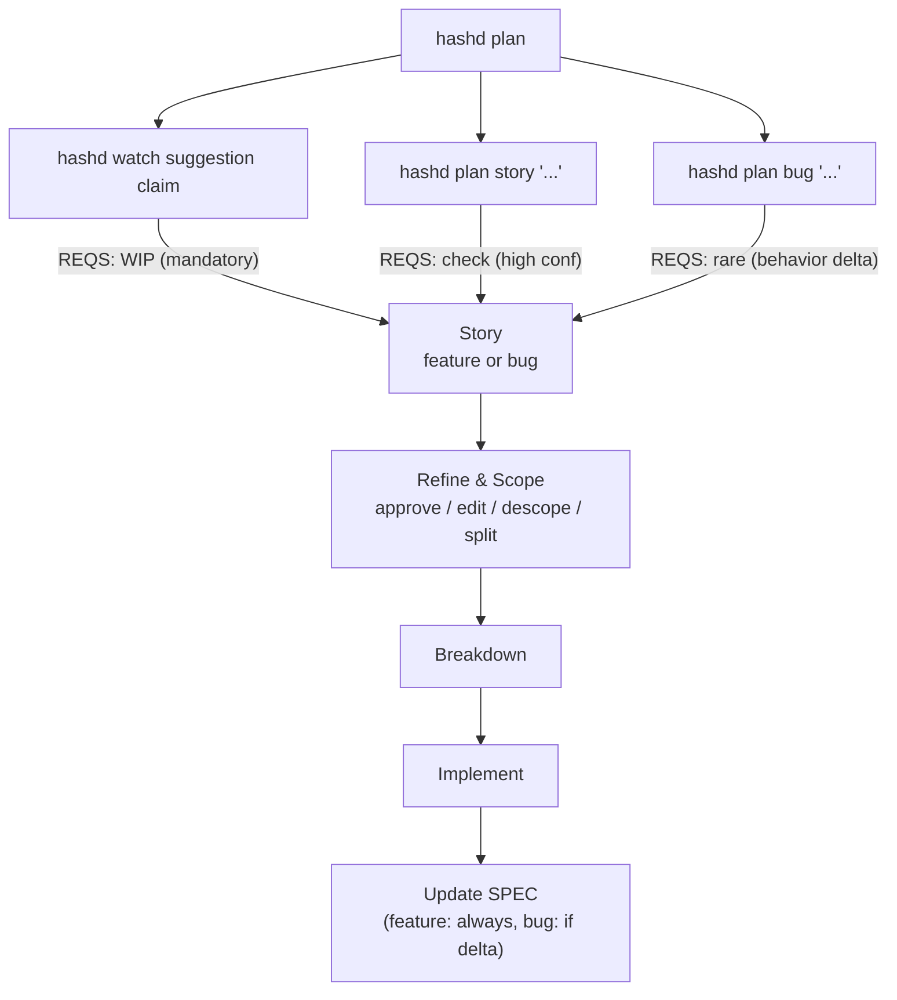


### Tech Tree (auto-chained after discovery)

A rejected discovery batch leaves existing suggestions intact. Its failure
notice and `hashd plan status` link to the complete diagnostic with the originating
suggestions and dependencies. Use the linked `hashd show-prompt` command to inspect
it; `hashd plan discover` generates a new batch, rather than editing the unsaved one.

`hashd plan` runs two phases. Phase 1 (discovery) produces actionable suggestions safe to start against current `main` — the same numbered list operators already know. Phase 2 (tech tree planner) auto-chains immediately after, projecting the near-future structure: tech tree suggestions that depend on in-flight stories or actionable suggestions.

**Two distinct planning surfaces, one operator command:**

| Surface | What it produces | Operator can act? | Crosses agent boundary? |
|---|---|---|---|
| Main planner (phase 1) | Actionable Suggestions, numbered `[1]`, `[2]` | Yes — `accept` creates a Story | Yes — Suggestions become Stories that agents consume |
| Tech tree planner (phase 2) | Tech tree suggestions, displayed by title only | No — view-only inspection | No — never reaches any implementer/reviewer/breakdown agent |

The main planner stays conservative: never surfaces work that depends on in-flight stories (their code isn't on `main`; an implementer would build against a foundation that doesn't yet exist). The tech tree planner is where that projected visibility lives.

**Lifecycle:**

```text
[Human] $ hashd plan
         |
         v
  Clear the displayed suggestions while discovery runs
         |
         v
  Phase 1: discovery
         |  status: "Discovering..."
         v
  Actionable suggestions populate at top of panel
         |
         v
  Phase 2: tech tree (auto-chained)
         |  status: "Computing tech tree..."
         v
  Projected dependents fill in under suggestions and in-flight stories
         |
         v
  Done
```

**Concurrency:** discovery and tech-tree generation share one per-project workflow.
A second discovery dispatch while that workflow is open is refused; it does not
cancel and replace the first. The discovery endpoint clears the in-memory tech
tree before attempting dispatch, so even a refused duplicate can clear that
projection. There is no separate operator cancellation of phase 2.

**Replacement:** a validated discovery batch replaces the project's available
suggestions; already-claimed suggestions are retained. A rejected batch preserves
the previous suggestions. Tech-tree projections are
in-memory and cleared when discovery is requested. They are regenerated from
the accepted batch and in-flight stories.

**Session reuse:** the tech tree agent reuses the discovery agent's session via the existing session-resume primitive (same mechanism used by `review_resume`). Avoids reloading project context twice.

**Web:** the Tech tree tab shows a read-only dependency list, including empty and unavailable states. Discovery/reconnect refreshes replace its contents without changing the selected tab. Projected nodes use titles; `#N` refers to a phase-1 suggestion, not a projected-node number.

**Visualization:** see `DAS_PLAN.md > Story Dependencies, Thin Slicing, and the Tech Tree` for the full TUI rendering spec — unified tree panel, gradient dimming by level, multi-parent `*` marker, `t` toggle, level cap with `... (N more)` collapse.

**Agent boundary invariant:** tech tree output never reaches any agent. Implementer, reviewer, breakdown, planning-edit, refinement — none receive tech tree content in prompts, context, or any other input. The boundary is enforced by a test fixture; adding tech tree data to any agent input is a test failure.

### Planning entry points

Suggestion claims create stories tied to their REQS regions. Direct feature and
bug intake can draft without REQS; matching requirements are annotated when the
planner identifies an applicable region. A draft can be edited or scoped before
acceptance; acceptance permits execution and breakdown. See the [planning walkthrough](docs/walkthrough.md#2a-generate-a-story-the-spec-driven-path).

### Questions and Answers

Hashd has two distinct question/answer lifecycles with different operator UX. Both share the same storage table (`clarifications`), discriminated by which entity owns the row: `story_id` set (story-planning) or `workstream_id` set (workstream-runtime).

**Vocabulary:**
- **Clarification** / **CLQ** — generic database term, any row in the `clarifications` table.
- **Story open questions** — operator-facing term for story-scoped CLQs. Bundled emission, bundled answer.
- **Workstream CLQs** — operator-facing term for workstream-scoped CLQs. Multi-emit, bundled answer via `hashd answer <workstream-id> "..."`.

#### Story-planning questions

Created by the **planning agent** during story drafting (or re-drafting via edit). When the planner identifies ambiguity in REQS that it can't resolve on its own, it emits questions as part of its output.

| Aspect | Detail |
|---|---|
| Created by | Planning agent (during suggestion-backed planning or `hashd story edit`) |
| Stored in | `clarifications` table, `story_id` set, `workstream_id` null |
| Emission shape | Bundle — planner emits all open questions at once in its structured output |
| Operator UX | Answer the bundle together, or answer individual questions in the web UI |
| Operator answers via | `hashd answer STORY-XXX "Q1: ..., Q2: ..."` (TUI: `a` key on story detail), or an individual question's answer form |
| Trigger on submit | Bundle answers dispatch an edit and mark the captured questions answered. Individual answers are saved first; answering the final blocking planning question dispatches an edit with the current round's saved Q&A. Runtime questions, informational answers, and split proposals do not trigger this story redraft. |
| Consumed by | Edit-flow's planner invocation (re-drafts the story with the bundled answers as context) |
| Loop | Planner may emit new questions if answers were incomplete. Old answered story open questions are preserved as historical context. Loop continues until the planner is satisfied or the operator gives up. |

**Answer context and recovery.** The planner receives the current round's saved
question/answer pairs, including when an operator answers some individually and
the rest as a bundle. Older rounds remain in the database; the story content is
the planner's source of truth for earlier rounds. There is no clarification-round
limit. If automatic edit dispatch fails after an individual answer is saved, the
error preserves the dispatch diagnostic and says that the answer is saved.
`hashd story edit STORY-XXX` retries with the current round's saved answers;
the operator does not need to answer an already-answered question again.
Story ownership, drafting protection, workflow singletons, and the PM/REQS locks
still apply.

**Arc-planning questions.** An Arc proposal planner that asks for a missing
product fact stores its questions as ordinary story clarifications bound to
the owning Arc attempt (`arc_operation_id`, `arc_execution_id`), answered on
the same two routes: `POST /clarifications/{id}/answer` per question and
`POST /stories/{id}/answer` for every pending question of the round. The
answer is input to the planner, saved as typed, never control flow: it
decides no proposal and starts no story edit. The answer that completes the
round resumes that attempt as a new `resume` attempt (see **Arc proposal**).

Ad-hoc stories (`manual`, `bug`, `split`, and legacy origins) may be planned and
edited without REQS. Discovery and other origins that must annotate a REQS region
still require that document. No synthetic requirements file is created.

#### Workstream-runtime questions (CLQs)

Created by the **implement-stage agent** during workstream execution. When codex/claude needs operator input mid-task to proceed (e.g., "which approach should I take for X?"), it emits one or more clarification requests and the workstream blocks.

| Aspect | Detail |
|---|---|
| Created by | Implement-stage agent (during `hashd run` execution) |
| Stored in | `clarifications` table, `workstream_id` set |
| Emission shape | Multi-emit — the implementer emits one or more questions in `clarifications_needed: [...]`; the runner persists the batch as blocking CLQs for the current micro-commit and stops for an answer |
| Operator UX | Bundle answer — operator reads every pending CLQ for the workstream, submits one combined answer string. The CLQ-NNN ids are hidden as an *address*, not as a label: `hashd answer` refuses a `CLQ-` prefix so the operator only ever types a story or workstream id, while `hashd show <workstream>` prints `CLQ-041 [BLOCKING] ...` and the web's clarification cards read `CLQ-041 · round 2`. |
| Operator answers via | `hashd answer <workstream-id> "..."` (TUI: `c` key on workstream detail) |
| Trigger on submit | Every pending CLQ on the workstream flips to `answered` with the bundled answer text and the next agent run auto-dispatches (start_impl from `active`, resume_impl from `awaiting_human_review`). |
| Consumed by | The implement-stage prompt context on the next workstream run picks up the answered CLQs as part of the implement prompt |
| Loop | Implement agent emits new workstream CLQs as further ambiguities surface across runs. Each CLQ persists independently in storage; operators always see them grouped by workstream. |

**Why bundle (operator side).** Even though storage tracks CLQs individually, operators answer them together most of the time — partial-state ("answered some, dispatched, then more arrived") was a regular source of confusion. The single bundle answer + auto-dispatch keeps the lifecycle one operator action wide.

#### Why the same storage, different operationally

| | Story-planning | Workstream-runtime |
|---|---|---|
| Discriminator | `story_id` set, `workstream_id` null | `workstream_id` set |
| Submit trigger | Bundle answer or final individual blocking planning answer dispatches edit-flow | Bundle answer dispatches workstream run (start_impl or resume_impl) |
| Re-emit on next round | Planner emits replacement bundle; old answered CLQs preserved as context | Implement emits new CLQs as needed |
| Operator surface | TUI 'a' (story_detail) → bundle modal | TUI 'c' (workstream_detail) → bundle modal |
| CLI surface | `hashd answer STORY-X "..."` | `hashd answer <workstream-id> "..."` |

The single entry point `hashd answer` routes by ID prefix: a `CLQ-` id is
rejected outright (operators address stories and workstreams, never questions),
`STORY-`/`BUG-` goes to the story path, and every other id goes to the
workstream path. Story bundle answers dispatch first, then flip the captured
questions. Individual story answers save first, then dispatch when the final
blocker is answered. Workstream bundle answers also save first so the resumed
run cannot immediately re-block on an unanswered CLQ.

### Story Scope Management

Descoping removes a criterion from active acceptance criteria and excludes it
from implementation. Rescoping restores it. Merge finalization preserves deferred
criteria in REQS with their source story's provenance after burning its WIP
sections. See [scope commands](docs/walkthrough.md#adjust-story-scope).

Splitting has two paths:

- Agent proposal mode asks the `plan_split` stage to propose a narrowed parent
  story plus dependent sub-stories. The proposal lands as a `breakdown_proposal`
  clarification; the operator approves, rejects or requests revision before
  anything is applied. The proposal is anchored to the story's content hash,
  which is checked when the split plans, again when its proposal is inserted
  (in the insert's own transaction), and when it is applied. A story whose
  content changed while the stage ran, or whose content is locked by then,
  gets no proposal: the split fails with `plan_split.source_changed`, and its
  failure notice on the story names which and when to request the split
  again. The content hash is the whole fence: an ordinary split holds no
  lock, hold, stage or story field, because it reads only its own story, the
  codebase and existing titles, replans nothing else, and already runs in the
  project planning slot. A split that autonomous mode itself requested to
  take a size offer (SPEC "Story Size Estimate") is accepted as soon as it is
  proposed, through the same answer path ("yes"); any other question the story
  has pending is left for the operator. A split an operator requested waits
  for their answer in every mode.
- Deterministic indices mode preserves the existing surgical workflow: selected
  acceptance criteria are extracted into one new `draft` sibling story and
  applied directly.

Only the Arc proposal operation plans an Arc's children. A split of an Arc,
agent or deterministic, is refused (`story.split.arc`), including when applying
a proposal generated before the story became an Arc, and both answer routes
refuse an answer to a `breakdown_proposal` on an Arc, whatever its text, before
anything is written. Add individual stories with `hashd plan story "..." --arc
<ID>` instead. A story within an Arc can still be split into child stories in
the same Arc; Arcs themselves never nest.

Refine planning and every edit give a size estimate (`size_estimate`: a verdict
of `fits`, `split` or `arc`, the concerns behind it and the suggested pieces),
judged quickly against the project's story size threshold,
`workflow.story_size_guidance_loc` (default 2000 lines added plus deleted;
resolved defaults < system < project, where an unusable value falls back to the
next lower layer). The stored estimate describes the story as last planned:
planning, an edit and an approved revision store it, a direct operator edit of
the story's fields or criteria leaves it unchanged, and every other content
write deletes it. It never blocks acceptance, changes stage or raises a
clarification. Split and Arc proposals receive the same advisory threshold when
proposing pieces: the planner aims for children, and in an ordinary split the
retained parent, that fit reasonably within it, and the proposal carries no size
field. This is advisory story sizing; it does not measure Git changes or impose
per-microcommit size limits.

**Size offer (operator action).** The story's read carries `size_offer` when
the estimate offers an action the server would admit right now: a split for a
`split` verdict (and for an `arc` verdict on a story already in an Arc, whose
pieces stay in that Arc), or making the story an Arc for an `arc` verdict on a
story in no Arc. The offer follows the action's own refusals, so it is absent
while the story's content is locked, a hold stands, the story is an Arc, a
split proposal awaits review, or a split is being planned. The
operator takes it after a confirm: `S` on the TUI story detail, the banner's
button on the Web story page, or the command `hashd show` names (`hashd story
split <ID>` or `hashd story arc <ID>`). A split press requests the planner's
breakdown proposal, reviewed with `hashd answer` like any other; an Arc press
requests an Arc proposal (`request_arc_proposal`, below). The client then shows the server's message and re-reads the story;
the offer goes because the action removed it. In autonomous mode the server
takes the offer itself after a planning or edit write: a split as the press
does, its proposal accepted once it lands, and an Arc as a
`request_arc_proposal` request, which holds the story in `arc_proposal` with
its type unchanged until a proposal is approved. A request refused before it
reserves the operation is skipped. Once it reserves, the take is taken
whatever became of the start (failed, unconfirmed, or cancelled meanwhile):
its `size_offer` record names that outcome and carries the request's
Diagnostic whole, and it is never retried. A story that stored a
`breakdown_recommended` before this keeps it, shown under Split Recommended,
until its next planner write.

**Dependency editing (operator action).** `hashd story depends-on <ID> --add
... --remove ...` (and the TUI and Web dependency editors) changes a story's
present prerequisite list in one request; `--dry-run` reports what applying
would do and changes nothing. The server validates the whole resulting list
(existing, same project, not abandoned, distinct, no self, no cycle -- an Arc
may keep a closed prerequisite it already lists), then:
a draft or draft_failed story with an unfinished prerequisite moves to
`pending` and replans once they are implemented; a pending story whose
prerequisites are then all implemented -- an emptied list included -- is
released to `queued` and replanned now; an accepted story may lose prerequisites or gain
implemented ones, never an unfinished one, and does not move. An Arc records
any valid edit, an unfinished prerequisite included, and never moves: an Arc
is approved, and completed, only once no prerequisite is active -- each is
implemented or closed (abandoned); an id naming no story, a blank entry or an
unreadable list holds it back -- and it is never parked for planning. Queued, drafting, editing, revised, implementing and later stories are
refused, as is a stored list that cannot be read. The story read lists each
dependency with its state, and an `edit_dependencies` row says when editing
is offered. An edit changes the present list only (DEP-2026-10-01-R1): nothing
records who set an entry, and a later planning run starts from the current
list and may reassess it. A story can also be given prerequisites when it is created
(`hashd plan story|bug --depends-on ...`, and the TUI and Web create dialogs):
they are validated the same way, recorded before planning starts, and the
story's first planning run starts from them; it waits in `pending` while one is
unfinished.

Agent-created split sub-stories start in `pending` when they depend on the
parent or another sibling. When every dependency reaches `implemented`, the
server transitions each pending sub-story to `drafting` and dispatches planning
so it redrafts against the current codebase.

An Arc's children are planned, not drafted from the proposal's sketch, outside
supervised mode: a child that waits for nothing is created `pending` with an
empty recorded `depends_on`, and the approved Arc proposal's release leg runs
one stranded-pending recovery pass that releases it into
planning at once, through the planning slot. The recovery scan releases a
pending story with an empty list only when it is an Arc's child, so a story
from before `depends_on` existed, whose column defaulted to `[]`, never
releases. In supervised mode the child starts as a `draft` for the operator.

#### Descoped Criteria Lifecycle

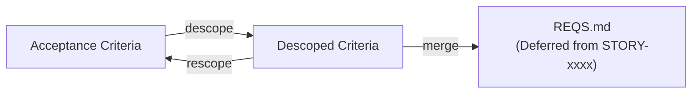

- A criterion remains part of its story while descoped and can be rescoped before merge.
- Merge finalization adds a "Deferred from STORY-xxxx" section to REQS.md after
  burning the implemented story's WIP sections.
- The deferred REQS items are picked up by the next `hashd plan` discovery run.
- During implementation, descoped criteria are injected into agent prompts as
  negative requirements ("DO NOT implement").

TUI controls are in [Story scope operations](docs/watch.md#story-scope-operations).

---

## Artifact Edit Locks (REQS / SPEC)

Manual artifact inspection is read-only. Editing always reloads the current
protected REQS or SPEC document under its lease; historical views cannot be
saved as current edits. REQS writes preserve WIP protection; SPEC writes do not
change requirements or acceptance criteria. [Viewer controls](docs/watch.md#document-inspection-and-editing)
are documented separately.

REQS.md and SPEC.md have independent per-project edit locks coordinating human
editors with planning, story-edit and documentation workflows. Housekeeping REQS
cleanup holds the PM singleton and local flock, but does not acquire the artifact
lock; these locks therefore do not cover every automated writer. Each lock is a
workflow-ID singleton (`reqs-lock:{project}` / `spec-lock:{project}`) --
`ArtifactLockWorkflow` -- the same primitive family as `pm:{project}` and
`mergelock:{project}`. Whoever's holder currently runs under that ID holds the
lock; the lock's state (holder, FIFO queue, lease) is durable across restarts.

A cancelled merge keeps `mergelock:{project}` until its locked section ends, and
undoes its admission only after the lock child has closed. The local section
stops at its next step boundary: it starts no new step after the cancel, and
once `merge_attempt` begins it runs through to its record. A step that fails
after the cancel arrived stops as the cancel, returning the workstream to the
state it was admitted from, and the cancel record carries the step's failure
and output as evidence.

A forced cancel (the merge execution cancelled, then sent `force-cancel` on the
same run; a failed signal leaves a plain, waiting cancel) does not wait: the
`local` or `pr_approved` locked section is no longer waited for, the lock
frees, and the merge undoes its admission at once. It records a work-in-progress
stop saying the git work in the repository may have been cut off partway, with
`git -C <repo> status` and the retry as next steps.

Both are `POST /flow-runs/{id}/cancel` on the `merge:{project}:{ws}` (or
`resolve:{project}:{ws}`) handle. With no body the cancel waits: the lock and
the admission are released when the running git work ends, and the response says
a stop was requested, not that the run is cancelled. With `{"force": true}` they
are released at once. Force is refused on any other kind of run.

Waiting is **event-driven, never polled**. Two acquire paths feed one FIFO queue:

- **Clients** (TUI editor, CLI) acquire via a blocking Update -- it parks in the
  workflow until granted, then returns a lease token. The TUI drives a **10-min
  idle lease** reset on keystrokes (2-min warning, then drop-to-read-only); the
  CLI is identity-keyed (the holder is the calling user, no token threaded).
- **Automated writers** (planning, story-edit, docs) acquire via a signal and
  are **signaled back** on grant, so a waiting plan costs O(1) history, not one
  event per poll. Planning/edit take `reqs-lock` **inside** their pm section (pm
  stays the automated-vs-automated mutex; the artifact lock is purely the human
  boundary); docs takes `spec-lock` for its run. A 2-min heartbeat holds the
  lease; release is explicit, and the writer's body deadline + lease are the
  crash backstop.

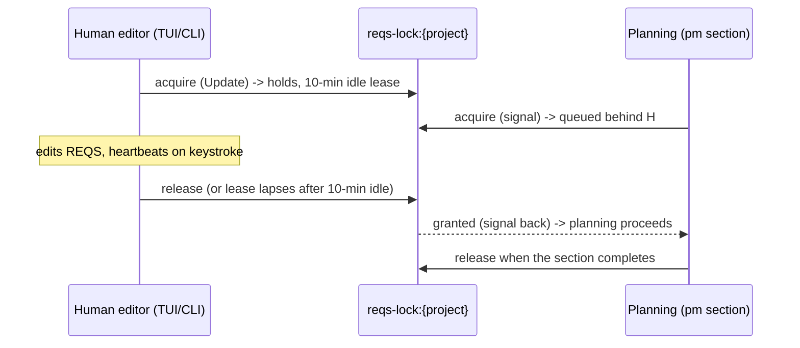

**Save guard:** a write is rejected if its token / caller-identity no longer
holds the lock (a lapsed lease). A write while an **automated** writer holds the
lock is always rejected (its edit must not interleave); another **human** holder
also blocks tokenless writes and document creation. **Break-glass steal**
exists server-side but is unpublished (no CLI verb, no TUI key) and refuses to
steal from a system process -- yanking a live planning run would corrupt its
in-flight REQS write. When Temporal is absent the whole mechanism degrades to
CAS-only writes. A connectivity failure never authorizes this fallback. Save
responses pair document content with its revision; clients must not advance a
draft's base revision without the corresponding content.

---

## Phase 2: Implementation

The implement stage returns an agent's linear, unpublished commits to staged
changes before handling failure, fallback, clarifications or already-done output.
Existing artifact guards,
tests, review and the Hashd commit stage then run normally. Rewritten history,
published commits or an unverifiable publication check stop the stage with the
work preserved; they are not permission to bypass review. A private workstream
checkpoint survives interrupted runs. Preflight reconciles it before selection
or gate re-entry, and activity retry reconciles it before composing Git context.
Reset/replan clear it only after their authorized Git reset succeeds; partial
breakdown preserves it along with the worktree.

`hashd reset <workstream> --checkpoint` is an explicit recovery for a stopped
implementation whose pending attempt changed history. It restores that attempt's
recorded starting HEAD, discards the attempt's committed/staged/unstaged/untracked
changes, clears its saved agent session and checkpoint, and preserves the plan's
completed micro-commits and review guidance. This is not ordinary `reset`, which
redos the whole plan, nor permission to rewrite published work. A running or
unverifiable conflicting execution, changed branch, incomplete/published history,
or unfinished merge/rebase refuses recovery without resetting files.

Before destruction, one private worktree-owned backup retains current history,
index and files (including ignored files); failure to preserve it refuses reset.
The backup survives an interrupted reset for retry and is removed after verified
reset and its durable audit receipt. A retry after that receipt only finishes
cleanup. Before the receipt, a retry already at checkpoint HEAD requires a clean
worktree: pending or unreadable edits refuse reuse of the earlier backup rather
than discarding files it may not contain. Worktree deletion removes remaining
backup data; there is no permanent
checkpoint archive or cleanup timer. Reset does not restart implementation:
`hashd run` re-enters normal implementation, tests and review. The checkpoint
records HEAD, not a historical dirty-file snapshot; resetting explicitly discards
all pending edits, including any that existed before the failed invocation.

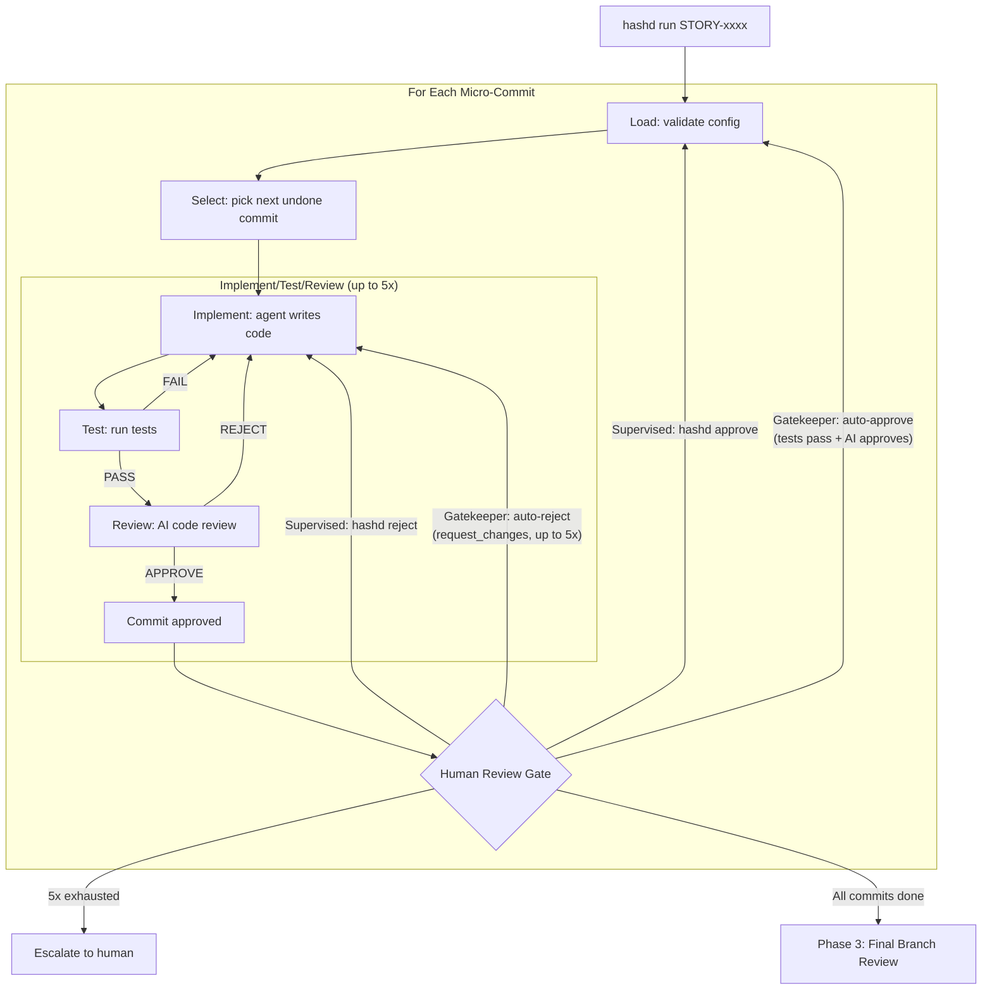

**Pre-commit hook in the test stage.** After the test stage auto-stages the implementer's work and runs the configured build command, it runs the repository's pre-commit hook on the staged change with `git hook run --ignore-missing pre-commit` in the worktree, then the configured test command. Git resolves the hook from the repository's own configuration. The hook runs whether or not a test command is configured or `tests_skipped` is set. A hook that exits non-zero ends the stage as a test failure: the implementer is retried with the hook's exit status and complete output as its test-failure feedback, under the same adjudication, loop guards and attempt budget, and the output is kept as `stages/pre-commit.log` in the run directory. A repository with no pre-commit hook runs the stage as before. When the installed git has no `git hook run` (older than 2.36), the stage records the skip in its log and goes on to the tests. One `test_timeout` deadline bounds the whole stage body -- the staging, the build, the hook with its git support probe, the tests and the required-verification recheck together -- and the phase that uses it up fails with the stage's timeout report. Staging retries an `index.lock` collision as the commit stage does; staging that still fails fails the stage, so the hook never judges a stale index. The hook runs once per test-stage execution; an automatic FIX's required-verification recheck does not rerun it, and anything it changes in the worktree stays. The commit stage still runs the hook at commit, as before.

**Fast check in the test stage.** The test stage's configured test gate runs one of two checks. The full check is the effective impl-phase test command (`test_cmd`, falling through to `merge_gate_test_cmd`). The fast check is the project-level `fast_test_cmd`, handed the files the branch touched. `gates.commit_check` picks: `fast` runs `fast_test_cmd`, `full` runs the full check, and unset runs `fast_test_cmd` when one is set and the full check otherwise. `hashd project config set` refuses a write that would leave a combination the stage cannot run -- `gates.commit_check=fast` with no `fast_test_cmd`, a value other than `fast` or `full`, or either key on a multi-repo project, whose per-commit test commands live in its repo rows -- and the test stage, after the pre-commit hook, refuses the same combinations from a config edited by hand: the stage fails with that Diagnostic, is not retried, and runs no other command. The fast check runs `fast_test_cmd` with the stage's `tests_skipped` handling, deadline, failure parsing, loop guards, baseline exclusion and unresolvable-command skip. Its handoff is the list of every path that differs between the workstream's merge base (the same fork point the branch's other evidence uses) and the worktree's content -- the branch's commits, the staged change, the hook's rewrites and non-ignored untracked files -- taken with renames off, so a rename lists both its old and new path, and a deleted file is listed. The list is deduplicated, sorted and written one path per line, newline-terminated, to `stages/touched-files.txt` in the run directory; an empty set is an empty file. The command's environment carries `HASHD_TOUCHED_FILES` (that file's absolute path), `HASHD_TOUCHED_FILES_COUNT`, `HASHD_BASE_SHA` (the merge base), `HASHD_HEAD_SHA` (the worktree's HEAD) and `HASHD_TOUCHED_FILES_INLINE`, the complete list, only when it is at most 32 KiB; a longer list leaves that variable absent, never partial, and the file stays complete. A git failure taking the list fails the stage. When a touched path contains a newline, which the line-per-path list cannot carry, the stage runs the full check instead and records why. The record names the check. Every `test_result` row whose verdict a test command produced carries metadata `check` (`fast` or `full`), plus `touched_files` (the count) for a fast check and `check_reason` for a fast configuration's fallback; the row's content takes the same label after its existing qualifiers -- `COMMIT-X - Test PASSED (fast check, 12 touched files)`, `COMMIT-X - Test PASSED (baseline excluded; full check)` -- and `result` keeps its values. An automatic FIX's required verification produces the verdict it records, so that row reads `(required verification; full check)` whatever the configured gate ran first. A hook refusal's row names no check, since no test command ran. `stages/test.log` opens with a `=== CHECK ===` header naming the check, `touched_files` for a fast check, the fallback's `check_reason` and the command, ahead of `=== STDOUT ===` and of any baseline note; the reason and command are Go-quoted with `===` escaped, so no command can add a field or open a section, and a required verification's log reads `full`, as it runs the recorded command. The per-commit reviewer reads the row's metadata (the header when no row landed) and the final reviewer reads that header, and both say in their test results when the result came from a fast check and how many touched files it covered; a full check reads as it always has. A fast pass never satisfies an automatic FIX's test-kind required verification: the recorded command always runs after it. The merge gate with its post-rebase leg, the pre-push gate and the finalize gates always run the full suite.

---

## Phase 3: Final Branch Review

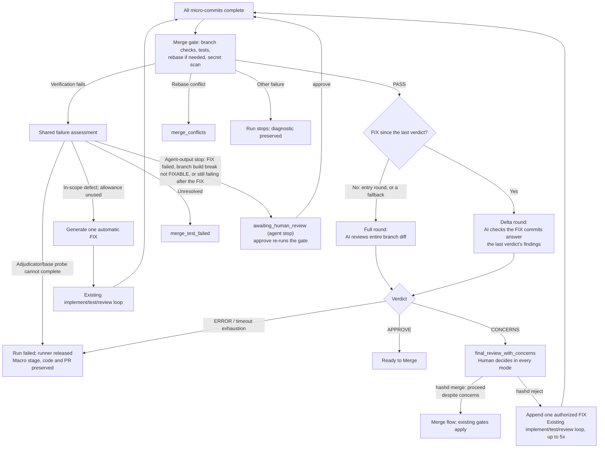

A current final-review failure remains visible at `ready_to_merge` and PR
stages; older implementation failures still retire when the stage advances.

An operator's `reject` appends one FIX and resumes implementation through
`address_concerns: final_review_with_concerns -> active`. The existing
`workflow.max_review_attempts` budget applies: up to five implement/test/review
attempts on that same FIX, then the normal human gate on exhaustion. Once the
FIX commits, merge preparation runs again, then a final-review round. New
concerns require another operator decision; retries do not authorize new FIX work.
There is no separate final-review repair counter. The retired
`workflow.max_final_review_selfheal` setting has no effect. Existing plans, reviews,
and events are preserved; recorded workflow continuations remain replayable.

The first final review of a branch is a **full entry round** over the whole
branch. The round after a FIX is a **delta round**. Its anchor is the newest
final-review row with a verdict (error rows are skipped) and the head that row
reviewed. It reviews only the commits the branch gained since that head: its
own commits that are not patch-equivalent to one the anchor carried, so base
commits a rebase brought in and faithful replays drop out, and a replay the
rebase changed stays in. The reviewer gets those commits' diff, every touched
file's content at head, the anchor's findings labelled A1..An, each FIX's plan
block, the operator's guidance and the acknowledged concerns. It answers two
questions -- is each labelled finding answered, and is the touched code
correct -- and reports nothing in files the delta does not touch. The round
falls back to full when there is no verdict yet; the newest verdict is a legacy
row that recorded no head; its head commit no longer exists; the branch has an
unreviewed merge commit since the verdict; no commit gained since the verdict
is a FIX; a reset or replan deleted the reviews, leaving no
verdict; the delta comes out empty; or `workflow.final_review_incremental_after_fix`
is false (default true, read every round). Every row records `reviewed_head` and
`round_kind`; a delta row, error rows included, also records `anchor_head`. A
delta round measured against its reviewer's input limit also records, error rows
included, `prompt_mode` (`embedded` or `listed`), `prompt_chars` and
`prompt_limit_chars`; a full round and an unmeasured delta round record none of
them.
A reviewer agent may declare a prompt input limit (`prompt_input_limit_chars`
in its `agents` entry). A delta prompt over that limit, less a margin held back
for what the agent's harness wraps around it, withholds the touched files'
contents and lists each touched path instead, for the reviewer to read from the
worktree. A listed prompt still over it fails the round without invoking the
agent: the error row names the limit, the measured size and every prompt
section's size, and the round parks for a human decision.

The merge gate checks whether the assembled branch is ready for review and
integration; per-commit approval cannot establish compatibility with a moving
base branch. It runs the configured full-suite command (unless explicitly
skipped), refreshes the base, handles rebase and conflict checks, and scans for
secrets. It neither merges nor opens a PR.

The rebase leg fails in two ways that need different operator actions, and the
`merge_gate_result` row's `failure_type` names which:

| `failure_type` | What happened | Where the workstream parks | Operator action |
|---|---|---|---|
| `rebase` | The rebase stopped ON conflicted files | `merge_conflicts` | AI resolve, or resolve by hand and retry the merge |
| `rebase_blocked` | The rebase was refused before it reached any file: unstaged changes, an unresolvable base ref, or a failed fetch **inside the rebase leg** | `active` | run |

The gate's own preliminary fetch is a different failure: it never reaches the
rebase leg, and its row carries `fetch_failure`. Only the rebase leg's fetch
lands under `rebase_blocked`.

Nothing needs resolving in the blocked case, so the server does not offer
`start_resolve` there, and the run that actually clears it is what the surfaces
show.

The `failure_type` is a diagnostic about a run that has ended, and it does not
decide what the operator is offered now. A surface enters the conflict recovery
on current authority only: the server's `start_resolve` action row, or the
workstream standing at `merge_conflicts`. That is what keeps rows recorded
before this split -- which carry `rebase` for either half -- from handing an
already-recovered workstream a resolve the dispatch would refuse, and it needs
no migration: the row's meaning is historical either way.

Temporal's 20-cycle ContinueAsNew boundary limits history size, not total
work; it is not a repair allowance.
The unused `workflow.max_micro_commit_iterations` setting has been removed;
existing overrides remain inert.

### Merge-Gate Recovery Decision

This policy changes recovery, not the integration checks. Both failures occur before merge:
one before rebasing, the other during post-rebase verification.

**Rationale:** failure before or after rebase does not predict repairability.
Retry execution when a transient condition can clear; authorize code changes
only for an evidenced, in-scope defect. Repeating exhausted work unchanged or
generating more FIX commits is not evidence of progress.

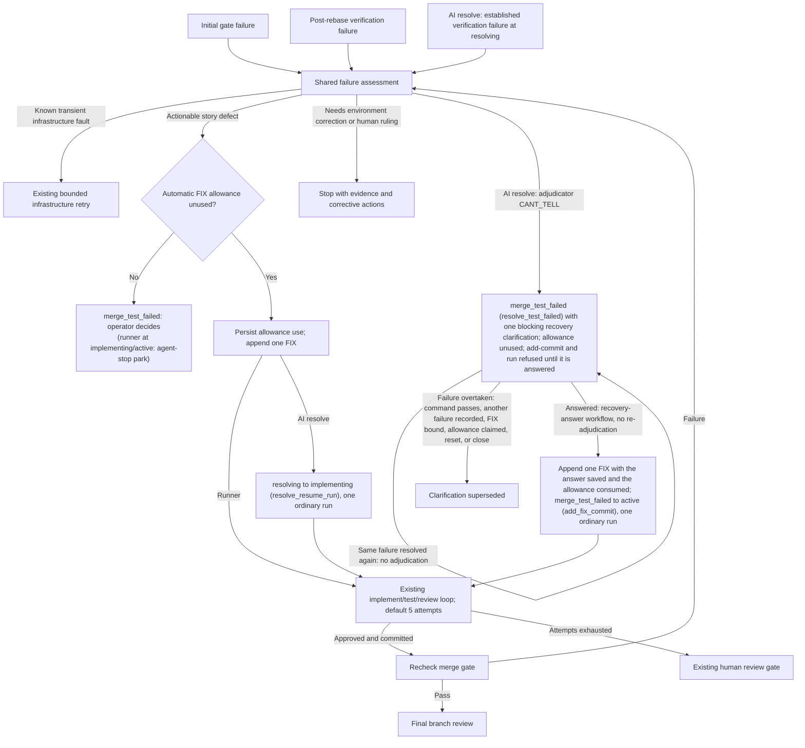

- Preserve the failed command, tested revision and output. Where practical,
  compare the same check against the base in an isolated worktree. A passing
  base and failing story provide evidence of a regression; a failing base does
  not establish the same defect: the probe does not run setup hooks or inherit
  installed dependencies. Inconclusive evidence goes through existing
  adjudication, then to a human if cause or permissible scope remains unclear.
- Allow **one automatically generated FIX per story**, shared by both gate
  locations and AI resolve. Persist its consumption; restart, Go and another rebase do not
  replenish it. Further FIX work requires explicit operator authorization: the
  answer to a pending recovery clarification, or `hashd workstream add-commit`,
  which the server refuses while one is pending. A `merge_test_failed` park that
  schedules no FIX -- the runner's or AI resolve's -- names one list: `hashd
  answer`, `hashd show` and `hashd merge` while a recovery question is pending,
  otherwise `hashd show`, add-commit, `hashd run` and `hashd merge`; then AI
  resolve while the allowance is unspent, since a resolve can still adjudicate
  and schedule the FIX or open the question, or `hashd close` once it is spent.
  `merge_gate_repairs` records the failed check before adjudication, including
  human-recovery exits. In the runner, a separate claim spends the allowance before generation
  and the command is atomically bound to the appended FIX. The claim and the bind each first
  admit the worktree against the record's current failure: on the workstream's branch, at the
  tested revision or a descendant still containing its base, with no operation in progress, no
  unmerged path, and no working change at a path already changed when the gate's verification
  began. A refused claim parks with nothing claimed; a refused bind binds nothing and leaves the allowance spent;
  neither touches the tree. An interrupted or invalid generation
  leaves the allowance spent, requiring an operator; it cannot silently repeat.
  The one exception is an empty FIX list answering an OBSOLETE ruling on a test
  failure: the tests need no change, so the claim is released, the row is
  `NO_FIX`, and nothing is spent. The gate then re-runs the failed command once,
  unchanged: in the worktree on the same HEAD with the profile's test timeout,
  with no fetch, rebase or normalisation, writing `stages/merge_gate_rerun.log`.
  It does so once per gate execution, and only while the checkout is still the
  tested content: the repair admission a generated FIX's bind uses admits it,
  HEAD is exactly the failure's tested revision, and the checkout's content
  identity -- the test verdict store's key over HEAD and the working content,
  read before the failed verification -- reads the same, so an edit git status
  hides (assume-unchanged, skip-worktree) still counts; an identity that differs
  or cannot be read runs no rerun; a later gate, such as one an approve at the
  park starts, may rerun again. The rerun records its verdict in the test
  verdict store without reusing one, so a pass replaces the failure's verdict
  and the landing reuses it. Before it runs, a `merge_gate_flake_rerun` timeline row names the
  verdict and reason, the failure's command, tested revision and failing tests,
  and that the gate is re-running once unchanged; a rerun whose row cannot be
  recorded does not run. A second row records the result: passed, or the failure
  the gate parks on. A passing rerun continues the gate as a pass of that
  verification would have -- the checks after the suite, the required
  verification, the secret scan and Ready -- with no park, FIX or human action;
  a later failure in the same gate is adjudicated as usual and may get the
  allowance's FIX, but never reruns. A rerun that fails, times out or breaks the
  build is recorded as a FAILED `merge_gate_result` row and as the record's
  current failure, and the gate parks without adjudicating, generating or
  re-running again, where an empty FIX list's park lands (the agent-stop park,
  else `merge_test_failed`), the allowance unspent. A gate that ran no rerun
  parks the same way, its record saying why.
  Migration counts recorded legacy merge-gate repairs without rewriting plans.
  Later failures update separate current-failure evidence; recovery and merge
  verify that check as well as the original FIX's check, without renewing the allowance.
- **AI resolve is the second caller.** An established verification failure on a
  resolved tree -- before publishing, on the semantic leg, or when a rejected
  push's re-run verification fails -- is recovered while the workstream is
  still at `resolving`, in a recovery activity of its own. A FIX already bound and still undone is handed off to
  as it is; a recovery clarification already pending for the same failure
  (command and tested revision) stays pending and parks without adjudicating; a
  spent allowance, or a story with no problem or acceptance criteria, parks
  without adjudicating; otherwise the base comparison and the adjudicator
  rule. Beside REGRESSION and build FIXABLE (the code is wrong: an
  implementation correction), a test failure judged OBSOLETE (the tests are
  wrong) schedules a test correction. Generation receives the ruling whole,
  and the allowance is consumed in the same write that appends the FIX and
  binds its required verification and ruling, so an adjudication, generation,
  decline or refused append that stops consumes nothing. The FIX moves the
  workstream `resolving -> implementing` (`resolve_resume_run`) and one ordinary
  run takes it from the resolved tree through tests, review, commit, this gate
  and final review. CANT_TELL, in every autonomy mode, parks at
  `merge_test_failed` (`resolve_test_failed`) and opens one blocking,
  workstream-scoped recovery clarification (`merge_gate_recovery`) consuming
  no allowance. An adjudicator or base comparison that cannot complete, or an
  adjudicator that offers no verdict (never read as CANT_TELL), opens no
  question; it and a failed generation or append
  park there with the step's own failure on the record. The human's answer to
  that clarification is the ruling: it goes straight to FIX generation, and the
  one FIX it schedules consumes the same allowance (see [Answering a merge-gate
  recovery clarification](#answering-a-merge-gate-recovery-clarification)).
- Reuse the normal FIX loop, resume/fallback machinery and attempt budget:
  five total attempts by default, not five additional retries. The failed gate
  command must be required verification within that loop and at the gate;
  explicit recovery and merge retain it too. Passing narrower
  checks or skipping configured tests cannot bypass it.
- Authentication, missing configuration/tooling and exhausted timeouts require
  corrective action, not speculative code generation. Infrastructure retries
  spend their existing budget, not the FIX allowance. Textual merge conflicts
  retain the existing conflict-resolution path.
- After the automatic allowance is spent, unresolved code failures park at
  `merge_test_failed` with evidence and valid operator actions -- except the
  run's own gate at `implementing` or `active` when the allowance is bound to
  a FIX or the runner's claim recorded a failed FIX generation, which parks at
  the agent-stop gate (see [Agent-stop landing](#agent-stop-landing-a-stop-that-is-not-a-question)).
  A claim with no recorded generation result keeps `merge_test_failed`.
  No automatic second FIX; a new run does not replenish that allowance.
- A post-rebase verification failure is checked on the integrated branch, and
  the branch stays there on both rebase paths: the direct rebase, and a
  regeneration-assisted rebase whose replay finished and whose tip
  regeneration recreated every taken path with a passing build. Recovery
  records the failure against that HEAD and goes through the assessment above.

### Retry Boundaries

Counts below are total attempts, including the first, not additional retries.

| Loop | Work retained | Budget / exit |
|---|---|---|
| Implement/test/review, including FIX | Same micro-commit and worktree; resume implementation when possible | `workflow.max_review_attempts`, default 5; approval commits, exhaustion reaches the human gate; terminal outcomes can stop earlier |
| Planner and story edit | Same proposal; validation feedback resumes the planner | Shared `runPlannerLoop`, up to 3 attempts |
| Review output repair, normal and final | Same review task and latest session; repair verdicts, not code | Shared budget of 3 calls across schema and verifier repairs. A lost/stale prior-round session permits one cold fallback with its own budget; no recursive fallback |
| Plan split and tech tree | Same generation task with validation feedback | Separate two-attempt redraft implementations |
| Transport / activity retries | Retry a failed invocation or crash-safe activity, not rejected work | Transport policy and Temporal RetryPolicy; bounded separately by stage/activity deadlines |

A FIX starts with its full FIX prompt. Subsequent attempts use the normal
implementation resume/fallback machinery and timeout setting. Missing sessions
fall back to the full prompt; committing clears the implementation session for
the next micro-commit. Neither resume nor retry authorizes another FIX.

Normal and final review share verifier repair and session replacement handling.
The invocation shape changes to resume; the originating reviewer role retains
its configured agent, model, effort and timeout. Final review starts cold across whole-branch review rounds.

Stage deadlines bound agent invocations; activity deadlines also cover wrapper
work and retries. They are different bounds, not duplicate settings. Resume
stages share their base setting. Existing activity deadlines are unchanged:
review uses its configured timeout with the review floor and activity margin;
final review has a 7,200-second activity cap. Output repairs and transport retries
share the remaining activity time; attempt limits do not guarantee a fresh full
timeout for every nested retry. Discovery has its own invocation and activity retry budgets; see the deadline inventory.


---

## Phase 4: Merge

**Default: direct merge to main.** For external review, use `hashd pr create`; merge the reviewed PR in configured PR mode or with `hashd merge --pr`. Supports GitHub, Bitbucket, and GitLab. The forge is auto-detected from your git remote or set explicitly via `forge:` in config.yaml.

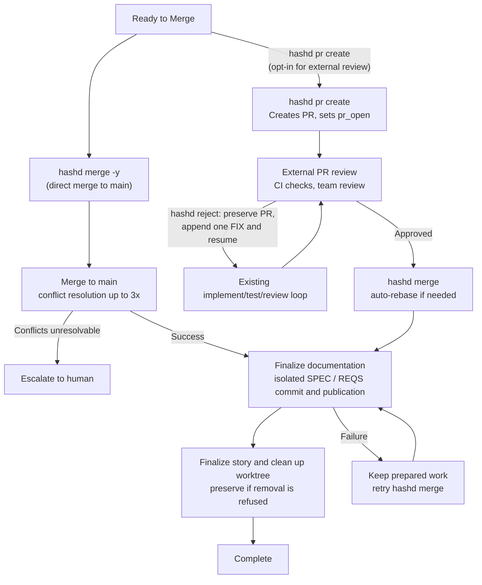

**Test verdict cache.** A project test command's verdict is recorded under the project's `gate-receipts/` directory, one file per key. The key is the git tree of everything the command could observe (tracked changes and non-ignored untracked files, written through a scratch index so the worktree and its index are untouched), the argv with its working directory relative to the worktree root, and the resolved path and content digest of the executable argv[0] names there. Workstream, branch, destination SHA, worktree path and timeout are not part of it, nor is HEAD outside the clean-HEAD form below. When the per-commit fast check recorded the verdict, the key also carries the sha256 of the touched-file list it was handed: such a verdict is reused only for the same command, content and touched set, and never matches a full-command lookup. A checkout whose tree cannot name its content (a `.gitattributes` file or a converting attribute, `core.autocrlf` other than false, `core.filemode=false`, `core.symlinks=false`, `core.ignoreCase=true`, an assume-unchanged or skip-worktree index entry, or a submodule gitlink) is keyed by its HEAD commit instead, and only while the tree the worktree holds, written the same way through a fresh scratch index from every non-ignored file's bytes, is HEAD's tree; no stat data is consulted. A checkout with `core.ignoreCase=true`, whose tree would fold a new path into a tracked one, is never keyed that way. That key also carries a fingerprint of every HEAD path as it sits on disk, read without git's conversions (a file's bytes and permission bits, a symlink's target, and a checked-out submodule's own clean HEAD and fingerprint taken the same way; any other gitlink state is a miss), so an unchanged checkout still reuses a pass and any uncommitted byte is a miss, including one git normalises away (a line ending). A verdict is recorded only for a run that completed and left the key unchanged, with its complete redacted output, its duration and where and for which workstream it was recorded. The latest verdict for a key wins, and only a pass is reused: a recorded fail never short-circuits a run, and a pass is reused only within seven days of recording and when its recorded duration fits the reusing site's test timeout. Expired receipts are ignored, not pruned. The merge gate's suite and its post-rebase leg, and post-rebase verification on the landing, PR and resolve paths (the gate's command and test-kind required checks), read and write the cache; build commands are never cached. Narrowed post-rebase verification reads the store twice: before the rebase it looks up a full-command pass for the pre-rebase tree as its proof, and its fast check reads and writes its verdict under the fast-check key. The per-commit test stage's test phase reads and writes it too, for the impl-phase test command and an automatic FIX's test-kind required verification, keyed by the argv run from the worktree root; its build phase and a build-kind required verification are not cached, and a run that exits non-zero but passes through baseline exclusion is recorded as a fail. The committed-breakage probe and the merge-gate base comparison read and write it as well. They look up the revision they would test before creating their throwaway worktree, with the key a fresh checkout of that revision would get, computed without a checkout; the lookup is a miss, and the site creates its worktree and runs, when that revision would be keyed by clean HEAD (a `.gitattributes` file or a converting attribute or setting, case folding, or a submodule gitlink) or when argv[0] resolves to a path inside the checkout. A verdict's provenance records which key form it used. Every reuse records a `test_verdict_reused` timeline row naming the command, the key form and its tree or HEAD commit, where and by whom the pass was recorded, and when. A reuse whose row cannot be recorded is not a reuse: the command runs as on a miss. A pass recorded by a runner other than a stage is reported by that runner and trusted on reuse. `hashd test [--] <command...>` also writes the cache: it runs the command in the current directory of a git worktree, computes the key before and after the run with the same key function, and posts a completed run whose key did not change to `POST /test-verdicts` with site `hashd test`. A report whose key carries a touched-file digest is refused, since `hashd test` never computes one. Its pass is reported by whoever ran it. The server attributes such a verdict only from records it holds, and the two attributions have separate conditions. The workstream is attributed when the request's forwarded run identity names a workstream whose live `runner_run_id` is that run; otherwise the verdict is attributed to no workstream and no commit. The commit is attributed, on top of that workstream, only when an implement-stage invocation is registered for it and its recorded micro-commit selection resolves; a live run outside implement, or one without a selection, keeps its workstream attribution with no commit.

### Merge Modes

Newly created PR bodies include the stored plan's microcommit/AC mapping and
referenced criterion text as a **creation-time snapshot**, not delivery or review
proof. Missing mappings remain explicit. Adoption and later pushes preserve the
existing PR body; creation does not post a separate review comment.

| Mode | CLI | TUI | Telegram | When to use |
|------|-----|-----|----------|-------------|
| **Direct** (default) | `hashd merge -y` | `[m] merge` | `/merge` | Standard workflow, AI-reviewed code |
| **PR** (opt-in) | `hashd pr create`, then `hashd merge --pr -y` | `[P] pr`, then `[m] merge` | `/pr`, then `/merge` | External review needed (team, CI bots) |
| **Direct override** (per merge) | `hashd merge --local -y` | `[m] merge`, then merge directly | -- | Merge the local branch tip once, whatever the configured mode or an open PR |

The merge mode can also be set as a project default in config.yaml (`merge_mode: pr`). The `--pr` CLI flag overrides the project default for a single merge invocation. It does not create a PR. With PR mode and no known PR, offer **Create PR** through the existing creation workflow; creation stops at PR review. Merge requires an existing PR. An explicit merge request may adopt one already on the forge before refusing with `hashd pr create <id>`, without announcing a merging state or dispatching a workflow for a missing PR. Availability reads never query the forge for this prerequisite.

Merge routing contract:

- Default routing follows the project/repository `merge_mode`.
- `local` (REST) / `--local` (CLI) selects the direct route for one merge from every merge-admitted state and changes no setting.
- `--pr` forces the PR route.
- A request naming both routes is refused.
- Recovery routes (the `merge_conflicts` resume, the already-merged archive) take precedence over the requested route.
- A merge that lands the local branch tip with a linked PR requires the open-PR acknowledgement before admission: the direct route from any state, or the default route under a local `merge_mode` from a state other than `pr_open` / `pr_approved`. Dispatch refuses nothing from the recovery states: a `merge_conflicts` resume whose conflicts were cleared without a merge starts over at `merging`, and that restart applies the route checks and the acknowledgement then, after admission; a restart they refuse parks at `ready_to_merge`.
- The PR is closed only after the local merge lands.
- A direct merge from `pr_open` / `pr_approved` that fails before landing returns to the state it started from, except where merging always goes: a merge conflict to `merge_conflicts`, a post-rebase test failure to `merge_test_failed`.

`merge --wait` follows the dispatched execution through documentation finalization,
even when the workstream already reads `merged`; blocked or failed finalization
returns a nonzero exit. `--pr --wait` may return at a PR review/CI gate while that execution
is still running.

A cancel that takes effect only after the merge has landed leaves the workstream
`merged` with the archive not run or not finished. The local section does not
stop for a cancel once `merge_attempt` begins and the PR merge does not stop for
one at all, so a cancel requested while either runs lands here, as does one
that stops the archive or its wait for the lock. The merge reports success,
records a work-in-progress stop saying the cancel arrived after landing, and
does not undo its admission. Re-running `hashd merge <ws>` finishes the
post-landing steps. When the archive ends in error under the cancel, the stop
carries that error, since a cancelled git step can read as a failure; a re-run
that fails the same way shows the archive failing on its own. A story-link
refusal keeps its own report.

The forge platform is auto-detected from the git remote URL, or set explicitly in config.yaml (e.g. `forge: github`, `forge: bitbucket`, or `forge: gitlab`).

After a successful forge merge, Hashd best-effort posts the captured final
review's verdict, confidence and findings to the PR. The latest final-review
attempt must have a verdict whose recorded diff identity matches the prepared
base/head trees, and the forge must confirm the merged PR's source head matches
that prepared head. Missing, malformed or inapplicable evidence skips the comment
with a diagnostic; it never implies approval or changes the merge result.
Local merges post nothing. Delivery is attempted within the existing
one-attempt merge activity, without automatic backfill on archive/reentry or an
exactly-once guarantee.

### Merge stop inventory

A merge that ends without merging owes one durable, workstream-linked record of why, and so does a merge whose cancel arrived after it landed, which reports success without its post-landing steps. The message it returns dies with whichever client happened to be attached; the record is what an operator reads afterwards, from the CLI, the TUI or the API. The census in `server/internal/temporal/workflows/merge_stop_exits_test.go` (`mergeStopExitCensus`) enumerates those exits and drives each one through the workflow. Where the workflow records the row itself, the census fails any exit that hands back a message and no row; where the row goes down inside the activity, it asserts the workflow adds none of its own -- a second, thinner write would supersede the report that has the evidence -- and names the mergeflow test that holds the row, which `TestMergeStopCensusDelegatesToLiveTests` checks still exists. The table here is that census's operator-facing copy, held to it by a drift test in the same package: a row naming an exit the census does not list, an exit the census lists with no row, or a row whose outcome class or recorder disagrees with the census all fail it, so a leg added later cannot land without its row.

**Outcome class** is which standing-record surface the row lands on: `fault` records an `operation_result` `failed`, `work-in-progress` a `blocked`. Which surface each of those reaches, and how long the record stands there, is stated once under **Stopped-operation records** in the state model. A third value, `decided inside the activity`, is neither -- one return site can carry either class depending on which leg inside the activity stopped (`runPRApproved`'s `!approved.OK` return is a fault for a failed push or a refused forge merge and a note for a pre-merge rebase conflict), so the class is pinned where it is decided, by the mergeflow test the census entry names in `pinnedBy`.

**Recorder** names which of the three writers puts the row down. `MergeRecordStop` is the workflow's own recorder leg, and the only one that can record work-in-progress. `MergeLogError` is the fault choke (`mergeflow.RecordMergeError`), whose outcome is fixed at fault rather than taken from the leg. "the acting activity" is the activity's own `FailMerge`, inside the activity itself.

| exit | outcome class | recorder |
|---|---|---|
| begin reported the workstream missing or a preflight failed | decided inside the activity | the acting activity |
| the autonomy gate paused the merge | work-in-progress | `MergeRecordStop` |
| the conflict resume found a human merge in progress | work-in-progress | `MergeRecordStop` |
| the push that updates the PR failed | decided inside the activity | the acting activity |
| the conflict resume did not converge | work-in-progress | `MergeRecordStop` |
| the pr_open route carries no PR number | fault | `MergeLogError` |
| the PR status read failed | fault | `MergeLogError` |
| the PR was closed without merging | fault | `MergeLogError` |
| the forge requested changes | fault -- at head only; a stale or undated verdict records work-in-progress, and a branch holding commits the PR has never been shown keeps whichever of those classes its head test gave it while the record is worded as unpublished work, see the head test below | `MergeRecordStop` |
| the auto-rebase bound was exhausted | fault | `MergeLogError` |
| a rebase is needed and the workstream has no worktree | fault | `MergeLogError` |
| the auto-rebase failed | fault | `MergeLogError` |
| the PR is not ready to merge yet | work-in-progress | `MergeRecordStop` |
| the pr_approved route carries no PR number | fault | `MergeLogError` |
| another merge held the project lock before the PR merge | work-in-progress | `MergeRecordStop` |
| the locked PR merge did not merge | decided inside the activity | the acting activity |
| another merge held the project lock before the local merge | work-in-progress | `MergeRecordStop` |
| the operator cancelled the locked local merge | decided inside the activity | the acting activity |
| the locked local merge did not merge | decided inside the activity | the acting activity |
| the operator's cancel arrived after the merge landed | work-in-progress | `MergeRecordStop` |
| the operator force-cancelled the locked merge | work-in-progress | `MergeRecordStop` |
| another merge held the project lock before the archive | work-in-progress | `MergeRecordStop` |

#### A dead merge

A merge whose worker died -- a server killed mid-merge -- reaches none of the exits above. The housekeeping sweep's merging failsafe records `stage_timeout` and `run_failed` once the merging substage passes its threshold, and then recovers the lane when the merge is dead. Dead means all three hold: a failure of the current merging substage is recorded since that substage was entered, under the current merge's admission (a stamp the merge before it left does not count), the `merge:{project}:{ws}` run has no pending activity, and the `mergelock:{project}` run held for that exact merge run has none either. A merge whose record is already gone cannot be running, so a lock it abandoned, one parented by this workstream's merge ID, is still judged and closed as its own. A merge parked on its lock child shows no activity of its own, which is why the lock is judged with it. A lock held by another workstream's merge is not this lane's and is never touched. A read that fails is not dead, and the sweep tries again next time. The record is judged again after the lane: a new admission means the lane is another merge's now, and a workstream that left `merging` or entered another or the same substage again under the same admission has moved past the failure judged, so it is left alone.

Recovery closes the merge run, then the lock run held for it, each by its exact run ID and by terminate rather than cancel: a cancel is delivered to workflow code, which would run the merge's admission undo and the lock section's cancellation wait after the workstream had already moved. The merge goes first because closing the lock child under a live parent would wake the parent into that same undo. The lock is then judged from a read taken after the merge closed: a merge about to start its lock child shows no activity, so the lock can be taken between the first read and the terminate, and a closed parent starts no child. A lock found executing then leaves the lane at `merging`; a newer merge run leaves it to that merge. A merge that has no record by then (its terminate found nothing) is gone, not replaced, and its lock is still closed. Each close is an `engine_cleanup` row on the workstream; a run already gone counts as closed. A row that fails to land fails the recovery, naming the exact run. A later recovery, or a terminate that finds the run already closed by another recovery, writes the missing row from the run's close event in the engine. A recovery's terminate carries the workstream, actor and reason there, and the later recovery lists the terminated runs of the merge and lock workflow IDs through visibility, which keeps a closed run whatever has run under its ID since, so a lock that has passed to another merge, or whose merge has no record left, is still found. Only a run whose terminate names this workstream is recorded, under the actor and reason it carried, so an operator's abort stays the operator's; a run closed any other way, its own exit, a terminate from outside hashd or another workstream's recovery, gets none. This is the one place the server closes a `mergelock:` execution itself. The lock outlives its parent by design (`AbandonOnParentClose`), so leaving it would hold every merge in the project, this workstream's retry included, for up to the section deadline. Only when both closes succeed does the workstream leave `merging`, by the merge-abort edge for the state the merge was admitted from (read from the admission's `state_changed` row): `pr_open` and `pr_approved` return there, any other origin, or none recorded, to `ready_to_merge`. The merging stamp is then cleared. The exit and the clear hold the project lifecycle lock that merge admission decides under, so a retry cannot stamp its own substage in between and have it wiped. The closes run outside that lock, where the dead merge's own undo can return the workstream and a new merge be admitted; the exit checks, under the lock, that the record is still the one judged -- the newest admission, the state and the failed substage's entry -- and otherwise leaves the lane alone. The sweep takes that lock without waiting; when another holder has it, the closed lane stays at `merging` and the next sweep exits it. A close that fails leaves the lane at `merging` for the next sweep.

The `stage_timeout` stays on the workstream's current errors, naming the stage, while that exit is its newest transition, so the operator sees why the merge stopped. `hashd merge <ws>` is then offered and admitted as usual.

`hashd merge <ws> --abort` is the operator's form of the same exit, for a merge the sweep has not recovered yet. It runs the same judgement and recovery and takes no other merge option. It holds the project lifecycle lock and the workstream's admission throughout, rather than the sweep's try-lock before the exit. A merge not judged dead is refused, naming the condition that keeps it alive, and nothing is changed. A merge that changes after the abort has terminated its runs stays at `merging`, and the abort reports the runs it terminated and the stage the merge is at.

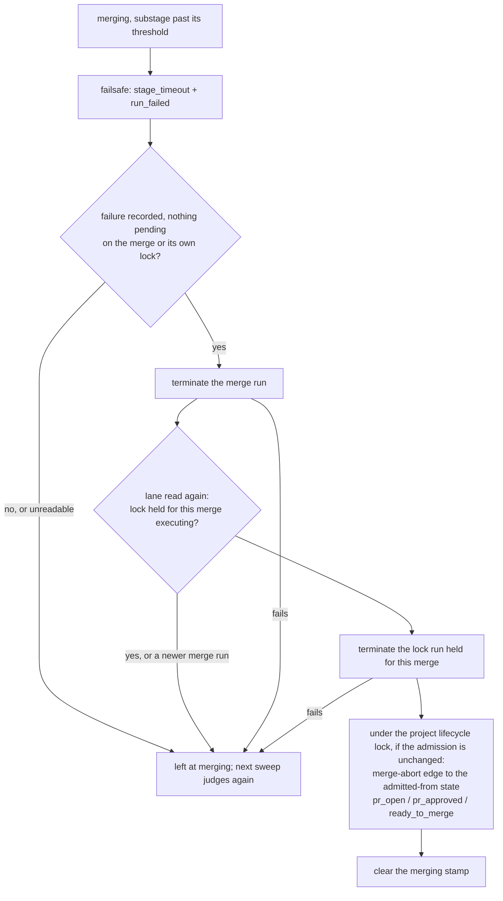

**Rebase only on a forge conflict.** The `pr_open` check sends a merge to the auto-rebase only when the forge reports a conflict (`forge.PRStatus.Conflict`): GitHub's `CONFLICTING`, an open Gitea PR Gitea reports unmergeable, GitLab's `conflict` or `need_rebase` on an open MR. Bitbucket's read carries no conflict signal. Any other reason a forge withholds the merge on an open PR -- on GitLab a missing approval, a draft, unresolved discussions, a mergeability check still running -- is the not-ready stop above, work-in-progress at the `pr_open` gate. Its title, the merge reply and the dashboard row all read `PR open · merge blocked · <reason>`, where the reason names the forge and its blocker (`MergeBlocker`, for example `GitLab: required reviewer approval missing`); the detail keeps the forge's review, checks and mergeable facts.

#### The head test on a forge changes-requested verdict

The `pr_open` forge check blocks merging on rejection without changing state.
`hashd merge` checks the forge again without rerunning
agents; `hashd reject <id> -f '<selected review guidance>'` creates a FIX and
returns to `active`. Forge findings remain opt-in through `--include-forge` or
an edited `--findings-file`; bare reject uses only internal findings.
This separates a forge verdict from the operator's decision to assign more work.
Rebase-conflict and merge-abort transitions are unchanged.
The `pr_changes_requested` trigger is ledgered as undispatched: operator reject
writes the FIX plan and `active` status together through the existing plan CAS.
Its trigger name remains the availability key, not evidence of a dispatcher.

One exit's class is not fixed by the leg. A forge `CHANGES_REQUESTED` is classified by whether it is a verdict about the commit at the PR head, not by which reviewer issued it: `mergeflow.ClassifyChangesRequested` runs the test at the stop and records the answer under the `changes_requested_freshness` key, and `changesRequestedStop` picks the outcome off it. Why the test exists, and what the classification then drives on `runtime_status`, are stated in **The forge's reviewer, dated against head** in [Architecture: Current activity readers](docs/ARCHITECTURE.md#current-activity-readers). This is the merge side of that rule: which class the stop records, and therefore where the operator finds it.

| head test | the stop records | where the operator finds it |
|---|---|---|
| `at_head` | fault | the error surface, beside hashd's own reviewer's `request_changes` |
| `stale` | work-in-progress | the notice surface: the verdict refers to an older head and the forge has not cleared it |
| `undecidable` | work-in-progress | the notice surface, with the record stating that freshness could not be determined |

`TestWFHeadTestTableMatchesTheClassifier` holds this table to `changesRequestedStop` and to the freshness values `fsm` declares, so a fourth classification cannot land without a row.

**The local branch against the published head.** The freshness test dates the verdict against the commit the PR points at; it never asks whether that commit is the code the operator has. The same stop asks second, locally: `mergeflow.ComparePublishedHead` compares the workstream branch tip with the head the forge snapshot names, and the answer rides the stop's payload as `published_head_state` with `published_head_local_sha` and the ahead/behind counts beside it. When it reports commits the published head has never seen, the record is worded from it -- the title and detail say that unpublished local work is what stands between this branch and a merge, naming the local tip, the published head and the ahead count, and a tip with commits on both sides reports the divergence instead. The standing review is still named, from what the changes-requested row actually carried: its reviewer and the commit it was recorded on where the forge gave them, and where that row carried no reviewer the sentence stays with the forge's aggregate decision and the account of why nothing could be dated, because a row with no reviewer is a review hashd never read rather than a nameless one. Nothing in the wording says the review saw the unpublished commits, or that publishing will clear the verdict, because the stop knows neither. The merge's own reply carries the same account, so an operator who only catches the response reads what the row says.

The recorded help for that shape leads with the publish step and drops the reject/FIX entry -- a FIX asks an implementer for work the branch may already hold, which is the misreport this check exists to end -- while the PR link and the `hashd merge <ws>` re-check stay where the other stops put them. Which publish step depends on the direction. A branch that is only ahead takes `hashd pr push <ws>`: the published head holds nothing this tip lacks, so the push adds commits. A diverged tip takes `hashd pr push <ws> --sync`, the same remedy `RunPRPush` prints when the remote refuses its lease, because the plain push takes its `--force-with-lease` snapshot from the local `origin/<branch>` and rebases onto the base only -- it never tests the PR head for ancestry, so on a diverged tip it would replace the commits that head holds instead of publishing to them. The comparison words the stop and never classes it: the class column above is the head test's alone, so an at-head verdict is still a fault and a stale or undated one still a note. Equal heads, a tip that is only behind, a comparison that could not be made, and a snapshot carrying no comparison at all each leave the record's title, detail and help exactly as the rows above describe them. Every comparison that ran is still stated on the record's facts, beside the forge snapshot line, with the local tip and the counts the stop recorded, so a comparison that could not be made reads as unverified rather than as agreement; the merge's reply says so as well.

**Publication is confirmed before the forge merge.** The PR merge proceeds only when the PR head the forge reports equals the local committed branch tip. `MergeApprovedPRLocked` checks this immediately before the forge merge call, after the rebase, the post-rebase test and any force-push. Both routes reach the check: the `pr_open` loop's ready verdict and the `pr_approved` verdict. It reads the forge status once more and runs `mergeflow.ComparePublishedHead` against that read. A push that succeeded counts for nothing; only the head the forge reports now counts. The merge is refused on `ahead`, `behind`, `diverged` and `unverified`, including a failed status read and a read that reports no PR head, and on a PR the forge reports already merged or closed. A refusal records a work-in-progress stop through the existing recorder, with the comparison on the record and help that leads with the publish step for that state (`hashd pr push <ws>` when ahead, `hashd pr push <ws> --sync` otherwise) followed by `hashd merge <ws>`. A PR already merged or closed takes only `hashd merge <ws>` from `pr_open`, whose status check reconciles it. From `pr_approved` the merge never reads the PR's state, so the stop does not offer `hashd merge`: a closed PR is pointed at `hashd close <ws>`, and a merged PR's record says that no hashd command reconciles it from that state. The workstream returns to `pr_open` or `pr_approved`, whichever it came from. No CLI flag, REST route or bypass is added.

---

## Plan regeneration and branch baseline

### Plan regeneration: reset / replan / reject

Three operator commands touch a workstream's plan + worktree, all backed by the one
`breakdown` engine (the same generator as the initial plan -- see "Test-Conflict
Escalation"). They differ only in scope and whether the plan is kept:

| Verb | Plan | Worktree | Feedback | What it's for |
|------|------|----------|----------|---------------|
| **reset** | kept (commits unmarked) | reset to **baseline** (drops committed + uncommitted work) | -- | The plan is right, the implementation went bad: redo it from clean. |
| **replan** | **regenerated** (breakdown re-runs) | reset to **baseline** | optional (`-f`) | The plan is wrong: re-derive it from the requirement. |
| **reject** (gate) | kept | current attempt only (`--reset` discards it; otherwise refine in place) | folded gate findings plus optional `-f` | At a review gate: iterate on the current micro-commit or branch feedback. |

reset and replan are the same operation modulo "keep vs regenerate the plan";
both reset the worktree to the recorded baseline via the shared
`resetWorktreeToBase` (`server/internal/api/mutations_reset.go`), then return the
workstream to active.

Ordering, when the workstream is parked at the human gate: **both** close the
open `run:{project}:{ws}` execution *before* the reset, and refuse with nothing
destroyed when the close cannot be confirmed — the same refusal, named for
whichever verb was run. Past that point both re-frame every refusal, again from
the same pair: one naming the close, one naming the close and the worktree reset
after it. Neither retires the parked run row itself: that belongs to the state
move, and the FSM's own retirement (`fsm.ClearBlockedRunOnExit`) fires on every
exit from awaiting_human_review. replan additionally re-validates the row after the
close, and its plan regenerates on the operator's next explicit `hashd run` rather
than here; reset keeps the plan, so it has nothing to regenerate.

`resetWorktreeToBase` fails closed: it refuses (409) if a rebase or merge is in
progress, or if the recorded baseline is no longer the branch's live fork point
with its base branch. The latter happens once the branch has been rebased during
merge prep -- the recorded `base_sha` is not advanced by those paths, and stays a
*transitive* ancestor of HEAD, so a plain ancestry check would miss it. The fork
point is measured against the base as it stands now, read the way provisioning
reads it: origin's branch fetched into a ref private to the call (bounded by
`git.network_timeout`, leaving `origin/<base>` untouched), or the local branch
when the repository has no remote. A local `origin/<base>` is not consulted: it
can lag `base_sha` after provisioning, and a ref that lags a completed rebase
would report the recorded baseline as the fork point. When that read fails --
origin unreachable, no `origin` remote, the branch missing -- the reset refuses.
So reset/replan are practically available before merge prep -- in implementing /
awaiting_human_review -- and refuse afterward rather than silently rewinding past
the rebase to a stale base.

**Surface map** (every operation reachable in the surfaces that had it):

| Operation | CLI | TUI | Telegram |
|-----------|-----|-----|----------|
| Regenerate plan | `hashd replan [id] [-f ".."]` | `N` | — *(not exposed; the bot has no reset/replan)* |
| Redo implementation | `hashd reset [id]` | `R` | — *(not exposed)* |
| Discard stopped implementation attempt, retain completed micro-commits | `hashd reset <id> --checkpoint` | — *(not exposed)* | — *(not exposed)* |
| Gate reject / approve | `hashd reject [id] [--reset]` / `hashd approve [id]` | `r` / `a` | `/reject` / `/approve` |

The Telegram bot exposes the human-gate verbs (`/approve`, `/reject`), but has
no reset or replan controls.

### The recorded `base_sha` and the derived fork point

The recorded `base_sha` is the *provisioning* fork point -- where the branch
began -- and it stays that. The merge-prep rebases do not advance it, which is
what the `resetWorktreeToBase` guard above leans on and what makes the record the
right value for reset/replan, the run preflight's base-present check
(`stages/preflight`), staleness analysis and dispatch's baseline messaging.
Reopen's staleness analysis (`api/mutations_open.go`) counts only the default
branch's own changes since its common ancestor with `base_sha`
(`base_sha...<default branch>`), so a default branch that lags the record adds
nothing.

One path does advance it, deliberately: the baseline-gate clear
(`api/mutations_dispatch.go`, `tryClearBaselineGate`) rebases a baseline-blocked
branch onto the default branch once that branch has moved, and then persists the
advanced value -- a new provisioning record for a branch that was re-provisioned
onto a new base. The writers are: the create INSERT
(`api/mutations_story_run.go`), which stores the empty sentinel that the
readers' unusable-base arm exists to catch; provisioning, which resolves the
real SHA over that sentinel; the baseline-gate clear above; and
`PATCH /workstreams/{id}`.

Provisioning (`runflow/provision.go`, the `resolve_base_sha` substage) chooses
that SHA as follows:

- A remote-backed repository fetches origin's default branch into a ref
  private to the attempt
  (`git fetch --no-tags --refmap= origin +refs/heads/<branch>:refs/hashd/provision/<id>/<token>`,
  bounded by `git.network_timeout`), pins the commit that fetch retrieved, and
  deletes that ref. It does not update the shared
  `refs/remotes/origin/<branch>`, which merge prep and the publish path fetch
  into concurrently, so that ref can stay behind the recorded `base_sha` until
  one of them moves it. The fetch also leaves the operator's `FETCH_HEAD`
  alone and does not fetch submodules or start maintenance.
- A repository with no remote configured uses its local default branch.
- It fails closed, as a provisioning failure in `provision_error`, when the
  remotes cannot be read, when remotes exist but none is `origin`, when the
  fetch fails or is killed by its bound, when origin lacks the branch, and when
  the fetched ref is not a commit. It never falls back to the local branch,
  `HEAD`, a tracking ref, `FETCH_HEAD` or another remote.
- A `base_sha` already recorded is reused as-is: a re-run of provisioning does
  not fetch or refresh it.

It never checks out, resets, stashes, cleans, merges, pulls or rebases in the
operator's checkout.

A reader that wants the branch's *live* fork point derives it at read time
through `mergeflow.EffectiveBaseForWorkstream`
(`server/internal/mergeflow/gitops.go`) instead of reading the column. A range
spelled from the record widens by however far the base branch travelled since
provisioning, so it reports upstream's commits and files as this workstream's
own work. The readers that derive are:

| Derived reader | Where |
|----------------|-------|
| `GET /workstreams/{id}/diff` and `/diff/changes` ranges | `api/read_diff_changes.go` (`resolveDiffRange`) |
| those endpoints' `scope=current` range | `api/read_diff_current.go` (`resolveCurrentRange`) |
| those endpoints' `commit=<micro-commit id>` range | `api/read_diff_microcommit.go` (`resolveMicrocommitRange`) |
| `GET /workstreams/{id}/changes` `since_base` list | `api/read_endpoints.go` |
| merge-begin ahead-count | `mergeflow/begin.go` |
| cost SLOC shortstat (`hashd cost --with-sloc`) | `api/routes_cost.go` |
| docs-update range | `temporal/workflows/docs.go` (and `mergeflow/archive.go`) -> `reqs/docs_update.go` |
| commit-stage touched-files refresh | `runflow/commitstage.go` |
| test-stage fast-check touched-file set (`HASHD_BASE_SHA`) | `mergeflow/touchedfiles.go` (`ComputeTouchedFiles`) |
| refs loader base | `refs/builtins.go` (`resolveBase`) |
| branch evidence in the adjudicate, FIX and per-commit review prompts | `mergeflow/branchdiff.go` (`BranchEvidenceRange`) |
| completed-commit range a requirements edit's planner is shown | `temporal/workflows/edit.go` (`EditAttempt`) |

The helper hands the recorded value straight back whenever it cannot derive a
point it trusts, so a derived range never starts further back than the recorded
one it replaces.

The final review's deletion evidence reads the recorded value on purpose
(`stages/review/final_review.go` -> `stages/review/deletion_evidence.go`). Its
window is the *upstream* side, `base..<default branch>` -- "what did upstream
delete since this workstream was created that this branch still carries" -- so a
rebase does not poison it, and a derived fork point would empty that window for
every rebased branch rather than narrow it.

Workstreams in a terminal status (`merged`, `closed`, `closed_no_changes`) are
never probed, and that is a trade rather than a tautology. For `merged` and
`closed_no_changes` it costs nothing: the branch is contained in its base,
which the helper's own guard asks as an ancestry question before computing
anything, so a probe would be discarded anyway. For `closed` -- abandoned
*without* merging, so its tip is not reachable from the base -- there IS a
narrower fork point to derive, and skipping means those rows keep today's
recorded-base numbers instead. The correction lands on the open rows an operator
is still working; repairing merged history needs a different mechanism and is not
part of this rule.

`PATCH /workstreams/{id}` is the only caller-supplied writer of the column and
validates the shape: a full git object ID (40 hex, or 64 in a sha256 repository)
or the write is refused, so no new caller-supplied write can be anything else --
rows stored before that boundary are not covered by it, which is why the diff,
`/changes` and cost readers still carry an unusable-base arm
(`recordedBaseUnusable`, `api/read_diff_source.go`).

### Question & Answer Commands

`hashd answer` is the entity-level CLI surface for clarification Q&A. A CLQ-NNN
id is hidden as an *address* and shown as a reference label. As an address it is
refused: `hashd answer` rejects a `CLQ-` prefix, so the operator talks to
entities (stories and workstreams). The server fans out an ordinary bundle
answer across the pending questions on that entity, dispatching a story edit
or workstream run. As a label it is printed wherever a question or a ruling
has to be named — `hashd show <workstream>` lists `CLQ-041 [BLOCKING] ...`,
`hashd show <story>` cites the ids a criterion was derived from, and the web's
clarification cards read `CLQ-041 · round 2`.

The web UI also accepts individual answers. Each answer is saved first; only
the final blocking story-planning answer dispatches a story edit, with the current
round's saved Q&A. Non-final, informational, runtime, and proposal answers do not
dispatch through this individual-answer route. Proposal decisions use the
entity-level answer flow described below.

Story clarifications can also carry `breakdown_proposal` payloads from
`hashd story split STORY-xxx`. Answer `yes` to apply the parent revision and create
sub-stories transactionally, `no` to reject without changes, or any non-yes/no
feedback to request a revised proposal. A proposal is inserted only if the
story's content hash still matches the content it was planned from and the
story's content is not locked; otherwise none lands and the split fails with
`plan_split.source_changed`. The same hash and lock checks refuse, at apply, a
proposal whose story changed after it was inserted. An ordinary split holds no
story ownership; the content hash is its whole fence.

| Command | Description |
|---------|-------------|
| `hashd answer` | Show help. |
| `hashd answer list` | List entities with pending clarifications (stories + workstreams). |
| `hashd answer show <entity>` | Show pending question text for one entity. |
| `hashd answer <entity> "<text>"` | Submit an entity-level answer. Ordinary question bundles record the answer and dispatch a story edit or workstream run; proposal decisions follow their own apply, reject, or revision path. |

**State requirements.** Stories must be in `draft` (no linked workstream) for
`hashd answer`. Workstreams must be in `active`, `implementing`, or `awaiting_human_review`. Other
states return a structured diagnostic that names the right next command.

**Failure semantics.** For an ordinary story bundle, dispatch happens before
the captured questions flip to `answered`. Dispatch failure leaves those
questions pending; a flip failure after dispatch reports that the edit is already
in flight. Ordinary workstream bundles save their answers before dispatch, so a
dispatch failure can leave answers saved without a new run.

Individual answers also save before any dispatch. If the final blocking planning
answer is saved but its edit cannot be dispatched, the error explicitly says the
answer was saved and retains the dispatch diagnostic. Resolve that error, then
use `hashd story edit STORY-XXX` to retry with the saved current-round answers;
do not resubmit an already-answered question. Answers that do not trigger dispatch
remain saved without starting work.

## Directives

Directives are durable standing guidance, included explicitly in the stages
that produce or judge work. Stage-scoped blocks restrict delivery; malformed
blocks warn and render rather than silently dropping guidance. Locations,
authoring syntax and commands are in [Agent management](docs/AGENT_MANAGEMENT.md#directives).

A workstream's directives have two writers: the guidance verb
(`POST /workstreams/{id}/feedback`), which carries whatever preconditions the
busy-guard table below gives it, and the directives editor
(`PUT /directives/workstream`), which replaces the whole document. **Any gate on
the guidance verb governs that verb, not the column.** The editor is the
authoring surface and is deliberately not gated at the human parks; it is
guarded instead by a compare-and-swap token, so a replace built on a stale read
is refused rather than silently discarding what its author never saw. The
reasoning and the refusal shape are in
[Agent management](docs/AGENT_MANAGEMENT.md#two-write-paths-and-what-each-one-guards).

The guidance verb **appends** one entry to the column (`mutations_workstream.go`,
the feedback route): the new entry goes after the existing text, separated by a
blank line, and earlier entries stay. The append is its own compare-and-swap
against the text it read -- a write landing in between is kept and the append
re-reads, up to three attempts, then refuses with 409 and appends nothing. The
response carries the full saved text, which the CLI, TUI and Web show; the
Telegram bot shows only the server message.

## Workstream State Model

A workstream's runtime position is described by two orthogonal fields: **stage** (where in the lifecycle) and **status** (what's happening at that stage right now). For stages with internal sequencing, a third field — **substage** — tracks position within the stage.

The macro lifecycle is still stored under legacy `status`/`state` names;
`runtime_status` is a shipped read-side projection, and `runner_stage` records
substage progress. Renaming the persisted fields is not part of this document.
Provisioning failures stay at `provisioning`, carrying `provision_error` or
`baseline_failures`, rather than introducing separate macro failure states.

Current active-operation reads treat `resolving`, `merging` and non-failed
`provisioning` as running absent failure/blocked evidence. Merge/resolve probes
can report orphaned execution; provisioning relies on the run claim. These
rules depend on additional run and operation evidence described below.
Implementation details are in
[Architecture](docs/ARCHITECTURE.md#current-activity-readers).

### FSM activity authority

Entity FSM contracts define legal macro-state transitions and guards. The
implementing, provisioning and merging sub-FSM definitions below describe their
stage progression and exits. The FSM's `RequiredActivity` selects execution
evidence; server-bound `ActivityProviders` collect it outside atomic admission.
`ComputeRuntimeStatus` interprets the result, and clients render it without
stage-based activity overrides. Whether standing records' recorded next steps
are withheld is the snapshot's `work_in_flight`, which adds the stage's own
workflow (merge at `merging` and on a PR at `pr_open`/`pr_approved`, resolve at
`resolving`) to `runtime_status` running; every surface reads that field. The JSON contracts do not yet declare activity owners.

A macro-state alone is insufficient evidence that execution has stopped:
human-gate workflows remain open while waiting, in-place operations can run
without moving state, and merge finalization continues after code reaches
`merged`. Story planning owns `plan:{project}:{story}`; the project-scoped
`pm:{project}` section serializes its shared-artifact writes.

A retained merge substage is phase history, not proof of activity. After
`merged`, runtime status requires the merge workflow to be open; a failed
execution lookup fails the read rather than reporting running or done.
The same rule applies to run, resolve and provisioning activity. Agent registrations
count only while their wrapper is live. A pending dispatch without a confirmed
execution is indeterminate, not a safe stopping point. Admission and housekeeping
remain conservative on lookup errors; that refusal is not evidence for a spinner.

#### Current contract gaps

- A normal clarification exit writes `blocked_clq_at_select` (or the
  implement/adjudicate/breakdown variant) before clearing the run claim and
  recording a blocked result. A bare `clarification_check` can remain when
  that best-effort marker write fails. Restart has a separate activity
  classifier and can disagree with the stopped result.
- Publish visibility still suppresses lookup errors; it does not yet share the
  explicit error result used by runner and active-operation reads.
- Breakdown, merge gate, final review, in-place operations and post-merge
  archive are not fully represented by the entity's macro/substage pair.
- Implementing and merging validate known same-domain transition pairs;
  provisioning validates names only. Failed prior-state reads can skip
  validation, and stage writes have best-effort failure paths.

The [current reader inventory](docs/ARCHITECTURE.md#current-activity-readers)
records the existing implementations and their boundaries.

### Story ownership

An ordinary story has zero workstreams before its claim and exactly one
implementation workstream after it; the workstream is the story's execution
detail, not a sibling. An Arc never executes and owns none, and each Arc child
follows the same rule. Lineage an earlier attempt left after its row was
deleted is attributed history of the single implementation. A closed
workstream kept after the story's close or abandon keeps its `story_id` with
the story's forward link cleared: it is the story's single ended
implementation. Temporal executions are unaffected. The claim
(`LockStoryToWorkstream`), the unique index `idx_workstreams_project_story`,
the pre-migration refusal (rerun `hashd internal migrate-dbs` once resolved)
and the archive refusal enforce it; the index's down migration keeps every
row. Details: [Story workstream ownership](docs/ARCHITECTURE.md#story-workstream-ownership).

### Stage

A **stage** is a workflow position with defined inputs, outcomes and transitions.
Re-execution is permitted only under that stage's retry and mutation contract:
crash-safe activities can retry, while one-shot mutations retain their single
attempt. A shared stage name does not make every operation idempotent.

Transitions change the current workflow position. Re-entry uses current-cycle
artifacts and durable operator guidance under their documented scope; persisted
review and transcript history remains available to operators. A historical
verdict does not become the new attempt's result merely because it is stored.

The macro FSM enumerates the stages. See **State Diagram** below for the canonical list and transitions.

#### Additive flow state

When stage A → B → A happens (e.g., implementing → review → implementing on a rejection), the second visit to A starts with:
1. Original inputs to A
2. Plus the current-cycle artifact from B (e.g., the just-completed review's actionable feedback)

The terminal output of the first A is gone (replaced by the second A's output). Historical feedback and summaries remain queryable for humans, but they do not accumulate into per-commit reviewer or implementer prompts.

### Status

A **runtime status** is the read-side projection at the workstream's current
stage. Its eight values combine macro-state, execution and outcome evidence.

| Status | Meaning | Computed from |
|---|---|---|
| `running` | Process attached, work in progress at current stage | `runner_pid`/`runner_run_id` alive AND `last_run` incomplete; OR an outer-leg `runner_stage` stamp (`merge_gate` / `final_review`) confirmed by run-workflow liveness — the tail of a run executes with the claim already deregistered, so the stamp is all it writes, and it outranks a `blocked` run row because the gate's fix-commit exit sets one and keeps working. In an active-operation stage the stamp is ignored: a gate that exits on a conflict preserves `merge_gate` and nothing clears it, so it rides into the `resolving` / `merging` that follows, where that stage's own workflow is the liveness. OR active-operation stage (`resolving`/`merging`/non-failed `provisioning`) with its operation workflow open. At `resolving`/`merging` a live operation workflow outranks a retained `failed`/`blocked` run row — the run is the failure the operation is recovering from, and its failure stays in `current_errors` — unless a blocking clarification is pending; OR an open publish workflow (`pr create` / `pr push`); OR a `merged` workstream with an [unfinished archive](#unfinished-archive) whose archive owner is open |
| `blocked` | Waiting for external input (clarification, human review, conflict resolution, post-rebase merge-test recovery, etc.) | `last_run.status == "blocked"` (at `resolving`/`merging` only when the operation workflow is closed, or a blocking clarification is pending); `merge_test_failed` with latest run failed |
| `changes_required` | Reviewer requested changes. Internal review-loop exhaustion parks at `awaiting_human_review` (runtime `blocked`). A forge rejection preserves the PR state: reject creates a FIX; merge checks the forge again. Neither approve nor run clears a forge verdict. Never shown for active-operation stages | Latest review verdict is request changes; OR the latest merge stop recorded a forge CHANGES_REQUESTED verdict classified **at-head** ([revision test](#the-head-test-on-a-forge-changes-requested-verdict)) |
| `failed` | Previous run errored, retryable via re-dispatch | `last_run.status == "failed"` (at `resolving`/`merging` only when the operation workflow is closed, or a blocking clarification is pending); OR a `merged` workstream with an [unfinished archive](#unfinished-archive) whose archive owner is closed |
| `idle` | Stage entered, no run has executed yet. Never shown for active-operation stages | No `last_run` record for current stage |
| `orphaned` | Runner or operation flow exited without writing a terminal result, unintentionally | `runner_pid`/`runner_run_id` dead AND `last_run` incomplete; OR active-operation stage whose operation workflow is closed. An outer-leg stamp never produces it: a blocked gate exit preserves the stamp deliberately while the run workflow closes (a failed one clears it), so a closed workflow beside one is the ordinary shape of a parked workstream. That evidence falls through to the branches below it — `blocked` off the run row, a review verdict, `idle` |
| `done` | Terminal entity stage reached and nothing left to finish | Stage in terminal set (`merged`, `closed`, `closed_no_changes`), except a `merged` workstream whose archive is [unfinished](#unfinished-archive) |
| `paused` | A person paused the workstream; the pause is an admission hold, not an FSM stage, and can stand at any stage | A standing `human_edit` hold (see **Workstream pauses**) over an underlying `running` or `idle`; the hold's readiness (`ready` / `waiting` / `unknown`, the evaluator behind `human_edit_hold.state`) is served beside it as `pause_readiness` and displayed `<stage> / paused (<readiness>)`. `done`, `failed`, `orphaned`, `blocked` and `changes_required` keep precedence, and every gate keeps reading the pre-pause value |

#### Unfinished archive

A merge lands the code and sets `merged`, then runs the post-merge archive
(docs update, REQS burn, story completion, worktree cleanup). A `merged`
workstream's archive is **unfinished** when either holds:

- it has an archive-failure stop -- a `merge` `operation_result` fault carrying
  `archive_failure_class`, or, recorded before that key existed, titled as an
  archive failure (`mergeflow.ArchiveFailedTitle` / `ArchiveRefusedTitle`;
  events are not rewritten) -- newer than the archive's last `archive` event
  with status `completed`, even when a later attempt has started since. An
  archive records `started` and then `completed`; a re-run that finishes a
  deferred publication of an already-completed archive records both again, so
  its stamp stands while it runs. A re-run that finds nothing left to do
  records the completion again only over such a standing stop or over a
  `started` no completion followed (a publication interrupted after it
  published), so a clean replay records nothing twice. Only a completion
  retires the stop, outside the
  [retire rules](#stopped-operation-records): a re-run writes its landed
  (succeeded) `merge` row before its archive runs, and a re-run that fails
  earlier, or finds the merge lock busy, writes a newer `merge` row too, all
  while the archive is still unfinished;
- a merging substage stamp is retained (`fsm.HasMergeTail`) and the
  archive's newest `archive` event is not a completion. A completion retires a
  stamp the merge workflow's exit backstop failed to clear after the archive
  finished. A completion that could not be read is a failed read, not an
  absent completion: the merged workstream's read fails rather than guess.

`fsm.ArchiveUnfinished` derives it from `fsm.ArchiveEvidence`; the reads take
both facts off the same rows that build `current_errors` and the newest
`archive` event, and pass them to `ComputeRuntimeStatus`, so every surface
answers alike. The archive's owner (`fsm.ArchiveActivity`) is
the merge workflow, or the run workflow when its external-merge reconcile runs
the archive inline; it is probed even with no stamp, because the merge
workflow's exit backstop clears the stamp and a re-run from `merged` runs its
begin step and waits for the archive locks before it stamps `finalize` again.
The merge workflow's admission release writes no generic stop over an archive
failure, which records its own. Readings:

| Archive owner | runtime_status |
|---|---|
| open | `running` -- the archive (first run, `hashd merge <ws>` re-run, or the external-merge reconcile) is finishing |
| closed | `failed` -- the archive stopped; `hashd merge <ws>` re-runs it from its checkpoint |
| (archive complete) | `done` |

The archive-failure stop stays in `current_errors`, served once, until the
archive completes. Its `output_tail` is an excerpt; the archive activity
stores the failing command's whole redacted capture before the activity
boundary, and the stop's `output_transcript_id` names that record. Closed
stages run no archive and always read `done`.

**Recovery.** `hashd merge <ws>` on the `merged` workstream re-runs the
archive from its checkpoint: `start_merge` from `merged` is a self-transition,
offered while no merge workflow runs, and its route rows note that the route
is not used. The story's reads name the condition in `archive_unfinished`, and
the story detail serves the same merge rows beside the workstream's failure
row, so the recovery is offered from either entity. `GET /dashboard` lists the
story while the archive is unfinished even when it is already `implemented`
(the archive marks it before recording completion), and the Web dashboard
gives an unfinished workstream no story row joins a row of its own; both keep
the owner filter.

**Janitor rule.** The engine janitor re-runs an unfinished archive at most once
per recorded failure (`sweepUnfinishedArchives`). On each housekeeping sweep it
decides each `merged` workstream whose archive-failure stop stands under the
project lifecycle lock, which every merge dispatch admits under: a held lock
leaves it for the next sweep. Holding it, the janitor asks the archive owner
(fail-alive: no answer, no action) and, with the owner closed, reads the
standing stop again, so nothing can finish the archive or record a newer
failure between that read and the action. It keys on the stop's events id:

| The standing stop | The janitor |
|---|---|
| `retryable`, recording `archive_push`, not re-run by the janitor | dispatches one re-run through the same merge dispatch as `hashd merge`, with no initiating account, the stop's id in `MergeInput.RetriesArchiveFailure`, and publishing exactly when the failed archive did (`archive_push`). Its `engine_cleanup` row `archive_rerun_dispatched` naming the stop (`failure_event_id`) is written in the admission transaction: a dispatch refused before admission records nothing and the next sweep decides again, and a workflow start that fails after it leaves the one attempt spent |
| `deterministic`; or carrying `archive_retry_of` (the janitor's re-run recorded it); or still standing after the janitor's re-run ended; or not recording `archive_push` | escalates once: a `blocked` event linked to the workstream and its story, naming the failure (`failure_event_id`) and `hashd merge <ws>` |
| already re-run (re-run still open) or already escalated | nothing |

A re-run's archive failure carries `archive_retry_of`, so the janitor reads it
as its own and never retries it. The re-run's execution starts after
`merged_at`, so the OPEN pass gives it `terminalCancelGrace` from its own start
and never cancels it.

Review outcomes and activity answer different questions. A changes-requested
review records what needs correction; it does not establish that an operation
has stopped. A forge review applies to the published revision it identifies,
not automatically to later local or published changes. Missing review identity
must not be presented as a confirmed current-head rejection.

Publishing is workflow work even though it does not produce an agent verdict.
It must not erase the standing review or failure that the operator still needs
to see. Workflow activity and review outcome therefore remain separate facts;
consumers must not define different working/waiting rules to preserve a verdict.

**Current implementation:** the server exposes both
`runtime_status` and `runtime_status_excluding_publish`, and restart adds its
own state classifier. Their existing
consumer mapping and probe behavior are recorded in
[Architecture: Current activity readers](docs/ARCHITECTURE.md#current-activity-readers).
The state and liveness contracts above describe their current boundaries.

#### Publish liveness

[Current probe behavior and per-site consumer table](docs/ARCHITECTURE.md#current-activity-readers).

#### Stopped-operation records

Diagnostic content is normalized once by the server from its owning review,
clarification, provisioning, run or operation record. The existing FSM and
operation-result selectors still own currentness and retirement; normalization
adds no lifecycle. Recorded help remains available as advice in expanded
diagnostics, while executable controls use `available_actions` and its guards.
The field and evidence contract, including the unchanged merge-retry visibility
disagreement between server and TUI, is in `docs/ARCHITECTURE.md`.

An async operation that stops -- a merge waiting on a review, an add-commit the
planner declined, a plan split that failed -- records an `operation_result`
event, and the workstream reads surface what still stands. Read by
`server/internal/api/current_errors.go` for both `hashd show` and `hashd list`.

**Which surface.** The row's `outcome` decides, nothing else:

| outcome | surface | operator meaning |
|---|---|---|
| `failed`, `declined` | `current_errors` | a fault: red, counted in the dashboard `[!N]` |
| `blocked` | `current_notices` | work-in-progress (waiting on a review or CI, another operation holding a lock): visible, never red, never counted |
| `succeeded` | neither | the marker that retires older rows |
| `code_change` | neither | a declaration that the branch moved, and nothing else (below) |

**How long a record stands.** Four rules, each a strictly-newer comparison on
`created_at` -- no timer, no recency window, no run-id match:

- **Latest per operation.** Only a later row of the SAME operation replaces
  one. A merge stop and an add-commit decline are independent.
- **A newer declared code change** retires a row that classed itself
  `invalidated_by: code_change` (below) -- and nothing else does. Such a row is
  an answer about one specific commit, so only the branch moving can have
  changed the answer; the two rules below deliberately do not reach it.
- **A newer `plan_changed`** retires an older row of the one operation that
  modifies the plan and lands a workstream-scoped row -- `add_commit` -- and no
  others. `hashd workstream add-commit` succeeds without a byte of the branch
  moving, so it is no answer about a forge verdict, a rejected push, a failed
  rebase or a PR closed without merging; it is a self-transition at
  `ready_to_merge`, which is exactly where a merge stopped on a closed PR parks
  the workstream. The rule is an allowlist because that is the fail-safe
  direction: an operation added later stands until something that speaks for it
  lands.
- **A landed `succeeded`** retires older FAULTS across operations -- the only
  clearing path for operations that emit no success of their own, and what
  clears "PR #7 was closed without merging" when the `hashd pr create` its own
  help names opens a healthy PR #8. It does not touch notices: a stop that is
  work-in-progress is re-emitted by its own operation on every attempt, and an
  unrelated success says nothing about it. It does not touch code-change-classed
  rows either: a `pr push` whose remote already matches head short-circuits and
  records a success having pushed nothing, and an at-head verdict is still
  standing on the forge over a byte-identical branch. Only a declared code
  change retires those, through the rule above.

**A live retry of the same publish.** While Temporal confirms that the `prcreate:{project}:{ws}` (or `prpush:{project}:{ws}`) execution is running and that it started after a standing `pr_create` (or `pr_push`) fault was recorded, the reads withhold that fault from `current_errors` and the dashboard count. This is not a retire: the event row is untouched and stays in the timeline, and the fault is served again as soon as no running attempt is confirmed. The answer comes from the publish-liveness probe and its per-request memo, so a probe that fails, times out, runs out of batch budget or reports no start time withholds nothing. Notices, other operations and the other publish verb are unaffected. A PR create or push workflow that is cancelled, or ends on an activity error it can still observe, records a `failed` row for its operation titled as cancelled or interrupted before completing, with the cause in its explanation, so the latest attempt's ending is the one served. An execution that closes without recording anything (terminated, worker gone) leaves the previous fault standing.

Record producers preserve whether an outcome depends on the published commit;
changing a branch does not clear an unrelated repository or infrastructure fault.
[Record classification](docs/ARCHITECTURE.md#standing-record-evidence-and-rendering)
describes the emission contract.

Standing records retain their diagnostic, output evidence and recovery steps.
Compact reads do not change membership or retirement. Detailed reads disclose
missing evidence rather than substitute a different historical fault. Rendering
withholds the previous attempt's record while that same operation is running;
recorded advice does not override action guards. See the
[read/display contract](docs/ARCHITECTURE.md#standing-record-evidence-and-rendering).

**Declaring a code change.** The publishers that record an outcome row write
`code_change` in it -- `pr_create` and `pr_push` through
`mergeflow.EmitPRSuccessMovedHead`, `ai_resolve` on its own success emit, and
the runner's fix push to an open PR (`runflow/commitstage.go`) under the
`pr_push` operation, because it is the same act on the same branch as the verb
-- and only when the remote head actually moved, decided by reading the
tracking ref either side of the push rather than by which leg the verb took. No
event type is read for this: `run_complete` and `run_failed` are notifications
that a run ENDED, both emitted on legs that commit nothing, and dropping a
still-true stop on one of those is the silent disappearance these records exist
to prevent.

The runner's push is the one that has to declare: it is the most frequent
head-mover there is, and it is the run a changes-requested record's own help
prescribes, so a stop it stales must drop on it rather than wait for the next
merge attempt. It fires only in autonomous mode (`runflow.AutoPushForPR`) -- in
gatekeeper and supervised that run commits without publishing, so it moves no
remote head, and the operator's own `hashd pr push` is what drops the record.
Its row carries the declaration and nothing else. It is recorded with outcome
`code_change`, not `succeeded`, and where the push moves nothing it is not
recorded at all -- unlike the `pr_*` verbs, which record their success without
the flag. The verbs are operator-dispatched operations whose outcome is owed an
answer; this leg is not, and it fires once per micro-commit, so a `succeeded`
row here would be a cross-operation fault broom over stops a push cannot
answer. "PR #7 was closed without merging" stays true however many times the
branch is pushed to.

The merge flow's own pushes (the publish leg, the `pr_open` rebase, the
pre-merge rebase and the approved-path force-push) stay silent, and the cost is
a record that outlives its commit rather than one that vanishes: they run
inside a merge dispatch that records a row for that attempt, so the merge stop
they could stale is replaced by the latest-per-operation rule, and only a
record of a different operation can outlive them.

#### Status is derived

Runtime status is computed on read from the current stage, run records, runner
markers and workflow liveness; it is not stored as a column. A dead subprocess
alone does not establish an orphan: its workflow may still own an activity retry.
The [status derivation above](#status) defines when a closed execution and its
remaining evidence report `orphaned`.

The canonical compute function lives Go-server-side (in the workstream serializer); clients consume the derived field from the REST payload rather than recomputing it.

#### Cancellation and orphaned execution

`orphaned` identifies execution that disappeared without the expected completion
evidence. Cancellation records deliberate termination of a workflow and is not a
separate workstream runtime-status value. The shipped `hashd cancel` abandons a
queued story and cancels its planning workflow, or stops the planner call
drafting or editing a story and puts the story back (see
[Story Lifecycle](#story-lifecycle)); it does not stop a running workstream.
Workstream close and recovery have their own cancellation and confirmed-closure
rules under [Operator Verbs](#operator-verbs).

#### Run start

`run_started` fires once per run id, at the first landed claim that writes it, decided from the events record. `runflow.RegisterRunner` sets `runner_run_id` and the cycle's `runner_claim_token` with `runner_stage` cleared, checks for an existing `run_started` row for the workstream and run id, and records one only when none exists -- claim and row commit in one `BEGIN IMMEDIATE` transaction, so racing or retried claims find the committed row. A claim that lands on no row, is refused (see [the busy guard](#the-busy-guard-structural-verb-lock)) or fails its transaction records nothing, and the next landed claim for that run id records the start. Claims are not stages: no claim stamps `runner_stage` or emits `stage_changed`.

A release before `run_started` recorded the claim as `stage_changed` with stage `starting`, the run id and no state. That row counts as the same run's start, for both the claim check and the error-return lookup (`RunStartedRecorded`), so a run crossing the upgrade -- parked at a gate, or between cycles -- records no second start. Existing rows are read as they are; none is rewritten or backfilled.

These are not run boundaries: a later cycle's claim or a continue-as-new re-begin reusing the run id, the human-gate continuation claim, the pre-dispatch recovery claims in `server/internal/api/startup_resume.go` (the run they dispatch records its start at its own first claim), and deregistrations. Provisioning precedes the first claim.

#### Run close

The outcome event is the only thing that closes a run. Deregistration, a cleared `runner_stage` and a departing substage's `stopped` event are not closes. A cycle-originated terminal is notified once, by the cycle's finish choke (`RunnerNotifyRunOutcome`). A cycle whose release stood down, because another run holds the workstream's claim or another owner's stamp sits on an unclaimed row, writes its own run row and notifies nothing, and the run ends there: no park, next cycle, human gate or all-complete leg. Every outcome the outer run workflow emits goes through its per-execution closer (`runCloser` in `server/internal/temporal/workflows/runner_outer.go`). The closer records that a closing outcome was routed -- whether or not the best-effort emit activity succeeded -- and also records a cycle child's status its finish choke already notified (failed, blocked, interrupted, `changes_requested`) and a merge-gate verdict its activity already notified. Those pass-throughs schedule no emit of their own (except the exit-state failure row below, on a history before its version). Every outcome row and frame carries the run id of the run it closes, which is what matches it to that run's `run_started`; a `run_complete` or `review_needed` emit already scheduled before those events carried it records its row without one. The record is read once, by the close deferred over the workflow's error returns: once the closer is closed, a later cancellation or error adds nothing. `TestOuterRunClosingExitsEmitExactlyOneOutcome` pins exactly one outcome emit per run for each exit below.

| Exit | Emitted by | Outcome event |
|------|------------|---------------|
| Cycle failed at any stage, including a gate re-entry | cycle finish choke | `run_failed` |
| Cycle blocked, including the blocked-CLQ marker exit | cycle finish choke | `blocked` |
| Cycle interrupted (implement or review) | cycle finish choke, with the interrupted stage and microcommit | `run_interrupted` |
| Replayed cycle result `changes_requested` (recorded by earlier builds) | that cycle's finish choke | `review_needed` |
| Review gate: decide, park or resume error | outer notify, `human_review` | `run_failed` |
| Agent-stop gate: park or resume error | outer notify, `human_review` | `run_failed` |
| Unsupported gate action, either gate | outer notify | `blocked` |
| Merge-gate activity, entry or post-gate dirty-check, or merge-ready reconcile error | outer notify, `merge_gate`, after the run row is patched `failed` at `merge_gate` (version `merge-gate-failure-run-row`) | `run_failed` |
| Merge-gate exit-state failure after a blocked / conflict / verify-failed verdict (version `merge-gate-exit-failure`) | the `RunnerMergeGate` activity's `blocked` for the verdict, `merge_gate`; a history before version `merge-gate-exit-failure-keeps-gate-outcome` also emitted an outer `run_failed` and replays both | `blocked` |
| Unabsorbable dirt after the merge gate | `RunnerEmitBlocked`, `merge_gate` | `blocked` |
| Merge-gate entry block on dirt the heal cannot absorb (version `blocked-exit-outcome`) | `RunnerEmitBlocked`, `merge_gate`, the entry-dirt reason | `blocked` |
| Merge gate blocked / conflict / verify-failed | the `RunnerMergeGate` activity, before it returns the verdict (the rebase leg's emit in `HandleRebase`, the others' in `emitMergeGateBlocked`), `merge_gate` | `blocked` |
| Gate re-entry child returning `stop_human_gate`, mapped to a blocked run (version `blocked-exit-outcome`) | `RunnerEmitBlocked`, the child's failed stage, the stop's title (its body when untitled) | `blocked` |
| Gate re-entry child returning `all_complete` -- the operator skipped the parked micro-commit, the last undone one, before approving (version `gate-reentry-all-complete-leg`) | the all-complete leg, as for a cycle returning `all_complete`: the merge gate and final review rows here; a history before that version returned `all_complete` with no outcome and replays that way | per that leg's row |
| External merge (PR already merged) | `RunnerEmitRunComplete`, status `merged` | `run_complete` |
| Final review approve | `RunnerEmitRunComplete`, status `ready_to_merge` | `run_complete` |
| `--once` stop after a passed cycle (version `once-stop-run-complete`) | `RunnerEmitRunComplete`, status `--once: stopped after one micro-commit cycle` | `run_complete` |
| `--once` stop after a passed gate re-entry, auto-continue or approve (version `once-stop-run-complete`) | `RunnerEmitRunComplete`, status `--once: stopped after one micro-commit cycle` | `run_complete` |
| `--once` stop after merge-gate fixes (version `once-stop-run-complete`) | `RunnerEmitRunComplete`, status `--once: stopped after one micro-commit cycle`, after the run row is patched `passed` and the `merge_gate` stamp is cleared (a looping run keeps both for its next cycle) | `run_complete` |
| Final review concerns verdict; error verdict on a history before version `final-review-durable-failure` | `RunnerEmitReviewNeeded` | `review_needed` |
| Final review failure: error verdict or activity error | `RunnerNotifyRunOutcome` on the leg's cleanup context (outer notify on a history before version `final-review-durable-failure`), `final_review` | `run_failed` |
| Final review concerns-activity error | outer notify, `final_review` | `run_failed` |
| Cancel while parked at the review gate (version `started-run-cancel-error-close`) | `RunnerEmitRunCancelled`, `parked_at` `human_review`; the workflow still returns its `CanceledError` | `run_cancelled` |
| Cancel while parked at the agent-stop gate (version `started-run-cancel-error-close`) | `RunnerEmitRunCancelled`, `parked_at` `agent_stop`; the workflow still returns its `CanceledError` | `run_cancelled` |
| Any outer exit above whose outcome is routed on a cancelled workflow context -- an outer-leg activity, such as the merge gate, failing on the cancellation (version `started-run-cancel-error-close`) | `RunnerEmitRunCancelled` in place of that outcome, `parked_at` empty | `run_cancelled` |
| Cycle cancelled during a stage, ending at a terminal status (version `started-run-cancel-error-close`; from version `agent-stage-waits-for-cancel`, a stage that does not wait for its cancellation -- preflight, select, clarification check, concern triage, adjudicate, commit -- or an escalation exit) | cycle finish choke, `RunnerEmitRunCancelled` in place of its notify, `parked_at` empty; the run's write and release stay on the cancelled context, so the claim is left for the housekeeping sweep | `run_cancelled` |
| Cancel during an agent stage -- breakdown, implement, test, review, partial breakdown or final review -- once the stage has ended, whether on the cancellation, another error or a result that came back after the cancel (version `agent-stage-waits-for-cancel`) | the cancelled exit, on a context the cancel does not reach: the run row `interrupted` at the stage, with the operator-cancel title as its reason; the run's keyed release (`RunnerFinishRun`, the cycle's with `Cycle`, the outer leg's for final review), where a release refused as another run's stands down with no outcome; then `RunnerEmitRunCancelled` naming the stage, with the operator-cancel diagnostic. No further stage, cycle, retry, gate or final-review routing starts | `run_cancelled` |
| Forced cancel (`force-cancel` after the cancel) while an agent stage above is running (version `agent-stage-waits-for-cancel`) | the forced exit, at once, with the stage's activity left pending: on a context the cancel does not reach, the run row `interrupted` at the stage with the forced-interrupt title as its reason, then `RunnerEmitRunCancelled` naming the stage with `Forced` and the forced-interrupt diagnostic. No `RunnerFinishRun`: the claim and stamp are left for the housekeeping sweep | `run_cancelled` |
| Error return after the run started: a cycle child returning an error at the cycle, gate re-entry or approve site (a `RunnerBeginRun` failure after the claim, a `RunnerLoadCycleContext` failure), or a provision error in a continued-as-new execution (version `started-run-cancel-error-close`) | the close deferred over the workflow, only when `RunnerRunStarted` finds the run's start (its `run_started` row, or a pre-upgrade `starting` row): `RunnerEmitRunCancelled` for a cancellation, `parked_at` empty; otherwise `RunnerNotifyRunOutcome`, status `failed`, the error text, stage `provision` for a provision error and none for a cycle child; the error is returned | `run_cancelled` / `run_failed` |

A merge-gate failure after the cycle has persisted `all_complete`, or after the gate's `passed` patch, replaces that outcome in the current run state: a timeline event alone is not the current failure state. The patch carries the `run_failed` reason and runs on the leg's cleanup context; a write that still fails is named in the `run_failed` reason. A history before `merge-gate-failure-run-row` leaves the row as the leg last wrote it.

Every `run_cancelled` above is emitted on a context disconnected from the workflow's, so it lands although the workflow context is cancelled. From version `agent-stage-waits-for-cancel` a cancel during an agent stage writes the run row and runs the keyed release on a disconnected context as well; a history recorded before that version keeps both on the cancelled cycle context. The `started-run-cancel-error-close` rows closed with no outcome on a history recorded before that version, and replay that way.

From the same version the outer workflow waits for the `RunnerMergeGate` activity to finish after a cancel request instead of resolving it as cancelled at once. The gate emits its own `blocked` before it returns a blocked / conflict / verify-failed verdict and keeps running until a heartbeat delivers the cancellation, so a verdict reached in that window comes back and closes the run through the gate row above; `run_cancelled` closes it only when the gate stops on the cancellation. `TestMergeGateCancellationKeepsTheGateOutcome` pins both on the real server.

From version `agent-stage-waits-for-cancel` the agent-stage legs are waited for in the same way: the cycle's implement, test, review, breakdown and partial breakdown activities and the outer workflow's final review keep their future pending after a cancel request until the activity has ended, and the outer workflow waits for its cycle child to close. A cancelled body stops at its next heartbeat, so `run:{project}:{ws}` stays open, and a second dispatch of it fails as already started, until the stage's work has stopped; a plain cancel of a run answers that it finishes when its running stage stops. Concern triage and adjudicate are not waited for. A history recorded before that version replays its non-waiting legs. `TestRunCancellationWaitsForTheRunningAgentStage` pins the implement case on the real server.

`POST /flow-runs/{id}/cancel` with `{"force": true}` on `run:{project}:{ws}` cancels the run and then sends it `force-cancel`, as for a merge or resolve. From the same version the signal ends those waits: the outer workflow forwards it to the cycle child it is waiting on, by that exact execution, and waits only for the child to close; a cycle waiting on an agent stage, or the outer workflow waiting on final review, takes the forced exit above and closes at once. The run closes, and a new run can be dispatched, while the stage's body may keep running, and writing, until its next heartbeat delivers the cancel. The forced exit runs no release, so the runner claim and stamp are left for the housekeeping sweep. A force that reaches the run anywhere else -- a stage that does not wait for its cancellation, the commit, the merge gate, a gate park -- changes nothing, and the run stops as on a plain cancel. A history recorded before that version ignores the signal. `TestRunForcedCancellationClosesWithoutTheAgentStage` pins the implement case on the real server.

The wait reaches `hashd close`, `hashd workstream remove`, replan and reset, which cancel the run and do nothing destructive until it is confirmed closed. A run inside its merge gate or a waited agent stage closes only once that activity has heard of the cancellation at a heartbeat and stopped, so those commands wait for it within the `dispatch_rpc` bound (130s). The CLI's mutations wait longer than that; a client that gives up first (the Python and web clients, at 120s) ends the wait with the request. Either way an unconfirmed close changes nothing -- workstream, records and worktree stay as they were -- and the refusal reports only what the handler observed, naming the command to re-run with its id, `--project` and the flags that shaped the request -- a close's `--keep-branch`, and `--no-changes` with its shell-quoted `--reason`; a replan's shell-quoted `--feedback` -- never adding a confirmation the operator did not give. A run still stopping means a read-back after the cancel answered that the run was running: the cancellation is already requested and the same command succeeds once the run has stopped. A read-back that failed or never answered, a cancel request that ended before temporal answered it (so a cancel may already be pending), and a cancel that never reached the run all point at the sidecar check first.

The two `blocked-exit-outcome` rows closed with no outcome on a history recorded before that version, and replay that way. Surfaces that notify on `blocked`, such as the Telegram bot's push, now notify for them.

On a merge-gate exit-state failure the timeline keeps the gate's first `blocked` outcome, with its full payload. The exit transition that fails afterwards is bookkeeping, not a second close: the run result reads failed at `merge_gate` carrying the transition error, and the workflow logs that error.

The `--once` rows are emitted only by the outer `--once` returns. A passed cycle in a looping run selects the next commit and emits nothing; `RunnerNotifyRunOutcome` stays silent for `passed`. The `once-stop-run-complete` rows closed with no outcome on a history recorded before that version, and replay that way.

Closing predicate: every run-tagged `run_failed`, `blocked`, `run_interrupted`, `review_needed`, `run_complete` and `run_cancelled` row is written through one durable per-run predicate at the emitter's record path (`recordRunClosing` in `server/internal/eventbus/emit.go`, query `RecordRunClosingEvent`). The check and the insert are a single SQL statement keyed by `(workstream_id, run_id)`, so concurrent writers cannot both pass it. The closing set is those six types plus `run_closed_externally`, the external-closure outcome. A backstop outcome is a `run_closed_externally` row, or a closing row whose `actor` is `backstop`, which only a backstop-mode write sets. A backstop-mode write records only when the run has no closing row, so it yields to any outcome. A workflow-mode write -- every emitter above, and any writer that does not select backstop mode -- records as before unless the run already holds a backstop outcome, so it yields only to a backstop; two workflow-mode outcomes for one run both record, as they always did. A refused write inserts nothing, publishes nothing, is logged and returns success to its caller. A row with no run id closes no run and is recorded as before, so the untagged `review_needed` and `blocked` a park writes are unaffected; so is a resolve's `blocked`, tagged with the resolve's own run id, which never has a backstop outcome.

Housekeeping failsafe and the predicate: for an orphaned runner-owned stamp, the failsafe (`commitSubstageFailsafe` in `server/internal/api/housekeeping.go`) commits its whole record in one `BEGIN IMMEDIATE` transaction or none of it: the run row the stamp belongs to marked `failed` (`markLatestRunFailed`), `stage_timeout`, and a backstop-mode `run_failed` tagged with that run's id. When the predicate refuses that `run_failed` -- the run already holds a closing outcome -- the transaction rolls back, so the run row, `stage_timeout` and `run_failed` all stay as they were; the attempt counts as neither fired nor an error and publishes nothing. Any failed write rolls the record back too, and the next sweep retries it. Frames publish only after `COMMIT`. A committed failsafe is a backstop outcome, so the run's own later closing writes yield to it. The `stage_timeout`/`run_failed` precheck still short-circuits a stamp whose record is already there; past it, the predicate alone decides the `run_failed`. A mark that matches no run row tags nothing and closes no run, so it keeps the write-by-write path with untagged events. The flow-owned failsafe (provisioning and merging substages) commits through the same transaction; its `run_failed` is a workflow-mode write, so it yields only to a backstop outcome or `run_closed_externally`, and a refusal likewise rolls back the run row mark and `stage_timeout` and counts as not fired. A same-stage `run_failed` the precheck found is not written again, since the predicate would admit a second workflow-mode outcome.

External-closure outcome: `run_closed_externally` is the closing outcome for a run whose execution chain the engine closed outside workflow code. It is neither `run_failed` nor `run_cancelled`. `RecordRunClosedExternally` (`server/internal/eventbus/emit.go`) writes it inside its caller's transaction, through the predicate in backstop mode, and returns the post-commit publisher. Its kind is `Terminated` or `TimedOut`, and its content is `terminated outside workflow control` or `engine time limit reached`. The content says what the engine did. It never says the run failed, and it makes no claim about agents, stages, lost or kept work, or the workstream. The row's `data` keeps every value whole, with no clamping: `kind`, `run_id`, `workflow_id`, the recorded `first_execution_run_id`, the `closed_execution_run_id`, the engine `close_time`, and, for `Terminated` only, `terminate_reason` and `terminate_identity` verbatim. It also carries an optional `last_recorded_stage`, which is the last stage recorded for the workstream and not a claim about where the execution stopped. The outcome is not a standing current error, patches no runs row, and changes no stage, claim or `available_actions`.

Notify or quiet: in the same transaction the write reads the workstream's stage. When the workstream is already `merged`, `closed` or `closed_no_changes`, the outcome is recorded quietly (`notify` false). Any other stage notifies (`notify` true). The flag is stored in the row and carried on the frame, and the notification classifier (`server/internal/notify/classify.go`) decides from the frame alone. `notify` true selects the event for attention and raises a NeedsYou toast titled with the content line. `notify` false raises no toast. The frame's `reason` is bounded like any ShortStr. A terminate reason longer than 500 characters rides as a notice naming the durable row (`hashd --project <p> show-prompt ev_<id>`), built by the same helper as the discovery-failure notice, so subscribers never drop the frame.

Boundary: exits before the run's first claim (provision failure, baseline block, a provision error in a first execution, and a first cycle whose `RunnerBeginRun` failed before claiming) never start a run, so there is nothing to close: the deferred close finds no `run_started` row. A continue-as-new carries the run into the next execution and closes nothing. Executions closed outside workflow code -- terminated, or past their execution timeout -- run no exit code, so the deferred close does not cover them; the housekeeping sweep's external-closure reconciliation (below) closes them when the engine gives conclusive evidence, and until then such a run reads `orphaned`, not completed.

Execution identity: a run's `run_started` row records, in its `data`, the engine identity of the outer `WorkstreamRunWorkflow` it executes in -- `workflow_id` (`run:{project}:{ws}`) and `first_execution_run_id`, the chain's first execution ID (`workflow.GetInfo(ctx).FirstRunID`), which the engine keeps across continue-as-new. The outer workflow reads both and hands them to every cycle child it starts, which forwards them to `RunnerBeginRun`; a cycle child's or activity's own identity is never recorded. The identity is written only in the claim transaction that records the start, and only when both values are present. A start recorded without it, by an earlier build or an execution scheduled before the fields, keeps `data` NULL: no identity is added after the fact. `TestOuterCyclesBeginWithTheOuterExecutionIdentity` and `TestRunnerBeginRunRecordsExecutionIdentity` pin this.

External-closure reconciliation: every housekeeping sweep, after the active-agent-invocation reap and before the substage-timeout failsafe, runs `reconcileExternallyClosedRuns` (`server/internal/api/run_close_reconcile.go`). Its candidates are the project's `run_started` rows that recorded both identity values, whose workstream row still exists, and whose run holds no closing outcome, newest start first. For each it reads the engine's account of the recorded chain. The holder of the recorded workflow ID is the chain's latest link only when it reports the recorded first execution ID; otherwise the walk describes the recorded first execution and follows each link's close event -- a ContinuedAsNew successor, or a TimedOut one when the engine names it -- to the link with no successor. Only a latest link the engine closed `Terminated` or `TimedOut` is evidence: the pass records `run_closed_externally` in one `BEGIN IMMEDIATE` transaction through the predicate in backstop mode, with the terminate reason and identity from the close event, as a label only the newest runner substage (`runflow.IsRunnerSubstage`) recorded after the run's start and before the workstream's next one -- merge-flow, provisioning, resolve-progress and other stage rows in that window never name it -- and publishes after `COMMIT`. The holder's run claim (`runner_run_id`), `runtime_status`, runs rows, `engine_cleanup` rows and the age of any row or stamp are never evidence.

The evaluation fails alive. A running chain, a `Completed`, `Failed` or `Canceled` latest link, a ContinuedAsNew link whose successor is not visible, a NotFound anywhere in the walk, a lookup error, an inconsistent chain and the sweep's own bound running out all record nothing and leave the run as it was. Each evaluation has one verdict -- recorded, already closed (the predicate refused the write), not external, not found, or inconclusive -- and only an inconclusive one is logged and counted in the sweep's `errors`. One run's failure -- an unusable answer, an error the engine returns about that run's own execution, a failed write -- does not stop the others, but an unreachable engine (`Unavailable`, `DeadlineExceeded`, `ResourceExhausted` or `Canceled`, the errors the next run's lookup would meet too) or the sweep's bound running out stops the pass: the remaining runs wait for the next pass as one count, and the failsafe after the pass keeps the rest of the sweep's budget. A refused or failed write publishes nothing, and a later pass retries a failed one. The pass has no expiry, age or attempt limit and no tick of its own. It never deletes or rewrites rows, and makes no Git, agent, dispatch, signal, cancel or terminate call, no FSM transition, no claim or stamp change and no runs patch; a run it closes then refuses the failsafe's `run_failed` in the same sweep, leaving one closing account.

#### Milestone rows

Beside each run's start and close, the timeline records what happened to each micro-commit and to the branch, written by the producer that holds the fact. A row about a micro-commit opens with its recorded id and a colon, and carries the same id in its `microcommit_id` column. Only `commit_landed` says a micro-commit was committed: a plan entry marked done by a skip records `microcommit_skipped`, and a refused attempt its `run_failed`. A stage the operator cancels closes its run with `run_cancelled`, which names no micro-commit; its run id is shared by every cycle of that run, so the cancelled attempt is the one the run's latest implement start row before it names. Apart from the FSM's transition into `merged` written beside it, only `merge_landed` says the branch landed: an approving final review and a PR publication say what they did, and the archive records its own rows. A replayed outcome records nothing twice -- the commit stage's recovery leg finds its row by micro-commit and SHA, and a workstream already merged or archived records no second landing or archive. Rows written before these shipped keep their stored content (`Stage implement: started`, `Run interrupted`, `pre_merge_tests_skipped: unknown`); nothing rewrites them. A row with no bus type of its own wakes a client holding the timeline open with the `timeline_entry` frame, and the client re-reads the events REST read.

| Row | Producer | Identity carried | Live frame |
|-----|----------|------------------|------------|
| `stage_changed` | `server/internal/api/agent_invocations.go`, from the implement launch's start registration | micro-commit id and title | `stage_changed` |
| `commit_landed` | `server/internal/runflow/commitstage.go` | micro-commit id and title, short SHA; the full SHA in `data.commit_sha` | `timeline_entry` |
| `microcommit_skipped` | `server/internal/runflow/implementdriver.go` (auto-skip), `server/internal/api/mutations_state.go` (`hashd skip`) | micro-commit id, the recorded reason | `timeline_entry` |
| `run_cancelled` | `server/internal/temporal/workflows/runner_stages.go` (`RunnerEmitRunCancelled`), when the cycle's stage is cancelled | run id only | `run_cancelled` |
| `run_failed` | `server/internal/runflow/notifyoutcome.go` | micro-commit id, stage, reason when the run recorded one | `run_failed` |
| `microcommit_added` | `server/internal/api/mutations.go` (reject), `server/internal/reqs/add_commit.go` (add-commit), `server/internal/runflow/mergegate_recovery.go` (merge-gate FIX) | added id, the title where the producer has one, where the work came from | `timeline_entry` |
| `final_review_started` | `server/internal/stages/review/final_review.go` | run id | `timeline_entry` |
| `final_review_outcome` | `server/internal/stages/review/final_review.go` | verdict, decision, finding count, whether a human decides; for a measured delta round, prompt mode, size and limit, and its content says when the touched files were listed rather than embedded | `timeline_entry` |
| `pr_publication` | `server/internal/mergeflow/pr_create.go`, `server/internal/mergeflow/pr_push.go` | operation, branch, base, PR, landed head, outcome | `timeline_entry` |
| `merge_started` | `server/internal/mergeflow/begin.go`, `server/internal/mergeflow/pr_workflow.go` | branch, target branch, merge mode | `timeline_entry` |
| `merge_landed` | `server/internal/mergeflow/reconcile.go`, `server/internal/mergeflow/begin.go`, `server/internal/mergeflow/pr_workflow.go` | branch, target branch, merge mode, PR, merge commit, merge message | `timeline_entry` |
| `archive` | `server/internal/mergeflow/archive.go` | started or completed | `timeline_entry` |

A worked example, one PR-mode workstream: PARSER-002 found already done; PARSER-003 cancelled mid-implement, retried by the next run, refused by the pre-commit hook and skipped by the operator; the final review rejecting, then the operator's `hashd reject` appending the FIX. `TestMilestoneSequenceReachesEveryRead` (`server/internal/cli/log_test.go`) drives the real producers over exactly this sequence and reads it back through the events reads, `hashd log`, the SSE frame and the web feeds; `TestMilestoneRowsDocMatchesTheSequence` holds this section to it.

```
stage_changed         COMMIT-PARSER-001: Parse the input -- Stage implement: started
commit_landed         COMMIT-PARSER-001: Parse the input -- Committed a11ce001
stage_changed         COMMIT-PARSER-002: Normalize line endings -- Stage implement: started
microcommit_skipped   COMMIT-PARSER-002: Skipped, nothing committed: line endings were normalized by COMMIT-PARSER-001
stage_changed         COMMIT-PARSER-003: Reject empty input -- Stage implement: started
run_cancelled         Run cancelled
stage_changed         COMMIT-PARSER-003: Reject empty input -- Stage implement: started
run_failed            COMMIT-PARSER-003: failed at commit
microcommit_skipped   COMMIT-PARSER-003: Skipped, nothing committed: the pre-commit hook refuses it; the review fix covers it
final_review_started  Final review started
final_review_outcome  Final review rejected (request_changes): 1 finding -- needs a human decision
microcommit_added     COMMIT-PARSER-FIX-001: Added to plan from selected findings and operator guidance
stage_changed         COMMIT-PARSER-FIX-001: Address review feedback -- Stage implement: started
commit_landed         COMMIT-PARSER-FIX-001: Address review feedback -- Committed facade01
final_review_started  Final review started
final_review_outcome  Final review approved: 0 findings
pr_publication        PR create: PR #7 created (parser -> main, https://forge.example/acme/demo/pull/7)
merge_started         Merge started: parser -> main (PR merge)
merge_landed          Merge landed: parser -> main (PR merge, https://forge.example/acme/demo/pull/7)
archive               Archive: started
archive               Archive: completed
```

### The busy guard (structural-verb lock)

A workstream is **busy** when durable evidence says a live worker stands on it: a stamped `runner_stage` or a non-empty `runner_run_id`, confirmed by liveness. A claim's liveness is asked of the cycle workflow its `runner_claim_token` names (`run-cycle:<project>:<ws>:<parentRun8>:<tag>`), and of the run workflow (`run:<project>:<ws>`) when there is no token; a stamp with no claim asks the run workflow. The claim covers the window between a run claiming the workstream and entering its first substage, where no stamp exists yet. Both halves are required — the stamp or claim alone may be a crashed leg's leak (housekeeping's orphan sweep is the expiry for a leaked stamp), and workflow-openness alone would deadlock the human gates, where workflows stay open for hours parked. Liveness fails **alive**: when it cannot be determined, the workstream reads busy — a spurious refusal costs the operator a retry, a spurious pass is a clobbered plan. A residual `starting` / `stopped` stamp is a retired value, not a stamp (`fsm.RetiredRunnerStages`): only a claim beside it counts. With neither a stamp nor a claim, liveness is not consulted.

A claim is two columns. `runner_run_id` is the run id, minted once at dispatch and shared by every cycle and continue-as-new link of the run. `runner_claim_token` is per cycle: the cycle's own child workflow ID, which does not carry the run id. A cycle's claim (`runflow.RegisterRunner`) lands only on an empty row or on the writer's own claim -- its token, or an untokened claim of its run (a startup-resume pre-claim, a gate continuation's re-claim, a claim written before the token column). An untokened claim of another run is replaced without a probe: every claim writer runs inside its own run's workflow, and `run:<project>:<ws>` is one per workstream, so another run's untokened claim is presumed stale; the takeover records an informational `runner_claim_takeover` row naming the replaced run, which never lists among the taking-over run's current errors. A tokened claim of another cycle is replaced only after the liveness probe confirms its cycle closed, asked of the row as read and fail-alive; a refused claim writes nothing on the row, records a `system_error` naming both claims, and its cycle stands down. Every exit clears the token alongside `runner_run_id`, and a release carrying a token lands only on that token or an untokened claim of its run, so a cycle's late release cannot clear a later cycle's claim or stamp in the same run; the outer leg's tokenless release lands on any claim of its own run, so it clears a cycle claim its run leaked, and never on another run's tokened claim; a tokenless cycle release (a pre-token activity) never clears a tokened claim.

The run markers are keyed the same way. A substage stamp (`runflow.RecordRunnerSubstage`), the blocked-CLQ marker (`runflow.MarkRunnerBlockedCLQAt`) and the gate continuation claim (`runflow.ResumeFromHumanGate`) are written only onto an empty row or the writer's own. A stamp or marker lands in one statement only while `runner_claim_token` is empty or the writer's token; the outer leg's tokenless `merge_gate` / `final_review` stamps also land on any claim of their own run, whatever cycle token remains, and clear that leaked token so the row reads as the run's claim and liveness asks the run workflow; any other tokenless writer naming a run is refused on a tokened claim; no stamp asks the probe or replaces a holder. A substage stamp's ownership is decided before its implementing sub-FSM check, so a late stamp over another holder's stamp is refused as superseded rather than as an invalid transition. The continuation claim is tokenless and follows the claim rule above: it lands on an empty token whose `runner_run_id` is empty or its own run's, takes over another run's untokened claim, or lands after the probe confirms a tokened holder closed. A refused write changes nothing, emits no `stage_changed`, and records a `system_error` naming the writer (its token, else its run id) and the holder. A cycle whose stamp or marker is refused stands down like a refused claim: no further substage work, run result, release or outcome, and the run starts no further cycle. A refused continuation ends the run the same way, before a reject's worktree reset and the decision's transcript, run-row reopen or transition, and with no gate re-entry: a reject-with-reset resets the worktree only once its claim is admitted.

A provisioning-redispatch claim (startup recovery sets `runner_run_id` on a `provisioning` workstream with no stamp) reads busy while its workflow is live. Startup recovery claims only a row whose `runner_run_id` and `runner_claim_token` are both empty. The claim window has no timeout, and no timer or reaper replaces a claim: a verifiably closed workflow unlocks it, a live or indeterminate one holds it.

A pending approve/reject is also durable evidence that a continuation can
select work: structural edits are refused from signal submission through
runner ownership. Reset/replan may cancel this handoff; neither bypasses an
actual live runner stamp. The handoff uses the existing transitional columns.

The lock is not a new primitive. It is the `no_active_runner` FSM guard evaluated over existing columns (`server/internal/fsm/guards_runner.go`), attached to the structural commands' contract edges, surfaced through `available_actions` like every other guard.

The busy guard is not the only precondition a structural verb can carry. `skip` also carries `has_undone_commit` (`server/internal/fsm/guards_plan.go`) on every one of its edges: there has to be a micro-commit left to skip, which is the 409 the endpoint already answered without one. So `skip` is unavailable at `ready_to_merge`, `pr_open` and `pr_approved` — where every micro-commit is `Done` — with nothing busy at all, and on a plan that is missing or malformed. It rides the trigger rather than any one client's state list so the CLI, the TUI and the web withhold it from the same availability read.

`add-commit` also carries `no_pending_recovery_question` (`server/internal/fsm/guards_recovery.go`) on every `add_commit` and `add_fix_commit` edge, and every `all_commits_done` edge carries `no_run_past_recovery_question`. While a merge-gate recovery question is pending on the workstream, answering it is the one repair-direction path. The add-commit endpoint refuses with a Diagnostic naming the question and `hashd answer`, before anything is dispatched or changed, and the add-commit activity asks again before its planner runs and at the write. A run over a plan with no undone micro-commit goes from select straight to the merge gate, past the clarification check, so in any state the run endpoint refuses it the same way (`--run-anyway` included) and its `all_commits_done` row is refused. A run with work left is not refused: its clarification check stops it on the blocking question. Both guards lift once the question is no longer pending.

**Unlocked at the parks** — the states that exist to wait for a human, all evidenced by cleared run markers: `awaiting_human_review`, a CLQ-blocked run, and the `merge_test_failed`-class failure states. The claim does not lock them, because every cycle and outer-leg exit releases its own claim: a release keyed to a run and cycle whose claim another run, or a later cycle of the run, has since taken changes nothing and stands down. On a workstream that holds no runner claim, the outer leg's release clears `runner_stage` only when it holds `merge_gate` or `final_review`; any other stamp, such as a merging substage, is left as found and the release stands down. The cycle's release clears only the cycle's own substage stamps there, the case of a cycle whose best-effort claim never landed.

A command is **structural** when it can rewrite what a live worker stands on — the plan document, the worktree, or the run's structure. That one rule sorts every command into four classes:

| Class | Verbs | Rule |
|---|---|---|
| Structural | `replan`, `reset`, `edit-commit`, `add-commit`, `skip`, `resolve-oscillation`, plan-carrying `PATCH` | Refused while busy (the shared guard); refused by contract from flow-owned states (`merging`, `resolving`). `skip` additionally carries `has_undone_commit`, so it is withheld wherever the plan has nothing left to skip, busy or not; `add-commit` additionally carries `no_pending_recovery_question`, so it is withheld while a merge-gate recovery question is pending |
| Append | `feedback`/guidance | Always allowed — append-only by design, nothing a worker stands on is rewritten |
| Capability | `pr push`, story `update-criteria` | No FSM transition, so no contract edge gates them; offered through an availability capability row that mirrors the endpoint's own preconditions (for `pr push`: an open PR, a branch, no publish already in flight, and no merge workflow open -- refused with the `no_active_merge` guard's reason). The busy guard does not apply — a plain push rewrites nothing a worker stands on — except to `--sync`, which rebases and so takes it explicitly |
| Park | `approve`, `reject`, `answer` | Allowed exactly at their parks — the states those verbs exist for |
| Terminal-intent | `close`, `cancel`, `remove` | Not busy-gated; contract edges still apply. Workstream close confirms workflow closure before changing state or removing the worktree; cancel/remove retain their existing teardown paths |

Machine writers (janitor, housekeeping, runner internals) are a fourth caller class outside the table: liveness-gated with busy-skip — they never queue behind the guard and never fight the operator for it.

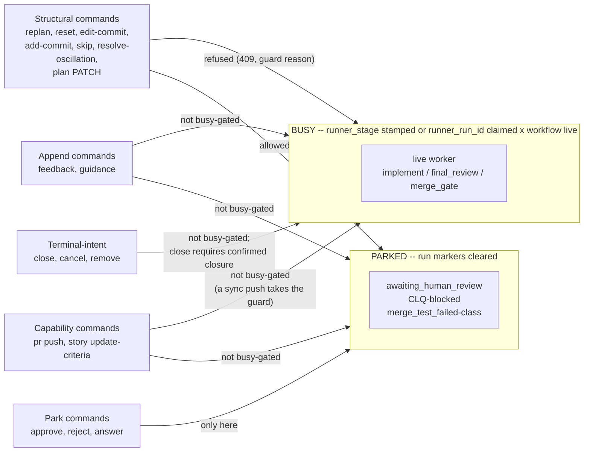

Offered and accepted are one computation: the endpoints gate through the same availability rows the UIs render (`requireWorkstreamTrigger`), and the drift test (`command_contract_drift_test.go`) requires every mutating route and every contract trigger to be classified — a command cannot ship half-wired.

### Substage (sub-FSM)

Stages with internal sequencing have their own sub-FSM. The substage field
tracks position within that sequence; the stored macro `status` is the
lifecycle stage, not its working/waiting state. A recorded sub-FSM exit and
the receiving parent flow determine where ownership goes next.

Implementing and merging enforce known same-domain transition pairs;
provisioning currently checks names only. Validation can be skipped on a failed
prior-state read, and writes have best-effort failure paths. Definition and
enforcement are not equivalent. The declared sub-FSMs are:
- **`implementing`** — runner inner loop. **Formalized.** Contract at `server/internal/fsm/implementing_substages.json`, loaded as `fsm.ImplementingSubstages` by `server/internal/fsm/fsm.go`. See **Implementing sub-FSM** below for the transition table.
- **`merging`** — merge sequence. **Formalized.** Local merge records `acquire_lock → pre_merge_tests → post_rebase_test → checkout → merge_attempt → finalize`; PR merge records `acquire_lock → pre_merge_tests → post_rebase_test → pr_merge → finalize`. The `post_rebase_test` substage runs the merge-gate command in the worktree after rebasing onto fresh main and before any merge lands.

Post-rebase check: after a rebase that git completed without a conflict, post-rebase verification on the landing path, the PR path, the merge gate's auto-rebase leg and the resolve legs runs the configured build and then the project's fast check (`fast_test_cmd`), handed the files touched between the new merge base and the rebased tree, instead of the full test command. It does so only when the test verdict store holds a pass of the full command for the tree the branch held immediately before the rebase. The full command runs instead, and the reason is recorded, when that proof is missing, when the rebase had conflicts or needed union, regeneration or AI resolution, when no fast check is configured, when `gates.commit_check` is `full`, in a multi-repo project, or when the touched-file list cannot be handed over; a rebase that was not needed is verified as before. A fast check that fails is followed by the full command on the same tree, always run rather than answered from a recorded pass, and the full command's verdict is the one reported, recorded and recovered; a fast failure the full command contradicts is recorded as a disagreement, and one followed by a full-command timeout stays on the blocked record beside it. The build, the fast check and that full command share one `test_timeout` deadline, as the test stage's phases do; a full-only verification gives each command its own. A fast pass never retires recorded post-rebase failures, and on the auto-rebase leg the merge gate still runs its full suite on the rebased tree before admitting the branch. Each verification after a rebase records a `post_rebase_check` timeline row naming the check that ran, its touched-file count and the full-command pass it relied on.

- **`provisioning`** — **Defined; names validated, transitions not enforced.** `resolve_base_sha → worktree_create → setup_hook → baseline_tests → plan_generate`, with explicit failure exits and `plan_generate_complete` returning to the parent flow. Contract: `server/internal/fsm/provisioning_substages.json`.

Merge does not require the target branch to remain at the base SHA used by
`post_rebase_test`. Target movement alone does not reject the merge. Git
conflict handling, non-overwrite protections and forge-required checks still
apply; this policy accepts that later base changes were not tested together
with the story. Merge-time tests remain in place.

#### Implementing sub-FSM

States: `preflight`, `select`, `clarification_check`, `concern_triage`, `implement`, `test`, `adjudicate`, `review`, `qa_gate`, `commit`. (`breakdown` runs before `select` but is not a tracked sub-FSM state — like the initial breakdown, the escalation partial breakdown sets `runner_stage="breakdown"` without an FSM transition.)

Transitions:

| Trigger | From → To |
|---|---|
| `preflight_pass` | `preflight` → `select` |
| `select_pass` | `select` → `clarification_check` |
| `clarification_clean` | `clarification_check` → `concern_triage` |
| `triage_complete` | `concern_triage` → `implement` |
| `implement_pass` | `implement` → `test` |
| `test_pass` | `test` → `review` |
| `test_fail` | `test` → `implement` (build failure: straight back to implement) |
| `test_conflict` | `test` → `adjudicate` (test failure: judge the conflict) |
| `adjudicate_resolve` | `adjudicate` → `implement` (REGRESSION/OBSOLETE verdict) |
| `review_approve` | `review` → `qa_gate` |
| `review_request_changes` | `review` → `implement` (or `review` → `adjudicate` when the blocker set repeats — deadlock; see Review-Conflict Escalation) |
| `qa_pass` | `qa_gate` → `commit` |
| `commit_pass` | `commit` → `select` |
| `commit_refused_repair` | `commit` → `implement` (recognized lint refusal with the automatic repair unspent; see Commit rejection carryover) |

Terminal triggers (exit-to-caller; control leaves the sub-FSM):

| Trigger | From | Exit reason |
|---|---|---|
| `select_complete` | `select` | all commits done |
| `clarification_blocked` | `clarification_check` | clarification needed |
| `implement_blocked` | `implement` | implementer stopped: clarification requires an answer; a block without clarification parks for human review |
| `review_human_gate` | `review` | awaiting human review |
| `qa_fail` | `qa_gate` | qa gate blocked |
| `adjudicate_blocked` | `adjudicate` | test/build/review conflict needs a human decision (Supervised CANT_TELL, or any REQUIREMENTS_CONFLICT / ARCHITECTURAL_DECISION escalation in every mode) |

These terminal triggers return control to the parent. They do not by
themselves prove that parent notification, persistence or continuation work
has finished. The parent must record its own working or waiting position.

#### Provisioning sub-FSM

The provisioning attempt owns setup through the following progression. A
failure returns to the parent with failure evidence; it does not create a
new macro failure state. Successful completion permits the parent to enter
`active` and continue the run, not to infer that the whole run is idle.

| Trigger | From -> To |
|---|---|
| `resolve_base_sha_pass` | `resolve_base_sha` -> `worktree_create` |
| `worktree_create_pass` | `worktree_create` -> `setup_hook` |
| `setup_hook_pass` | `setup_hook` -> `baseline_tests` |
| `baseline_tests_pass` | `baseline_tests` -> `plan_generate` |

| Exit trigger | From | Result returned to parent |
|---|---|---|
| `resolve_base_sha_failed` | `resolve_base_sha` | Base resolution failure; `provision_error` populated |
| `worktree_create_failed` | `worktree_create` | Worktree creation failure; `provision_error` populated |
| `setup_hook_failed` | `setup_hook` | Setup failure; `provision_error` populated |
| `baseline_tests_failed` | `baseline_tests` | Baseline failure; `baseline_failures` populated |
| `plan_generate_complete` | `plan_generate` | Provisioning complete; parent advances to `active` |

#### Merging sub-FSM

These stages belong to the merge/publish operation, not to a second activity
classifier. `acquire_lock` can wait for a lock; `await_pr_approval` performs a
forge check and can then return a waiting result. Neither stage name alone
acknowledges that the owning workflow has finished its work.

| Trigger | From -> To |
|---|---|
| `lock_acquired` | `acquire_lock` -> `pre_merge_tests` |
| `pre_merge_tests_pass` | `pre_merge_tests` -> `post_rebase_test` |
| `post_rebase_test_pass_local` | `post_rebase_test` -> `checkout` |
| `checkout_pass` | `checkout` -> `merge_attempt` |
| `merge_pass` | `merge_attempt` -> `finalize` |
| `create_pr_pass` | `create_pr` -> `await_pr_approval` |
| `push_branch_pass` | `push_branch` -> `await_pr_approval` |
| `pr_approved` | `await_pr_approval` -> `acquire_lock` |
| `post_rebase_test_pass_pr` | `post_rebase_test` -> `pr_merge` |
| `pr_merge_pass` | `pr_merge` -> `finalize` |

| Exit trigger | From | Result returned to parent |
|---|---|---|
| `merge_blocked` | `acquire_lock` | Lock unavailable or pre-checkout validation failed |
| `checkout_failed` | `checkout` | Checkout failed |
| `merge_attempt_failed` | `merge_attempt` | Merge failed or conflicts need resolution |
| `finalize_complete` | `finalize` | Merge finalized; any remaining archive work retains its own operation ownership |
| `create_pr_failed` | `create_pr` | PR creation failed |
| `await_pr_approval_blocked` | `await_pr_approval` | Waiting for PR approval or checks |
| `push_branch_failed` | `push_branch` | Push failed |
| `pre_merge_tests_failed` | `pre_merge_tests` | Pre-merge validation failed |
| `post_rebase_test_failed` | `post_rebase_test` | Post-rebase gate failed |
| `pr_merge_failed` | `pr_merge` | Forge merge failed |

#### Test-Conflict Escalation (adjudicate → partial breakdown → human)

When a previously-passing test goes red after an implement attempt, the loop does
**not** blindly re-run implement with "fix the code." It runs a bounded, tiered
escalation: a judge (Tier 1), then a **partial breakdown** that re-derives the
uncommitted plan tail (Tier 2), then a human (Tier 3). Budget: **judge×1 →
partial-breakdown×1 (per failing-test signature) → human** — no unbounded looping.

```text
test red ─► adjudicate (judge, Tier 1)
              │
   verdict ──┼─ REGRESSION / OBSOLETE ─► implementer fix, 1 try ─► test ─► green ─► review
              │
              ├─ deadline / infra exhausted ► failed (explicit retry)
              │
              ├─ CANT_TELL, Supervised ────► blocking clarification (adjudicate_blocked, human)
              │
              └─ CANT_TELL, unattended ────► PARTIAL BREAKDOWN (Tier 2)

  same failing-test-identity signature twice (after a REGRESSION/OBSOLETE retry)?
     ├ not escalated yet ─► PARTIAL BREAKDOWN (Tier 2)
     └ already escalated this signature ─► Tier 3: human gate (blocked)

PARTIAL BREAKDOWN  (= the `breakdown` engine re-invoked, scope=partial, 1 try/sig)
  re-derive the UNCOMMITTED tail; committed prefix frozen; worktree left intact
     ├ deadline / infra exhausted ─► failed (explicit retry)
     ├ Gatekeeper/Autonomous: apply ─► re-implement against the re-derived tail
     ├ Supervised: apply + block for plan review (hashd show / hashd run)
     └ can't resolve ─► raise a blocking clarification (human)
```

A red test first routes to a read-only judge substage (`adjudicate`) that
classifies the conflict **against the story's true requirement** (problem +
acceptance criteria) — deliberately distinct from the micro-commit task, which
may have over-specified something the requirement never asked for. A build
failure with a NEW error signature goes straight back to implement (the code
simply doesn't compile, and the loop is the right tool for a moving target);
one that REPEATS with an identical signature escalates through the
build-conflict ladder below.

Verdicts (`server/internal/fsm/implementing_substages.json`; judge prompt in
`prompts/adjudicate.md`):

| Verdict | Meaning | Route |
|---|---|---|
| `REGRESSION` | the requirement never asked for this side effect; the change is wrong | back to implement: fix code, **keep the test** |
| `OBSOLETE` | the requirement supersedes the test; it encodes old behavior | back to implement: reconcile the test, recording it in `touched_tests` |
| `CANT_TELL` | requirement is silent, or it's a scope/product call | Supervised: blocking clarification (`adjudicate_blocked`); unattended: hand to the partial breakdown |

Separation of authority: the implementer may **fix its own code** freely, but
**only an OBSOLETE verdict authorizes a test change**. The judge is read-only
(no `Edit`/`Write`); it returns a verdict, the implementer acts on it, and any
test edit/deletion is declared in the implement result's `touched_tests` so the
terminal reviewer (which holds the acceptance criteria) re-checks it. An
unparseable or failed adjudication defaults to `CANT_TELL`, except deadline
exhaustion: no verdict is acted on; the run fails for explicit retry.

**CANT_TELL routing by autonomy:** Supervised opens a blocking clarification
directly — a human is already in the loop. Gatekeeper/Autonomous hand the
ambiguous conflict to the partial breakdown instead: it can re-derive the tail or
raise its own clarification, a better first responder than a bare CLQ for
unattended modes.

**Oscillation trigger (Tier 1 → 2):** when the *same set of failing tests*
repeats across consecutive adjudications, Tier 1 isn't converging, so the loop
escalates to the **partial breakdown** (Tier 2) — and if it already escalated for
this conflict, to the **human** (Tier 3). The signature is the set of
failing-test **identities** (test name + file), parsed from `test.log` and stored
on the `review_history` entry — deliberately *not* the raw output, which carries
per-run durations that would make an unchanged failure look different every run
(the bug that made the original guard a silent no-op). It mirrors the review
loop's `_review_blocker_set` identity comparison.

**Committed-breakage probe (before Tier 3):** once per signature, before the
human takes a repeat, the loop reruns the failing command at committed HEAD in
a throwaway worktree and reframes the implement prompt only when a current
failing-test identity is red there too. The command is the one that produced
the failure, with the argv it ran: the full check's, `fast_test_cmd` with the
fast check's touched-file set (the same `stages/touched-files.txt` and
`HASHD_*` variables) when that check produced it, or an automatic FIX's
required verification, which is handed no list. A list whose bytes no longer match the digest the
test stage recorded makes the probe inconclusive, and the failure goes on to the
human.

Two known limitations, both bounded: (1) the signature depends on the parser
extracting structured failures — output it can't structure yields an empty
signature and no *early* escalation, but `max_review_attempts` still caps the
loop and routes to the human gate; (2) the identity excludes the failure
*message*, so "same test, different assertion" counts as oscillation (the
observed livelock was the identical failure every iteration).

#### Build-Conflict Escalation (repeat signature → adjudicate → human)

Build failures ride the same escalation *machinery* at a different trigger
point: the judge runs on **signature repeat**, not per-failure as the test
path does — most first build failures are trivial implementer slips the loop
fixes in one pass, and judging every one would burn an invocation per typo.
```text
build red ─► signature (file + normalized message, NO line:col)
              │
              ├─ NEW signature ──────────► back to implement (plain retry, as always)
              │
              └─ SAME signature as the previous failure
                    │
                    ├─ judge already spent for this signature ─► human gate (blocked)
                    │
                    └─► adjudicate (build kind, read-only judge)
                          │
               verdict ──┼─ FIXABLE ──► ONE directed implement retry
                          │              (judge's 2-3 sentence direction rides the
                          │               retry prompt; same signature again ─► human gate)
                          │
                          ├─ deadline / infra exhausted ► failed (explicit retry)
                          │
                          ├─ CANT_TELL, Supervised ─► blocking clarification (human)
                          │
                          ├─ CANT_TELL, unattended ─► human gate, judge's DIAGNOSIS
                          │                            as the blocked reason
                          │
                          └─ other activity error ──► blocked (run ends, no approval)
```

The build judge (`prompts/build_adjudicate.md`, verdicts `FIXABLE` /
`CANT_TELL`) diagnoses WHY the error persists rather than classifying a
change-vs-test contradiction: it gets the compiler errors verbatim, the
commit task, and the recent-branch context (commits with the files each
touched, plus the changed-file list vs the default branch) — the evidence
needed to attribute a structural cause like a shared file clobbered or made
stale by an earlier branch commit. The test-conflict `adjudicate.md` premise
and verdict space (`REGRESSION`/`OBSOLETE` with `test_target` routing) do not
map to compile errors and are never fed them.

The signature (`BuildFailureSignature`, sibling of the test one) is the
sorted, deduplicated set of **file + normalized message** identities parsed
from compiler diagnostic lines — deliberately no line:col, since a failed
fix that shifts the unfixed error a few lines would change a
position-bearing signature and resume blind retries. Output with no
recognizable diagnostic lines yields an empty signature and the guard stays
inert (the plain retry loop and its attempt cap still apply).

There is deliberately **no tier-2 partial-breakdown leg** for builds: a
repeated identical compile error is structural and plan regeneration is the
wrong medicine — the ladder goes judge → human, with the judge's diagnosis
(not just raw compiler output) in the gate reason.

#### Per-commit re-review: the reviewer resumes its own session (arbiter resume)

The per-commit reviewer is an **arbiter, not a designer**: it rules on
whether the implementation delivers working code aligned with the
requirements. Two mechanisms hold that boundary:

- **Round-to-round session resume.** Round 1 of a commit's review is a
  cold, full contextual review (`prompts/review_contextual.md`). Every
  later round for the same commit resumes the SAME reviewer session
  (`prompts/review_round_resume.md`): the reviewer re-reviews the diff as
  it now stands, verifies its own violations are gone, and flags what the
  new round broke. No prior-finding text is injected — the session already
  carries its own findings, and textual re-injection is the confusion
  channel PR #823 removed (models read history as current state). The
  resume prompt carries only this round's fresh evidence (what changed
  since the round that session last graded, build/test results, claimed
  fixes, implementer notes, human guidance) plus an anchoring guard:
  earlier remedy hints were optional — grade whether the violation is
  gone, not whether the suggestion was taken. The change evidence is a
  summary and never a diff body: the files that moved between the tree
  the session last graded and this round's, with per-file added/removed
  line counts; an explicit statement that this round grades the same tree
  the session last graded, when the two identities match; or an explicit
  statement that the prior graded state cannot be established, when it
  cannot — never an empty list standing in for either statement. When the
  session cannot resume (gone, or context exhausted) the round falls back
  to ONE pure cold review — never with prior findings as text — and
  records a `review_session_fallback` transcript event; a fresh-eyes
  round there is expected and the attempt budget absorbs it. Fresh
  holistic eyes are final_review's job, not the per-commit loop's.

  The logical stage stays `review`; execution uses `review_resume` and
  `review_resume_round.log`. The prompt row is written before its attempt
  dispatches, so it carries only what is known then: the prompt template
  and the requested `resume_session_id`. The response row carries the
  invocation's own `invocation_stage` and returned `session_id` -- from
  the invocation, not from the prompt template. Cold fallback records the
  cold invocation separately from the failed resume.

  Claimed fixes and notes come from the current `RunnerImplement` terminal
  result, carried in the `RunnerReview` activity input, never re-parsed from
  `implement.log`. Activity retries retain that input; the next implement
  attempt replaces it. Older activity inputs may lack the evidence:
  `implementation_evidence_present=false` records that absence, with no
  stale-log fallback. An empty supplied result is present but has no claims.

- **Findings are violations, not designs.** A finding's `text` states
  what is broken and why (mechanical one-endpoint instructions included);
  a design choice is not the reviewer's to impose — it rides the optional,
  explicitly non-binding `hint` field, which the retry relay renders as
  `(reviewer suggestion, optional: ...)`. The implementer may satisfy the
  violation any way it can defend; the resumed reviewer grades the
  violation, not the road taken.

Divergent findings across rounds — the reviewer finding NEW things — are
the loop's own convergence space: they run the full `max_review_attempts`
budget and park at the human gate on exhaustion. No judge is summoned for
novelty.

#### Review-Conflict Escalation (deadlock → adjudicate → human)

The unresolved-blockers repeats-guard (in the review reject branch) trips
when the SAME blocking finding set survives an implement retry — the
reviewer and implementer are stuck. That deadlock is the review judge's
seat: before parking, the loop asks the judge ONCE for a directed retry
against a closed list. The judge's charter is the operator's manual
remedy for a stuck review — a reject carrying a CLOSED fix list ("fix
exactly these, everything else is deferred, stop") — mechanized.

The guard compares blocking-finding text only. `diff_identity` records each
round's provenance and appears in `hashd show`, but does not affect the guard:
changed code with the same blockers can still be deadlocked. Repeated blockers
do not prove the review is stale.

Only the format retry's first redraft has an identity check. Before asking a
resumed session to restate its assessment, it compares the round's identity with
that session's last recorded identity. A mismatch or either missing identity
(no session row, unreadable reviews table, or round without an identity) forces
a cold round.

Ordinary resumed rounds may repeat an assessment without an identity gate.
The resume prompt's round-evidence section discourages stale repetition but
does not prevent it. Fresh or stale, a repeated blocking set reaches the same
deadlock comparison.

```text
review reject
     │
     ├─ findings DIFFER from the previous reject ─► the loop's own convergence space:
     │        retry with feedback until max_review_attempts, then human gate
     │        (no judge for novelty; after a judged retry, any reject is terminal
     │         at the human gate)
     │
     └─ blocking finding set REPEATS the previous reject (deadlock)
              │
              ├─ judge already spent (reviewJudged), or no budget left
              │        ─► human gate ("unresolved blocker set repeated")
              │
              └─► adjudicate (review kind, read-only judge)
                    │
         verdict ──┼─ CARRY ──► ONE directed retry against a CLOSED LIST
                    │            • the list is authoritative implementer guidance
                    │              (HUMAN GUIDANCE block — the manual-remedy channel)
                    │            • AND the judged round's reviewer grades EXACTLY that
                    │              list via the closed-list prompt (reject again ─► human gate)
                    │
                    ├─ deadline / infra exhausted ► failed (explicit retry)
                    │
                    ├─ CANT_TELL, Supervised ─► blocking clarification (human)
                    │
                    ├─ CANT_TELL, unattended ─► human gate, judge's DIAGNOSIS as the reason
                    │
                    └─ other activity error ──► human gate (fail closed: a judge
                                                we can't run can't bless a retry)
```

The review judge (`prompts/review_adjudicate.md`, verdicts `CARRY` /
`CANT_TELL` / `REQUIREMENTS_CONFLICT` / `ARCHITECTURAL_DECISION` — the
last two covered under "Requirements / architectural escalation" below)
reads the per-round finding history (each round's verdict,
confidence, and findings with severities) plus the current branch diff and
the story requirement, and rules which findings a competent reviewer would
genuinely insist on versus which are churn. `CARRY` returns that closed
list in `reason`; `CANT_TELL` (same literal as the other spaces, so the
routing reuses) means the rounds reflect a real product question, not
distillable churn. The test-conflict `REGRESSION`/`OBSOLETE` and
build-conflict `FIXABLE` verdicts do not survive in the review space.

The CARRY list threads to the implementer through the same
`review_feedback` slot the build ladder's FIXABLE direction uses
(`FormatReviewCarryFeedback`), so the closed list — not the last round's
raw divergent findings — leads the resume prompt. It is also stacked into
the HUMAN GUIDANCE block, which covers the fresh and FIX-cycle implement
prompts (where the retry `review_feedback` slot is not rendered). It
threads to the reviewer via a dedicated closed-list prompt
(`prompts/review_closed_list.md`, selected by a code-side mode flag on the
review stage). The closed-list reviewer's finding space is deliberately
narrow: (a) whether each carried finding was resolved, and (b) breakage
this round's own diff introduced — never a fresh audit. That reframe is
why it is a distinct prompt rather than the resume round: the deadlocked
session already failed to converge, so the judged retry gets a bounded
rubric instead. The one-shot budget is a `reviewJudged` bool on the cycle
state (reviews carry no signature to key on, unlike the build ladder);
once it is set, a reject OR a sub-threshold (soft-retry) approve on the
judged round is terminal at the human gate rather than buying more
rounds.

#### Requirements / architectural escalation (the judge asks the human in plain language)

Some non-convergence is not churn the judge can distill into a CLOSED
LIST: the reviewer alternates because two standing constraints are
jointly unsatisfiable (each round's fix IS the next round's finding), or
because a structural decision has no precedent. Code bugs converge — a
fixed finding stays fixed; a requirements conflict oscillates. For these
the review judge has two elective, proof-carrying escalation verdicts on
top of `CARRY` / `CANT_TELL`:

- **`REQUIREMENTS_CONFLICT`** (operator label: *"insufficient /
  contradictory requirements"*) — two standing constraints collide.
- **`ARCHITECTURAL_DECISION`** — a non-obvious structural choice with no
  clear precedent.

Decision contract, in order (`prompts/review_adjudicate.md`):

1. **Honesty rule** (verbatim in the judge AND all per-commit reviewer
   prompts): a resolution that lies to the end user — a silent no-op
   behind a success message, a screen showing state that is not real —
   is never a valid way to satisfy a finding. If the only reading that
   closes every finding deceives the user, the findings are unsatisfiable.
2. First attempt one honest reading that satisfies every standing finding
   → **`CARRY`**: the judge resolves technical conflicts itself; it does
   not escalate a disagreement it can settle.
3. If none exists → an escalation verdict, **proof required**: quote both
   colliding constraints verbatim and name each source (AC text, commit
   instruction, template copy, prior ruling). A verdict whose proof is
   incomplete (fewer than two sourced constraints, fewer than two options,
   or no question) is downgraded to `CANT_TELL` — the fail-closed net.

On either escalation verdict the run **parks immediately at the human
gate in every autonomy mode** (no further FIX rounds), via the existing
`finishBlockedCLQ` path — the driver opens a blocking clarification and
returns `Blocked`.

The clarification a human sees is **plain product language**: a concrete
end-user scenario, options as product behaviors with their trade-offs,
and an optional one-sentence judge *lean* placed after the options. The
question body carries no file paths, file:line, or symbol names — a
fencing heuristic rejects them; on a leak the judge gets **one** re-author
attempt (question only, `prompts/review_adjudicate_reauthor.md`), then a
safe generic question, never the leaky text. The mechanical findings and
the colliding-constraint proof ride below as evidence.

```text
escalation verdict (REQUIREMENTS_CONFLICT | ARCHITECTURAL_DECISION)
     │
     ├─ proof incomplete ──────────► downgrade to CANT_TELL (fail-closed net)
     │
     └─ proof ok
          │
          ├─ question leaks identifiers ─► one re-author ─► still leaks ─► generic question
          │
          └─► open blocking clarification (plain-language question + evidence),
              park at the human gate — ALL autonomy modes, no rounds 4/5
```

##### The answer amends the acceptance criteria (REQUIREMENTS_CONFLICT only)

A ruling that contradicts the record must become the record: if the story's
acceptance criteria still say the thing the human just overruled, every
later prompt carries two contradicting authorities (stale AC + overriding
ruling) — the exact fuel of the oscillation the judge exists to stop. So
answering a `REQUIREMENTS_CONFLICT` clarification turns the ruling into the
minimal acceptance-criteria edits, human-confirmed.

The escalation clarification is stamped kind `requirements_conflict`.
`ARCHITECTURAL_DECISION` keeps the default `question` kind and never enters
this path — its answer rides the existing per-run guidance channel
(`HumanFeedback` → the HUMAN GUIDANCE prompt block), never an AC edit.

The flow rides the `breakdown_proposal` idiom — a clarification KIND that
selects specialized handling on the existing `/workstreams/{id}/answer`
endpoint, so no new command and no new REST surface:

1. **Ruling → derive.** Answering the `requirements_conflict` clarification
   dispatches `AcAmendmentDeriveWorkflow`. A read-only judge-family agent
   stage (`prompts/ac_amendment_derive.md`, `server/internal/stages/acamend`)
   reads the question, the ruling, and the story's current acceptance
   criteria and emits the MINIMAL edits. The run stays parked throughout —
   never resumed mid-derivation.
2. **Minimality validator.** The deriver declares the criterion indices it
   targets; the server applies only those operations to the original list
   (untouched criteria stay byte-identical by construction) and rejects any
   operation outside the declaration, a double-touch, or an empty edit. A
   rejection — or an empty delta (the ruling maps to no AC change) — skips
   the proposal and resumes guidance-only, with an operator message when it
   was a validation failure. Authored text is never rewritten on a guess.
3. **Propose → confirm.** A valid, non-empty amendment posts an
   `ac_edit_proposal` clarification whose body is the exact per-criterion
   diff plus the consequence line. The rendering is generic text, so every
   surface (CLI, TUI, web, Telegram) shows the same informed choice with no
   new client handling. The deriver ran outside any reservation, so the
   insert rechecks what apply checks, under one story reservation. As at
   apply, a requirements conflict already resolved posts nothing, and
   criteria that no longer hash to the base the deriver saw close the
   conflict superseded and resume guidance-only with the ruling plus a
   note. A story no longer linked to the workstream, or whose content is
   locked outside implementing, closes the conflict superseded with no
   resume; apply instead refuses those with no write and leaves its
   proposal pending. A superseded close stores the ruling verbatim
   with the reason, since it is the ruling's only record. The recheck holds
   no story ownership: the hash and stage checks are the whole fence.
4. **Apply, then resume.** "yes" dispatches `AcAmendmentApplyWorkflow`,
   which applies the edits under the **`pm:{project}` singleton** (answer-
   driven story mutation, serialized exactly like an edit — never a raw
   write) and re-validates against the current story first, so a concurrent
   edit that invalidated the diff falls back to guidance-only instead of
   applying a stale delta. No acceptance-criteria write happens under a live
   worker (the #1408 liveness busy-guard). Then the run resumes with the
   ruling as guidance. Amend first, resume second — never the reverse. "no"
   resumes guidance-only with the ruling.

Only story acceptance criteria change; SPEC.md and REQS.md are untouched.

```text
answer requirements_conflict clarification (the ruling)
     │
     ▼  AcAmendmentDeriveWorkflow — run stays parked
  deriver agent → minimal AC edits → validate (declared indices only)
     │
     ├─ empty / invalid ─► resume guidance-only (ruling [+ note]); no proposal
     │
     └─ valid ─► insert-time recheck (one story reservation)
                     ├─ source resolved → nothing
                     ├─ criteria drift → resume guidance-only (ruling + note),
                     │                   then close superseded; succeeded result
                     ├─ workstream unlinked / content locked outside implementing
                     │                 → close superseded, no resume; declined result
                     ▼
                 post ac_edit_proposal (exact diff + consequence line)
                     │
                     ├─ "no"  ─► resume guidance-only (ruling)
                     │
                     └─ "yes" ─► AcAmendmentApplyWorkflow
                                    │ pm:{project} section: re-validate → apply
                                    ├─ live-worker → close proposal, no write, NO resume
                                    │                 (the live run is the run)
                                    ├─ drift/invalid → resume guidance-only (ruling + note)
                                    └─ applied → resume with the ruling as guidance
```

#### Commit rejection carryover (a refusal the next run is told about)

A commit refusal preserves the rejected micro-commit and full diagnostic.
The next attempt selecting that same undone commit receives the latest
unresolved rejection, on fresh and resumed paths. A missing, damaged or
mismatched evidence record fails delivery; infrastructure read errors retain
their retry policy. Other commits and done/removed plan entries do not inherit it.

A deadline kill before a verdict is `deadline_unjudged`, not a new refusal;
it does not supersede an earlier rejection. An `operator_action` obstruction
must be reported blocked if still present, not cleared by deleting locks,
editing workflow-owned files or bypassing hooks.

Landing the commit retires that commit's rejection context, including crash
recovery. Reset, replan and partial-breakdown replacement retire all affected
context because reused IDs may name different work. The original outcome and
evidence remain immutable. Merge failures likewise retain complete evidence;
missing evidence persistence is disclosed rather than inventing a reference.

A recognized lint refusal of the `git commit` invocation, with the work still
uncommitted and its complete evidence retained, selects automatic repair: the
same run re-enters implement for the same micro-commit, and test, review, the
human-gate decision, qa_gate and commit run again. Each pending micro-commit
gets one automatic repair. Replay, restart, continuation, gate re-entry and
manual retry do not refill it; reset, replan and partial-breakdown replacement
renew it. Every other commit failure, and any refusal after the repair is
spent, ends the run failed at commit with the manual recovery steps; a
refusal after the repair is spent also records that the repair was already
used.

See [storage and delivery details](docs/ARCHITECTURE.md#commit-and-merge-rejection-evidence).

#### Agent-stop landing (a stop that is not a question)

A stop with nothing to commit and nothing to answer is not a failure and
not a question — it is a run that needs a human to look. Two implementer
stops, four judge stops, one test-ladder stop, one partial-breakdown stop
and three merge-gate stops land here:

- **The bare implementer block** — the agent reports itself blocked and
  raises no clarification. Its park cause is a fixed line (`The
  implementer stopped with no question to answer`) and its body is the
  agent's own blocked reason. Left to end where it stood, that run
  closed with the workstream still at `implementing`, reading
  `implementing / blocked`.
- **The exhausted implement ladder** — the session resume missed, the
  fresh fallback attempt ran, and what the agent returned fits no
  classification the stage can act on. (Nothing parses a status here:
  the implement contract's status payload is only read on a SUCCESS
  classification, and this landing is decided by which classification
  arm the failure fell into.) Its park cause is that classification's
  own title (`<agent> returned unusable implementation output`) and its
  body is the raw output the driver captured. Left to end where it
  stood, that run closed `failed` at `implementing` — the right verb for
  a stage that broke, the wrong one for an agent that gave up, whose
  cure is not a re-run.
- **The concern-triage oscillation** — the triage judge found the
  commit's review or fix history going in circles and promoted the
  concerns it keeps returning to. Its park cause is `Concern triage
  detected an oscillation` followed by the existing one-line summary of
  the first three promoted concerns; its body is that summary followed
  by every promoted concern, in the order the judge returned them. Left
  to end where it stood, that run closed at `implementing / blocked`
  with a reason naming `[a] approve` and `[r] reject`, neither of which
  exists there. Approve and reject at this park each **waive the
  oscillation check for the next cycle only, and only for the stopped
  micro-commit**: that cycle re-runs the same micro-commit over the same
  review history, and without the waiver its triage stops it again. The
  cycle after it, and every later micro-commit, runs triage normally --
  including a micro-commit the next cycle selects because the stopped
  one was skipped at the park. The waiver crosses continue-as-new and
  orphan recovery (the run row's `stop_origin` and `microcommit_id`,
  below); `hashd run --override-oscillation` is unchanged. Histories recorded before this
  landing replay their old blocked exit.
- **The build judge's three human-gate exits** — the same compiler
  failure repeated and the build-conflict judge was called in:
  - it ruled CANT_TELL (or returned a verdict it does not recognize):
    `repeated build failure needs a human decision`;
  - it ruled FIXABLE but the attempt budget is spent: `build failure is
    fixable but the attempt budget is exhausted`;
  - the identical failure persisted after its one directed retry:
    `identical build failure persisted after the judged retry (<n>
    attempts)`.

  That line is the park cause's title, and the body is the judge's whole
  diagnosis or direction (when it gave one; for the third exit, the
  direction the judged retry ran on) followed by the build failure output
  the ladder was acting on, so the cause of the first two reads as the
  old blocked reason did. The first two record the stop on the `adjudicate` stage as
  `blocked` (the judge ran and ruled); the third on the `test` stage as
  `failed`. Left to end where they stood, each closed at
  `implementing / blocked` while its `loop_exhausted` event announced a
  `human_gate` that was never reached. Histories recorded before this
  landing replay their old blocked exit. A judge that could not run keeps
  its failure: an infrastructure interruption ends the run `failed`, a
  judge error or `FailureTitle` keeps its fail-closed blocked exit, a
  deadline keeps its deadline failure (older histories replay the
  deadline park), and a ruling that raised a clarification keeps
  `finishBlockedCLQ`.
- **The test ladder's tier-3 exit** — the same tests failed again after
  the plan tail was re-derived, and the committed-breakage probe either
  found them green at HEAD or its one self-heal retry for that failure
  was already spent. Its park cause is `identical test failure persisted
  after re-deriving the plan (<n> attempts)`, and its body is the whole
  failing test output the ladder was acting on (the formatted failure,
  or the raw test output when there is none). It records the stop on the
  `test` stage as `failed`. Left to end where it stood, that run closed
  at `implementing / blocked` while its `loop_exhausted` event announced
  a `human_gate` that was never reached. Histories recorded before this
  landing replay their old blocked exit. The self-heal retry still
  continues the loop, and the attempt-budget exit still ends the run
  `failed`.
- **A partial breakdown that blocked with no clarification** — the
  test-conflict escalation could not re-derive a usable plan tail (the
  agent errored, refused, or returned no commits), its re-derived tail
  was refused by the splice, or the tail came back empty, and the
  clarification it raises for a human was not created. Its park cause is
  `Partial breakdown <conclusion>` (`could not re-derive a usable plan
  tail`, `could not apply the re-derived tail safely`, or `re-derived an
  empty plan tail`), and its body is the escalation's own reason, whole:
  the agent's error or refusal reason, the splice's refusal, or the
  empty-tail text. It records the stop on the `breakdown` stage as
  `blocked`. Left to end where it stood, that run closed at
  `implementing / blocked` with only the generic `test conflict needs a
  human decision` reason, naming no clarification and no cause.
  Histories recorded before this landing replay their old blocked exit.
  A block that did create its clarification keeps `finishBlockedCLQ`, the
  supervised plan-review pause keeps its plain blocked exit, and an
  escalation that could not run (an activity error, a deadline, a forced
  or cancelled stop, or no outcome at all) keeps its failure.
- **The merge gate's three agent-output stops** — the run's merge gate
  (the all-complete leg, not the cycle) stopped on what an agent itself
  produced:
  - the story's one automatic FIX failed: generation errored, did not
    produce exactly one valid FIX, or produced one the bind admission
    refused (`Merge-gate automatic FIX generation failed`, `... did not
    produce one valid FIX`, `Merge-gate automatic FIX was not bound`).
    The body opens with one line naming the verdict, what failed and
    what generation made of it (`Merge gate failed: adjudicator ruled
    <VERDICT> on <X>; automatic FIX generation produced no FIX`, X the
    first failing test the test-output parser names and how many more,
    else `build` or `tests`). The verdict leads so the park's capped
    one-line reason always keeps it. Then every failing test name, the
    failure the FIX was generated against (command, revision, base
    comparison and recorded output), the adjudicator's verdict and
    reason, what generation returned (its error, the empty answer or the
    refusal) whole, and the run-relative stage log pointers: the failing
    leg's log and `stages/fix_generation.log`. Without the agent-stop
    landing the same failure parks at `merge_test_failed`: its reason is
    that lead line and the next steps, and its blocked report is this
    record and the next steps whole. A reason past the bus's
    500-character bound is never cut: it names the verdict and outcome
    and states that the failing tests and next steps did not fit and are
    in the report.
    A failed automatic rerun after an OBSOLETE ruling and an empty FIX
    list stops the same way, as `Merge-gate verification failed again on
    its automatic rerun`. Its lead names the verdict and what the rerun
    failed on (`Merge gate failed: adjudicator ruled OBSOLETE; automatic
    rerun failed on <X>`, X the rerun's first failing test and how many
    more, else `build` or `tests`; `timed out in` for a timeout). Its
    record lists the rerun's failing tests before the original's, adds
    the rerun's failure (command, revision and recorded output) after the
    empty answer, and ends with `stages/merge_gate_rerun.log` after the
    other logs; a gate that ran no rerun says why instead;
  - a build that passes on base and fails on the story revision, which
    the adjudicator did not rule FIXABLE (`Merge-gate build break on the
    branch was not ruled fixable`). The body is the judge's whole reason,
    the base comparison and the recorded output;
  - verification still failing once the story's automatic FIX allowance
    is spent, when a FIX is bound to it or the runner's claim that spent
    it recorded a failed FIX generation (`Merge gate failed: <X>`, X the first failing test the test-output parser names, else `build` or `tests`). The body is the command, revision and recorded output. A claim with no recorded generation result keeps
    `merge_test_failed`.

  Bodies carry the output whole, not the park report's 60-line tail. The
  gate announces no blocked of its own for these (the park is the one
  announcement), still writes its `merge_gate_result` and
  `fix_generation_result` rows, clears the `merge_gate` stamp so the
  `no_active_runner` verbs pass, applies no merge-gate exit state, and
  hands the stop back to the run loop, which parks it with `stop_origin =
  merge_gate`. Every micro-commit is done there, so **approve re-runs the
  merge gate unchanged**: a plain continue, whose next cycle implements a
  micro-commit an operator added or reopened at the park first, and
  otherwise re-runs the gate on the branch as it stands. The FIX
  allowance is not restored. Orphan approve does the same: an
  `agent_stop` row dispatches a plain run. **Reject appends one FIX
  micro-commit** whose description is the operator's `-f` guidance, the
  same way the post-completion and PR-state rejects add theirs
  (`microcommit_added` from operator guidance, `plan_changed`), and the
  run implements that FIX before the merge gate runs again, with the
  allowance still spent. The guidance travels in the FIX alone: the
  signal, or orphan recovery's plain run, carries no feedback, and no
  rejection guidance row is filed. Reject's meaning follows the stop's
  origin, not whether the plan is complete. A live park appends the FIX
  together with the expiring pending-decision marker and both records,
  in one write, with the workstream still parked, and then signals; a
  signal the engine definitely refused takes FIX and marker back in one
  write. While the marker stands a re-issued reject is refused. After
  it expires the FIX's records identify it, wherever add-commit has
  since put other commits: while it is undone, a reject with the same
  guidance delivers it rather than appending a second, whether the run
  is live or has closed, and a reject with different guidance is
  refused, naming that FIX. An orphaned park places the
  FIX the same way, moves to `active` through the reject trigger and
  dispatches one plain run; a refused dispatch takes the FIX back, puts
  the park and its run row back and announces the return to the park. A run row
  whose payload will not decode refuses the reject. Reject there refuses `--reset`,
  empty guidance and any findings selection, as well as an exhausted FIX
  number or guidance containing reserved plan syntax, before anything
  changes.
  These stops land here only from `implementing` or `active` (the park's
  `await_review` sources); from anywhere else, and in histories recorded
  before this landing, they keep `merge_test_failed`.

  **Check-result stops keep their landings.** A rebase conflict goes to
  `merge_conflicts`; a test failure after rebase, a test-kind ruling, an
  inconclusive base comparison, no decision, a refused admission, an
  ineligible state, a story with no requirement and an allowance another
  execution consumed go to `merge_test_failed`; a found secret, a test
  timeout, a refused rebase or a dirty worktree go back to `active`, where
  `hashd run` is offered. Those are the checks reporting on the branch,
  not an agent giving up, and each already lands where its cure is
  offered; at the agent-stop park approve would only mean "re-run the
  gate", which those landings already offer.

Stage deadlines and exhausted infrastructure interruptions are failures, not
approval requests. In all three adjudication legs and partial breakdown they
end the run `failed`, preserving work and the available diagnostic for explicit
retry. Failure handling neither creates clarifications nor authorizes a commit
or plan rewrite.
Genuine rulings retain their existing decision paths. Older executions replay
their recorded routing; an already-created clarification keeps its answer path.

An unusable-output stop reaches the human gate only after both a session-resume
attempt and its fresh fallback have been spent in this run. A first full-prompt
attempt still fails for explicit retry. The classifier must recognize no known
fault, the invocation must have an ordinary exit without an invocation error,
and stdout/stderr must contain actual agent output. Deadlines, spawn/stream
errors, interrupts and recognized network/provider failures remain failures.
Transcript-wide token matching can conservatively classify a quoted error as
a fault and miss this park; see [classification details and limitations](docs/AGENT_MANAGEMENT.md#agent-stop-classification).

The FSM's `no_active_runner` verbs do survive all of those exits — each
clears `runner_stage` — but the two things the stop calls for do not: the
gate verbs that answer it, and a durable record of why it stopped beyond
the agent's own free text in a log.

The landing sends that stop through the human gate the run workflow
already parks on. Same park, same signal, same two routed verbs (approve
and reject — see the replan note below) — and deliberately **not** the
same decision, and **not** the same approve:

- **No confidence decision.** `DecideHumanGate` grades the latest
  `stage_review` row, and that lookup is workstream-scoped with no
  micro-commit filter. At a stop on micro-commit N the row it reads is
  N−1's, so an approving above-threshold review of work that already
  landed would auto-continue and commit the half-finished tree. The
  landing parks in **every autonomy mode** instead.
- **Approve means "have another go at the same micro-commit."** The
  review gate's approve re-enters with `ApprovedCurrentDiff`, which skips
  implement/review and commits the current tree. Here it re-enters with
  nothing carried forward, so the next cycle selects the same still-undone
  micro-commit and re-runs implement against it. Nothing is committed
  until an implement actually succeeds — the frozen-work rule.
- **The stamp is cleared.** Not by the park — the park only transitions,
  emits and patches the run row. The deregister is the cycle's own exit
  (`finishPreserving` with `preserveStage=false` → `DeregisterRunner`),
  the same thing the exit this landing replaced did. It stays
  load-bearing: `runner_stage` is what the FSM's `no_active_runner`
  guard reads, so preserving it here would withhold `skip` /
  `edit_commit` / `add_commit` (self-transitions at
  `awaiting_human_review`) at the very stop that needs them.

A block that DOES carry clarification ids keeps its own exit
(`finishBlockedCLQ`): it is already answerable, its marker drives the
answer-resume dispatch, and its `runner_stage` stamp is preserved for
that.

Other agent-produced stop shapes are deferred call sites, one line each.
This section does not list them — the runner cycle has many exits that
finish `StatusBlocked` at `implementing`, and a short list would be read
as complete. Find them by shape: an exit whose reason is an agent's or a
judge's own text rather than an answerable clarification
(`finishBlockedCLQ` marks the ones already answerable, which are not
candidates). The carve-out is by **cause**, not exit status: a stop from
outside the work — usage limit, expired login, provider overload, worker
death — is never a candidate, because its cure is a re-run, not a
review.

One is named anyway, because the shape rule above will not find it and
it is the give-up an operator meets most: the **exit-0 attempt that
modified nothing** (`<agent> made no changes`). It is not an agent
error at all — the agent returned a clean result and `git status` came
back empty — so it never reaches the classification arm, never sets
`StopAtHumanGate`, and ends the run `failed` at `implementing` with a
`FailureHelp` naming `hashd reject`, which `available_actions` does not
offer there. This is a current mismatch between recorded advice and admitted actions.

The park writes the record in the one write that blocks the run row, and
it has three parts, plus a fourth on the concern-triage stop:

- The **cause** — a single bounded line, the stop's kind followed by one
  line of the agent's own text. WHICH line is the exit's to say, and it
  travels beside the body as `runflow.StopBodyKind`: the **first** line
  when the exit composed the body (`<agent> blocked: ...`, a deadline's
  fact block), because a composed cause leads with its point; the
  **last** non-empty line when the exit handed over captured output,
  because that is where a stop states its conclusion. This is
  `gate_reason`, and it is the part that renders: the TUI's
  `Human review:` row, the web detail page's gate line, `hashd show`'s
  line under the last run, and `hashd show --json`'s
  `last_run.gate_reason` for the non-TTY reader.
- The agent's **full text** — durable on the run row and in the cycle's
  stage note, folded the way a stage failure folds (kind, then the
  agent's words, then the next steps under `Suggestions:`). How much of
  it renders depends on the stage status the stop records, which each
  stop chooses for itself: `hashd show` cuts a stage note to a 50-byte
  preview either way, and the TUI expands a note only for a stage
  recorded `failed`. The exhausted ladder records `failed` — the stage
  did fail, and that is the status it recorded before this landing
  existed — so its diagnosis and its `hashd log` pointer still render
  there. The bare block records `blocked`, because nothing broke, and
  its text is the part still waiting on a renderer: that is
  **STORY-0004**, and this landing keeps the durable record and the
  existing cap meanwhile, which is why the one line that always renders
  (the cause above) composes the agent's words in rather than stating
  the kind alone.
- The **stop origin** (`stop_origin = concern_triage` or `merge_gate`), on
  those stops only — which check the decision answers. For concern triage
  an orphaned approve or reject dispatches its run with that check waived
  for the micro-commit the run row names; a merge-gate stop's orphaned
  approve is a plain run, and its reject (live or orphaned) appends a
  FIX first. It is written, carried
  over and retired with the park kind below; the park kind stays
  `agent_stop`, so every reader of the kind treats this park as any
  other agent stop.
- The **park kind** (`park_kind = agent_stop`) — the machine half, and
  load-bearing rather than informational:

> If the run workflow closes while the workstream is still parked
> (cancellation, an unrecognized action, a janitor sweep), a later
> `hashd approve` has no workflow to signal and falls to orphan
> recovery — which dispatches `ApprovePostReviewExhaustion`, i.e.
> **commit whatever is in the worktree**. At a stop park that would
> commit the half-finished tree the landing exists to protect, and
> `available_actions` offers approve at `awaiting_human_review` either
> way, so the operator cannot tell the two meanings apart. The recovery
> therefore reads `park_kind` and dispatches a plain run for an
> agent-stop park: same micro-commit, re-implemented, nothing committed.
>
> Only a workstream with **no runs at all** keeps the commit meaning by
> default — it cannot have stop-parked. An *indeterminate* read (the
> query failed, the payload will not decode) resolves the other way, on
> the rule the liveness probe already follows: a probe failure is not a
> verdict. A spurious re-implement costs a cycle; a spurious commit
> lands the frozen tree.

Because the recovery branches on it, `park_kind` has to be on the row
whenever the workstream is parked — so the write order at both ends puts
it there first and takes it away last. The park writes the run row
**before** the FSM transition that makes approve eligible, so a park that
half-completes (an emit fails, the activity expires — these run
`MaximumAttempts:1`, so nothing retries) can leave a workstream parked
but never one parked without its kind. The resume mirrors it: the reopen
clears the title, explanation and gate_reason but **carries the kind
over**, because it commits before the transition back to active that it
pairs with, and in that window the workstream is still parked. The kind
is retired by the row's next outcome — a fresh park rewrites the record,
a run result replaces the payload.

The operator actions at an agent-stop gate have the following contract.
An orphaned gate has the same database state but no open run execution;
an unavailable sidecar cannot establish that an execution is orphaned.

| Action | Live workflow | Confirmed orphaned workflow |
|---|---|---|
| Approve | Signal the parked run to implement the next undone commit; do not approve the stopped diff for commit | Dispatch implementation with the stop-kind semantics; restore the gate and blocked run only if dispatch was definitely refused |
| Reject with feedback | Signal feedback to implementation and persist it for the same commit's reviewer | Forward feedback in the new run input and persist it for that commit's reviewer; restore the gate and blocked run only on a definite dispatch refusal |
| Reject with explicit reset | Discard staged, unstaged and untracked changes back to HEAD before resuming; retain committed work | Validate and perform the same reset before recording the decision or changing state; refuse an unavailable worktree or in-progress merge/rebase before mutation |
| Approve / reject at a merge-gate stop | Approve signals the parked run to re-run the merge gate unchanged. Reject appends one FIX carrying the feedback, even after add-commit, then signals; refuse findings selection (`--findings-file`, `--include-forge`), `--reset` and empty feedback before mutation; write no guidance row, the FIX carries it | Approve dispatches a plain run that re-runs the gate. Reject appends the same one FIX, then dispatches a plain run; the same refusals; no guidance row |
| Skip / edit-commit / add-commit | Preserve the gate and worktree; the subsequent decision selects the next undone commit from the amended plan | Same plan semantics; the subsequent decision dispatches a new workflow |
| Reset | Confirm closure, re-validate, reset to baseline and retain the reset plan; await explicit run | Confirm absence, then the same reset |
| Replan | Confirm closure, re-validate, reset to baseline and story skeleton; await explicit run | Confirm absence, then the same preparation |
| Close / reopen | Confirm closure before committing close or removing artifacts; a later reopen must have no old singleton owner | Confirm absence before close; preserve the branch when reopen is intended |
| Run / retry | Refuse: approve or reject is the continuation | Refuse: approve or reject performs recovery with the correct gate meaning |

Outside a merge-gate stop, rejection at an agent stop targets the **next undone plan commit**, including
after skip. The latest review can belong to a previous commit in the same
run and must not determine this target. Reviewer guidance is scoped to the
selected commit while the implementer receives identical feedback through
the signal or dispatch input. Review-gate rejection uses the same selection,
including after skip; legacy rows without a plan retain reviewed-commit scoping.
Deduplication only counts guidance visible to the receiving run: an orphan
continuation gets a fresh row when an earlier run consumed the same ruling.
CLI Actions and Next Steps, TUI bindings and command-palette
handlers, Web buttons and add-commit responses must not recommend a new
run while the human gate remains open, including stops with a failed stage.
A requested Git reset that fails after starting reports failure and possible
partial reset; continuation is not dispatched as though it succeeded.

A delivered decision freezes structural edits until the runner claims its
continuation. The existing `approving`/`rejecting` transitional marker has no
display expiry in this interval; a queued signal does not expire with the UI.
The one exception is a merge-gate stop's reject: its FIX, its
`microcommit_added` and `plan_changed` records and an expiring `rejecting`
marker land in one transaction before delivery, so after a crash before the
signal or dispatch, a reject retried with the same guidance re-delivers that
FIX (a duplicate signal is drained at the next park), and a workstream left
`active` with the FIX takes `hashd run` once the marker expires. The FIX's
records for the parked run identify it as the pending reject's after
housekeeping clears the expired marker. The retry writes whichever of the two
records the FIX lacks.
The runner's continuation claim atomically sets `runner_run_id`, clears
`runner_claim_token` and `runner_stage` and clears the marker in one
statement, landing only where [the busy guard](#the-busy-guard-structural-verb-lock)'s
claim rule admits it; the live claim is the busy evidence until the first
substage write, and the claim emits no event.
A stage event clears only ordinary display progress, using a conditional SQL
update that excludes `approving` and `rejecting`. A stale event read therefore
cannot erase a newer decision or emit a false clear notification.

Both gates schedule their resume activity with cancellation acknowledgement
required and the shared heartbeat ticker enabled. On a recovery cancellation,
the workflow waits for that activity to return before reporting closure; this
includes a rejected-work Git reset that is still stopping. The heartbeat bound
uses the existing quick-activity deadline, and the recovery closure budget is
unchanged: if stopping takes longer, recovery refuses without touching the
plan or worktree and can be retried once the activity has stopped.
Reset and replan can cancel a pending handoff, and close remains available;
each must confirm closure before changing work. A lost start reply leaves the
continuation unconfirmed and preserves its handoff marker, rather than restoring
an old gate over a possibly accepted execution. Run/retry cannot overwrite it.
A lost signal reply likewise retains the decision until consumption or recovery.

Close checks the current owners of the run, merge, resolution and add-commit
workflow IDs after cancellation, refusing a replacement execution or an
unavailable probe. Amendment continuations share the project lifecycle lock;
a bounded activity refuses contention promptly, preserving the recorded
amendment for a subsequent operator decision.

Approve and reject are the only decisions this landing **signals**.
`replan` is the third verb offered at the park, and it does not ride the
gate signal at all — the signal carries only the approve/reject
`handleHumanGate` accepts. `POST /workstreams/{id}/replan` instead
**closes the parked execution** and then does its state work
synchronously: cancel `run:{project}:{ws}`, wait until Temporal reports
that exact run closed, re-validate the row, reset the worktree to the
baseline, write the story skeleton over the plan, and delete the
discarded plan's reviews. The parked run row is retired by the move back
to `active` rather than by the verb (see below) — that row is a
`blocked` record of a run nothing can resume now, and left standing it
would keep `hashd show` reading `active / blocked` with the discarded
plan's `gate_reason`. The plan itself is
**not** regenerated there; it regenerates when the operator runs the
`hashd run` the endpoint's reply asks for, which picks the replan
guidance up as `replan_feedback`. That two-command shape is the
contract, not a shortfall.

Two things end at a replan and they are not the same thing: the
workstream's **stage** moves to `active` (an FSM transition), and the
run **workflow** closes (an execution ending). Closing the execution is
what makes the second command possible — leave it open and its singleton
refuses the very `hashd run` the reply names, while a late approve or
reject resumes it onto a worktree the replan has already reset.

`reset` is the fourth verb at the park and takes that same pair of
steps, for the identical reason: it also lands on `active` and also
invites a `hashd run`, so it closes `run:{project}:{ws}` before it
touches the worktree and refuses on an unconfirmed close. Its refusals
raised after the close say so, the same way replan's do. Reset also
re-validates the target and singleton after closure, but keeps the plan
rather than regenerating it. `close` validates its FSM edge, confirms
closure of the run, merge, resolve and add-commit executions, and only
then commits the terminal state and removes the worktree. A failed
cancellation leaves the worktree and database state intact; cancellation
requests already accepted may still take effect.

**Parked-run retirement belongs to the transition.** A park records
`status='blocked'`, `blocked_reason='awaiting_human_approval'`, park kind
and `gate_reason`. `fsm.ClearBlockedRunOnExit` retires it on every exit from
`awaiting_human_review`, including reset, replan and close, and on reopening a
workstream closed while parked. New verbs inherit retirement through their
transition. Self-transitions (`skip`, `edit_commit`, `add_commit`,
`resolve_oscillation`) never call it because the gate remains open.

Approve/reject safely reach it through either recovery path. Signal-based
recovery resumes the same run; `reopenRunAfterGateResume` has already
committed the row repair, leaving nothing blocked. Orphan recovery dispatches a
fresh run, so retirement ends the old row. Dispatch failure rolls back both row
and stage in either recovery path.

Retirement clears status and `blocked_reason`, but `gate_reason` remains
in the data JSON. `hashd show` and the TUI therefore render it according to
the workstream's stage, not merely the stored row.

`POST /workstreams/{id}/open` is the one caller outside
`fsm.TransitionWorkstream` — its reopen writes status, worktree and the
closed metadata in a single guarded CAS — so it calls the shared rule
directly rather than keeping a second copy of which edges retire.

The order is load-bearing and the failure path follows from it. The
close is the **first irreversible step**, not a preparation ahead of
them: it comes before the worktree and the plan are touched, but it is
itself an effect that no later refusal takes back. An unconfirmed close
is therefore a refusal, not a shrug — a cancel the sidecar rejects, or
one it accepts but nothing honours, fails with the run still open and
the worktree, plan, session, runner state, status and guidance
untouched, and says which of the two happened, because an accepted
cancel stays pending on that run. Retry the same `hashd replan`.

A server with **no sidecar connection at all must refuse recovery**.
Unavailable Temporal is not confirmed workflow closure: executions
persist across API restarts, whether or not this API instance started a
worker. Reset, replan and close return a failure before changing the
worktree, plan, session, guidance, close metadata or parked run row.
An actual NotFound/closed response from Temporal permits recovery; a nil
client, failed describe, refused cancellation or unconfirmed cancellation
does not. This supersedes the earlier nil-client-success requirement.

A refusal after successful workflow close reports both the closed run and
what remains untouched. An operator decision can arrive during that round trip,
so revalidation requires unchanged status, plan and worktree, an available
`replan` trigger and no replacement execution. Drift returns 409 without
resetting. The named closed run explains why the park has no workflow;
approve/reject still use orphan recovery (`PARKED_RUN_CLOSED` below).

Revalidation does not recheck whether the recorded baseline is the branch's
live fork point. `resetWorktreeToBase` owns that guard and shares it with
`/reset`, so its refusal cannot name a run; the caller adds the same
closed-run note.

A failure after reset reports that the worktree is already at baseline and
points to an idempotent retry. Guidance is the only append-only step; retries
skip text already pending rather than adding a duplicate for later breakdown.

Cycle exit `stop_human_gate`, park core `runflow.ParkStopForHumanReview`,
outer branch in `WorkstreamRunWorkflow`.

```mermaid
stateDiagram-v2
    [*] --> IMPLEMENTING : hashd run
    IMPLEMENTING --> CLQ : block WITH clarification ids
    CLQ --> [*] : ends blocked, answerable (stamp preserved)
    IMPLEMENTING --> PARKED : bare block / exhausted ladder, every autonomy mode (stamp cleared)
    PARKED --> IMPLEMENTING : approve (re-implement, commits nothing)
    PARKED --> IMPLEMENTING : reject (re-implement with the ruling)
    PARKED --> ACTIVE : replan (closes the run, resets to baseline; plan regenerates on the next hashd run)
    PARKED --> ACTIVE : reset (closes the run, resets to baseline; plan kept)
    PARKED --> PARKED_RUN_CLOSED : run workflow closes (cancel / unrecognized action)
    PARKED_RUN_CLOSED --> IMPLEMENTING : approve, no workflow to signal (park_kind decides)
```

`PARKED` and `PARKED_RUN_CLOSED` are the **same workstream stage** —
`awaiting_human_review`. Nothing here transitions to the `closed` stage:
what closes on that edge is the run workflow, not the workstream, which
is why the second node still offers approve. It is drawn as its own node
only because the approve arriving there has no workflow to signal and
goes through orphan recovery, where `park_kind` decides its meaning.

`ACTIVE` is the workstream stage too — the FSM's `active`. The replan
and reset edges close the run workflow on their way there, but the arrow
is the stage move; the execution ending is the step that makes it safe,
not the destination.

#### Scope Adjudication (operator-invoked, advisory)

The review loop has two moves — retry or park — and it deadlocks when the
reviewer's objection is something the implementer structurally cannot fix: a
plan-scoping dispute over *where* work belongs, which neither party has the
authority to settle. `hashd workstream adjudicate <ws> [--commit <mc>]
[--wait] [--wait-timeout <dur>]` runs a read-only scope judge over the stuck
review and reports.
It is **not** wired into the runner loop, not auto-invoked, and mutates no
workstream state; the operator runs it, reads the briefing, and decides.

```mermaid
flowchart LR
    OP[operator: hashd workstream adjudicate] --> API[POST /workstreams/id/adjudicate]
    API --> WF["adjudicate:{project}:{ws} workflow"]
    WF --> ACT[RunnerScopeAdjudicate activity]
    ACT --> CTX[assemble dispute record:\nplan block, latest review,\nimplementer summary, guidance, diff]
    CTX --> J[scope judge agent\nprompts/scope_adjudicate.md]
    J --> N[normalize: cite-to-rule,\nconfidence floor, briefing guarantee]
    N --> ROW[(reviews row\nreview_type=scope_adjudication)]
    ROW --> SHOW[hashd show / --wait briefing]
    ROW -. never read by .-> LOOP[review loop / triage / lineage]
```

The judge rules on **where work belongs**, never on **what the software
should do**: if resolving the dispute requires changing or interpreting an
authored artifact (requirements, spec, an AC, a human-written prompt), it has
no jurisdiction and returns `CANT_TELL`. Rulings must cite to rule — a
`file:line`, AC id, plan block, or prior operator ruling — an `OUT_OF_SCOPE`
ruling must additionally name a target micro-commit that exists in the plan,
and every ruling must clear the active autonomy mode's commit-confidence
threshold; the normalize layer downgrades anything else (missing citation,
missing or phantom target commit, sub-threshold confidence) to `CANT_TELL`.
Every outcome, `CANT_TELL` included,
carries a six-section briefing (dispute, reviewer position, implementer
position, artifacts marked authored/derived, the single question the dispute
hinges on, and concrete operator options).

The ruling persists as a `reviews` row with
`review_type = 'scope_adjudication'`. The review-list queries
(`ListReviewsByMicrocommit`, `ListReviewsByWorkstream`,
`ListLatestReviewsByProject`) exclude that type, so the ruling never enters
review history, the review prompt, oscillation triage, runtime status, or
lineage surfaces — advisory means the loop cannot see it. `hashd show <ws>`
surfaces the latest ruling's verdict and hinge question.

Advisory is precise, not absolute silence: the judge runs through
`agents.RunStageWithOptions` like every agent stage, so the standard
agent-stage envelope still rides — active-invocation registration (an
in-flight judge honestly shows as agent activity), agent-stage event rows,
agent_calls, and transcripts. What never happens is an FSM transition, a
workstream-row write, or any consumption of the ruling by the runner loop.

**Partial breakdown (Tier 2):** the "architect" *is* the `breakdown` engine
re-invoked in **partial** scope — `RunPartialBreakdownStage`
(`server/internal/runflow/partialbreakdown.go`), the breakdown
generator run in partial scope with the conflict context: the failing
test, the judge's verdict + reason, and the existing plan with committed commits
**frozen** (the plan also carries the acceptance criteria, the fixed
requirement). It re-derives **only the uncommitted tail**:

- **Committed (`Done: [x]`) micro-commits are frozen** and preserved verbatim.
  The agent regenerates only the uncommitted tail; `ReplaceUncommittedTail`
  (`server/internal/plan`, the Go-canonical plan mutation) splices the new tail
  onto the committed prefix and **fails closed** (→ human) if a committed commit
  would land in the regenerated region.
- **The worktree is NOT reset.** The implementer's in-flight work stays; it gets
  the re-derived task on the next attempt and refines its work against it.
- After re-derivation the engine **re-selects** the in-flight micro-commit from
  the new tail (the previous selection may have changed).

| Mode | After re-deriving the tail |
|---|---|
| Gatekeeper / Autonomous | apply and re-implement against the revised tail |
| Supervised | apply, then block for plan review (`hashd show` / `hashd run` to continue) |
| can't resolve | raise a blocking clarification — a human decides |

**Safety boundary:** the partial breakdown rewrites micro-commit **tasks** only —
**never** the story's acceptance criteria/requirement ("task ≤ requirement"), and
**never** committed work. It is autonomous-eligible precisely *because* it is
breakdown, which structurally produces tasks from a fixed requirement and cannot
reach it. The budget is one partial breakdown per failing-test signature: if the
re-derived tail still oscillates, Tier 3 (human) takes it. This is the same
`breakdown` generation engine as the initial plan — differing only in scope
(uncommitted tail vs whole plan) and in leaving the worktree intact.

The validation hooks into the runner-stage write (`RecordRunnerSubstage` in `server/internal/runflow/substage.go`): when both the previous and the new `runner_stage` are in the spec's state set, the transition must match a registered edge. Cross-domain transitions (`preflight → breakdown`, `review → human_review`, anything involving `merge_gate` / `final_review`) are accepted unconditionally — those values are outside the implementing sub-FSM's state set.

Stages without sub-FSM (light operator-decision stages):
- `active`, `awaiting_human_review`, `ready_to_merge`, `final_review_with_concerns`, `merge_test_failed`, `pr_open`, `pr_approved`
- Terminal: `merged`, `closed`, `closed_no_changes`

`drafting`, `draft`, `editing`, and `accepted` are story-lifecycle stages, not workstream stages, so they are intentionally outside the workstream model here.

Sub-FSM transitions are **code-driven**, not operator-driven. Macro FSM transitions are operator-driven (or auto-fire on macro-stage completion). Both layers have validated transitions.

#### Display convention

Operator-facing displays combine the three fields:

```
implementing / running (review)        — workstream running, currently in review substage
implementing / blocked (blocked_clq_at_select) — waiting for clarification answers
implementing / failed (test)           — last run failed at test substage
resolving / running                    — conflict-resolution workflow active
merge_test_failed / blocked            — post-rebase merge test failed; add a FIX commit, retry merge, or close
ready_to_merge / idle                  — approved, waiting for operator merge
merged / done                          — terminal
```

#### Timeouts

The bounds below are the substage slice of the whole set; **Deadline inventory** under the Execution Model enumerates every bound that stops work while it runs or holds a failure back before it is reported, with the setting that moves each one.

Substage timeouts have one effective settings source. Stages with an in-process primary timeout use `stages.<name>.timeout`, resolved by `defaults.yaml < system config < project config`; housekeeping derives their failsafe threshold as the effective `stages.<name>.timeout` plus `stagetimeout.OrphanReapMarginSeconds` (one housekeeping sweep interval). Runner-only substages live in `runner_stages.<name>.timeout`, resolved by the same `defaults.yaml < system config < project config` layers. Those keys are absent from the settings schema, so the config-set and settings path refuses them; they are set by editing the system or project config.yaml (see **Commit supervision** below). Each runner-only entry is one of:

- A duration string: `"300s"`, `"10m"`, `"1h"` — see `server/internal/duration`.
- `"NA"` — no timeout (idle / operator-paced / pure-logic substages); housekeeping skips entirely.
- `"config"` — uses the effective project `test_timeout`, resolved at sweep time.

**Runner-substage failsafe settings:**

| runner_stage | timeout | rationale |
|---|---|---|
| `preflight` | NA | pure logic, sub-second |
| `breakdown` | `stages.breakdown.timeout + 300s` | derived failsafe; stage default is 900s |
| `select` | NA | pure logic |
| `clarification_check` | NA | pure logic |
| `concern_triage` | `stages.concern_triage.timeout + 300s` | derived failsafe; default value is 120s |
| `implement` | `stages.implement.timeout + 300s` | derived failsafe; default value is 1200s |
| `test` | config + 300s | `test_timeout` plus failsafe margin |
| `adjudicate` | config | `test_timeout`, no failsafe margin |
| `review` | `max(stages.review.timeout, ReviewFloorSeconds) + 300s` | stage default 900s; the 3600s review floor makes the default failsafe 3900s |
| `human_review` | NA | indefinite by design |
| `qa_gate` | NA | pure logic |
| `commit` | `runner_stages.commit.timeout` (default 120s) | one budget for staging, commit hooks, bookkeeping and optional publication |
| `merge_gate` | config + 300s | `test_timeout` plus failsafe margin |
| `final_review` | `max(stages.final_review.timeout, ReviewFloorSeconds) + 300s` | stage default 1200s; the 3600s review floor makes the default failsafe 3900s |

**Commit supervision.** Each new cycle snapshots
`runner_stages.commit.timeout` once. A positive duration bounds staging,
inspection, `git commit` and the rest of the commit stage; local commands
inherit it instead of a separate ten-second cutoff. The single-attempt activity
heartbeats, waits for cancellation acknowledgment and allows
`stagetimeout.RuntimeBufferSeconds` for cleanup/reporting. Remote fetch/push
also retain `git.network_timeout` within the remaining stage budget.
`config` resolves to `test_timeout`; historical dispatches retain the fixed
180s activity limit.

Commit is the table's only stage that refuses `NA`; elsewhere it means no
bound and housekeeping skips the substage. Commit has no unbounded fallback:
without an in-process budget it still stops at the fixed 180s activity limit,
reported against the cycle's options rather than a setting the operator can
raise. `ResolveCommitStageTimeout` rejects `NA`, empty and non-positive
values with a Diagnostic naming the key. It is the only reader and validation
point because `runner_stages.*` is absent from the settings schema and must
be set by editing config.yaml. Unlimited-duration supervision is unsupported.

Git commands run in their own process group. Cancellation sends SIGTERM; the existing five-second pipe/shutdown allowance bounds waiting, and remaining group members receive SIGKILL on exit. This preserves hooks and user files; no lock is removed. Captured commit-failure output is redacted and retained in the existing story/run transcript before cancellation is propagated. These are ordinary cancellation and process-group cleanup guarantees, not proof of complete cleanup after server death or of ownership of deliberately detached children. Interrupted attribution recovery remains a separate contract.

**Activity timeouts.** Each runner agent substage is a Temporal activity. Its
effective timeout maps to `StartToCloseTimeout` with a 60s margin; gate stages
such as `final_review` use a fixed floor. Long stages also use a 120s
`HeartbeatTimeout`, fed every 30s by `startActivityHeartbeat`. Temporal
detects a killed worker within that heartbeat window, without waiting for
StartToClose or housekeeping.

The `agentActivityOptions` `RetryPolicy` separates crash-safe retries from
one-shot work:

- Tier A uses `MaximumAttempts>1`: implement, adjudicate, concern_triage, test,
  probe, detect, provision, final_review and review, plus the Arc decision
  apply, record and release legs (`idempotentActivityOptions`), whose repeats
  converge on the one write. Review stores cumulative
  latest-wins records; its outcome errors carry the non-retryable
  `review_outcome` marker.
- `MaximumAttempts:1` retains heartbeats but prevents whole-body replay of
  plan/transition writers (breakdown, partial_breakdown), merge checkpoints
  (merge_gate, final_review_concerns), single-activity mutations (add_commit,
  plan_split) and commit.

Agent outcomes normally return data with a nil error and never trigger activity
retries; only non-nil infrastructure errors do. Review's marked outcome errors
are the explicit exception to the nil-error convention, not to the no-retry rule.

Housekeeping applies the runner-substage failsafe only to an orphaned stamp
whose run workflow has closed. `temporalRunnerAlive` fails alive; an open
workflow retains its server-side activity timeout. Coarse flow-owned
merging/provisioning labels, which run inside one activity, always receive the
housekeeping failsafe.

**Convention.** The substage-timeout convention -- "this substage timed out" -- has two legs sharing one events-table sentinel: the in-process leg `runflow.RecordInProcessSubstageTimeout` (`server/internal/runflow/timeout.go`), called by the runner activities' own timeout handlers, and the `housekeeping` sweep's failsafe leg (`failSubstageTimeout` in `server/internal/api/housekeeping.go`). The convention emits one `StageTimeout` typed event per substage entry; the housekeeping leg additionally marks the latest run failed and emits the run-failed event -- for a runner-owned stamp as one transaction under the run-closing predicate (see **Run close**) -- and a separate housekeeping step runs the engine-state janitor (below).

**Idempotency.** The convention queries the events table for an existing `stage_timeout` event since the most recent `stage_changed` event entering the current runner_stage. If found, it returns early. The `housekeeping` sweep (a Temporal Schedule firing every 5 minutes) therefore cannot generate duplicate events for a workstream whose in-process timeout already fired.

**Failsafe vs primary.** In-process timeouts are the PRIMARY mechanism — the runner activities catch their own subprocess/agent timeouts the moment they fire and produce the same StageTimeout event the housekeeping sweep would produce, and Temporal's per-activity StartToCloseTimeout backstops a killed activity server-side. Housekeeping is the FAILSAFE for what neither catches: an orphaned substage stamp whose run workflow has closed, and the coarse flow-owned labels (merging / provisioning).

**Time-in-substage** is derived from the events table — the most recent `stage_changed` event for the workstream whose `stage` matches the current `runner_stage` is the entry timestamp. No `runner_stage_entered_at` schema column; the events table is the source of truth.

**Workstream `runtime_status`** reflects timeout failures naturally via `last_run.status='failed'` (set by the runner's own failure handling, or by the housekeeping convention path when the runner is dead). The `runtime_status` field reads from `last_run.status`, so a timed-out workstream surfaces as `failed` to UIs without any extra plumbing.

**Story FSM stays put.** Timeout failures bubble up at the workstream level via `runtime_status`. The story's macro FSM does not transition on a workstream substage timeout; the operator decides whether to retry, reset, or abandon the workstream.

**Automatic cleanup boundary.** The janitor (below) cancels drifted executions and prunes closed histories, but does not auto-rewind the workstream's macro FSM, free the worktree, or close the workstream. The operator drives the recovery decision via `hashd run --retry`, `hashd reset`, or `hashd close`. Its one automatic recovery is an unfinished post-merge archive, re-run or escalated once per recorded failure ([Unfinished archive](#unfinished-archive), **Janitor rule**).

**Engine-state janitor.** Every 5 minutes, per-project housekeeping reconciles
the re-derivable `temporal.db` against the FSM through `sweepZombieWorkflows`
(`server/internal/api/dispatch_engine.go`). It covers these workflow families:

- Workstream: `run`/`merge`/`resolve`/`addcommit`.
- Story: `plan`/`edit`/`plansplit`/`arcproposal`.
- Project-transient: `docs`/`discovery`/`detect`/`pmdescribe`.
- `pm:`/`mergelock:` are excluded; cancelling their parents covers them.

The OPEN pass cancels running executions whose entities are terminal or absent.
The CLOSED pass deletes their closed histories; the 7-day namespace retention
covers other histories, including failed runs an operator may inspect. Before
it deletes a `run:{project}:{ws}` history of a workstream that still exists, the
CLOSED pass runs the external-closure reconciliation (see **Run close**) over
every candidate run of that workstream, once per workstream per pass
(`runClosuresSettled`). Recorded, already closed, not external (the latest link
`Running`, `Completed`, `Failed` or `Canceled`) and not found are conclusive,
and the delete proceeds. A lookup error, the sweep's bound running out or a
failed outcome write is inconclusive: every `run:` delete for that workstream
is skipped and logged for this pass, and the next pass retries, with the
namespace retention the outer bound. A run the OPEN pass terminated gets the
ordinary `run_closed_externally` outcome, its reason the engine's terminate
event's (`engine janitor: pending cancel was never honored`), never the
`engine_cleanup` row's, recorded quietly when the workstream is `merged`,
`closed` or `closed_no_changes`. Absent workstreams have no candidates and
other families are not evaluated; their deletes are unchanged. For
stories, OPEN covers only `implemented`/`abandoned`; CLOSED also covers
`draft_failed`. A live `edit:`/`plan:` on a failed draft may be resubmitted
recovery waiting for the PM slot. Closed edit history can be pruned because its
feedback was saved as `dropped_edits` before the status changed.

Project-transient workflows have no entity row: they are cancelled only after
72 hours and receive no CLOSED pass. `docs`/`discovery` IDs match exactly, so
`proj` cannot match `proj-staging`. Lookup errors other than
`sql.ErrNoRows` treat the entity as live.

Cancellation is a request. Human-gate and artifact-lock signal waits select
over cancellation so parked workflows exit CANCELED instead of waiting forever
in `Receive`. If a later sweep finds RUNNING with cancellation already pending
(`DescribeWorkflowExecution` extended info), OPEN escalates to termination.
Each action writes a durable `engine_cleanup` event with workflow ID, run ID,
action and qualifying reason, such as “workstream X is merged” or “story Y no
longer exists.”

Cancel/abandon/remove record operator intent; terminal status authorizes cleanup.
Removal also cancels the workstream's open executions inline, closes an attached
PR and deletes its remote branch (idempotent if already absent). The janitor
catches missed cleanup.

After 12 consecutive sweeps against one target (~1 hour), housekeeping emits one
project-scoped `engine_loop_detected` event with target, action, streak count
and first occurrence. It emits again only when the streak doubles. Skipping the
target or restarting the server resets the in-memory streak.

**Engine-health incidents.** `server/internal/enginehealth` debounces reports
from the `workflowOpen` liveness funnel, janitor visibility lists and a
Temporal SDK logger adapter installed at the in-server client dial. The first
two report success/failure directly; the adapter reports worker infrastructure
logs such as task-processing and poll failures.

Two failures within two minutes open an incident and emit one system-scoped
`engine_degraded` event. The first success at least one minute after the last
failure closes it with `engine_recovered`, including outage duration and
per-source failure counts. These projectless events are durable in the ops-root
events store and broadcast over SSE to all subscribers, regardless of project
filter. The TUI footer shows `engine degraded` while open; `hashd status`
and `hashd doctor` list the last 7 days of incident events.

Separately, SIGTERM-to-SIGKILL escalation for an agent subprocess emits a
project-scoped `agent_killed` event through
`/agent-invocations/killed`. It records workstream, stage, PID and whether
cancellation or timeout caused the kill.

### Operator Verbs

The generated entity edges and their guards determine admission. Client
controls consume the same availability; naming a command here is not permission
to bypass its guard. Admission and its state change are serialized before a
worker is dispatched. The worker continues the admitted operation; it must not
request admission again and reject itself as competing work. Failed dispatch
undoes only its own admission. Recovery and finalization use guarded edges too.

A command that changes an entity's state performs an edge, whether or not it
calls `fsm.Transition*`: one that writes status directly re-evaluates that
edge's guards first, under the project lifecycle lock, so admission is decided
in one place. The lock covers the re-read and the claim only; Git, model and
forge work happen outside it.

A guard protecting work in flight belongs on every edge that would disturb that
work, not only on the edge that starts it. `no_active_publish` therefore sits on
the edges that leave a publication-open state as well as on `create_pr`, and
`no_active_merge` protects merge admission and the exits that would disturb an
existing merge. A newly admitted PR merge enters `merging` before dispatch; its
input preserves the prior PR route, not a second permission to start work.

Work that is dispatched but not yet a state change holds a short-lived claim
(`transitional_status`). Only its holder clears it: a dispatch that loses a race
cleans up its own claim and never another's. Expiry reaps a crashed one.

Recovery triggers (`reset`, `replan`) answer to the busy guard alone, so a
workstream whose publication or merge is wedged still has a route out.

| Operation | Current effect and boundary |
|---|---|
| Approve / reject | Decide at the human gate. An agent-stop approval retries implementation; it does not approve the stopped diff for commit. Review rejection carries selected findings and authoritative human guidance. |
| Approve / reject at a merge-gate stop | Approve re-runs the merge gate. Reject always appends one FIX carrying the operator's feedback; findings selection (`--findings-file`, `--include-forge`) and `--reset` are refused, and no guidance row is written. |
| Reset / replan | Structural operations: respect busy guards, confirm closure of a parked execution, re-validate, then reset to baseline. Reset retains the plan; replan regenerates on the next explicit run. |
| Run / retry | Resume eligible work under its current state and evidence. A human gate requires approve/reject rather than a new run; retry does not bypass a pending decision. |
| Answer | Record the human ruling and follow the entity's clarification continuation. Answer persistence and dispatch ordering are specified under [Questions and Answers](#questions-and-answers) and [Question & Answer Commands](#question--answer-commands). |
| Close / reopen / remove | Close confirms execution closure before terminal state and worktree removal. Reopen does not revive an old singleton owner. Remove confirms its workflows stopped, refuses an agent still flushing or a project docs writer, and deletes its records atomically while preserving stories, other workstreams and the lineage of merged work. |

**Go's availability.** A workstream's detail, snapshot and available-actions
reads carry a `run` capability row: whether a plain `hashd run` is eligible to
attempt now. The server answers it from the run route's own side-effect-free
checks, in the route's order and with its early returns, so a refused row
carries the words the press would be refused with. An available row may carry
a `note` saying what the press does beyond starting a run: resuming a run
parked at a restart hold, or rechecking a base whose tests were failing.
Available is not a guarantee: agent and credential preflight, the baseline
recheck and the workflow singleton decide at the press. Story Detail (TUI and
Web) gates an implementing story's Go on this row alone, never on the
workstream's stage or runtime, and withdraws Go when its read of the workstream
fails.

Workstream removal deletes its reviews, guidance, events, transcripts, runs,
usage, commit records, clarifications and conversations with its row; close and
retry retain them. Removing a `merged` workstream whose story is `implemented`,
or that has no story, keeps its lineage -- commit records, intent captures, and
the clarifications, guidance, saved prompts and events they name -- and its
workstream ID stays reserved: a later story that would take that ID is given
the next numbered variant (`<id>_1`, ...) with its own branch and worktree
([Retention on removal](docs/LINEAGE.md)). It does not cancel another
workstream's documentation update.

### Recovery from Crashes

A process crash may be absorbed by the owning workflow's activity retry. If the
workflow closes without expected completion evidence, the workstream can report
`orphaned`; a human-gate park with a recorded blocked result is not an orphan.
Recovery follows the current state and guards:

- **`hashd run <id>`** — re-dispatch in place. The runner picks up where it left off. The engine tolerates leftover staged changes and injects them as context for the next implement attempt; session resume is attempted; clean fallback exists.
- **`hashd reset <id>`** — rewind to an earlier stage, discard partial work.

There is no "stuck" state — `orphaned` is recognized and recoverable: the FSM preserves the phase, and `hashd run` is the canonical resume.

## State Diagram

Legend: [STATE] = FSM macro stage (the `stage` field per the **Workstream State Model** above). Substages (e.g. preflight, select, implement, test, review, qa_gate, commit inside `implementing`) are tracked separately and rendered alongside the macro stage in operator displays — not shown in this diagram.

```mermaid
stateDiagram-v2
    [*] --> active
    active --> implementing : hashd run

    implementing --> awaiting_human_review : await_review
    implementing --> active : impl_complete (all commits done handled separately)
    implementing --> merge_conflicts : rebase_conflict

    awaiting_human_review --> active : reject (iterate)
    awaiting_human_review --> implementing : resume_impl (approve, more commits)
    awaiting_human_review --> ready_to_merge : all_commits_done

    active --> ready_to_merge : all_commits_done
    active --> merge_conflicts : rebase_conflict

    ready_to_merge --> final_review_with_concerns : final_review_concerns
    ready_to_merge --> merge_conflicts : rebase_conflict
    final_review_with_concerns --> ready_to_merge : final_review_approve
    final_review_with_concerns --> active : address_concerns (fix commit)
    final_review_with_concerns --> merge_conflicts : rebase_conflict

    ready_to_merge --> merging : hashd merge (local)
    ready_to_merge --> pr_open : hashd pr create (pr mode)
    final_review_with_concerns --> merging : hashd merge
    final_review_with_concerns --> pr_open : hashd pr create

    pr_open --> pr_approved : PR approved
    pr_open --> active : hashd reject (FIX commit, PR kept open)
    pr_open --> merge_conflicts : rebase_conflict
    pr_approved --> active : hashd reject (FIX commit, PR kept open)
    pr_approved --> merging : hashd merge
    pr_approved --> merge_conflicts : rebase_conflict

    merging --> merged : success
    merging --> merge_conflicts : conflicts
    merging --> merge_test_failed : post_rebase_test_failed
    merging --> ready_to_merge : merge_aborted
    merging --> pr_open : merge_aborted_to_pr_open
    merging --> pr_approved : merge_aborted_to_pr_approved
    merging --> pr_open : push_for_pr

    active --> merge_test_failed : post_rebase_test_failed (gate-time semantic break)
    implementing --> merge_test_failed : post_rebase_test_failed (gate recovery exhausted)
    ready_to_merge --> merge_test_failed : post_rebase_test_failed
    final_review_with_concerns --> merge_test_failed : post_rebase_test_failed
    pr_open --> merge_test_failed : post_rebase_test_failed
    pr_approved --> merge_test_failed : post_rebase_test_failed

    merge_test_failed --> active : add_fix_commit
    merge_test_failed --> merging : hashd merge
    merge_test_failed --> resolving : start_resolve (AI semantic-break fix)
    merge_test_failed --> closed : hashd close
    merge_test_failed --> merge_conflicts : rebase_conflict (re-run gate or publish now conflicts)
    merge_test_failed --> ready_to_merge : all_commits_done (hashd run; re-run gate passes)

    merge_conflicts --> active : resolve_conflicts
    merge_conflicts --> merging : retry_merge
    merge_conflicts --> resolving : start_resolve (AI)
    merge_conflicts --> ready_to_merge : all_commits_done
    merge_conflicts --> merged : conflicts_resolved_and_merged
    merge_conflicts --> merge_test_failed : post_rebase_test_failed (re-run gate rebases cleanly, tests fail)

    resolving --> implementing : resolve_resume_run (interrupted runner gate resolved, or resolved and push failed; any origin when a verification failure schedules a FIX)
    resolving --> pr_open : resolve_success (resolved, or resolved and push failed)
    resolving --> ready_to_merge : resolve_success_no_pr (resolved, or resolved and push failed)
    resolving --> merge_conflicts : resolve_failed
    resolving --> merge_test_failed : resolve_test_failed (verification failed; no FIX scheduled)

    merged --> [*]

    note right of active : hashd close from most states -> closed
    note right of closed : hashd close --no-changes -> closed_no_changes
```

**Legend:** [STATE] = FSM macro stage. Substages (implement, test, review, etc.) run within `implementing` and are tracked via the substage / sub-FSM model — they're persisted (via `runner_stage`) and surfaced alongside the macro stage in operator displays. See **Workstream State Model** above.

**Terminal stages:** `merged` (code landed; archive may still be working),
`closed` (hashd close), `closed_no_changes` (hashd close --no-changes).
`closed` and `closed_no_changes` can be reopened via `hashd open`; `merged`
cannot. Entity terminality is not a substitute for the owning operation's
completion condition.

### ready_to_merge vs final_review_with_concerns

Both states indicate all micro-commits are complete. The difference is the final branch review verdict:

| State | Final Review | Meaning |
|-------|--------------|---------|
| `ready_to_merge` | APPROVE | Green light - no concerns |
| `final_review_with_concerns` | CONCERNS | Human should review concerns before proceeding |

**Functionally identical:** Both states allow the same actions (create PR, merge, edit). The distinction is informational - `final_review_with_concerns` means the AI reviewer flagged concerns that a human should acknowledge before proceeding.

**Transitions:**
- `ready_to_merge` -> `final_review_with_concerns`: Via `final_review_concerns` trigger (final review found issues)
- `final_review_with_concerns` -> `ready_to_merge`: Via `final_review_approve` trigger (concerns addressed)
- `final_review_with_concerns` -> `active`: Via `address_concerns` trigger (generate fix commit)

**In TUI:** When in `final_review_with_concerns`, the Details panel shows the specific concerns from the final review (stored in SQLite).

---

## Entity State Contracts (generated)

The **State Diagram** above is authored. The block below is generated from the
FSM contract JSONs (`server/internal/fsm/*_fsm.json`) plus a scan of the dispatch
code, and pinned by a drift test: `cd server && task generate:state-docs`
regenerates it, and the plain test run fails the build when it is stale. For each
entity it lists the states, a mermaid diagram, and every transition's trigger
with how that trigger is dispatched. This is the derivable half; where a path
lands on failure is not statically derivable and is described by hand in the
publish and conflict-resolution prose, not generated here.

<!-- BEGIN GENERATED: entity-state-contracts -->

_Generated by `task generate:state-docs` from the FSM contract JSONs and a scan
of the dispatch code (`server/internal/fsm/contract_dispatch_test.go`). Do not
edit by hand. Where each path LANDS ON FAILURE is not statically derivable and
is hand-written prose OUTSIDE this block._

Dispatch column: **operator** = a state-changing REST route fires it (directly, or by resolving source->dest at an internal/api call site); **system** = a flow/runner fires it (or resolves source->dest at a non-API empty-trigger call); **dynamic** = dispatched as a variable, emitter not statically nameable; **orphaned** = in the contract with no dispatcher.

### repo

**States:** `active`, `ignore`, `primary`, `reference`

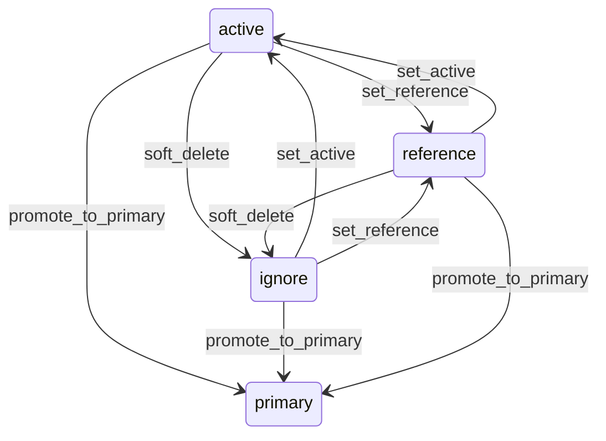

| trigger | source -> dest | dispatch |
|---|---|---|
| `promote_to_primary` | `active` -> `primary` | operator -- resolved source->dest at internal/api/repos_handlers.go |
| `set_reference` | `active` -> `reference` | operator -- resolved source->dest at internal/api/repos_handlers.go |
| `soft_delete` | `active` -> `ignore` | operator -- resolved source->dest at internal/api/repos_handlers.go |
| `promote_to_primary` | `ignore` -> `primary` | operator -- resolved source->dest at internal/api/repos_handlers.go |
| `set_active` | `ignore` -> `active` | operator -- resolved source->dest at internal/api/repos_handlers.go |
| `set_reference` | `ignore` -> `reference` | operator -- resolved source->dest at internal/api/repos_handlers.go |
| `promote_to_primary` | `reference` -> `primary` | operator -- resolved source->dest at internal/api/repos_handlers.go |
| `set_active` | `reference` -> `active` | operator -- resolved source->dest at internal/api/repos_handlers.go |
| `soft_delete` | `reference` -> `ignore` | operator -- resolved source->dest at internal/api/repos_handlers.go |

### story

**States:** `abandoned`, `accepted`, `arc_proposal`, `draft`, `draft_failed`, `drafting`, `editing`, `implemented`, `implementing`, `pending`, `queued`, `requirements_edit_draft`, `requirements_editing`

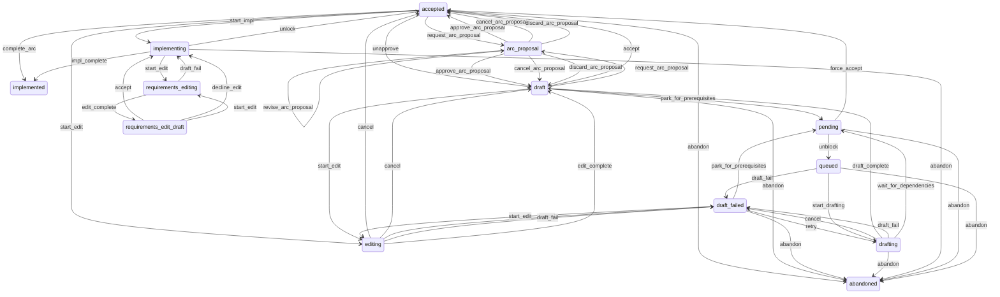

| trigger | source -> dest | dispatch |
|---|---|---|
| `abandon` | `accepted` -> `abandoned` | operator -- internal/api/mutations_cancel.go, internal/api/mutations_story.go, internal/reqs/edit_gate.go |
| `complete_arc` | `accepted` -> `implemented` | dynamic -- name referenced in dispatch code; dispatched as a variable (e.g. a generic /transition route) |
| `request_arc_proposal` | `accepted` -> `arc_proposal` | system -- internal/reqs/arc_proposal.go |
| `start_edit` | `accepted` -> `editing` | system -- internal/reqs/requirements_edit.go |
| `start_impl` | `accepted` -> `implementing` | operator -- internal/api/mutations_story_run.go, internal/mergeflow/archive.go |
| `unapprove` | `accepted` -> `draft` | operator -- internal/api/mutations_unapprove.go |
| `approve_arc_proposal` | `arc_proposal` -> `accepted` | system -- internal/reqs/arc_proposal.go |
| `approve_arc_proposal` | `arc_proposal` -> `draft` | system -- internal/reqs/arc_proposal.go |
| `cancel_arc_proposal` | `arc_proposal` -> `accepted` | system -- internal/reqs/arc_proposal.go |
| `cancel_arc_proposal` | `arc_proposal` -> `draft` | system -- internal/reqs/arc_proposal.go |
| `cancel_arc_revision` | `arc_proposal` -> `arc_proposal` | system -- internal/reqs/arc_proposal.go |
| `discard_arc_proposal` | `arc_proposal` -> `accepted` | system -- internal/reqs/arc_proposal.go |
| `discard_arc_proposal` | `arc_proposal` -> `draft` | system -- internal/reqs/arc_proposal.go |
| `resume_arc_proposal` | `arc_proposal` -> `arc_proposal` | system -- internal/reqs/arc_proposal.go |
| `retry_arc_proposal` | `arc_proposal` -> `arc_proposal` | system -- internal/reqs/arc_proposal.go |
| `revise_arc_proposal` | `arc_proposal` -> `arc_proposal` | system -- internal/reqs/arc_proposal.go |
| `abandon` | `draft` -> `abandoned` | operator -- internal/api/mutations_cancel.go, internal/api/mutations_story.go, internal/reqs/edit_gate.go |
| `accept` | `draft` -> `accepted` | operator -- internal/api/mutations_ownership.go, internal/api/story_approve.go, internal/pm/requirements_edit.go |
| `park_for_prerequisites` | `draft` -> `pending` | operator -- internal/api/story_approve.go, internal/api/story_dependencies.go |
| `request_arc_proposal` | `draft` -> `arc_proposal` | system -- internal/reqs/arc_proposal.go |
| `start_edit` | `draft` -> `editing` | system -- internal/reqs/requirements_edit.go |
| `abandon` | `draft_failed` -> `abandoned` | operator -- internal/api/mutations_cancel.go, internal/api/mutations_story.go, internal/reqs/edit_gate.go |
| `park_for_prerequisites` | `draft_failed` -> `pending` | operator -- internal/api/story_approve.go, internal/api/story_dependencies.go |
| `retry` | `draft_failed` -> `drafting` | dynamic -- name referenced in dispatch code; dispatched as a variable (e.g. a generic /transition route) |
| `start_edit` | `draft_failed` -> `editing` | system -- internal/reqs/requirements_edit.go |
| `abandon` | `drafting` -> `abandoned` | operator -- internal/api/mutations_cancel.go, internal/api/mutations_story.go, internal/reqs/edit_gate.go |
| `cancel` | `drafting` -> `draft_failed` | system -- internal/reqs/edit_gate.go |
| `draft_complete` | `drafting` -> `draft` | dynamic -- name referenced in dispatch code; dispatched as a variable (e.g. a generic /transition route) |
| `draft_fail` | `drafting` -> `draft_failed` | operator -- internal/api/housekeeping.go, internal/pm/story_result.go |
| `wait_for_dependencies` | `drafting` -> `pending` | dynamic -- name referenced in dispatch code; dispatched as a variable (e.g. a generic /transition route) |
| `cancel` | `editing` -> `accepted` | system -- internal/reqs/edit_gate.go |
| `cancel` | `editing` -> `draft` | system -- internal/reqs/edit_gate.go |
| `cancel` | `editing` -> `draft_failed` | system -- internal/reqs/edit_gate.go |
| `draft_fail` | `editing` -> `draft_failed` | operator -- internal/api/housekeeping.go, internal/pm/story_result.go |
| `edit_complete` | `editing` -> `draft` | operator -- internal/api/housekeeping.go |
| `abandon` | `implementing` -> `abandoned` | operator -- internal/api/mutations_cancel.go, internal/api/mutations_story.go, internal/reqs/edit_gate.go |
| `impl_complete` | `implementing` -> `implemented` | system -- internal/mergeflow/archive.go |
| `start_edit` | `implementing` -> `requirements_editing` | system -- internal/reqs/requirements_edit.go |
| `unlock` | `implementing` -> `accepted` | operator -- internal/api/mutations_state.go |
| `abandon` | `pending` -> `abandoned` | operator -- internal/api/mutations_cancel.go, internal/api/mutations_story.go, internal/reqs/edit_gate.go |
| `force_accept` | `pending` -> `accepted` | operator -- internal/api/mutations_ownership.go |
| `unblock` | `pending` -> `queued` | dynamic -- name referenced in dispatch code; dispatched as a variable (e.g. a generic /transition route) |
| `abandon` | `queued` -> `abandoned` | operator -- internal/api/mutations_cancel.go, internal/api/mutations_story.go, internal/reqs/edit_gate.go |
| `draft_fail` | `queued` -> `draft_failed` | operator -- internal/api/housekeeping.go, internal/pm/story_result.go |
| `start_drafting` | `queued` -> `drafting` | dynamic -- name referenced in dispatch code; dispatched as a variable (e.g. a generic /transition route) |
| `accept` | `requirements_edit_draft` -> `implementing` | operator -- internal/api/mutations_ownership.go, internal/api/story_approve.go, internal/pm/requirements_edit.go |
| `decline_edit` | `requirements_edit_draft` -> `implementing` | system -- internal/pm/requirements_edit.go |
| `start_edit` | `requirements_edit_draft` -> `requirements_editing` | system -- internal/reqs/requirements_edit.go |
| `draft_fail` | `requirements_editing` -> `implementing` | operator -- internal/api/housekeeping.go, internal/pm/story_result.go |
| `edit_complete` | `requirements_editing` -> `requirements_edit_draft` | operator -- internal/api/housekeeping.go |

### suggestion

**States:** `available`, `claimed`, `done`

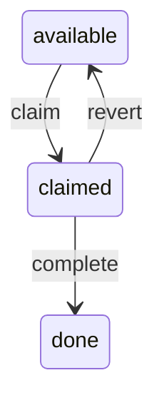

| trigger | source -> dest | dispatch |
|---|---|---|
| `claim` | `available` -> `claimed` | operator -- internal/api/mutations_plan.go |
| `complete` | `claimed` -> `done` | system -- internal/pm/story_result.go |
| `revert` | `claimed` -> `available` | operator -- internal/api/mutations_plan.go, internal/api/mutations_plan_reconcile.go |

### workstream

**States:** `active`, `awaiting_human_review`, `closed`, `closed_no_changes`, `final_review_with_concerns`, `implementing`, `merge_conflicts`, `merge_test_failed`, `merged`, `merging`, `pr_approved`, `pr_open`, `provisioning`, `ready_to_merge`, `requirements_editing`, `resolving`

```mermaid
stateDiagram-v2
    active --> active : add_commit
    active --> ready_to_merge : all_commits_done
    active --> awaiting_human_review : await_review
    active --> closed : close
    active --> closed_no_changes : close_no_changes
    active --> active : edit_commit
    active --> merge_test_failed : post_rebase_test_failed
    active --> merge_conflicts : rebase_conflict
    active --> active : replan
    active --> active : reset
    active --> active : resolve_oscillation
    active --> active : skip
    active --> implementing : start_impl
    active --> requirements_editing : start_requirements_edit
    awaiting_human_review --> awaiting_human_review : add_commit
    awaiting_human_review --> ready_to_merge : all_commits_done
    awaiting_human_review --> active : approve
    awaiting_human_review --> closed : close
    awaiting_human_review --> awaiting_human_review : edit_commit
    awaiting_human_review --> active : reject
    awaiting_human_review --> active : replan
    awaiting_human_review --> active : reset
    awaiting_human_review --> awaiting_human_review : resolve_oscillation
    awaiting_human_review --> implementing : resume_impl
    awaiting_human_review --> awaiting_human_review : skip
    closed --> active : reopen
    closed --> active : reset
    closed_no_changes --> active : reopen
    closed_no_changes --> active : reset
    final_review_with_concerns --> final_review_with_concerns : add_commit
    final_review_with_concerns --> active : address_concerns
    final_review_with_concerns --> closed : close
    final_review_with_concerns --> pr_open : create_pr
    final_review_with_concerns --> final_review_with_concerns : edit_commit
    final_review_with_concerns --> ready_to_merge : final_review_approve
    final_review_with_concerns --> merge_test_failed : post_rebase_test_failed
    final_review_with_concerns --> merge_conflicts : rebase_conflict
    final_review_with_concerns --> active : reset
    final_review_with_concerns --> final_review_with_concerns : resolve_oscillation
    final_review_with_concerns --> final_review_with_concerns : skip
    final_review_with_concerns --> merging : start_merge
    final_review_with_concerns --> requirements_editing : start_requirements_edit
    implementing --> implementing : add_commit
    implementing --> ready_to_merge : all_commits_done
    implementing --> awaiting_human_review : await_review
    implementing --> closed : close
    implementing --> closed_no_changes : close_no_changes
    implementing --> implementing : edit_commit
    implementing --> active : impl_complete
    implementing --> merge_test_failed : post_rebase_test_failed
    implementing --> merge_conflicts : rebase_conflict
    implementing --> active : replan
    implementing --> active : reset
    implementing --> implementing : resolve_oscillation
    implementing --> implementing : skip
    implementing --> requirements_editing : start_requirements_edit
    merge_conflicts --> merge_conflicts : add_commit
    merge_conflicts --> ready_to_merge : all_commits_done
    merge_conflicts --> closed : close
    merge_conflicts --> merged : conflicts_resolved_and_merged
    merge_conflicts --> merge_conflicts : edit_commit
    merge_conflicts --> merge_test_failed : post_rebase_test_failed
    merge_conflicts --> pr_open : push_for_pr
    merge_conflicts --> active : reset
    merge_conflicts --> active : resolve_conflicts
    merge_conflicts --> merge_conflicts : resolve_oscillation
    merge_conflicts --> merging : retry_merge
    merge_conflicts --> merge_conflicts : skip
    merge_conflicts --> resolving : start_resolve
    merge_test_failed --> merge_test_failed : add_commit
    merge_test_failed --> active : add_fix_commit
    merge_test_failed --> ready_to_merge : all_commits_done
    merge_test_failed --> closed : close
    merge_test_failed --> merge_test_failed : edit_commit
    merge_test_failed --> merge_conflicts : rebase_conflict
    merge_test_failed --> active : reset
    merge_test_failed --> merge_test_failed : resolve_oscillation
    merge_test_failed --> merge_test_failed : skip
    merge_test_failed --> merging : start_merge
    merge_test_failed --> resolving : start_resolve
    merged --> merged : start_merge
    merging --> ready_to_merge : merge_aborted
    merging --> final_review_with_concerns : merge_aborted_to_concerns
    merging --> pr_approved : merge_aborted_to_pr_approved
    merging --> pr_open : merge_aborted_to_pr_open
    merging --> merge_conflicts : merge_conflict
    merging --> merged : merge_success
    merging --> merge_test_failed : post_rebase_test_failed
    merging --> pr_open : push_for_pr
    pr_approved --> pr_approved : add_commit
    pr_approved --> closed : close
    pr_approved --> pr_approved : edit_commit
    pr_approved --> merged : github_merged
    pr_approved --> merge_test_failed : post_rebase_test_failed
    pr_approved --> active : pr_changes_requested
    pr_approved --> merge_conflicts : rebase_conflict
    pr_approved --> active : reset
    pr_approved --> pr_approved : resolve_oscillation
    pr_approved --> pr_approved : skip
    pr_approved --> merging : start_merge
    pr_approved --> requirements_editing : start_requirements_edit
    pr_open --> pr_open : add_commit
    pr_open --> active : add_fix_commit
    pr_open --> closed : close
    pr_open --> pr_open : edit_commit
    pr_open --> merged : github_merged
    pr_open --> merge_test_failed : post_rebase_test_failed
    pr_open --> pr_approved : pr_approved
    pr_open --> active : pr_changes_requested
    pr_open --> merge_conflicts : rebase_conflict
    pr_open --> active : reset
    pr_open --> pr_open : resolve_oscillation
    pr_open --> pr_open : skip
    pr_open --> merging : start_merge
    pr_open --> requirements_editing : start_requirements_edit
    provisioning --> closed : close
    provisioning --> active : override_baseline
    provisioning --> active : provision_complete
    provisioning --> active : reset
    ready_to_merge --> ready_to_merge : add_commit
    ready_to_merge --> active : add_fix_commit
    ready_to_merge --> closed : close
    ready_to_merge --> pr_open : create_pr
    ready_to_merge --> ready_to_merge : edit_commit
    ready_to_merge --> final_review_with_concerns : final_review_concerns
    ready_to_merge --> merge_test_failed : post_rebase_test_failed
    ready_to_merge --> merge_conflicts : rebase_conflict
    ready_to_merge --> active : reset
    ready_to_merge --> ready_to_merge : resolve_oscillation
    ready_to_merge --> ready_to_merge : skip
    ready_to_merge --> merging : start_merge
    ready_to_merge --> requirements_editing : start_requirements_edit
    requirements_editing --> active : requirements_edit_approved
    requirements_editing --> active : requirements_edit_restore_active
    requirements_editing --> final_review_with_concerns : requirements_edit_restore_final_review_with_concerns
    requirements_editing --> implementing : requirements_edit_restore_implementing
    requirements_editing --> pr_approved : requirements_edit_restore_pr_approved
    requirements_editing --> pr_open : requirements_edit_restore_pr_open
    requirements_editing --> ready_to_merge : requirements_edit_restore_ready_to_merge
    resolving --> closed : close
    resolving --> merge_conflicts : resolve_failed
    resolving --> implementing : resolve_resume_run
    resolving --> pr_open : resolve_success
    resolving --> ready_to_merge : resolve_success_no_pr
    resolving --> merge_test_failed : resolve_test_failed
```

| trigger | source -> dest | dispatch |
|---|---|---|
| `add_commit` | `active` -> `active` | dynamic -- name referenced in dispatch code; dispatched as a variable (e.g. a generic /transition route) |
| `all_commits_done` | `active` -> `ready_to_merge` | system -- internal/runflow/mergegate_driver.go |
| `await_review` | `active` -> `awaiting_human_review` | operator -- internal/api/mutations.go |
| `close` | `active` -> `closed` | system -- resolved from source->dest by an empty-trigger call |
| `close_no_changes` | `active` -> `closed_no_changes` | system -- resolved from source->dest by an empty-trigger call |
| `edit_commit` | `active` -> `active` | dynamic -- name referenced in dispatch code; dispatched as a variable (e.g. a generic /transition route) |
| `post_rebase_test_failed` | `active` -> `merge_test_failed` | system -- internal/mergeflow/admission.go, internal/mergeflow/post_rebase.go |
| `rebase_conflict` | `active` -> `merge_conflicts` | system -- internal/mergeflow/publish_conflict_route.go |
| `replan` | `active` -> `active` | operator -- internal/api/mutations_replan.go |
| `reset` | `active` -> `active` | operator -- internal/api/mutations_reset.go |
| `resolve_oscillation` | `active` -> `active` | dynamic -- name referenced in dispatch code; dispatched as a variable (e.g. a generic /transition route) |
| `skip` | `active` -> `active` | dynamic -- name referenced in dispatch code; dispatched as a variable (e.g. a generic /transition route) |
| `start_impl` | `active` -> `implementing` | dynamic -- name referenced in dispatch code; dispatched as a variable (e.g. a generic /transition route) |
| `start_requirements_edit` | `active` -> `requirements_editing` | system -- internal/reqs/requirements_edit.go |
| `add_commit` | `awaiting_human_review` -> `awaiting_human_review` | dynamic -- name referenced in dispatch code; dispatched as a variable (e.g. a generic /transition route) |
| `all_commits_done` | `awaiting_human_review` -> `ready_to_merge` | system -- internal/runflow/mergegate_driver.go |
| `approve` | `awaiting_human_review` -> `active` | operator -- internal/api/mutations.go |
| `close` | `awaiting_human_review` -> `closed` | system -- resolved from source->dest by an empty-trigger call |
| `edit_commit` | `awaiting_human_review` -> `awaiting_human_review` | dynamic -- name referenced in dispatch code; dispatched as a variable (e.g. a generic /transition route) |
| `reject` | `awaiting_human_review` -> `active` | operator -- internal/api/mutations.go |
| `replan` | `awaiting_human_review` -> `active` | operator -- internal/api/mutations_replan.go |
| `reset` | `awaiting_human_review` -> `active` | operator -- internal/api/mutations_reset.go |
| `resolve_oscillation` | `awaiting_human_review` -> `awaiting_human_review` | dynamic -- name referenced in dispatch code; dispatched as a variable (e.g. a generic /transition route) |
| `resume_impl` | `awaiting_human_review` -> `implementing` | dynamic -- name referenced in dispatch code; dispatched as a variable (e.g. a generic /transition route) |
| `skip` | `awaiting_human_review` -> `awaiting_human_review` | dynamic -- name referenced in dispatch code; dispatched as a variable (e.g. a generic /transition route) |
| `reopen` | `closed` -> `active` | dynamic -- name referenced in dispatch code; dispatched as a variable (e.g. a generic /transition route) |
| `reset` | `closed` -> `active` | operator -- internal/api/mutations_reset.go |
| `reopen` | `closed_no_changes` -> `active` | dynamic -- name referenced in dispatch code; dispatched as a variable (e.g. a generic /transition route) |
| `reset` | `closed_no_changes` -> `active` | operator -- internal/api/mutations_reset.go |
| `add_commit` | `final_review_with_concerns` -> `final_review_with_concerns` | dynamic -- name referenced in dispatch code; dispatched as a variable (e.g. a generic /transition route) |
| `address_concerns` | `final_review_with_concerns` -> `active` | dynamic -- name referenced in dispatch code; dispatched as a variable (e.g. a generic /transition route) |
| `close` | `final_review_with_concerns` -> `closed` | system -- resolved from source->dest by an empty-trigger call |
| `create_pr` | `final_review_with_concerns` -> `pr_open` | system -- internal/mergeflow/pr_push.go, internal/runflow/mergereadyreconcile.go |
| `edit_commit` | `final_review_with_concerns` -> `final_review_with_concerns` | dynamic -- name referenced in dispatch code; dispatched as a variable (e.g. a generic /transition route) |
| `final_review_approve` | `final_review_with_concerns` -> `ready_to_merge` | orphaned -- no dispatcher |
| `post_rebase_test_failed` | `final_review_with_concerns` -> `merge_test_failed` | system -- internal/mergeflow/admission.go, internal/mergeflow/post_rebase.go |
| `rebase_conflict` | `final_review_with_concerns` -> `merge_conflicts` | system -- internal/mergeflow/publish_conflict_route.go |
| `reset` | `final_review_with_concerns` -> `active` | operator -- internal/api/mutations_reset.go |
| `resolve_oscillation` | `final_review_with_concerns` -> `final_review_with_concerns` | dynamic -- name referenced in dispatch code; dispatched as a variable (e.g. a generic /transition route) |
| `skip` | `final_review_with_concerns` -> `final_review_with_concerns` | dynamic -- name referenced in dispatch code; dispatched as a variable (e.g. a generic /transition route) |
| `start_merge` | `final_review_with_concerns` -> `merging` | system -- internal/mergeflow/pr_workflow.go |
| `start_requirements_edit` | `final_review_with_concerns` -> `requirements_editing` | system -- internal/reqs/requirements_edit.go |
| `add_commit` | `implementing` -> `implementing` | dynamic -- name referenced in dispatch code; dispatched as a variable (e.g. a generic /transition route) |
| `all_commits_done` | `implementing` -> `ready_to_merge` | system -- internal/runflow/mergegate_driver.go |
| `await_review` | `implementing` -> `awaiting_human_review` | operator -- internal/api/mutations.go |
| `close` | `implementing` -> `closed` | system -- resolved from source->dest by an empty-trigger call |
| `close_no_changes` | `implementing` -> `closed_no_changes` | system -- resolved from source->dest by an empty-trigger call |
| `edit_commit` | `implementing` -> `implementing` | dynamic -- name referenced in dispatch code; dispatched as a variable (e.g. a generic /transition route) |
| `impl_complete` | `implementing` -> `active` | orphaned -- no dispatcher |
| `post_rebase_test_failed` | `implementing` -> `merge_test_failed` | system -- internal/mergeflow/admission.go, internal/mergeflow/post_rebase.go |
| `rebase_conflict` | `implementing` -> `merge_conflicts` | system -- internal/mergeflow/publish_conflict_route.go |
| `replan` | `implementing` -> `active` | operator -- internal/api/mutations_replan.go |
| `reset` | `implementing` -> `active` | operator -- internal/api/mutations_reset.go |
| `resolve_oscillation` | `implementing` -> `implementing` | dynamic -- name referenced in dispatch code; dispatched as a variable (e.g. a generic /transition route) |
| `skip` | `implementing` -> `implementing` | dynamic -- name referenced in dispatch code; dispatched as a variable (e.g. a generic /transition route) |
| `start_requirements_edit` | `implementing` -> `requirements_editing` | system -- internal/reqs/requirements_edit.go |
| `add_commit` | `merge_conflicts` -> `merge_conflicts` | dynamic -- name referenced in dispatch code; dispatched as a variable (e.g. a generic /transition route) |
| `all_commits_done` | `merge_conflicts` -> `ready_to_merge` | system -- internal/runflow/mergegate_driver.go |
| `close` | `merge_conflicts` -> `closed` | system -- resolved from source->dest by an empty-trigger call |
| `conflicts_resolved_and_merged` | `merge_conflicts` -> `merged` | orphaned -- no dispatcher |
| `edit_commit` | `merge_conflicts` -> `merge_conflicts` | dynamic -- name referenced in dispatch code; dispatched as a variable (e.g. a generic /transition route) |
| `post_rebase_test_failed` | `merge_conflicts` -> `merge_test_failed` | system -- internal/mergeflow/admission.go, internal/mergeflow/post_rebase.go |
| `push_for_pr` | `merge_conflicts` -> `pr_open` | system -- internal/mergeflow/begin.go, internal/mergeflow/pr_push.go |
| `reset` | `merge_conflicts` -> `active` | operator -- internal/api/mutations_reset.go |
| `resolve_conflicts` | `merge_conflicts` -> `active` | dynamic -- name referenced in dispatch code; dispatched as a variable (e.g. a generic /transition route) |
| `resolve_oscillation` | `merge_conflicts` -> `merge_conflicts` | dynamic -- name referenced in dispatch code; dispatched as a variable (e.g. a generic /transition route) |
| `retry_merge` | `merge_conflicts` -> `merging` | dynamic -- name referenced in dispatch code; dispatched as a variable (e.g. a generic /transition route) |
| `skip` | `merge_conflicts` -> `merge_conflicts` | dynamic -- name referenced in dispatch code; dispatched as a variable (e.g. a generic /transition route) |
| `start_resolve` | `merge_conflicts` -> `resolving` | operator -- internal/api/mutations_dispatch.go |
| `add_commit` | `merge_test_failed` -> `merge_test_failed` | dynamic -- name referenced in dispatch code; dispatched as a variable (e.g. a generic /transition route) |
| `add_fix_commit` | `merge_test_failed` -> `active` | system -- internal/reqs/add_commit.go, internal/runflow/recovery_answer.go |
| `all_commits_done` | `merge_test_failed` -> `ready_to_merge` | system -- internal/runflow/mergegate_driver.go |
| `close` | `merge_test_failed` -> `closed` | system -- resolved from source->dest by an empty-trigger call |
| `edit_commit` | `merge_test_failed` -> `merge_test_failed` | dynamic -- name referenced in dispatch code; dispatched as a variable (e.g. a generic /transition route) |
| `rebase_conflict` | `merge_test_failed` -> `merge_conflicts` | system -- internal/mergeflow/publish_conflict_route.go |
| `reset` | `merge_test_failed` -> `active` | operator -- internal/api/mutations_reset.go |
| `resolve_oscillation` | `merge_test_failed` -> `merge_test_failed` | dynamic -- name referenced in dispatch code; dispatched as a variable (e.g. a generic /transition route) |
| `skip` | `merge_test_failed` -> `merge_test_failed` | dynamic -- name referenced in dispatch code; dispatched as a variable (e.g. a generic /transition route) |
| `start_merge` | `merge_test_failed` -> `merging` | system -- internal/mergeflow/pr_workflow.go |
| `start_resolve` | `merge_test_failed` -> `resolving` | operator -- internal/api/mutations_dispatch.go |
| `start_merge` | `merged` -> `merged` | system -- internal/mergeflow/pr_workflow.go |
| `merge_aborted` | `merging` -> `ready_to_merge` | system -- internal/mergeflow/admission.go |
| `merge_aborted_to_concerns` | `merging` -> `final_review_with_concerns` | system -- internal/mergeflow/admission.go |
| `merge_aborted_to_pr_approved` | `merging` -> `pr_approved` | system -- internal/mergeflow/admission.go |
| `merge_aborted_to_pr_open` | `merging` -> `pr_open` | system -- internal/mergeflow/admission.go |
| `merge_conflict` | `merging` -> `merge_conflicts` | system -- internal/mergeflow/admission.go |
| `merge_success` | `merging` -> `merged` | system -- internal/mergeflow/reconcile.go |
| `post_rebase_test_failed` | `merging` -> `merge_test_failed` | system -- internal/mergeflow/admission.go, internal/mergeflow/post_rebase.go |
| `push_for_pr` | `merging` -> `pr_open` | system -- internal/mergeflow/begin.go, internal/mergeflow/pr_push.go |
| `add_commit` | `pr_approved` -> `pr_approved` | dynamic -- name referenced in dispatch code; dispatched as a variable (e.g. a generic /transition route) |
| `close` | `pr_approved` -> `closed` | system -- resolved from source->dest by an empty-trigger call |
| `edit_commit` | `pr_approved` -> `pr_approved` | dynamic -- name referenced in dispatch code; dispatched as a variable (e.g. a generic /transition route) |
| `github_merged` | `pr_approved` -> `merged` | orphaned -- no dispatcher |
| `post_rebase_test_failed` | `pr_approved` -> `merge_test_failed` | system -- internal/mergeflow/admission.go, internal/mergeflow/post_rebase.go |
| `pr_changes_requested` | `pr_approved` -> `active` | orphaned -- no dispatcher |
| `rebase_conflict` | `pr_approved` -> `merge_conflicts` | system -- internal/mergeflow/publish_conflict_route.go |
| `reset` | `pr_approved` -> `active` | operator -- internal/api/mutations_reset.go |
| `resolve_oscillation` | `pr_approved` -> `pr_approved` | dynamic -- name referenced in dispatch code; dispatched as a variable (e.g. a generic /transition route) |
| `skip` | `pr_approved` -> `pr_approved` | dynamic -- name referenced in dispatch code; dispatched as a variable (e.g. a generic /transition route) |
| `start_merge` | `pr_approved` -> `merging` | system -- internal/mergeflow/pr_workflow.go |
| `start_requirements_edit` | `pr_approved` -> `requirements_editing` | system -- internal/reqs/requirements_edit.go |
| `add_commit` | `pr_open` -> `pr_open` | dynamic -- name referenced in dispatch code; dispatched as a variable (e.g. a generic /transition route) |
| `add_fix_commit` | `pr_open` -> `active` | system -- internal/reqs/add_commit.go, internal/runflow/recovery_answer.go |
| `close` | `pr_open` -> `closed` | system -- resolved from source->dest by an empty-trigger call |
| `edit_commit` | `pr_open` -> `pr_open` | dynamic -- name referenced in dispatch code; dispatched as a variable (e.g. a generic /transition route) |
| `github_merged` | `pr_open` -> `merged` | orphaned -- no dispatcher |
| `post_rebase_test_failed` | `pr_open` -> `merge_test_failed` | system -- internal/mergeflow/admission.go, internal/mergeflow/post_rebase.go |
| `pr_approved` | `pr_open` -> `pr_approved` | dynamic -- name referenced in dispatch code; dispatched as a variable (e.g. a generic /transition route) |
| `pr_changes_requested` | `pr_open` -> `active` | orphaned -- no dispatcher |
| `rebase_conflict` | `pr_open` -> `merge_conflicts` | system -- internal/mergeflow/publish_conflict_route.go |
| `reset` | `pr_open` -> `active` | operator -- internal/api/mutations_reset.go |
| `resolve_oscillation` | `pr_open` -> `pr_open` | dynamic -- name referenced in dispatch code; dispatched as a variable (e.g. a generic /transition route) |
| `skip` | `pr_open` -> `pr_open` | dynamic -- name referenced in dispatch code; dispatched as a variable (e.g. a generic /transition route) |
| `start_merge` | `pr_open` -> `merging` | system -- internal/mergeflow/pr_workflow.go |
| `start_requirements_edit` | `pr_open` -> `requirements_editing` | system -- internal/reqs/requirements_edit.go |
| `close` | `provisioning` -> `closed` | system -- resolved from source->dest by an empty-trigger call |
| `override_baseline` | `provisioning` -> `active` | operator -- internal/api/mutations_dispatch.go |
| `provision_complete` | `provisioning` -> `active` | system -- internal/runflow/provision.go |
| `reset` | `provisioning` -> `active` | operator -- internal/api/mutations_reset.go |
| `add_commit` | `ready_to_merge` -> `ready_to_merge` | dynamic -- name referenced in dispatch code; dispatched as a variable (e.g. a generic /transition route) |
| `add_fix_commit` | `ready_to_merge` -> `active` | system -- internal/reqs/add_commit.go, internal/runflow/recovery_answer.go |
| `close` | `ready_to_merge` -> `closed` | system -- resolved from source->dest by an empty-trigger call |
| `create_pr` | `ready_to_merge` -> `pr_open` | system -- internal/mergeflow/pr_push.go, internal/runflow/mergereadyreconcile.go |
| `edit_commit` | `ready_to_merge` -> `ready_to_merge` | dynamic -- name referenced in dispatch code; dispatched as a variable (e.g. a generic /transition route) |
| `final_review_concerns` | `ready_to_merge` -> `final_review_with_concerns` | system -- internal/runflow/finalreviewconcerns.go |
| `post_rebase_test_failed` | `ready_to_merge` -> `merge_test_failed` | system -- internal/mergeflow/admission.go, internal/mergeflow/post_rebase.go |
| `rebase_conflict` | `ready_to_merge` -> `merge_conflicts` | system -- internal/mergeflow/publish_conflict_route.go |
| `reset` | `ready_to_merge` -> `active` | operator -- internal/api/mutations_reset.go |
| `resolve_oscillation` | `ready_to_merge` -> `ready_to_merge` | dynamic -- name referenced in dispatch code; dispatched as a variable (e.g. a generic /transition route) |
| `skip` | `ready_to_merge` -> `ready_to_merge` | dynamic -- name referenced in dispatch code; dispatched as a variable (e.g. a generic /transition route) |
| `start_merge` | `ready_to_merge` -> `merging` | system -- internal/mergeflow/pr_workflow.go |
| `start_requirements_edit` | `ready_to_merge` -> `requirements_editing` | system -- internal/reqs/requirements_edit.go |
| `requirements_edit_approved` | `requirements_editing` -> `active` | dynamic -- name referenced in dispatch code; dispatched as a variable (e.g. a generic /transition route) |
| `requirements_edit_restore_active` | `requirements_editing` -> `active` | dynamic -- name referenced in dispatch code; dispatched as a variable (e.g. a generic /transition route) |
| `requirements_edit_restore_final_review_with_concerns` | `requirements_editing` -> `final_review_with_concerns` | dynamic -- name referenced in dispatch code; dispatched as a variable (e.g. a generic /transition route) |
| `requirements_edit_restore_implementing` | `requirements_editing` -> `implementing` | dynamic -- name referenced in dispatch code; dispatched as a variable (e.g. a generic /transition route) |
| `requirements_edit_restore_pr_approved` | `requirements_editing` -> `pr_approved` | dynamic -- name referenced in dispatch code; dispatched as a variable (e.g. a generic /transition route) |
| `requirements_edit_restore_pr_open` | `requirements_editing` -> `pr_open` | dynamic -- name referenced in dispatch code; dispatched as a variable (e.g. a generic /transition route) |
| `requirements_edit_restore_ready_to_merge` | `requirements_editing` -> `ready_to_merge` | dynamic -- name referenced in dispatch code; dispatched as a variable (e.g. a generic /transition route) |
| `close` | `resolving` -> `closed` | system -- resolved from source->dest by an empty-trigger call |
| `resolve_failed` | `resolving` -> `merge_conflicts` | system -- internal/mergeflow/resolve.go |
| `resolve_resume_run` | `resolving` -> `implementing` | system -- internal/mergeflow/resolve.go |
| `resolve_success` | `resolving` -> `pr_open` | system -- internal/mergeflow/resolve.go |
| `resolve_success_no_pr` | `resolving` -> `ready_to_merge` | dynamic -- name referenced in dispatch code; dispatched as a variable (e.g. a generic /transition route) |
| `resolve_test_failed` | `resolving` -> `merge_test_failed` | system -- internal/mergeflow/resolve.go |

<!-- END GENERATED: entity-state-contracts -->

---

## Publish and Conflict Resolution Paths

PR creation, explicit push, merge-for-PR, PR-open auto-rebase and approved-PR
merge all publish branches, but their failure exits differ. A publish refusal
does not imply a transition to `merge_conflicts`. The table below records the
actual parks; [implementation paths](docs/DIFF.md#publish-and-conflict-resolution-paths)
map those outcomes to the code and clients.

### Where each path lands when it cannot finish

| Path | Rebases onto base | On rebase conflict | Lands at |
|---|---|---|---|
| `pr create` (`RunPRCreatePush`) | yes | returns an outcome | **no transition** -- stays put |
| `pr push` (`RunPRPush`) | yes | returns an outcome | **no transition** -- stays put |
| merge-for-PR (`RunMergePushForPR`) | yes | `FailMerge`, no `TargetState` | **`ready_to_merge`** (`fail.go:60-62`) |
| approved-PR merge (`MergeApprovedPRLocked`) | yes, via `PrepareRebasedBranch` | transitions on `pre.Conflict` | **`merge_conflicts`** (`pr_workflow.go:635`) |
| PR-open auto-rebase (`RebasePRBranch`) | yes | returns `false` on `BranchSyncConflict` | **no transition** -- stays put |
| merge gate (`runflow`) | yes | parks | **`merge_conflicts`** |
| ai-resolve (`resolve.go`) | yes | the conflict agent; `failTo` when it cannot resolve | **`merge_conflicts`**; a resolved tree whose verification fails, **`implementing`** when recovery schedules a FIX (or finds one bound and undone before publishing), else **`merge_test_failed`** (`parkVerification`); a resolved, verified tree whose push fails, **its origin** -- `implementing` for an interrupted merge gate, else `pr_open` or `ready_to_merge` (`pushIfRemote`), unless a push rejected with no identified cause fails its re-run verification, which is recovered the same way |

A `pr push` that lands routes on the status captured when it was dispatched, not on a read taken after the push: from `merge_conflicts` it moves to `pr_open` via `push_for_pr`, and from `ready_to_merge` or `final_review_with_concerns` via `create_pr`, each as a transition from that dispatch-time status. If the workstream has left that status by the time the push lands, the push changes no state, records a failed `pr_push` outcome naming both statuses, and still declares whether the branch moved on origin. A workstream already at `pr_open` is where the push would have put it, so the push lands as a success.

Three paths reach `merge_conflicts`, and they differ by who starts them,
not by who performs the transition -- every one of these transitions is
executed by server code, so "system-driven" is only meaningful about the
invocation.

Exactly one is system-invoked: the merge gate, which runs inside the
runner cycle with nobody asking. The other two are operator-invoked.
`ai-resolve` is the TUI's `i`, and lands back in `merge_conflicts` when it
cannot resolve a conflict; a resolved tree that fails verification is handed
to a planned FIX at `implementing`, or lands at `merge_test_failed` when none
is scheduled. A resolved, verified tree whose push fails is a
publication failure, not a conflict: the resolve records it by the kind git's
own result establishes -- a deadline kill, hashd's own refusal, a remote lease
or ref rejection, an authentication or transport failure, or a push with no
identified cause, such as a declining pre-push hook -- keeps the resolved
commits on the local branch and leaves `resolving` for where it came from. A
push with no identified cause is then verified once (see "A rejected push is
verified once" below): it lands at `merge_test_failed` instead when that
verification fails, and when the gate's own command passes it is pushed once
more on the same head, taking the success exit if that push lands. A resolve that interrupted the runner's
merge gate returns to `implementing` through `resolve_resume_run` with the
`merge_gate` substage kept and no run started, so `hashd pr push` (when a PR
exists) and then `hashd run` still take the branch through the gate and final
review; otherwise it lands at `pr_open` (`resolve_success`, retry `hashd pr
push`) or `ready_to_merge` (`resolve_success_no_pr`, retry `hashd merge`). The
rollback and the stale-resolving self-heal land a workstream left at
`resolving` over that record at the same place. `MergeApprovedPRLocked` is
`hashd merge` on an approved PR, whose pre-merge rebase conflicting is the one
operator route that *enters* the state from outside it -- it transitions with
an empty trigger, resolved source->dest, and is declared as such in
`emptyTriggerSites`.

Every other operator verb behaves differently. An operator who hits a
genuine conflict through a *publish* verb -- `pr create`, `pr push` -- is
left in the state they started from, with the conflict correctly
detected, the worktree correctly restored, and no verb that advances.

### Build-owned conflicts

Regeneration subsumption -- taking `--theirs` for a conflicted path and
proving the build rewrites it -- is one implementation,
`RebaseSubsumingOwned` (`mergeflow/owned.go`), and three kinds of caller
reach it: the merge gate (`runflow/mergegate_regen.go`), the AI resolver
(`mergeflow/resolve.go`), and the publish paths, which pass an optional
`heal` into `syncBranchOnto`.

The publish paths build that heal with `HealWithinBudget` from the
project's merge profile; `pr create`, `pr push`, merge-for-PR, and the
PR-open auto-rebase all supply one. When the profile cannot be resolved
the heal is nil and the older behaviour stands: every conflict parks for
a human.

The heal is consulted ONLY after a rebase has already conflicted and been
aborted -- a clean rebase never runs a build. It completes the rebase
when every conflicted path is build-owned on both sides, using the same
predicate as the gate and the resolver, and parks (tree restored, exactly
as without heal) when any path is not. It runs under its own budget, so
an over-long build sequence parks with its reason stated instead of
running into the activity's deadline.

A workstream carrying regenerated artifacts (any change to the REST
surface regenerates `server/contracts/openapi.json`) can therefore
publish while base has also moved that file, provided the build owns
every conflicted path. Before the publish-path heal existed this was a
hard gap on every publish verb.

### Operation ownership and dispatch

Defined sub-FSM progression and parent exits appear in the
[substage contract](#substage-sub-fsm). In-place operations and cross-stage work
still need explicit ownership; an unchanged macro state does not establish idle.
The implementation inventories, including their known historical gaps, are in
[Architecture](docs/ARCHITECTURE.md#workflow-visibility-and-dispatch-inventory).

### Invariants the publish paths enforce

- Publishing and no-op publishing reconcile PR tracking; an existing link must
  remain reachable through the appropriate PR actions.
- Publication refuses a branch behind its base. Paths allowed to rebase do so
  first; commit-stage auto-push must not rebase and refuses instead.
- Publish/resolve paths verify the checked-out branch before rebasing it. This
  is not universal enforcement: the merge-gate rebase/regeneration sites still
  rely on runner ownership, as recorded in the [implementation inventory](docs/DIFF.md#invariants-the-publish-paths-enforce).
- Never force-push the default branch or use bare force. The lease uses the
  existing tracking ref; if missing, one fetch primes it from the current remote
  tip. An absent remote branch requires nonexistence. Refreshing the base does
  not refresh that branch lease. The one-time priming is weaker than a previously
  held lease, and a failed fetch cannot silently become an empty expectation.

## Story Lifecycle

```mermaid
stateDiagram-v2
    [*] --> queued : hashd plan story / suggestion-backed planning
    queued --> drafting : PM slot acquired; capture input + owner
    queued --> draft_failed : planning failed before acquisition
    queued --> abandoned : hashd cancel
    drafting --> draft : AI generation complete
    drafting --> pending : planner identifies unfinished dependencies
    drafting --> draft_failed : AI generation failed
    drafting --> abandoned : hashd cancel (first draft)
    drafting --> draft_failed : hashd cancel (retry)
    pending --> queued : dependencies implemented, by completion or a dependency edit
    pending --> accepted : hashd approve --force (every dependency implemented)
    pending --> abandoned : hashd close
    draft_failed --> drafting : hashd story retry
    draft_failed --> editing : hashd story edit
    draft_failed --> abandoned : hashd close
    draft --> editing : hashd story edit
    accepted --> editing : hashd story edit (guard - no workstream rows)
    editing --> draft : AI edit complete
    editing --> draft_failed : AI edit refused
    editing --> draft : timeout 15 min
    editing --> draft : hashd cancel (edit of a draft)
    editing --> draft_failed : hashd cancel (edit of a failed draft)
    editing --> accepted : hashd cancel (edit of an accepted story)
    draft --> accepted : hashd approve
    accepted --> implementing : hashd run (LOCKS story)
    implementing --> implemented : hashd merge (LOCKED)
    implementing --> requirements_editing : hashd story edit (holds the workstream)
    requirements_editing --> requirements_edit_draft : proposal ready
    requirements_editing --> implementing : failed / timed out (workstream restored)
    requirements_edit_draft --> requirements_editing : hashd story edit / hashd answer
    requirements_edit_draft --> implementing : hashd approve --start-over | --keep-code (workstream to active)
    requirements_edit_draft --> implementing : decline_edit (workstream restored)
    draft --> abandoned : hashd close
    accepted --> abandoned : hashd close
```

**Stages:**

| Stage | Description | AI edit |
|-------|-------------|----------|
| `queued` | Planning waiting for the PM slot; ordinary field edits remain available | No |
| `drafting` | AI generating story (in progress) | No |
| `pending` | Story waiting for dependencies before redraft | No |
| `draft_failed` | AI generation failed; needs operator clarification, retry, or close | Yes (via `hashd story edit`; retry with `hashd story retry`) |
| `draft` | Generated, awaiting approval | Yes |
| `editing` | AI edit in progress (auto-reverts after 15 min) | No |
| `accepted` | Ready for implementation | Yes -- until its workstream row exists (`story_has_no_workstreams` guard, any status including closed/merged; a story owns at most one) |
| `implementing` | Workstream active | Yes -- a requirements edit, which holds the workstream (below) |
| `requirements_editing` | Read-only planner revising an implementing story (auto-ends after 15 min) | No |
| `requirements_edit_draft` | The planner's proposal, awaiting approval or decline | Yes (revises the proposal) |
| `implemented` | Workstream merged | No |
| `abandoned` | Closed without implementation | No |

**Transitions:**

- `hashd approve STORY-xxx` moves draft -> accepted (and a
  requirements-edit proposal to implementing, below). It is refused while
  any blocking clarification on the story is pending, and the story's
  `accept` row in `available_actions` is withheld then with the same reason;
  a pending count that cannot be read withholds it too.
- `hashd cancel STORY-xxx` abandons a queued story. For a drafting or editing
  story it closes the planner workflow and, when the run holding the story
  closed cancelled (or no run holds it), puts the story back as its entry
  recorded: a first draft is abandoned, a retry returns to draft_failed, an
  edit to the status it started from with that data and the clarifications its
  dispatch superseded. A run that ended another way, or a result that has begun
  to land, stands: cancel changes nothing and names the status the story
  reached. A failed close changes nothing. The story's `cancel` row in
  `available_actions` is offered for these three statuses, and withheld, with
  the route's own reason, for a drafting or editing story entered before the
  entry record existed.
- `hashd story split STORY-xxx` can create dependent sub-stories in pending
- Initial planning can also declare existing stories in `depends_on`. Hashd
  validates the project-local references and rejects dependency cycles, then
  atomically saves the draft's problem, criteria and dependencies. It enters
  `pending` if any dependency is unfinished, otherwise `draft`. Completion uses
  the same pending-to-queued handoff and replans against the updated codebase;
  it does not approve or run the dependent story. Omitted dependency output
  preserves existing dependencies; an explicit empty list removes them.
  An attempt that found unfinished dependencies defers REQS annotation until
  that replan. If the last dependency completes before its result lands, the
  result still enters `pending` and the existing recovery scan releases it for
  replan, rather than returning a draft whose anchors were never applied.
- dependency completion moves pending -> queued for a fresh plan against current code;
  the plan's own planning-slot acquisition moves it on to drafting
- `hashd approve --force STORY-xxx` (`POST /stories/{id}/approve?force=true`,
  the internal `force_accept` transition) moves pending -> accepted, accepting
  the requirements as they stand now, without re-drafting. That is the
  operator's choice, not the automatic path: when the dependencies land on
  their own, the unblock moves pending -> queued and the planner re-drafts
  against the current code. Every listed dependency must be `implemented`;
  a blank, unknown, abandoned, unreadable or not-yet-implemented one refuses
  it. With dependencies, all implemented, there is no prompt. With none, the
  CLI asks for confirmation (default no) and `-y` skips it; without a TTY and
  without `-y` it refuses rather than accepting.
  The request carries `expected_updated_at`, the `updated_at` of the story
  read the operator reviewed (the CLI's own pre-confirmation read, `-y`
  included); a story changed since is refused with nothing accepted, and the
  operator reloads and reviews it before approving again. Nothing refreshes
  the revision or retries on its own. Only one of this and the unblock can
  take a pending story: the forced write re-checks status, revision,
  clarifications and dependencies in the same transaction as its CAS, and
  records its `story_changed` event there too.
  The Web Story Detail offers the same acceptance as "accept as written" when
  the story read's `force_accept` availability row is available, posting the
  revision the page rendered; with no dependencies it confirms first, and
  cancel sends nothing. A stale refusal shows the server's reload guidance on
  the head's error line.
- `hashd story edit STORY-xxx` moves draft -> editing -> draft
- `hashd run STORY-xxx` moves accepted -> implementing (LOCKS story)
- `hashd merge <ws>` moves implementing -> implemented
- `hashd close <ws>` unlocks story (returns to accepted)
- `hashd story clone STORY-xxx` creates editable copy of locked story

### Requirements edit of an implementing story (Revise Story)

`hashd story edit STORY-xxx -f "..."` on an implementing story revises its
requirements -- the TUI and Web label it Revise Story -- while its one linked
workstream is **held** in
`requirements_editing`, out of merge readiness. The hold is entered from
`active`, `implementing`, `ready_to_merge`, `final_review_with_concerns`,
`pr_open` or `pr_approved` when no run, merge, publish or pending recovery
question is live and no operator claim (`dispatching`, a gate decision) is
unexpired, and never while the workstream is reserved for human edits. The
`dispatching` claim is short-lived and an add-commit's planner outlives it; an
add-commit that finds the workstream held when it comes to append refuses and
appends nothing.
The stage it left is recorded on the story.

- The planner reads the worktree (read-only) and is told the completed
  commits, the plan and the uncommitted changes. Its output is stored as a
  proposal; the story's content is untouched and REQS is never written.
- Approval must choose how the work continues: `hashd approve STORY-xxx
  --start-over` or `--keep-code` (`POST /stories/{id}/approve?continuation=
  start_over|keep_code`). A bare approval of a revision is refused, never
  destructive by default; the choice is refused on any other approval, and with
  `--force`. Either way approval writes the proposal, returns the story to
  `implementing` and the workstream to `active`, replaces the plan with the
  revised story's skeleton (its problem, criteria and non-goals, and no
  micro-commits: nothing done under the previous requirements counts as done),
  discards the retired attempt's reviews (and the final review's mark that
  their concerns were delivered), commit failures, checkpoint, agent session
  and merge-gate repair binding (the replan's own disposal), and starts a run whose breakdown plans
  the revised story in full. A pending breakdown refusal on the held
  workstream refused the plan approval retires, so approval supersedes it
  inside the approval transaction and does not answer it: it neither blocks
  the next run nor reaches a later prompt as an operator's answer. The workstream reaches `ready_to_merge` again only
  through the gate and final review.
  - **Start over** (recommended; the TUI, Web and Telegram offer it first and
    confirm it)
    resets the worktree to its base first, as replan does: the workstream's
    commits and uncommitted work are discarded. If the approval then fails, the
    code stays reset, the revision still awaits approval, and the same approval
    re-run finishes it.
  - **Keep and rework** keeps the unmerged code as starting material only. The
    breakdown inspects it against the revised story and plans explicit keep,
    change and removal work (obsolete code, tests and dependencies included),
    with no micro-commit that merely adopts the existing code. Where the kept
    code already meets revised criteria, it plans one micro-commit verifying
    them, which the implementer reports `already_done` when nothing needs
    editing; the merge gate and final review still run. That breakdown
    reverts only its own agent's stray writes: the kept commits and
    uncommitted work survive it. Answering `proceed` to a refusal of that
    breakdown does not replan from the base: the workstream is prepared as a
    replan would be but without the reset while the refusal is still pending,
    then the answer and the permission to proceed are recorded in one
    transaction. A failure in either leaves the refusal pending, and answering
    `proceed` again repeats both; a dispatch failure after them is retried
    with `hashd run`, which carries the permission. The revision stays owed
    until a breakdown succeeds. An explicit `hashd replan` or `hashd reset`
    still resets, and once its reset has succeeded it retires the owed
    revision, whose kept code is gone. A full `hashd reset` of a workstream
    still owed such a revision keeps the revised story's plan rather than its
    soft-reset one (a revision approved before approval retired plans still
    holds the superseded micro-commits): it writes that skeleton and retires
    the revision in one transaction, and refuses before touching anything
    when the story cannot be read.
  - Unless the change is genuinely small, starting over is recommended: agents
    tend to preserve or work around old code. Small, especially additive,
    changes are usually better as a follow-up story than a revision.
- Declining (story transition `decline_edit`), a failed or timed-out attempt,
  or an edit whose workflow could not be dispatched applies nothing: the story
  returns to `implementing` and the workstream to exactly the stage it was held
  from.
- While held, the workstream's FSM declares only these system transitions:
  no verb moves it, the generic `/transition` and the status `PATCH` refuse it,
  and run, push, remove, reservations, adjudication and hooks refuse with the
  hold named.

The proposal is exposed on `GET /stories/{id}` as `requirements_edit`; the
TUI, Web and Telegram story details render it with its per-criterion changes
and offer approve (with the continuation choice), revise and decline from the
story's `available_actions` rows; Telegram's `/approve` on a revision replies
with the same choice.

A workstream that stopped on a breakdown refusal of a plan an earlier
approval already retired, before approval superseded refusals, recovers
through the same revision: run `hashd story edit STORY-xxx -f "..."`, review
the proposal, and approve it with a chosen continuation. The pending refusal
does not prevent the edit from starting, and approval supersedes it. This
costs another edit-agent run and another operator review. Approval replaces
the current plan with the revised story's skeleton and discards the attempt's
reviews, commit failures, agent session, checkpoint and merge-gate repair
binding. `--keep-code` keeps
the code as starting material; `--start-over` resets the worktree to its base.
Tests cover the edit starting on that workstream, and approval of a stubbed
proposal that keeps every criterion. They do not show that a real edit agent
returns such a proposal, so review what it proposes before approving. Do not
answer the refusal (`proceed` or `hold`) and do not edit the database instead.

### Content ownership and recovery

Ordinary field/criteria mutations check eligibility, read the current story and save in one database transaction. Compatible updates preserve both changes. Lifecycle changes and their metadata use the same boundary; a retry or recovery derived from an earlier read refuses if that input changed. `pending` and `abandoned` retain their existing ordinary-field eligibility; the table above describes AI edits.

Planning dispatch captures `drafting_started` (initially `created_at`).
Delayed begin and timeout handling must match that handoff; they cannot adopt
a later retry before its activity acquires ownership. On entering
`drafting`/`editing`, planning/edit acquires the input snapshot and durable
`content_owner` together. The owner is the initiating Temporal execution
RunID, independent of story/workstream identity.

The write that moves a story into `drafting` or `editing` also records its
pre-entry state under `claim_origin`: the status and data it had just before
it entered, without the claim stamps. `reqs.AcquireStoryContent` writes it when
a claim moves the story, and the retry route writes it when `retry` moves a
`draft_failed` story to `drafting` (the planner then re-acquires without
moving it). Every exit from `drafting` or `editing` removes it. Operator cancel
restores from this record and nothing else; a story that entered before the
record existed has nothing to restore and cannot be cancelled.

Queued edits reload content when acquiring ownership, not when joining the PM
queue. Planning routes and refines from that acquired title and story, preserving
accepted queued edits and criterion IDs rather than replacing them with stale
dispatch inputs.

Results require the same owner and stage; returning to the same stage under a
new operation does not authorize an old result. Success atomically commits
content, new questions and `draft`; failure commits its cause and
`draft_failed`. Suggestion completion/release separately checks the linked
story, expected lifecycle and planning handoff in its transaction, so a late
result cannot release another story's or retry's claim.

The FSM revokes result permission when leaving the owned stage. Before applying
REQS, the planner checks ownership under the existing file lock and records
`content_applying` (the lock directory). The FSM refuses exit while that lock
is held; its CAS also detects content/ownership changes or a write interval
starting after the lifecycle read. Git children inherit the lock, so worker
death does not release surviving writers. Completion and recovery clear the
marker only after reacquiring the lock. Success completion waits for those
inherited-lock holders before its transaction, with plain reads and up to the
`requirements_lock_wait` bound (see Deadline inventory): a nonblocking look that
finds the lock free clears only its own owner's marker under the reacquired
lock, and the same output then lands. The first look that finds the lock held
records the wait once as a story-scoped `blocked` `operation_result`, which
reaches the live stream and the events feed only: story reads drop notices. If
its stage or owner changed meanwhile it applies no result content and releases
nothing; an edit's operator feedback is still kept as a dropped edit. If the
lock is still held when the bound ends, the story keeps its owner and marker
and records a diagnostic that the project-wide REQS lock is still held. A
lock that cannot be checked ends the wait at once: the story keeps its owner
and marker and records the lock's acquire error. Four records say the story
keeps its owner: the lock-held record at the end of the wait, the
unchecked-lock record, a stopped result's record, and the lost-result
fallback's refusal record below. Each is written in the transaction that finds
the execution still owning the story in stage, and published after it commits.
No database transaction spans Git.

| Path | Ownership lifetime and release |
|------|--------------------------------|
| Normal result / agent refusal / failure | The current execution finalizes atomically, then releases; an old execution cannot release a newer owner or replace its content. A success first waits, outside any transaction and up to the `requirements_lock_wait` bound, for Git descendants still holding its inherited REQS lock, clearing only its own marker under the reacquired lock; if the lock is still held at the bound it keeps ownership and the marker and records the lock-held diagnostic, with edit feedback kept as a dropped edit. A lock that cannot be checked ends the wait at once: ownership, the marker and edit feedback are kept the same way, and the story records the lock's own error as the cause, with no next step. |
| Cancellation / worker death | Ownership lasts until failure finalization or recovery. A cancellation request alone does not prove activities stopped. A success finalization cancelled before its result lands records on the story, on a context detached from the cancellation and in the same transaction that finds it still owning the story in stage, the lock-held diagnostic when its most recent look found the REQS lock held and otherwise that it was stopped; the story keeps its owner and any requirements-write marker still set. One stopped by its activity deadline records no `operation_result` (an edit still keeps its feedback as a dropped edit, which the fallback's replaces): Temporal discards that leg's outcome and reports a timeout, so the lost-result fallback below records it. A look that finds the lock cannot be checked records the same way: on a context detached from a cancellation that coincides with it, and not once the deadline has expired. Delivery is not exactly once: a record that commits before the leg's response is lost -- its deadline expiring or its worker dying before the body returns -- is followed by the fallback's own. A success leg that ends without recording an outcome -- its worker lost, failing before its body ran, or its body returning an error it did not record -- is failed with that reason only while its execution still owns the story, because a leg declared lost can still land; an edit's feedback is saved with it. While the project-wide REQS lock is held the guard refuses that failure: the story keeps its owner and marker, an edit's feedback is still saved, and the story records the lock-held diagnostic instead. If the lock cannot be checked the guard refuses the same way, and the story records the lost result with the guard's refusal as its cause and no next step, since timeout recovery is refused until the lock can be checked. |
| Operator cancel (`hashd cancel`) | `POST /stories/{id}/cancel` closes the story's `plan:` or `edit:` run and confirms it closed, then restores the story only when the run holding it closed Canceled, or no run holds it. Cancel wins only until the flow begins to finalize: the execution's REQS write interval stamped, or a finalize leg scheduled; a validated result that has done neither is discarded. Before that the flow waits for its cancelled activities and writes nothing -- no `draft_failed`, failure cause or dropped edit -- and `reqs.CancelStoryContent` restores the story in one write that also revokes the owner: a first draft (entered from `queued`) ends `abandoned`, a retry returns to `draft_failed`, and an edit returns to the status it started from with the recorded data, its dispatch's superseded clarifications back to `pending`. After that point the finalize leg runs to its end, including its dropped-edit writes on ownership loss; cancel changes nothing and reports the status the story reached. A failed or unconfirmed close changes nothing. |
| Editing timeout | Housekeeping rechecks the 15-minute clock inside the mutation, refuses an active/unverifiable REQS write, otherwise returns to `draft` and revokes the owner. Scheduled housekeeping itself waits for the PM section; TUI refresh does not perform recovery. |
| Planning timeout / dispatch compensation | Recovery checks its inspected row again. An unavailable liveness probe retains the story; with no configured client, recovery may revoke database writes without claiming workflow closure. A parent timing out before its first acquisition may fail `queued`; retries enter `drafting`. |
| Story-to-workstream claim | Routing must still match the story at the atomic `implementing`/`provisioning` claim. Orphan cleanup follows that claim, outside the transaction; failure uses `provision_error`. |
| Deferred split / AC amendment | These proposals do not own story content while awaiting a human. Apply validates the saved source anchor and current eligibility inside the mutation; stale proposals preserve the story and saved answers. |

Independently saved answers and ruling IDs retain their current clarification/round semantics. An edit dispatch stamps each clarification it supersedes with the edit execution's run ID, so a cancel of that execution returns exactly those rows to `pending`; rows answered or superseded by anything else stay as they are. The edit request reads the pending rows, dispatches and supersedes them under the project lifecycle lock, and the cancel restores under it, so the stamp always lands before that cancel's restore and before a competing edit reads the rows. Unapplied edit feedback is preserved even when a surviving REQS writer prevents failure finalization; a successful edit retires the dropped-feedback records present in its captured input and any record of the feedback it applied, without relying on timestamp ordering. The story/workstream association is checked together for amendments; unrelated workstream activity does not acquire story-content ownership. The PM singleton and REQS/SPEC artifact locks retain their separate responsibilities. Transactions protect short persistence boundaries; no database transaction spans a planner call. Agent ownership is durable precisely because a transaction cannot safely cover that wait.

### Dependency handoff (pending -> queued)

`hashd story split` can give a sub-story a `depends_on` list, and a story with one starts in `pending`. That state has three edges — `unblock`, `abandon` and the internal `force_accept` behind `hashd approve --force` (see Transitions above) — and no operator command drives the first. What drives it is a dependency completing.

When a story reaches `implemented` — by merge finalization, by the externally-merged-PR archive that runs the same finalization, or through the story-transition route — the server walks that story's `pending` children and releases every one whose dependencies are now **all** `implemented`. Anything less holds the child: a dependency still drafting or accepted, one that was abandoned, one missing from the project entirely. A completion only considers the children that name it, so one merge never sweeps the project.

A released child follows `pending -> queued` and waits there for the
project's planning slot, so dependents released together read `queued` while
one planner runs. Its replan's slot acquisition moves it to `drafting`; it
plans against current code, then waits at `draft` for a human. The handoff
stamps `drafting_started`, its queue entry and renewed handoff identity, so
stale-draft recovery measures its wait from release rather than the parent's
breakdown time; its drafting age runs from the slot acquisition. Before
failing an overdue draft, the sweep probes its planning workflow;
a split child still queued behind `pm` is spared. Probe errors fail alive.
With no configured client, checked recovery revokes result permission instead
of claiming execution stopped. One probe budget covers the whole pass, preventing
per-story waits on an unresponsive sidecar.

The `hashd restart` in-flight board uses the same verdict, not age alone.
A spared `queued`/`drafting` story also retains its suggestion claim,
preventing the same pass from calling its plan both live and orphaned. Other
stale claims—on `draft`, `accepted`, `implementing`, or missing
stories—are released by `planning_started` alone.

Three passes re-run the identical walk for children a completion path missed: `hashd plan reset` (the planning reconcile), the per-project housekeeping sweep, and the reconcile hashd runs at restart. They key on dependency state rather than on a parent id, so they need no record of which completion skipped the handoff. Each reports the children it released, meaning they left `pending` and their replan was dispatched — only the first child's dispatch is inline, so a later failure lands on the story rather than in that count.

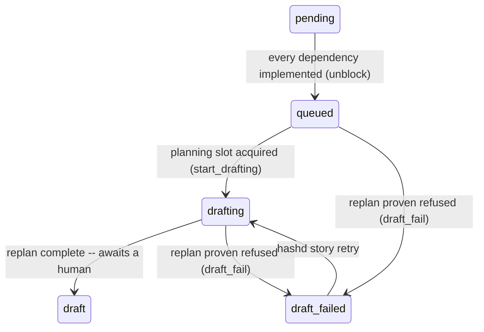

**Refused or unconfirmed dependency replans.** A proven dispatch refusal moves
the child to `draft_failed`. One failed draft blocks the project's
`/plan/new`, `/plan/quick` and `/plan/claim` entry points—CLI
`hashd plan claim`, `hashd plan story`, `hashd plan bug`, and TUI/web
planning—until retried with `hashd story retry` or closed.

A dispatch error alone is not proof: Temporal may already have accepted the
start. The server fails the child only when a workflow probe confirms nothing
is running. Otherwise it leaves the child `queued`, records the unconfirmed
outcome and relies on the stale-draft sweep.

Every path dispatches its first child inline. A refusal stops that walk: one
child becomes `draft_failed`, and the remaining eligible children stay
`pending`. Thus `hashd plan reset` against six stranded children and a
sidecar refusing starts reports one failure and five retained children. API
paths background subsequent dispatches; if refusals begin after the first
start, each affected child becomes `draft_failed` with its own recorded
refusal. Pending-child recovery cannot reclaim those failed drafts; each needs
`hashd story retry`.

The walk and failure-record writes have separate bounds: see
`dependency_handoff` and `dispatch_failure_record` in the
[Deadline inventory](#deadline-inventory). Against an unresponsive sidecar:

- Merge finalization dispatches every child inline under one
  `dependency_handoff` budget. Unreached children remain `pending` for the
  reconciliation passes above.
- The API backgrounds all but the first dispatch, with no aggregate budget.
  Those children reach `queued` with unconfirmed-dispatch records and are
  recovered by the stale-draft sweep.

These different bounds leave different resting states; both have recovery paths.

### Arc proposal (draft/accepted -> arc_proposal -> origin)

An Arc proposal operation plans a story's breakdown into an Arc's children and is the only way a story becomes an Arc. The story keeps its identity and type until an approval converts it; while a completed proposal awaits review its requirements stay editable through their existing writers, and an edit makes that proposal stale without changing it.

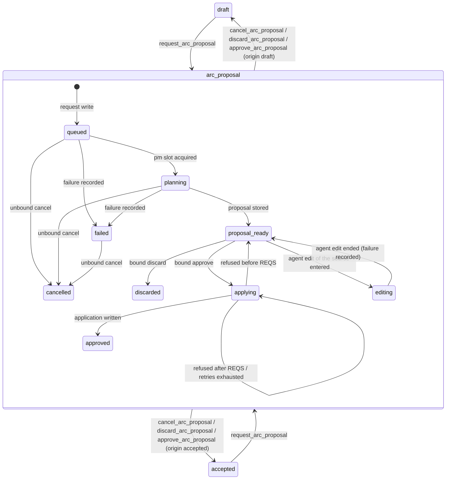

- **Operations, attempts and versions.** An operation groups attempts, and
  each attempt has its own `arc_proposals` row and its own execution. The
  request writes the operation's `initial` attempt; a `revision` attempt
  plans against a stored target proposal version, and a `retry` attempt names
  the attempt it retries. Every row carries `operation_id`, the execution of
  the operation's initial attempt. The operation's `guidance` is its initial
  guidance only; revision guidance is stored whole per revision attempt,
  bound to its target version, the source revision it was planned from, the
  principal that requested it and the time. Each stored proposal takes the
  story's next `proposal_version` on the attempt that produced it, so the
  operation's rows are its version and guidance history.
- **Current attempt, review target and effective phase.** One rule
  (`reqs.ResolveArcProposalOperation`) reads a story's latest operation, the
  operation of its highest-id row, and every read of its proposal state uses
  it: the fences, cancel, the decision binding, the source-edit admissions,
  the way-out rows and the story and list reads. The *current attempt* is the
  operation's highest-id row. The *review target* is its row with the highest
  stored `proposal_version`, or none. The *effective phase*, and the row that
  carries it, is the current attempt's while that attempt is `queued`,
  `planning` or `failed`, or is itself the review target; the review target's
  when a later revision or retry attempt is `cancelled`; and the current
  attempt's otherwise. Phase, stale and runtime are served off the effective
  row. A decision or a source edit names a version that must be the review
  target: any other version, including the one a revision is replacing, is
  refused stale and writes nothing, and while an attempt is `queued`,
  `planning` or `failed` no decision is offered or taken.
- **Phases**, on the attempt's `arc_proposals` row and displayed like a
  runner substage (`arc_proposal / <runtime> (<phase>)`): `queued`,
  `planning`, `proposal_ready`, `failed`, `cancelled`, `discarded`,
  `applying`, `approved`, `editing`, `needs_input`.
- **Ownership lifetimes.** The `pm:{project}` planning slot is a separate
  scheduler: generation holds it only while the plan step runs, and nothing
  holds it during review. Exclusive story content ownership (`content_owner`
  naming the operation's execution) is held only while the operation's work
  runs or waits on its exit: `queued`, `planning`, an unresolved `failed`
  attempt, an attempt parked in `needs_input` on its question round, and
  `applying`.
  An agent edit of the source at review (`editing`) is held by the edit's own
  execution, never the operation's: from its acquire in the `pm:{project}`
  slot until its result, its failure or the editing timeout returns the
  operation to `proposal_ready` in the same write that releases it.
  The request write sets it, together with the move to `arc_proposal` and the
  queued row. The store releases it in the same guarded write that records
  `proposal_ready`, so a ready proposal has no exclusive holder; its
  execution stays on the row as provenance and grants no write authority. The
  approval's `applying` write takes it again, refusing a story that has any
  owner; a refusal before REQS releases it with the return to
  `proposal_ready`; the cancel and application writes clear it as they return
  the story to its recorded origin. One rule (`arcProposalHeld`, read by the
  operation's fence) states this per phase, for every attempt kind: every
  write in between -- planning, the stored proposal, a failure, a decision --
  is admitted only for that execution while its attempt is the effective row
  of the story's latest operation and the story is held as its phase
  requires; a refused write writes nothing. An unfinished revision or retry
  attempt (`queued`, `planning`, `failed` or `needs_input`) holds
  `content_owner` under its own execution through the same fence, never the
  target version's, and its store releases it as the initial attempt's does;
  there is no second lock. While an attempt waits in `needs_input` its story's
  source is not edited; the answers completing its round resume it, and the
  whole-operation cancel of an initial chain, the revision cancel and the
  bound discard of a revision chain's target are its other exits, each
  cancelling the round's pending questions in the same write.
- **Workflow:** `arcproposal:{project}:{story}`, queued in the
  `pm:{project}` planning slot as section kind `arc_proposal`. Inside the slot
  it moves queued -> planning, runs the plan_split stage in Arc mode against
  the source as it stood at the request (`ArcProposalSourceRevision`), and
  stores the keyed proposal. An agent failure, timeout, invalid proposal or
  changed source records `failed` with the whole Diagnostic, the cancel step
  out of `failed` (not for a revision or retry attempt over a stored target,
  whose cancel ends only that attempt), and the plan_split transcript location
  when the agent ran.
  A planner that asks for a missing product fact instead -- a validated
  result carrying `questions`, from any attempt kind, Arc mode only -- parks
  the attempt in `needs_input` under the same fence and unchanged-source
  check, in one write: `content_owner` kept, the questions stored as one round
  of blocking clarifications bound to the operation and the asking attempt,
  and anything returned alongside kept whole on the row as evidence with no
  `proposal_version`, never a version, the review target or approvable. The
  run then ends without the Autonomous policy and releases the slot.
  An operation cancelled or superseded meanwhile is refused by its fence, before
  the agent runs or at the write, and writes nothing. Cancelled while queued, it
  writes nothing; the cancel owns that write.
  A revision attempt, and a retry whose chain of retry references starts at
  one, runs the same workflow, slot and stage: planning reads what it plans
  from out of the operation's stored rows, whole, never the workflow input's
  copy -- the target version's stored proposal with its keys, this revision's
  guidance, the initial guidance, and every earlier revision record in order
  with its target version and status (`active`, `consumed` once a version was
  stored from it, `cancelled`). A retry whose chain starts at the initial
  attempt plans as an initial attempt. The result keeps every carried key,
  gives each new child the next key no child of the operation's history has
  used, records each child's `derived_from`, and is stored only under the
  attempt's own execution, in phase `planning`, with the source revision
  unchanged: on the attempt's own row as the story's next `proposal_version`,
  which becomes the review target, back at `proposal_ready` with
  `content_owner` released in the same write. The target version's row is not
  written, and the Autonomous policy then runs as for an initial proposal. A
  key or derivation the store cannot resolve is invalid output; like every
  other revision failure it records the attempt `failed` with its guidance kept
  and the target unchanged.
- **Entry:** `POST /stories/{id}/arc-proposal` (body: `guidance`), offered by
  the `request_arc_proposal` row of a draft or accepted story's
  `available_actions` (withheld by the Arc eligibility rule and the edge's
  guards). `hashd story arc <ID>` posts `POST /stories/{id}/arc-proposal`, the CLI form of `request_arc_proposal`.
  The request refuses before writing while the story's `arcproposal` workflow
  is still open or the probe cannot answer, then writes the reservation and
  dispatches. A start Temporal refused, or never attempted, records `failed`
  with the response's Diagnostic; an AlreadyStarted start is reconciled when
  the open run's memo names this execution and fails naming the other one
  otherwise; a start that ended without an answer leaves the operation
  `queued`.
- **Exits**, all back to the origin (`draft` or `accepted`): the cancel and the
  bound discard through `POST /stories/{id}/arc-proposal/cancel`, the bound
  approval through `POST /stories/{id}/approve`, and the Autonomous policy's approval of a
  proposal just stored, through the same Arc decision service. The help
  recorded on a failed attempt names that attempt's exits with their routes
  -- a revision chain's retry, revision cancel and target discard, an initial
  chain's cancel and retry -- as advice; clients act from `available_actions`.

  **Answers and resume.** An attempt in `needs_input` takes its round's
  answers on either answer route, offered as the **Answer questions** row
  (`resume_arc_proposal`) only while it waits. Answers are input, never
  control flow: each is saved as typed to its question, so "approve" or
  "discard" decides nothing, and no answer ever starts a story edit. Answers
  that leave the round partly pending resume nothing and the response names
  each unanswered question. The answer that completes the round is admitted
  as every new attempt is (restart hold, open workflow, config), saves its
  answers and inserts a queued `resume` attempt of the same operation in one
  write, taking the story over from the asking attempt, and then dispatches
  it. The resume plans with the operation's answered rounds, as its chain
  (guidance, target, origin); a failed resume, its dispatch included, keeps
  the answers and is retried, never answered again. A repeat after the
  resume, or a late answer to a cancelled question, is refused stale (409)
  naming what won.

  ```mermaid
  stateDiagram-v2
      state "proposal_ready" as ready
      state "applying" as applying
      state "discarded (story at origin)" as discarded
      state "approved (Arc at origin, children created)" as approved
      state "queued (revision attempt, target stays stored)" as queued
      state "failed (revision attempt, target stays stored)" as failedrev
      state "needs_input (attempt waits on its question round)" as needsinput
      state "queued (resume attempt)" as resumed
      state "cancelled (story at origin)" as cancelled
      ready --> discarded : cancel route + binding (discard_arc_proposal)
      ready --> queued : arc-proposal route + binding + guidance (revise_arc_proposal)
      queued --> failedrev : revision planning or dispatch failed
      queued --> ready : cancel route, no binding (cancel_arc_revision)
      failedrev --> ready : cancel route, no binding (cancel_arc_revision)
      failedrev --> queued : retry route + arc_attempt (retry_arc_proposal)
      failedrev --> discarded : cancel route + target's binding (discard_arc_proposal)
      queued --> needsinput : planner asks for a missing product fact (questions bound to the attempt)
      needsinput --> needsinput : answer route, round still partly pending (answers saved, nothing resumed)
      needsinput --> resumed : answer completing the round, either answer route (resume_arc_proposal)
      resumed --> ready : resume planning stores a version
      needsinput --> ready : cancel route, no binding, revision chain (cancel_arc_revision)
      needsinput --> discarded : cancel route + target's binding (discard_arc_proposal)
      needsinput --> cancelled : cancel route, no binding, initial chain (cancel_arc_proposal)
      ready --> applying : approve route + binding (arcdecision run dispatched)
      ready --> applying : Autonomous policy, autonomous at decision time (same service, decider autonomous_policy)
      applying --> approved : application written (approve_arc_proposal)
      applying --> ready : refused before REQS, or a fresh start refused
      applying --> applying : approve route + binding, run confirmed closed (re-dispatch)
  ```

  **Binding rule.** A decision names the stored proposal it is for with
  `arc_proposal_version` and `arc_source_revision`, both read from the story's
  `arc_proposal`, and nothing else. On both routes the request's shape picks
  the operation before anything is read, and no form ever becomes another: one
  parameter without the other is a 400 naming the missing one; on the approve
  route the pair with `force`, `continuation` or `expected_updated_at` is a 400
  naming the combination; the unbound cancel never discards and the bound
  discard never cancels; a plain approve never approves a proposal (the held
  story refuses it, 409, at every phase) and a bound approve never reaches
  forced acceptance, the pending-clarification or edit-in-flight checks, a
  requirements-revision approval or a draft's acceptance. Every bound
  decision runs under `reqs.ResolveArcProposalBinding`: admitted only while
  that version is the story's current operation in a phase the decision acts
  from, the story is held as that phase requires (a ready proposal has no
  exclusive holder; an `applying` one is held by its execution), and the
  named revision is the one it was planned against (for an approval, also
  the story's own now). Any other binding -- no such version, a cancelled,
  replaced or still-planning one, one the other decision already recorded or
  won a race for, a revision other than the planned-against one, a ready
  story that has an exclusive holder -- is refused (409, `story.arc_proposal.stale`) naming what
  became of the version, the current attempt when it is another, and the story's status once it has left `arc_proposal`, with `GET /stories/{id}` as the next step, and
  changes nothing. No clarification decides a proposal: the operation creates
  none, and an answer of "yes" or "no" reaches neither the breakdown answer
  nor the Autonomous breakdown acceptance for a held story.

  - **Unbound cancel** (neither binding parameter): `cancel_arc_proposal` from
    `queued`, `planning` or `failed`. The cancel write lands first, then the
    workflow is asked to cancel; a failed ask is reported, never undone. A
    cancel landing between a request's reservation and its start finds no run;
    the request re-reads the operation after starting and cancels the run it
    started. A revision chain over a stored review target is cancelled alone
    (**Cancel revision**). At `proposal_ready` it is refused (409,
    `story.arc_proposal.ready`), naming the bound discard and the story read
    its binding comes from, and so at `editing`, naming the running agent
    edit; at `applying` it is refused (409, `story.arc_proposal.applying`),
    since the application may already have reached REQS.
  - **Cancel revision** (the unbound cancel route, `cancel_arc_revision`):
    while a revision chain -- a revision attempt, or a retry whose chain
    starts at one -- is `queued`, `planning` or `failed`, the unbound cancel
    cancels and revokes that attempt only: its row is marked `cancelled` with
    any failure kept, its revision record reads `cancelled`, and
    `content_owner` is released. The story stays in `arc_proposal`; the
    target, unwritten, is restored as the review target at `proposal_ready`
    with no owner, reading stale if the story's source changed since it was
    planned. The run serving the attempt is asked to cancel, its late output
    is refused, and the Autonomous policy is not run. One rule,
    `reqs.ArcRevisionCancelRefusal`, decides both the write and the story's
    `Cancel revision` row, which is offered while it admits and otherwise
    withheld with its reason; the whole-operation `cancel_arc_proposal` row is
    absent meanwhile. A revision chain the rule does not admit, such as a
    retry whose chain does not resolve, is refused (409,
    `story.arc_proposal.cancel_revision`), never ended whole. A cancel that
    loses the race to the chain's end -- its completion, another cancel, then
    an edit, approval or discard of the target -- and a revise or retry whose
    attempt a cancel ended while it was being dispatched, are refused (409,
    `story.arc_proposal.stale`, `reqs.ArcRevisionStale`) naming the winning
    state (the restored or stored target version and its phase, the current
    attempt, or the discarded target and the story's status) with
    `GET /stories/{id}` as the next step, never the `ready`, `applying`,
    `none` or `request` refusals.
  - **Bound discard** (the cancel route with the binding):
    `discard_arc_proposal`, which discards exactly
    that proposal. It is admitted only while that version is the story's
    current operation at `proposal_ready`, the story has no exclusive holder,
    and the named revision is the one it was planned against
    (`reqs.ResolveArcProposalBinding`).
    The story's source need not still match that revision: a source edited
    since planning bars approval, so discard is that proposal's exit. The write
    moves the phase to
    `discarded` with its decider and time and returns the story to its origin,
    with no `content_owner` to clear; it keeps the story's source fields as they are
    immediately before the discard (the proposal's planned-against source is
    never restored), touches no type, ID, child, dependency, REQS or
    clarification, and asks no workflow to cancel (the planning run has
    ended). A repeat of a recorded discard for the same version and revision
    answers with that discard and writes nothing. Any other binding -- no such
    version, a cancelled, discarded, replaced or still-planning one, a
    revision other than the planned-against one, a ready story that has an
    exclusive holder, an `applying` one -- is refused (409,
    `story.arc_proposal.stale`) under the binding rule.
  - **Failed-revision discard** (the bound cancel route with the target's
    binding, `discard_arc_proposal`): while a revision chain -- a revision
    attempt, or a retry whose chain starts at one -- is `failed` over a
    stored review target, the bound discard naming that target's
    `arc_proposal_version` and `arc_source_revision` is admitted under
    discard's source comparison, the revision the target was planned against,
    never the story's current one. In one write it cancels and revokes the
    failed attempt (its row `cancelled` with its failure kept, `content_owner`
    released), so its guidance record reads `cancelled`, discards the target
    with its decider and time, and restores the story to its origin; the
    Autonomous policy is not run. The story's `Discard proposal` row reads the
    same rule on the target's binding and names it in its note; approve and
    revise stay withheld while the attempt is failed. A queued or planning
    revision may still store, so its target's discard is withheld and refused
    naming the current attempt: cancel the revision first.
  - **Bound approval** (`POST /stories/{id}/approve` with the binding): the
    Arc decision service (`approveArcProposal`). It is admitted under the discard's binding rule plus one more check: the story's
    source must still be the revision the proposal was planned against. At
    `proposal_ready`, only while no `arcdecision` run of the story is open --
    an earlier attempt's run may still be closing after its refusal returned
    the proposal to `proposal_ready` -- one write
    (`reqs.BeginArcProposalApply`) moves the operation to `applying`, records
    the decider (the requesting user, or the Autonomous policy), takes
    `content_owner` for the operation's execution (refused if the story has
    any owner), and records a `story_changed`, published once the start of `arcdecision:{project}:{story}`
    is answered; the run is dispatched detached from the request, and the
    response's outcome is `arc_proposal_applying`. An open run refuses the
    approval (409) and a probe that cannot answer is a 503; both are checked
    before the write, which they leave unmade. The probe follows a read of the
    ready proposal, and the write admits only that ready generation (its
    `phase_changed_at`): one written since -- another approval's attempt,
    refused meanwhile by a run that may still be open -- is refused (409)
    with nothing written. A start Temporal refused, or
    never attempted, returns the operation to `proposal_ready` with the
    Diagnostic, as does an AlreadyStarted start whose open run's memo names
    another execution -- but only while the start window (below) is still
    open as that write reads it, when no other approval can have dispatched
    an application; past it the failure is recorded and the operation stays
    `applying`. One whose memo names this execution and this applying attempt
    (the applying write's `phase_changed_at`; a concurrent approval's start)
    stands; one naming an earlier attempt of this execution records the
    Diagnostic and stays `applying`, since that run may still apply. Any start whose run may be this execution's own
    -- an AlreadyStarted run that cannot be read, names no execution, or has
    closed since (one that applied the proposal stands) -- and a start that
    ended without an answer record the Diagnostic and stay `applying`: only an
    application known to have run nothing returns to `proposal_ready`, where a
    discard is admitted. At `applying`, an approval while a run of this
    execution and attempt is open, or inside the start window with no failure
    recorded, answers `arc_proposal_applying` and dispatches nothing; one
    while another execution's or an earlier attempt's run is open is refused
    (409), writing and dispatching nothing;
    once Temporal confirms no such run is open, it is the retry and
    re-dispatches with no phase change (a definite start failure then records
    the Diagnostic and stays `applying`, since an earlier run may have reached
    REQS); a probe that cannot answer is a 503 that changes nothing. A repeat
    of an applied approval for the same version and revision answers
    `arc_proposal_approved` with the recorded key-to-story mapping, whatever the
    story's state now, and writes nothing. Concurrent approvals make one
    `applying` write and one run.
  - **Revise and refresh** (`POST /stories/{id}/arc-proposal` with the
    binding and `guidance`): the
    request binds `arc_proposal_version` and `arc_source_revision` as read
    from the story's `arc_proposal`, the pair every other decision sends. A
    revise, of a target whose source is unchanged, is planned against the
    named revision; a refresh, of a stale target, is planned against the
    story's current source. Either takes the `revise_arc_proposal`
    self-edge (`reqs.ReviseArcProposal`) and produces a queued `revision`
    attempt carrying the guidance whole as its revision guidance, owning
    `content_owner`, and dispatched through the request's own dispatch; the
    target version is left unchanged and stays stored until a stored revision
    replaces it. The guidance never creates a clarification, approves or is
    read as a command. One parameter without the other is a 400 naming the
    missing one, and the binding with guidance that is empty after trimming
    is a 400 (`story.arc_proposal.revise`), both before anything is read;
    without either parameter the route is the request, which a held story
    refuses (409). It is admitted under the discard's comparison -- the
    version is the current target at `proposal_ready` with no exclusive
    holder, planned against the named revision, with no comparison against
    the story's source now -- before the write and again inside it. A
    refusal of the binding is `story.arc_proposal.stale`; the only others
    are the restart hold, and an earlier Arc proposal workflow of the story
    still open (or a probe that cannot say) while the binding stays admitted
    (`story.arc_proposal.request`). None writes, publishes or starts
    anything. One binding admits one write: an approval or another revise
    racing it is refused stale naming the winner, including a revise whose
    preflight finds the winner's workflow open, which re-reads the story
    under the binding rule.
  - **Retry** (`POST /stories/{id}/arc-proposal/retry` with `arc_attempt`):
    `arc_attempt` names the failed attempt as read from the story's
    `arc_proposal.attempt_execution_id`; a
    missing or empty one (after trimming) is a 400
    (`story.arc_proposal.retry`) before anything is read. One rule,
    `reqs.ResolveArcProposalRetry`, admits the retry before the write and
    again inside it: the named attempt is the operation's current and
    effective attempt, `failed`, and still holds the story. The write takes
    the `retry_arc_proposal` self-edge (`reqs.RetryArcProposal`) and inserts a
    queued `retry` attempt naming the failed one, carrying the same guidance
    and target (and revision guidance), planned against the story's current
    source, and dispatched through the request's own dispatch; the new
    execution owns the story's `content_owner`. The failed attempt is kept
    whole: its phase, failure Diagnostic and transcript are not written. A
    failed initial chain is retried the same way as a failed revision chain.
    Any other attempt -- planning, ready, cancelled (a cancelled revision),
    or no longer current because another retry won -- is refused (409,
    `story.arc_proposal.stale`) naming the current attempt and its phase; the
    restart hold, and an earlier Arc proposal workflow still open (or a probe
    that cannot say), refuse as the revise does. Two retries of the same
    attempt start one run: the loser is refused naming the queued retry,
    inside the write or by the re-read after its preflight finds the winner's
    workflow open. A revision cancel that lands after a retry commits cancels
    the retry attempt, the one current at its write. Overlapping requests
    serialize into whole committed sequences. A later request that still fits
    the state after the earlier one commits may also succeed (retry then
    cancel of the new current attempt; cancel restoring the unchanged target
    then its bound discard). Every request that no longer fits is refused
    through the shared stale refusal and writes nothing. The story's `Retry` row
    reads the same rule on the current attempt, so it is offered only for a
    failed current attempt with no live run, its note naming the
    `arc_attempt` to send, and is otherwise withheld with the refusal's
    explanation or the open-workflow refusal's title.

  A story in `arc_proposal` always carries the decision rows
  `discard_arc_proposal` ("Discard proposal") and `approve_arc_proposal`
  ("Approve proposal"), each decided by the rule its bound write runs under on
  the proposal the story serves: the discard is offered only at
  `proposal_ready`; the approval at `proposal_ready` only while no
  `arcdecision` run of the story is open (withheld, as the approval refuses,
  while an earlier one is or the probe cannot answer) and, at `applying`, only
  as the retry once the runtime reads `failed` (withheld as in flight
  otherwise). At `proposal_ready` the offered approval's note states what it
  does with each proposed child under the project's mode read now, from the
  plan-ready rule the child release applies (`arcChildPlanReady`), and a mode
  that cannot be read withholds the row and refuses the approval. In `queued`, `planning` and `failed`
  both are withheld with the reason a bound decision's refusal gives (no
  stored proposal to decide). Beside them it always carries the
  `revise_arc_proposal` row, labelled "Refresh proposal" while the review
  target is stale and "Revise proposal" otherwise, decided by the revise
  route's own rule (`arcProposalReviseRefusal`) on the binding the story
  serves: offered only while that stored target is the effective row at
  `proposal_ready` with no `content_owner`, with a note naming
  `arc_proposal_version=N and arc_source_revision=R`, that guidance is
  required and, for a refresh, that the new version is planned against the
  story's current source while vN stays as stored. It is withheld in
  `queued`, `planning` and `failed` with the decision rows' no-stored-proposal
  reason; at `editing`, at `applying`, once decided, or while the story has a
  `content_owner` with the resolver's explanation, the Explanation of the
  route's 409. A row the binding admits is still
  withheld, with the title of the route's `story.arc_proposal.request`
  refusal, while an earlier Arc proposal workflow of the story is open or the
  probe cannot say. Every write of a run publishes while that run is open, so
  the server observes each run it starts -- including one whose start it
  reconciles as its own after Temporal answered that it had already started
  -- and, once that exact run is confirmed closed (a wait that fails while the
  run is still open keeps watching), publishes one live `story_changed`
  frame (reason "its Arc proposal workflow closed") with no `events` row:
  nothing changed for the timeline to record, only what a read derives.
  Clients re-read on it and find the row offered, after a planning run's
  last write or a cancelled run that was still stopping. Observers do not
  survive a server restart, so at startup the server re-arms one for every
  Arc proposal run still open, read from the restart inventory's workflow
  listing, one per run; a run that closes after the restart is announced the
  same way. The announcement is live only: a client not connected when the
  run closes misses it, and its re-read when its event stream reconnects is
  the recovery, as it is for a run that closes while the server is down or
  before the startup re-arm lists it. Every
  phase but `proposal_ready` also carries the `cancel_arc_proposal` row,
  withheld at `applying` and at `editing` with the cancel's refusal reason,
  except while a revision or retry attempt over a stored target is `queued`,
  `planning` or `failed`, whose cancel ends only that attempt. The `approve`
  capability, `accept` and `force_accept` rows are never offered while the
  story is held. A `failed` operation keeps the story in
  `arc_proposal` until it is cancelled.
- **Review-time editing.** At `proposal_ready`, stale or not, the story stays
  in `arc_proposal` and the operator edits its source through the direct
  writers, `POST /stories/{id}/update-criteria` and
  `POST /stories/{id}/update-fields` (`mutateStoryContent` ->
  `reqs.MutateStoryContent`), or through the story edit agent (below). The one
  held-story rule (`arcProposalRefusal`, decided with the story's latest
  operation) admits a source edit only at `proposal_ready` with no
  `content_owner` and an origin whose content is not read-only; every
  lifecycle verb and capability stays withheld in every phase. In `queued`,
  `planning`, `failed`, `editing` and `applying` the edit is refused (409)
  naming the phase and `GET /stories/{id}`, and the `update_criteria` row is
  withheld with that reason; at review the row is offered with a note naming
  the binding. The edit is bound to the proposal it was made against:
  the bodies carry `arc_proposal_version` and `arc_source_revision`, the
  decisions' names, both required while the story is in `arc_proposal` (one
  without the other, or neither, is a 400 naming what is missing). Inside the
  edit's write `reqs.AdmitArcProposalSourceEdit` admits it only while that
  version is the story's current operation at `proposal_ready`, planned
  against the named revision, with no `content_owner`. An edit that loses to
  an approval meets the story still in `arc_proposal` at `applying` and is
  refused by the held-story rule (`arcProposalRefused`, 409,
  `story.arc_proposal.held`) naming that phase; one that loses to a discard,
  a cancel or a finished approval meets a story that has left `arc_proposal`
  and is refused by the binding (409, `story.arc_proposal.stale`) naming what
  became of the version (discarded, cancelled, approved) and the read to
  refresh from. The edit never touches the operation or its
  stored proposal; one that changes the source makes the proposal stale, says
  so on its `story_changed`, and withholds the approval. Edit and approval
  both run under the story's writer reservation (`WithStory`), so an approval
  after an edit fails the binding's source check and an edit after an
  approval meets `applying`. An edit that leaves the source revision as it
  was leaves the proposal approvable. **Discard after source edits** keeps the
  edited source; a discard never restores the proposal's planned-against
  source.

  ```mermaid
  stateDiagram-v2
      state arc_proposal {
          proposal_ready --> proposal_ready : direct source edit
          proposal_ready --> editing : agent source edit
          editing --> proposal_ready : edit finished, failed or timed out
          proposal_ready --> applying : bound approve (not stale)
          proposal_ready --> discarded : bound discard
      }
  ```

  **Agent edit at review** (phase `editing`). The existing story edit agent
  edits the source through the existing route, workflow and PM section:
  `POST /stories/{id}/edit`, whose body carries the same `arc_proposal_version`
  and `arc_source_revision` as the direct edit, both required for a held
  story. The story stays in `arc_proposal` throughout and never takes the
  story `editing` status. The route admits it by the held-story rule and the
  origin status's own `start_edit` edge and guards
  (`arcProposalStartEditRefusal`; an `accepted` origin requires
  `story_has_no_workstreams`), then enters it with
  `reqs.EnterArcProposalSourceEdit` under the binding and dispatches
  `edit:{project}:{story}` naming the editing generation; the entry's
  `story_changed` is published once the start is answered. A dispatch that
  fails ends the phase back at `proposal_ready` with the dispatch's
  Diagnostic. The story's `start_edit` row, labelled "Edit source
  requirements" with a note naming the binding, is offered only at
  `proposal_ready` and withheld with the phase's or the guard's reason
  elsewhere. Inside the PM section `RunEditBegin` acquires the reservation
  (`AcquireArcProposalSourceEdit`, stamping `editing_started`) with the edit
  stage `arc_proposal`, and prompts the agent with the story as it is, shown
  with the status the operation took it from; a begin that cannot acquire
  ends the phase. The result is written as an ordinary edit writes one --
  content, REQS anchoring, intent capture -- and the operation leaves
  `editing` for `proposal_ready` in the same transaction
  (`EndArcProposalSourceEdit`), its stored proposal never rewritten; no size
  offer is taken. Like an ordinary edit's `edit_complete`, that end sets the
  operation's `origin_status` to `draft`, so the agent-written content is
  accepted again: a later cancel or discard returns the story to `draft`,
  never straight to `accepted`. A direct field edit at review leaves
  `origin_status` as it was. A result that asks open questions applies
  nothing -- its attempt skips the REQS anchoring write -- and stores no
  clarification, since no answer route accepts one on a held story: the edit
  ends failed with every question whole in its `edit_diagnostic`, and the
  operator edits the source directly or discards the proposal. A failed
  attempt, refusal or lost result never moves the story to `draft_failed`:
  the phase ends at `proposal_ready` with the whole Diagnostic as
  `edit_diagnostic`. Every end of the phase checks the requirements-write
  marker on the story as its own write reads it, and is refused while the
  marker's REQS lock is held, as the `draft_fail` guard refuses an ordinary
  edit's failure. A late result -- its phase already ended, timed out or
  taken by another edit -- fails the owner and phase fence and writes
  nothing. Housekeeping ends an acquired edit past
  the editing timeout (`editingTimeout`, measured from `editing_started`)
  back at `proposal_ready`, recorded as timed out; an entry no execution has
  acquired is left inside its start window (`arcDecisionStartSettled` on
  the entry's `phase_changed_at`: the route commits `editing` before it
  starts the workflow) and while its edit workflow may be open (a probe
  that cannot answer counts as open), and ended once both are over,
  recorded as never started. A source the edit changed makes the proposal stale,
  as a direct edit does.

  The three operation writes (`server/internal/reqs/arc_proposal.go`) each
  run inside `WithStory` recording a `story_changed` published after commit. `EnterArcProposalSourceEdit` is the reservation, bound as the
  direct edit is (`AdmitArcProposalSourceEdit`): it moves the ready proposal
  to `editing` in the ready generation it admitted
  (`BeginArcProposalSourceEditCAS`, conditioned on `phase_changed_at`),
  clears the last edit's `edit_diagnostic` and sets no owner; its new
  `phase_changed_at` is the edit's generation. `AcquireArcProposalSourceEdit`
  binds `content_owner` to the edit's execution only while the operation is
  `editing` in that generation and unowned (the owner's repeat is a no-op).
  `EndArcProposalSourceEdit`, named by that owner, or by the generation alone
  while nobody acquired, returns the operation to `proposal_ready`
  (`EndArcProposalSourceEditCAS`, a new ready generation), removes
  `content_owner`, `editing_started` and the requirements-write marker --
  holding the REQS lock the marker names across the write, refused while it
  is held -- and records a failure's whole Diagnostic in `edit_diagnostic`. A late or foreign owner, another generation or another
  phase is `ErrStoryOwnership` and writes nothing. While the edit runs the
  bound approval and the bound discard are refused by the binding
  (`story.arc_proposal.stale`, saying an agent edit of the source is running),
  and a direct edit by the held-story rule (`arcProposalRefused`,
  `story.arc_proposal.held`, naming the `editing` phase).
- **Autonomous policy** (`ApproveArcProposalAutonomously`): when the plan step
  stores a proposal, the `arcproposal` workflow runs one more leg, retried
  for infrastructure faults (three attempts, heartbeating), that reads the
  project's mode at that moment (`config.LoadProjectConfig` +
  `EffectiveAutonomy`, the rule the breakdown acceptance uses). In
  `autonomous` mode it approves exactly the stored version and source
  revision through the Arc decision service above -- the same `applying`
  write and `arcdecision` dispatch, with the decider recorded as
  `autonomous_policy` -- and every refusal or start failure follows that
  service's rules. In any other mode it does nothing and the proposal waits
  at `proposal_ready` for an operator. A config it cannot read is recorded as
  the operation's decision Diagnostic (`reqs.RecordArcProposalReadyDiagnostic`,
  under the operation's fence) and the proposal waits; so are the decision
  service's refusal (a source changed since planning, say), whole, and
  retries that run out. An operation already decided or moved on is left
  untouched. Being a workflow leg, it resumes across a worker or server
  restart between the store and the approval. Each ask is a restart-hold
  boundary ("before the Autonomous approval of the Arc proposal"): a hold in
  force, including the pre-boot hold a restarted server's worker resumes
  under, is waited out first, and a hold that refuses the approval itself
  sends the leg back to that boundary rather than ending it, so a restart
  never drops the approval. It runs once per stored
  proposal: a mode changed afterwards triggers nothing. It never discards,
  and it never answers a clarification; the CLQ breakdown acceptance is not
  reached for a held story.
- **Awaiting-decision marker**: each time a proposal comes to await an
  operator's decision it records one `arc_proposal_awaiting_decision` events
  row (a `timeline_entry` frame after commit), whose data names the
  execution, the proposal version and its ready generation (`ready_since`,
  the `proposal_ready` write's `phase_changed_at`). It is written in the
  write that leaves the proposal waiting: `reqs.RecordArcProposalReadyDiagnostic`,
  the `ReturnArcProposalToReadyCAS` leg of a refused application (except the
  Autonomous policy's own failed start, which its approval leg retries),
  `reqs.EndArcProposalSourceEdit` returning an agent edit of the source
  (ended, failed or timed out) from `editing` to review, and, for a
  stored proposal the policy left waiting, the workflow's
  `ArcProposalAwaitDecision` leg (`reqs.RecordArcProposalAwaitingDecision`,
  under the operation's fence). A generation is marked once; a proposal the
  policy decided, an application that stays `applying`, and a fenced or
  rolled-back write record none. The `story_changed` phase rows are
  unchanged.
- **Application** (`applying` -> `approved`): one transaction, the split
  application (`applyPlanSplitProposalTx`) under the Arc decision binding
  (`server/internal/api/story_arc_decision.go`). It is admitted only while the
  operation is the story's current one at `applying`, still owns the story,
  and the story's `ArcProposalSourceRevision` is the one the proposal was
  planned against; the content lock does not refuse it. The write converts
  the source to an Arc (same ID), applies the parent revision, allocates IDs
  for exactly the proposal's children, links them to the Arc, resolves their
  dependencies from child keys to those IDs (a dependency on the source or an
  unknown key refuses the whole write), applies the REQS scope through
  `ReconcileSplitScope` with provenance `hashd-arc-decision: <project>
  <story> v<version> <execution>`, records the planner's intent capture for
  the source and every child, takes `approve_arc_proposal` to the origin,
  clears `content_owner`, and records `approved` with its time and the
  key-to-story mapping, keeping the decider the `applying` write recorded.
  Every `story_changed` is written in the transaction and published after
  commit. An operation already `approved` answers with its recorded mapping
  and writes nothing; a failure after the REQS commit rolls the database back,
  and a repeat recognises that commit by its provenance, so the operation is
  applied once. A failure reports whether it stopped before REQS could be
  written or at or after the REQS write.
- **Application run:** `arcdecision:{project}:{story}`
  (`temporal.DispatchArcDecision`, singleton, its memo naming the operation's
  execution and applying attempt), dispatched by the bound approval. Its apply leg runs the application
  above; the leg's RetryPolicy retries infrastructure faults (three attempts,
  heartbeating), and a repeat converges on the one application. A refusal is
  outcome data, never retried, and records the operation's outcome under its
  fence, bound to the applying attempt the run serves, so a late record of an
  earlier attempt writes nothing (a record leg retried like the apply, since
  a repeat converges) with
  the Diagnostic whole as the decision Diagnostic and a `story_changed`:
  - refused **before REQS could be written** (on a run's first attempt, with
    REQS history holding no scope commit naming the decision -- an earlier run
    the approval re-dispatched after may have written one; a refusal on a
    retried attempt may follow an earlier attempt's REQS write): the
    operation returns to `proposal_ready` with its decider cleared and
    `content_owner` released in the same write, so approve and discard are
    offered again; nothing is converted or created;
  - refused **after the REQS write**, or **retries exhausted**: the operation
    stays `applying`, since REQS may hold the scope commit the database does
    not record; the Diagnostic names that commit's provenance. Neither cancel
    nor discard ends it; the bound approval re-dispatches it once its run is
    confirmed closed.

  After the commit the release leg sends the Arc's ready children into
  planning through the stranded-pending recovery pass and records, per child
  key in the decision's `child_story_ids`, what became of each:
  `released` (left `pending`, its planning dispatched; a child whose dispatch
  was refused, or that is `draft_failed`, is `failed` -- the leg waits for the
  pass's backgrounded dispatches to answer before it records), `waiting` (created
  `pending` on sibling prerequisites; it is released when they are
  implemented), `draft` (supervised mode creates a child that waits on nothing
  as a draft for the operator) or `failed` with the pass's error (the
  stranded-pending sweep retries it). Outside supervised mode a child that
  waits on nothing is created `pending` and released here. A release failure
  never rolls back or recreates the structure; a repeated release moves only
  children still stranded in `pending` and keeps a child already recorded
  `released`. The story read serves the records as `child_releases`.
- **Reads:** `GET /stories/{id}` embeds the story's latest operation whole
  as `arc_proposal` (guidance, source revision, the keyed proposal and its
  version, the failure as a Diagnostic, the decision, the last agent edit's
  failure as `edit_diagnostic`); a cancelled or discarded one stays as
  history. It reads the operation through the one resolver
  (`reqs.ResolveArcProposalOperation`): `phase` is the effective phase;
  `proposal_version`, `proposal`, `source_revision` and `stale` are the review
  target's; `attempt_execution_id`, `attempt_kind` (`initial`, `revision`,
  `retry`) and `attempt_target_version` are the current attempt's, a retry's
  target read through its chain of retry references. `arc_proposal.history`
  serves the operation in order, whole and never truncated: every stored
  version with its proposal, outcome (`current`, `superseded` with
  `superseded_by` naming the next version, `approved`, `discarded` --
  supersession is derived from a higher stored version, so the superseded row
  is never rewritten) and the decision and edit Diagnostics recorded on it; the initial guidance; every revision guidance record
  with its target version, requesting user, request time and status
  (`active`, `consumed`, `cancelled`, the rule planning reads); and every
  attempt with its execution, kind, retry reference, target version, outcome
  (`queued`, `planning`, `failed`, `cancelled`, or `stored` with the version)
  and failure Diagnostic.
  Each history version also carries `comparison`, which the server computes on
  read from the stored versions of the same operation and never stores. A
  version's predecessor is the target version of the attempt that stored it,
  read through its chain of retry references: a revision's own target, and for
  a retry the target of the revision its chain starts at. A version stored by
  an initial attempt, or by a retry whose chain starts at one, has none, nor
  does the first version of a later operation after a discard; its
  `comparison` says so (`status` `no_predecessor`). Otherwise (`status`
  `compared`, with `predecessor_version`) it states the children carried
  forward, added and removed by key, each with its title; every added child's
  declared `derived_from`, whole, with the combined children (two or more
  target keys) and the split target keys (declared by two or more added
  children); for each carried child whether its title, problem and acceptance
  criteria sketch changed, with both values whole when one did; the dependency
  edges added and removed; and whether the REQS scope's retained and excluded
  texts changed, with both served whole, or that only one version has a REQS
  scope. Derivation never moves a key between carried, added and removed, and
  nothing is inferred from text similarity. A stored record that does not
  decode refuses the read; no partial comparison is served.
  A Diagnostic recorded on an attempt or a version
  stays readable there whichever attempt is current and once a later attempt
  supersedes it; no read or refused request clears it.
  While the story is in `arc_proposal`, the story read, `GET /stories` and
  `GET /dashboard` also carry `arc_proposal_phase`, the current attempt's
  `arc_proposal_attempt_kind`, read in the same snapshot, and the
  server-computed `arc_proposal_runtime` (`arcProposalRuntime`):
  `queued`/`planning` -- of an initial, revision or retry attempt alike --
  read `running`, or `orphaned` once Temporal confirms no `arcproposal` run of
  that attempt's own execution is open (none open, or the open run's memo
  names another execution; a probe that cannot answer reads `running`; one
  probe budget per read); `editing` reads `running` while the agent edit's
  `edit:{project}:{story}` run may be open or inside the edit's start window
  (`arcDecisionStartSettled` on the entry's `phase_changed_at`: the route
  commits `editing` before it starts that run), and `orphaned` once the window
  has passed and Temporal confirms the run is closed, on the same fail-alive
  probe; `proposal_ready`
  reads `awaiting_decision`; `failed` -- the failed attempt's own row, of
  any kind -- reads `failed`;
  `applying` reads `running` while an `arcdecision` run of this execution and
  applying attempt may be open (a memo naming no attempt cannot be told
  apart), and `failed` once Temporal confirms none is (closed without
  finishing), on the same fail-alive probe -- except inside the start window
  (`arcDecisionStartWindow`, three `dispatchCancelBudget`s after the applying
  write: the start, its settle probe and its failure record), where the run
  may not be started yet and the operation reads `running` unless a failure
  is recorded. Past the window a closed run reads `failed` whether or not
  anything recorded it (the server died before the start, or the run closed
  when its record leg failed), so the retry is offered.
  The same reads carry the stale fact: `arc_proposal.stale` on the whole
  operation and the compact `arc_proposal_stale` beside the phase, both from
  one rule (`reqs.ArcProposalStale`) on the review target: the operation holds
  the story with a stored proposal whose row is `proposal_ready`, `editing` or
  `applying` -- a revision or retry attempt running against it included -- and
  the story's `ArcProposalSourceRevision` is no longer that row's
  `source_revision`. It is
  derived on read from the story row and its operation read in one snapshot.
  The revision hashes only the operator-authored source -- title, type,
  target repo and dependencies from their columns, and the explicit data
  field list `arcProposalSourceKeys` (problem, source refs, non-goals,
  acceptance and descoped criteria, planning feedback) -- so operation and
  run bookkeeping (`content_owner`, the status mirror, `editing_started`,
  `content_applying`, `dropped_edits`, `failure_cause`) leaves it unchanged:
  a running agent edit reads stale only once it has changed that content, and
  one that fails without changing it leaves the proposal approvable. The
  approval's source check in `ResolveArcProposalBinding` is the same rule, so
  a stale proposal's approve row is withheld with the refusal's explanation:
  the source was edited after vN was planned against its revision, refresh
  from `GET /stories/{id}`.
  Phase changes publish `story_changed`, so clients reread rather than derive;
  the request publishes its reservation only after the start is answered, so
  the reread it prompts never finds a run that is about to start.
  The TUI, Web and `hashd show` Arc attention label "Arc draft" is
  that served `arc_proposal_phase` at `proposal_ready`, with `stale` beside
  it while `arc_proposal_stale` is true; every other phase shows as
  `arc_proposal / <runtime> (<phase>)`, followed by
  ` · <arc_proposal_attempt_kind>` when the served kind is not `initial`.
- `proposal_ready` is the single decision point every mode starts from. The
  planning workflow applies nothing itself and creates no clarification; its
  only mode read is the Autonomous policy leg above.

---

## Suggestion Lifecycle

Suggestions are created by `hashd plan` phase 1 (REQS discovery), or imported
from a tracker the operator picked from (`POST /suggestions/import`; the TUI
Plan screen's `i`), and stored in SQLite (`suggestions` table). `origin` says
which: discovery replaces only its own `available` suggestions, so an imported
one survives rediscovery. Importing never starts planning -- an imported
suggestion is claimed like any other, and the claim hands its tracker item to
planning as a selected reference and keeps it on the story
(`import_reference`).

An item is imported in a project while any record of its import exists there:
an open (`available`/`planning`) suggestion with its identity, or a story that
carries it, whatever the story's status -- archiving deletes the suggestion,
not the story, and a clone copies it. It becomes importable again only when no
such record remains; a claimed suggestion whose story was deleted blocks
nothing. The identity is connector + connection (its `REMOTE_SCOPE` form) +
item id, per project; attaching one item to several stories as a reference is
never limited. The import applies this rule inside one `BEGIN IMMEDIATE`
transaction, so concurrent or retried imports leave one record and the others
are refused naming it; `GET /connectors/search` returns the same rule's
advisory `imports` marks for the page's items, and `POST
/suggestions/import/marks` for any batch of items.

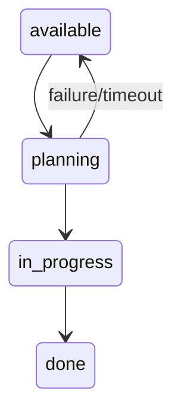

| Stage | Description |
|-------|-------------|
| `available` | Ready to be selected |
| `planning` | Story creation in progress (15 min timeout) |
| `in_progress` | Story created, workstream active |
| `done` | Workstream completed |

In the TUI, suggestions show status indicators:
- `(planning...)` - cyan, creation in progress
- `(planning timed out)` - red, can be retried
- `(in progress)` - yellow, story exists
- `(done)` - green, completed

**Note on tech tree suggestions:** the tech tree planner (`hashd plan` phase 2) produces a separate, ephemeral artifact class — "tech tree suggestions" — that does NOT enter the `suggestions` table and has no lifecycle states. They live only in server-side in-memory storage, render in the TUI tree visualization, and disappear on the next `hashd plan`. They never cross the agent boundary. See `DAS_PLAN.md > Story Dependencies, Thin Slicing, and the Tech Tree` for details.

---

## Requirements Lifecycle

```mermaid
flowchart LR
    REQS["REQS.md (shrinks)"] --> Stories --> SPEC["SPEC.md (grows)"]
    Stories -- "descoped criteria" --> REQS
```

### Document Update Flow

REQS.md and SPEC.md target the configured base branch, separately from feature
work. Post-merge finalization uses linked worktrees from the existing local Git
repositories, not clones or the operator's checkout.

```mermaid
flowchart TD
    subgraph PLAN["Planning Phase (main branch)"]
        P1["hashd plan story '...'"] --> P2[git pull --rebase]
        P2 --> P3["Planner annotates REQS.md\nwith WIP markers"]
        P3 --> P4["git commit + push\nWIP markers on remote"]
    end

    subgraph IMPL["Implementation Phase (feature branch)"]
        I1[hashd run STORY-0043] --> I2[Creates worktree on feature branch]
        I2 --> I3[Agent implements in worktree]
        I3 --> I4["Commits to feature branch\nNO changes to REQS.md or SPEC.md"]
    end

    subgraph MERGE["After code merge"]
        M1[hashd merge] --> M2[Acquire merge and artifact locks]
        M2 --> M3["Fetch destination branches\ncreate or reuse isolated linked worktrees"]
        M3 --> M4["Update SPEC from story and diff\ncheckpoint prepared result"]
        M4 --> M5["Preserve and burn marked REQS sections\nrestore deferred criteria; checkpoint"]
        M5 --> M6["Commit only configured artifacts\npublish each owning repository"]
        M6 --> M7["Record burn and finalize story\nbest-effort worktree cleanup; preserve changes"]
        M7 --> M8[Record archive completion]
        M4 & M5 & M6 & M7 -->|Failure or interruption| RETRY["Preserve prepared work\nretry hashd merge from checkpoints"]
    end

    PLAN --> IMPL --> MERGE
```

### Critical Invariants

1. **WIP tags are added to main** during planning and pushed immediately
2. **Feature branches never touch REQS.md or SPEC.md** - all doc work happens post-merge
3. **Isolated publication** - remote finalization leaves the base checkout's files, index, and branch untouched. Only prepared artifact commits are rebased onto an advancing destination; conflicts preserve the work and stop finalization. Local merge publication uses the recorded code merge, never a later base HEAD.
4. **One documentation commit per owning repository** - SPEC and REQS share a commit when colocated. No changes is success, not a commit failure.
5. **Publication precedes completion** - required failures leave finalization incomplete and retryable. Completed preparation and publication steps are checkpointed under the project directory's `archive/`. Local-only / `--no-push` finalization fast-forwards a clean, unchanged local base; otherwise prepared work is retained and finalization stops.
6. **Implemented stories' WIP markers survive until the burn** - the story-transition cleanup and planning's marker reconcile both preserve (or themselves burn) an implemented story's markers; only abandoned/missing stories get markers stripped with prose kept. The merge-archive burn finds the requirement sections by those markers, consumes the prose, and records a `requirement_burned` event; the reconcile sweep performs the same burn as the crash backstop when the archive never ran

### Manual Artifact Inspection and Edits

Manual document writes share the artifact ownership boundary with planners and
editors. They compare the editor's saved revision, hold the document lease during
write/commit/publication, and reject stale revisions, dirty or wrong-branch
checkouts, symlink paths, and edits inside protected REQS WIP sections. Explicit
leases can span multiple steps and require renewal before expiry. See [manual document commands](docs/walkthrough.md#manual-artifact-inspection-and-edits).

### Failure Modes

| Symptom | Cause | Fix |
|---------|-------|-----|
| Documentation incomplete after code merge | Finalization failed or was interrupted | Resolve the reported failure, then retry `hashd merge` |
| Documentation publication conflicts | Destination changed since preparation | Reconcile the preserved documentation worktree, then retry |
| No matching WIP sections | No published markers for this story, including ad-hoc stories | No REQS burn is recorded |

### WIP Tag Conflicts = Scope Overlap

If `git push` fails during planning due to conflicting WIP markers, this is NOT a git problem to auto-resolve.

**What it means:** Two stories are claiming the same requirements.

```
Story A (already pushed):                Story B (trying to push):
<!-- BEGIN WIP: STORY-0042 -->           <!-- BEGIN WIP: STORY-0043 -->
| Skill Level Filtering | ... |    <--   | Skill Level Filtering | ... |
<!-- END WIP -->                         <!-- END WIP -->
```

**Required action:** Rescope one of the stories. The overlap indicates:
- Stories are too broad
- Work is being duplicated
- Requirements need to be split more granularly

The system should abort story creation and report: "STORY-B overlaps with STORY-A. Rescope before proceeding."

---

## Execution Model

### Temporal Workflows

Each long-running operation runs as a Temporal workflow under a singleton workflow ID, so a duplicate dispatch fails instead of double-running:

| Workflow | Purpose | Trigger |
|------|---------|---------|
| `run:{project}:{ws}` | Execute micro-commit loop | `hashd run` |
| `plan:{project}:{story}` | Create story from suggestion | Plan screen suggestion claim, `hashd plan story`, or `hashd plan bug` |
| `merge:{project}:{ws}` | Merge to main and archive | `hashd merge` |

The other operations (resolve, edit, docs, discovery, detect, plan-split, add-commit) follow the same singleton-ID pattern; PM-artifact mutations additionally serialize through the `pm:{project}` section, and the `housekeeping` sweep fires from a Temporal Schedule every 5 minutes. `hashd project describe --suggest` and `hashd project tech --suggest` dispatch the same way under `pmdescribe:{project}:{target}` (target `description` or `tech`): the CLI POSTs `/projects/{name}/describe` or `/tech`, the server runs the `pm_describe` agent stage server-side, and the CLI renders the result from the `pm_describe_completed` event -- so the agent runs on the server in both local and team mode and the CLI never invokes an agent itself.

#### Restart in-flight inventory

`GET /inflight` is the cross-project list of work a stop would kill, and it is
**all-or-error**. Both legs are ordinary dependency calls -- the entity scan
reads each project's database, the workflow leg runs one paged Temporal
visibility query per project and collects every page -- so each either answers
completely or fails the whole inventory with an error. There is no partial
board, no "degraded" flag, and no failed scan is converted into an empty success
-- a complete inventory may be empty, which is a quiet stack rather than a
failure. A listing that died after an earlier page arrived, a database that will
not open, a sidecar that never answered, or a spent budget all return the same
refusal (`inflight.incomplete`).
`unchecked` remains on a successful answer and is not a failure -- it names what
the inventory structurally does not cover (a registry family it never queries, a
project with no database yet, an entity state it does not classify).

A dead merge lane is reported as already stopped, not as work to wait on. A
workstream at `merging` whose current merging substage has a stage failure
recorded since it was last entered (the record half of the dead-merge
judgement) has its merge lane read exactly: the latest `merge:` run and the
`mergelock:` run held for it. When neither has a pending activity and the
listing attributes no other open execution to the workstream, its row and its
`merge:` / `mergelock:` lines leave `items`, and it is listed under
`human_stopped` naming the failed stage and `hashd merge <ws> --abort`. A merge
with a pending activity on either run, or with no recorded stage failure, is
listed as before. A lane read that fails fails the inventory; it is never read
as stopped.

The stop paths (`hashd restart`, `hashd restart server`, `hashd stop`) read
that answer through one gate (`runStopGate`, `cli/restart_wait.go`), which
holds, waits for every row to report a boundary it acknowledged, and never
renders a failed read as a clear board. What a stop DOES about an inventory it
could not take is that gate's decision, not the inventory's.

Project description owns its map/reduce attempt through completion; step
failures become warnings rather than aborting the aggregate. Human gates park
the run until an operator decision. Implementation details are in
[project description](docs/ARCHITECTURE.md#project-describe-map-reduce-project-add).

### Workflow Lifecycle

```mermaid
stateDiagram-v2
    [*] --> RUNNING : hashd run
    RUNNING --> PARKED : human gate (awaits signal)
    PARKED --> RUNNING : hashd approve/reject (human-gate signal)
    RUNNING --> HELD : restart hold at an eligible boundary (acknowledged, awaits release)
    HELD --> RUNNING : release (execution-hold-released signal; re-check finds no hold)
    RUNNING --> COMPLETED : all commits done
```

A human-gate park (`PARKED`) and a restart hold (`HELD`) are different waits with different owners: the first waits for a person's decision and a restart never answers it; the second waits for the hold to be released and no person's decision is involved. See **Restart holds** below.

### Restart holds

Stopping hashd-server stops its in-server Temporal worker, and every activity it is running dies with it. `hashd restart`, `hashd restart server` and `hashd stop` therefore put a **restart hold** in force first and wait until every affected workflow is at a stopping point. Running stages finish under their own existing timeouts and retry policies; the hold only keeps the next unit of work from starting. There is no restart-specific wait limit: no countdown, no wait-timeout flag or setting, no derived ceiling. The wait ends when every item is ready, or when the operator cancels it (Ctrl-C/SIGTERM) or runs the `--force` form. No request, transport or probe timeout ends it or releases the hold.

**The hold.** One row per owner kind and scope on the system database (`execution_holds`, `server/internal/holds`). A restart hold is server-wide -- it names no project or workstream, and covers every project and every workflow family in `server/internal/inflight/families.go`; a **workstream reservation** names one workstream and covers only that one (see below). The row carries the exact request that holds it (`request_id`, chosen by the requesting command) and the server boot that took it (`boot_id`). `POST /restart-hold` takes or re-asserts it; `DELETE /restart-hold?request_id=` releases it; `GET /restart-hold` reads it and the startup release below. These routes accept solo-mode callers and team-mode owners and admins; the internal service token never reaches them.

**Admission.** While any server-wide hold row exists, every request that would dispatch, signal, cancel or close workflow execution is refused with a 409 Diagnostic sourced `hold.restart` that names the hold and the command to retry afterwards. A request also carries the workstream it executes for, if any, and is refused the same way by that workstream's reservation. That covers the operator verbs -- run, approve, reject, answer (story, workstream and the final clarification answer), plan (new/quick/claim/retry/discover/split), replan, reset, close, workstream remove/delete, project remove, story run and cancel, docs, merge and AI resolve, add-commit, PR create and push, detect, and a new artifact-lock acquire, cancel or override -- and every machine-originated start through the same engine chokes (`dispatchWork`, `signalHumanGateTemporal`, `closeRunExecution`, `cancelDispatchedWork`): startup resume, `ResumeWorkstream`, the post-merge dependency handoff (whose refusal leaves the child `pending` for the planning reconcile, as any declined handoff does). A route refuses before its first side effect; replan, reset, close and remove are refused because closing a held run discards it (the runner workflows run no cleanup on cancellation). Heartbeat and release of an artifact lock someone already holds stay open, so current work can finish.

The refusal is race-free by one admission lock, shared by both hold kinds. Every admitted request holds its read side until its engine call has returned, and taking the hold takes the write side: when `POST /restart-hold` returns, every request that passed admission has already started (and is described exactly by the inventory), and every later one is refused. Admission is always taken inside the project lifecycle lock, never around it.

**Eligible boundaries.** A workflow holds itself, only where no activity is running:

| Family | Boundary |
|---|---|
| run cycle (`run-cycle:`) | before every runner substage starts, except `commit`: QA gate -> commit -> push is one unit, held only before `qa_gate` |
| run (`run:`) | between micro-commit cycles; before continue-as-new; the human-gate decision, where auto-continue becomes a hold; before the merge gate; between the merge gate and final review; and, on a hold-requested signal only, at a park already waiting on a human decision (the review gate, the agent-stop gate) |
| planning, edit, AC amendment (`plan:`, `edit:`, `acamend-apply:`) | acquiring the `pm:{project}` section, where their work starts (sections that wait with a deadline -- housekeeping -- are not held there) |
| housekeeping | skips its whole tick and records `skipped_held`; the next tick after release is the recovery |
| merge, mergelock, resolve, PR create/push, docs, discovery, detect, adjudicate, AC-amendment derive, add-commit, plan split, describe | none: ready only when not executing (closed) |

At a boundary the workflow runs `HoldBoundaryCheck`, an activity that reads the committed hold rows without the admission lock: an admitted request can be waiting for this very workflow to close, and a hold writer queued behind that request would otherwise block the check. With no hold, it deletes this run's acknowledgement and the workflow proceeds. With a hold, it records an acknowledgement for this exact run (`execution_hold_acks`: workflow ID, run ID, parent execution, entity, boundary), then reads the holds again, so a release that took its acknowledgement snapshot just before this one landed cannot strand the run; if the hold is gone by then, the acknowledgement is deleted and the workflow proceeds. Otherwise the workflow blocks on the `execution-hold-released` signal or cancellation, then checks again. A signal is a prompt to look, never permission: a stray or duplicate one under a standing hold costs one re-check. A run already parked at a human gate reaches no boundary on its own, so it checks only when the `execution-hold-requested` signal arrives; each request is its own numbered site, and the gate channel is not read while it is held. An unreadable check retries under the activity retry policy rather than proceeding past a hold it could not read. Each call site is its own `GetVersion` change, so a run started by an earlier build replays the boundaries it already passed unchanged and holds at every one it reaches after.

**Readiness.** The stop gate decides readiness on every poll from two reads, `GET /inflight` and `GET /restart-hold`. The inventory has three legs: each project's entity scan (the state test in `server/internal/inflight`), each project's visibility listing of the families in `families.go`, and the detect start records below. The rows for one entity fold into one line that carries every open execution the listing named. A row reads held -- `held_at` names its boundary -- only when every execution behind it has an acknowledgement matching that execution's exact workflow ID and run ID; a row with no execution behind it (the entity scan alone) never reads held, and every row that is not held is running. One entity row leaves the board instead: a workstream at `implementing` whose runtime_status is not `running`, with no live agent invocation and no open execution the listing attributes to it, whose `run:{project}:{workstream}` an exact engine read reports closed. NotFound is not closure; that row stays. A dead merge lane leaves too, with its `merge:` and `mergelock:` lines: a workstream at `merging` with a stage failure recorded on its current merging substage, no pending activity on its merge run or on the lock run held for that run, and no other open execution the listing attributes to it. There is no other classifier: nothing is inferred from a stage name, an age or an entity's other executions, and the acknowledging run is not described -- the matched acknowledgement is the evidence that it is parked. The stop goes ahead when this request's hold is still the one in force, nothing on the board is running, and nothing is unchecked. The inventory is all-or-error: when any read behind it fails -- a project database, a listing, the hold or acknowledgement tables, the human-stop reads, the detect records or a detect describe, a run-closure read, a dead-merge lane read, or the request budget -- `/inflight` answers 503 `inflight.incomplete` with no board, and the gate reports readiness unknown, stops nothing and keeps waiting. While no hold is in force the inventory also lists acknowledged runs still waiting for their release (`release_pending`); readiness does not read it. Work already stopped for a human -- a workstream awaiting review, holding final-review concerns, with merge conflicts or failed merge tests, or whose latest run is blocked, a workstream whose dead merge lane left the board (its line names `hashd merge <ws> --abort`), and a story with clarification questions to answer -- is listed separately when it is not already on the board, never blocks, and is never touched: finishing or cancelling a restart approves, answers or releases none of it.

**Detect starts.** A detect workflow ID hashes a repo path nothing else records, and the project may not be registered, so a detect start is recorded on the system database (`detect_dispatches`) before it is attempted and settled after, per attempt: a confirmed start binds its run; AlreadyStarted binds the run it names, and leaves the start pending when it names none; an explicit engine refusal, or a start never attempted, clears that attempt's pending mark; anything else (a transport error, a timeout) leaves it pending. An earlier attempt settling late never clears a later attempt's pending mark. The inventory reads these records for every project. A pending start is listed as unchecked, whatever run the record also names -- a closed earlier run says nothing about the start after it -- so a plain restart does not reach readiness over it. A confirmed run is described by its exact workflow and run ID and is on the board while it runs; closed, or not found, it is not.

**Release.** `DELETE /restart-hold` deletes the row only for the request named (a late release from a cancelled request cannot delete a later request's hold, and is refused), then signals every acknowledged run -- by exact workflow and run ID -- while no hold row remains. A delivered signal leaves the acknowledgement for the run's own re-check to clear; a run the engine reports closed has its acknowledgement removed; a signal that cannot be delivered is reported as undelivered and the release is unconfirmed. Release is repeatable: the acknowledgements, not the row, decide what is signalled, so a later release -- any `hashd restart` cancel, or the next startup -- re-delivers. For a workstream, Go (`hashd run`, the TUI and web run action) on a run still waiting with no hold left delivers the release to that exact run and dispatches nothing. A planning, edit or AC-amendment section waiting at its acquisition has no such verb; its release is re-delivered by the next successful restart or start.

**Shutdown, startup, release.** The hold row survives the stop. A replacement server does not start held work before it is ready: held runs are waiting on a signal, hold rows still refuse admission, and startup auto-resume runs only after the startup release. Once the boot is ready -- temporal client connected, worker started, and its own API answering the boot self-dial -- it releases restart holds taken by earlier boots (never the current boot's), re-delivers to acknowledged runs, and records the outcome for `GET /restart-hold`. A boot that is not ready keeps the holds and says why; there is no retry loop, no supervisor and no failed-start repair. Work keeps its FSM and micro-commit/section position; nothing completed is repeated to resume.

**Workstream pauses.** A person pauses one workstream to work in it themselves: `hashd workstream pause <id>` (`POST /workstreams/{id}/human-changes/hold`; `hashd workstream reserve` is its old name, and older text calls a pause a reservation) writes a `human_edit` hold naming that workstream, under the same admission write lock and inside the project lifecycle lock, so a removal either finishes first or finds the hold. A workstream has at most one; a repeat naming the same `request_id` returns the standing one, and another request's is a 409. The request stops nothing itself: it refuses what would start next, asks the workstream's open run to check its holds, and lets running work reach its own boundary. Requests scoped to that workstream are then refused with a 409 sourced `hold.human_edit`, including the plan rewrites a restart hold does not refuse (PATCH plan, edit-commit, skip, resolve-oscillation, story split). Removing the containing project is refused too, naming the paused workstreams -- the pause is server-wide state that outlives the project row, so a teardown that went ahead would strand it -- and `--force` does not pass that refusal: force skips hashd's judgement about its own work, not a person's. Reads are untouched, every other workstream and project is untouched, and the housekeeping tick is not skipped. While the hold stands, a workstream whose runtime status would be `running` or `idle` reads `paused`, with the hold's readiness served as `pause_readiness`; the pause adds no stage, trigger or transition.

Every row of the workstream's `available_actions` reads unavailable while it is paused, with the pause as the failed guard, because admission refuses every one of them; only the unpause is offered. A pause that cannot be read withholds them the same way, because that is what admission does with it. A server with no system database withholds nothing but the two pause rows: nothing can be paused there, so nothing is refused.

Readiness is reported on the workstream's own reads (`human_edit_hold` on the detail read and the snapshot): `ready` when every open execution of the workstream has an acknowledgement matching its exact workflow and run ID -- or when nothing is open at all -- `waiting` while one has not, and `unknown` when a leg did not answer, which is never to be read as stopped. Nothing is inferred from a stage name or an idle stamp.

What counts as open is decided by the engine, not by the visibility index. The index is eventually consistent -- it can still list a run that has closed, and can omit one that has just started -- and a start whose RPC returned under the admission lock says nothing about whether the index has caught up. So every workstream-scoped family whose workflow ID is fixed by the project and the workstream (run, merge, resolve, PR create/push, add-commit, adjudicate -- those whose `ProbeFor` yields an exact ID) is described directly, and that answer replaces whatever the index said about that ID: a listed run is not the run if the engine names another, and a writer the index has not indexed yet does not read as stopped. The listing then contributes only the families whose ID carries a segment this read cannot supply -- a cycle's parent run and leg, an amendment's or a recovery answer's question id -- where a stale row can only add an execution and so hold the reservation waiting. Unlike the restart board, an open `run:` with no cycle under it is counted rather than narrowed away: a run parked at a gate resumes into the worktree the moment its gate is answered, so it has to acknowledge. `human_edit_hold_requested`, `_ready` and `_released` are recorded once per hold on the workstream's timeline.

`hashd workstream unpause <id> --request-id` (`DELETE /workstreams/{id}/human-changes/hold`; `hashd workstream release` is its old name) ends exactly that pause and signals the workstream's acknowledged runs, which go on from where they stopped. Nothing else ends it: no restart release, startup release, housekeeping tick, timer or lease. It dispatches no run, answers no gate and answers no clarification -- a workstream parked for a human decision is still parked for it afterwards -- and a run a restart hold also covers stays held and is reported as such. Its holder unpauses it, or a team-mode owner or admin. A restart wait lists a paused workstream separately, as held for a human that no restart release answers, and a restart release reports such a run as held rather than signalling it.

A pause is not permission to skip a review: changed material that had been reviewed returns through the applicable tests and review like any other change.

**The commands.** Plain `hashd restart`, `hashd restart server` and `hashd stop`, with or without `--yes`, take the restart run lock first (a concurrent stop is refused), put the hold in force, and wait. `--yes` answers the command's other prompts and never forces; the wait says so once. Progress prints the whole time: each affected flow with its stage, running time and its substage's existing deadline where the server resolves one ("no known deadline" otherwise), what is held, what waits on a human, and elapsed time -- in place on a terminal, and without one as a line per change plus a full summary every 60 seconds. Every status names Ctrl-C and `<invocation> --force`. A server that stops answering is reported with how long, with readiness unknown and nothing stopped, and the wait continues. Ctrl-C releases this request's hold, stops nothing, and reports whether the release was confirmed. A hold that cannot be put in force (no answering local server, a configured URL on another machine, a refusal) exits non-zero at once with nothing stopped, naming the same command and the `--force` form. `--force` skips the wait: it takes the hold when it can, shows the full inventory (unknown coverage included, no count cap), asks y/n on a terminal (no releases the hold and stops nothing), refuses without a terminal unless `--yes` is given, and proceeds without asking when the inventory is complete and empty; it reports each interrupted item as interrupted, not held. `--force` is refused on `hashd restart telegram` and `web`. Which machine the command acts on -- whether this machine owns the configured hashd-server -- is decided once, before the wait, and the full restart acts on that decision after it rather than resolving the endpoint again. `hashd stop` leaves the hold in force; the next successful start releases it. A stop path whose hashd-server stop fails releases the hold it put in force instead and still fails: the server is still up, and no start is coming to release it. The installers run the plain form and stream its progress.

**Discrepancies recorded by this contract.**

- Families other than detect are found through the per-project visibility listing, so the board is only as current as that listing: an execution it does not return is not on the board.
- A detect start whose outcome is unknown (never confirmed or refused, or an AlreadyStarted naming no run) stays unchecked -- plain restart waits on it -- until a later detect for that repository settles it, or the operator uses `--force`.
- An entity row the listing finds no open execution for can never read held. Apart from the verified-closed `implementing` row under Readiness, it keeps a plain restart waiting until its state changes -- so does an `implementing` row whose run the engine answers NotFound for -- and the way out is Ctrl-C or `--force`.
- A plain-cancelled run releases its own runner claim and stamp once its agent stage stops (version `agent-stage-waits-for-cancel`). A forced cancel, a cancel that reaches the cycle between stages or at a stage that does not wait for its cancellation, and a cancel on a history before that version still leave them for the housekeeping sweep. Because a cancel can still leave them, close, remove, replan and reset are refused under a hold rather than allowed to close a held run.
- Families with no modeled interior boundary are ready only when closed, however long they wait. A PR-mode merge polling an open PR, and a document lease a person holds (`reqs-lock:`, `spec-lock:`), keep a plain restart waiting until they close; the operator's way out is Ctrl-C or `--force`.
- Restart holds add no bound: the boundary check reuses the runner's quick activity leg, a release signal reuses `dispatch_rpc`, and the command's requests reuse the in-flight inventory's own per-attempt bound. No row is added to the Deadline inventory below.
- A reservation has no expiry and no lease: it stands until its holder or an administrator releases it. A server restart does not end it, and the startup release deletes restart holds only.
- A reservation on a workstream whose only open execution is in a family with no interior boundary -- a PR-mode merge, a push -- reaches `ready` only when that execution closes, the same way a restart waits on it.
- The families whose workflow ID carries a segment a reader cannot supply (`acamend-apply`, `acamend-derive`, `recovery-answer`, `run-cycle`) are found through the visibility index alone, so a reservation taken in the moment between one of them starting and the index carrying it can read `ready` over it. `run-cycle` is covered by its parent -- a run executing a cycle is not at a boundary, so it has no acknowledgement and the described run keeps the reservation waiting -- and admission refuses the answers that start the other three, so the window is a start already in flight when the reservation lands. Closing it needs a durable record of the dispatch, as detect starts have; the restart board reads these families the same way.

#### Human edits under a reservation

A reservation exists so a human can change files in the workstream's own
worktree while nothing of it executes. Three writes are offered under one, and
all require the reservation to be `ready` -- requested is not enough, because
a reservation is taken before the work stops.

A **save** replaces one file's content and records what it replaced. A
**discard** puts back the content from before the first save of each path
under that reservation -- the agent's uncommitted work included, since that is
what the human displaced. A **commit** keeps the saved batch instead, as a
commit on the workstream's branch. None of the three releases the reservation
or resumes anything, and only the commit runs git.

While any saved edit stands, the workstream's execution is refused and so is
the release of its reservation. That is deliberate and it is not the
reservation's refusal: content a human wrote is content no review graded, so
resuming over it would let an agent build on it and a review round grade it as
the agent's own. The refusal outlives the reservation, because the reservation
is released first.

The two ways out are a discard or a commit. A discard refuses any path
something else changed since its save, rather than overwriting it, and
recognises a file already holding its pre-save content as restored -- so a
partly applied discard is recoverable rather than wedged.

A commit is **explicit and path-scoped**. It commits the selected files WHOLE
from the worktree, so work that was already in those same files is committed
too -- the preview says so per path, splitting the human's delta from the one
carried along, and the commit message keeps that split. Every other path, and
anything staged in it, is untouched: there is no `git add`. It marks no planned
micro-commit done, pushes nothing, opens nothing, releases nothing and resumes
nothing -- committing is not continuing.

It runs only on a batch an operator has been shown. The commit hands back both
the paths and the preview's own token, and is refused if either has moved: a
batch that grew or shrank, or a HEAD, index or carried-work split that is no
longer what the preview reported. Confirming path names alone would not confirm
the attribution, because a hand-made commit or a `git add` changes what the
commit carries without changing a single saved byte. A path that has changed
since its save is refused outright.

A retry recognises a commit it already made by the `Hashd-Human-Edit` trailer,
never by matching content -- matching bytes prove only that bytes match. The
trailer names the reservation *instance* and the exact batch, not the
reservation's client-chosen name, so a later reservation reusing that name and
saving the same content cannot be told its work has already landed. A match is
checked against the branch before it is acted on, because acting on it is what
lifts the guard. So a failure between the commit and its bookkeeping is
finished rather than repeated, and evidence that cannot be read refuses rather
than becoming an answer.

The commit is **managed work**, not a request handler: the endpoint dispatches
it and it runs as its own execution, visible to `/inflight` and to restart
while the repository's hooks run. A client may wait for the SHA, but the wait
does not own the operation -- it finishes whether or not anyone is waiting, and
a wait that ends says so rather than reporting an outcome. It does not run its
hooks again on the platform's schedule: hooks are not idempotent, so a lost
attempt is resolved by asking git what landed, never by repeating it. While
that question is open the saved edits stay saved and the workstream stays
refused.

Running the commit does not make its own reservation busy: readiness excludes
the one execution that reservation owns, by identity, and still counts
everything else -- another reservation's commit included.

### Activities

Each stage executes as a Temporal activity with a stage-derived `StartToCloseTimeout`, a heartbeat, and a `RetryPolicy` for observability and retry (see **Automatic Transient Failure Retries** below and **Timeouts** in the Workstream State Model).

### Deadline inventory

Every bound that stops work while it runs -- or that holds a failure back before it is reported -- has one row in the registry at `server/internal/deadline` (`registry.go`), and one row here: the agent stage and runner substage kills, the Temporal activity legs that carry them, the test/baseline gate, remote git operations, the housekeeping sweep over their stamps, the bounded re-probe of an agent binary that was missing when a stage tried to spawn it or when preflight looked for it, the post-merge dependency handoff together with the records a failed replan dispatch writes about a released child, the `/plan/reconcile` heal route, the acquisition and body bounds on PM and merge singleton sections, and a finished planner or edit result's wait for the REQS lock. That registry is the source of truth for the names -- which setting moves a bound, and which bound a derived one builds on -- and it deliberately holds no seconds: a margin looks constant from a distance and is not, so the path that fires passes the numbers it actually used and the descriptor checks that they add up to the bound the operator was shown. A drift test in that package parses the table below and fails when a registry bound has no row, when a row names a bound the registry does not have, or when a row's setting disagrees with the registry's.

`dispatch_rpc` and `plan_reconcile` stop no work, and are here because each can end an operator's request. `dispatch_rpc` bounds a caller's wait on one sidecar round trip, and on the handful of routes that take the project lifecycle lock before the call (run, add-commit, replan, reset, approve, reject, merge, PR create, PR push) that wait is holding a project-wide lock as well; its other callers — the probe that classifies a failed planning dispatch, and the liveness probe that refutes a story's staleness for the stale-draft sweep, the `/suggestions` reads and the restart board alike — end no request and hold no lock, and its row says where they report instead. `plan_reconcile` bounds a whole handler that stacks several of those legs in series, so the documented heal command answers with its counts instead of dying in the client with none of them. `requirements_lock_wait` and `requirements_lock_poll` stop no work either: they hold a finished planner or edit result's outcome back while it waits for the REQS lock, and pace its looks at the lock.

The entity-lifecycle timeouts are outside that family and are deliberately absent from this table: `workflow.drafting_timeout_minutes` (the planning reconcile that fails a stale drafting story), the 15-minute editing revert (which also returns an agent edit of the source at Arc review from `editing` to `proposal_ready`), and the 15-minute planning-claim timeout. Each has its own lifecycle recovery rule (see Story Lifecycle), and each still reports a bare elapsed naming no bound and no setting. An Arc proposal attempt parked in `needs_input` is deliberately unbounded: it waits on its question round, holding its story, for as long as the operator takes to answer, and no timeout or housekeeping pass moves it; its exits are the answers completing its round, which resume it, the cancel, the revision cancel and the bound discard of its target. The table does not cover them, so a missing row does not mean there is no bound.

| bound | value or derivation | setting | reported by |
|---|---|---|---|
| `agent_stage` | the stage's timeout resolved `defaults.yaml < system config < project config`, or `stagetimeout.AgentDefaultSeconds` when the stage carries no entry | `stages.<name>.timeout` | the agent subprocess kill: `agents.RunStageWithOptions` stops the process at the stage's bound and `agents.timeoutKillClassification` describes it |
| `runner_stage` | the substage's `runner_stages` entry, set by editing config.yaml rather than through the settings path (see Commit supervision under Timeouts): a duration string, `NA` (no bound, skipped entirely), or the `config` sentinel, which resolves to the project test timeout and therefore reports under `test_gate` rather than under the table the sentinel sits in | `runner_stages.<name>.timeout` | the commit stage enforcing its recorded budget, and the housekeeping sweep as the base its threshold builds on |
| `activity_start_to_close` | the leg's resolved base plus `stagetimeout.RuntimeBufferSeconds`, so the in-process leg records its own outcome before Temporal expires the activity -- with `stagetimeout.Floor` raising the holistic review stages and `stagetimeout.WorkflowCeilingSeconds` standing in when a stage resolves to nothing. New implement cycle contexts also reserve `stages.browser_classify.timeout` and `stagetimeout.BrowserLifecycleSeconds` for browser startup/cleanup; optional setup respects the remaining activity budget, including for older recorded contexts without this allowance. The commit leg derives from its resolved runner-stage budget plus the same margin. The network legs scale off the remote-git bound by the number of remote operations they perform -- the PR-create and PR-push activities (`workflows.prPushLegDeadline`) counting their sync fetches plus `mergeflow.PushNetOps`, every remote operation of every push attempt since a transport failure re-runs the push in-activity, plus `mergeflow.PushRetryBackoffTotal` for the waits between attempts, scaled off `gitnet.DefaultTimeout` when dispatched without the bound -- and hold `deadline.APIFailsafe` more for each forge CLI call on their worst path, resolving the forge (which may run the CLI's auth check) counting as one (the merge begin's PR adoption, the pr_open status check, PR create's find-or-create, and the runner's merge-ready PR reconcile, whose flat leg holds the same addend); the locked merge activities' flat body bound already covers their forge calls. The post-merge dev publish re-runs a push that failed on transport in-activity under the same transport-only policy (`mergeflow.retryTransportPush`) and adds nothing to its leg: each retry runs only while its backoff wait plus one remote-git bound still fits before the activity's deadline. The resolve's recovery activity sums its own legs, each resolved the way a stage leg is and with the same margin: the base comparison at the project test timeout, the `adjudicate` stage and the `fix_generation` stage (`resolveRecoverySeconds`); the resolve attempt before it keeps its flat budget, and none of that attempt's time is taken from the recovery's. The planning and edit success-finalize legs (`workflows.resultFinalizeActivityOptions`) take `pm.RequirementsLockWait` plus a 60s budget, which no setting moves. The Arc decision apply leg takes the same `pm.RequirementsLockWait` plus 60s and its release leg `workflows.arcDecisionReleaseBudget` (three `deadline.APIFailsafe` -- the inline planning dispatch's start and classification probe, then the backgrounded dispatches it waits for -- plus 60s), each per attempt under the infra-only retries of `workflows.idempotentActivityOptions`, as is its record leg's 60s; no setting moves any of them. The flat budgets (the resolve attempt, docs and housekeeping-section legs, and the cycle's own short legs) are literals in the workflow that no setting moves | `stages.<name>.timeout` / `runner_stages.<name>.timeout` / `test_timeout` / `git.network_timeout`, or `not configurable` for a flat budget | Temporal expiring the activity |
| `heartbeat` | the `HeartbeatTimeout` the leg was started with, reported as the number that leg used. It is set in the leg's own `ActivityOptions`: `agentActivityOptions` for the runner's agent stages, `idempotentActivityOptions` for the Arc decision apply and release legs, and `resultFinalizeActivityOptions` for the planning and edit success-finalize legs all take the shared `activityHeartbeatTimeout` (`server/internal/temporal/workflows/activity_options.go`), and the options beside each other workflow's activity under `server/internal/temporal/workflows` carry their own literal. This is dead-worker detection, not a deadline set on the work, so its next steps point at server/worker health and never at config | `not configurable` | heartbeat loss |
| `housekeeping_sweep` | the substage's resolved base plus `stagetimeout.OrphanReapMarginSeconds` (one sweep interval) on the in-process-stage branch and on the `test`, `merge_gate`, `pre_merge_tests` and `post_rebase_test` substages, and no margin at all on the rest of the `runner_stages` table -- `adjudicate` included, which resolves through the same `config` sentinel and gets no margin with it; `push_branch` additionally floors at twice the remote-git bound, which then becomes the setting that moved the threshold | `stages.<name>.timeout` / `runner_stages.<name>.timeout` / `test_timeout` / `git.network_timeout` | the housekeeping sweep marking an orphaned stamp failed |
| `test_gate` | the project's test timeout, capping the build command, the test stage's staging and pre-commit hook steps and the test command. Non-positive is the operator setting no cap, and this gate then enforces none -- what expires is an enclosing deadline. The key is integer-typed, so a raise for it proposes bare seconds and never the duration grammar | `test_timeout` | the runner's test/baseline gate, plus every merge-gate, rebase, regeneration and conflict-resolution leg that re-runs those same commands |
| `git_remote` | the remote-operation bound resolved `defaults.yaml < system config < project config` | `git.network_timeout` | remote git operations (`gitnet.KillDiagnostic`) |
| `detect` | the detect stage's timeout, resolved like any other agent stage. It is its own bound so a payload's `bound_kind` separates the wizard's stage from a runner's | `stages.detect.timeout` | the project-add wizard's detect stage kill |
| `dispatch_rpc` | `api.dispatchCancelBudget`, `deadline.APIFailsafe` (130s), the value the connector host subprocess also takes as its whole-host bound and each forge CLI call (gh/glab/bkt/tea, the auth check included) takes per call, neither of which is this bound's caller: the bound one caller puts on one sidecar round trip -- the dispatch start, the human-gate probe and signal, the cancel and its confirm leg, the story cancel, the artifact lock's detached cancel, state query and release, and the probe that decides whether a failed planning dispatch left a workflow running (classifyPlanningDispatchFailure, in `mutations_story.go`). It is a failsafe a healthy sidecar never meets, sized so a close's confirm leg outlasts a cancelled run still stopping in-flight work (a merge gate hears of the cancellation only at its next heartbeat). Taken on a request's context it ends no later than that request: the server sets no request timeout, the CLI's mutations wait 3 minutes, the CLI's reads and the web client stop after `deadline.SyncHTTPWait` (120s) in total, and the Python client after 120s with no bytes read (a per-read wait, not a total one), cancelling the request context there; only the legs detached from the request, the classification probe among them, spend the whole bound regardless. It stops no agent work. For a handler it ends that handler's wait — and on the routes that take the project lifecycle lock first (run, add-commit, replan, reset, approve, reject, merge, PR create, PR push), the hold on that lock with it; most dispatch sites take no such lock. The classification probe is not a handler at all: it runs detached, in a background goroutine on the story-transition path and inside the merge archive activity on the worker path, and it bounds the post-merge dependency handoff's per-child start and probe, so the first child that meets an unanswering sidecar spends `mergeflow.dependencyHandoffBudget` whole. The staleness-refuting liveness probe reports the same way, by leaving the story it condemned alone. Its three callers all take it on their own context, clamped to a share of what that caller has left, but spend it two ways: the stale-draft sweep and the `/suggestions` reads spend one such budget across a whole pass rather than one per row, so an unanswering sidecar cannot charge the cap per condemned row; `hashd restart`'s in-flight board spends one per row, since there it is one row's refutation, and is bounded instead by the aggregate deadline the inventory sets before the rows, which that clamp reads -- so no single row can spend the board's whole budget either | `not configurable` | a handler's own refusal, whose next step is `deadline.SidecarHealthNextStep` rather than a raise. The connector host and forge CLI calls that share the value do not report here: a forge call returns that operation's own timeout error. The classification probe reports through the record it decides instead: the story-scoped `operation_result` for the released child, plus the merge system error on the archive path. The staleness probe reports by leaving the story it condemned alone -- on the story row for the sweep, on the board for the restart gate |
| `agent_probe_interval` | `ProbeIntervalSeconds` (`server/internal/agentprobe/probe.go`): pacing for failed starts and missing-binary checks; covers the observed 1-2s replacement gap. Dispatch permits one delayed recheck, shared across unresolved binaries | `not configurable` | `agents.runStageSubprocessWithBinaryProbe`, `preflight.probeAgentBinaries`, dispatch preflight (`server/internal/api/run_preflight.go`); successful recovery records `agent_retry` / `binary_unavailable` |
| `agent_probe_window` | `ProbeWindowSeconds` (`server/internal/agentprobe/probe.go`): covers a 10-20s reinstall with margin. One elapsed-time window, clamped to the enclosing deadline minus the caller's reserve; independent of the subprocess timeout | `not configurable` | Runner retries failed starts only; preflight shares PATH checks across agents using the same binary. Exhaustion retains the existing failure. Credential-check skips follow `preflight.checkAssignedAgentsHealthy` |
| `dependency_handoff` | `mergeflow.dependencyHandoffBudget`, a literal in `server/internal/mergeflow/archive.go`: the slice of the archive activity the post-merge dependency handoff may spend releasing a merged story's pending children, fan-out included. A fixed budget rather than a share of the activity bound, so an unreachable sidecar cannot turn post-merge bookkeeping into a failed archive over a merge git has already committed | `not configurable` | the archive's post-merge handoff, as the durable system error recorded against the merged workstream; children the expired walk did not reach stay `pending` and the planning reconcile releases them |
| `dispatch_failure_record` | `storydeps.dispatchFailureRecordBudget`, a literal in `server/internal/storydeps/unblock.go`: the bound on the records written about a released child whose planning dispatch failed. It is a budget of its own rather than the dispatch's, which a failing dispatch has commonly already exhausted | `not configurable` | the records themselves -- the child's `draft_failed` fields for a proven refusal, and the story-scoped `operation_result` `hashd show STORY-x` reads for a dispatch whose outcome is unconfirmed |
| `plan_reconcile` | `api.planReconcileBudget`, a package var in `server/internal/api/mutations_plan_reconcile.go` (a var only so its own test can lower it): the bound on the whole `POST /plan/reconcile` handler, which stacks three fixed sidecar legs in series -- the stale-draft sweep's probe budget, the claim sweep's, and the first stranded child's inline dispatch. It stops no agent work; what it ends is the operator's own heal request. Sized so the route plus the one sidecar leg it cannot reach -- the detached dispatch classification probe, on its own `dispatch_rpc` budget -- still lands inside the CLI's 3-minute mutation timeout (15s plus the probe's 130s). Every ctx-following leg under it shortens automatically, since a nested Go context timeout takes the earlier deadline; the WIP-marker heal is outside its *cancellation*, detached with its own git bound so an ended request cannot abort a REQS commit midway, but it is synchronous and so does spend this window while it runs | `not configurable` | the route's own response: it returns its base counts and whatever clauses apply, rather than the client timeout with neither that an unbounded pass produced. Children and claims the expired pass did not reach are left where they were, for the next pass, and the response says the budget ran out rather than naming rows it never examined as failures |
| `singleton_section_wait` | `workflows.acquireSingletonChild` retries busy starts at five-second intervals against the caller's acquisition deadline. For `pm:{project}`, `HousekeepingSectionDeadline` in `server/internal/temporal/workflows/housekeeping.go` is 30s; planning, story edits and AC amendments pass zero (no acquisition cap, still cancellable). For `mergelock:{project}`, `workflows.mergeLockDeadline` is 900s for merge and normal finalization, `workflows.mergeArchiveLockDeadline` is 60s for archive-only routes, and `workflows.mergeExternalLockDeadline` is 600s for externally merged archive routes | `not configurable` | Housekeeping warns, increments its error count and skips that project's sweep for the tick. Merge callers record a `merge_busy` stop identifying whether merge or archive is outstanding |
| `singleton_section_body` | `workflows.acquireSingletonChild` applies a positive body timeout as the child's `WorkflowRunTimeout`: `workflows.planningBodyDeadline` is 1500s, `workflows.housekeepingBodyDeadline` is 300s, and `workflows.mergeLockBodyDeadline` is 7200s. Edit and AC-amendment sections set no body timeout here; their activity and lifecycle bounds remain separate. This bounds the section workflow's lifetime, not proof that its activities have stopped or that a retry can safely write | `not configurable` | The child timeout propagates to its caller. Planning attempts ownership-revoking compensation; housekeeping warns and increments its error count; merge callers propagate the section error. Existing ownership and physical-write fences remain necessary |
| `requirements_lock_wait` | `pm.RequirementsLockWait` (`server/internal/pm/story_result.go`), a package var only so its own tests can lower it: how long a validated planner or edit result waits, with plain reads and outside any transaction, for Git descendants of its own REQS write to release the requirements lock they inherited before `pm.finishStory` lands it. It stops no work. The planning and edit success-finalize legs take it plus their 60s budget as a single-attempt, heartbeating StartToClose (`workflows.resultFinalizeActivityOptions`), so the wait records its own outcome before Temporal expires the activity. It is not clamped to the planning section's body deadline (`workflows.planningBodyDeadline`). A section that times out mid-wait runs the parent's body-timeout compensation, which the guard refuses while the lock is held; the waiting result's next heartbeat reports the section gone and cancels it, and a wait stopped with the lock still held records the same lock-held diagnostic and keeps ownership. If the lock frees first, the ownership check lets only the first of the compensation and the result land | `not configurable` | the result's own record, when the bound runs out or the wait is stopped with the lock held: a story-scoped `operation_result` (`planning` or `edit`, `failed`) titled "The project-wide REQS lock is still held", with the lock's acquire error as its explanation and the recovery command as its help. The story keeps its owner and `content_applying`, and edit feedback is kept as a `requirements_locked` dropped edit |
| `requirements_lock_poll` | `pm.requirementsLockPoll` (`server/internal/pm/story_result.go`): the pause between the waiting result's nonblocking looks at the lock | `not configurable` | nothing of its own: each look lands the result, waits again, or records a lock it could not check, and expiry reports under `requirements_lock_wait` |

---

## Retry Limits

### Business Logic Retries

| Stage | Max Retries | On Exhaust |
|-------|-------------|------------|
| Implement/Test/Review loop | 5 | HITL |
| Final Review (`hashd review`) | Same as implement loop | Auto-retry last commit with feedback |
| Merge conflict resolution | 3 | HITL |
| PR auto-rebase | 3 | HITL |

### Automatic Transient Failure Retries

Agent transport retries happen within one attempt. Workflow activities retry
infrastructure failures only where replay is crash-safe and a retry budget
remains; agent outcomes do not become infrastructure retries. Review's
outcome-shaped errors carry a non-retryable marker. Breakdown, partial breakdown,
merge-gate/concerns, single-activity mutations and commit keep their one-shot
boundary. These retries are separate from the business-logic attempt limits.

Cancellation preserves its cause: worker/heartbeat/persistence interruption can
retry eligible activities; an operator-requested cancellation is terminal and
must not restart the work. The implementer resumes its saved session on a
crash retry; other eligible stages rerun fresh. An interrupted one-shot partial
breakdown fails, preserving work for explicit retry. A genuine judge outcome
that cannot settle follows the human-decision path; a deadline instead fails
the run with stage/micro-commit context. Git pushes are not blanket-retried:
archive may retry once after rebase, and its post-merge dev publish, like `pr create` and `pr push`,
re-runs a push that failed on transport, with backoff, only while the retry still fits
before the activity's deadline; the commit stage remains one-shot.

Exact activity, heartbeat and cancellation propagation mechanisms are in
[Agent management](docs/AGENT_MANAGEMENT.md#activity-cancellation-and-retry-boundaries).

---

## Resume Behavior

Recovery preserves the worktree and follows the owning workflow's state.
Infrastructure retries of eligible activities replay that activity; implementation
can resume its persisted agent session. A newly dispatched run enters the ordinary
cycle for the next unfinished micro-commit, including implementation; a previous
failure at test or review does not by itself skip implementation on that new run.

A human gate requires its recorded approve/reject decision. Approval at a
review-exhaustion gate proceeds through QA and commit for the reviewed diff;
approval at an agent-stop gate retries implementation. Rejection carries feedback
into the implementation loop. [Retry boundaries](#retry-boundaries) specify the
separate invocation and workflow budgets.

A run held for a restart is not a failed run and none of the rows above apply to it: its workflow is still open, waiting at the boundary it acknowledged. Release resumes it there -- the same stage position, nothing completed repeated. If the release did not reach it, `hashd run` on that workstream delivers the release to that exact run instead of dispatching a new one; while a restart hold still stands, `hashd run` is refused with the hold named (see **Restart holds**).

### Auto-Skip Logic

When the implementer reports `already_done`:

| Uncommitted Changes | Action |
|---------------------|--------|
| **None** | Auto-skip to next micro-commit |
| **Present** | Proceed to test/review (changes ARE the implementation) |

This prevents orphaned changes when a timeout leaves uncommitted work in the worktree.

A FIX bound to a recorded merge-gate repair ruling does not auto-skip when
the worktree is clean: a local environment repair can require no file changes.
It still passes the pinned verification command, review and QA gate. If there
is nothing to commit afterward, the commit stage marks the plan entry done
and records completion without creating a Git commit or commit-chain row.
Ordinary implementation with no changes retains its existing failure/auto-skip rules.
Whole-plan reset/replan detach the discarded FIX binding so a reused ID cannot
inherit its ruling; the failure evidence and consumed repair allowance remain.

An auto-skip records `microcommit_skipped` with actor `system`, stage `implement` and the implementer's reason, redacted; `hashd skip` records the same row with actor `operator` and the operator's reason, and nothing when the entry was already done. Neither says committed -- see [Milestone rows](#milestone-rows).

---

## Merge Safety

### Auto-Rebase for PRs

When using `--pr` or `merge_mode: pr`, if a PR becomes conflicting (main moved ahead):

1. `hashd merge` automatically attempts rebase
2. Uses `--force-with-lease` (safe force push)
3. Retries status check after push
4. Blocks for human if rebase has conflicts
5. Max 3 rebase attempts before escalating

### Review Requirements

The merge command respects the forge's review settings:

| Review Status | Behavior |
|---------------|----------|
| **APPROVED** | Merge proceeds |
| **PENDING/None** | Merge proceeds (no review required by repo) |
| **CHANGES_REQUESTED** | Blocks while preserving the PR state; reject creates a FIX, merge checks again. At-head vs stale/undated classification follows the [head test](#the-head-test-on-a-forge-changes-requested-verdict). |
| **REVIEW_REQUIRED** | Blocks until required reviews are complete |

### Check Requirements

| Check Status | Behavior |
|--------------|----------|
| **success** | Merge proceeds |
| **pending** | Merge proceeds (for slow bots like CodeRabbit) |
| **failure** | Blocks until checks pass |

### Force Push Safety

- Only force-pushes to PR branches (never main)
- Uses `--force-with-lease` to prevent overwriting others' work
- Only applies to worktrees managed by hashd

### Rebase Resolution Safeguards

Automated rebases preserve authored work. Machine git calls disable rerere.
Generated-conflict healing requires build ownership on both branch and base,
then regeneration from the rebased tip; scaffolds, hand-written files and
delete/modify conflicts do not qualify. A failed rollback is reported explicitly.

AI resolution retains the correct branch identity and verifies the build and
the merge gate's own command before publishing. It does not repair a failed
verification itself: it stores the evidence, keeps the resolved branch, and
either hands an authorized ruling to one planned FIX or parks at
`merge_test_failed`. Text conflicts it cannot resolve park at
`merge_conflicts`. Missing/skipped gate commands do not claim verification or
retire outstanding repair obligations. Deadline, refusal, lease, transport and
authentication failures are not verification failures; a push rejected with no
identified cause is one only when the configured verification, re-run once on
the revision it tried to publish, fails.

A cancelled AI resolve rolls back only after its running attempt or recovery
activity has ended, within that activity's StartToClose: the cancel reaches it
on its next heartbeat, and the activity answers it with the step it had
reached and the error it stopped with. The rollback record names the
operator's cancel, that step and that error. A cancel that lands after the
activity has finished leaves its result standing but starts no runner
continuation: the run outcome names the cancel and `hashd run`. A
forced cancel (the resolve execution cancelled, then sent `force-cancel` on
the same run; a failed signal leaves a plain, waiting cancel) does not wait:
it rolls back at once, and the record names the forced interrupt and says
the git work in the worktree may have been cut off partway.

A publish can heal proven build-owned conflicts; other conflicts preserve the
pre-rebase branch when rollback succeeds and report any rollback failure.
Exact ownership probes, regeneration rules, limits and implementation exceptions
are in [Rebase resolution safeguards](docs/DIFF.md#rebase-resolution-safeguards).

### Post-rebase semantic breaks (merge_test_failed)

A rebase can apply cleanly *textually* yet break the branch *semantically*:
a migration-number collision, a signature that changed on main, a helper that
moved. The build/test gate catches it, but the fix is usually mechanical when
the operator (or an agent) has the right evidence.

**One park, two entry points.** The post-rebase build/test failure -- whether
it surfaces during the runner's merge gate (previously left the workstream
`active`) or during the merge flow's `post_rebase_test` -- routes to the single
`merge_test_failed` park. Only the *resolvable* subset lands there: the gate
emits a typed `verify_failed` outcome for a build/test failure on a cleanly
rebased tree, distinct from infra/config blockeds (fetch failed, not
configured, timeouts), which still go to `active`. No reason-string matching.

**The integrated branch is the repair checkout.** A rebase's integration is
complete once the direct rebase has applied, or once the regeneration-assisted
rebase has finished its replay and its tip regeneration has recreated every
taken path with a passing build. On both paths the branch then stays at the
integrated revision whatever the post-rebase verification returns. A build or
test failure reaches recovery against that HEAD, and a FIX it authorizes runs
there. A timeout, a missing or unparseable build or test command, or a failure
to stage or commit the files the post-rebase build regenerated keeps the
integration, parks blocked with its report and authorizes no FIX. A
cancellation keeps it too and returns as an infrastructure error, recording no
code failure. Preparation that has not completed restores the pre-rebase
branch and removes only the files the attempt introduced: an ownership or
base-side probe, including its cancellation; a conflicted path the build does
not own; a one-sided conflict; a failed union merge, `--theirs` or
`rebase --continue`; a replay past its stop or restart bound; no configured
build; a tip regeneration that fails, times out, is cancelled or does not
recreate a taken path; and any other regeneration error. The direct rebase
aborts an unresolved rebase or a failed continue; before either rebase starts, a checkout the repair admission's checkout read refuses -- wrong, unnamed, detached, mid-operation or unmerged -- is left as found and parks on that refusal.

**A repair is admitted only on the checkout its failure was recorded on.** Before the story's FIX allowance is claimed or a FIX is bound, and again wherever a bound FIX is handed to the ordinary run, hashd reads the worktree with local Git and writes nothing to it. The checkout must be on the workstream's branch, with no rebase, merge, cherry-pick or revert in progress and no unmerged paths. HEAD must be the tested revision of the failure the repair relies on, a later integration a hashd record names, or a descendant of either; one the repository no longer holds is named and skipped. When that tested revision contains its recorded base, or is no longer held to show it does not, HEAD must contain the base. The commits a descendant adds are named in the route's record. Every tracked, staged or untracked non-ignored change must be at a path that had no working change when the same execution's merge-gate verification began. Nothing is fetched, built or compared with the remote branch. A refusal claims, binds and consumes nothing, leaves an already-bound FIX bound and undone, and stashes, cleans or resets nothing. The workstream stays at `merge_test_failed`, or an answer gets its admission refusal with the question still pending, and the record names the unmet condition, the branch or detached HEAD, HEAD, the tested revision and base, and every in-progress operation, unmerged path and unaccounted change. The merge gate reads the checkout the same way before its entry heal, its checks or either rebase touch it: a checkout off the workstream's branch, detached, mid-operation or holding unmerged paths is left exactly as found -- nothing is healed, rebased or aborted -- and the gate parks at `merge_test_failed` with that refusal on its record. AI resolve reads it the same way before its entry stashes anything, and parks such a checkout untouched where it was dispatched from, its record naming the refusal. Its rollback reads the checkout again before restoring and leaves such a checkout untouched unless the resolve recorded passing that entry read and the checkout is a detached HEAD whose rebase in progress Git records as rebasing the workstream's branch, since only then can it be the resolve's own rebase; a checkout on another branch, rebasing another branch, or whose rebase cannot be read is left as found, and a recovery's rollback never claims one. A cleanup from an earlier attempt -- the gate's rebase abort and regeneration rollback, AI resolve's restores and its rollback -- first checks that the workstream has neither changed state nor recorded a handoff since that attempt began, and, for a gate attempt, that the story's merge-gate record has not claimed the allowance or bound a FIX since; one that has stands down, logs it, and changes nothing, and an AI resolve exit, handoff or recovery preservation whose restore stood down records and transitions nothing. So does a merge gate whose rebase abort or regeneration rollback stood down because the worktree moved on: it announces no block, records no gate row and goes on to no repair, and its run records the stand-down as its own run row's failure at `merge_gate` without applying an exit state, clearing the new owner's stamps or emitting a run outcome. The run's own release of the workstream's runner claim, on every exit of that leg, lands only while the workstream holds no claim or that run's. A gate or heal activity that errors, is cancelled or times out with no verdict, a cleanup retry that lands after another run claimed the workstream, or a release whose bounded retries all fail and so cannot show the workstream is still the run's, records its failure at `merge_gate` on its own run row, leaves the other run's claim, stamp and state as found, applies no exit state and emits no run outcome; a failed heal releases before its block for that reason. The final-review concerns check's error exit records its failure at `final_review` on its own run row and announces its `run_failed` only after its release lands. A run whose workflow is cancelled schedules no release: it closes as `run_cancelled` without a failed row. One that stood down only because ownership could not be read parks as before, the note on its reason. An execution that claimed the allowance and stopped before binding a FIX leaves it consumed, unless generation answered an OBSOLETE ruling on a test failure with an empty FIX list, which releases the claim: a later one claims and generates nothing, and its park reports the failure as `Merge gate failed: <X>`.

**Evidence on the park.** The durable failure record carries the first real
error lines plus a summary of what moved on main (commits since the branch's
base + the files both sides touched), so `hashd show` and the TUI display WHY,
untruncated, before anyone acts. `i` (AI-resolve) is the primary recovery from
`merge_test_failed`, alongside `hashd merge` (retry), `add-commit`, and
`hashd run` after an out-of-band fix; while a recovery question is pending
(below), the answer replaces `add-commit` and `hashd run`. That run is an ordinary pipeline-forward
dispatch (no `--run-anyway`): it re-runs the merge gate and lands at
`ready_to_merge` for final review when the gate passes, at `merge_conflicts`
when the rebase now conflicts, or back at `merge_test_failed`. It does not
replenish the automatic FIX allowance. A failing re-run from either recovery
park records its evidence and parks without attempting an automatic FIX or
spending its allowance.

**The AI-resolve semantic-break leg.** Dispatched from `merge_test_failed`
(the source state is threaded server-side; no new verb), AI-resolve rebases
onto current main. If that now conflicts, it falls through to the textual
conflict legs. If it is clean, it runs the configured build and the merge-gate
test, and publishes on a pass. The build runs here as on the textual legs --
the tip regeneration, which commits what the build rewrites before the gate
verifies the tree -- so the branch published is the tree verified. A build
that failed without a verdict (timed out, killed, never launched) leaves no
required check behind, so this is where its retry verifies it.

The textual legs run the same gate command before they publish (see
[resolver safeguards](docs/DIFF.md#rebase-resolution-safeguards)), so wherever a gate command is
configured no AI-resolve leg reaches a push against a branch that command never
judged, and a narrower check -- a green build gate, a required repair check --
cannot carry a branch past a failed gate command.

Where the two entry points differ is what they owe when NO gate command
resolves. The semantic leg is dispatched over a recorded gate failure, so an
unconfigured gate is the failure it reports, and it parks. The textual legs
are publishing a resolved branch rather than landing one: an unconfigured gate
leaves them with the logged caveat (the merge is where that hard-blocks), and
they run whatever required repair checks still stand, or skip the verification
altogether when none does. Both treat the operator's explicit `tests_skipped`
as the opt-out it is and publish, and neither reports a gate that did not run as
one that passed. Otherwise the difference is only where they start: the semantic
leg is dispatched onto a clean rebase, the textual legs arrive at one after
resolving conflicts.

**A failed verification goes to a planned FIX or parks; the resolve does not
repair it.** On either leg, a build or gate command that fails commits nothing
and resets nothing: the resolution is finished work, and the branch stays at the
resolved revision with a clean tree restored loss-free -- a failed tip
regeneration's own uncommitted edits and the untracked files it introduced are
dropped, and anything else left behind is stashed. Never `merge_conflicts`.

A command that ran and exited non-zero returned a verdict on the tree and
*establishes* the failure. That is not proof the code is broken: a child
service that fails to start inside an otherwise-launched test command exits
non-zero exactly like a broken build, and no structural field separates them.
An established failure is recorded as the workstream's current merge-gate
failure (`merge_gate_repairs`, under the story's recovery key), so its command
stays required verification whatever the configured commands say next. A
command that timed out, was killed by a signal or never launched (a missing
binary, an unstartable harness), and a leg where no gate command resolves where
it requires one (a `merge_gate_test_cmd` that does not parse, on either leg; an
unconfigured gate on the semantic leg), reached no verdict: the park is
*unjudged* and concludes nothing, and parks at `merge_test_failed`
(`resolve_test_failed`). The `ai_resolve` record names the kind of check
(`Test Verification Failed` / `Build Verification Failed`), says whether it is
established or unjudged, and carries the existing retries. Cancellation is not a
verification outcome: a cancelled resolve stores, records and parks nothing.

**An established failure is handed to a planned FIX.** Still at `resolving`,
the resolve takes it through the [merge-gate recovery
decision](#merge-gate-recovery-decision), sharing the story's one FIX
allowance with the runner. The adjudicator decides and gives direction; nothing
edits code inside the resolve. A test failure judged OBSOLETE schedules a test
correction; a test failure judged REGRESSION or a build failure judged FIXABLE
schedules an implementation correction. FIX generation receives the ruling
whole with the requirements, the failed command, the tested revision and the
evidence, and the one FIX it returns is appended with the allowance consumed
and its required verification bound in the same write. The resolve then moves
`resolving -> implementing` (`resolve_resume_run`) from every origin -- an
interrupted merge gate, a publish or merge attempt, with or without a PR --
publishes nothing, and starts one ordinary `run:{project}:{ws}` workflow, which
takes the FIX through tests, review, commit, the merge gate and final review
even when the failure arose after an earlier final review. Its `ai_resolve`
record is not a success: it names the failure, the ruling and the FIX -- and
this resolve's own failure too, when that is a different one -- offers
`hashd run` for a continuation that did not start, and stops standing once the
FIX commits.
A preservation of the worktree that fails or cannot be confirmed stops the handoff, and recovery preserves before it binds anything: the workstream parks at `merge_test_failed` (`resolve_test_failed`) with that failure as its reason, no FIX newly bound, the allowance unspent and no move to `implementing`.

**Recovery runs as an activity of its own.** The resolve attempt that
establishes the failure records it with its evidence and its current
merge-gate failure, then stops: the workstream stays at `resolving` and the
tree at the tested revision. `ResolveWorkflow` then schedules the recovery
activity with a fresh budget built from the recovery's own limits -- the base
comparison at `test_timeout`, the adjudicator and FIX generation at their stage
timeouts, each with the activity margin -- so time the attempt spent resolving
conflicts spends none of it. Recovery reruns no rebase, conflict resolution or
verification. Before acting it revalidates what it was handed: a workstream no
longer at `resolving` is left alone, so a recovery that already moved it
cannot append a second FIX, and a failure the story's merge-gate record no
longer holds as current parks on that revalidation step with nothing
recovered. The worktree is then admitted against that failure, and again just
before the FIX is appended: on the workstream's branch, at the tested revision
or a descendant still containing its base, with no operation in progress, no
unmerged path, and no working change at a path already changed when the
resolve's verification began (the attempt hands recovery the baseline it took
then). The FIX generation record of an admitted append carries that
admission whole, naming the commits since the tested revision. A refusal parks
on the admission step with its facts on the record, appends and consumes
nothing, and leaves the tree as it is: nothing is stashed or aborted. A
recovery that does not complete -- its own failure, a timeout or a
cancellation -- runs once and is compensated against the failure the attempt
recorded: the workstream leaves `resolving` for `merge_test_failed` with that
failure's evidence still the standing record, naming the recovery step it
stopped on where one is known, and no generic crash record over it. A recovery
that stopped once a FIX was bound -- its own append, or a FIX it found bound --
and before recording the handoff lands at `implementing` with that handoff
recorded instead, naming the FIX and `hashd run`, and naming this resolve's own
failure beside it when the FIX is bound to another -- once that handoff's
admission admits the worktree, which runs before the rollback restores
anything; a refusal lands at `merge_test_failed` with no restore. A binding
that cannot be read fails the rollback rather than reading as no FIX. Cancellation stays
terminal: nothing continues from it. A conflict phase that times out or is
cancelled before any failure is established keeps the attempt's existing crash
compensation.

```mermaid
flowchart TD
    ATTEMPT["Resolve attempt: rebase, resolve, verify"] -->|Established verification failure| RECORD["Record failure, evidence and current merge-gate failure; stay at resolving, tree at tested revision"]
    ATTEMPT -->|Resolved, publication failure, conflict or unjudged park| EXISTING[Existing attempt exits and crash compensation]
    RECORD --> RECOVERY["Recovery activity: own budget (test_timeout + adjudicate + fix_generation)"]
    RECOVERY -->|Workstream no longer resolving| NOOP[Nothing run or recorded]
    RECOVERY -->|Failure no longer stands| REVAL["merge_test_failed: revalidation step on the record"]
    RECOVERY -->|"Worktree not admitted, at the start or before the append"| ADMIT["merge_test_failed: admission step on the record, tree untouched"]
    RECOVERY -->|FIX scheduled| HANDOFF["resolving -> implementing; one run unless one is live"]
    RECOVERY -->|"FIX scheduled, handoff not admitted"| REFUSED["merge_test_failed: refused handoff on the record, FIX bound, tree untouched"]
    RECOVERY -->|No FIX| PARK["merge_test_failed: recovery step on the record"]
    RECOVERY -->|Failed, timed out or cancelled| COMP["merge_test_failed: failure's evidence kept, stopped step named"]
    RECOVERY -->|"Stopped after its FIX was bound"| BOUNDFIX["resolving -> implementing: handoff recorded, no run started"]
    BOUNDFIX -.->|"Handoff not admitted"| REFUSED
```

A FIX already bound and still undone is owed work: a later resolve hands off to
it with no adjudication or generation, before anything could publish past it,
whether its verification still fails or now passes. Every such handoff -- a
resolve's before it publishes, recovery's, and the rollback's -- first admits
the worktree against the failure the FIX is bound to, under the same conditions
as recovery's admission. HEAD may also descend from a later integration: the
record's current failure when it names another revision or base, the resolve
integration the latest handoff of that FIX recorded, and, before publishing,
the revision this resolve's verification began on and the base it rebased
onto -- so a verification that resets or rewrites the branch is not admitted
through it. The handoff's
record carries the admission whole (HEAD and every commit since the anchor),
and names that verified revision and base when the admission went through
them, for a later handoff of the same FIX to accept. A refusal publishes
nothing, leaves the FIX bound and undone, records the admission on a failed
`ai_resolve` record that is never read as a handoff, and leaves `resolving`
for `merge_test_failed` with the tree as it is: nothing is cleaned, stashed or
aborted. That record, like an admission park's, says the tree was kept, and a
rollback that lands either one -- after a park transition that did not land,
or a crash -- restores nothing under it. A spent allowance, a story
with no problem or acceptance criteria, an adjudicator or base comparison that
cannot complete, and a generation that fails or declines or an append a
competing plan write refuses all park at `merge_test_failed` with nothing
consumed; the record names that step and its own failure. AI resolve stays the
retry only while the allowance is unspent: over a spent one a resolve schedules
no FIX, so that park's recorded help names `hashd show`, add-commit, `hashd run`,
`hashd merge` and `hashd close` instead. A park written while a recovery
question is pending names the answer in place of add-commit and run, which the
server refuses.

**CANT_TELL opens a recovery clarification.** It parks at `merge_test_failed`
with nothing consumed and, in the same park, opens one blocking,
workstream-scoped `merge_gate_recovery` clarification with a caller-managed
round, so no other pending question is superseded. It carries
the judge's question (the default conflict question for the failure's kind when
it gives none), its diagnosis with any options and lean, and the complete
evidence -- kind, command, tested revision, base comparison and output -- and
is bound to that failure and to the story's `merge_gate_repairs` record.
Opening it consumes no allowance. The park's `ai_resolve` record names the
pending question and `hashd answer <ws>`. A later resolve that establishes the
same failure leaves it pending and parks without adjudicating again. It is
superseded, with `clarification_changed` published, once its failure is
overtaken: the failed command passes on the branch (as the gate's own command
or only as a required check), a different failure is recorded, a FIX is bound
to the record, the runner claims the allowance, or the workstream closes.
Clients read it through the ordinary clarification surfaces. While it is
pending, answering it is the one repair-direction path: the
`no_pending_recovery_question` and `no_run_past_recovery_question` guards
refuse `add-commit`, and any run over the park's all-done plan, which would
reach the merge gate without a clarification check, so the endpoints refuse
them wherever the workstream goes next (a `hashd merge` that lands at
`merge_conflicts` or aborts to `ready_to_merge` included; a run with work left
stops at its clarification check instead), `hashd show` drops them from its
next steps
(its action list prints `add-commit` as blocked with the question's reason), the
TUI, web and bot withhold them and offer the answer, and the park's recorded help is
`hashd answer`, `hashd show`, `hashd merge` and AI resolve. `hashd merge` and AI
resolve stay available.

#### Answering a merge-gate recovery clarification

The answer to a pending `merge_gate_recovery` clarification is the human's
ruling on the failure the adjudicator could not settle. `hashd answer <ws>` at
`merge_test_failed` sends it to that clarification alone: no other pending
question is answered, and nothing else is dispatched. The route admits it only
while the clarification's failure is still the current failure on the story's
`merge_gate_repairs` record, no FIX is bound to the record, the allowance is
unconsumed and no answer workflow for the clarification is live. Each refusal
is a 409 whose source names the rule (`answer.recovery.failure_superseded`,
`fix_bound`, `fix_claimed`, `in_flight`), with nothing changed. Every other
clarification kind, and every other state, keeps the ordinary answer admission.
An answer that picks one of the question's options by its position is resolved
to that option's text once, at admission, with the raw pick kept beside it: the
workflow, the saved answer and the bound ruling all carry the option's text.

An admitted answer starts `recovery-answer:{project}:{ws}:{clarification}`
(`WorkflowExecutionErrorWhenAlreadyStarted`). While it runs the workstream reads
`runtime_status = running` -- at `merge_test_failed`, and at `active` after the
hand-off until the run it starts takes over -- so the question is not offered
again, and it emits `answer:` progress phases. Its first activity runs once
(`MaximumAttempts: 1`), because it appends to the plan and transitions the
workstream:

- **Replay.** A FIX bound for this clarification is this answer's own (the
  workflow is a singleton per clarification, and the question is answerable
  only while pending). Still undone, it skips generation and goes straight to
  the hand-off.
- **Generation.** FIX generation receives the question, the answer whole, the
  story's problem and acceptance criteria, the failed command, the tested
  revision, the stored evidence (diagnosis, base comparison and complete output)
  and the plan. There is no re-adjudication, story edit, breakdown, reset or
  rebase. An answer that directs no correction is declined: like a failed
  generation it appends and consumes nothing, and the clarification stays
  pending.
- **Append.** First the worktree is admitted against the record's current
  failure, on the workstream's branch, with no working change accounted, since
  an answer is not the execution whose verification failed. A refusal
  (`worktree_not_admitted`) writes nothing: no FIX, no claim, no saved answer,
  and the clarification stays pending. Then one write saves the answer on the
  clarification, consumes the allowance, binds the failed command as required
  verification with the human ruling (question, answer and the clarification's
  id), and appends the FIX. The FIX generation record written right after it,
  before the hand-off, carries the admission whole (`bind_admission`), naming
  the commits since the tested revision. The write refuses, writing nothing,
  unless the workstream is still at `merge_test_failed` with the plan
  generation read, the clarification is still pending for the same failure and
  nothing is bound -- so a competing add-commit, run, AI resolve or second
  answer that lands first leaves no second FIX. A refused append that finds
  this answer's own FIX bound finishes that FIX's hand-off instead.
  `clarification_changed` is published after the commit.
- **Hand-off.** `merge_test_failed -> active` through `add_fix_commit`,
  skipped when it already landed. Before it moves, the worktree is admitted
  against the failure the FIX is bound to, as every resolve handoff of a bound
  FIX is: HEAD may also descend from the record's current failure or a
  resolve's recorded integration, and no working change is accounted, since
  the verification that failed ran in another execution. A refusal transitions
  nothing: the answer stops at admission, the FIX stays bound and undone, and
  the worktree is left as it is.

A second activity then starts exactly one ordinary run through the server's
run dispatch, unless a run is already live. The run takes the FIX through
implementation (the implementer and reviewer are given the question and answer
beside the failure's evidence), tests with the failed command as required
verification, review, commit, the merge gate and final review.

Every outcome but a cancellation is the workstream's `recovery_answer`
operation_result, carrying the ruling whole. Once this answer's FIX is bound --
as reported, or read off the binding when a failed activity could not say -- a
succeeded row states it scheduled, which retires the answer's earlier failures
and the park record that asked for the answer. The row carries the hand-off's
admission when the hand-off was admitted and, when the attempt that appended
the FIX reports it, that append's admission (`bind_admission`), each whole,
naming the commits since the tested revision or integration it admitted from.
A stop after the append -- a hand-off the admission refused, with the
admission on the row -- or a
continuation that is not confirmed, adds a newer failed row naming that FIX
and `hashd run <ws>`; it retires when the FIX is done. When the workflow could
not say whether its append landed, the record reads the binding, and a FIX
found there is reported as scheduled with no run started for it. A stop before
the append names answering again, `hashd show` and `hashd close` while the
question is still pending and a new answer could get further; for an admission
refusal, the same help the answer route gives that refusal (AI resolve for a
failure no longer current, `hashd run` for a bound FIX, then `hashd show`),
and `hashd show` alone for a worktree not admitted, whose row carries the
admission; only `hashd show` and `hashd close` when the story has no
requirements for a FIX to serve; and `hashd show`, add-commit and close once
the question is no longer pending. Only the row offering the answer again stops
standing once the question is no longer pending; a row naming the FIX, or
written after the question had closed, stands.
Cancellation records nothing: before the append the clarification stays
pending, after it the FIX stays bound. `hashd run` takes such a FIX up: the
run's select finds it bound and undone at `merge_test_failed` and hands it off
through `add_fix_commit` before continuing to `implementing`, and skips that
hand-off when it already landed. The same admission runs first. Admitted, the
run's `mc_selected` row names it; refused, the run fails at select without a
retry, its `run_failed` record carrying the refusal and the admission whole,
and the workstream stays at `merge_test_failed` with the FIX bound and undone.

```mermaid
flowchart TD
    Q["merge_test_failed: pending merge_gate_recovery clarification"] -->|hashd answer ws| ADMIT{"Admitted? failure still current, no FIX bound, allowance unconsumed, no answer workflow live"}
    ADMIT -->|No| REFUSE["409 answer.recovery.*: nothing changed"]
    ADMIT -->|Yes| WF["recovery-answer:{project}:{ws}:{clarification} (runtime_status running)"]
    WF --> BOUND{"This answer's FIX already bound and undone?"}
    BOUND -->|Yes| HADMIT
    BOUND -->|No| GEN["FIX generation: question, answer, requirements, failed command, tested revision, evidence, plan"]
    GEN -->|"Decline or failure"| PENDING["Recorded; clarification stays pending, nothing consumed"]
    GEN -->|One FIX| BADMIT{"Worktree admitted against the current failure?"}
    BADMIT -->|"No: recorded with the admission, hashd show"| PENDING
    BADMIT -->|Yes| APPEND{"One write: still merge_test_failed, same plan, clarification pending for the same failure, nothing bound?"}
    APPEND -->|"No, and no FIX of this answer bound"| PENDING
    APPEND -->|"No, but this answer's FIX is bound"| HADMIT
    APPEND -->|"Yes: answer saved, allowance consumed, verification and ruling bound, FIX appended"| HADMIT{"Worktree admitted against the FIX's bound failure?"}
    HADMIT -->|No| HREFUSED["Recorded at merge_test_failed: FIX scheduled, then run not continued with the admission: hashd run ws; FIX bound, tree untouched"]
    HADMIT -->|Yes| HAND["merge_test_failed to active (add_fix_commit)"]
    HAND -.->|"Stopped before it landed"| RETRY["hashd run: select admits the worktree, hands the bound FIX off (add_fix_commit), then implementing; refused, the run fails at select"]
    HREFUSED -.-> RETRY
    HAND --> LIVE{"Run already live?"}
    LIVE -->|Yes| DONE["Recorded: FIX scheduled (succeeded)"]
    LIVE -->|No| RUN["Start one ordinary run: implement, test, review, commit, merge gate, final review"]
    RUN -->|Started| DONE
    RUN -->|Not confirmed| ACTIVE["Recorded at active: FIX scheduled, then run not continued: hashd run ws"]
```

A resolve that recorded its verification failure and then stopped before its
own park -- a crash, or a park transition that did not land -- still lands at
`merge_test_failed` (`resolve_test_failed`), as does one that recorded a
refused handoff; one that recorded its handoff
to a FIX lands at `implementing` (`resolve_resume_run`) with the FIX kept: the
workflow's rollback and the stale-resolving snapshot self-heal both read the
`ai_resolve` record written since the workstream last entered `resolving`.
Neither heals a workstream holding a bound, undone FIX to `ready_to_merge` or
`pr_open`.

**A rejected push is verified once.** A push can fail after verification
passed with no cause git's own result identifies -- a pre-push hook that
declines, typically after running its own checks. Hook output is not evidence
hashd can judge: it is never read for a verdict or a command. The rejection is
recorded as a publication failure first, so a resolve that dies during what
follows still leaves `resolving` as one. When a gate command or a required
repair check is configured, the resolve then re-runs that verification once on
the revision the push tried to publish -- after stashing, loss-free, whatever
uncommitted changes the worktree holds -- and ends in one of three ways:

- **Passes:** the publication failure, recorded again with the commands that
  passed on that revision and whether the gate's own command was among them,
  then one automatic retry of the same push on the same head. It is taken only
  when the gate's own command ran (a pass by required repair checks alone does
  not qualify), the branch ref and HEAD are still the tested revision, and the
  tree is clean -- nothing is stashed again -- and only once per entry to
  `resolving`, read from the records before any push: a re-executed or
  resumed resolve that finds a retry recorded since that entry pushes and
  verifies nothing: one recorded as published of the revision the branch
  still holds continues as a landed push, and otherwise hashd records its
  refusal to push again. A condition
  that fails is named on the record and nothing is pushed. The retry publishes
  the tested revision itself, never a branch ref moved since. The attempt is
  recorded before the push, and is the standing publication failure if the
  resolve stops after it -- including when the retry landed but its published
  outcome could not be recorded, which stops the resolve with an error saying
  the push landed. A retry that lands and is recorded takes the resolve's
  success exit --
  `implementing` through `resolve_resume_run` with the merge gate and final
  review still to run, `pr_open`, or `ready_to_merge`; nothing merges or
  approves. One rejected again is the standing publication failure, recorded
  with the retry spent and its own blocker, and leaves by the publication
  exit. The retry is the ordinary leased, behind-base-guarded push: no hook
  bypass, no agent, no repair.
- **Fails with a verdict:** an established verification failure, recorded and
  handed to a planned FIX or parked exactly as a pre-publication failure.
- **Reaches no verdict** (timed out, killed, never launched): the same park,
  unjudged.

Both store the command's evidence as below, and their `ai_resolve` record
carries the rejected push's record (`push_rejection`, with the hook's output),
which it replaces as the standing row. The hook's output stays there and in
the rejection's transcript entry, and never becomes the verification's
evidence. A worktree no longer at that revision, or one the stash cannot clean,
is not verified: the publication failure says so. With nothing configured to
verify, the rejection stays a publication failure, and deadline, refusal,
lease, transport and authentication failures run no verification and are
never pushed again. No agent launches, and a verification the resolve's
cancellation stops adds nothing to the rejection already recorded.

**What the park stores.** A resolved pre-publish command that does not clear
writes the same durable post-rebase run row as the merge path: command, exit
code, tested revision, complete output and bounded tail. This covers semantic
and textual gate runs before push, including required repair checks, the
verification of a rejected push, and the build every leg runs at the tip.

The park record cites that row instead of copying the output. Its one-line
reason and twenty-line excerpt therefore point to durable evidence. A failed
write is marked `output_unrecorded`, so the tail is not presented as the full
record.

A resolved command that times out, is killed or never launches is stored the
same way with `gate_unjudged`: it reached no verdict on the tree. Its command
and output still reach the next FIX implementer; the marker records that the
failure is unjudged, and withholds none of its evidence.

An unconfigured or unparseable gate resolves no command and creates no such
row. Its configuration help remains in the leg's record and transcript.
Otherwise that help would replace the workstream's latest real post-rebase
failure and reach the next implementer instead of the earlier failing command.

**Return to the interrupted work.** A preserved `merge_gate` substage identifies
a stop in the runner, whether or not a PR exists. Successful AI resolution
returns to `implementing` (`resolve_resume_run`) and starts the ordinary
`run:{project}:{ws}` workflow. Its completed plan proceeds through the shared
merge gate and final review; resolving conflicts does not approve the branch.
The resolver uses the same lifecycle-locked continuation as AC amendments,
waits for dispatch confirmation, then releases its own workflow.
A failed handoff leaves the resolved work intact and reports `hashd run` as
recovery. Post-PR publish/merge resolution retains its existing PR-aware exit.
Snapshot recovery must not infer runner completion from a clean worktree.
If the resolver is confirmed closed before handoff, recovery returns to
`merge_conflicts` for another AI-resolve attempt, to `merge_test_failed`
when that resolve recorded a verification failure, or to `implementing` when it
recorded handing off to a FIX -- never to merge-ready.

---

## Modality Reference

The matrix summarizes selected human decision points across interfaces.
The entity contracts and server guard results remain authoritative for action
availability; this is not a complete client or operation inventory.

### Decision Points

| Stage | CLI | TUI | Telegram |
|-------|-----|-----|----------|
| awaiting_human_review | `hashd approve` / `hashd reject [-f ".."]` | [a] Approve / [r] Reject | [Approve] [Reject] [Review] |
| ready_to_merge | `hashd merge -y` / `hashd pr create` | [m] Merge / [P] Create PR | [Merge] or [Create PR], [Reject] [Review] |
| final_review_with_concerns | `hashd merge -y` / `hashd pr create` | [m] Merge / [P] Create PR | [Merge] or [Create PR], [Reject] [Review] |
| pr_open | `hashd reject -f ".."` | [r] Reject / [o] Open PR | [Open PR]* [Reject] [Review] |
| pr_approved | `hashd merge` / `hashd reject -f ".."` | [a] Merge / [o] Open PR | [Open PR]* [Merge] [Review] |

> The [operator-action contract](#operator-verbs) and server guards govern admission.

Default is direct merge to main. Use `hashd pr create` (CLI), `[P]` (TUI), or `/pr` (Telegram) to create a PR for external review. Merge it separately with `hashd merge` in PR mode, or `hashd merge --pr -y` to override local mode. The ready-state controls follow server availability: Create PR when PR mode has no known PR, Merge when its prerequisites pass.

*"Open PR" is a URL button that opens the PR directly. Only shown when `pr_url` is set.

### Review Context

At decision points, each modality must surface the AI review findings:

| Decision Point | What to show |
|---------------|-------------|
| awaiting_human_review | Per-commit review: decision, blockers, concerns, suggestions, notes |
| final_review_with_concerns | Final branch review: full markdown with verdict and concerns |
| ready_to_merge | Final review summary (approve verdict) |
| pr_open / pr_approved | PR/MR feedback from forge (CI bots, team comments) |

## Review Scoping Rules

**Review-content invariant:** A change cannot inherit a review result from the
code it changes. Approval applies to reviewed content, not merely a run, stage,
or commit identity. Human or agent edits that change reviewed material must
return through test and review before commit or merge, including after final
review. `qa_gate` checks recorded test status and approval; it does not rerun
tests or perform a review. A SHA-only rewrite with demonstrated patch
equivalence does not by itself invalidate a review.

Review, retry, and adjudication handoffs preserve the complete text of the
findings and rulings they select. Scope, severity, and supersession determine
which records apply; size does not. Never truncate decision-carrying text:
an omitted finding can become an unintended deferral. Hard delivery failures
must surface as failures, not partial instructions. Raw log excerpts are
distinct from findings and rulings.

Per-commit stage reviews are **stable records** about the code at the moment they ran. They are never filtered by `run_id`, but their `concerns` do not carry forward into later implementer prompts. Instead, per-commit concerns form a single-shot pool for the first final review only.

The first final review includes active per-commit concerns with commit provenance.
After completion, `concerns_pool_consumed_at` is set on the workstream. Subsequent
final reviews see an empty per-commit concern pool; they retain previous
final-review context and the approved accepted deviations described below. A
replan or an approved requirements revision deletes the retired attempt's
reviews and clears the mark with them, so the next attempt's first final review
receives its own pool.

The rejection path (`hashd reject`) and micro-commit planning path (`hashd workstream add-commit`) pull the most recent final review by review type and recency, without filtering by run. The latest final review is always the one the user is reacting to.

Final-review records and agent invocation evidence carry the real run identity
when called from the engine. This is bookkeeping and traceability, not a
read-side scope filter.

### Review Scope and Final-Review Currency

Because `run_id` is not a read filter, it cannot say what a review graded. A per-commit stage review and a final review routinely share one run, so a run-id comparison reports a micro-commit approval as current work on the branch. Records are told apart by kind; run identity answers only the narrower ownership question below, and never selects. Both answers are derived server-side and carried on the reads clients already make, so the CLI, the web Review tab and the TUI do not each combine runner stage, liveness and record identity for themselves.

**Scope** rides every `ReviewDetail` -- the workstream snapshot's `review` block and `GET /reviews/{id}` -- and names what the record graded, from the row's own identity rather than its run: `branch` for a final review, `microcommit` for a record naming one micro-commit (the per-commit stage review, the scope adjudication), `workstream` for a record naming neither. The history list `GET /workstreams/{id}/reviews` serves raw review rows and carries no scope.

**Current review** is the snapshot's `review` block, selected server-side by
`currentSnapshotReview` (`server/internal/api/snapshot.go`):

- With a pending micro-commit or FIX, select that exact ID's latest stage-review
  attempt, or null if none exists. An earlier commit's review cannot substitute.
- Once all commits are done, select the final review only when currency is
  `verdict` with a matching `review_id`; otherwise return null. Running or
  verdictless attempts cannot revive an earlier verdict.
- A recorded PR does not select a review.

Every snapshot includes `review_selection: "current_piece"`, even with null
`review`. `hashd show`, default `hashd review`, the web Review tab, TUI
default panel and Telegram Review accept it as current only with that exact
marker. A missing or unknown marker means current review unavailable.
`review_data`/`final_review_data` remain history—the newest row of each
kind regardless of what it graded—and never replace an empty or unavailable
selection.

Explicit history uses `hashd review list`/`hashd review show`
(`GET /workstreams/{id}/reviews`, `GET /reviews/{id}`). The TUI's highlighted
micro-commit reads its own latest review, or empty if none exists. Neither path
requires the selection marker.

**Currency** is the workstream-level `final_review_currency` block on the workstream snapshot, in one of four states:

| State | Meaning | Derived from |
|-------|---------|--------------|
| `running` | A final-review attempt is executing; any stored verdict is an earlier attempt's | A durable `final_review` runner substage stamp confirmed by run-workflow liveness -- the outer-leg runner report |
| `unavailable` | The latest attempt ended without a verdict, so there is no current one | A `final_review` stamp whose run workflow is gone; or the last run patched with `failed_stage: final_review` and no verdict of its own; or a latest `final_review` row whose outcome is `error` |
| `verdict` | The recorded final review is the latest attempt's own outcome | The latest `final_review` row, selected by kind |
| `none` | No final review has ever been recorded | No `final_review` row and no failed attempt |

The states are evaluated in that order, and each arm exists because the one after it would otherwise answer for a case it does not cover:

- A killed attempt leaves the stamp behind with its workflow gone and the run row unpatched until housekeeping reaps the stamp on the `final_review` timeout, hours later. Liveness -- not the stamp -- is what makes a stamp evidence, so a stamp whose workflow is verifiably gone reports `unavailable` rather than reviving an earlier approval as current for that window. The stamp arm carries the runner block's own exclusions: a terminal workstream keeps the stamp that saw it merged, and an active-operation stage carries one naming a leg that is not executing, so neither reads `unavailable`.
- A round that fails writes a real review row carrying `error` where the verdict goes, and patches its run with `failed_stage: final_review`. That row is the record of an attempt that ended *without* a verdict; reporting it as one would have the same payload say both things.
- Only the failed run's own verdict answers for it. Ownership is the row's `run_id`, which the final review persists with the run it was invoked under -- an ownership test on a record already selected by kind, never a selection. A review carrying no run id (`hashd internal stage-review` invoked outside a run workflow) belongs to no run and is not adopted by whichever run is latest.

Every input is a persisted row plus that liveness answer, so a server restart or a client reconnect re-answers identically.

### Answered workstream clarifications

Fresh and resumed implementers and reviewers receive answered workstream
clarifications as historical Q/A evidence, including question context, original
blocked commit IDs, rounds and answer chronology. Blocked IDs record where the
question arose, not a rule that every answer applies to every later task. Local
answers stay local; explicit broader human rulings apply across their stated
scope, and the latest applicable ruling supersedes conflicting older plan or AI
instructions. Agents interpret that scope; Hashd does not infer or persist it
from keywords. Identical answers in the same recorded question batch and answer
round render once with every question and origin retained. Distinct rounds stay
separate, and missing legacy creation or answer times do not justify deduplication.
The resumed reviewer renders this evidence from its existing context reload even
when its session predates the answer. Existing answer persistence and
per-rejection guidance remain separate. A breakdown refusal ends with the plan
it refused: approving a requirements revision supersedes the held workstream's
pending breakdown refusals inside the approval transaction and does not answer
them, so none reaches this evidence as an answered refusal.

### Operator Guidance (workstream_guidance)

Operator guidance -- rejection feedback and replan instructions -- is an append-only record in the `workstream_guidance` table, sharing the reviews identity convention (`project`, `run_id`, `workstream_id`, `story_id`, `microcommit_id`). The same scoping rule applies: `run_id` is write-side provenance only, never a read filter. `story_id` is the durable anchor (guidance survives workstream removal and re-creation); `microcommit_id` NULL means workstream-wide. All rows are standing: the per-commit review loader pulls every row scoped to the commit or the whole workstream, newest first, and the newest one renders as the prompt's HUMAN GUIDANCE section. There is no consumed/applied lifecycle.

#### PR Review Finding Ledger

PR/MR review threads from the forge are durable external findings. They are not the same thing as the single-shot per-commit concern pool above.

`GET /workstreams/{id}/pr/threads` calls `forge.ListReviewThreads`, serves the threads to its caller, and folds the same fetch into `pr_review_findings`, deduped by the forge-stable thread ID. The forge owns resolution: hashd writes `resolved_by_forge` only when the forge reports `IsResolved`, and writes `outdated` only when the forge reports `IsOutdated`. Hashd does not close or self-resolve review findings -- an operator editing or excluding a finding in the rejection draft changes that one FIX's selected findings; it does not settle the thread.

Reconciliation runs when the operator reads threads, including when a rejection draft loads its optional forge section through `GET /workstreams/{id}/review/findings?include_forge=true`. Loading a section does not select it for submission. Both routes share the thread reader and ledger reconciliation; only Reject withholds forge findings when local work is ahead of the PR head. Upserts preserve `first_seen_sha` / `first_seen_at`, so a finding keeps the commit it first appeared at even as GitHub re-anchors the underlying comment to each new head on push. A ledger write never costs the caller its threads: the forge round-trip has already succeeded, so a failed reconcile is logged and the threads are served anyway.

`/pr/threads` is the detail-surface read: the TUI and Web workstream detail screens show the forge review from it, without starting a rejection. Beside the threads it reports the PR head and the checks status for that head, each reviewer's current verdict with the commit it covers and a freshness of `at_head`, `stale` or `unknown`, and the local branch compared with the PR head as `equal`, `ahead`, `behind`, `diverged` or `unverified`. Each thread is classified `outstanding` (the forge reports it unresolved) or `resolved`, from the forge's resolved and outdated flags alone; an outstanding thread whose anchor the forge marks outdated stays `outstanding` and carries `outdated_anchor: true`, because an outdated anchor is not a resolution. Each thread links to itself on the forge, or to the PR when the forge gives it no link, and its full body is served. When the local branch is not the PR head, the threads and verdicts are still served, labelled `evidence_head: pr_head`, with a `notice` naming the comparison and the publish command; `withheld` is always false on this route. Reject keeps its withhold: with local work ahead, `include_forge=true` refuses with 409 rather than offer findings about a head the operator has moved past.

Reconciliation is two-sided. A thread can stop being reported without ever being resolved -- its author deletes the comment, or a rebase destroys the anchor it hung on -- so each pass also stamps `absent_at` on every finding for that PR it did not touch (the upsert refreshes `last_seen_at`, making an older stamp exactly the set that went missing). Absence is recorded *beside* `status`, not over it: `status` remains whatever the forge last said, `absent_at` is what hashd observed. A thread the forge reports again has its `absent_at` cleared, because absence describes the last pass rather than a terminal state. The row itself is never deleted -- an absent finding is still part of the PR's history.

```mermaid
flowchart LR
    P[Operator: P -- push branch to PR] --> RV[Coworker / automated review]
    RV --> F[Forge PR/MR review threads]
    F --> T["/pr/threads"]
    F --> R["/review/findings?include_forge=true"]
    T --> L[(pr_review_findings)]
    R --> L
    T --> D["Detail forge review section (TUI + Web):<br/>provenance, all threads"]
    R --> M[Rejection draft forge section<br/>open threads only; client-selected inclusion]
    M -->|explicit selection| FIX[FIX task findings + separate human guidance]
    FIX --> P

    C[Per-commit concern pool] --> FR[First final review only]
    FR --> X[Consumed once]
```

The loop is operator-paced. `P` publishes the branch to the long-lived PR -- the whole point of pushing is to solicit review, so it is a deliberate keystroke rather than an automatic consequence of committing, and it moves no FSM state. The publish is a force-with-lease, because the merge flow's rebase legs legitimately rewrite this branch's history and a plain push can never publish a rebased branch; the lease refuses if the remote gained commits the worktree has never seen, so a colleague's concurrent push is not overwritten -- with the one caveat recorded under the publish invariants, that a branch with no local tracking ref is fetched once and the lease primed from that tip. On the TUI detail screen the forge review section reads `/pr/threads` when the screen opens, and again only on `F` (offered while the workstream has a PR) -- never on a timer or an event refresh, and never by Merge or Reject. `r` opens the TUI draft in human-guidance, forge, internal order. Forge findings are included and expanded by default after fetching; internal findings are included and collapsed, with their loaded summary visible. Only open, current forge threads are offered; the selected and edited findings are saved to the next FIX with separate guidance.

The ledger is durable and reconciled across review cycles. The concern pool is internal review context consumed once by the first final review. Keeping them separate prevents stale per-commit notes from leaking into later prompts while preserving forge-owned review threads until the forge itself says they are resolved or outdated.

#### Two-Phase Review Context

Every final review receives the story's problem, non-goals, current and descoped
ACs, resolved planning and workstream clarifications, and available build/test
results. Planning answers retain round order; later rounds supersede conflicting
earlier answers. Git context names
the repository/worktree, resolved base and branch commits, and their merge base.
The complete changed-file inventory, stats and diff share that comparison. Diffs
under 1,000 lines are included whole; at 1,000 or more the entire diff is omitted,
never truncated. FIX and test/review adjudication share this policy, retaining
the exact comparison and complete file inventory. Branch context does not widen
the assigned task. Historical findings inform review but do not add requirements.

Per-commit reviewers may record `accepted_deviations`: short explanations of
justified departures from the commit description. Each commit's latest review,
only when approved, supplies these to every final-review round, separately from
the one-shot findings pool. They inform review of the current code, never override ACs or
operator rulings. Missing entries are not inferred from implementer claims.

Final review uses different context depending on whether a prior final review exists:

1. **First final review** (no prior `final_review` record): Human decisions plus the single-shot per-commit concerns pool. This gives the reviewer cross-commit concern awareness once, without leaking stale concerns into later cycles.

2. **Subsequent final reviews** (prior v2 `final_review` exists **and** FIX commits in plan): The previous final review's findings formatted as a verification checklist, plus human rejection feedback extracted from the most recent FIX commit. Per-commit stage notes are omitted -- they cause echo/doom-loop problems where the LLM re-raises concerns that FIX commits already addressed.

Falls back to human decisions when: no prior final review, prior is v1 (no structured fields), no FIX commits in the plan (e.g. manual `hashd review` re-run), or the checklist would be empty. The per-commit concerns pool does not refill after `concerns_pool_consumed_at` is set.

The verification checklist (loaded from `prompts/review_verification_section.md`) instructs the LLM to verify each item against the diff, mark resolved items, and only re-raise what is demonstrably unfixed.

### Operator rulings

An operator ruling dismisses a finding for the rest of the workstream. Rulings are ACK-NNN entries in `workstreams.acknowledged_concerns`, appended by any of three paths:

- `hashd workstream acknowledge [<ws>] [<finding-ref>]`
- `hashd reject --dismiss "<finding-ref>: <reason>"` (repeatable)
- `POST /workstreams/{id}/acknowledged-concerns`

Every reviewer round that can raise findings receives the whole list, read from the workstream row when that round loads its context, so a ruling recorded between rounds reaches the next one: the per-commit stage review (fresh, closed-list or resumed session), the final review's full round and its delta round, and the within-round repair redraft (the verifier redraft and the format retry). Implementers receive the same list as accepted concerns to preserve. A project `review_repair.md` override that renders without the rulings fails the redraft rather than running it blind.

Reviewers are told that a finding matching a ruling, by the rule it is an instance of and by its text, is not a finding and is not raised again, and that a ruling's reason is not relitigated. The one exception is new evidence the ruling did not have -- a test that now fails, the same defect in a different file. Such a re-raise names the evidence and sets the finding's `ruling` field to the ruling's ACK id, which is recorded as given and changes neither severity nor blocking.

A ruling lasts the whole workstream: it survives FIX cycles, rebase, retry, reset and replan, and ends only when the workstream is removed. The server does no matching or filtering against rulings; whether a finding matches one is the reviewer's judgment.

### Per-stage artifact passing

Different surfaces have different audiences and different needs:

- **Agent surfaces** (reviewer/implementer prompts in the per-commit loop): evaluation artifacts are fresh per cycle. The reviewer sees the current diff plus story/AC context; the implementer sees the just-completed review's feedback. Prior evaluation cycles are not carried in the prompt. Answered operator clarifications are a durable exception: both roles receive the historical Q/A evidence described above, including answers originating at earlier commits.
- **Operator surfaces** (TUI detail, `hashd show`, CLI summaries, review history inspection): cumulative across attempts. Humans need to see the workstream's history; agents don't.
- **Concern lifecycle**: concerns flagged in per-commit reviews persist at workstream level until the first final review, then drop. Concerns do not flow to next per-commit implementers.
- **Operator guidance** (`hashd reject <id> -f "<text>"`): the operator's free-text guidance for a specific reject is passed to the next implementer attempt via the human-guidance section -- per-cycle on that implementer surface (signal-borne, cleared after first use). A reject that lands on a closed run (orphan recovery) and a replan additionally record the guidance as a standing `workstream_guidance` row, which keeps informing every subsequent review of its scope (see Operator Guidance under Review Scoping Rules). At review gates, `-f` is optional and additive: hashd folds the gate findings into the FIX commit by default, while human guidance appears first and takes precedence.
- **Per-commit oscillation check** (in `stage_concern_triage`): the explicit exception that uses cross-run historical context. It runs once a selected micro-commit has at least two prior stage reviews, whether the commit is a regular `COMMIT-...-001` or a `COMMIT-...-FIX-001`. It detects "going in circles" on the same finding, including A -> B -> A and persistent identical reviews. It does not treat partial progress as oscillation: if `(A, B)` becomes `A`, the workstream is still converging. Pure `A -> A` needs three consecutive identical reviews before escalation. FIX commits continue to use their structured fix history and oscillation-resolution records.

Principle: agent evaluation artifacts are current; answered operator clarifications remain durable historical evidence. Artifacts visible to humans are cumulative.

### Reject Behavior

| State | Feedback | Effect |
|-------|----------|--------|
| awaiting_human_review | Typed feedback (optional) | Iterate on current commit |
| final_review_with_concerns | Final-review findings folded by default; optional `-f` guidance | Generate FIX commit |
| ready_to_merge | Latest internal findings by default; optional forge inclusion or complete override, with separate human guidance | Generate FIX commit |
| pr_open | Latest internal findings by default; optional forge inclusion or complete override, with separate human guidance | Keep PR open; append FIX commit |
| pr_approved | Latest internal findings by default; optional forge inclusion or complete override, with separate human guidance | Keep PR open; append FIX commit |

**Durable PR:** rejecting a PR never closes it. The server includes the latest applicable internal findings by default and fetches open forge findings only when requested. All interactive clients submit the complete selected findings with separate human guidance. All clients default to including internal findings; the TUI also initially includes available forge findings. CLI supports `--include-forge` or `--findings-file` and additive `-f`. Empty selections never restore defaults; a new FIX needs findings or guidance. The same PR gains the FIX and is reused after implementation. Exclusion does not resolve a forge thread; resolution remains with its reviewer.

#### Low-touch finding disposition: FIX completion is authoritative

**Current assigned implementation, not shipped behavior.** The feedback work
has reached a held checkpoint; finding identity, commit-derived disposition and
executor timeout decisions are unsettled.

Its intended workflow records selected findings on a FIX and marks them
Addressed only after the ordinary implementation/test/review/commit path succeeds.
Selection, creation, failure, skipping or an unfinished FIX do not qualify;
unselected findings remain unresolved. The successful committed FIX is
authoritative, with no extra implementer report, attestation or verification pass.
Only subsequent reviewer disagreement reopens a finding, retaining the response;
old thread flags,
re-fetches and unchanged verdicts do not. Native forge resolution stays separate.
Explicitly proceeding with unaddressed findings would warn without resolving them
or bypassing forge and unrelated safety guards.

Feedback processing only organizes supplied review material; it does not inspect
code, judge correctness, invent findings/severity or verify a FIX. Ambiguity stays
visible and all clients consume the same disposition. The
[adapter and classification design](docs/ARCHITECTURE.md#forge-review-feedback-adapter-contract)
records the current design; this section does not declare those paths delivered.

#### Reject Fold Loop

```mermaid
flowchart TD
    IG[Internal gate: final_review_with_concerns / ready_to_merge] -->|hashd reject| F["Latest internal findings + optional forge findings<br/>or complete submitted override"]
    PG[PR gate: pr_open / pr_approved] -->|hashd reject| F
    F --> CONTENT{Findings or human guidance?}
    CONTENT -->|none| REFUSE["Refuse without mutation"]
    CONTENT -->|present| M["FIX-N from selected findings + separate guidance<br/>(HUMAN INPUT takes precedence; PR preserved)"]
    M --> IMPL[FIX-N implement pass] --> REV[review]
    REV -->|approved| DONE[proceed]
    REV -->|same concerns recur| OSC{recurrence?}
    OSC -->|2nd, below threshold| INF["informed retry:<br/>fold + recurring history"] --> IMPL
    OSC -->|persists a -> a -> a / a -> b -> a| ESC["escalate -> resolve-oscillation (human)"]
```
