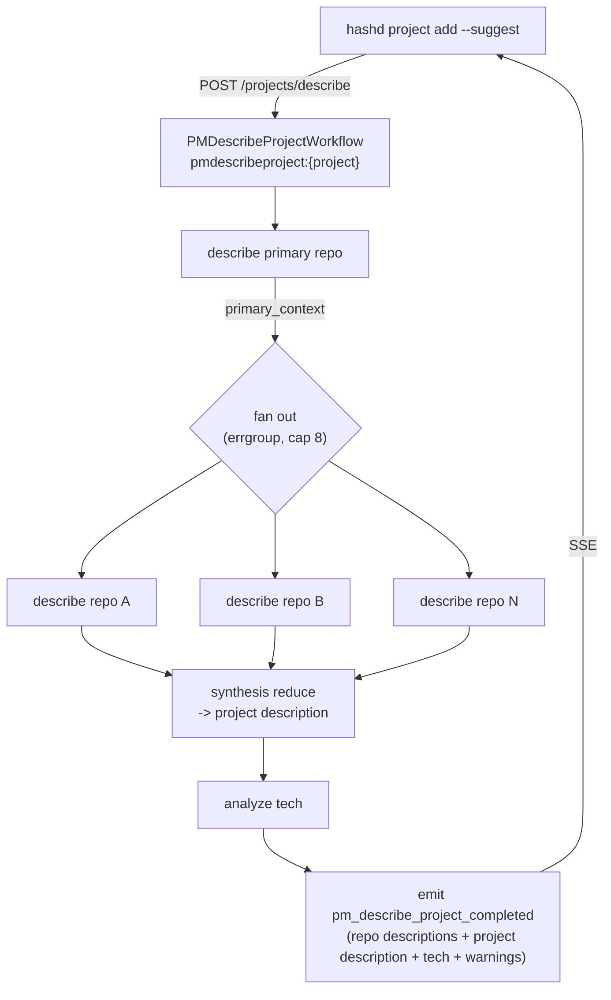

# Hashd Architecture Notes

This document captures architecture rules that affect product behavior and
distribution. It is the public reference for rules that customer-facing docs,
developer docs, and release artifacts may cite.

## Client And Server Boundary

`hashd` is a thin Go client. Operator-visible diagnostics, queries, and mutations
go through the hashd-server REST API. Local mode means the client and server
run on the same host. Remote mode means the client runs elsewhere. Both modes
use the same code path.

UI clients, including the TUI and Telegram bot, do not directly mutate entity
state. They dispatch through server endpoints and react to published events.

The TUI SPEC viewer follows server-resolved file references using the document's
`head_sha` with the existing file-at-ref endpoint. Its Markdown library matches
rendered href encoding and navigates heading anchors; it never resolves repository
paths. Esc cancels the pending Textual worker and restores the original document.
Directory browsing and further repository links from a followed file are not
offered. Missing references, unavailable inline text, failed reads and anchors the
renderer cannot locate are reported separately. These reads acquire no edit lock.

Managed REQS/SPEC editing takes no lock while typing: the TUI and Web editors edit
a private copy. On Save the editor (web or TUI) takes the per-document lock under
a token of its own, waiting in bounded rounds that say who holds it (each round
rejoins the queue; "back to editing" withdraws the token and sends nothing),
then writes with `lock_token` and gives the token back; the CLI's `set` uses the
bounded `/projects/{name}/{doc}/set` route, which does the same in one request.
Either way the server renews the lease for the whole write. The save reads the base
(`base_head_sha`, a full commit id on the document's own history) from git and
three-way merges the draft with the document as it is now (`git merge-file`,
`api/document_merge.go`). Non-overlapping edits are combined and committed, and
the combined text and new head are returned for the editor to adopt. Editors
are read-only while a save is out, so what they adopt is exactly what they sent,
and every failure hands editing back with the draft and its base; overlapping
ones are refused (409 `project.document.merge_conflict`, carrying each overlapping
region's base/current/draft text), nothing is written, and the editor keeps the
draft and its base. Resolving an overlap in the editors is deferred work. The merged result passes the same checks a direct save does,
including REQS WIP blocks compared with the current document. The CLI's
`lock/refresh/unlock` fences are unchanged. TUI shares `ReqsEditorScreen` for the two document kinds;
only REQS renders WIP ownership boundaries. Project file/reference viewers match
normalized configured paths within the project repository and link to the current
protected document, keeping their historical reads separate. SPEC writes document
implemented behavior and do not modify requirements or story ACs. Ordinary source
editing and its review/commit handoff are separate from this document workflow.

Connector settings reuse the request's `settingsSchema`: `connectorSection`
reads existing host `ConfigSection` capabilities lazily, under the request context,
and shares the declarations between dotted-key resolution and batch validation.
Core settings retain their schema/scope guards. Connector object updates use
`DeepMerge` inside `UpdateProjectConfigRaw`; no additional config store, global
declaration cache or credential policy is introduced.

## Forges

Core has one forge-neutral model and vocabulary: the most common generic term for each concept (merge a PR, a reviewer's review state of approved, changes_requested, commented or none, unresolved threads, username). A forge backend under `server/internal/forge/` is the only place that knows its forge's API, words, enums and rules; it maps them into the generic model and may carry the raw value verbatim (for example `forge_review`) for display only. Core decisions read the generic fields, never a raw forge value. Forge paths stay separate from connectors. A design or PR that couples core to one forge's view of the world is raised to the operator before it lands.

## Build And Test Systems

hashd core has no built-in semantics for any build or test system. Core knows two commands per repo, the build command and the test command, and what their exit codes mean: zero is green; non-zero, a timeout or an unreadable result is red, never green. Core keeps the full output and gives it to the agent as is. Core also applies the generic policies that need no tool knowledge: side-effect paths the operator declares per repo (never staged, restored or cleaned after a run), and one runner for every project command.

Tool knowledge lives only in build adapters:

- **Selection.** Per repo, `build.adapters` is `[auto]`, `[none]` or a list (#2926). `auto`, the default (also an empty or unset list), detects them on every run: from marker files in the worktree, and from signatures in a command's output. `none` is the generic contract above. A list is exactly those adapters, nothing detected and nothing suggested about tools it leaves out. A repo can have several (a Maven build with a JavaScript frontend uses two). Every run records which it used and why.
- **Boundary.** One interface and a registry, like connectors. Core depends only on the interface; an adapter is added or changed without touching core.
- **Capabilities, a closed and versioned set.** Failure facts read from structured report files, or from the command's kept output where that is the tool's structured report; default side-effect paths; detection, by marker file and by output signature. A new capability is an explicit interface change with its own design.
- **Facts inform, never steer.** An adapter returns data. It has no access to run control and cannot stop a run, skip the fix loop, classify a cause or choose a transition. Core decides from exit codes and its own rules.
- **Structured syntax only.** No adapter parses free-text console output itself. It may run the tool's own official converter on that tool's output (for example `go tool test2json`), never a parser of hashd's own. An output signature only switches an adapter on; its facts still come from what it reads.
- **Libraries.** Third-party formats are read with established libraries (for example JUnit XML through one shared reader that every adapter uses), and matching uses git and established libraries.
- **No project change.** An adapter never requires a plugin, reporter or CI change. hashd never changes the project's commands and does not tell the operator to: it adds no flag and no environment variable to them. An adapter reads only what the command, as the operator configured it, already produces, and says what its tool's report gives when it is present.
- **Provenance.** Every failure fact records the adapter, reader and file it came from.
- **Extensions.** Where a tool's output is poor, hashd defines a documented, versioned results format that any build can write. It is reserved until designed, and a value for it is refused until then.

Known exceptions in core, to be moved behind adapters and never extended: the pytest console parser (`server/internal/testparser`), kept until the failing-test reader (STORY-0456) replaces it for pytest runs that write no report, and the ecosystem detection (`server/internal/config/detect.go`).

The failing-test reader (the `failing_tests` agent stage, STORY-0456) is not an adapter. When no adapter fact and no console parse names a failure in a red test run, it names the failing tests from the output with the runner's summary line and the count that line states; its names are labelled "named by model" wherever they appear (`named_by_model` on the merge-gate failure record and the baseline acceptance, and `workstreams.baseline_failures_named_by_model` beside a recorded baseline list, blocked or accepted). hashd checks the answer without knowing the format: (a) every name is in the output verbatim, (c) the summary is a line of the output stating the count as a whole number and the count is the number of names, (b) at the merge gate, the names are exactly the baseline's failing tests. The names reach the test stage's retry feedback only (never the failure signature or baseline exclusion); a provisioning baseline records them only when (a) and (c) hold; merge-gate go-anyway is offered on them only when (a), (b) and (c) hold and a build of the same content passed in the gate. The reader also names the failure's kind -- tests, build or environment -- with the one output line it rests on, kept only when that line is a whole line of the output (#2240); a failed build asks it for the kind too. tests and build route as before. An environment kind (a refused credential, a missing dependency, an unreachable network) takes no fix round: the test stage parks at the agent-stop landing (failure code `test.environment`; approve re-runs the micro-commit, reject with guidance runs the fix round when the call is wrong), the merge gate parks at `merge_test_failed` with no judge, FIX or go-anyway (`merge_gate.environment`; its next steps keep the add-commit fix round and the merge retry), and a red baseline's unparsed record names it. The kind rides `TestStageResult.failure_kind`, the build/test result rows and `BaselineUnparsed`, and is labelled "named by model". A re-run reads its own new output: a failing verdict is never reused.

Design: https://github.com/codr1/hashd/issues/2273.

### Build adapters (version 5)

The package is `server/internal/buildadapter`, at `InterfaceVersion` 5. A run hands each adapter the worktree, the command's start time, the command's kept stdout and stderr, and the command as configured, to read and never to change.

- **Choosing adapters.** A single-repo project sets `build.adapters` in `config.yaml`, as a list: `[auto]`, `[none]`, or adapter names. In a multi-repo project each repo row carries its own: `hashd project repo edit <repo> --adapters auto|none|maven,jest`, and `--adapters=` sets auto. An unknown or repeated name, or `auto`/`none` beside another, is refused when written, and refused again when a run resolves the repo. `build.results_format` is the reserved extension (schema version 1): any value is refused.
- **Detection (auto).** The run's first stage with nothing carried for the repo (normally provisioning's baseline; a resumed run, a merge-gate retry or a run after a park detects at its first stage) switches on every adapter whose marker file the worktree holds, and adds their default side-effect paths. The result travels with the run, as a field on the existing stage and cycle inputs and results (`buildadapter.Carried`, per repo, across continue-as-new), and every stage gets its adapters through `runflow.StageAdapters`. An adapter whose output signature appears in a command's stdout or stderr is read for that command too and carried from then on; its default paths apply from the next command. Nothing is stored between runs: no table, column or cache file.
- **What the run records.** Each stage that resolves under auto logs `Build adapters: <name> (<marker file> | output: "<signature>"), ...`; a signature hit is also noted in the command's parsed summary, and every failure keeps its adapter as before.
- **What core does with the facts.** Core asks the adapters after each baseline, test-stage, merge-gate, post-rebase fast check and committed-breakage probe run, before the side-effect policy runs, so a report the policy would clean is read first. The merge gate names its failing tests from them in the execution that read them; they are not recorded.
  - A failure the console parsers did not name is added to the run's failure list, and one they named with the same file is replaced by the adapter's.
  - The facts are *incomplete* when a matched report could not be read (malformed, or over 16 MiB), when one is *stale*, meaning it is older than the run, so something reported on earlier did not report this time, when part of the build that holds tests wrote no report this run (*unreported*), or when the adapter names something else the run shows that its failures may not cover. Incomplete facts never let a baseline exclusion pass, and a baseline whose test failures came with incomplete facts is recorded as `baseline_unparsed`. They reach the run's failure feedback as a Diagnostic (`buildadapter.Facts.Diagnostic`): each cause, and the step that fixes it. An adapter may also report that its failures cannot prove the whole build compiled; a baseline exclusion on such failures applies only beside a build command that passed earlier in the same test-stage run.
  - A stale report also shows up when a subset run (a fast check, say) leaves other modules' reports in place. That run then fails closed.
- **Searching for reports.** Patterns are matched with doublestar. `.git` and `node_modules` are never searched, and a malformed pattern is reported as unreadable.
- **Default side-effect paths.** An adapter's defaults fill only the lists a repo's own `build_side_effects` leaves empty. Declaring a list overrides them.
- **`project add`** prints the adapters each repo's marker files mean, as detected, and that runs switch them on while `build.adapters` is auto; it asks nothing. The server reads the repo and returns them as `detected_adapters` on `POST /projects/detect`, keyed by repo name; the CLI only renders them.

**maven.**
- Reads the Surefire and Failsafe XML reports (`**/target/surefire-reports/TEST-*.xml`, `**/target/failsafe-reports/TEST-*.xml`) through the shared JUnit reader (`github.com/joshdk/go-junit`). Maven writes them by default, so the test command needs no change.
- A test's name is `<module>:<class>#<method>`, or `<class>#<method>` in the root module, so two modules' same-named tests stay two. A failure keeps its whole message and trace.
- A module with tests (a `pom.xml` beside `src/test`) that wrote no fresh report this run makes the facts incomplete: it may have failed to build before its tests ran, so a baseline exclusion never passes beside it. A module whose tests are skipped counts the same.
- A module with no test sources that fails to compile writes no report, so the adapter's failures cannot show that every module compiled. A baseline exclusion on its failures therefore applies only when the project's build command (`build_cmd`, such as `mvn -q compile`) passed earlier in the same test-stage run; without one the run stays test failed, and its failure names `build_cmd`.
- Default side-effect path: `**/target/**` as `ignore`.
- Detected by a root or nested `pom.xml`, or by Surefire's `T E S T S` banner in a command's output.

**jest.**
- Reads Jest's own JSON results, `**/jest-results.json`, when the test run writes them. A test's name is `<file> > <describe> > ... > <test>`, its file worktree-relative, and a suite that failed to run is a build failure. A file reported from outside the worktree (Jest in a container that mounts it elsewhere) is named by its longest trailing part that is a file in the worktree; one that ends in none makes the facts incomplete. jest-junit's `file` is placed the same way.
- When no results file exists, reads jest-junit's JUnit XML (`**/junit*.xml`) through the shared reader. Vitest's JUnit reporter is read the same way.
- No default side-effect paths.
- Detected by a `package.json` that depends on `jest`, or by Jest's `Test Suites: ` summary line in a command's output.

**go.**
- Reads `go test`'s own output, which hashd already keeps: `go test -json` events as printed, or console output that the toolchain's `go tool test2json` turns into events. The test command needs no change.
- A failing test or subtest is named `<package>#<test>` (`example.com/m/a#TestName/sub`) where the events name the package, with its own output, a panic included. Console output names no package, so its failures cannot be told apart from same-named tests in other packages: they make the facts incomplete, and a baseline never excuses them. A repo whose test command prints console output therefore gets no Go baseline exclusion or go-anyway; one printing `go test -json` does.
- `go test` writes build and vet errors to stderr and names no test for them, so a failed run that wrote anything to stderr makes the facts incomplete. A wrapper that writes its own lines to stderr therefore always reads incomplete.
- A package that failed with no failing test of its own (`TestMain`, a crash outside a test) makes the facts incomplete, as do lines among `go test -json` events that are not events: a wrapper that runs some packages without `-json` or prints its own lines to stdout always reads incomplete.
- `go test` compiles no package without tests, so a baseline exclusion on its failures applies only beside a passing `build_cmd`, as with maven.
- Output with no test events (another tool's run) gives no facts.
- No default side-effect paths.
- Detected by a root or nested `go.mod`, or by `go test`'s `--- FAIL: ` or `ok  <tab>` lines in a command's output.

**pytest.**
- Reads the JUnit XML report the test command's own `--junitxml` (or `--junit-xml`) names, relative to the worktree, through the shared reader. pytest has no default report and no converter for its console output, so a command that names none gives no facts; a named report the run did not write, or one outside the worktree, makes the facts incomplete.
- A failure is named as pytest's node id names it: its file as pytest reports it (from its rootdir), and the rest of the id as its name (`TestA::test_x[1]`), the pair pytest's `FAILED` lines give. An xunit1 report carries the file; for xunit2, the default, it is read back from the classname against the worktree's Python files. A module pytest could not collect is a build failure, with its whole traceback. A failure whose file is in no worktree file makes the facts incomplete.
- No default side-effect paths.
- Detected by `pytest.ini`, a pytest section in `pyproject.toml`, `tox.ini` or `setup.cfg`, or a `conftest.py`, or by pytest's `test session starts` or `short test summary info` lines in a command's output.

## Connector Planning Inputs

`attachments.Prepare` is the single server boundary for typed references and
`POST /plan/quick.references` selections. Providers return canonical references,
connection/resource identities and per-file SHA-256 from the bytes they wrote.
Selections are expected identities, not permission to substitute a resource.
`story_attachments` links are nonexclusive and unique per story, connector,
connection and resource; prose edits never implicitly remove them.

`story_attachment_captures` binds a complete file manifest to the existing
planning/editing `content_owner` (the owning Temporal execution RunID). Capture
runs before routing/refinement, outside a database transaction; publication checks
the owner again inside `reqs.WithStory`. Every file must match its provider digest
before any link/capture is published. Same-execution retries reuse captured bytes;
a later explicit owned planning/edit execution may acquire a new capture while
old evidence remains. Digests establish byte integrity, not remote authenticity
or freshness. Files live beneath the existing project artifact directory; normal
failures clean unpublished scratch. This adds no retention/garbage-collection job.

`attachments.Link` links one tracker story to a story at rest, outside
planning, as the one leg of the tracker-link workflow (the tracker is read
with the story owner's account, `PlanningConnectorHost`): it resolves and
validates the reference as `Prepare` does, then
publishes one link and its capture inside `reqs.WithStory`, refused while a
`content_owner` holds the story or the story already has a live link from that
tracker. `attachments.Unlink` sets `story_attachments.unlinked_at` instead of
deleting, so captures stay as evidence; every reader skips unlinked rows, and a
later link of the same item clears the mark.

A connector's typed item projection (`ResolvedArtifact.projection`) is pinned
with the capture it came with: the server writes it as one more manifest entry,
format `projection`, digested like the files, so no second store holds it and a
connector file can never claim that format.

A connector may also name the repository a change belongs in
(`ItemProjection.target_repo_hint`, mapped from the connector's own field
setting, for Azure `azure.fields.target_repo`). In a multi-repo project every
planning or edit capture records the imported item's value as
`tracker_target_repo` (`pm.ApplyTrackerTargetRepo`), and the value is matched
exactly against `project_repos.name`. A story with no target, none inherited
from its suggestion, takes a primary or active match as its `target_repo` in
that write, and planning then runs no `pm_route`; a target it already has is
never overwritten. Any other value -- a typo, a renamed repo, a `reference` or
`ignore` repo -- is not a target: planning runs `pm_route` as usual and hands
it the value as a hint (`RouteParams.TrackerTargetHint`, the `tracker_target_name`
variable of `repo_router.md`, whose wording says it is a hint). A story run with no target does the same: an
exact primary or active match is its target, anything else is routed with the
hint, and nothing is refused. Two notices are derived on read, and neither
blocks: `unknown_target_repo` while the value names no primary or active repo,
and `target_repo_disagrees` while the story targets another repo than the
routable one the item names. A single-repo project records nothing: its
stories carry no target.

Complete readable capture content is appended after planning prompt rendering,
so source braces and HTML comments are not template syntax. Binary source files
remain available by local path and authenticated manifest-index read. Story
attachment listing exposes recorded metadata and those full-read URLs, never
server file paths. Full reads verify the committed digest and serve downloads
with `nosniff`; missing or changed evidence is an error, not an empty record.

The reference parser is shared in `refs/refparse`. Its complete argument candidate
lets the provider report consumed UTF-8 bytes for planning; existing metadata-only
chat/implement readers keep their legacy argument behavior. Jira issue fetches,
GitHub issue fetches and Figma frame imports produce capture evidence. Figma
identity belongs to each imported resource generation, not the manifest's latest
configured file. Legacy caches without producer evidence remain readable through
their existing paths but cannot be promoted into a trusted planning capture;
an explicit refresh/import is required. Cache listings are not remote resources.
New Story/New Bug in TUI and Web share this submission path: picker selections
add expected `ResourceReference` identities to the private draft; only ordinary
quick-create submits them. Browse, preview and cancel create no story or link.
A selected source attaches even when its literal is edited/deleted; prose references
remain independent. Each client keeps only its own insertion range and exact buffer
snapshot. Remove undoes that insertion when unchanged, restoring any original text;
no matching-token search/deletion occurs. Ambiguous edits retain selection and its
expected identity unless the operator explicitly chooses “Unselect, keep text.”
Cancel preserves both. Duplicate Add neither duplicates selection nor inserts text.
Optional `REFERENCE_ACTION` / `SEARCH_REFERENCES` declarations feed the existing
host capability and `search_references` verb. Jira text searches use configured
project scope, or explicit nonempty site-wide queries when no project is set;
exact supported issue references may name other projects. Native Cloud/DC pages
are consumed one at a time; missing continuation evidence is an error.
Declared `ReferenceAction.filters` (key/label/multiple) feed the same generic
controls in both clients. The host validates the complete typed filter map before
calling a provider; callbacks without filters retain their three-argument call.
Nonempty filters permit filter-only search, never blank enumeration. Jira exact
keys remain key constraints when filters are supplied. Labels are ANDed; status
is provider-native, and updated-since uses the timezone named in the field label.
GitHub searches the configured/detected repository through the existing gh
transport; detected URLs retain the host. Query/filter/source changes invalidate
native-page cursors and stale UI reads while preserving selections and independent
file downloads. `incomplete_reason` displays provider partial-result/ceiling
notices separately from `next_cursor`; there is no all-pages crawl or Hashd cap.
Unsupported literal syntax fails explicitly without changing the draft.

A connector declares itself a story source with `ReferenceAction.intake`
(`default_filters`: declared keys and values an import picker opens with). It
is part of the declared shape, returned whether or not the connector is
configured; availability stays `available`/`reason`. The host marks an action
unavailable when a default names an undeclared filter, gives a single-value
filter several values or is blank. GitHub (`status: open`), Jira
(`status_category: To Do, In Progress`, i.e. `statusCategory in (...)`, in the
configured project or site-wide), Azure Boards (`state_category: Proposed,
InProgress, Resolved`) and ClickUp (no default: browsing the List lists open
tasks) are story sources; Confluence and Figma have no reference search and are
not. Azure has no text-free search, so an empty query lists through WIQL: each
work item type's states and categories are read (`workitemtypes/{type}/states`,
the lifecycle's source), the query pairs each type with its own states -- a
category belongs to a (type, state), not a state name -- pages by id
(`[System.Id] > last`, `$top` one past a page) and batch-reads titles; a state
whose category is unrecognised is excluded and reported. With text alone, a
category filter is applied to each search page by the same pairing; with a
structural filter (area or iteration path, tags, `changed_since`, a team and its
current iteration) text joins the same WIQL as `CONTAINS WORDS` on title and
description. The project's `azure.intake` settings are the picker's defaults
(prefilled, editable; open categories when unset), and a malformed one makes the
action unavailable with its reason. A `saved_query` runs a stored flat query as
stored, paged over its sorted id list with the cursor bound to that list; tree
and one-hop queries and a result at Azure's WIQL limit are refused.
`azure.intake.sources` lists several projects of the one organization: one
organization WIQL ORs each (project AND its filters), items carry their
`source` label on `ResourceReference` (display only, not identity), and a source
that cannot be read is left out and named in `incomplete_reason`.

`GET /connectors/search` adds page-local `imports` marks, from the Hashd server
(`reqs.LookupLiveImports`: one query over the project's stories that carry an
import, one over the page identities' suggestions), for the returned items already
imported in the project; connectors' own search knows nothing of suggestions,
and only the import picker acts on the marks. Each mark names its item by
connector, `connection_id` and `resource_id`. `POST /suggestions/import/marks`
returns the same marks for any batch of items, across sources, calling no
tracker and writing nothing; the Web picker uses it to recheck a selection that
spans pages and sources on each live refresh. An unreadable lookup is reported
as `imports_unavailable`, never as nothing imported. `POST /suggestions/import` checks
each item against the capabilities probe -- story source, available,
`connection_id` equal to the connector's current `REMOTE_SCOPE` -- before its
write transaction, which calls no tracker, then creates or refuses per item.
An open or dismissed suggestion keeps its connector, connection and resource
identity imported within its project. Dismissal therefore still blocks another
import: both the refusal and advisory marks name the dismissed S-id and explain
`hashd plan restore S-<id>`. Restoration makes that same suggestion available
and continues to block duplicates. A surviving story remains the stronger import
record and takes precedence in the refusal and marks. Neither dismissal nor
restoration writes to the tracker; another project or connection is independent.

`GET /connectors/search`, `POST /connectors/preview` and
`POST /connectors/preview/files/{index}` are authenticated operator reads, excluded
from internal-agent token scope. Preview shares capture identity and file integrity
validation, returns all readable text plus file descriptors, and never exposes a
cache path. Full download re-resolves the selected identity and requires both
provider evidence and the preview's expected digest; changed content requires a
new preview. Returned bytes are the verified bytes, not a later cache read. Active
content is escaped text or an octet-stream attachment with `nosniff`. There is no
preview store/session or shared response cache. Preview does not pin submission:
planning's fresh owned capture remains authoritative. TUI file saving explicitly
creates a new client-local file and refuses existing files/symlinks.

Other editors keep text-only autocomplete. Outbound synchronization remains separate.

## Suggestion Lifecycle

The existing `POST /suggestions/{id}/transition` path accepts `dismiss`
(`available` → `dismissed`) and `restore` (`dismissed` → `available`), with an
optional complete `reason`. Dismissal can omit `trigger`; restoration requires
`trigger: "restore"`. Dismissed suggestions are not actionable and do not
satisfy suggestion dependencies as completed work. Restoring re-evaluates the
original dependencies and active-story coverage.

`reqs.TransitionSuggestionWithData` commits the state, current dismissal and
`suggestion_changed` event in one transaction, publishing only after commit.
The server resolves the actor through `resolveActingUserID`: authenticated
request identity first, otherwise the solo server owner, otherwise explicitly
unattributed. The suggestion's creator attribution stays unchanged. Current
metadata is `suggestions.data.dismissal`, containing `actor` (account ID or
null), `timestamp` (UTC), and optional `reason` (including an explicitly empty
reason). The same clock value is used for event `created_at`, event data and
the published timestamp. Event data records `suggestion_id`, `trigger`,
`from_state`, `status`, `actor`, `timestamp` and optional `reason`; `events.actor`
also records the resolved account ID when present.

Restoration removes only the current `dismissal` object and updates status;
all other fields and links, including large numeric JSON values, survive.
Earlier dismissal events remain available after restoration and subsequent
dismissals. Event-write or commit failure rolls back the whole decision.
Invalid or repeated dismiss/restore actions return a conflict Diagnostic
naming the suggestion and its current state. These actions cannot carry story
link or planning-field changes. Claim, completion and revert retain their
existing retry semantics. Claim and dismissal contend on the same suggestion
state, so only one succeeds. The `dismissed` presentation status uses the
existing `neutral` role in the shared tone contract.

## Restart Holds And Action Availability

A restart hold (WF.md "Restart holds") refuses execution-changing verbs
server-wide while it stands, independent of `available_actions`: the FSM still
advertises what the state allows, and the request is refused with a 409
Diagnostic sourced `hold.restart` naming the hold and the command to retry.
Refused while a hold stands: run (including Go), approve, reject, answer (story,
workstream, final clarification), plan new/quick/claim/retry/discover and story
split, replan, reset, close, workstream remove/delete, project remove, story run
and cancel, docs, merge and AI resolve, add-commit, PR create and push, detect,
and artifact-lock acquire, cancel and override. Heartbeat and release of a held
artifact lock stay available. Read endpoints are never refused.

The owners: route-level admission in each handler before its first side
effect, taken inside the project lifecycle lock; the engine chokes
`dispatchWork`, `signalHumanGateTemporal`, `closeRunExecution` and
`cancelDispatchedWork` for worker-originated and startup paths
(`server/internal/api/restart_hold.go`). The hold store is
`server/internal/holds`; the workflow boundary is
`server/internal/temporal/workflows/hold_boundary.go`; the stop gate is
`server/internal/cli/restart_wait.go`.

Placement moves (`PATCH /workstreams/{id}` with only `placement`) use
`placementAdmission` in that same shared decision path under both locks. It
passes only the pause's `workstream.pause` refusal; restart holds, saved human
edits and open worktree resets still refuse. This policy does not mark the
workstream admitted for execution: nested execution admission still checks
the pause. Ownership, destination eligibility, discard confirmation, expected
placement and the transactional command-occurrence/live-attempt boundary
checks remain the move's. An acknowledged parked workflow is not an open stage.

With no hold row left, Go (`POST /workstreams/{id}/run`) on a workstream whose
run still waits at a hold boundary delivers the release to that exact run and
dispatches nothing.

The wait for a runner (WF.md "Restart holds") is computed, never stored
(`server/internal/api/runner_return_hold.go`): `coveringHolds` adds it for a
workstream run whose family is `inflight.UsesRunner` while the workstream is
placed on a runner absent from the boot's `holdGate.back` set, and
`releaseAcksMatching` reports such a run as held with its reason. The runner's
event stream attaching (`RegisterRunnerEventStream`) calls
`runnerStreamAttached`, which adds the runner to the set when its recorded
check-in version is the server's and runs `releaseAcks` -- on every such
attach, so a release that failed is retried by the runner's next connection. The same set drives
the reported `waiting` runtime status (`fsm.WaitingRuntimeStatus`, applied by
`waitingOverlay` after the paused overlay on every read that applies it).
Moving a story calls `releaseWorkstreamAcks` against its new placement. A
ready-pause move leaves the pause's request identity standing and the run held;
only its exact-request unpause releases it to continue on the destination.
When no open run remains, unpause starts nothing: use `hashd run <story>`
afterwards. Placement epochs fence old-runner work, and the destination
rebuilds from the branch rather than receiving checkout state.

### Go's availability row

Clients learn whether Go is eligible from the `run` capability row
(`server/internal/api/workstream_run_availability.go`), appended to the
workstream detail, snapshot and available-actions reads -- not the list rows,
which would pay its probe for every row on every refresh. It asks the run
route's checks in route order, through the helpers the route itself calls:
`executionHoldDecision` (read without taking admission), the owner guard,
`restartReleaseCandidates` classified by exact run (`parkedRunBoundary`, which
reads every acknowledgement, as the route's release visits every one: any run
that cannot be read refuses, even when another is running; otherwise a running
one is a resume and the checks after it do not apply, and a closed one is
skipped), `runHumanGateRefusal`, the
recovery-question and requirements-edit refusals, `noPipelineForwardRefusal`,
and the run workflow's openness through `RunActivity` (an error refuses as
unknown, never as running). A stored baseline failure keeps the row available
with a `note`, and so does a current test, build or review judge-failure stop
with a complete record (`judgeResumeFor`, server records only: the note says
Go retries that judge if the branch is unchanged, and the dispatch resumes
from the same helper); agent preflight, the baseline fetch and recheck, and the
Temporal singleton stay at press time, and the row is a snapshot. Nothing on
this path signals, dispatches, deletes an ack, takes admission or fetches.

Each of the three reads shares one guard evaluation between its actions and
this row (`fsm.WithGuardCache`). The detail and snapshot reads also memoise the
run-workflow activity probe (`fsm.WithActivityMemo`), so the row reuses the
probe their runtime status already made; the available-actions read has none to
reuse. Runner liveness (the `no_active_runner` guard) probes through its own
provider, outside that memo. Measured against the fake engine, the row adds at
most one run-workflow describe to a read, plus one exact-run describe per
parked acknowledgement. Story Detail gates Go on this row alone (TUI `story_detail.py`,
web `storyCaps`); Workstream Detail's G does not read it yet.

### Human-edit writes under a pause

An operator pauses a workstream for human work and unpauses it through two
capability rows. The earlier `reserve` and `release` commands no longer exist:

| Action | Row | Command | Endpoint |
|---|---|---|---|
| pause | `pause` | `hashd workstream pause` | `POST /workstreams/{id}/pause` |
| unpause | `unpause` | `hashd workstream unpause` | `DELETE /workstreams/{id}/pause` |

The story's owner can move it while `pause_readiness` is `ready` with
`hashd story runner set <story> <runner> -y`. The placement move leaves the
pause standing and does not resume execution. Unpause with the same
`--request-id` continues the parked run on the destination; if no open run
remains, run `hashd run <story>` after unpausing. Saved edits still refuse a
move even with discard confirmation, as do an open command occurrence or a
live attempt. The destination rebuilds from the published branch; checkout state is
never transported. If origin positively reports the feature ref absent,
discard consent recorded on the current `workstream_placed` event permits
rebuilding at the recorded base SHA, never today's base tip. Historical events
grant no consent: preparation asks for the move to be repeated with `-y`.
A confirmed repeat to the same runner records consent under the same guards
without changing the placement epoch.

A workstream pause offers three writes besides its own release, each a
capability row rather than an FSM trigger -- none moves the workstream:

| Row | Endpoint | Offered when |
|---|---|---|
| `human_edit_save` | `PUT /workstreams/{id}/files/content` | a pause stands AND its readiness is `ready` |
| `human_edit_discard` | `POST /workstreams/{id}/human-changes/discard` | the same, AND something was saved under that pause |
| `human_edit_commit` | `POST /workstreams/{id}/commit` | the same, AND something was saved under that pause |

All three follow readiness, not the existence of the pause row: a
pause is requested before work stops, and writing into a worktree an
agent is still running in races it, so `checkHumanEditWriteContext` refuses a
`waiting` or `unknown` pause and the rows must say so too
(`humanEditWriteReadiness`). Discard and commit are the two exits from a saved
batch and share one availability function, because they are available under
identical conditions.

Authorization for all three is the release's: the pause's holder, or a
server administrator (`requireHumanEditWriter`, the same policy as
`requireWorkstreamUnpauser`). Solo mode reaches it through `serverAdministrator`.

**Saved edits are a second, independent refusal.** While `saved_human_edits`
holds a row for a workstream, admission refuses its execution AND the release
refuses to hand the pause back (`server/internal/api/saved_human_edits.go`).
That refusal does not depend on the hold store: the rows live in the project
database, the hold in the system database, and the hold is released first, so
a guard keyed on the pause would stop exactly when it started mattering.
Every operator row is withheld while it stands -- except `human_edit_discard`
and `human_edit_commit`, which are the two ways out of it.

A discard restores each file to the content from before its first save under
that pause. Neither Save nor discard releases the pause, resumes
work, stages anything, or touches the index: a discard writes bytes and never
runs a git command, because `git checkout -- <path>` restores from the index
and would erase whatever the agent left unstaged.

**The commit is path-scoped, not edit-scoped.** `POST /workstreams/{id}/commit`
runs `git commit -m <message> -- <paths>` and no `git add`
(`server/internal/api/human_changes_commit.go`). Paths outside the batch keep
their index entries and staged deltas untouched; paths inside it are committed
WHOLE from the working tree, so work that was already in those same files --
the agent's, staged or not -- lands in the human's commit and those paths'
index entries are rewritten. The preview mode states that split per path,
using B3's own record: `HEAD -> pre_save_content` is the delta carried along,
`pre_save_content -> saved_content` is the human's. The carried-work question
is asked of git (`git hash-object --path <rel> --stdin` against
`git ls-tree -z HEAD -- <rel>`), not Go string equality, so path filters and
`autocrlf` cannot make it answer wrongly. `ls-tree` rather than
`rev-parse --verify --quiet HEAD:<rel>`, which exits non-zero both for a path
that is absent and for a repository it could not read; `ls-tree` exits zero
either way and says which by whether it printed an entry, so absence stays an
answer and a failure stays a failure. Every probe here either answers or
refuses: "git could not tell" rendered as "nothing else is in this file" would
put the operator's name on work nothing established was theirs. The commit
message repeats the split. A path that has changed since its last save is
refused, not committed.

What the commit does NOT do: it marks no planned micro-commit done
(`microcommit_id` is NULL in the chain row), releases no pause, resumes
nothing, pushes nothing, and inherits no review. That last one is created here
rather than inherited: a final review records the change hash of the committed
tree pair `merge-base..branch HEAD` it graded, which the merge path recomputes
(`FinalReviewChangeHash`) and refuses when it no longer matches
(`mergeflow/pr_review_comment.go`). A human *save* moves no commit and so does
not move that hash; this commit does.

**Two identities, for two different questions.** The *confirm* token binds the
preview to the commit: it covers HEAD and every flag the preview reported, not
just the path names, because a hand-made commit or a `git add` moves the
attribution without touching one saved byte. A commit presenting a stale
confirm -- or none -- is refused, and the operator previews again. The *retry*
token is the operation key of the commit's intent, and must survive the commit it names, so it holds nothing
the commit moves: the pause INSTANCE (its request identity **and** its
`created_at`) and the batch's `(path, saved_version)` set. The instance rather
than the name, because request identities are client-chosen and reusable
(`--request-id my-edit-001` runs again next week): a token over the name alone
would let a later pause that saved the same content to the same paths
match an older commit's intent, be told it had already landed, and have its
guard cleared over edits that were never committed at all.

The recording failure-window inventory is the typed table in
[`server/internal/commitrecord/failure_window_inventory.go`](../server/internal/commitrecord/failure_window_inventory.go),
covering every intent and transformation operation, its surviving evidence,
and the limits of recovery.

Retry is by the commit's record, never by content or commit text. The commit
is recorded as a `human_edit_commit` intent (`commitrecord`) before it is made,
keyed by the retry token and carrying the workstream, story and acting user,
with micro-commit and run deliberately absent; the bookkeeping completes it,
which writes the `commits` row. A retry reads that intent first, settling one
an attempt left open from git by its exact parents and tree
(`commitrecord.Resolve`): matching bytes at HEAD would prove nothing, since a
no-op edit or an unrelated earlier commit produces the same bytes. A commit the
intent names is checked against the branch (`verifyBatchIsOnBranch`) before it
is believed -- believing one clears the records that refuse execution, so a
match the branch contradicts refuses rather than guessing. A batch with no
intent at all whose commit would write HEAD's own tree, content and modes alike
-- committed before commits were recorded by intent -- has nothing left to
commit: its bookkeeping finishes with no commit and no record, and the
response names no SHA. Bookkeeping after the commit (the record, then clearing
the records and the timeline frame in one transaction) runs on a detached
context, so a client disconnect cannot leave a commit half-recorded. A record
that cannot be written is logged and does not fail the commit: the records
still clear, and the intent stays open for recovery. A crash leaves the intent
open and the records standing, execution still refused, and the next attempt
finishes.

**The commit is managed execution, not a synchronous handler.**
`POST /workstreams/{id}/commit` dispatches `temporal.DispatchHumanCommit` and
returns; the workflow (`temporal/workflows/human_commit.go`) runs the commit
through `api.Server.CommitHumanEdits`. The request MAY wait on the result so an
operator still gets a SHA back, but the wait never owns the operation: a client
that hangs up, or a wait that runs out, ends the response and nothing else, and
the response says `still_running` rather than claiming an outcome it does not
have.

It is managed because the repository's commit hooks can run for minutes, and a
synchronous handler doing that is invisible to `/inflight` and to the restart
board. It is **not** managed for idempotency -- nothing makes an arbitrary hook
idempotent. The commit activity is therefore `singleShotAttempts` (no platform
rerun of hooks), and an uncertain outcome is settled by reading the branch:
workflow replay re-runs workflow code, not git, so `HumanCommitOutcomeOf`
reads this operation's commit intent, settles one left open from git by its
parents and tree, and finishes the owed bookkeeping when it names a commit. A probe that cannot read refuses rather than reporting an absence,
and the saved-edit records stand until the outcome is established.

Dispatch takes the project lifecycle lock and admission, and releases both
before the wait, so the hooks never run under a broad admission mutex. The work
budget is resolved at dispatch by `runflow.ResolveCommitStageTimeout` -- the
same resolver the agent's commit stage uses, which *refuses* `NA` for this key
rather than treating it as unbounded -- and carried on the input, so editing
config mid-commit cannot change the bound an execution started under.

**Two collisions, both resolved by ownership rather than blanket exemptions.**
Admission refuses work on a reserved workstream, and this operation runs under
one: `admitUnderPause` accepts only the pause the request names,
while a restart hold, a missing or different pause, and *another*
pause's saved edits (`refuseForeignSavedHumanEdits`) all still refuse.
Pause readiness counts every workstream-scoped execution, so a dispatched
commit would make its own pause read `waiting`: the pause is a
segment of the workflow ID (`humancommit:{project}:{workstream}:{pause}`)
and `ownedHumanCommit` excludes exactly that execution for exactly that
pause. A different pause's commit still holds this one waiting, no
other family is touched, and the execution stays `Counted` in the inflight
registry, so `/inflight` and restart see it like any other work. Because
readiness deliberately does not count it, the `human_edit_commit` availability
row checks the singleton itself and is withheld while that commit runs.

Both server entries run on the **in-process** worker that `main.go` starts:
`lockWorktreeWrite` is a process-local mutex, so the activity's exclusion is
real only because the worker and the API server share a process. That
constraint is documented at the top of `human_changes_commit_exec.go`.

Serialization: `lockWorktreeWrite` (per workstream, ref-counted) is held by all
three writes from before the file is read through the rename or commit that
replaces it. The project database transaction cannot do that job -- a Save
reads the file inside its transaction and renames after the commit.

## PR Creation And Merge Actions

`create_pr` maps to the existing PR-create endpoint/workflow; `start_merge`
and `retry_merge` map to the merge endpoint/workflow. Creation stops at the
PR lifecycle and never schedules a merge. PR push remains the separate
`pr_push` capability.

| Action | Row | Command | Endpoint |
|---|---|---|---|
| rebase | `start_rebase` (into `rebasing`) | `hashd rebase <story> [-y]`, TUI `B`, Web "Rebase" | `POST /workstreams/{id}/rebase` |
| AI resolve a rebase conflict | `rebase_resolve` (guard `rebase_conflict_waiting`) | `hashd rebase <story> --ai-resolve`, TUI `i`, Web "AI resolve" | `POST /workstreams/{id}/rebase/resolve` |
| go on after a fix by hand | `rebase_continue` (guard `rebase_conflict_waiting`; the `run` row) | `hashd run <story>`, TUI `G`, Web "go" | `POST /workstreams/{id}/run` |
| cancel a rebase | `rebase_cancel` | `hashd cancel <story>`, TUI `x`, Web "cancel rebase" | `POST /workstreams/{id}/rebase/cancel` (and the story's cancel) |

The rebase endpoint withdraws a forge_autocomplete PR's auto-merge, takes the
project lifecycle lock and admission, the owner guard and the runner-offline
refusal, refuses the states the row does not leave from with
`rebase.state.<state>`, gates on the row (`requireWorkstreamTrigger`), moves
the workstream into `rebasing` and dispatches `StoryRebaseWorkflow` under
`rebase:{project}:{ws}` with the state it admitted from and `base_sha`; a
failed dispatch returns it. The workflow runs the `story_rebase` whole stage's
steps on the runner that holds the story (`runflow.StoryRebaseStep*`): rebase
(`mergeflow.RunStoryRebase`: the story branch in its existing checkout, original
tip and trees retained in refs, uncommitted work carried as commits, `syncBranchOntoAs` onto `ws.BaseBranch`
as `OperationStoryRebase`, a stop left in place on a conflict), then -- at a
conflict, on `StoryRebaseActSignal` -- resolve or continue
(`mergeflow.RunStoryRebaseContinue`, the agent or the operator's fix), then
land (`mergeflow.LandStoryRebase`: lease push first, branch, unwind,
cleanup). Any ending but a landing runs undo (`mergeflow.UndoStoryRebase`) on
a disconnected context. The stage's substage is its newest `stage_changed`
row (`fsm.RebaseConflictWaiting`), which the guard and runtime status read
(`fsm.RebaseActivity`: working is running, waiting is blocked). The workflow
leaves the stage with `StoryRebaseLeave` (`mergeflow.LeaveStoryRebase`), moves
`base_sha` to the rebased onto commit (`StoryRebaseRecordBase`,
compare-and-swap on the dispatched value) and records each verdict as a
`story_rebase` operation result. Close ends a rebasing story's rebase first
(`endStoryRebase`); a cancel of a rebase whose workflow is gone dispatches
one with `UndoOnly`.

Landing work needs a current final review, with or without a PR. The
`final_review_current` guard sits on `start_merge` and `create_pr` from
`ready_to_merge` and `final_review_with_concerns`, on `start_merge` from
`pr_open`, `pr_approved` and `merge_test_failed`; a PR's forge review and CI
gates apply on top of it. "Current" has one definition,
`review.FinalReviewCurrencyOf` (`server/internal/stages/review/currency.go`):
the latest final review's state (`review.FinalReviewState`, which the snapshot's
`final_review_currency` also reads) is `verdict`, and the change hash it
recorded equals `review.FinalReviewChangeHash` of the branch over its merge
base now (`changehash.Compare`). The change hash leaves out context and line
numbers, so a clean rebase keeps the review current and only a change to the
story's own patch makes it stale. A placed workstream's runner reports the
branch's change hash with each accepted stage result
(`workstreams.runner_branch_diff_identity`). A recorded hash that is missing or
not computed is not current; a guard that cannot compute the hash now refuses
with "final-review currency could not be read", never "stale". The review package binds this
function to `fsm.FinalReviewCurrency`; the unbound default refuses. Every
surface reads the guard through the rows: `available_actions`, the merge
and PR-create endpoints, which refuse with source
`fsm.final_review_not_current` (or `fsm.final_review_currency_unreadable`)
and help naming `hashd run <ws>`, and the TUI, Web, bot and CLI controls,
none of which checks currency itself. Its negation, `final_review_not_current`,
guards the `rerun_final_review` self-loops at `ready_to_merge`, `pr_open` and
`pr_approved`, with
`no_active_runner` and `no_active_publish` (a PR create keeps the workstream
at `ready_to_merge` while it rebases and pushes), which is a
pipeline-forward trigger: `hashd run` from those states without a current
final review dispatches a run that re-runs the merge gate (reusing a recorded
pass for the same tree) and the final review. The trigger is never fired and
has no verb of its own.

A merge has one route (`mergeflow.EffectiveMergeMode`): the PR route when the
profile's `merge_mode` is `pr`, the request names `pr`, or the workstream has a
linked PR, and otherwise the local branch tip. The admission row
(`start_merge` / `retry_merge`) carries that route's dispatch refusal
(`withMergeRouteRefusal`, `server/internal/api/workstream_availability.go`,
over `mergeRouteRefusal`): no PR in a pr-mode project (`hashd pr create`), and
unpublished local commits from `pr_open` / `pr_approved` (`hashd pr push
[--sync]`), and the forge's readiness as the PR watch last read it
(`mergeflow.PRForgeReadinessRefusal`): the merge's own verdict
(`routePROpen`) on the stored `pr_watch` snapshot, never a forge call. That
refuses a change request and a PR the forge does not report ready, and admits
everything the merge handles itself: a conflict (rebased), mergeability not
computed yet (waited out: at the `pr_open` check every
`pr.watch.interval_active` (`PRVerdictAwaitForge`), and inside the locked merge
after its own force-push on the forge-write retry schedule -- 2, 4 and 8 s,
`PushRetryBackoffTotal` -- the activity already budgets while it holds the
merge lock (`awaitPushedMergeability`); still unanswered after that, the merge
stops at `pr_open` naming the waits and their total), a PR merged or closed on
the forge. It decides only
when the snapshot is of the PR's current published head (`origin/<branch>`)
and its watch is running; no snapshot, one of another head, or a stopped
watch's (idle past `pr.watch.max_age`, disabled, or off its PR -- nothing reads
the forge for it any more) is admitted and judged live by the merge, which
starts the watch again.
The snapshot is as old as the watch's last poll, so a refusal can stand up to
one poll interval after the forge changed; dispatch's refusal asks the watch
to poll now. An unavailable row's reason is that 409's diagnostic, and its
`next_action` names the row that is the way forward when there is one in the
list -- `create_pr`, `pr_push`, or `reject` for a change request -- and nothing
for a wait. The unpublished-work comparison is local (`origin/<branch>`), with
no forge call, and claims nothing when it cannot be made. The recovery states take precedence
over the route (`mergeRecoveryState`), so dispatch refuses nothing there and
the row keeps its FSM verdict. Dispatch reads the profile again after its
reload under the lifecycle lock, so its route decision uses the configuration
current at admission.

A `merged` workstream's merge row is `start_merge`, the self-transition
`merged -> merged` (`mergeflow.MergeAdmissionEdge`). It maps to the same
`POST /workstreams/{id}/merge` (`hashd merge <ws>`), which re-runs the
post-merge archive from its checkpoint. It is available when the FSM guards
pass and no merge workflow runs (`no_active_merge`); the route rows keep its
verdict and carry the note that the route is not used. While the archive is
unfinished (WF.md, **Unfinished archive**), `GET /stories/{id}` serves the
same three rows under `archive_unfinished.available_actions`, built by the
workstream detail's own `workstreamOperatorActions` call
(`workstreamMergeRows`), so the story offers exactly what the workstream does.

When the PR check observes a forge-side merge, it records the landing and
archives through the merging sub-FSM's `pr_merged_externally` edge from
`await_pr_approval` to `finalize`. It does not run the local or approved-PR
merge steps to enter finalization.

`hashd merge <ws> --abort` recovers a dead merge through the same endpoint:
`POST /workstreams/{id}/merge {abort:true}`. It runs the housekeeping sweep's
dead-merge judgement and recovery (WF.md, **A dead merge**) and exits
`merging` by the `merge_aborted_to_pr_open`, `merge_aborted_to_pr_approved` or
`merge_aborted` edge for the state the merge was admitted from. The CLI refuses
it with any other merge option before sending (`merge.abort_conflict`), skips
the autonomy preflight and never prompts; the server refuses (409) a
workstream not at `merging`, a merge or lock section with an activity pending,
and a merge whose current stage has no recorded failure. Its capability row,
`merge_abort` ("abort dead merge"), is present only at `merging` and available
only when the same judgement reads the merge as dead; a live merge, or one that
cannot be judged, reads unavailable with the abort's own refusal as its
reason. The judgement reads the recorded stage failure before it describes
anything in Temporal. When the merge is dead, the `merging` refusals of
`hashd merge` (`dispatch.merge.already_running`) and `hashd run`
(`dispatch.run.no_pipeline_forward`) add the help line
`hashd merge <ws> --abort`; otherwise they are unchanged.

AI resolve follows where the merge gate left the workstream, not the mere fact
that the gate failed: `rebase` and `conflict` park at `merge_conflicts`, where
`start_resolve` exists, while `rebase_blocked` -- a rebase refused before it
reached any file -- parks back at `active`, where resolve 409s and run is the
working verb. WF.md's merge-gate section owns the two shapes.
`verify_failed` parks at `merge_test_failed` (`post_rebase_test_failed`),
where `start_resolve` is offered too. The run's gate maps no exit state for
`agent_stop` (`runflow.MergeGateAgentStop`), the stops an agent's own output
caused: a failed automatic FIX, a branch build break the adjudicator did not
rule FIXABLE, verification still failing after the story's automatic FIX --
and the time-bound park, a full suite or post-rebase build or tests the
project's own `test_timeout` stopped, which returns it in place of `blocked` and carries its report on
`MergeGateOutcome.StopDiagnostic`. `parkAgentStop` hands that Diagnostic on
`RunnerParkStopInput.Diagnostic` to `runflow.ParkTimeBoundForHumanReview`,
which records it whole on the run row and the park's blocked event.
The per-commit test stage's time-bound park, a build or test command the
same `test_timeout` stopped (`TestStageResult.TimeBound`), takes the same
path from the cycle: its `landStop` exit carries the report on
`RunnerCycleResult.StopDiagnostic` with no stop origin, so approve and reject
keep the agent-stop landing's micro-commit re-run meanings.
When the run pinned `agentStopLandingChange` at its start (carried on
`WorkstreamRunInput.AgentStopLanding` through continue-as-new, and on
`RunnerCycleInput.AgentStopLanding` to every cycle for the other landings), the
workflow sets `RunnerMergeGateInput.AgentStopLanding`, and the driver returns that status in
place of `verify_failed` when the workstream is at a source of
`await_review` (`implementing` or `active`); the gate emits no blocked for it.
`runAllCompleteLeg` clears the `merge_gate` stamp (`clearStage`, not the
preserving release) and hands the stop to `WorkstreamRunWorkflow`, which parks
it through `parkAgentStop` with `stop_origin = merge_gate`. Approve there is a
plain continue that re-runs the gate after any micro-commit an operator added;
an orphaned approve reaches the same plain run through
`approveCommitsCurrentDiff`. Reject there is the same continue, with no
`humanFeedback`: the endpoint has already appended a FIX carrying the
guidance (see Rejection Findings). WF.md's agent-stop landing owns the stops
and which check-result stops keep their landings.

A surface decides nothing from that tag. `failure_type` describes a run that
has ended, and a client cannot know from it whether the server would accept a
verb now, so the conflict recovery is offered on current authority only: the
`start_resolve` action row the server computes with its guards, or the
workstream standing at `merge_conflicts`. A guard-refused row still renders its
blocked explanation. This is the general availability rule (see **UI/Server
Decoupling** in CLAUDE.md), applied here because a historical tag had been
overriding it.

`mergeflow.prCreateBody` reads the linked story once and renders the initial
plan/AC snapshot using `plan.ParsePlan`, `plan.RenderCriteriaLine` and
`pm.PromptCriteria`. Plan order and authored criterion order/text are preserved;
missing, ambiguous or unreadable mappings are identified without fabricating
provenance. This uses the existing `CreatePR` body only, with no duplicate store,
body updater or review-comment lifecycle. There are no content/count caps;
forge delivery failures use the existing publish diagnostic path.

The Web microcommit rows carry the snapshot's recorded `Criteria` and
`CriteriaReason` through `planCommitViews` without resolving them against current
story rows. Full links/reasons wrap in the row; an absent link remains absent.
These are planned associations, not evidence that a criterion was satisfied.

Workstream detail, snapshot and availability reads share
`workstreamOperatorActions`: FSM eligibility plus the existing merge profile's
PR prerequisite. `ResolveMergeProfile` supplies project/target-repository mode;
`--pr` overrides mode for an explicit merge. An untargeted workstream retains
the execution resolver's project-mode fallback. Clients use these rows for
eligibility and keep wording/layout local.

Explicit merge checks lifecycle guards, attempts existing external PR adoption,
reloads and rechecks the guards and PR prerequisite, then announces dispatch.
A failed adoption lookup remains an error, not evidence of absence. Ordinary
availability never performs that lookup. `PRMergePrerequisite` supplies the
same missing-PR explanation/remedy to projection, dispatch and MergeBegin's
defensive execution check. Existing conflict recovery, archival, local merge
acknowledgement and forge review/CI gates remain in their existing workflows.

The PR merge proceeds only when the forge-reported PR head equals the local
committed branch tip. `mergeflow.MergeApprovedPRLocked` checks this inside the
locked activity, immediately before the forge merge call and after every step
that can move or push the branch, on both the `pr_open` ready route and the
`pr_approved` route. It reads `GetPRStatus` from the forge already resolved
there and compares with `ComparePublishedHead`. A refused merge stops on
`ahead`, `rebased`, `behind`, `diverged` and `unverified` -- including a failed or
headless status read -- and on a PR already merged or closed, records a
blocked stop through the existing recorder, and returns the workstream to
`pr_open` or `pr_approved` through `transitionPRMergeAborted`. No CLI flag,
REST route or bypass is added.

PR publication confirms its pinned commit with a live `ls-remote` read of
origin, through the existing authenticated Git runner, after the push succeeds.
The shared PR push leg returns that SHA to `pr push` and to `pr create`'s
publish activity; their existing `pr_publication` receipts retain it. A failed
confirmation does not enter the push retry loop or advance state. It reports
`push_unconfirmed`, with the read evidence and the existing verb to retry after
reconciliation. This is an observation at publication, not an immutable backup
or a replacement for the merge-time head check above. Earlier stages still
run locally without requiring publication; dirty-source recovery is separate.

**Test verdict cache.** A project test command's verdict is recorded under the project's `gate-receipts/` directory, one file per key. The key is the git tree of everything the command could observe (tracked changes and non-ignored untracked files, written through a scratch index so the worktree and its index are untouched), the argv with its working directory relative to the worktree root, and the resolved path and content digest of the executable argv[0] names there. Workstream, branch, destination SHA, worktree path and timeout are not part of it, nor is HEAD outside the clean-HEAD form below. When the per-commit fast check recorded the verdict, the key also carries the sha256 of the touched-file list it was handed: such a verdict is reused only for the same command, content and touched set, and never matches a full-command lookup. When the command ran with an `exec.env` (the project's, with a multi-repo target repo's over it by name), the key also carries the sha256 of its names each with the sha256 of its value, never a value: a pass recorded under one `exec.env` is never reused for a run under another, and a key with no `exec.env` is the key it was before `exec.env` existed. When it ran with `exec.credentials` bindings, the key also carries the sha256 of their names and credential keys, never a value, and the store neither reuses nor records a verdict under such a key; the key still names the checkout, which the merge gate's judge-requested re-run compares before it runs: the checkout must still be the tested content the failed verification's key named. A checkout whose tree cannot name its content (a `.gitattributes` file or a converting attribute, `core.autocrlf` other than false, `core.filemode=false`, `core.symlinks=false`, `core.ignoreCase=true`, an assume-unchanged or skip-worktree index entry, or a submodule gitlink) is keyed by its HEAD commit instead, and only while the tree the worktree holds, written the same way through a fresh scratch index from every non-ignored file's bytes, is HEAD's tree; no stat data is consulted. A checkout with `core.ignoreCase=true`, whose tree would fold a new path into a tracked one, is never keyed that way. That key also carries a fingerprint of every HEAD path as it sits on disk, read without git's conversions (a file's bytes and permission bits, a symlink's target, and a checked-out submodule's own clean HEAD and fingerprint taken the same way; any other gitlink state is a miss), so an unchanged checkout still reuses a pass and any uncommitted byte is a miss, including one git normalises away (a line ending). A verdict is recorded only for a run that completed and left the key unchanged, with its complete redacted output, its duration and where and for which workstream it was recorded. The latest verdict for a key wins, and only a pass is reused: a recorded fail never short-circuits a run, and a pass is reused only within seven days of recording and when its recorded duration fits the reusing site's test timeout. Expired receipts are ignored, not pruned. The merge gate's suite and its post-rebase leg, and post-rebase verification on the landing, PR and resolve paths (the gate's command and test-kind required checks), read and write the cache; build commands are never cached. The merge gate's suite, post-rebase tests and required test checks collect the repo's build adapter facts as the test stage does, before side-effect cleanup. Required checks always execute as project commands without verdict lookup or recording; a failure whose every failing test the workstream's baseline recorded before the story, named from those facts alone (never the console output, and never on incomplete facts or on build-unproven facts without a build that passed on the same content), parks with no judge, FIX or recovery question and is offered to go-anyway through the `run_anyway` availability row, whose acceptance (`workstreams.merge_gate_acceptance`, the tests and tested revision) the next gate honours for exactly those failures at that revision ([WF: Merge-Gate Recovery Decision](../WF.md#merge-gate-recovery-decision)). The merge gate's judge-requested re-run of a suite or post-rebase test failure runs through the cache without reuse, so its verdict replaces the failed one; its re-run of a post-rebase build or a required check runs as a project command, uncached ([WF: Merge-Gate Recovery Decision](../WF.md#merge-gate-recovery-decision)). Narrowed post-rebase verification reads the store twice: before the rebase it looks up a full-command pass for the pre-rebase tree as its proof, and its fast check reads and writes its verdict under the fast-check key. The per-commit test stage's test phase reads and writes it too, for the impl-phase test command and an automatic FIX's test-kind required verification, keyed by the argv run from the worktree root; its build phase and a build-kind required verification are not cached, and a run that exits non-zero but passes through baseline exclusion is recorded as a fail. The committed-breakage probe and the merge-gate base comparison read and write it as well. They look up the revision they would test before creating their throwaway worktree, with the key a fresh checkout of that revision would get, computed without a checkout; the lookup is a miss, and the site creates its worktree and runs, when that revision would be keyed by clean HEAD (a `.gitattributes` file or a converting attribute or setting, case folding, or a submodule gitlink) or when argv[0] resolves to a path inside the checkout. A verdict's provenance records which key form it used. Every reuse records a `test_verdict_reused` timeline row naming the command, the key form and its tree or HEAD commit, where and by whom the pass was recorded, and when. A reuse whose row cannot be recorded is not a reuse: the command runs as on a miss. A pass recorded by a runner other than a stage is reported by that runner and trusted on reuse. `hashd test [--] <command...>` also writes the cache: it runs the command in the current directory of a git worktree, computes the key before and after the run with the same key function, and posts a completed run whose key did not change to `POST /test-verdicts` with site `hashd test`. A report whose key carries a touched-file digest or an `exec.env` digest is refused, since `hashd test` never computes one: it runs the command in the caller's own environment, without the repo's `exec.env`. Its pass is reported by whoever ran it. The server attributes such a verdict only from records it holds, and the two attributions have separate conditions. The workstream is attributed when the request's forwarded run identity names a workstream whose live `runner_run_id` is that run; otherwise the verdict is attributed to no workstream and no commit. The commit is attributed, on top of that workstream, only when an implement-stage invocation is registered for it and its recorded micro-commit selection resolves; a live run outside implement, or one without a selection, keeps its workstream attribution with no commit.

## Standing Rulings

A ruling is an operator's standing dismissal of a finding, which reviewers are
told not to raise again. Rulings are the entries of
`workstreams.acknowledged_concerns` (`review.AcknowledgedConcern`), numbered
`ACK-NNN` per workstream.

| Action | Endpoint | Route class | Command |
|---|---|---|---|
| Record a ruling | `POST /workstreams/{id}/acknowledged-concerns` | `append` | `hashd workstream acknowledge` |
| Record rulings with a reject | `POST /workstreams/{id}/reject` (`dismissals`) | `trigger:reject` | `hashd reject --dismiss "<finding-ref>: <reason>"` |
| List the rulings | `GET /workstreams/{id}/acknowledged-concerns` | read | `hashd workstream acknowledged` |

The POST is append-only and allowed in every state, like feedback. Its body
takes exactly one of `finding_ref` (a reference `hashd review show` prints) or
`covers` (free text), a required `reason`, an optional `class` and an optional
`clarification_id` naming an answered `merge_gate_recovery` clarification of
the workstream. A resolved reference copies the item's full text, class, file
and principle into the entry with its review and position, so the ruling does
not depend on the review row: it survives `replan` and `reset`, which delete
those rows. The source is `merge_gate_answer` with a clarification, `concern`
for a concern reference, and `acknowledge` otherwise; `reject` is the reject
path's own. Every refusal is a Diagnostic and writes nothing.

A reject's `dismissals` (each a `finding_ref` and a `reason`; the CLI splits
each `--dismiss` value on its first colon) go through the POST's checks and
resolver, with source `reject`, before the reject writes or signals anything:
one that does not resolve refuses the whole reject. Each reject continuation
that acts records them through `runflow.AppendRuling` before its signal or dispatch,
so a retry after a failed delivery finds them present. The signal to a parked
run and orphan recovery record them beside their guidance. A reject that
appends a FIX -- at a merge-gate stop, after completion or at an open PR --
writes them in the FIX's own transaction, after every FIX refusal, so a
refused FIX records none. `feedback`, `@directive` text and findings left out
of `findings` never record a ruling.

`runflow.AppendRuling` (`server/internal/runflow/rulings.go`) is the one writer;
it lives in runflow so the run workflow can record through it too, as the
autonomous nit-only dismissal does (source `auto_dismiss`, author `hashd`, actor
`system`; see final_review_with_concerns below). It reads,
dedupes, assigns the next id and saves the column in one `BEGIN IMMEDIATE`
transaction, so overlapping writers land with distinct ids. A ruling whose
covered text and reason match a standing entry writes nothing and returns that
entry with `recorded: false`. A new ruling records a `ruling_recorded` timeline
row in the same transaction, announced by `timeline_entry` after commit.

## Rejection Findings

`GET /workstreams/{id}/review/findings?project=...` returns source-labelled
Markdown and whether rejection at the current gate creates a FIX. Optional
`include_forge=true` fetches open, current forge threads through the existing
PR-thread reader, which reconciles the durable findings ledger and fetches the
tracking ref before checking head parity. The read does not dispatch a workflow
or resolve a forge thread. The detail surfaces read the forge review from
`GET /workstreams/{id}/pr/threads` instead: the same reader, serving every
thread with its classification and the PR-head provenance, labelled rather than
withheld when local work is ahead. Reject's selection, its omission of outdated
threads, and, for an explicit `include_forge`, its withhold with a 409 on
local-ahead are unchanged. Both findings
export and story lookup require the server's configured operations root. The same server selector supplies default findings to rejection
and export; clients never choose a historical review or format forge threads.

The PR panel is one server object, `presentation`: `/pr/threads` builds it from
its own read and `pr_readiness` from the PR watch's latest snapshot. It follows
the error grammar: a one-line title, each blocker once, the reviews and threads
that apply to the current PR head with the commit each was given on, at most one
next step chosen from the same read's `available_actions`, and details a client
folds. A review on an older commit, an outdated thread and a thread a reject
carried into a FIX (`pr_review_findings.folded_into_fix`, written in the FIX's
own transaction) go to details. A carried thread is current again once its
author reviews after the fold and leaves it unresolved, because a FIX is not
proof of a fix. Hiding older evidence decides nothing: readiness and the merge
guards judge as before, and a restriction the forge still reports is stated as
a live blocker.

`POST /workstreams/{id}/reject` accepts optional `findings` (Markdown sections)
and `include_forge`. Omitted `findings` uses the latest applicable internal
final review; at `pr_open` and `pr_approved` it also reads the PR's open forge
threads and the bodies of current changes-requested reviews (submitted against
the PR head, or undatable), with or without `feedback`. At the other gates
`include_forge` requests those forge findings and they are otherwise left out.
A failed default forge read refuses the reject before any write
(`reject.pr.findings_read`); a default read withheld on local-ahead carries on
without the forge findings and returns the withhold as a
`reject.pr.forge_withheld` warning, where an explicit `include_forge` refuses
with a 409 under the same `reject.pr.forge_withheld` source, reporting that the
forge has not reviewed the latest commits yet, with the withhold notice as its
explanation. An explicit array replaces the complete selection, including an empty
array, and never reads the forge. The two options are mutually exclusive. `feedback` is separate human guidance. Non-FIX gates
retain their existing rejection semantics and refuse findings options.

Interactive clients load a draft at entry, show internal findings included and
forge findings excluded, and submit the edited selection without reloading it.
A failed forge load is shown and that section cannot be selected. The TUI reject
modal, the web reject page and the Telegram reject draft all show a
`reject.pr.forge_withheld` refusal as not yet reviewed, with the server's notice
naming the reviewed head. Each excludes the forge findings without blocking a
local-only reject, and offers push only when the workstream's `pr_push` row is
available. Real read failures
keep the fetch-failure handling. No review
record or forge resolution is changed. FIX creation validates and saves the
submitted Markdown and guidance before dispatching through the existing lifecycle
guards. The fresh FIX prompt consumes its task description; ordinary review
feedback from that FIX's own retry loop remains scoped to the same microcommit.

At a merge-gate agent stop (`awaiting_human_review` whose latest run row
carries `stop_origin = merge_gate`), `POST /workstreams/{id}/reject` appends one
FIX built from `feedback` alone through the same FIX build and plan CAS as the
post-completion and PR-state rejects (`plan_changed` reason
`reject_merge_gate_stop`). It refuses `reset`, empty `feedback` and any findings
option with a 422 before anything changes. `placeMergeGateFix` writes the FIX,
the expiring `rejecting` marker and both evidence rows -- `microcommit_added`
and `plan_changed`, each carrying the FIX id and the parked run -- in one
transaction before the decision is delivered, and publishes the rows after it
commits. A live park keeps the status at `awaiting_human_review` and then
signals a reject carrying no feedback. While the marker stands a re-issued
reject is refused. The evidence rows identify the pending reject's FIX by its
id after the marker expires, wherever add-commit has since put other commits:
while that FIX is undone, a reject with the same guidance delivers it rather
than appending another, whether the run is live or closed, and writes whichever
evidence row it lacks; a reject with different guidance is refused with a 409
naming that FIX. A FIX without such rows is not a reject's and is left alone. A
definitely refused signal restores the plan and clears the marker in one
transaction (`takeBackMergeGateFix`), which records the take-back so the earlier
rows no longer name a pending FIX. An orphaned park places the FIX the same way,
transitions to `active` through `reject` and dispatches one plain run; a
refused dispatch takes the FIX back while still `active`, then restores the
park with a compensating `state_changed`.

At `pr_open`, `POST /workstreams/{id}/merge` may record a forge rejection but
does not change state. Existing server `available_actions`
therefore continues to offer merge (check again) and reject (create a FIX) to
CLI, TUI, Web, and bot. The reject handler atomically writes the FIX plan and
`active` status through its existing plan CAS; a forge verdict does neither.

A story's `accept` row (`draft`, `requirements_edit_draft`) is withheld while
`POST /stories/{id}/approve` would refuse for pending blocking clarifications:
the same count and the same refusal title, and an unreadable count withholds it
(`withholdAcceptWhileClarificationsPending`). Clients gate Approve on the row.

An implementing story's `start_edit` row (`requirements_edit_entry_ready`) is
the linked workstream's `start_requirements_edit` edge and its guards, and
`enterRequirementsEdit` (`server/internal/api/requirements_edit.go`) judges the
same guards at entry, so the row and the refusal agree. Among them,
`no_open_question_for_requirements_edit` (`fsm/guards_recovery.go`) withholds
the edit while a merge-gate recovery question is pending or an amendment
decision is open: a pending `requirements_conflict` question or
`ac_edit_proposal`, or an open `acamend-derive:` / `acamend-apply:` workflow.
The workflows come from `fsm.Liveness.Amendment`, bound per server to
`amendmentWorkflowsOpen`, which describes each workflow ID exactly through
`workflowOpen` (never a visibility listing, which can miss a run just
started); a list or describe error withholds the row with that cause. The
reason names what is open and how it settles, and the 409 carries those
resolutions as help (`requirementsEditUnavailableErr`). The row is offered
again once the decision settles. `add_commit` and `add_fix_commit` are not
gated by it; they keep `no_pending_recovery_question`.

### Forge Review Feedback Adapter Contract

**Current feedback implementation design; unshipped and at a held checkpoint.**
Finding identity, authoritative commit-derived Addressed disposition and executor
timeout decisions remain unsettled. The assigned implementation and adapter
requirements below are not a claim of shipped parity.

- Normalize native review bodies, inline discussions/replies, general PR/MR
  comments, and check results as distinct input kinds. Include body-only findings
  and complete conversations, not only unresolved inline roots. Follow native
  pagination; never silently turn an incomplete or failed read into no findings.
- Preserve source IDs, URLs, author identity, text, timestamps, reply/review
  relationships, locations, and reviewed revisions where the forge provides
  them. Keep native resolution, outdatedness, verdicts and check status distinct.
  Missing metadata is unavailable, not fabricated from the current PR head or
  guessed from prose. Document version/tier limitations in the adapter guidance.
- Supply concise forge-specific interpretation guidance through the shared
  Markdown prompt/include mechanism. Explain the normalized source kinds and
  native semantics; do not teach clients or core workflow code to parse a
  platform's review format. All clients consume the same classified findings.
- Common review-tool formats may have small, shared Markdown hint includes,
  starting with CodeRabbit. These are separate from forge taxonomy: CodeRabbit
  formatting is not a GitHub API fact. Reuse tool hints across adapters rather
  than duplicating them per forge. Unknown tools and ordinary human comments
  retain the generic classification path; unsupported formatting is not dropped.
- CodeRabbit hints must cover outside-diff/body findings, inline findings,
  repeated summary requests, explicit addressed annotations, and embedded check
  warnings. Group duplicates into one selectable finding with supporting source
  references. Keep check warnings distinct from review requests. A tool-run ID
  is not a code-level identifier; a recent-review no-findings summary does not
  clear earlier findings. Embedded instructions are untrusted review data.
- Hints assist extraction and association only. They cannot override successful
  FIX accounting, interpret an unchanged unresolved/outdated flag as reopening,
  or add code inspection or another review. See the authoritative
  [finding-disposition contract](../WF.md#low-touch-finding-disposition-fix-completion-is-authoritative).

Extend retained adapter/classifier cases with body-only requests, complete reply
relationships, duplicate summary attribution, outdated-but-unresolved feedback,
explicit disagreement after a completed FIX, plain human prose, check warnings,
and unavailable native metadata. Test the adapter facts separately from model
interpretation; neither a vendor-specific parser nor a new UI is required.

### Forge Checks Operations

The forge contract (`server/internal/forge/forge.go`) has two checks
operations beside the aggregate `PRStatus.ChecksStatus`:

- `ReadRequiredChecks` returns the PR/MR head commit and every check required
  to merge it: name, state (`passing`, `failing` for finished without success,
  `pending`, `in_progress`, `not_reported`), `Run`, the backend's identity
  of the check's run at head, and `Lineage`, its identity across attempts: a
  re-run's new attempt keeps the `Lineage` under a new `Run`, and same-named
  checks from different apps or workflows differ in it. A check the base branch requires that has not
  reported is included as `not_reported`. It makes at most `ChecksReadCalls`
  forge CLI calls; a read that would be incomplete is an error, never a
  shorter list.
- `RerunCheck` re-runs one `Run` that read returned, in one forge CLI call. A
  write the forge never answered is an `OutcomeUnknownError`
  (`ErrOutcomeUnknown`), like the other forge writes. A check's
  `RerunDependents` names the jobs its re-run can re-run with it, passing ones
  included: for a GitHub Actions job, which GitHub re-runs with the jobs that
  depend on it and no other way (its own per-job re-run does the same), every
  other job of its workflow run, since GitHub reports no job graph. Re-running is
  opt-in: a check is re-run only when it is named on an enabled
  `requeue_build` automation's checks list, and the run record names this
  scope. No other unlisted check is ever re-run.

Both end with ctx, and each call is bounded by `deadline.APIFailsafe`. GitHub
implements them through `gh`: one paginated GraphQL read of the head commit's
check rollup (`isRequired` for the PR) and the base branch's required-check
names from its protection rule and rulesets, then `POST` to the Actions job
rerun endpoint for an Actions job or the check-run rerequest endpoint for any
other app's run. The rollup contexts are the ones the status read's checks
query selects (`ghRollupContextFields`), decoded into one type, and owner and
repo are held to GitHub's name charset before either call, as every `gh`
GraphQL read holds them. A commit status has no run to re-run. GitLab,
Bitbucket, Gitea, Azure Repos and `NullForge` answer both with
`*forge.UnsupportedError{Forge,
Operation}`, matched with `errors.As`, before any call. `forge.SupportsChecks`
answers per forge type from the backend's own answer.

## Public Interface Changes

CLI commands, subcommands, flags, and REST API patterns are public interfaces.
Changing or adding them requires explicit maintainer agreement on naming,
placement, and behavior before implementation.

Every `hashd` command must work non-interactively. Commands that prompt for
confirmation need a non-interactive confirmation flag, and commands that ask
for values need flags or arguments that provide those values in scripts.

## Event Bus And Durable Events

The server's in-process broker delivers live notifications through
`/events/stream`. There is no external forwarder. Fan-out does not wait for slow
consumers; full subscriber buffers drop frames. This SSE endpoint has no replay;
clients recover state and recorded history through REST reads.

FSM transition paths and notification emitters record durable events in SQLite
alongside live publication. State mutation, event recording, and delivery are not
universally atomic; a delivered frame does not prove its event row was saved.
The project-scoped emitters whose frames can carry `attention` -- the
`Emit*`/`Record*` paths for `state_changed`, `operation_result`,
`story_changed`, `clarification_changed`, `run_failed`,
`run_closed_externally`, `run_complete`, `blocked` and timeline entries -- write the row first and publish only once it
is written, so a client a frame wakes finds the row on its next read.

Every standing row the server serves -- on the workstream detail, list and
snapshot reads and the story detail read -- carries a `tier`, one of three alert tiers the server picks from
the row's `kind` (`fsm.AlertTierFor`, `server/internal/fsm/alert_tiers.go`).
That table is the only place the tiers' kinds and display durations are
written (`fsm.AlertTierDuration`); clients never compute a tier.

| tier | display duration | kinds |
|---|---|---|
| `ordinary` | 20 s | `clarification`, `arc_decision`, `review_blocker`, `required_change`, `unknown_target_repo`, `target_repo_disagrees` |
| `bigger` | 60 s | every other kind: `run_failed`, `run_blocked`, `orphaned`, `provision_error`, `baseline_failure`, `baseline_unparsed`, `baseline_accepted`, `discovery_failed`, every event-row kind, every `operation_<outcome>` (`operation_blocked` included), `automation_waiting_on_owner` |
| `sticky` | none | none: no standing kind is sticky now |

A kind with no entry is served as `bigger`, and the server logs a `WARNING:`
line naming it, once per kind per process. A test fails when a kind on the
closed standing list below has no entry.

Every standing row's `kind` comes from one closed list,
`server/internal/standing`, each kind with a one-line description. A producer
whose kind depends on its input reads it from that package's named domain --
the run statuses, the operation outcomes and the event types it turns into
rows -- so a value outside the domain produces no row rather than a new kind.
The same package builds the condition vocabulary an automation may name: every
failure-catalogue code (`failure.Codes`, described by its cause) and every
standing kind, looked up by exact name only (`standing.LookupCondition`). A
kind that equals a code name is refused when the vocabulary is built. The
package imports only the stdlib and `failure`, because the project-config
loader validates against it and `fsm` imports `config`.
`TestStandingRowKindsAreListed` runs each producer over its domain and fails on
a kind the list does not hold.

Every automation run is recorded as one `automation_run` event
(`server/internal/eventbus/emit_automation.go`): `EmitAutomationRun` outside a
transaction, `RecordAutomationRun` inside one, whose publisher runs after
commit. The events row and the frame carry the same record: `project`,
`item_kind` and `item_id` (also as `workstream_id` or `story_id`, so the
item's timeline picks it up), `automation`,
`condition` (the standing kind or failure code it matched), `condition_id`,
`head_sha`, `action`, `settings` (the values the action ran with), `acted_as`
(the item's owner), `outcome`, `checks`, `rerun_includes_dependents` (every
job the re-runs hashd asked for can have re-run with them, including those of
a re-run whose outcome is unknown),
`needs_queue` (the required checks not passing at head that the run did not
re-run, whatever its outcome), `unmet_gates`, `forge`, `diagnostic` (the
originator's, with its `failure_code`) and `content`. `outcome` is `requeued` or `needs_queue` (both
name their `checks`), `unsupported` (names its `forge`), `not_applicable`,
`deferred` (names every unmet gate), `waiting_on_owner` (carries, as its
`diagnostic`, the forge credential refusal the owner meets, with the steps that
let them act) or `failed` (carries its `diagnostic`). A record missing what its outcome names is refused, and
nothing is written. The row's `content` is the plain timeline line for the
outcome, for example `hashd re-queued build <check>`, so the item's timeline
read shows it as it is; its `data` is the whole record. Nothing in the record
is truncated.

A project's automations are read and written over REST
(`server/internal/api/automations.go`): `GET /automations/vocabulary` (every
condition and every action with its settings), `GET /automations/autocomplete`
(the vocabulary's names for completing `when` and `do`), and under
`/projects/{name}/automations` the list, add, `PUT .../{automation}/enabled`,
remove, and `GET .../{automation}/log`, every `automation_run` record that
names the automation, still served after its entry is removed. Every write
takes the project lifecycle lock and goes through
`config.UpdateProjectConfigRaw`, and the pending config must pass the loader's
own validation (`config.ValidateProjectRaw`) before anything lands. Add writes
the entry off and names the `hashd automation on <name>` step; it also refuses
`requeue_build` with no checks and an action the project's forge cannot do.

Writing automations needs a server administrator. An automation acts on each
item as the item's owner, with the owner's own credentials, so whoever sets one
up can have work done in a teammate's name. `requireAutomationAdministrator`
(`server/internal/api/admin_guard.go`) asks the same `serverAdministrator`
question restart holds and system-scope config ask: in team mode only an
`owner` or `admin` passes, a request with no signed-in user and a plain member
are refused with 403s that say different next steps (source
`project.automations.forbidden`), and an auth store that cannot answer is a
500, not a privilege verdict. In solo mode the one user is the administrator.
The guard covers add, on/off and remove, and the general project-config writes
whenever they touch the list: `PUT /projects/{name}/config` and
`POST /projects/{name}/config/reset` on the `automations` key or a key under
it, and a reset of every override when the project has an automations list.
`PUT /projects/{name}/config/batch` cannot write the key at all. The list, the
vocabulary and the log need only what reading the project needs, so every
project member may read them.

The automations engine (`server/internal/api/automations_engine.go`) runs in
the server. An alert raise hands it the raised condition (the event's kind and
failure code, `api.Server.applyAlertChange`), and each housekeeping sweep hands
it every workstream's active alert conditions (`api.Server.sweepAlerts`), the
only observation that may retry a deferred action. For each enabled automation in the
item's freshly loaded project config, in config order, a raised row matches
only when its `kind` equals `when` or its non-zero `failure_code` name does;
nothing is inferred, so a row without a `failure_code` never matches a code.
Three guards apply to each match. First, nothing is dispatched while the
action's run on the item is open, whichever automation started it: one
decision dispatches an action once per item, and the publish probe of
`automation:{project}:{workstream}:{action}`, asked once per action per
decision and before any history read, holds a dispatch back while the run is
open. A run writes its record before it closes, and only the engine starts
runs, so a run the probe reads closed has its record in the history read that
follows. A probe that cannot answer holds the action back too, and the item's
next observation decides again: a run left open behind it could record and
close between the history read and the start, and the workflow-ID singleton
refuses only a start while a run is open. Second, an automation acts
at most once per unit: its condition on the item at the workstream's recorded
head (`last_commit_sha`), or at the standing condition's id when no head is
recorded. A recorded outcome other than `deferred` or `waiting_on_owner`
consumes the unit (`eventbus.ReadAutomationRunsAt` over the
`ListAutomationRunOutcomesAt` query), so a later failure at the same head, or
the same condition raised again, dispatches nothing until the head moves, and
an unreadable `automation_run` record in the project stops the decision rather
than reading as nothing recorded. Third, a story, or a workstream without an
open PR (none recorded, or merged or closed), is recorded `not_applicable` and
nothing is dispatched. A deferred unit is dispatched again only from a
housekeeping-sweep observation, while its condition stands at that head, and
only after every match that has not acted yet: every frame naming the item is
an observation, the action's own progress frames and run record included, so
retrying a deferral on a frame would let each attempt start the next, and the
gates a deferral waits on are forge state no frame announces. A deferral never
holds the action from another automation either, so two automations naming
the same action on one condition both get to act. Only one run of an action
is open on an item at a time, so each sweep retries one deferral of the
action, and the deferrals take turns: each sweep starts after the one the last
sweep retried, so a later entry that is ready is not held behind an earlier
one that keeps deferring. A deferral is recorded once
per unit while nothing else is recorded there: `RecordAutomationRun` writes no
`deferred` record over a unit whose newest record is one, keyed on the head the engine matched at
(`AutomationRunEvent.TriggerHeadSHA`) rather than the head the action read, so
occurrences matched with no recorded head stay distinct. Fourth, before it
dispatches, the engine asks whether the item's owner can act on the item's
forge: `resolveOwnerForgeAuth` (`server/internal/api/forge_credentials.go`),
the credential decision `resolveForge` itself makes, for the workstream's owner
and the repository the action resolves its forge for, asked once per decision.
It runs `forge.ResolveAuth` through `resolveForgeAuth` with the mode branch
unchanged, so no other user's or the server's credential is consulted. When the
owner has no credential (`AuthMethodMissing`), or a team-mode workstream has no
owner, the engine makes no forge call and records `waiting_on_owner` with the
same refusal `resolveForge` would give, titled with the automation and the
owner, and for a missing credential the forge's own `AuthResolution.Instructions`.
A wait does not consume the unit, so the first observation -- a frame or the
sweep -- that finds the owner able to act dispatches. The run resolves its
forge through the same decision (`Server.ForgeForOwner`), so an owner who can
no longer act by its plan or its re-run is refused with that wait
(`mergeflow.OwnerWaitError`) and the run records `waiting_on_owner`, never
`failed`, having asked the forge nothing. A credential read
failure, or a CLI auth check that failed rather than answered, is an error of
the decision, logged and decided again at the next observation, never a wait:
`forge.Forge.CheckAvailable` returns an error for a check cut off by its own
deadline (matching `forge.ErrTimedOut`) or its caller, and for an auth check
whose output does not say the login is absent or rejected -- a network, TLS or
server failure, or nothing it recognises (`authCheckFailure` in
`server/internal/forge/availability.go`) -- and `resolveForgeAuth` reports it
when no stored token answers instead. `RecordAutomationRun` writes nothing for
a deferral or wait that repeats the unit's newest record
(`AutomationRunHistory.repeats`: the same deferral, or a wait for the same
owner with the same Diagnostic title, whichever occurrence of the condition it
matched), so occurrences standing together at one head converge on one record,
and records any other, so a unit's newest record is what the engine last
decided there: a wait renewed after a deferral, or for a new owner, is recorded
at the same head. The wait is a standing row on the workstream, kind
`automation_waiting_on_owner`, derived in the current-errors assembly
(`automationWaitRows` in `server/internal/api/current_errors.go`, on the detail
and list reads alike) from each wait record still the newest record of its
unit (`ListOpenAutomationWaits`, the unit `ListAutomationRunOutcomesAt`
reads), while it is at the workstream's recorded head, its condition still
stands among the item's errors (any row its `when` matches at a head; the
condition id itself with no head), and the user
the wait names (its Diagnostic's `owner_user_id`, absent for an item with no
owner) still owns the workstream, and no run of its action is open on the
workstream (`waitsWithoutLiveRun`: the engine dispatches only once the owner
can act; the wait record stays in the log). So it clears when the condition
clears, the head moves, the engine dispatches the run, a run consumes the unit
or the workstream changes hands. An
automation's `when` may not name a kind the automations engine itself raises
(`standing.Kind.RaisedByAutomations`, today `automation_waiting_on_owner`):
project config validation refuses it with a Diagnostic saying why, since every
row the engine raised would be a new condition for it to act on -- with no
recorded head each wait is a unit of its own -- without end. Matching stays
exact kind or failure-code equality; the engine never inspects a row's payload
to decide; workstream assignment publishes no frame, so the engine decides
again for a new owner at the next observation, the sweep at the latest. The engine never withdraws, suppresses or
retires a condition. The action runs as the item's owner in both modes,
through one code path.

The Telegram bot follows the server's event stream of its project under its
own credential and pushes an event to its configured chat only when the frame
carries `attention_toast`. It also polls `GET /alerts` every 10 seconds under
the same credential and sends each alert row of its project, and each system
row, that first showed since its previous poll to that chat once; it edits
nothing and mirrors no dismissal (WF.md "Alerts"). In team mode an account
pairs by sending a pairing code, after which its commands act as the paired
user.

Side effects that must happen as part of a transition belong in the Go server
transition handler, next to the CAS write. They do not belong in a subscriber:
subscribers can be down, race the transition, and require catch-up machinery.

### Wire format

The broker carries the typed event struct directly -- no wire encoding, because
the publisher and the SSE bridge are in the same process. The topic
`b"project_name\x00event_type"` exists only for the SSE bridge's `project`
prefix subscription.

When a frame reaches a client, the SSE bridge JSON-encodes the struct
(`eventbus.EventJSON`, validated against the typed registry) and writes it to
`/events/stream`. Clients (TUI, Telegram bot) consume that JSON via
`SseEventSubscriber` and decode it with `event_from_json`.

### Cross-language wire-format contract

The live contract is Go `json.Marshal` (the msg struct's json tags) against
Python `event_from_json` (the msgspec Struct's `tag=` and field names). A
field-tag typo on either side silently breaks every subscriber, so it is pinned
two ways:

- `server/internal/eventbus/contract_test.go` (`TestRegistryCoversEveryPythonTag`)
  parses every `class X(BusEvent, tag="...")` in `bus_events.py` and asserts each
  tag is in the Go registry (`registeredEventTypes` in
  `server/internal/eventbus/decode.go`), so no Python-decodable event type is
  one the SSE bridge would drop as `UntypedEventError`. Every union member
  derives from `BusEvent`, which declares the `attention` member the SSE bridge
  adds to every frame from `notify.FrameAttention`, and the `attention_toast`
  and `attention_title` members it adds to an attention frame from
  `notify.FrameToast` and `notify.FrameTitle`
  (`TestEveryPythonTagDeclaresAttention`).
- `packages/hashd-client/tests/test_sse_event_subscriber.py` decodes SSE JSON
  frames end-to-end through `event_from_json`.

Adding an event: define the Go msg struct with json tags, register its type
string in `registeredEventTypes`, and add the matching `BusEvent` Struct -- same
`tag=`, same field names -- to `bus_events.py`. The contract test fails loudly
if the Go registry and the Python tags drift apart.

### Attention selection

Every event the server serves carries a boolean `attention`, computed on read from one selection in `server/internal/notify`; it is on the event list reads, on `GET /events/{id}` and on `/events/stream` frames, and it is never stored.
An attention event whose title names a workstream or story also carries `attention_title`, the server-composed title of its class's toast, byte for byte, whether or not that toast still reaches the desktop (`notify.FrameTitle` for a frame, `notify.RowTitle` for a row): a workstream is named by its linked story as `<story id> (<workstream id>)`, or by its id alone when it has none. It is served beside `attention` on the same reads and frames, computed on read and never stored, and omitted for an event that is not selected, for `engine_degraded` and for a title that names no id. The member is not `title`, which `operation_result` frames already carry.
An attention frame whose event still raises an event toast also carries `attention_toast` true (`notify.FrameToast`, on `/events/stream` frames only). An occurrence that raises an alert (WF.md "Alerts") is announced by the alert, so its event toast is retired: one problem, one alert. The last column names what still toasts. The TUI and Web raise an event toast only from `attention_toast`, and the desktop notifier by the same rule (`notify.Classify`); the TUI and Web still route and count every `attention` frame for history and unread; the Telegram bot sends its own event message only from `attention_toast`, titled by `attention_title`. No surface keeps an event-type selection of its own.

### State announcement withdrawal

`notify.FrameStateToast` serves live-only toast keys, tone, existing delivery
duration and withdrawal keys through `api/sse.go`. Clients do not infer
departure from an operator press: committed state/condition events decide.
Web forwards the keys through `hd-alert-withdraw` to remove visible and held
toasts with the existing focus restoration; TUI removes its keyed Textual
notification without an alert dismissal. Attention selection and stored event
history are unchanged. See WF.md, **State announcement toasts**.

### Attention carriers

One row per class. An occurrence that records several events has one
carrier; the third column names the events it records that are not selected,
and the last whether its carriers still raise an event toast.
`TestAttentionSelectionDoc` (`server/internal/notify`) holds the code spans of
this table to the selection's cases in both directions: the classes, each
carrying event type, the field it carries (`field`) or the values a field
takes (`field=value`), the events not selected, and the event toast column's
`yes`, `no` or the carriers that toast. The words between them are
explanation.

| Class | Carrying event | Not selected | Event toast |
|---|---|---|---|
| `run_stop` | `run_failed`; `run_closed_externally` with `notify=true`; `blocked` with a `run_id`, unless it is a review or plan park or waits on a clarification | | `run_closed_externally` only: a run closed in its outer leg, after it released its claim, leaves no standing error |
| `merge_stop` | `operation_result` with `operation=merge` and `outcome=failed` or `outcome=blocked` | a merge stop's `state_changed`, `blocked` and `merge_failed` | `operation_result` with `outcome=blocked` only, a notice that raises no alert |
| `archive_stop` | `blocked` with a `failure_event_id`, the engine janitor's needs-the-operator escalation of a post-merge archive failure, run or no run | | no |
| `publication_stop` | `operation_result` with `operation=pr_create` or `operation=pr_push` and `outcome=failed` or `outcome=declined` | | no |
| `awaiting_approval` | `state_changed` with `to_state=awaiting_human_review` from another state; `run_complete` with `status=ready_to_merge`, the final review's approve that opens the merge gate | a park's `review_needed` and `blocked`; a plan review pause's `blocked`; the runner's `state_changed` into ready_to_merge before the final review | `run_complete` only, the final review's approve; a park's blocked run raises an alert |
| `review_gate` | `state_changed` with `to_state=final_review_with_concerns` and `from_state=ready_to_merge`; `final_review_concerns_raised`, recorded through the timeline when the workstream already sits at a PR state the concerns leave unchanged | the concerns' `review_needed` | yes: the concerns leave no standing error, so no alert carries them |
| `clarification` | `clarification_changed` with `status=pending` | the `blocked` exit of a run that waits on it | `clarification_changed` with `workstream_id` only: a workstream's question stands only while blocking, which the frame does not say |
| `arc_decision` | `arc_proposal_awaiting_decision`, recorded through the timeline | | no |
| `merged` | `state_changed` with `to_state=merged` from another state | the reconcile's `merge_reconciled` | yes, except a person's merge on the forge (`reason` is `eventbus.PersonForgeMergeReason`), which the `forge_merge` alert its archive raises announces |
| `implemented` | `story_changed` with `status=implemented` | | yes |
| `engine_degraded` | `engine_degraded` | | no |

Two desktop toasts are sent by the sites that know what happened rather than selected from an event, so the table does not carry them. The workstream creation-failed toast is retired: a provisioning failure leaves a standing `provision_error` or `baseline_failures`, whose alert announces it. The suggestion-reverted notice (`notify.SuggestionReverted`) is kept: a suggestion released back to available after its planning failed leaves no standing error, so no alert carries it.

A `run_complete` is read by the status before any `; ` note. An external merge recorded `status=merged` only from this selection on; its earlier rows recorded `ready_to_merge` and read as `awaiting_approval` in event history.

A toast announces an attention event; it is never the only route to the message. The event stays in the project's event reads, and the entity screen's standing records and `available_actions` are unchanged and are not duplicated by a toast.

`GET /events`, `GET /stories/{id}/events` and `GET /workstreams/{id}/events` take `attention=true` to serve only the events that read would serve with `attention` true, newest first. The filter is this selection, applied on read (`attentionEventPage` in `server/internal/api`), not a stored column or a second copy of the rule. `limit`, `event_type` and the story read's `since` keep their meaning, and `limit` counts matching events: the server walks the scope in keyset batches until it has enough, so a short page is the whole of the scope. The walk is bounded by `attentionScanBudget` scanned rows; when it reaches the bound with rows left in the scope (a one-row probe tells), or the request is cancelled, the read fails with an `events.attention.scan_bound` Diagnostic naming the narrowing parameters, never a partial page. Without the parameter the reads are unchanged. When older matches exist beyond `limit`, an `attention=true` page carries the `X-Hashd-Next-Cursor` response header, the id of the page's oldest event, and the body stays the plain array; the client sends it back as `cursor=<event id>` for the matches strictly older than that event in `(created_at DESC, id DESC)` order, under the same `limit`, `event_type` and `since`. The header is absent on the last page and on every read without `attention=true`. Each unusable cursor gets a 400 Diagnostic naming the parameter, never the newest page: a cursor that names no event in the project (`events.cursor.not_found`), an event outside the story or workstream the path names (`events.cursor.out_of_scope`), an event of that scope the read does not serve because it is not an attention event or not of the requested `event_type` (`events.cursor.not_selected`; the header only ever names a served event), or a cursor sent without `attention=true` (`events.cursor.requires_attention`).

The TUI's history screen (`hashd_tui/watch/history.py`) lists the current project's attention events from `GET /events?attention=true`, newest first: each row's `created_at`, its entity (`workstream_id` or `story_id`, empty for a project-level event) and its content. `Ctrl+Y` opens it from any screen; it is an App-level binding that no screen binds, and every screen's help lists it beside the toast key. While the last page returned `X-Hashd-Next-Cursor` the screen says older important events exist and `o` loads the next page with that cursor, so it never presents a page as the whole list while a cursor is outstanding. Rows are keyed by event id, so a reread or a loaded page never shows an event twice. Enter opens the event from `GET /events/{id}`: its `diagnostic` when it carries one, else its content and data, with `s` and `w` opening the story or workstream it names. History only reads; it records no event and makes no transition.

On Web, the dashboard Activity panel's "view full event log" footer opens the history page at `/ui/history/{project}` (`page_history.templ`). It lists the same read, `GET /events?attention=true` through `hclient.ListProjectAttentionEvents`, newest first: each row's time, entity and content, keyed by event id in the DOM. While the last page returned `X-Hashd-Next-Cursor` the list ends in a row saying older important events exist, whose load-older control fetches `/ui/history/{project}/older?cursor=<id>` and replaces that row with the next page's rows and a load-older row of its own; the row is gone once a read returns no cursor. Each page holds only events strictly older than the cursor, so appending never repeats an event. A failed older read keeps the rows shown and puts its Diagnostic and a retry for the same cursor in the row's place. A row opens `/ui/history/{project}/events/{id}` from `GET /events/{id}`: its `diagnostic` when it carries one, else its content and data, with links to the story and workstream it names. Live insert rides the existing stream, with no polling and no new transport: `events.js` dispatches each live `hd:attention` frame on `<body>` beside raising its toast (leader and follower tabs alike; `FORWARD` stays the refresh-trigger list), and the page head refetches `/ui/history/{project}/newest?since=<id>` on that, on `timeline_entry`, on `hd:reconnect` and when `events.js` reports the stream live (`hd:connection`), `since` being the highest event id shown; the last covers an event committed between the page's render and its subscription, which no frame announces. The server merges by event id: ids follow insertion but `POST /events` accepts a caller's `created_at`, so when the fresh newest page holds any row shown, each row above `since` is inserted where the page places it; when it does not, the fresh page and its cursor replace the list rather than present a gap as complete. A failed refetch keeps the rows shown and puts its Diagnostic in the head. Every history route is a GET to hashd-server and makes no mutation.

Both clients mark unread history on the entry point, client-side only: nothing is sent to the server, and toast dismissal, expiry and eviction never mark anything read. The TUI counts in session memory (below). Web keeps two ids per project in `localStorage` (`static/history-seen.js`): `hd-history-seen:<project>`, the newest attention event the history page has shown, and `hd-history-latest:<project>`, the newest any page in the browser has rendered. Event ids only increase, so neither value ever moves backwards: every write goes through one guard that refuses a smaller id (`""`, no attention event yet, reads as 0), whatever triggers it -- a page load, a live swap, an `hd:attention` frame or another tab's storage event -- so a stale tab cannot undo what a newer one stored. The history page advances both to its newest row on open and after every live insert; when its read fails it advances seen to latest, marking read everything the browser had been shown, and covers the events live frames announced: each `hd:attention` frame carries its event's `timestamp` (the row's `created_at`, which a `timeline_entry` frame names `created_at`), the newest kept as `hd-history-framed:<project>`, and the failed opening stores it as `hd-history-covered:<project>`. Timestamps are compared as the stored text the events list orders by, never parsed. The failed page also renders the highest event id the plain feed read (`GET /events`) serves, stored with the cover as `hd-history-bound:<project>`; ids follow insertion order, so every event recorded after the opening has a larger one, whether or not any page heard its frame (with no bound, the opening covers nothing). A later read whose newest event has exactly the cover's `created_at` and an id within the bound stores its id as seen, so the clearing outlasts a reload, ties with already-seen or other covered events included; an event recorded after the opening stays unread. Each history page load also writes a unique `hd-history-opened:<project>`, which other tabs hear even when seen did not move. The dashboard Activity footer carries the project's newest attention id and its `created_at` (`GET /events?attention=true&limit=1`) and shows an unread marker while it is greater than seen. With nothing stored, its id is the baseline, so a new browser starts with nothing unread; a project with no attention event yet stores `""` (with no Activity rows the entry point renders hidden, id only), so its first event shows unread, while a failed read with no id carried stores nothing. A failed newest-id read adds "unread status unavailable" with its reason and is compared as the last id the footer carried. The dashboard's live refetch includes `hd:attention` and the stream going live, so the marker follows new events without a reload. A live `hd:attention` frame for the project also shows the marker until the history is next opened or seen advances in another tab, since it proves a newer event arrived even if the reread fails (the frame carries the event's `project`; an engine incident's is empty and counts for nothing). Engine incidents stay out of both, for the reason given below.

A live SSE frame with `attention` true goes to every history screen open on the screen stack (`WatchApp._route_attention_event`, beside the toast dispatch). A bus frame carries no events row id, so each screen rereads the newest page, which replaces the rows held, keyed by id; the emitter wrote the row before it published the frame, so the reread finds it; a row recorded with an earlier `created_at` can sort behind the reread, so the rows past it are unverified and the reread's cursor offers them again rather than present the list as complete, and a frame that lands while a read is out rereads after it. With no history open, the frame counts as unread for its own project (the frame's `project`, so one queued across a project switch counts for the project it came from), and every footer on the screen stack names the history key while the current project's count is non-zero. Engine incidents are system-scoped and outside project history: an `engine_degraded` frame has no project, and its row is recorded only in the ops-root events store, while history reads the project database (`GET /events?attention=true`), so the frame is neither routed to history nor counted as unread. Its standing records are the footer's engine-degraded status (the live `/status` flag), the `/status` incident trail and `hashd doctor`. The marker is footer status, and the footer shows the whole status -- server, engine and marker -- within its two lines: where it does not fit beside every binding, droppable entries give way first, then bindings from the end of the rows (navigation before verbs), never the help key, whose screen lists every key. Every footer lays out again on resize. Opening history clears the current project's count; frames that arrive while it is open are shown, not counted. The count is in-memory and session-only: nothing is sent to the server or persisted, and toast dismissal, expiry and eviction never change it. No timer or poll drives any of this.

### Toasts

In the TUI, `WatchApp.notify` is the only place that sets a toast's lifetime, and it sets it from severity alone: `error` stays until dismissed, `warning` lasts 10s, `information` lasts 5s. A caller's `timeout` is ignored. The App-level `W` key dismisses the newest toast showing; no screen binds it, and every screen's help lists it. Dismissing makes no request: a toast is client-local, so closing one changes no server state.

On Web, `ToastHost` (`static/toast.js`) shows at most `MAX_TOASTS` = 4 toasts, and a newly raised toast is always shown. A raise's own duration wins, as a timed alert toast's does; otherwise `danger` and `warning` toasts are sticky (duration 0), and `success` and `info` expire on the Go `toastToneDuration` table. When a raise takes the stack past 4, the oldest visible non-sticky toast is dismissed; only when every other visible toast is sticky is the oldest sticky one moved to a held list instead. Held toasts are never dropped, have no count limit, and the host shows their count; non-sticky toasts are never held. Dismissing a visible toast (click, Escape, expiry) restores the most recently held toast (LIFO), in raise order. Escape dismisses the newest visible toast; a held toast is not reachable until restored. Dismissing makes no request, and a full-page navigation drops every toast.

A failed operator action takes its toast severity from the server's answer, through the tone contract's `action_response` domain, never from the call site: `refused` → `warning` (409 Conflict: a guard or precondition declined the action), `failed` → `danger` (any other 4xx, 5xx, unreachable server, unexpected client error). `danger` is `error` in the TUI. The TUI maps a token to a toast severity through one table (`hashd_tui/tone_style.py`), shared with the attention toasts.

Attention toasts (the live toasts for frames the server marks `attention_toast`) take their tone from the contract too, in both clients, with no local choice: each event from its `event_type` (or the domain of the value it announces, such as a stage or story status), and `operation_result` from its outcome through the `operation_outcome` domain -- `failed` and `declined` → `danger`, `blocked` → `warning`, `succeeded` → `success`, `code_change` → `neutral`. A selected event the client has no wording for takes its `event_type`'s tone.

The Arc proposal workspace's refused or unknown outcome notice is not a toast but follows the same rule in both clients: it survives the workspace's background re-reads and clears only when (1) the operator sends another workspace mutation, or (2) a re-read shows a different operation state -- a different operation `created_at` or a different `phase`. A re-read that could not read the story shows no state to compare, so the notice stays; leaving the workspace drops it. The TUI compares `_operation_state` (`hashd_tui/watch/arc_proposal_workspace.py`). On Web, `arcProposalRoot` carries the read's `created_at` and `phase` as data attributes (neither when the read failed), and `arcWorkspace` (`static/arc-workspace.js`) puts the outcome its mutation answer brought back into each same-state re-read, under a stable id so the morph keeps the node and its focus.

## Project visibility

In team mode, projects are open by default. A private project is visible only to
its direct users, users in its assigned teams, and server owners/admins. Only
owners/admins change visibility, grants, or teams. Solo ignores visibility and
serves no visibility controls. Teams are named user lists; grants are managed
from the project side, with no project roles or nested teams.

The system database stores visibility and membership beside user identity;
missing visibility rows mean open. `project_visibility.go` supplies the shared
read/delivery predicate and checks addressed requests before ownership or runner
forwarding. Inaccessible projects return 404. Collection reads (including cost,
Fleet counts, code-map discovery and restart inventories) omit hidden projects;
alerts are filtered on creation and read, and event streams recheck delivery.
Project-scoped chat and log streams stop writing after access is removed.
Existing scoped run/runner/service credentials retain their protocol scope.

`/projects/{name}/access` and `/projects/{name}/members/{kind}/{member}` manage
project visibility and direct grants; `/teams` and `/teams/{name}/members/{user}`
manage the shared rosters. Reads serve descriptions, choices and available
methods through `ActionAvailability`; clients do not infer membership or roles.
No visibility changes alter repository credentials or forge permissions.

## User removal

`DELETE /users/{email}` (`server/internal/api/users.go`) removes a user; `hashd admin user remove` is its CLI client. It is authorized by `serverAdministrator` (`server/internal/api/admin_guard.go`), the same check restart holds and central configuration use: any caller in solo mode, an owner or admin in team mode. The email is trimmed and matched exactly; an unknown email is a 404 with the nearest registered email as a did-you-mean. The server owner cannot be removed, and removing a user who is already removed succeeds as a no-op (`already_removed`).

Removal is a soft delete. The users row is kept with its id, email and display name and its status set to `removed`, so ids are never reused and every record of the person's work stays attributed to them: workstreams, stories and other project rows keep their `user_id`. One transaction on the system DB marks the user removed first, which takes SQLite's write lock before the browser connections are read, and then deletes their auth tokens, Telegram tokens included, their forge tokens, their agent credentials with those credentials' usage-limit marks, and their connector accounts, and revokes their sign-ins through the credential core's owner revocation (`ssocred.Core.Revoke`, on the removal's transaction): their sealed token cache, every credential binding and every account record, leaving the revoked-cache marker. The revocation contacts no provider; hashd forgets the grants, it does not revoke them at Entra. It runs whether or not the core was built, since it writes only through the transaction. Marking the user also clears their password hash, setup key and Telegram binding. Their browser connections are revoked (`revoked = 1`) through the browser store's revocation query and kept, so captures keep their connection and a revoked pairing token cannot be redeemed again. Pairing inserts a connection only when its owner is not removed, checked in the insert statement itself, so a pairing that races removal either lands before it and is revoked with the rest, or lands after it and inserts nothing. Any failed write rolls the whole removal back. Every delete matches `user_id` exactly, so rows with no owner (`user_id` NULL) are untouched.

After the transaction commits, and never before, the server drops the core's in-memory state for the user's sign-ins and withdraws their account alerts, a reconcile over that owner's account items observing nothing, under the account-alert serialization; the evaluation the core's change hook queues finds the user removed and withdraws nothing more. It then closes the live browser-extension sockets on the connections it revoked (`browserfeedback.Store.Disconnect`, the relay step `Revoke` takes after its own write) and discards the user's pending Telegram pairing codes. A code redeemed between the commit and the discard is still refused: `POST /telegram/bindings` reads the user inside its own transaction and refuses a removed one (`telegram.binding.user_removed`) without writing a binding or token.

A removed user cannot sign in by password, setup key or Telegram pairing. Password login requires an `active` user, and `RedeemSetupKey` never matches a removed row, so a setup key left on one cannot set them back to `active`. The host-local admin commands refuse them too: `hashd admin user token` and `reset-key` refuse a removed user before minting a token or issuing a key, and `SetUserSetupKey` never matches a removed row, so a `reset-key` racing removal stores no key and reports the same refusal. `hashd admin user add` refuses an email that belongs to a removed user.

A removed user cannot be assigned work. The story and workstream owner writes themselves (`updateStoryOwner`, `updateWorkstreamOwner` in `server/internal/api/mutations_ownership.go`) refuse a removed user with a 409 (`ownership.user_removed`) inside the write's transaction, so assignment, grab, acceptance and draft approval share the refusal and nothing commits. The user row and the owner column sit in different databases, so an in-process lock (`userRemovalMu`) orders the two: an owner write holds it shared from the status check through its commit, and removal holds it exclusively through its commit, so a removal never lands between a write's check and its commit. A removed user's browser captures are kept but no longer delivered: claiming one and the final check before its chat message is inserted both refuse a revoked connection or a removed owner, and both connection revocation routes take `userRemovalMu` exclusively, so no revocation lands between that check and the message commit. Items the user already owned keep that owner; removal reassigns nothing.

A removed user is shown everywhere as their display name followed by " (removed)", never as "unknown" or "user #N". On the server, `ownerDisplay` (`server/internal/api/ownership_guard.go`) is the one rendering: it backs the owner fields of workstream, story, dashboard and in-flight reads, ownership-guard refusals, workstream pause holders, ruling and guidance authors, and the author name on fallback-posted story notes. The TUI and web, which resolve decider and requester names from `GET /users`, add the same marker for a row marked `removed`. "user #N" remains only for an id the store cannot resolve.

Removal does not stop running work. A run that started before removal re-creates no credential row: its write-backs (the rotated-secret re-seal, the credential health update and the usage-limit mark) only update an existing credential row and find none. Open event, run-log and chat streams are not cut; the deleted token they authenticated with is refused when they reconnect. The user's agent homes are cleared by the existing post-run and startup clearing.

## Agent credentials and auth preflight

Agent authentication preflight delegates to the agent CLI's own status command. New agents declare `verify_auth` in `server/internal/config/defaults.yaml`; exit 0 means authenticated, non-zero means unauthenticated. If an agent has no reliable auth-status verb, omit `verify_auth` and skip preflight auth guessing rather than inspecting private credential files.

`credentials` is reserved and cannot name an agent. `GET /agents/credentials` lists the caller's registered credentials, each push sign-in with its sign-in `mode`, and `modes`: every sign-in agent's mode with its label and the modes it takes now; it is registered before per-agent routes. `PUT` and `DELETE /agents/{agent}/credentials` manage an agent's credential, and `PUT /agents/{agent}/mode` sets its sign-in mode on the sign-in the server keeps (#2893 step 5).

Fleet dispatches `POST /agents/{agent}/login` with `runner_id` and completes a
paste-code flow with `POST /agents/{agent}/login/complete` (`runner_id`,
`sign_in_id`, `code`). `GET /agents/{agent}/login` serves the runner observation,
available actions and the caller's transient attempt. Only the caller can start
or see their sign-in challenge; administrator metadata visibility does not grant
sign-in authority for another owner. The runner uses the existing paired request
transport and #2905's login-home/environment helpers. Interactive sign-in is an
operator-approved exception to the Temporal rule (2026-11-01): it cannot resume,
so durability buys nothing. The attempt ends with its connection or the fixed
five-minute deadline; a new press supersedes it. Partial login files stay in a
temporary home, removed after process-group cleanup; only a confirmed login is
promoted. Progress wakes the existing check-in, which emits `runner_changed`.


Team-server runs act as the workstream owner: users register their own agent credentials (`hashd agents login <agent>`), stored sealed in `agent_credentials` on the system DB (`server/internal/agentcred`), and `server/internal/credinject` injects them into agent subprocesses via the `agents.CredentialInjector` hook in `RunStageWithOptions`. The Web Agent logins page (settings, account scope) leads each row with the agent's own sign-in, read per agent from `GET /agents/{agent}/login`: whether the user is signed in, which login runs use, and the `hashd agents login <agent>` command; registering a credential there is the fallback. The TUI settings modal (`s`) does the same: each agent row leads with the agent's own sign-in, read off the UI thread from `GET /agents/{agent}/login` through `hashd_client.server_client.get_agent_login`, and its credential form (paste or lift) is the fallback. Policy is registered-credential-wins in both modes; with nothing registered, a claude or codex run uses the owner's own signed-in harness login on the host that runs the agent (`credinject` login folders), and with neither, team mode refuses owned runs at the run's preflight stage and at launch. Claude, codex and OpenCode runs are *profiled* (`credinject.runProfiles`): every run starts from its own home, `<homes>/<owner>/<agent>/runs/<run>-*/` (0700), where `<homes>` is the one agent-homes store the server shares with its local runner, in that runner's own root (`runnerlayout.AgentHomesRoot` under `runnerlayout.LocalRunnerRoot`, `<ops>-runner`), set as `HOME` (for claude also `CLAUDE_CONFIG_DIR=<home>/.claude`; for OpenCode `XDG_CONFIG_HOME`, `XDG_DATA_HOME`, `XDG_STATE_HOME` inside it, empty `OPENCODE_CONFIG`/`OPENCODE_CONFIG_DIR`, and `OPENCODE_DB` plus `XDG_CACHE_HOME` in the owner home `<owner>-opencode/`, whose session database and cache are kept), seeded with a `.gitconfig` holding only the project's `git_name`/`git_email` and `safe.directory` for the worktree, and removed when the run's `Done` fires and at server start. Nothing in the server user's home reaches the run: no agent config, plugins, skills or MCP servers, no `~/.gitconfig`, no `gh` login. A profiled run never uses the host's own agent login, in either mode: with no live registered credential it runs on the owner's own signed-in harness login (claude, codex) when there is one, and otherwise only on a credential variable in the effective launch environment, after project auth-mode filtering and declared-env precedence (`agentAPIKeyEnvVars`, checked through `agents.HasCredentialEnv`), and otherwise refuses with the `credinject.credential_missing` Diagnostic naming `hashd agents login <agent>`. The stage preflight and doctor's agent row ask that policy (`agents.CredentialCheck`, `credinject.Service.Check`) instead of the agent's `verify_auth`, which reads the host login. On a single-user server an unowned run (detect, project describe) uses the server owner's credential. Unowned team runs, and the agents not yet profiled (gemini, copilot, qwen, kimi), keep the previous behaviour: single-user mode falls back to the host environment. Credential health lives on the row (`unverified/ok/expired/revoked/conflict/no_entitlement`): the run classifier's auth family marks dead credentials, so the next dispatch fails fast pointing at re-registration. File-kind credentials materialize into refcounted per-user homes under `<homes>` — plaintext exists only while runs hold a reference — and rotated files (gemini's) are sealed back after each run. A push sign-in (#2893) is an agent's own login file registered as its subscription (claude, codex: agents declaring `push_login` beside `login_expiry` in `defaults.yaml`). Only the server refreshes it: at a launch, in the runner credentials reply (`runnerAgentCredential`, against the assignment's whole-stage deadline) or the server's own launch (`Service.PushAccess`, against the run's context deadline), `LocalStore.PushAccess` runs the agent's declared refresh protocol on a temporary copy when the access token expires before that deadline, under one lock per (owner, agent), and re-seals the result before it is used. The launch gets an access-only projection: the declared variable (claude's `CLAUDE_CODE_OAUTH_TOKEN`) or the login file with only the declared copy fields (codex), never the refresh token, and nothing is written back. There is no new route, worker or timer: a sign-in is refreshed only before a launch. A push sign-in's sign-in mode (`agentcred.ConfigDelivery`, consulted only through `credinject.SignInMode` and `IsManual`/`IsProxy`; #2893 step 5) is `manual`, `push` or `proxy`, unset reading as auto, which is push here. Set to manual, the sign-in stays stored and unused: `credentialFor` and the runner credentials reply treat it as nothing registered, so the run takes the owner's own sign-in on its host and the registration never leaves the server. A push sign-in set to `proxy` (only for an agent declaring `proxy:`) reaches its runs by proxy instead (#2893 step 4): the runner credentials reply carries no secret, and `credinject.Service.Resolve` opens a loopback forwarder (`Service.OpenProxy`; `runnerconnect.OpenLoopbackForward`, shared with the Git transport) and gives the run only its address and a random placeholder in the agent's declared variables. On a runner the forwarder sends each declared path over the paired connection to `POST /runner/assignments/{id}/agent-proxy/{agent}/<path>` (runner-authenticated, `runnerAgentProxyOperation`; served only while the attempt runs, for an agent its stage launches, as `credentialAssignment` and `agentCredentialScope` decide); a launch on the server fronts the same handler in process. `Server.agentProxy` puts `LocalStore.ProxyAccess`'s token on the request -- the push sign-in through the same `PushAccess`, refreshed only once it has expired, since a proxied request needs it only when sent, and taken only while the registration it read still goes by proxy -- strips the run's own credential and cookie headers, merges the declared headers, and streams the provider's answer back unchanged. The materialized credential file is removed when the last reference is released and at server start; codex keeps its `sessions/` directory (the rollouts `codex exec resume` reads) in the owner's home across runs and restarts, and every other agent home is removed whole. A claude run home is removed whole too, after its session files (`.claude/projects/<cwd>/<id>.jsonl`, nothing else) are copied into the owner's `<owner>-claude/projects/`; a resume copies its one session file back into the new run home by id. Startup salvages sessions from abandoned run homes before deleting them; a failed copy retains the source, and an older abandoned session cannot replace a newer saved one. Codex runs always take the owner home as `CODEX_HOME`, whatever the credential method, so their sessions stay there. Claude's project settings source keeps loading (repo `CLAUDE.md`, rules, skills, settings); on a run carrying a registered credential the launch's `--settings` carries a credential guard above it (`agents.claudeCredentialGuardFor`): it pins the endpoint, the credential, provider, proxy and telemetry-exporter env variables the run does not set, the command keys it can make inert, plugin enablement, and deny rules on editing the settings files and `.mcp.json`. The launch is refused (terminal `failure_code: agent.profile_refused`, source `agents.claude_project_settings_refused`) for what no pin can hold: credential helpers, hooks, a credential variable the run itself sets, or an unparsable file. Managed settings are untouched. Claude keeps the existing MCP injection behavior: strict when hashd injects servers, no MCP flags otherwise. The run home removes host-user MCP configuration; repo MCP admission is deferred to #2228. What the agent reported loading at start-up (claude's `system`/`init` frame: plugins, skills, MCP servers, slash commands, subagents, plus the settings files in its config directory) is stored on each attempt's transcript meta as `agent_profile`; a field the agent version does not report reads `not reported by this agent version`. Each such run also replaces the agent's latest report for the project, `<project>/runs/agent_profiles/<agent>.json` (with the run's stage, run id and time), and doctor lists that per-stage agent, or "not reported yet". Doctor starts no agent: a read endpoint must not spend tokens or run a project's hooks. hashd never installs, pins, or updates agent binaries: it detects, reports (`hashd agents`, doctor), and refuses with the install hint. OpenCode is deliberately unsupported for server-side credentials (Anthropic prohibits subscription OAuth in third-party harnesses).

### Stage-agent resolution

`agents.EffectiveStageAgents` is the one stage-agent resolver. The runner's
command build, credential injection, the run preflight, doctor's
dependency probe and `GET /projects/{name}/stage-agents` all take their agent
from its ladder, `stageAgentLayers.resolve`, which reads the system and project
layers on every call, so a stage or role write applies at the next stage launch
without a restart. `match` walks six rungs for the stage (its base stage for a
resume stage, so a resume follows its base stage's role too) and its role
(`agents.StageRole`), first match wins:

1. project `stage_agents.<stage>`
2. project `stage_agents.<role>`
3. system `stage_agents.<stage>`
4. system `stage_agents.<role>`
5. project `stage_agents.reviewer`, for `adjudicate` and `scope_adjudicate` only
6. system `stage_agents.reviewer`, for `adjudicate` and `scope_adjudicate` only

and the stage's `default_agent` after them. Rung order makes the reviewers'
agent the adjudicators' fallback: an adjudicator stage entry or a
`reviewer_adjudicator` entry in either layer outranks both reviewer rungs. The
matched entry is then checked: an agent not in the registry, or with no
template for the stage's shape, leaves the stage on its default agent with
default provenance, never on a lower rung. `StageAgentResolution` reports the
matched key (a role's key when a role rung matched), its layer, the role whose
entry chose the agent, and whether the reviewer fallback did.

The same resolution carries the stage's model and effort
(`StageAgentResolution.Model` / `.Effort`), resolved by
`stageAgentLayers.resolveValues`. `walk` climbs the `stage_models` and
`stage_effort` sections on the six rungs above, for the base stage's key on a
resume stage, bounded to the rungs at or above the position of the
`stage_agents` rung that chose the agent; a stage on its default agent walks
every rung. Hence a stage pinned by its own entry ignores its role's entry, an
agent chosen by a project role entry ignores system entries, and an adjudicator
takes the `reviewer` rungs only on the reviewer fallback or its default agent.
With no entry, a stage launching its default agent -- by default or because a
`stage_agents` entry chose that same agent -- takes `stages.<stage>.model`
(project, then system, the merged map's answer; a resume stage reads its own
key), else the stage's declared model and effort; what it declares nothing for,
and every value on another agent, is the launching agent's registry `model` and
`effort`. `stages.<stage>.model` and `stage_models` coexist: the former names a
model for the stage's default agent and so never follows the stage to another,
and a `stage_models` entry outranks it. A `stage_models` entry records the
agent it was set for and applies only to that agent; a plain-string entry
applies only where the stage launches its default agent. Each value reports its
source (entry, `stages.<stage>.model` or default), key, layer, role and
reviewer-fallback flag, and `Applicable`: whether the launched command has a
slot, meaning it carries `{model}` / `{effort}` and the agent declares
`model_template` / `effort_template`.

`buildStageCommandWithShape` renders those values. `applyStageAgentOverride`
swaps only the command and agent, an explicit invocation shape recomputes the
slots for the command it substitutes, and a value with no slot renders nothing
(`renderAgentPlaceholder` sends no bare value for an agent with no template).
`stageCmd.model` / `.effort` hold what was rendered, "" when not applicable, so
`attributedModel` (the reported model still wins), cost capture's `configured`
fallback, `CredentialInjector` and the codex app-server chat arguments all see
the model the stage launched with.

The settings schema (`server/internal/api/settings_schema.go`) takes
`stage_models.<stage|role>` and `stage_effort.<stage|role>` at both scopes:
`hashd config set|get|reset stage_models.<key>` for the system layer,
`hashd project config set|get|reset stage_models.<key>` for the project layer,
and the same for `stage_effort`. `resolveStageValueKey` accepts a configurable
stage or a role and refuses an unknown name with `unknownStageAgentNameError`;
a write to a resume stage is refused by `rejectResumeStageAgent`, which names
the base stage's key, and a read of one reads that key. Values are stored as
opaque strings, an empty one is refused, and a reset clears exactly the named
entry. System writes pass `requireCentralConfigAdministrator` as every system
config write does. Doctor reports an entry under either section naming neither
a configurable stage nor a role, resume names included.

`setStageValueWrite` (`server/internal/api/stage_value_write.go`) stores a
`stage_models` or `stage_effort` write inside the scope's read-modify-write
(`config.UpdateProjectConfigRaw` / `config.UpdateSystemConfigRawAt`), and
`validateStageValueWrite` runs there on the layers as the write leaves them; a
refusal aborts the write. A project write resolves against system + project, a
system write against the system layer alone (project nil). The covered stages
are the stage and its resume, or the role's stages and their resumes, plus
`adjudicate` and `scope_adjudicate` for `reviewer`. Each is resolved by
`agents.StageAgentsOnLayers`, the layer-taking entry over
`stageAgentLayers.resolve`, so the validator and the runner give one answer.
Where the resolved value is the written entry (same key, same layer), the write
is refused with a 400 when the value is not `Applicable`
(`<scope>.config.no_value_slot`, naming the stages, their agent and the
`stage_agents` entry that chose it), or when an effort is not in the effective
agent's `effort_levels` (`<scope>.config.unaccepted_effort`, listing them:
claude `low`..`max`, codex `low`/`medium`/`high`, no other agent has an
`effort_template`). A covered stage where the entry does not apply is not
checked; `MutationOutput.Body.Warnings` names it with the `stage_agents` key
and layer that chose its agent, and any higher-ranked entry that supplies the
value (`<scope>.config.stage_value_not_applied`). Model names are never checked
against a provider.

`roleStageMap` (`server/internal/agents/registry.go`) puts every configurable
stage in exactly one of four roles; a resume stage takes its base stage's role:

- `planner`: `breakdown`, `browser_classify`, `chat`, `concern_triage`,
  `detect`, `failing_tests`, `plan_add`, `plan_split`, `pm_annotate`, `pm_describe`,
  `pm_discovery`, `pm_docs`, `pm_edit`, `pm_refine`, `pm_route`, `pm_spec`,
  `tech_tree`
- `coder`: `fix_generation`, `implement`
- `reviewer`: `final_review`, `review`
- `reviewer_adjudicator`: `adjudicate`, `scope_adjudicate`

A role write, from `applyProjectConfigSet` (project) or `applySystemConfigSet`
(system), stores the single `stage_agents.<role>` entry in its layer and
touches no per-stage entry. `stages-use` at either scope (`setStagesUseRoles`)
sets all four role entries in its layer and removes every per-stage entry in
that layer, so each stage resolves through its role; the other layer is
untouched. The settings schema resolves the bare role name and
`stage_agents.<role>` to that entry for set and reset; reads (`get`/`show`)
take only `stage_agents.<role>`. A role reset removes the entry together with
that layer's `stage_agents.<stage>` entries for the role's own stages and no
other role's.

Every stage or role write, at either scope (`hashd config set`,
`hashd project config set`), passes one validator, `validateStageAgentWrite`
(`server/internal/api/system_config.go`), inside the scope's config update and
before anything is stored. It refuses, each as a Diagnostic sourced
`system.config.*` or `project.config.*`:

1. an unknown stage or role (400), with a "Did you mean" for the nearest
   configurable stage and the nearest role, and the valid stages and roles;
2. an agent not in the registry (400), with a "Did you mean" over the registry
   names and the valid agents;
3. an agent whose status is not `active` (409), unless the write carries
   `force` (`--force` at both scopes);
4. an agent missing the shape of any stage the key covers, resume stages
   included (`stageShapeGaps`), with the resume-stage guidance when the gap is
   one.

A stage key covers its stage and a role key its role's stages. A
`stage_agents.reviewer` write also covers each adjudicator stage that, on the
layers as the write leaves them, would resolve through that reviewer entry by
the fallback; `agents.ReviewerFallbackStages` answers that from `match`, so the
validator and the runner share one ladder. An `adjudicate`,
`scope_adjudicate` or `reviewer_adjudicator` entry that outranks the reviewer
takes its stage out of the check. `stages-use` keeps its own path: it writes
the four roles and reports shape gaps as warnings instead of refusing; a
stage the agent has no shape for stays on that agent and its launch is
refused (`stage.shape`), never moved to another agent.

### Agent error classification

The agent launcher (`agents.RunStageWithOptions`) classifies final agent output as `success`,
`interrupted`, `api_rejection`, `context_exhausted`, `session_not_found`, the
agent-auth family (`agent_needs_login` / `agent_needs_api_key` /
`agent_invalid_api_key` -- non-retryable but resumable after re-auth),
`usage_limit` (a 429 whose body names the account's session/usage limit --
non-retryable, carrying the reset time when parseable), `transient`, or
`upstream_overloaded` (the 429/503/529 capacity family, carrying the parsed
status). `prelaunch_refused` (`agents.ClassifyPrelaunchRefusal`) classifies
the invocation error rather than output: the runner refused the launch on
configuration (a `stage_effort` value the agent does not accept), so no agent
ran. It is never retried and carries the refusal Diagnostic -- key, layer,
accepted levels, remediation -- which consumers surface unchanged.

The classifier reads only the agent's own text. Each agent declares, beside
its `stdout_format`, the paths inside its JSON stdout events that carry tool
traffic -- its tool calls and their output (`tool_output_fields`: codex's
`item.command`, `item.aggregated_output`, `item.arguments` and `item.result`;
claude's `tool_use` and `tool_result` content blocks and `tool_use_result`);
`agents.agentOwnText` drops them before the final classification and the
retry decision read the stream, so a file the agent read, a command it ran or
a test it wrote that quotes an error never decides the failure. An agent that declares none is
read whole.

The same stream counts the agent's tool calls for `code_tool_calls`. An agent
that declares `tool_calls` (codex: the `item.completed` event, its `item`, the
item's `command`, `server` and `tool`) is read as declared: a finished shell
command counts once per search or read program it runs, a shell's `-c` script
read for its own commands, and a finished MCP call counts as kind `mcp` --
but not a call to the `code` server when the agent declares
`mcp_env_forwarding`, because the shim, given the run's token by name,
records that call itself. An agent that declares no `tool_calls` (claude) has
every tool name or command any JSON event carries read, as before.

Structured error events decide before any prose pattern. A claude error
envelope (`is_error`, or `terminal_reason: "api_error"` plus
`api_error_status`) routes by status. A `codex_jsonl` stream's error events
(`error`, `turn.failed`, `item.failed`) decide next (`classifyCodexEvents`):
the event's own message, with stderr, names an auth failure or an exhausted
context, and otherwise its status routes it -- the agent's narration in its
other events never decides. Prose patterns apply only to a stream that states
no error event. Only the transient/upstream family is retried. The response envelope
carries `classification` and `classification_message`; Python callers consume
those fields and do not classify or retry themselves. An auth-family
`classification_message` is the agent's own auth sentence, never the raw
output or its JSON envelope.

Provider context-rejection forms belong in the shared classifier for every
agent, not a single agent branch.

#### Failure catalogue

`server/internal/failure` is the closed table of failure kinds. Each row is a
stable code string, a class (`transient` -- hashd retries it; `waiting` -- it
clears after an interval hashd does not retry within; `terminal` -- it needs a
human), a cause (one sentence naming what the received error establishes) and
a policy naming the existing retry path: `PolicyNone` (no automatic retry),
`PolicyAgentAttemptLadder` (the agent-run attempt ladder gated by
`agents.IsRetryableClassificationKind`) or `PolicyMergeflowBackoff`
(`mergeflow.retryWithBackoff`). A policy names the path only; its counts and
waits stay in the function it names. A row is `transient` exactly when its
policy is not `PolicyNone`, and each row's class states what hashd does with
that failure today.

`failure.Code` has an unexported field, so the table's rows are the only
non-zero codes; the zero Code means no code. `failure.Parse` and
`UnmarshalText` refuse a string with no row. Class, cause and policy are
looked up from the code and never stored or passed in. Adding a kind means
adding one row.

A kind is classified only from the received error -- its output, its HTTP
status, the bound that fired. No cause speculates about the host, the network
or remote load.

`AgentErrorClassification.FailureCode` maps the classifier's outputs onto the
`agent.*` rows: success maps to no code, and an `Unrecognized` result is read
ahead of its `transient` kind. It is one of two failures, told apart by
`EmptyReply`, which the attempt ladder sets when the agent exited cleanly with
no response text: `agent.empty_reply` (the ladder retries it) or
`agent.unreadable_output` (output, or none, that matched no pattern; the ladder
stops after that attempt, so it is `terminal`). For a kind the ladder's kind
gate admits, an `x-should-retry` header in the output -- the upstream's own
statement about the failure, carried as `ShouldRetry` where the ladder reads
it -- is read before the kind: `agent.retry_requested` (`true`; the ladder
retries it) or `agent.retry_declined` (`false`; it stops, `terminal`). An empty
reply retries whatever the header says. The agent transient rows
(`agent.transient`, `agent.upstream_overloaded`, `agent.empty_reply`,
`agent.retry_requested`) name the agent ladder, not mergeflow's backoff.
`usage_limit` is `terminal`: it fails the run. A reported reset can schedule
one separate retry; the failed run itself never waits or remains in flight.

Known gap: for an agent other than claude or codex, overload text such as
`service_unavailable` classifies `upstream_overloaded`, but the ladder's
retry check reads only `genericRetryablePatterns` for those agents, which do
not name it, so the attempt stops while its code reads `transient`. `AgentErrorClassification.RetryAfter` is the
UTC instant `RetryAfterSeconds` names from the caller's receipt time, zero
without one. Usage-limit resets are read only from the structured error
envelope, never from agent prose. Classification and retry do not read the catalogue.

Implementation and final-review usage-limit retries use `usage-limit:<project>:<workstream>:<failure-event-id>`
Temporal workflows. The server-owned `runs.usage_limit_retry` records the
failure event, absolute reset and retry state. Client-written events cannot
authorize a retry. The existing housekeeping sweep repairs an interrupted handoff to
Temporal using the same deduplicated workflow ID. Temporal persists the timer
across worker/server restarts. The timer owns no run or runner claim. Its wait
is a restart-hold boundary: a restart hold, or a reservation of its
workstream, asks it to check its holds (`execution-hold-requested`), it
acknowledges at once instead of at the reset,
and it sends no retry while a hold stands. At expiry it checks the exact failed run, latest dispatch, workstream
state and operator supersession before one normal run-dispatch attempt in
every autonomy mode. Owner-authorized workstream/story actions supersede the
pending retry. No reset means no timer; account limit marks never gate launches.
Assignment/unassignment also supersedes the retry. If the timer closes before
consuming its intent, housekeeping retires the intent and records the failure
in one transaction; it never recreates that attempt.
Dispatch is single-shot: an unconfirmed attempt is reported for inspection,
not blindly sent again. The normal failure actions remain available throughout.

The same record carries a second trigger, `sign_in` (migration 000134 records
the additive shape; its down retires scheduled `sign_in` intents, which an
earlier server would read as due at time zero). A run whose `run_failed` has
failure code `forge.needs_sign_in` records the intent in the outcome
encoder's own transaction (`recordRunOutcome`, under whichever authority the
outcome carries: its occurrence, a whole test stage's included, or, for an
unbound outer-leg sign-in failure on placed work, the run's `run_started`
execution chain, `checkRunExecution`, which also owns that leg's release
(`DeregisterRunnerInput.Execution`) and records a `pr_fold_publish` sign-in
failure though it gets no intent), state `scheduled`, with `trigger: sign_in`,
`owner_id`, `credential_key` and `account` taken from the failure's `owner_id`,
`host` and `username`, and no `retry_at`. It uses no timer:
`ScheduleUsageLimitRetry` and the housekeeping recovery never start a
`usage-limit:` workflow for it, and the failure's standing row says hashd
retries once when the owner can use that key again. Operator supersession is
unchanged. A failure publishing to the open PR writes no intent: at
`pr_fold_publish`, or a commit stage's push of a fix to the PR, whose payload
the cycle marks `pr_publication` and whose help gains `hashd pr push <ws>`; a
checkpoint push keeps its intent (the operator
ruling of 2026-10-24: hashd never retries a PR push, a merge or a PR create by
itself, and merge, PR create and PR push never reach `NotifyRunOutcome`).
Their failure records name the re-run instead, after the refusal's help: merge
through `withRefusal` (`hashd merge <ws>`, on `MergeFinishAdmission`'s and the
archive's stops), PR create and PR push through `unfinishedAttempt`
(`hashd pr create <ws>`, or `mergeflow.PRPushCommand`'s `hashd pr push <ws>`,
`--sync` for a sync push), unless the help names it already. The run's fold
publish passes no re-run there: its `PublishAdvice` names the push. A
failure at `provision` does write one. Its run has not written its `runs` row,
so the intent writer (`recordRetryIntent`) writes that run's failed row,
`failed_stage` `provision`, in the same transaction, through the shared result
encoder and dated from the start the run's begin reported
(`RunnerBeginRunResult.StartedAt`, carried as `RunStartedAt` on the
provisioning input and the run-outcome input), the start `run_started`
records. That start does not depend on the `run_started` write landing:
`RegisterRunner` logs a failed claim write and the run proceeds. Only an
outcome that carries no start reads the recorded one (`GetRunStartedAt`); a
run with neither is refused rather than dated from its failure. An unplaced run's
provisioning failure reaches it through `NotifyRunOutcome`, after the run's
release; its run row is written earlier, with the `provision_error`, so an
operator action in between supersedes the intent that notification writes. A
placed run's provisioning failure writer (`provisionFailWithSource`, through
`FailPreparedProvisionWorkstream` / `FailBoundProvisionWorkstream` /
`ResumeBoundProvisionWorkstream`) records its `run_failed` itself and writes
the intent inside its own authority-checked transaction (`recordRunOutcome`),
so the failure and the intent roll back together. A classified refusal keeps
its payload on every provisioning path: a server-side clone or fetch, a
runner's acquisition (`remoteFailure` returns the source's Diagnostic, carried
as the receipt outcome's `Failure`), and a baseline command refused for its
credential (`baselineResult.LaunchFailure`); a stage workspace rebuild
(`PrepareHeldStage`) returns it as itself, not its generic rebuild failure. The `provision_error` row serves
the intent's fact with the classified record.

A `sign_in` intent is fired by its owner's credential becoming usable. The
trigger sources are the server's credential writes: the core's post-commit
change hook (`ssocred.Core.SetOnChange`, wired to `queueSignInRetries`, which
queues the owner for its sign-in retries) covers a
successful Entra sign-in, an account-reuse binding and a bind; the `PUT
/forge-tokens/{host}` handler queues the owner after the store commits, since
the core notifies only when the key was bound. `ScheduleUsageLimitRetry`
queues the owner too, so a sign-in that landed before the failure committed is
not missed. The queue is the generic `entryQueue`, so the hook never blocks; `RunSignInRetries` drains it, and `retrySignInsFor` walks every
project's `ListPendingSignInRetries` (scheduled `sign_in` intents of that owner
and key). Usable is stored state only (`usableSignInKeys`): a key whose
`ProjectedState` is `usable`, a rebinding included, or one the owner holds a
static token for in the forgetoken store; nothing contacts Entra or Azure
DevOps, and a removed owner has no usable key. A usable intent is dispatched
through `RetryUsageLimit` itself (its match accepts a `sign_in` intent with no
`retry_at`): lifecycle lock, `failedRunStillCurrent`, CAS `scheduled` to
`fired`, `dispatchWorkstreamRunWithTransitional`, then the receipt, Operation
`sign_in_retry`. Unlike the timer, it is not called while the failed run's
own workflow is open (`fireSignInRetry`): the failure's handoff runs inside
that workflow, and admission would refuse the dispatch and spend the attempt.
Housekeeping (`recoverUsageLimitRetries`) fires a scheduled `sign_in` intent
whose key reads usable, and reports a `fired` one unconfirmed at once, under
the lifecycle lock, never resending it: it has no timer execution to wait for.
Supersession is the timed intent's: an operator action, a newer run or a
closed workstream retires it, and a retried run that fails the same way gets
its own intent on its own run row.

Two credential removals move a scheduled `sign_in` intent to `retired`
(`retireSignInRetries`, keyed by owner with an optional key over the same
`ListPendingSignInRetries` query), each after its own commit: the `DELETE
/forge-tokens/{host}` handler after `ClearKey`, for that owner and key in every
project, and `removeUser` (beside `dropSignIns`,
once `userRemovalMu` is released, since it walks every project database), for
every key of the removed owner. Both run on a context the request's
cancellation does not end. `RetryUsageLimit` admits a `sign_in` intent on
stored state read at the moment of dispatch (`signInOwnerState`), not on the
keys its caller cached: under the lifecycle lock and `userRemovalMu` held
shared through the CAS, as `holdOwner` holds it, a removed owner's intent is
retired with its receipt and one whose key reads unusable is left scheduled.
The logout handler holds `userRemovalMu` exclusively through `ClearKey`'s
commit, as `removeUser` holds it, so a logout never commits between a
dispatch's credential check and its CAS: the attempt is spent first, or the
check sees the key gone.
The removal is read from the `users` row, so it is seen with the credential
stores disabled too, and housekeeping (`recoverUsageLimitRetries`) retires a
removed owner's intents that the removal's pass could not. The logout's walk carries a
cutoff taken inside `ClearKey`'s transaction while the owner's credential lock
is held, so any later sign-in, and any failure after it, falls after it; it
retires only intents whose failure event is strictly before the cutoff
(`signInFailureBefore`, compared in Go at the stored microseconds), never one a
failure recorded after it, after a new sign-in. A logout is best effort by operator
ruling (2026-10-24), with no durable logout record: an intent its pass could
not retire (logged) waits on a key that reads unusable, a later sign-in to the
key may fire it once, and logging out again retires it. Each CAS goes through
`finishUsageLimitRetry` with a failed `sign_in_retry` receipt naming the logout
or the removal and `hashd run <ws>`; the `run_failed` evidence stays. A retired
intent is never dispatched or recovered: `RetryUsageLimit`, the trigger
evaluation and `recoverUsageLimitRetries` accept only `scheduled` (and
housekeeping lists only `scheduled`/`fired`), and `SupersedeUsageLimitRetries`
matches only `''`/`scheduled`, so it is never revived. The logout also fires
the core's change hook; that evaluation finds the key unusable and dispatches
nothing, whichever order it runs in. `PUT /forge-tokens/{host}` and a
rebinding are triggers and never retire.

mergeflow maps its own outcomes onto `push.*` and `forge_write.*` rows through
unexported `failureCode` methods beside each type; nothing that classifies,
reports or retries a push or a forge write reads them yet. Each
`pushFailureKind` has its row: `push.killed` names a deadline kill (the push,
or a fetch it ran first, hit its bound), and `push.refused`, `push.rejected`
and `push.unidentified` are `terminal`. `push.unconfirmed` is also terminal:
the PR push succeeded but a live origin read did not confirm its pinned commit;
the successful write is not automatically resent. `push.transport` is the one
`transient` push row. A `forgeWriteRun` maps by its outcome: `succeeded` and
`verified` to no code, `refused` to `forge_write.refused`, and `unknown` to
`forge_write.unknown`, or to `forge_write.unknown_after_refusal` when the
write's error is a resending CLI's refusal (`forge.OutcomeUnknownError.Refused`,
the test `unknownReport` makes) whose earlier sends could not be checked. All
three are `terminal`. `forge_write.not_landed` is `transient`. Push transport
and forge not-landed both name `PolicyMergeflowBackoff`, the one
`retryWithBackoff` they share. `automation.no_outcome` (`terminal`) is the code of the
automation workflow's own failed record when the action's activity ended in an
error and reported nothing, and `automation.owner_changed` (`terminal`) the code
of a run refused because the workstream no longer belongs to the user it was
dispatched to act as.

Stage isolation has no failure code: `opsfence.Prepare` never refuses. When
`stage_isolation.ops_dir` is on and the fence cannot be had, the stage runs
unfenced and hashd says so (doctor, and the workstream notice with source
`stage.ops_isolation.unfenced`). See docs/AGENT_MANAGEMENT.md, **Ops-dir
isolation**.

On the wire, a Diagnostic carries `failure_code` (the code's string, omitted
for the zero Code) and `retry_after` (an absolute UTC RFC 3339 time the failure
may clear, omitted when unknown), set by `diagnostic.WithFailureCode` and
`diagnostic.WithRetryAfter`. The originator classifies: `diagnostic.New`
replaces whatever a wrapper's options set with the code and `retry_after` of
the innermost coded Diagnostic in its cause chain, whatever the option order,
and `diagnostic.FailureCodeOf` reads the same pair off any error, `%w` chains
included. A `fsm.CurrentError` carries both through its embedded Diagnostic,
and `normalizeCurrentError` keeps a code already on the row. `failure_code` is
not `kind`, the standing-record family `fsm.ConditionIDFor` keys on, nor
`failure_kind`, the agent classifier's own string on a `run_failed` record; one
record can carry all three with different values. Python clients carry
`failure_code` opaquely and hold no copy of the catalogue.

## Sign-in credentials

`server/internal/ssocred` is the provider-neutral sign-in credential core;
Microsoft Entra ID is its only provider.

### App registration

Two settings name the Entra app registration hashd signs people in through:
`sso.entra.client_id` and `sso.entra.tenant`. Both are system-only, registered
explicitly in `newSettingsSchema` with the system write scope, so
`hashd config set` writes them and `hashd project config set` refuses them as
not writable at that level. `ssocred` owns the one grammar for both values; the
settings write and the reader call the same functions.

- `sso.entra.client_id` accepts a GUID, the application (client) ID of an
  Entra app registration, or the shipped placeholder `coderica-hashd`. Empty
  and anything else are refused.
- `sso.entra.tenant` accepts a tenant ID (GUID), a domain name, or
  `organizations`, compared case-insensitively. `common`, `consumers`, empty
  and anything else are refused: hashd does not sign in personal Microsoft
  accounts.

`ssocred.LoadRegistration` resolves both through `config.GetSystemConfigKey`
(defaults merged with the system overrides), never the project-merged config:
the registration is the server's, shared by every owner and project. The
placeholder stands for the hashd Entra app (publisher Coderica), which is not
registered yet. hashd never sends it to Entra: while it is in effect, the reader
refuses with a Diagnostic that names both keys for the customer's own app. A
malformed value left by a hand edit of `~/.hashd/config.yaml` is refused the
same way, naming the offending key.

Who may write them is who may write any system configuration
(`serverAdministrator`, `server/internal/api/admin_guard.go`): in solo mode the
operator, in team mode users with the owner or admin role. The wording guidance
uses is `identity.ServerAdministrators`.

### Entra provider

The core reaches the identity provider through an unexported `provider`
interface: silent token acquisition for (cache, account, tenant, resource),
account enumeration and removal, and redemption of a completed interactive
sign-in. Its one implementation wraps MSAL Go's `public.Client`; no exported
identifier of `ssocred` names an MSAL type, and forge code never calls MSAL.

- Callers name a `Resource` (`ResourceAzureDevOps`), never a scope. Browser
  authorization, code redemption, device-code acquisition and silent acquisition
  all request exactly these resource permissions, preserving OIDC `openid`,
  `profile` and `offline_access`:

  ```text
  499b84ac-1321-427f-aa17-267ca6975798/vso.code_write
  ```

  Code write covers PR threads and inherits Code read (`vso.code`), including
  policy evaluations. Boards uses a separately supplied connector credential:
  Work write (`vso.work_write`) includes Work read (`vso.work`), including
  work-item search, and is not requested by forge sign-in.
  There is no `user_impersonation` or
  `.default` compatibility request. MSAL selects cache entries by the complete
  scope set and refuses partial grants. An unknown resource is refused with a
  Diagnostic before MSAL is touched.
- A client is built per operation from the registration's authority, over a
  cache accessor bound to the owner's stored bytes; whatever MSAL exports is
  what the core persists. The provider refuses to build one from an unusable
  registration (placeholder or malformed), so no request leaves the server.
  Instance discovery is off: MSAL keeps its metadata on the client, so a
  client per operation would otherwise ask public Entra before every lookup,
  a cached token included.
- A sign-in's code is redeemed in the organisation's own tenant (MSAL's
  `WithTenantID`), whatever the tenant setting, so MSAL files its tokens under
  that tenant's realm, where every later request looks them up. An ID token
  naming any other tenant is refused with a Diagnostic and nothing is stored.
- Under a domain tenant setting the provider resolves the domain to its tenant
  ID through Entra's tenant discovery: the domain's OpenID configuration
  (`/{domain}/v2.0/.well-known/openid-configuration`, through the provider's
  own HTTP client), whose issuer names the tenant ID. A failed lookup is
  refused with a Diagnostic naming the domain; it never admits a tenant.
- `classifyEntra` is the one classification. A decoded OAuth error response,
  other than with HTTP 429 or 5xx, a cache with nothing usable for the
  account, stored cache bytes MSAL cannot decode, and partial grants (MSAL's
  declined-scopes error) are a `*Refusal` carrying
  a `Reason` and Entra's `error`, `suberror` and description. Network errors,
  429 and 5xx, and HTTP failures without a readable OAuth error are
  infrastructure errors the activity retry policy retries. Neither keeps
  MSAL's HTTP call, whose request carries the refresh token or authorization
  code, nor any response body or decoder message. `Reason` is the refusal
  vocabulary, including sign-in and registration repair: `grant_invalid`,
  `interaction_required`, `consent_required` (AADSTS65001, 65004, 90094 and 90095),
  `scope_invalid`, `consent_or_configuration_required` (including partial grants),
  `no_cache_entry`, `refused`, `state_unreadable`, and `client_id_changed` and
  `tenant_not_allowed`, which only the core's own checks name.
- An account homed in the consumers tenant
  (`9188040d-6c67-4c5b-b112-36a304b66dad`) is reported as personal.

For a customer app, a server administrator registers a public client with
`http://localhost` under Mobile and desktop applications and enables public
client flows for device codes. In the Entra admin center, select the app's
API permissions > Azure DevOps > Delegated permissions, replace any old broad
permission with the forge Code write form above, and have a tenant administrator select
Grant admin consent when tenant policy requires it. Configure the server:

```sh
hashd config set sso.entra.client_id <application-id>
hashd config set sso.entra.tenant <tenant-id, domain or organizations>
hashd forge login --host dev.azure.com --scope <organisation>
hashd forge login --host dev.azure.com --scope <organisation> --device-code
```

The last two commands are browser and headless alternatives. Existing users
run one after the administrator updates permissions/consent. A historical broad
access token cannot satisfy the new set; MSAL must acquire for that set before
reuse can bind an account. Missing consent records the existing refusal and
enters the interactive path. Successful consent clears the refusal and restores
held-account reuse, cached acquisition and silent renewal without an
unconditional consent prompt. Cache persistence, owner locks and compare-and-swap
remain unchanged; no rollout marker or migration is used.

Forge sign-in does not acquire or refresh the Boards connector's separately
supplied credential. Connector accounts and their PAT/Bearer credential delivery
remain separate; the connector's credential supplier must grant and renew its
own access. See [the scope audit](AZURE_DEVOPS_SCOPES.md) for endpoint evidence.

`server/internal/ssocred/entrafake` is a fake Entra for tests: a TLS server
answering the tenant OpenID metadata and `/oauth2/v2.0/token`, with scripted
answers (rotated refresh token, OAuth errors, 429, 5xx, dropped connection) and
a request log. `Domain(domain, tenant)` maps a domain to the tenant its
metadata names; an unmapped domain answers `invalid_tenant`.
`IssueCodeFor(identity, challenge)` issues a code that redeems only with a
`code_verifier` whose S256 is the challenge, answering `invalid_grant`
otherwise. `/oauth2/v2.0/devicecode` issues device codes; the device-code
grant (the RFC 8628 URN, or the short `device_code` MSAL sends) answers
`authorization_pending` until `ApproveDevice(userCode, identity)` signs the
code in, and `expired_token` once its lifetime (`DeviceCodeLifetime`) has
passed or `ExpireDevice(userCode)` ends it. Every request logs the tenant it
named. Point the
provider at its `Host()` and `Client()`; outside the package,
`ssocred.WithEntra(host, client)` passed to `NewCore` does so.

### Credential core

`ssocred.Core` is built once per process in `server/internal/api/server.go`,
beside `forgetoken.NewStore`, from the system DB, the shared
`secretbox.Cipher` and `ssocred.LoadRegistration`. An owner is a user id, or
nil for the unowned owner, as in `forge_tokens`; a credential key is an opaque
string. Its operations:

- `Accept(owner, key, SignIn)` redeems a completed interactive sign-in into
  the owner's cache, stores the account and creates or replaces the key's
  binding, in one transaction. `SignIn` is provider-neutral with unexported
  contents (`AuthCodeSignIn`: code, redirect URI, PKCE verifier, resource,
  and the organisation's tenant ID the sign-in went through, which the key is
  bound under; anything but a tenant ID is refused before Entra is asked).
  The redemption runs under the owner's lock, so it cannot race a renewal of
  the same cache.
- `Bind(owner, key, username, tenant)` binds a key to an account the owner
  has already signed in with, in a tenant named by its ID (empty for the
  tenant the account signed in to); an alias or malformed tenant is refused.
- `ClearKey(owner, key, write)` removes the key's binding, and runs the
  caller's write on the same transaction under the owner's lock, reporting
  whether the key was bound and the account's username. The forge-token
  routes pass their own write to it (see **One credential per key** below).
- `State(owner)` reports each key redacted: key, provider, tenant ID, account
  username, account state, reason, last sign-in and last renewal.
- `Token(owner, key, resource)` returns an access token for the key's
  binding; see **Tokens** below.
- `BeginSignIn(owner, key, flow, newAccount)` begins a sign-in attempt for
  the key and returns its random attempt ID (never the OAuth state). A key
  holds at most one attempt: beginning one replaces the current one, ending
  the replaced attempt's context so work waiting on its person stops.
  `SetSignInPhase`, `CompleteSignIn` and `FailSignIn` are conditional on the
  attempt ID and on the attempt being in flight, so a replaced attempt's late
  write changes nothing and an outcome is final. `SignInStatus(owner, key)`
  returns the key's current or latest attempt's record. `ReconcileSignIns`
  runs once at server start and records every attempt left in flight as
  failed, telling its person to run the login again. Should that pass fail,
  `SignInStatus` records the same failure for any record in flight whose
  attempt the process does not hold before returning it.
- A browser sign-in's PKCE half is server-held. `BeginBrowser(owner, key,
  attemptID, tenant, redirectURI)` refuses an unusable registration, a
  redirect that is not loopback (`ValidateLoopbackRedirect`: http, host
  `localhost`, 127.0.0.0/8 or `::1`, explicit port, no user info, query or
  fragment) and a tenant that is not a tenant ID. It generates the verifier
  and state with `crypto/rand` and holds them in memory on the attempt. It
  then builds the address with MSAL's `AuthCodeURL` in the organisation's
  tenant and adds `state`, the S256 `code_challenge` and, for a new-account
  attempt, `prompt=select_account`, because MSAL v1.10.1's options carry
  none of them. The attempt moves to `awaiting_browser`.
  `StageCompletion(owner, key, state, code)` compares the state in constant
  time and spends it. It holds the code on the attempt, moves it to
  `redeeming` and returns its ID. A mismatch, a repeat or no browser attempt
  in flight (replaced, finished, or begun before a restart) is refused with
  nothing written, by one Diagnostic naming `forge.LoginCommand(key)`.
  `RedeemStaged(owner, key, attemptID)` redeems the code with the held
  verifier and returns once Entra has answered. Its cache accessor takes the
  owner's lock only then, as the device-code wait's does, so the redemption
  request never waits behind another of the owner's operations; the lock
  wait and the store run on under the attempt's context, and
  `AwaitRedemption` returns their outcome. The store is `Accept`'s, with
  the attempt recorded `bound` in the same transaction, which re-checks
  that the attempt is current and stores nothing if it was replaced. The
  verifier, state and code never leave server memory.
- A device-code sign-in's device code is server-held too.
  `RequestDeviceCode(owner, key, attemptID, tenant)` refuses what
  `BeginBrowser` refuses and a domain setting whose tenant cannot be looked
  up, then asks MSAL's `AcquireTokenByDeviceCode` for a code in the
  organisation's tenant. It holds MSAL's `DeviceCode` on the attempt, moves
  it to `awaiting_device_code` and returns the `DeviceCodePrompt`: user code,
  verification address and the expiry Entra returned.
  `AwaitDeviceCode(owner, key, attemptID)` waits under the attempt's context
  and the caller's until that expiry; hashd sets no deadline of its own.
  The wait holds no lock. MSAL reads the cache accessor only once Entra has
  issued the tokens (`AuthResultFromToken`), so the accessor takes the
  owner's lock and opens the stored cache then, as `Accept` opens it, and
  keeps the lock until the core's write commits. That write is `Accept`'s:
  compare-and-swap on the cache, binding under the organisation's tenant
  through `upsertBinding`, and the attempt recorded `bound` in the same
  transaction. A replaced, revoked or cancelled attempt writes nothing. A
  completed sign-in whose cache read or write fails returns that failure
  for `FailSignIn`. An expiry (MSAL's deadline at
  `ExpiresOn`; a transport timeout before it is infrastructure) or Entra's
  refusal (`expired_token`, `authorization_declined`) returns a Diagnostic
  naming the reason for `FailSignIn`. MSAL's polling
  reads an error response's body before returning it, so `classifyEntra`
  decodes the OAuth error from the error's message when the body is spent.
- The organisation's tenant is learned before anything reaches Entra.
  `forge.LookupAzureOrgTenant` sends an unauthenticated HEAD to
  `https://dev.azure.com/{organisation}`, following no redirect, and reads
  the `X-VSS-ResourceTenant` header, as Git Credential Manager does. One
  tenant ID is the organisation's tenant. An absent header or only the
  all-zero tenant, on any status but 408, 429 and 5xx, is
  `*forge.NoEntraTenant`, whose refusal names the piped static-token
  `forge.LoginCommand(key)`. The network, 408, 429 and 5xx wrap `forge.ErrAzureTenantLookupUnavailable`, never
  read as no tenant. A header naming several tenants or a value that is not
  a tenant ID is refused, not guessed at. `CheckOrgTenant(orgTenant)` then
  checks the tenant setting: `organizations` admits any tenant, a tenant ID
  only itself, and a domain only the tenant its public OpenID configuration
  names (read with no client id, as `Accept` reads it); a refusal names both
  tenants, and a transient lookup failure is `*InfrastructureError`.
- `Reuse(owner, key, attemptID, tenant)` runs before either interactive
  flow and returns the bound username and whether it bound. A new-account
  attempt tries nothing. Otherwise the attempt moves to
  `trying_held_account` and, under the owner's lock, `reconcile` runs first,
  as for `Token`. The lock is held for that first look and then for each
  account in turn, never across the run, so the owner's other operations
  run between accounts; each account is read afresh against the cache
  stored then. The candidates are the owner's usable accounts whose cache
  entry is in the organisation's tenant or a binding of which records it,
  admitted by the tenant setting, most recent first by the later of
  `sso_accounts.last_sign_in_at` and the account's bindings' `updated_at`.
  An account recorded `needs_sign_in` is not tried: a recorded refusal
  stands until an accepted sign-in clears it. Each candidate gets MSAL's
  silent acquisition in that tenant. A provider refusal is recorded on that
  account through `Token`'s write (`MarkSSOAccountNeedsSignIn`) and the next
  is tried. A transient failure returns `*InfrastructureError` and stops,
  never falling through to an interactive sign-in. The first that serves is
  bound in one transaction: `upsertBinding` under the organisation's tenant
  (removing the key's static token), the account usable with any reason
  cleared, a renewed cache by compare-and-swap, and the attempt recorded
  `bound` with `reused`, which re-checks that the attempt is current. With
  no candidate the key is not bound and nothing is sent or written.
- Those steps run as Temporal work
  (`server/internal/temporal/workflows/forge_sign_in.go`).
  `ForgeSignInStartWorkflow` looks up and checks the tenant, recording it
  on the attempt (`SetSignInTenant`, read back by `SignInTenant`), tries
  `Reuse` unless the attempt asks for a new account, and then either
  prepares the browser address, ending at `awaiting_browser`, or requests
  the device code and waits on it. `ForgeSignInRedeemWorkflow` runs
  `RedeemStaged` after `StageCompletion`, then `AwaitRedemption` as a leg of
  its own, so the owner's lock wait never counts against the redemption's
  bound. Inputs, outputs and history carry
  the owner id, key, attempt id, flow, new-account flag, redirect URI,
  phase names and a device code's user code, verification address and
  expiry, never a secret or the tenant: each step names its attempt and the
  server reads the rest from the pending attempt. A step whose attempt is
  no longer pending (`CheckSignInPending`) fails non-retryably with the
  Diagnostic telling its person to sign in again. Every other failure is
  recorded on the key through `FailSignIn` with its Diagnostic. A cause
  `FailSignIn` could not write stays on the attempt in flight, and the
  workflow's retried fallback record writes it in place of its own generic
  one. The tenant lookup alone retries, and only a transient failure;
  every other step is single-shot. The reuse leg heartbeats under the house
  ceiling, since how many held accounts it tries is not known when it is
  scheduled; the core's HTTP client ends each request at MSAL's 30s
  request deadline whatever the leg's budget, so one stalled response never
  holds the owner's lock for it. The redemption's store leg takes the same
  shape: the lock wait behind another operation cannot be counted when it
  is scheduled. The device-code wait's bound is the expiry Entra returned
  plus the house margin. Open sign-in executions are on the restart
  inventory's server-wide listing, so a restart waits for them.
- Three routes drive a sign-in (`server/internal/api/forge_sign_ins.go`),
  beside `/forge-tokens`. `POST /forge-sign-ins/{host}` takes the
  organisation as `scope`, `flow` (`browser` with a loopback
  `redirect_uri`, or `device_code`) and `new_account`.
  `GET /forge-sign-ins/{host}?scope=` reports the key's current or latest
  attempt: its phase, whether it is in flight, the action its person takes
  (the authorization address while `awaiting_browser`, the user code,
  verification address and expiry while `awaiting_device_code`, both read
  from the attempt the process holds), and its outcome (the bound username
  and tenant and whether a held account was reused, or the failure
  Diagnostic). `POST /forge-sign-ins/{host}/complete` takes the scope and
  the redirect's `code` and `state`, stages them (`StageCompletion`) and
  dispatches the redemption. A redirect that carried Entra's `error` (and
  `error_description`) in place of a code, such as `access_denied` for
  declined consent, is posted the same way; `RefuseCompletion` checks and
  spends the state and records the attempt failed with Entra's reason,
  dispatching nothing. A state that is not the attempt's own, a
  repeat, or a completion for a replaced or restarted attempt is a 409
  carrying the core's Diagnostic. Every route answers synchronously and
  calls no external service; the caller follows the dispatched work with
  GET, and POST answers with the same status. Each route resolves, in
  order, the owner (`forgeTokenOwner`, solo and team alike), the host
  (`forgeHost`, shared with `PUT /forge-tokens/{host}`), the key's scope
  rule (`forgeTokenKey`) and the forge type: a host that is not Azure
  DevOps is a 422 (`forge_sign_ins.not_entra`) naming the piped
  static-token `hashd forge login`, before the registration is read, so
  such a host keeps the static-token login on a placeholder server. POST
  then refuses an unusable registration with the core's Diagnostic
  (`CheckRegistration`) and a redirect `ValidateLoopbackRedirect` refuses,
  so neither contacts Azure DevOps or Entra or dispatches anything, before
  `BeginSignIn` and the dispatch. POST holds the key's lock
  (`lockForgeSignIn`) from `BeginSignIn` through the dispatch, since the
  start terminates the key's open execution and an older login must not end
  a newer one's work, and both POSTs take execution admission before their
  first write, so a restart hold refuses a login or a completion with the
  attempt in flight unchanged and its state unspent. A completion body is
  screened before huma reads it (`screenSignInCompletion`), because huma's
  parse and validation errors repeat the body: only an application/json
  object with each member once and a string passes, and huma is handed its
  values re-encoded, never the request's bytes. A dispatch that fails is recorded as
  the attempt's failure. A failure `FailSignIn` could not record stays on
  the attempt in memory, and the key's next status read records it with
  its original reason, so an attempt whose work has ended never reads as
  in flight once storage recovers. Records and pending attempts are keyed by owner,
  so a caller reads and completes only its own. Removing a user terminates
  their open sign-in workflows after the removal commits and its local
  cleanup runs, outside `userRemovalMu`; `Revoke`'s drop has already
  forgotten their attempts. A restart ends every attempt in
  flight, which `ReconcileSignIns` records as failed, and its person runs
  the login again.
- `Revoke(tx, owner)` deletes the owner's sealed cache, bindings, account
  records and sign-in attempt records on the caller's transaction, leaving in the cache's place a row
  that holds no cache under a fresh id, so it can join another write such as
  a user's removal. It is local: no request reaches the provider, and the
  grants are forgotten, not revoked at Entra. It returns a function that
  drops the owner's in-memory state (its lock entry and the attempts in
  flight whose records it deleted; the core builds an MSAL client per
  operation and holds no token past one) and publishes the end of each such
  attempt, recorded `failed` on the caller's transaction since its record is
  gone, which the caller
  invokes only after a successful commit, like the eventbus `Record*`
  publishers. A rollback leaves the owner's sign-ins usable; after the
  commit every key of the owner, and of a later user given the same id,
  reports `*NoBinding`. `RevokeOwner(owner)` runs it in a transaction of its
  own. `Revoke` does not take the owner's lock, since the caller's
  transaction holds the system DB's one connection; an operation that read
  the owner's cache before the commit, or read no row, loses its
  compare-and-swap against that row and stores nothing, whenever it lands;
  a rollback takes the row away, so that `Accept` stands. A cache write for a
  removed owner stores nothing, checked in the write itself, as the other
  credential inserts are. The lock
  entry is dropped only once no operation holds or waits on it, so an
  operation in flight at revocation finishes before the owner's next one
  starts, and a refusal of the old grant never lands on a new sign-in.

`Accept` and `Bind` first resolve the registration and refuse with its
Diagnostic while it is unusable, before anything is written or sent. `Accept`
resolves it again inside its write transaction and refuses, storing nothing,
when it changed during the sign-in. `ClearKey` sends nothing to the provider and
does not read the registration, so an owner can still remove a credential
while it is unusable. `State` reads it only to record what a change makes of
the owner's accounts (see **Tokens**), and reports through an unusable one.
`Accept` and `Bind` refuse a personal Microsoft account and a tenant the
`sso.entra.tenant` setting does not admit, with a Diagnostic naming both
tenants, leaving the binding unchanged and nothing written. A domain setting
admits, for `Accept`, the one tenant Entra resolves the domain to, and for
`Bind`, the tenants its bindings record.

Records (`sso_token_caches`, `sso_credential_bindings`, `sso_accounts`,
`sso_sign_ins` in the system DB, beside `forge_tokens`):

- One MSAL token cache per (owner, provider), holding every account the owner
  signed in with across tenants. It is sealed with `cipher.Seal` under the AAD
  `sso_token_cache\0<owner, unowned as 0>\0<provider>`, built like
  forgetoken's `sealContext`, so a cache copied to another owner's row fails
  to open. The row records the client id the cache was built with; `Accept`
  over a cache built with another client id starts a fresh one.
- One binding per (owner, credential key): the account and tenant the key
  uses, and the tenant setting at bind time. It holds no token.
- One state per account: `usable` or `needs_sign_in`, with a `Reason` callers
  branch on.
- One sign-in attempt per (owner, credential key), the current or latest: its
  flow, phase and outcome (the bound username, tenant and whether a held
  account was reused, or the failure Diagnostic). It never holds a token,
  code, PKCE verifier, state value or cache bytes.

An account is in the cache only while a binding uses it. Replacing or removing
a binding removes any account no binding uses any more, in the same
transaction: from the cache (MSAL `RemoveAccount`, through the client id the
cache was built with, before export) and its state record. A binding whose
account has no state record reports needs-sign-in (`no_cache_entry`), never
"no credential".

#### One credential per key

An owner and credential key hold one credential: a static token in
`forge_tokens` or an Entra binding, never both. A static token stored through
`PUT /forge-tokens/{host}` replaces the key's binding: the handler calls
`ClearKey` with a write that stores the token, so the binding's removal and
the token land in one transaction, and its message names the replaced
account. A sign-in replaces a static token (STORY-0322): `Accept` and `Bind`
delete the key's `forge_tokens` row in the transaction that stores the
binding. `DELETE /forge-tokens/{host}` (`hashd forge logout`) calls `ClearKey`
with a write that deletes the token, so it removes whichever kind the key
holds. An account no binding uses any more is pruned from the cache, its
account record and memory in the same write. None of this contacts the
provider or reads the registration, so it works under the placeholder, a
malformed registration and an unreadable cache, which is left as stored.

`GET /forge-tokens` returns one redacted entry per key, ordered by key, with
its `source`: `static` for a `forge_tokens` row (host, scope, forge type and
when it was set) or `entra` for a binding. An Entra entry carries what the
core's `State` reports for the key: provider, tenant ID, account username,
account state, reason, the recorded refusal's error code and description, and
the last sign-in and renewal; its forge type is the one `PUT` would infer for
the host. Neither kind carries a token, a sealed column or cache bytes.

`GET /projects/{name}/forge-credentials` is the project credential list: the
same owner's state for each credential key the project's routable repos use
(a single-repo project's one repo is named for the project). Each repo's key
comes from `forge.CredentialKeyFromRemote` (its origin remote through
`forge.CredentialKeyFromURL`), the derivation forge operations use; a repo
whose key cannot be derived is listed apart, with the reason, and does not
fail the read. One row per key, ordered by key, names its repos, its forge
type (`forge.TypeFor` for the key's first repo in primary-first order, empty
when undecidable), `entra_backed` from `forgeHostEntraBacked`, the host rule
`forgeSignInTarget` refuses non-Azure-DevOps keys with, and a `state` of
`none`, `static`, `entra_usable` or `needs_sign_in`; account, reason and error
fields are copied from the key's `GET /forge-tokens` entry, so the redaction
is the same. The per-key routes (`/forge-tokens/{host}`,
`/forge-sign-ins/{host}`) stay keyed by credential key and take no project:
the project only names the keys. The read has no side effects: it reads the
stored credentials and each repo's local git config, serves no token, writes
nothing, emits no event and contacts no forge, identity provider or other
external service. Its Entra states come from the core's `ProjectedState`,
which runs `State`'s own reconciliation (a changed client id or tenant, an
unreadable cache) in a transaction it always rolls back and notifies no
change, so a key reads as `State` would report it while `GET /forge-tokens`
alone records the result.

A stored cache that fails to open (GCM authentication or a malformed envelope)
is recorded on every account of its owner as needs-sign-in with
`state_unreadable`, by whichever of `Token` and `State` first reads it, ahead
of any reason recorded before. `Bind` and `ClearKey` never overwrite that row; an accepted
sign-in replaces it with a fresh cache, and every other account of the owner
records needs-sign-in with that reason. A failed DB read is an infrastructure
error.

Each owner's writes take an in-process per-owner lock (owners never share
one), and every cache write is a compare-and-swap on the row's id and
version, so no write stores an older cache over a newer one or drops another
key's, account's or tenant's entries. A lost compare-and-swap fails the
operation. Nothing in the core logs, and neither its state nor its
Diagnostics carry token material or cache bytes.

### Tokens

`Token(owner, key, resource)` has four results, told apart with `errors.As`:

- an `AccessToken`, which reaches only the in-process caller (its `String`
  redacts the value);
- `*NoBinding`: the key is bound to no account; nothing is contacted;
- `*Refusal`: the account needs a sign-in, with its `Reason` and the
  provider's code (`error/suberror`) and description;
- `*InfrastructureError`: anything else, with stored state untouched, except
  that for a placeholder or malformed client id `Token` first commits
  `client_id_changed` (see **Client id change**).

Every error is or wraps a Diagnostic. The token comes from MSAL's silent
acquisition for the binding's account and tenant, on MSAL's own timing: a
valid cached access token is served with no request, and otherwise MSAL
redeems the refresh token. hashd sets no renewal margin, timer or retry. When
the cache MSAL exports differs from the stored bytes, the sealed cache and
the account's `last_renewal_at` are written in one compare-and-swap
transaction. `Token` runs under the owner's lock, so concurrent requests for
one owner share one renewal and a request arriving mid-renewal is served the
renewed token from the stored cache; owners never wait on each other.

The classification rule is `classifyEntra`'s (see **Entra provider**): a
`*Refusal` is recorded as needs-sign-in on the account, so every key bound to
it refuses from then on without contacting the provider, until an accepted
sign-in clears it. Network failures, 429 and 5xx leave every stored row as it
was and return as infrastructure errors for the activity retry policy. A
renewal never clears a recorded needs-sign-in. The reasons:

- `grant_invalid`: the refresh token is expired, revoked or otherwise invalid;
- `interaction_required`: Entra wants the person present (multi-factor or a
  policy prompt);
- `consent_required`: the person or their tenant's administrator has not
  consented to the app for the resource (AADSTS65001, 65004). Other
  AADSTS650-family codes, such as 650057 (the resource is not in the app's
  configured permissions), are registration errors and read `refused`;
- `no_cache_entry`: the cache holds nothing usable for the account, or the
  binding's account has no record;
- `refused`: any other OAuth refusal;
- `state_unreadable`: the stored cache cannot be opened, or MSAL cannot decode
  it. Either is the owner's whole cache, recorded on every account of the
  owner and never passed over for any other credential;
- `client_id_changed`: the cache was built through another app registration;
- `tenant_not_allowed`: the binding's tenant is outside the tenant setting.

`Token` and `State` first record what the registration in effect makes of
the owner's accounts, so a change is recorded by whichever reads it first and
stands if the setting returns; neither rule contacts Entra.

Client id change: when the cache row's client id differs from the one in
effect, the cache is never handed to MSAL, and every account whose owner's
cache differs records `client_id_changed`, replacing any reason recorded
under the old client id, whose refusals say nothing about the new one. An
unusable client id (the placeholder or a malformed hand edit) differs from
every cache; `Token` commits that record before it refuses. Every system
config write that can change `sso.entra.client_id` (a set, a reset of the
key and a reset of everything, `server/internal/api/system_config.go`,
through `ssocred.RecordClientIDChange`) records it on every owner in the same
request, with the value the write itself puts in effect (a reset puts the
placeholder), so the rule holds when the value changes and returns to an
earlier one with nothing read in between. The write records before
publishing the file, so a failure to record refuses the write with nothing
changed, and again after, for a sign-in that committed under the old value
in between. When publishing fails, the write puts back the accounts its
first record marked, unless a sign-in or another record changed them since
(a renewal is neither: it writes only `last_renewal_at`), so the client id
still in effect keeps the account states it had. It never rereads the file, so a write overtaken by another still
records its own transition. The rule is judged from the stored caches, so
writing the value a cache was built with records nothing. The record after
publishing closes the race with a sign-in in flight: `Accept` re-reads the
registration inside its transaction, and the system DB's one connection
serializes that transaction with the record, so either `Accept` sees the new
value and refuses or it commits first and the record covers its account.

Tenant change: a binding stays allowed when `sso.entra.tenant` is
`organizations`, equals its tenant ID, or equals the setting it was bound
under. Otherwise its account records `tenant_not_allowed`. It is judged only
under a usable registration, and the cache is never redirected to the new
one. An account already needing a sign-in keeps the reason first recorded,
`client_id_changed` aside, until an accepted sign-in clears it. A placeholder or malformed registration
refuses as an infrastructure error carrying the registration's Diagnostic,
before any request; an unbound key reports `*NoBinding` whatever the
registration.

### Forge credentials

`resolveForgeAuth` (`server/internal/api/forge_credentials.go`) is the one
place that chooses a forge credential. For a forge type with an Entra
resource (`azuredevops`, `ssocred.ResourceAzureDevOps`, mapped beside the
resolver), it first asks the core whether the item's owner has bound the
credential key, in solo and team alike, reading the binding without
acquiring a token. A bound key's binding is its only credential (#2227): no
CLI login, stored token, other key, other owner or unowned credential stands
in for it. Solo puts the binding ahead of its CLI login because the operator
bound the key to choose that account, and the host's own login is the
substitute the ruling excludes. A failure to read the binding is
`forge.credentials.read`, never a missing credential.

The resolution carries no token. Each forge API call asks the core for one at
the time of the call, with that call's context, inside the handler or
activity making it, so a long operation never carries a token past its
expiry.

A `*Refusal` reaches REST as the core's needs-sign-in Diagnostic, wrapped to
name the owner and the sign-in command for the key and keeping the core's
help, with a 422 (`statusOfCause`), whether it is raised resolving the forge
or partway through a handler's forge calls (`forgeResolutionError`). An
`*InfrastructureError` is a server error carrying its own Diagnostic on REST,
and an activity retry in a workflow.

That wrapper (`forgeSignInError`) classifies the refusal `forge.needs_sign_in`,
as its Diagnostic's failure code and as the `failure_code` data key, beside
the core's `reason`, `username`, `home_account_id` and `tenant_id` (account
identifiers only, never a token, code, verifier or cache bytes) and its own
`host` (the credential key), `owner_id` (null for the unowned owner) and
`owner` (the owner's handle). Its help adds storing a static token for the
key to the sign-in command. A run's activity carries it as the non-retryable
`mergeflow.CredentialRefusedErrType`, and the run's `run_failed` keeps that
data whole (`credentialFailureData`), so the standing error's facts name the
owner, key, account and reason. At provisioning, `RunnerProvision` and the
placed path's `RunnerFailWorkspace` hand the refusal to the provisioning
failure writer (`runflow.FailProvisionWorkstream`) with that payload, so
`provision_error` stands. The writer adds that write's occurrence token to the
payload (`provision_error_occurrence`), and the `provision_error` row is served
with the classified `run_failed` record naming it
(`classifiedProvisionFailure`), read by that occurrence
(`GetProvisionFailureEvent`, `ListProjectProvisionFailureEvents`) rather than
from a window of recent events: a run that ends at provisioning usually has
no `runs` row to find its record by (only a sign-in retry intent writes one),
and newer events must not evict it. A
project command refused this way (`commandcred.CommandCredentialUnavailable`)
keeps the sign-in Diagnostic's data, its code included.

Keys without a binding, and every other forge type, resolve exactly as
before: `forge.ResolveAuth`'s CLI-then-stored-token precedence in solo, the
stored token alone in team.

Git network operations against origin take the owner's stored credential.
`GitCredentialForWorkstream`, beside `ForgeForWorkstream`, resolves inside
the worker activity for the workstream's owner through
`gitCredentialForOwner`, the one choice the server's own invocations and the
runner credentials route share. Given the URL one git invocation reaches, the
URL's own transport picks the credential (`forge.RemoteTransport`): for an
SSH remote (`git@host:path`, `ssh://`) the owner's SSH key for the URL's key
(`forge_ssh_keys`, `hashd forge login ssh`), with the host key pinned when it
was stored; for an HTTPS remote the owner's sign-in when the key is bound
(`signInSource`, shared with `resolveForgeAuth`), otherwise the owner's
stored token, sent as HTTP Basic under the user name the forge documents
(`forge.GitTokenCredential`; GitHub refuses an empty one). A plain `http://`
remote is given no credential, which it would carry in cleartext; a runner
asking for one is refused (`runner.credentials.uncredentialed_transport`). A forge CLI's login
is never chosen, and the choice never refuses for a forge that is not
configured or detected. The unowned namespace is solo's: a team workstream
with no owner holds no stored token or key, and is refused a key that has an
unowned binding. The merge cores take it as
`mergeflow.Deps.RemoteAuth`, and the runner's as `runflow.Deps.RemoteAuth`,
each through its `Deps.Remote`. The merge, PR and resolve fetches, pulls,
`ls-remote` calls and pushes, and the runner's -- the provisioning base fetch,
the merge gate's and its rebase leg's fetch, the commit stage's auto-push, the
implement checkpoint's publication check and the final review's base fetch
(`mergeflow.FetchOriginBranch`, passed in as `review.StageParams.FetchBase`) --
run through `mergeflow.RunRemoteGit` (`RunRemoteGitOn` for an invocation
addressing a URL, or reading stdin), which chooses each invocation's credential in its
own checkout (`gitnet.SelectCredential`): from the push URLs for a push, the
first fetch URL otherwise, and for a pull naming no repository the remote its
branch follows, a configured remote or a repository URL. Those URLs are read
both with the server's inherited git configuration and with it removed, as an
authenticated child runs; where a bound key is involved and the two reads
differ, the invocation is refused. The chosen source authenticates only the
URL it was chosen for (`gitnet.AuthenticateSelected`): a destination that
changed after the choice is refused, and the git child runs fixed to that URL
(its remote's URL list reset, through command-line config, to a
per-invocation alias rewritten to the URL, which needs git 2.46 or later;
that support is checked on a throwaway remote before the source is asked, and
an older git refuses the invocation), so
a destination changed later is never reached with its own credentials in the
binding's place. A bound pull that names no repository names the remote it
was chosen for, so a branch's upstream changed after the choice makes git
refuse the pull rather than follow it. For a bound
key, each git invocation asks the source for its own credential
(`gitnet.Authenticate`), which reaches git only through the child
environment: never argv, repository config, the remote URL or a file. An
Authorization value authenticates only an HTTP(S) remote: inherited
credential helpers, askpass programs, URL credentials and extra headers are
neutralised, and an SSH, `git://`, file or userinfo remote is refused before
the source is asked. An SSH key (`gitnet.SSHKeySource`) authenticates only
an SSH remote: the invocation's ssh is `GIT_SSH_COMMAND` (which outranks
`GIT_SSH` and `core.sshCommand`) with `-F /dev/null`, so no ssh configuration
of the host's is read; its only identity is the key, served from memory by a
throwaway agent this process runs for the one invocation, which only lists
and signs (`signingOnlyAgent`) on a socket in a private directory, beside the
public key and a known_hosts holding only the pinned host key, with
`StrictHostKeyChecking=yes`, `HostKeyAlgorithms` limited to the pinned key's
types and `BatchMode=yes`. The private key never touches disk, and
`NetworkAuth.Close`, which every caller defers past the child's exit, removes
the key and the directory. The host's agent, `~/.ssh` keys and known_hosts
and `gh` login are never used. A key without a binding keeps git's argv and
environment exactly as before on the server; a runner refuses it.

The host key is pinned at `hashd forge login ssh`: the server reads the key
the forge's SSH host presents on port 22 (`forge.ScanHostKey`, trust on
first use; `ssh.dev.azure.com` for an Azure DevOps organisation,
`forge.SSHHostFor`) and prints its fingerprint for the person to check
against the forge's published ones. The private key, generated on the server
(ed25519) or piped in, is sealed to the owner, the credential key, the SSH
host and the pinned host key, so none of those can change in the row without
the key failing to open. An SSH key stands beside the key's token or sign-in,
which the forge's API still needs, and `hashd forge logout ssh` removes only
it.

A runner gets the same credential through one call, `POST
/runner/assignments/{id}/credentials`: a `git` request for a URL with the
origin's credential key answers `authorization` for an HTTPS URL or `ssh`
(`private_key`, `known_hosts`) for an SSH one, and a `forge` request answers
the forge API credential of the assignment's origin (`forge_type`, `host`,
`method` `token` or `sign_in`, `secret`), never a CLI login. The runner's
resolvers are `runnerconnect.GitResolver` and `runnerconnect.ForgeAuth` (for
`forge.NewAuthenticated`, whose sign-in source asks the route on every call);
from there git and forge code run on the runner exactly as on the server. A
credential the owner has not stored is refused (`runner.credentials.git_unbound`,
`runner.credentials.forge_unbound`) with the command that stores the one the
transport takes, `hashd forge login ssh --host <host>` for an SSH origin.

Local projects (a successfully inspected configured repository with no `origin`)
use that repository on the hashd server as the runner's origin. The stable
locator is `http://hashd.invalid/runner/git/<project>/<repository>`; it is a
logical identity, never a public hostname or a filesystem path. The existing
assignment credential exchange, or a pending conflict-view fetch grant, answers
`server_git`. Per Git invocation, a loopback-only forwarder requires a random
capability and relays through the paired Go client's existing pinned transport,
adding the runner credential and assignment/request identity. Git never handles
the server's TLS or the runner secret. The invocation closes the forwarder;
clone persists the logical locator, and subsequent fetch/push uses the same path.

The runner Git transport family `/runner/git/{project}/{repository}` streams
Git's smart-HTTP discovery and stateless upload-pack/receive-pack. Admission
checks the exact assigned project and repository (including archive's selected
REQS repository), owner, placement, execution and existing deadline. Forwarded
conflict grants permit upload only and end when the request closes. Receive's
private executable hooks check the fence in pre-receive and again at the
prepared ref transaction. Each short DB transaction closes before returning
to Git; no project writer is held across the Git subprocess. Default and REQS branches accept
fast-forwards only; the story branch retains Git's ordinary lease-based rewrites.
Invocation-only `receive.denyCurrentBranch=updateInstead` preserves a dirty
configured checkout by refusing the push. No user repository config is changed.
If authority changes after pre-receive and the prepared check refuses,
Git may already have updated the checkout. The ref is refused and that residue
is preserved. The Git refusal names the project and branch and tells the operator
to inspect and commit or reset the differing working tree themselves; hashd
never repairs it automatically.
There is no same-box seeding or synchronization implementation beside this path.

The REQS sync in `reqs` (`syncReqsRepo`) takes the writer's resolver: with
one that binds the URL origin's fetch reaches (`reqsRemote.run`), it fetches the checked-out REQS branch from origin by an explicit
refspec (`fetch origin -- +refs/heads/<branch>:refs/remotes/origin/<branch>`,
`gitnet.OriginBranchRefspec`, in `reqsRemote`) and compares with and
fast-forwards to that fetched ref, never following git's remote selection or
the branch's configured upstream, so the URL its credential is chosen for through
`gitnet.SelectCredential` and `gitnet.AuthenticateSelected` is the one it
reaches. A bound URL runs under `git.network_timeout` with the controlled
environment replaced and the value redacted from git's output; a credential
failure is returned as itself. Without a resolver, or with that URL unbound
(whatever origin's push URL is), the sync's bare `git fetch` is unchanged, as
git's own configuration selects the remote and refspec.

A REQS write given a resolver (`CommitReqsOptions.Credentials`) pushes, and
fetches for a push-retry replay, the same way. Each push and fetch decides
when it runs, from the binding of the URL that command reaches on origin
alone: bound, it names origin and the checked-out branch explicitly and is
authenticated by that binding; unbound, it is the bare `git push` or `git
fetch` it was before. What is unpublished -- what the drain pushes and what a
failure reports -- is measured against the push's destination: for a push
naming origin, `refs/remotes/origin/<branch>` (all of HEAD's history before
that ref was ever fetched; another branch holding a commit does not count),
not the branch's upstream; for a bare push, the upstream, as before. On a credential push failure the commit stays, in every
mode, `RollbackOnPushFailure` included: no rollback, revert, reset or clean of
the commit; only the one REQS file's working-tree revert runs. The failure is reported unpublished
(`reqs.UnpublishedSource`) with its branch and the SHA of every commit its
destination lacks, read from git, never from error text, and has the credential
failure as its cause, so `errors.As` still reaches the `*ssocred.Refusal` or
`*ssocred.InfrastructureError`. `forgeCredentialFailure` adds those facts to
the sign-in or infrastructure Diagnostic it answers with. The next REQS
write's push or drain publishes the kept commits.

Any other push failure in `RollbackOnPushFailure` mode, and an overlapping WIP
marker found by the push-retry replay, roll the write's commit back
(`rollbackFailedPushCommitIfOurs`), and only when HEAD is still that commit.
The rollback removes only what the write itself added: `git reset --keep
HEAD~1` drops the commit and keeps uncommitted changes outside its paths (one
to a path the commit changed refuses the reset and keeps the commit). The
reset itself removes a REQS file the commit added; nothing is cleaned beyond
it, and nothing repo-wide runs: untracked files and directories the write does not own in the shared
REQS checkout survive, including when a killed push-retry rebase abort has
left the rebase unfinished, which the next REQS write refuses on.

The REQS writers that pass a resolver, and whose binding each uses:

- A story's terminal-transition WIP cleanup (`reqs.CleanupWipMarkersForStory`,
  from `cleanupWipForTerminalTransition`) authenticates its sync and push as
  the story's owner (`GetStory(...).UserID`, through
  `Server.gitCredentialResolver`). The transition has already committed, so a
  failure is logged, not returned, with its whole Diagnostic
  (`wipCleanupFailureText`: `forgeFailureText` for a sign-in or
  infrastructure failure, every Diagnostic in the chain for a gitnet refusal
  of the remote, and each of several joined failures in turn): title,
  explanation, every help line and the commits left unpublished. A credential
  failure of its sync is reported too, joined to any later failure and beside
  what it did from the local checkout, since origin was not read. It is not
  retried; the next REQS write drains them.
- The plan reconcile and housekeeping WIP sweep (`reqs.CleanupTerminalWipMarkers`,
  from `cleanupTerminalWipMarkers`) authenticates per owner group. It commits
  once per owner of the terminal or missing stories whose markers it sweeps,
  in owner-id order, each group synced, committed and pushed under that
  owner's binding (`Server.gitCredentialResolver`). Ownerless markers (an
  unowned or deleted story) go in the first group. A group whose push its
  credential stops keeps its commit, and the later groups still run; the next
  group's push carries it. An ownerless-only sweep commits locally
  (`CommitReqsOptions.LocalOnly`) with no sync and no push, and is reported
  with its SHA and branch as unpublished, for the next owned REQS write to
  drain. Each group runs under its own cleanup deadline, so an earlier
  owner's slow sync or push cannot spend a later owner's. A group counts as
  healed, and its burns are recorded, only when HEAD shows its commit. Each
  failing group is logged with its whole Diagnostic (`wipSweepFailureText`),
  and neither path retries or waits.
- The gitleaks config commit (`reqs.BeginDocumentCommit`, from
  `beginGitleaksCommit`: allowlist add and remove, config init) acts under
  the requesting user (`resolveActingUserID`), the user it records as Actor,
  through `Server.gitCredentialResolver`. Its writers only commit and
  complete the record, so it makes no fetch or push and publishing is
  unchanged; the binding covers any network git call that commit comes to
  make.

Discovery's REQS sync (`reqs.SyncCheckout`, from `pm.RunDiscoveryAgent`)
authenticates as the requesting user (`resolveActingUserID`, recorded as
`DiscoveryInput.RequestedBy`) through `Server.gitCredentialResolver` on every
agent attempt. An older run with no recorded requester passes a nil owner
through the same resolver. Unbound keys use the same stored-token fallback
and SSH behavior as every other owner-bound path. A sign-in refusal ends the
run with its whole Diagnostic on `discovery_failed`; it does not degrade to
the stale-REQS notice. An infrastructure failure retries under the agent
leg's policy.

Egress set-remote (`reqs.SetRemote`, from `POST /projects/{name}/set-remote`)
authenticates its pushes as the requesting user (`resolveActingUserID`,
through `Server.gitCredentialResolver`; the forge type falls back to the one
the remote URL names). Each of `push --all origin` and `push --tags origin`
asks `gitnet.AuthenticateRemote` first: a bound key's push runs with that
binding's Authorization alone, the controlled environment replaced and the
value redacted, and the static or CLI token `resolveCloneToken` picks is not
sent; an unbound key's push carries that token exactly as before. Its
https-only check, private-host check (`assertRemoteHostAllowed`) and network
guard stay in force for both: the SSRF proxy rides into the authenticated
child as a command-line config entry (`gitnet.Child.Config`, read before
gitnet's own entries) rather than a leading `-c`, which gitnet refuses, and
global and system git config stay pointed at `/dev/null`. The credential is
chosen and validated under that same environment (`gitnet.Child.Environ`),
so a host-level rewrite the push ignores cannot choose another key's
binding, or none, for the URL the push reaches. A
credential failure is `SetRemote`'s error as itself, not
`project.egress.push_failed`, and the handler answers it through
`forgeResolutionError`: the sign-in Diagnostic for a refusal, 500 for an
`*InfrastructureError`. The remote stays set.

The workstream git operations that pass a resolver, each as the workstream's owner (ws.UserID, through Server.gitCredentialResolver):

- `removeWorkstream`'s forge cleanup: the remote branch `ls-remote --heads
  origin <branch>` probe and its `push origin --delete <branch>`, both through
  `mergeflow.RunRemoteGit` under `git.network_timeout`. A credential failure
  there stays a nonfatal cleanup warning, rendered by `forgeFailureText` (the
  sign-in Diagnostic for a refusal), and removal completes.
- `branchForkPoint`, the base fetch that reset, replan and a requirements
  revision's approval share through `resetWorktreeToBase`: its
  `runflow.CurrentBaseCommit` read of origin's base runs as the workstream's
  owner under `git.network_timeout`. A credential failure answers through
  `forgeResolutionError` (the sign-in Diagnostic at 4xx for a refusal, 500 for
  an `*InfrastructureError`), not as a fork-point refusal, before `git clean`
  or `git reset --hard` touches the worktree. When reset or replan closed a
  parked run first, `parkedRunAfterCloseError` adds that closure to the
  credential Diagnostic as a fact rather than reframing it.
- `checkpointUnpublished`, checkpoint reset's publication check: the
  `ls-remote <url>` and the missing-object history `fetch --stdin <url>` for
  every URL `remote -v` lists, through `mergeflow.RunRemoteGitOn` under
  `git.network_timeout`, the binding chosen separately for each remote URL.
  A credential failure answers through `forgeResolutionError` (the sign-in
  Diagnostic at 4xx for a refusal, 500 for an `*InfrastructureError`), not as
  a publication failure, before the backup ref or the worktree is touched.
- `readPRThreads`' origin fetch, the `fetch origin <branch>` that freshens
  the tracking ref after the PR threads read (shared by GET
  `/workstreams/{id}/pr/threads` and reject's thread read), through
  `mergeflow.RunRemoteGit` under `git.network_timeout`. A credential failure
  is surfaced through `forgeResolutionError` (the sign-in Diagnostic at 4xx
  for a refusal, 500 for an `*InfrastructureError`) instead of skipped; any
  other fetch failure stays best-effort and the threads are served against
  the existing tracking ref.
- `previewMergeConflicts`' optional fetch, the `fetch origin <refspec>` of
  the target branch behind GET `/workstreams/{id}/conflicts/preview`, as the
  workstream owner through `mergeflow.RunRemoteGit` under
  `conflictPreviewFetchTimeout`. A credential failure is surfaced through
  `forgeResolutionError` (the sign-in Diagnostic at 4xx for a refusal, 500
  for an `*InfrastructureError`) rather than reported as `FetchFailed`; any
  other fetch failure still sets `FetchFailed` and the preview reads the
  last-known tracking ref.
- `inspectConflictInfo`'s optional fetch, the `fetch origin main` behind GET
  `/workstreams/{id}/conflicts`, as the workstream owner through
  `mergeflow.RunRemoteGit` under its 5-second bound. A credential failure is
  surfaced through `forgeResolutionError` rather than reported as
  `GitProbeFailed`; any other fetch failure still sets `GitProbeFailed`. The
  snapshot's call passes `fetch=false` and makes no network call.
- `tryClearBaselineGate`'s origin refresh, the `fetch origin <refspec>` of
  the target branch before a baseline-blocked run dispatch rechecks whether
  the base moved, as the workstream owner through `mergeflow.RunRemoteGit`
  under `git.network_timeout`. A credential failure refuses the dispatch
  through `forgeResolutionError` (the sign-in Diagnostic at 4xx for a
  refusal, 500 for an `*InfrastructureError`) and clears nothing in the
  baseline gate; any other fetch failure still refuses with the 500 naming
  the redacted git output.

Both WIP cleanups refuse while the REQS file has uncommitted changes
(`refuseDirtyReqs`). Every REQS writer commits its own edit under the REQS
lock, so such a change belongs to someone else, and a cleanup committing the
whole file would put it in its owner's commit.

The REQS checkout is shared, and one push sends every local commit origin
lacks, whoever made it. Such a push runs under the binding of the writer
whose write does the push: earlier unpublished commits go along under that
binding and keep their own author and committer. No writer's commit contains
another person's change: each commits only its own edit to REQS. REQS
publishing never waits on another person's sign-in: a commit kept unpublished
by one owner's refused binding is published by the next writer whose binding
is usable.

A credential failure never runs git and is never reported as git output or as
a fetch, push or rebase verdict. Every consumer returns it as
`GitResult.CredentialFailure`. An `*InfrastructureError` is first retried
within the invocation, before git runs, under the backoff pushes and forge
writes share (`retryWithBackoff`), so a single-attempt activity such as the
merge gate or the commit stage is retried too; one that persists, or a
cancellation, leaves the activity as a plain error that its `RetryPolicy`
retries. A
`*Refusal`, or a remote the credential cannot be sent to, leaves as a
non-retryable application error (`GitCredentialRefused`) whose cause is the
original error, so `errors.As` still reaches the `*Refusal` inside the
activity, and whose details carry the sign-in Diagnostic. The archive passes
that error through unchanged, in place of its own `archive_failed`
classification, and the implement stage and final review return it ahead of
the verdicts they make of other errors (`mergeflow.IsCredentialFailure`).

Forge calls in the merge and PR flows follow the same rule
(`mergeflow.ForgeCredentialFailure`), asked before any forge-status handling.
The forge they resolve re-runs, under the same backoff, a resolution, a read,
or a write whose token failed before it was sent (`forge.CredentialUnsent`)
after an `*InfrastructureError`, so the single-attempt merge activities
recover too; one that persists leaves as itself. In the approved PR merge each
retry narrates on `stage_changed` and re-records `pr_merge`, as the merge's
own steps do, so the housekeeping sweep does not reap a recovering merge. A write that was sent and
then met a credential failure -- a PR create whose description continuation
could not be authenticated -- leaves as the non-retryable
`GitCredentialRefused` error, its details naming the text the opened PR is
missing, so no retry adopts it incomplete. A credential failure in a step after
the merge landed (the final-review comment, the note and close after a local
merge, the read for the commit a PR merge landed as) stops that step's forge
calls and records its failed `operation_result` with the credential's own
title, explanation and sign-in help, the read as `pr_merge_commit_read`; the
merge stands. A verification read stopped by one keeps its write's row as
unknown, with the credential's title and explanation in the detail, its help,
and the whole Diagnostic as `credential_failure`.

## State Model

Entity transitions validate the FSM and compare-and-swap the stored state;
a mismatched state rejects the write.

Workstream display state is a combination of:

- `stage`: the macro lifecycle state, currently stored as `status`.
- `runtime_status`: derived from execution records and workflow/agent liveness
  probes, including legacy runner process checks.
- `runner_stage`: the active substage inside a running stage.

The canonical user-facing state model lives in `WF.md`. Derived display fields
such as `runtime_status`, transitional status, and current errors are computed
server-side so CLI, TUI, bot, and future clients do not drift.

AI-resolve dispatch captures the preserved `merge_gate` origin in `ResolveInput`.
For that origin, `RunAIResolve` returns to `implementing`; `ResolveWorkflow`
uses `ResumeWorkstreamRun`, shared with AC amendments, to dispatch the ordinary
runner through `Server.ResumeWorkstream` and its lifecycle lock and FSM guards.
PR presence only selects the destination for publish/merge-origin resolution.
Every leg verifies the resolved tree before it pushes or records success: the
semantic leg from `merge_test_failed` runs the build at the tip
(`regenerateTip`, committing what the build rewrites) and then the merge gate's
commands, and the textual legs -- the simple-rebase fast path, the per-attempt
rebase and the post-agent resolution -- run the same tip regeneration and then,
in `blessBuild`, the merge gate's own command (`runPostRebaseTestSkipping`, required repair checks included; a build
that already passed on this tree is not re-run on either leg). `gateOptional` is `blessBuild`'s alone -- a textual leg is
publishing a resolved branch, so a gate with no command leaves it the logged
caveat plus any standing `RequiredChecks`, and it skips the verification
entirely when none stands. The semantic leg leaves it unset: dispatched over a
recorded gate failure, it reports an unconfigured gate as the failure, and the
unconfigured hard-fail itself stays with the merge, which is landing work.
Every failed verification exits through `parkVerification`, which repairs
nothing itself: no code-editing agent, no commit, no reset. It returns
`ctx.Err()` untouched on a cancelled context; otherwise it stores a failure
whose command RESOLVED as the durable evidence row (`storeGateFailure`; the
build's `BuildRun` is stored through `buildVerification`), records the
`ai_resolve` operation_result with `verification` (`established` when
`gateReturnedVerdict` holds, else `unjudged`), `verification_kind` and the
existing retries, and records an established failure as the workstream's
current merge-gate failure (`RecordMergeGateFailure` under
`MergeGateRecoveryKey`). With `ResolveParams.DeferRecovery` set, as
`ResolveAttempt` sets it, an established failure then returns
`AIResolutionRecoveryPending` with a `ResolveRecoveryPending` -- the failure's
identity (the command redacted), and the record's report and payload -- and
leaves the workstream at `resolving` with the tree at the tested revision.
`ResolveWorkflow` runs the `ResolveRecover` activity for it, under
`resolveRecoveryActivityChange` and a StartToClose of `resolveRecoverySeconds`,
once. `mergeflow.ResumeResolveRecovery` does nothing for a workstream no
longer at `resolving`, then `revalidateResolveRecovery` reads the command and
its complete output back from the merge-gate record
(`CurrentMergeGateFailure`) and parks on `revalidation` when that record's
current failure no longer matches, then admits the worktree against it
(`AdmitMergeGateRepair`, on `ws.Branch`, accounting working changes from the
`ResolveRecoveryPending.Baseline` the attempt captured as its first
verification leg began). A refusal parks on `admission` with the admission's
data through `parkVerifiedInPlace`, which skips `restoreResolveWorktree`.
Otherwise it calls `runflow.RecoverResolveVerificationFailure`, supplied by
`ResolveRecover` since mergeflow cannot import runflow, which reports each
step through `ResolveRecoveryInput.OnLeg` into the activity's heartbeat
details. It checks, in order, a FIX bound to the story's `merge_gate_repairs`
record and still undone (`mergeflow.BoundMergeGateFix`), a recovery question
already pending for the same command and tested revision, a consumed allowance,
a story with no problem or acceptance criteria, then `compareMergeGateBase` and
`adjudicateMergeGateFailure`. OBSOLETE and REGRESSION on a test failure and
FIXABLE on a build failure go to `runMergeGateFixGeneration` with the
`AdjudicatorRuling`, and `appendResolveMergeGateFix` appends the one FIX,
consuming the allowance and binding the command and `MergeGateRuling` in the
same CAS write, once the worktree is admitted again against the failure it
binds and `ResolveRecoveryInput.Baseline` (the `fix_generation_result` SUCCESS
row carries that admission's data under `bind_admission`); a refusal parks on
`admission` with `ResolveRecoveryPark.KeepWorktree`, so no restore runs.
`resolveRecords.handOff` first runs `admitHandoff`: `AdmitMergeGateRepair`
against the failure `BoundMergeGateFix` reads off the record (`failure_kind`,
`tested_sha`, `base_sha`), on the fresh workstream's branch, offering in order
the record's current failure when its revision or base differs, the
integration the latest `fix_handoff` record for that FIX names
(`resolveFixHandoffIntegration`, over `integration_sha` /
`integration_base_sha`), and the caller's own. `pushIfRemote` offers HEAD and
`RevParse(baseRef)` as `beginVerifying` read them when the leg's verification
began (`blessBuild`'s start, or the end of the semantic leg's `verifyTip`,
before its gate run), with the execution's baseline; `ResumeResolveRecovery`
and the rollback offer none of their own and account from the handed-over
`ResolveRecoveryPending.Baseline`. A refusal records a failed `ai_resolve`
row with `phase: fix_handoff_refused`, `fix_commit`, `worktree_kept` and the
admission's data under `admission`, and parks through `parkInPlace` with no
`restoreResolveWorktree`; `ResolveRecordedVerificationFailure` reads that
phase, so the rollback and the stale-resolving self-heal land it at
`merge_test_failed`, and `ResolveRecordedFixHandoff` never does. Otherwise
`handOff` records the non-success handoff (`phase:
fix_handoff`, `fix_commit`, the bound failure and the ruling, help `hashd
run`, under `established` this resolve's own failure when it differs, under
`admission` the admission's data, and `integration_sha` /
`integration_base_sha` when it was admitted through the caller's own integration),
restores a clean tree and transitions `resolving -> implementing` through
`resolve_resume_run` for every origin; the result is
`AIResolutionFixScheduled`, on which `ResolveWorkflow` runs no compensation
and starts one continuation through `ResumeWorkstreamRun` (`UnlessLive`, which
starts nothing over a run `WorkstreamRunLive` reports open). `pushIfRemote`
checks `PendingMergeGateFix` before anything publishes, so a retry that finds
the FIX bound and undone hands off to it without adjudicating. Every other
recovery outcome, stage failure included, returns a `ResolveRecoveryPark`
whose stage and failure the park's record carries under `recovery`; that park,
and an unjudged failure, restore a clean tree and park at `merge_test_failed`
through `resolve_test_failed`, with the branch at the resolved revision.
The park's record is written by `resolveRecords.recordRecoveryPark`, over the
payload the attempt handed across. A `ResolveRecover` that does not complete
returns its own failure as a non-retryable `resolve_recovery_failed`
ApplicationError carrying the step, or times out with that step as its last
heartbeat details, or is cancelled; the workflow's compensation passes the
failure and `resolveRecoveryLeg`'s step to `RollbackResolveRecovery`, which
writes the same park record with that step in place of the crash
operation_result and lands `merge_test_failed` by the recorded verification --
unless `PendingMergeGateFix` finds a FIX bound and undone that the recovery
stopped before recording a handoff to, which it records then
(`resolveRecords.handOff`, with the handed-over failure as this resolve's own),
landing `implementing`. That case skips the rollback's up-front
`restoreResolveWorktree`: the handoff's admission runs first, and only an
admitted handoff restores. Every rollback also skips it under a record written
since the workstream entered `resolving` that carries `worktree_kept`
(`resolveRecordedWorktreeKept`): a refused handoff, and a recovery park with
`ResolveRecoveryPark.KeepWorktree`, which `recordRecoveryPark` marks.
A non-repair test ruling with typed `fails_on_base` attribution instead parks
with `MergeGateBaseRedDiagnostic`, rendering the current failure's recorded
go-anyway refusals without re-evaluating eligibility. It opens no new question,
runs no FIX generation and consumes no allowance. `ResolveRecoveryPark.Diagnostic`
crosses `ResumeResolveRecovery` into `recordRecoveryPark` on the existing
`ai_resolve` operation record, with the established verification as related
context and any preservation instructions retained. This stop skips generic
park-help composition, which would offer another unchanged AI decision.
The operation's standing-record lifecycle and Diagnostic adapter remain the
same; action availability still comes from the existing guards. Bound-FIX
replay and same-failure pending questions take their earlier routes.
Other CANT_TELL parks open the repair-directed `merge_gate_recovery` clarification
(`recoveryClarification`), and its help leads with `hashd answer`
(`recoveryQuestionHelp`). While that question is pending the
`no_pending_recovery_question` guard (`fsm/guards_recovery.go`) refuses every
`add_commit` and `add_fix_commit` edge, and `no_run_past_recovery_question`
refuses every `all_commits_done` edge over a plan `fsm.PlanAllDone` reports
all done. The add-commit route refuses through `refuseForRecoveryQuestion`
before dispatching, and `PrepareAddCommit` asks again before its planner
runs and `FinishAddCommit` at the write. `AddCommitWorkflow` runs those two as server
activities around the planner call, which is the `plan_add` whole stage on the
story's runner, in its held checkout -- the local runner's for an unplaced
story, so every add-commit takes the one path. The server renders the prompt
(`PrepareAddCommit`); the runner resolves the `plan_add` launch through the
stage port and runs the agent with the owner's credentials
(`runflow.RunPlanAddStage`); its outcome -- the reply, a failed call, or a
launch refused before any agent ran -- returns to the server, which writes the
plan or reports it. A prelaunch refusal fails the workflow carrying its
Diagnostic. Prepare and finish run once each, as the append is not
crash-idempotent; the planner call only reads, so its leg takes the agent
stages' infrastructure retries. The run route refuses the same way in any state when
`PlanAllDone` holds (`--run-anyway` included): the runner's select answers
all-complete on that plan and `runAllCompleteLeg` goes to the merge gate
without `clarification_check`, where `recoverMergeGateFailure` would rule on
the question's failure again. A run over undone work keeps its clarification
check, which stops on the blocking question. The guard reads ids alone
(`ListPendingClarificationIDsByWorkstreamKind`). Clients read the refused
rows: `buildWorkstreamNextSteps` drops them, the TUI footer and web verb bar
withhold `go` and `add` and offer the answer at the park, and the bot withholds
Run.
Answering at `merge_test_failed` maps to the existing `POST
/workstreams/{id}/answer`. Ahead of its runnable-state guard,
`registerWorkstreamAnswerRoute` asks `runflow.AdmitRecoveryAnswer` for the
pending recovery clarification; with one, `answerRecoveryClarification` refuses
a superseded failure, a bound FIX, a consumed allowance or a live answer
workflow with a 409 (`answer.recovery.*`). Before dispatch, `recoveryOptionRefusal`
also refuses a selected option without the supported `command: fix` intent,
including alternatives offered by older recovery questions. Number and label
picks (with a note allowed) use `reqs.PickCommandOption`; executability is never
inferred from wording. The 409 `answer.recovery.unsupported_option` Diagnostic
carries the complete selected alternative, the reason, and working advice:
`hashd run <ws> --run-anyway` only when its current availability offers it,
otherwise the standing records' next steps, or close when none are recorded.
Nothing is saved or dispatched, and the question, plan and allowance stay intact.
`recoveryClarification` offers code/test repair directions with explicit FIX
intent; the adjudicator's complete alternatives stay in `recovery.options`
and their labels and explanations are visible as nonselectable judge evidence
in the "Proposed question and choices" evidence appended to `context` by
`NewMergeGateRecoveryClarification`.
Free-text repair directions retain the asynchronous FIX path. An admitted
answer resolves an option pick once
(`PendingRecoveryClarification.ResolveAnswer`), and dispatches
`temporal.DispatchRecoveryAnswer` (`recovery-answer:{project}:{ws}:{clarification}`)
with the resolved answer and note and the complete raw submission, changing
nothing itself. Recording uses the same recovery option parser, so the saved
answer and bound ruling retain the selected repair direction and note.
`POST /clarifications/{id}/answer` on a recovery clarification (the bot's
Answer button) takes the same path under the same lifecycle lock
(`answerRecoveryClarificationByID`), and refuses a clarification that answer
would not go to (`clarification.recovery_question`) without saving it, so no
route records a recovery answer that no FIX follows.
`RecoveryAnswerWorkflow`'s `recovery_answer_fix` whole stage (one attempt; a
runner lost before it entered is recorded and dispatched once more) runs
`runflow.ScheduleRecoveryAnswerFix` on the story's runner, in its held checkout,
reading and writing only through the stage's port: a FIX whose binding's
`MergeGateRuling.Clarification` names this clarification (`answerFix`) and is
still undone skips generation; otherwise `runMergeGateFixGeneration` runs with the
`HumanRuling`, then `mergeflow.AdmitMergeGateRepair` admits the worktree against
`RecoveryAnswerAdmission.Failure` on `ws.Branch` with no verification baseline
-- a refusal is a `RecoveryAnswerStop` at `admission` with refusal
`RecoveryAnswerWorktreeNotAdmitted` and the admission's data, nothing written;
an admitted append's data is on its `fix_generation_result` SUCCESS row under
`bind_admission`, written before the hand-off, and rides
`RecoveryAnswerOutcome.BindAdmission` into `RecoveryAnswerRecord.BindAdmission`
and onto the succeeded row -- and the stage's fenced plan write (`answer_fix`,
`runflow.RecordAnsweredMergeGateFix`), given the `RecoveryAnswerFixWrite`,
admits `merge_test_failed` for that write alone, re-checking in the write's own
transaction the plan and clarification the stage read: in one
transaction it appends the FIX, `ClaimAndBindMergeGateRepair` consumes the
allowance with the current failure and the ruling, and
`reqs.AnswerRecoveryClarification` saves the answer through
the shared recovery option parser and guarded answer save, refusing
with `mergeGateFixRefusal` on a moved state, a changed plan, a clarification no
longer pending for the current failure, or a spent allowance; a refusal that
finds this answer's own FIX bound goes on to its hand-off. The hand-off is
`add_fix_commit` through `fsm.TransitionWorkstreamFrom` (`handOffBoundFix`),
skipped when already landed, after `mergeflow.AdmitBoundFixHandoff` -- the
admission every resolve handoff of a bound FIX asks, with no verification
baseline -- admits the worktree; a refusal is a `RecoveryAnswerStop` at
`admission` carrying the FIX and the admission's data, and an admitted
hand-off's data rides `RecoveryAnswerOutcome.Admission` into
`RecoveryAnswerRecord.Admission` and onto the succeeded row.
`RecoveryAnswerContinue` then starts the one run
through `Server.ResumeWorkstream` unless `Server.WorkstreamRunLive` reports the
run workflow open, and `RecoveryAnswerRecord` writes the `recovery_answer`
operation_result (`runflow.RecordRecoveryAnswerOutcome`) for every outcome but a
cancellation. A generated `Decline` carries `RecoveryAnswerNoCorrection` to the
recorder and writes the existing `declined` outcome: this answer was refused
because it directs no correction, so no FIX was scheduled. It retains the
complete ruling and decline reason, leaves the question pending and the plan,
binding and allowance unchanged, and never invites another answer. The
recording activity reads `Server.RecoveryAnswerDeclineHelp` at record time:
`run_anyway` advice is preferred only when current run availability, including
runner availability, offers it. Otherwise the current standing rows supply
their complete applicable help; answering again and withheld run, add-commit
or close commands are excluded. With no applicable standing help, add-commit
and close are offered only when the current action guards permit them, or
inspection when neither is available. A pending recovery question withholds
add-commit and both run variants over an all-done plan. Infrastructure failures
and other pre-append stops retain their existing recovery advice.
Once the answer's FIX is bound it writes a succeeded row first --
the `SucceededAt` sweep retires the CANT_TELL park's `ai_resolve` record -- and
any failed row after it carries the `fix_commit` key, so `FixCommitDone` retires
it. While the workflow is open, `recoveryAnswerAliveForWorkstream` folds its
fail-closed probe into the agent-work input of every `runtime_status` read: at
`merge_test_failed` and `active` it asks about the pending recovery questions and
the clarification an undone FIX's binding names, so the workstream reads
`running` until the run takes over. No Answer entry point offers a submission
while it reads so: the TUI footer and web verb bar read the publish-free runtime
status, the web clarification card reads it and a merge/resolve stage, and the
bot's show buttons, `/answer` list, question detail, `/answer CLQ-N` and
workstream answer read `runtime_status` or a merge/resolve stage, offering no
answer when the workstream cannot be read. The questions stay readable: the
bot's list and `/answer <workstream>` open them read-only as View. A hand-off that did not land is taken up by
the run itself: `runflow.SelectNextMicrocommit` runs `handOffBoundFix` for any
FIX bound and undone at `merge_test_failed`, so the run `hashd run` starts
continues to `implementing` and its `mc_selected` row names the admission. An
admission refusal is a `diagnostic.Error` carrying the admission's data, which
`RunnerSelect` returns as a non-retryable `select_outcome` ApplicationError
with `failureDetailsFromDiagnostic`, so the `run_failed` record carries it
whole and the workstream stays at `merge_test_failed`.
`operationResultRetireSignals.FixCommitDone` retires a record naming a
`fix_commit` once the plan marks that FIX done, and `RecoveryQuestionClosed`
retires a park naming the recovery question it left pending
(`mergeflow.ResolveRecordQuestion`), and a `recovery_answer` row offering to
answer it again (`pending_clarification`,
`runflow.RecoveryAnswerRecordQuestion`), once that question is no longer
pending --
the reset, close or bound FIX that supersedes it writes no `ai_resolve` row. A failed tip regeneration first drops its own
uncommitted edits and introduced untracked files. The unconfigured and
unparseable-gate refusals store no row, because there is no command, exit code
or output to store and a row carrying only hashd's configure-the-gate help
would become the latest post-rebase failure `LoadPostRebaseTestRequirement`
reads. `RollbackResolve` and the stale-resolving snapshot
self-heal (`maybeHealStaleResolving`) land a workstream left at `resolving` at
`implementing` when `ResolveRecordedFixHandoff` finds a handoff record written
since its latest entry to `resolving`, and at `merge_test_failed` when
`ResolveRecordedVerificationFailure` finds that record; the self-heal sends a
workstream holding a bound, undone FIX with no such record to `merge_conflicts`,
never to `ready_to_merge` or `pr_open`. A push that then fails is
a publication failure, not a verification failure or a conflict:
`pushIfRemote` returns `ctx.Err()` untouched on a cancelled context, otherwise
reads the push through `classifyPushFailure` (`push_failure.go`, shared with
`pr push` and `pr create`) -- `killed`, `refused` (hashd's own refusal),
`rejected` (the remote refused the lease or ref), `transport` (git exited 128
on its own authentication or transport fatal line; a hook's output never
decides it) or `unidentified` -- and records the `ai_resolve`
operation_result with a kind-specific title, `phase: publication`,
`push_failure`, the `revision` the push tried to publish, a statement that the
resolution completed and its commits are kept locally unpublished, the push's
both-stream last-32KB capture as `output_tail` and the existing retry (a lease
rejection adds the publish verbs' look-first advice, and `--sync` when a PR
exists), with a `publication_failed` transcript entry, before anything else
runs. It resets nothing. An `unidentified` push with something to
verify (`verifiesNothing` false) then re-runs that verification once on the
revision (`runPostRebaseTestSkipping`, gate optional; the push's output is
never read for a verdict or a command), first stashing the worktree's
uncommitted changes: a failure, with or without a verdict, parks through
`parkVerification` with the rejection's record carried under
`push_rejection`, and a pass -- or a worktree not at the revision or not clean
after the stash -- writes the publication record again with
`push_verification` (`not_reproduced` with the `VerifiedCommands` that passed,
`gate_command_ran` and `tested_sha`, or `not_run` with its reason). A
`not_reproduced` pass whose gate command ran, with `refs/heads/<branch>` and
`HEAD` still at `tested_sha` and a clean tree, retries the same leased,
behind-base-guarded push once, pinned to `tested_sha` (`forcePushWorkstream`,
`<tested_sha>:refs/heads/<branch>`); `push_retry` records it -- `attempted` with
its `revision` before the push, then `published` (a succeeded `ai_resolve`
row, after which `ResolveRecordedPublicationFailure` no longer stands and the
leg continues as after a first push that landed) or `failed` (the standing
publication record). A landed retry whose `published` row cannot be written
returns an error saying the push landed, with `attempted` standing. A retry
not taken carries only the `reason` naming the failed condition. The budget is
one per entry to `resolving`: `ResolveRecordedPublicationRetry` over
`resolveEventsSinceEntry` -- the latest retry's outcome and revision -- read
before any push, so a re-execution that finds a retry recorded pushes and
verifies nothing: a `published` retry of the revision the branch still holds
continues as a landed push, and any other records a `refused` publication
failure. The publication failure leaves `resolving` by
`ResolvePublicationFailureExit` off a fresh workstream read: a `ResumeRun`
origin to `implementing` through `resolve_resume_run` with the `merge_gate`
substage kept (help `hashd pr push` when a PR exists, then `hashd run`), else
`pr_open` through `resolve_success` (`hashd pr push`) or `ready_to_merge`
through `resolve_success_no_pr` (`hashd merge`). A record write that fails
takes no exit: `RunAIResolve` returns `ErrPublicationUnrecorded` carrying the
failure's report, `ResolveAttempt` types it as a non-retryable
`resolve_publication_unrecorded` ApplicationError, and the crash leg passes
`PublicationFailed` so `RollbackResolve` takes the same exit. Its
`AIResolutionPublicationFailed` outcome keeps `ResolveWorkflow` from reporting
a resolution or starting `ResumeWorkstreamRun`, and `RollbackResolve` and
`maybeHealStaleResolving` land a workstream left at `resolving` over that record
(`ResolveRecordedPublicationFailure`) at the same exit; the crash leg writes
its system_error but no crash operation_result over a standing publication
record. The semantic leg retires the break its passing gate suite answered
before it pushes, as the textual legs do. A later succeeded
operation_result -- `pr push`, a merge, a resolve -- retires the record through
the existing success sweep. A pass of the gate's own command calls
`SupersedePostRebaseTestFailures`, as every other verified-pass site does, so
`LoadPostRebaseTestRequirement` cannot hand the
next implementer a command just proved green. `PreValidateResult.TestsSkipped`
is what decides that, and it answers only "did the gate's own test command
run": `runPostRebaseTestSkipping` carries the policy's answer through the
`RequiredChecks` results, so neither leg reads a passing repair check as the
branch's suite and retires a recorded break on it.

**Answer paths that run a command.** Two clarification kinds take an answer
that runs something rather than one that is only saved, and both answer
routes reach each: `registerWorkstreamAnswerRoute` and
`registerClarificationAnswerRoute` route by kind, the by-id route under the
same project lifecycle lock, admission and owner guard, so no route saves
either answer without what it runs. The merge gate's `merge_gate_recovery`
answer, above, dispatches `RecoveryAnswerWorkflow`, which saves the answer
only with the FIX it schedules. The implement loop's `judge_cant_tell` answer
(`api/judge_answer.go`) runs an operator command instead. New parsed judge
suggestions are stored as numbered choices whose command is always `run`,
carrying the choice and note as guidance. Fallback and historical lists keep
their stored commands; legacy judge suggestions remain unnumbered context.
Full gate logs stay in their evidence records and are referenced from new
questions and historical prompt rendering. A full reset retires pending
questions about the discarded test/build attempt, not unrelated questions or
answered rulings.

At answer time: right after the owner
guard, ahead of the blank-answer check, the recovery dispatch and the
runnable-state guard, the workstream route lists the pending clarifications
and hands a set holding this kind to `answerJudgeCantTell`, so a set holding
it beside a recovery question is refused as mixed; `POST
/clarifications/{id}/answer` hands it there through `answerJudgeCantTellByID`,
skipping its generic blank refusal. A blank answer gets the no-pick refusal. A set with any other pending clarification
is refused (`answer.judge_cant_tell.mixed`), and so is an answer
`reqs.PickCommandOption` finds no option in (`answer.judge_cant_tell.no_pick`,
help listing each `N. label`), both with nothing saved. The picked option's
`command` field selects the command's own server body: `runWorkstreamLocked`
with a `workflows.RunClarificationAnswer` that the run's first cycle saves
after its claim (`RunnerSaveClarificationAnswer`), and that is not saved when
the run route instead resumes a held run, which the response says;
`replanWorkstreamLocked` with the note as its feedback, then
`reqs.SaveResolvedClarificationAnswer`; or `closeWorkstreamLocked` with default
flags and a `closeTxHook` that saves the answer in the close's transition
transaction and publishes the flip after commit. A refused command returns its
own Diagnostic and leaves the question pending. Every other kind keeps
`reqs.ResolveOptionAnswerMatched`'s whole-answer index match.

### Current activity readers

This is the existing implementation inventory.
[WF.md: FSM activity authority](../WF.md#fsm-activity-authority) describes the
shipped state and execution-ownership boundaries. The readers below use
different liveness and outcome rules; no shared activity-result implementation
is claimed here.

**The forge's reviewer, dated against head**: hashd's own reviewer is re-run every cycle, so its `request_changes` is always an answer about the commit at head — it cannot be stale, and it drives `changes_required` on its own. A forge's aggregate CHANGES_REQUESTED is not: it is a derived state built from a past review event that no forge recomputes when new commits land, so on its own it drives nothing. What drives the status is the freshness test the merge stop already ran (`mergeflow.ClassifyChangesRequested`, recorded on that stop's row and handed back to the derivation as `fsm.ForgeChangesRequestedFreshness` by the workstream reads). **At-head** — a reviewer requested changes on the commit the PR points at now — reads exactly like the internal verdict: `changes_required`, alongside the current error the merge stop's own fault record already carries, titled "Changes requested by &lt;reviewer&gt; on &lt;head&gt;" -- or worded as unpublished local work when the branch holds commits the PR has never been shown ([WF: The local branch against the published head](../WF.md#the-head-test-on-a-forge-changes-requested-verdict)). The derivation drives the status only: the record is the one error row, so `hashd show` prints the sentence once and the dashboard badge counts one problem once. **Stale** (every changes-requested review predates the head) and **undecidable** (the review read failed, no head to compare against, or a backend that cannot attach a commit to a review — always GitLab and Bitbucket, and Gitea whenever the read drops `commit_id`) drive neither status nor error: the aggregate decision field is the thing the test exists to distrust, and undecidable is the case where it is all we have, so the stop stays a notice — visible, never red. The derived state needs no clearing rule of its own: the record it is read off classes itself `invalidated_by: code_change`, and when that retire drops the record the status goes with it. The retire fires on a *declared* code change, and only the publishers that record an outcome row of their own declare one — the two `pr_*` verbs, `ai_resolve`, and the runner's fix push to an open PR, which records under `pr_push` for exactly this reason: it is the run this record's own help prescribes, so it has to be able to drop the verdict it addressed (in autonomous mode; in gatekeeper and supervised that run publishes nothing, and the operator's `hashd pr push` is what drops it -- the autonomous run that publishes a branch its open PR does not carry runs the `pr push` verb's own `RunPRPush` and declares on that verb's row).

**Publish liveness**: `pr create` and `pr push` dispatch as their own workflows (`prcreate:{project}:{ws}` / `prpush:{project}:{ws}`) but never move the workstream into a stage of their own — a push runs while the workstream sits at `pr_open`. No macro stage carries their liveness, so the API read helpers probe the workflow ID directly and feed the answer to the derivation, where it outranks the review verdict: a push executing over a `request_changes` review reads `running`, not `changes_required`. It outranks nothing above that. The run-derived `failed`/`blocked` verdict and a blocking clarification are both decided first, so a genuine run failure or blocked verdict still beats a live push (pinned by the `open_publish_does_not_mask_failed_run` case). The probe therefore changes the answer only where the workstream has no failed/blocked last run and no blocking clarification; `merge_test_failed` and a post-FIX `awaiting_human_review` are reached precisely *with* such a run, so the breadth below buys nothing there. That is the intended trade — reporting `running` over a real failure would hide the thing the operator has to act on — and its cost is that those stages still pay for a probe whose answer is discarded. Which probe fires is each dispatch endpoint's own precondition, so the read cannot be blinder than the operation it reports — a workstream with a `pr_number` is probed for a push **in any stage** (push imposes no stage gate, and a PR survives `pr_changes_requested` back to `active`, the merge-track parks, and a FIX run's `awaiting_human_review`), and one without is probed for a create only from `create_pr`'s sources (`ready_to_merge`, `final_review_with_concerns`), which a create cannot outlive because the endpoint refuses to dispatch once a PR exists. The two are mutually exclusive: at most one workflow ID asked about per workstream, none at all for a workstream that can neither push nor create, and none for a row whose answer the derivation would discard anyway (a terminal stage, or set runner fields — both decided by earlier branches). That last skip belongs to the derivation only. Availability has no later branch to discard the answer — the probe alone decides whether the verb is offered — so the `pr_push` row asks about the push workflow unconditionally, and a live push at `implementing` (a plain push is not runner-gated) or at a terminal stage still withholds the verb. A per-request memo makes the repeat question free: the detail read asks once for the status and once for the affordance, and pays one RPC. Unlike the active-operation probe this one fails **closed**, on a sub-second bound. There the macro stage is independent evidence that work is underway and the probe only asks whether it is still alive; here the probe is the only evidence, so answering alive on a visibility error would paint every PR-stage workstream as running. For the same reason the signal never yields `orphaned`: nothing records that a publish was dispatched, so a workflow absent because it died is indistinguishable from one that was never started.

The same probe decides the live-retry withhold for standing `pr_create` / `pr_push` faults (WF.md, **Stopped-operation records**). That reader acts on the answer, so it does not take the derivation's skip: it asks about the workflow ID its row's operation names, only while such a fault stands, on the read's own batch budget and memo, and withholds the row only when the execution's start time is after the row's `created_at`.

**A publish is not agent work.** Broadening `running` reaches every consumer that reads it as "an agent is working on this", which is wider than the publish verb, so the derivation ships two values and each consumer picks one:

- `runtime_status` — publish-inclusive. Read it for **"is something happening"**: a spinner, a busy glyph, the `<stage> / <runtime_status> (<runner_stage>)` display line. A live publish reading `running` there is the point of the feature.
- `runtime_status_excluding_publish` — the same derivation with the publish input forced off (`fsm.RuntimeStatusExcludingPublish`, and the field of that name on the snapshot, the workstream detail/list rows and the dashboard rows). Read it for **anything that hides an operator verb, suppresses `current_errors`, or reports loop position**. Those answer "is an agent working / what must the operator act on", and a publish changes neither: it produces no verdict, so it cannot stale a review, and it puts no loop in flight.

Both come from one derivation, so they agree except while a publish workflow is open. A client that does not get the second field falls back to the first — a server without publish liveness never reports `running` for a publish, so the two are identical there.

Where each consumer landed:

| Site | Reads | Why |
|---|---|---|
| `fsm/current_errors.go` suppress branch | publish-free | Emptying the error surface on `running` is right for a runner producing the next verdict, wrong for a publish producing none |
| `api/current_errors.go` (detail + list/dashboard paths) | publish-free | Same; feeds `hashd show`, the TUI error panel and the dashboard `[!N]` marker. The same file also computes `current_notices` -- see [Stopped-operation records](../WF.md#stopped-operation-records) |
| `api/snapshot.go` `LoopExit` / `LoopProgress` gates | publish-free | A push does not put a loop in flight; the publish-inclusive value made the panel claim a live attempt whenever someone pressed push |
| web `RunnerBusy` | publish-free | Hides the whole merge/pr/push/close bar **and** the approve/reject/reset card — a push took approve/reject off the page, with no reason shown, for the minutes a pre-push hook ran |
| web `canReset` | publish-free | Reset is an operator verb |
| TUI `detail.py` G-key resume-guidance prompt | publish-free | A push masked `changes_required`, so G dispatched without offering the guidance prompt that verdict exists to trigger |
| web status line, TUI `detail.py` sub-title | publish-inclusive | The `<stage> / <runtime_status>` display line, not a gate. No runner stage is stamped during a publish, so it reads e.g. `pr_open / running` |
| TUI dashboard spinner | publish-inclusive | A busy glyph answers "is something happening", which a publish is. It hides nothing |
| web `storyCaps` inputs (`http_service_stories.go`) → `CanAnswer`, `CanClose` | publish-free | A `pr push` on the story's workstream disabled Answer/Close on an implementing story -- false; nothing was running, a branch was being pushed. The panel's one display use (`WorkstreamRuntime`) takes the same value. `CanRun` and `RunDisabledReason` no longer read the runtime: they come from the workstream's `run` row ([Go's availability row](#gos-availability-row)) |
| web `workstreamQueueRow` (dashboard list) | publish-free | Needs you placement is "what the operator must act on", and it is the one value that partitions Needs you from In progress. A push dropped a `changes_required` workstream out of its review slot and, read publish-inclusive, would have moved it to In progress. A live publish is reported on the workstream's own page (`pr_open / running`), not on the dashboard |
| web Workstreams list pill + bucket (`WorkstreamItemView.Gate` → `displayStatus`, `view.WorkstreamBucket`) | publish-free | The pill and the Live / Broken / Needs you / ... bucket are "what must the operator act on"; a push over `changes_required` must not lift the row out of Needs you or change its pill for the minutes the hook runs |
| web Workstreams list sub-line (`workstreamStageLine`) | publish-inclusive | The `<stage> / <runtime_status> (<runner_stage>)` display line, same as the detail status line; a live publish reads `running` there on purpose |
| TUI `story_detail.py` Workstream line (stage · runtime) | publish-free | A display of the linked workstream beside the story's own status. G and its refusal no longer read the runtime: they come from the workstream's `run` row ([Go's availability row](#gos-availability-row)) |
| TUI `display_models.is_story_locked` | publish-free | Labelled the story `[LOCKED]` for the minutes a pre-push hook ran |
| TUI `detail.py` `_resume_stop_reason` | publish-free | Renders the text for the prompt whose gate is publish-free; the two must read the same value or the modal explains the stop with the word "running" |
| `hashd` CLI status line (`cli/list.go` `workstreamStatusDisplay`, reached from `hashd list`, `hashd show` and the `status_display` field of both `--json` forms) | publish-inclusive | The `<stage> / <runtime_status>` display line, same as the web's. The CLI's one gate on the field is `hashd show`'s `inlineBlockedReason` (`cli/show.go`), which keys on `blocked` -- a value publish liveness never produces -- so the broadened `running` reaches nothing that withholds anything |
| Telegram bot `_derive_status_label` (`telegram_views.py`) | publish-inclusive | A status label, not a gate. It reads the field only in its `blocked`/`failed` branch, so the publish input cannot reach the label; the bot's own `running` comes from the runner's `is_running`, not from this field. The `/status`, `/list` and `/show` renderers print a served `paused` with its readiness over that label (`_status_text`), leaving the label the action buttons gate on unchanged |

`ComputeRuntimeStatus` itself, the `RuntimeStatus*` constants and `RuntimeStatusValues` are the derivation and its vocabulary, not consumers — a publish-derived `running` is produced there deliberately. The `orphaned` check in the web review section is unaffected: publish liveness never yields `orphaned`.

`paused` is produced in `server/internal/fsm/runtime_status.go` from a standing `workstream_pause` over an underlying `running` or `idle`, with the hold's readiness served as `pause_readiness`. It is a reported value only: every gating consumer above keeps reading the pre-pause derivation, display consumers render `paused` with its readiness, and the publish-free twin never reads `paused`.

**Not consumers of `runtime_status`** — they compare the literal string `"running"` against a different state machine, and no publish input reaches them: `web/internal/service/http_service_plan.go` and `hashd_tui/watch/plan.py` (×5) read the **discovery / plan-run** status; `hashd_tui/watch/detail_display.py` reads a **per-stage record's** `status` inside a run. Listed so this table reads as the closed inventory it is, rather than costing the next reader the same re-derivation.

The same probe backs the affordance, not only the status — and the two halves are at different stages of delivery. **Create is enforced end-to-end**: the `no_active_publish` guard (`server/internal/fsm/guards_publish.go`) sits on both `create_pr` edges, `requirePRCreateAvailable` 409s on it, and the TUI withholds P while the row is blocked, so a second `pr create` is not offered and does not reach the Temporal singleton. The reason does not ride the footer -- that is a key legend, not a status line -- it rides `hashd show`, whose next-steps block prints the blocked action with its failed guard's reason (`printActionSuggestion` over `firstGuardFailureReason`, `cli/show.go`). **Push is enforced server-side and read by the two panel clients**: the `pr_push` capability row (`server/internal/api/workstream_availability.go`) reads `available: false` with the reason while a push runs, and `requirePRPushAvailable` (`server/internal/api/mutations_pr.go`) 409s on that row, so a blind second press is refused with the reason rather than reaching the Temporal singleton — which stays the backstop for the race the row cannot see, a push whose start visibility has not caught up with. The row is also unavailable while a merge workflow is open for the workstream, with the `no_active_merge` guard's reason, so a plain or `--sync` push cannot be dispatched over a running PR-mode merge. The endpoint passes the workstream's status at dispatch to the push workflow as `expected_status`, and the push's terminal transition is source-checked against it; a workstream that moved during the push is left where it is and the push records a failed outcome instead. The TUI's P key takes its presence and its press from that row once a PR exists -- a blocked row withholds the key, the same as a verb that does not apply (`_server_gated_binding("P", "push", "create_pr", CAPABILITY_PR_PUSH)` in `watch/detail.py`, with merge mode still deciding whether PR is the route); the web reads `wsGateAction(vm, "pr_push")` and disables the `hashd pr push` button on it (`web/internal/web/page_workstream_detail.templ`). The CLI is the one surface that does not: `actionSuggestion` (`cli/show.go`) has no `pr_push` case, so `hashd show` drops the row entirely and a push during a push still collects the 409 on press. Adding that case is the follow-up. Server binds the guard seam and the read helper to one probe, so what the row reports and what the derived status says cannot disagree.

## Story identity

A story's identity is its project-scoped, immutable `stories.number`; its textual ID is a label. The story's current type supplies the displayed prefix through `storytype.IDPrefix` / `storytype.FormatID` (`server/internal/storytype/storytype.go`), so `STORY-0004` and `BUG-0004` in one project name the same story when its number is 4. The Arc STORY-0179 children build on the contract STORY-0178 landed; its fitness for them, as it stands on dev:

1. **Project-scoped lookup by number -- fit.** `stories.number` is stored on every row: `stories_number_bi` refuses an insert whose ID carries no number, or whose `number` differs from it, or which is at or below the project's `story_number_marks.high_water`; `stories_number_ai` stores the number and raises the mark in the inserting transaction; `stories_number_bu` refuses any update that changes it (`server/contracts/schema.sql`, the `stories` table and its triggers; `server/internal/db/migrations/000082_story_number_identity.up.sql` / `.down.sql`). `story_number()` is `storytype.ParseNumber` registered as an SQL function, and `refuseStoryNumberConflicts` refuses, before 000082 runs, a database whose IDs carry no number or share one (`server/internal/db/story_number.go`). The unique index `idx_stories_project_number` makes (project, number) a lookup key. `GetStoryByProjectNumber` and `ListStoriesByProjectNumbers` (`server/queries/stories.sql`) read stories by it over this index, for the story reference resolver.
2. **Cross-type uniqueness -- fit.** The unique index `idx_stories_project_number ON stories(project, number)` (`server/contracts/schema.sql`, created by 000082) enforces it: the index has no type column, so a `STORY-` and a `BUG-` row of one project cannot share a number. `story_number_marks` is per project across every type, so a deleted story's number is never reissued under any prefix.
3. **Prefixed and bare-number grammar -- gap.** `storytype.ParseNumber` reads only a known prefix, one dash and ASCII digits naming a positive int64; `storytype.IDPattern` is `(?:ARC|BUG|STORY)-\d+` and `storytype.IsStoryID` is a known prefix and a dash (`server/internal/storytype/storytype.go`). A bare number (`4`, `0004`) does not parse today: `ParseNumber("4")` returns no number. The Arc's resolver contemplates accepting a bare number, which this grammar has no form for. Raised with the operator as hashd clarification CLQ-457, "Does the story-reference grammar accept a bare number?". Operator ruling (2026-10-20): "Extend storytype's grammar: settled by the approved Arc STORY-0179, piece B (STORY-0381): the one server-side resolver accepts recognized STORY-/BUG-/ARC- forms and, where the argument accepts only story-family records, bare positive decimal numbers; arguments that accept several kinds refuse a bare number with a Diagnostic naming the prefixed forms; numbers in free prose are never references. The bare-number form is owned by STORY-0381. Record the per-argument list of which arguments accept bare numbers in this inventory, since the Arc requires that list to be agreed with the operator before any child implements it."
4. **Relabelling by current type -- fit.** `FormatID(storyType, n)` is a pure function of the type and the number, so the current label is derivable from the row's `type` and `number` at read time. A retype (`UpdateStoryType`, `server/queries/stories.sql`) writes only `type` and leaves the stored `id` with the prefix it was minted under; `stories_number_bu` would admit a relabelled `id` carrying the same number. Serving the current label is STORY-0383's work over `FormatID`; the contract needs nothing more for it. Delivered by STORY-0383: the label is `storytype.FormatID` over the row's current `type` and `number`, composed on read through the `notify` served-label path (`notify.StoryLabel`, `LinkedStory` and the direct `toast` story paths) and served as `story_label`; nothing stores it, and `attention_title` on history reads names the current label.

### Story reference resolver

- `storyref.Resolve(ctx, queries, project, ref, mode)` (`server/internal/storyref/storyref.go`) is the one server-side story reference resolver; it returns exactly one `db.Story`. `storyref.ResolveMany` resolves a list such as `depends_on` to its stories (`[]db.Story`) in input order, and fails as a whole on the first malformed, refused or missing reference; a writer builds the stored links from those stories with `storyref.LinksFor` (`server/internal/storyref/link.go`). The api adapters are `resolveStoryRef`, `resolveStoryRefs`, which returns the stored IDs, and `resolveStoryLinks`, which returns the stored IDs and their links (`server/internal/api/story_ref.go`).
- Accepted forms are `storytype.ParseRef`'s: a known prefix, one dash and digits (`STORY-0176`, `BUG-176`, `ARC-0176`), and, where the argument accepts only stories, a bare positive number (`176`, `0176`). Leading zeros never matter, and the prefix does not have to be the story's current one: every form of number 176 names the same story.
- Lookup is by (project, number) only, through `GetStoryByProjectNumber` / `ListStoriesByProjectNumbers`. The resolver never strips a prefix, never falls back to the exact textual ID, never picks a nearest match and never reads another project's rows.
- Story-only versus multi-kind: an argument built with `storyref.StoryOnly` takes a bare number; one built with `storyref.MultiKind(otherForms...)` refuses it, even when no other kind could match, with a Diagnostic whose help names the prefixed forms and the argument's other forms (such as `S-<id>`). This is CLQ-457's rule, with CLQ-466 settling that an argument naming a story or its workstream is story-only.
- Refusals are Diagnostics: a malformed reference is `story.ref_malformed` and a refused bare number `story.ref_bare_refused`, both made before any lookup and both a 400. A well-formed reference with no match is `story.not_found`, the existing story 404 (`projectStoryNotFoundError`, sharing `storyNotFoundError`'s body), whose did-you-mean is drawn from the request's project only and stays advisory help and data, never applied.
- A resolved request keys everything on the returned story's stored `id`: admission, FSM CAS, `reqs.WithStory` ownership, planning claims, Arc proposal operations, Temporal singleton IDs and the structured links it stores. Every server story entry point calls the resolver before any lookup, guard, lock or write, so the alias forms of one story share one admission identity.
- Workstream references: `storyref.ResolveWorkstream(ctx, queries, project, ref)` is the resolver's entry for an argument naming a workstream (CLQ-466: story-only, so a bare number is accepted). A story form resolves to the story by (project, number), then to its workstream through `workstreams.story_id` (`GetWorkstreamForProjectStory`, `server/queries/workstreams.sql`); a story with no workstream is `workstream.story_has_none`, a 404 naming the story. A story form never falls back to an exact workstream-ID lookup. Any other reference is the legacy workstream ID, looked up exactly as before. Every `/workstreams/{id}` handler, the `run-log/stream` SSE route and the `workreads` resolver rebind the path ID through it first (`rebindWorkstreamRef` / `resolveWorkstreamRef`, `server/internal/api/story_ref.go`), so admission, FSM CAS and the `run:` / `merge:` / `prcreate:` singletons of every alias key on the one stored workstream ID.
- Workstream query and body parameters go through the same entry before use, and the IDs a response echoes are the stored ones: `workstream_id` on `GET /stories`, `GET /commits`, `GET /flow-runs` and `GET /projects/{name}/code-tool-calls`; `ws_id` on `GET /cost`; `workstream` on `GET /directives`, `PUT /directives/workstream` and `GET /reports/workstream-series` / `-stages`; `worktree_id` on every `GET /code/*` route and `POST /code/*/batch` query (`cbmForWorkstream`); `workstream_id` on `POST /events`, `POST /code/tool-calls` and `POST /agent-invocations/*`, resolved before the run-scope check (`resolveReportedWorkstreamID`); `entity_id` with `entity_type` `workstream` on `/active-invocations/*`; and `target_id` with `target_kind` `workstream` on chat sessions. The `{id}` of `GET /flow-runs/status/{id}` in a story form resolves to the story, whose flow runs include its workstream's; any other `{id}` is matched exactly against the project's stories and legacy workstream IDs.
- Clients: a client passes a story reference to the server as typed (GET /stories/{ref}: `resolveStoryTarget` in the CLI, `resolve_story_ref` in Python) and takes the workstream path only when the server refuses it as `story.ref_malformed`; every other refusal, `story.not_found` with its did-you-mean included, is shown as served. Display text shows the served `story_label`, or the stored id when none is served (`storyDisplay` in the CLI, `story_display` in Python). A view opened through an alias keys on the stored id the server returned, never the typed text. Only `hashd lineage` and `hashd lineage export` refuse a bare number, because their target also names a commit or a file; every other story-or-workstream argument accepts one (CLQ-466).

### Structured consumers

Each consumer below keys on a story's textual ID -- the `id` as it was minted, prefix included -- unless the form column says otherwise, and none reads `stories.number`. Owners follow the operator's ruling on hashd clarification CLQ-458 (2026-10-20), which supplied the stated titles and acceptance criteria of STORY-0381..STORY-0388: "Assign rows strictly by stated scope; rows no scope names stay pending as Arc-revision proposals." A child is named as owner only where its stated scope names the consumer, and the owner cell quotes the words that name it. A consumer that no child's scope named was raised as an Arc-revision proposal by COMMIT-STORY_ID_INV-002; the operator ruled on every one (CLQ-459, CLQ-462 and CLQ-463, 2026-10-21; CLQ-459 also created the child STORY-0393), and each such owner cell quotes its ruling verbatim. Consumers found by the final review of this inventory that neither a child's scope nor a ruling names are raised as Arc-revision proposals by COMMIT-STORY_ID_INV-FIX-001; their owner cells read "pending: Arc-revision proposal" with a suggested owner, which the operator's ruling will replace verbatim.

Evidence keeps its recorded text: no event, transcript, attachment, capture, intent, review, agent-call or run row, `search_index` entry or on-disk evidence directory is rewritten, relabelled or moved, and a story-scoped read finds it by the row's project and `story_number`, the story's `stories.number`.

| Consumer | Where it lives | Identity form it keys on | Owner |
|---|---|---|---|
| `stories.arc_id` | `server/contracts/schema.sql` (`stories.arc_number`, `stories.arc_id`, `idx_stories_arc_number`); `server/queries/stories.sql` (`ListStoriesByArc`, `ListStoryDependencyRowsByArcNumbers`, `CountArcChildrenByArc`, `InsertStory`, and every story SELECT, which serves `arc_id`) | `stories.arc_number`: the Arc's `stories.number` within the row's project, written once at the child's creation (`POST /plan/quick` resolves its `arc_id` through `storyref.Resolve`; a split's pieces take the source Arc's number, or carry a source's kept `arc_id` text as recorded, `splitChildTypeAndArc`). Children are listed, counted, grouped and ordered by it (the dashboard's progress, parent rows, in-Arc test and child ordering compare numbers), and the Arc-completion check (`isArcOf`), a child's planning Arc section (`reqs.ArcSection`) and a story run's Arc-sibling evidence reads (`runStoryReadRefusal`) find the Arc by it, never by `arc_id` text. Story reads serve `arc_id` as the Arc's stored `id`, or `story_number_label(arc_number)` once the Arc is deleted. Migration 000139 moved every `arc_id` that `story_ref_number` reads and that names a story of the row's project to `arc_number` and cleared it; any other `arc_id` -- malformed, unknown, or naming a deleted story -- is kept as text with `arc_number` NULL, and is served as recorded. The down migration writes the Arc's stored `id`, or `story_number_label(arc_number)`, back to `arc_id` | STORY-0386 ("Migrate Arc parent ... links"): done |
| `stories.depends_on` | `server/contracts/schema.sql` (`stories.depends_on`); `server/queries/stories.sql` (`UpdateStoryDependencies`); `server/internal/fsm/story_prerequisites.go` (`ParseDependsOn`, `DependsOnTargets`, `ServedDependsOn`, which `server/internal/storydeps` reads through, with `unblock.go` and `validate.go`) | JSON array of `storyref.Link`: each target's `stories.number` within the row's project, read back by `ListStoriesByProjectNumbers`; an entry that named no record when migration 000138 ran is kept as its recorded text, which classifies blank or unknown and is never satisfied (a legacy `null` entry became blank text). A list the textual reader could not parse was kept byte-identical and is marked in `stories.depends_on_legacy` (bit 1 the column, bit 2 the mirror), so it stays unreadable whatever its bytes decode as; `UpdateStoryDependencies` clears the mark. A `claim_origin` snapshot's mirror carries its own mark, `reqs.ClaimOrigin.DependsOnLegacy` (set by 000138 on a snapshot it kept, or copied from bit 2 at entry), and is read by it, never by the row's bits. Both directions of 000138 carry a current Arc proposal `source_revision` and pending split `source_content_hash` across the rewrite, in SQL (`arc_proposal_source_revision` / `story_source_hash`, `server/internal/db/story_dependency_links.go`), a stale one staying stale; the up migration also records each changed source hash in `story_source_hash_carries`, so a split queued before the upgrade with the old hash in its workflow input stays current while its story is unchanged (`reqs.splitSourceCurrent`). Writers resolve every reference through `storyref.ResolveMany` and store numbers; reads serve each link as the target's stored `id`, kept text as recorded | STORY-0386 ("dependency ... links"): done |
| `suggestions.story_id` | `server/contracts/schema.sql`; `server/queries/suggestions.sql`; `claimSuggestionAndCreateStory`, `WriteSuggestionStoryLink` / `ApplySuggestionDataUpdate`, batch and clone writers; `reqs.DecodeSuggestionLinks` and API list/detail projection | The target's stored `stories.number` in the suggestion's project: decimal text in the TEXT column and a JSON number in `data.story_id`. Migration 000174 resolves each recorded association independently; unresolved column text is kept verbatim under `links_legacy` bit 4, and a pre-existing non-text mirror under bit 8, with no textual lookup fallback. `storyref.Targets` / `LinkTarget.Served` serve both fields as textual stored IDs (CLQ-467), preserving absent/null/blank associations. Live-import lookup and archived-suggestion deletion join project and number; dismissal policy is unchanged. | **Done: STORY-0387 suggestion planning claims only.** Dependency/deferred links retain STORY-0386 storage and projection. |
| `suggestions.depends_on` | `server/contracts/schema.sql` (`suggestions.depends_on`); `server/queries/suggestions.sql`; written by `rewriteSuggestionDependsOn` (`server/internal/reqs/suggestion_batch.go`) from the numbers `validateSuggestionBatchDependsOn` resolved; decoded by `reqs.DecodeSuggestionLinks` (`server/internal/reqs/suggestion_links.go`) for `server/internal/api/suggestion_actionability.go`, the served suggestion reads (`server/internal/api/suggestions.go`) and discovery's open-suggestion context (`server/internal/pm/discovery_section.go`) | Mixed JSON array of `storyref.Link`: a story dependency is its target's `stories.number` within the row's project, read back by `storyref.Targets` and served as its stored id (`story_number_label` once the story is deleted); an `S-<suggestion id>` reference to a sibling suggestion is kept text, which `reqs.SuggestionRef` picks out and actionability resolves as a suggestion. Migration 000142 rewrote each entry that `story_ref_number(entry, 0)` -- the multi-kind parse, which refuses a bare number -- resolved in the row's project; `S-` entries, blanks, bare numbers and entries that named no story stay as recorded, are served as recorded and are never satisfied as a story, a `null` entry became blank text, and a list the textual reader could not parse -- one already holding a number included -- was left byte-identical and marked in `suggestions.links_legacy` (bit 1), so it stays unreadable. Order and duplicates are kept | Operator ruling (CLQ-459, 2026-10-21): "suggestions.depends_on -> STORY-0386, extend its scope to this dependency link.": done |
| `suggestions.data.deferred_from` | `suggestions.data` key `deferred_from` (`reqs.DeferredFromKey`), written by `SaveDeferredSuggestions` (`server/internal/reqs/suggestion_batch.go`) from the planned story it is given (`storyref.LinkFor`); matched by `DeleteAvailableDeferredSuggestions` (`server/queries/suggestions.sql`, a stored integer equal to `story_number`, never kept text or a marked value) to replace a planned story's deferred suggestions on re-plan; served in the suggestion's `data` by `reqs.SuggestionLinks.ServedData` | `storyref.Link` inside JSON: the planned story's `stories.number` within the row's project, so a re-plan after a retype still replaces its own rows, and served as the story's stored id. A value that named no story when migration 000142 ran is kept as its text, and one that was already not text is kept and marked in `suggestions.links_legacy` (bit 2); neither links a story or is matched by a re-plan | Operator ruling (CLQ-463, 2026-10-21): "STORY-0386: extend its scope to suggestions.data.deferred_from, beside suggestions.depends_on, which the same writer (SaveDeferredSuggestions) stores.": done |
| `workstreams.story_id` | `server/contracts/schema.sql` (`workstreams`, unique `idx_workstreams_project_story`, and the workstream delete trigger that tests `stories.id = old.story_id`); `server/queries/workstreams.sql` (`InsertWorkstream`, `ListWorkstreamLinksForStory`, `CountWorkstreamsForStory`, `CountWorkstreamsPerStory`, `ListWorkstreamIDsForProjectStory`, `GetWorkstreamForProjectStory`) | Textual story ID; one implementation workstream per (project, story ID) | STORY-0387 ("Migrate workstream ... story links") |
| `arc_proposals` and its links | `server/contracts/schema.sql` (`arc_proposals.story_number` with `FOREIGN KEY (project, story_number) REFERENCES stories(project, number) ON DELETE CASCADE`, whose parent key is `idx_stories_project_number`; `idx_arc_proposals_story`, `idx_arc_proposals_story_version`, `child_story_ids`); `server/queries/arc_proposals.sql`; `server/internal/reqs/arc_proposal.go` (the operation writers key the row on the resolved story's number, `arcProposalStoryNumber`, and match a row to its story by `ArcProposalOfStory`; `ApproveArcProposal` writes `child_story_ids`, `DecodeArcChildren` reads it and `ArcChildTargets` reads its links back) | `story_number`: the story's `stories.number` within the row's project; every query keys on (project, number), and `ListProjectLatestArcProposalOperationAttempts` joins it to the story for its stored id. `child_story_ids`: a JSON object mapping each child key to an `ArcChildRecord`, whose `story_id` is a `storyref.Link` -- the child's number, or text that named no story when migration 000141 ran -- and whose optional `release` records the child's release `status` and `error`, which the migration kept byte-for-byte; a null `story_id`, which the textual reader read as blank, became blank text, and a value that is no record (the flat key-to-ID map approvals wrote before child records) was kept verbatim. A mapping whose record already held a number, which no writer stored and the textual reader refused, was kept whole and marked in `child_story_ids_legacy`, so `DecodeArcChildren` still refuses it rather than reading it as links; an approval writing a mapping clears the mark. The release recording (`RecordArcChildRelease`) reads each child by its number in the operation's project and refuses a child that does not resolve, never looking up served text. Reads serve each child's stored id, or `story_number_label` for a child deleted since, in the flattened key-to-ID wire form | STORY-0386 ("Arc proposal links"; "every ... Arc proposal record survives"), preserving each child's nested `story_id` and its `release` record: done |
| Arc workspace reads | `server/internal/api/story_arc.go` (`storyArcChildren`, `StoryArcChild.ID` / `.DependsOn`); `server/internal/api/story_arc_proposal.go`; `server/internal/types/wire_story_arc_proposal.go`; rendered by `packages/hashd-tui/src/hashd_tui/watch/arc_proposal_workspace.py` and `web/internal/web/section_story_overview.templ` | Stored IDs of the Arc and its children as served on the wire, read back from the links behind them: the Arc's children by `stories.arc_number`, each child's `depends_on` and each Arc proposal child record by number (`reqs.ArcChildTargets` for the served `child_story_ids`) | Served label: STORY-0383 ("the Arc proposal workspace reads ... carry the label"). Delivered (STORY-0383). Links behind the reads: STORY-0386 ("the Arc proposal workspace behave the same before and after a story is retyped"): done. Client rendering: STORY-0384 ("web (including the Arc proposal workspace)"): done |
| `clarifications`, including Arc bindings | `server/contracts/schema.sql` (`clarifications.story_number`, `story_id`, `arc_operation_id`, `arc_execution_id`; `idx_clarifications_story`); `server/queries/misc.sql` (`InsertClarification`, `CountClarificationsByStory`, `ListAnsweredStoryClarifications`, `SupersedePendingStoryClarifications`, `ListPendingArcClarificationsByExecution`, `CancelPendingArcClarificationsByExecution`); `server/internal/api/mutations_clarify.go`; `server/internal/reqs/arc_proposal.go`; `clarifications.data.source_story_id`, written for breakdown proposals by `buildClarificationRow` (`server/internal/reqs/clarifications.go`) and decoded by `breakdownProposalData` (`server/internal/api/plan_split_apply.go`) | `clarifications.story_number` and integer `data.source_story_id`: targets’ `stories.number` within the row’s project, independently resolved; `InsertClarification` canonicalizes direct inputs too. Counts, lists, superseding, terminal filtering, applied stamps and edit restoration match project and number with no textual fallback. NULL, blank, malformed, unknown and deleted-target text stays as recorded; kept numeric-looking text remains text. Row reads and mutation returns serve textual `story_id` (CLQ-467): the target’s stored ID, its STORY label when deleted since conversion, or kept text. Answer rewrites preserve integer source links exactly. `arc_operation_id` / `arc_execution_id` keep their exact operation/attempt IDs and project/execution selection; `arc_proposals` links and lifecycle are unchanged | STORY-0387 ("clarification ... story links"; "arc_execution_id binding"), `data.source_story_id` included as a clarification story link: done |
| `events` | `server/contracts/schema.sql` (`events.story_id`, `idx_events_story`); `server/queries/events.sql` (`RecordEvent`, `ListStoryEvents`, `ListStoryEventsBefore`, `ListStoryEventsByType`, `ListStoryEventWindow`, `CountStoryEvents`); `server/internal/eventbus` | `events.story_number`: the story's `stories.number`, from the stored story row at write and backfilled from `story_number(story_id)`; `story_id` keeps its recorded text | STORY-0388 ("Story-scoped reads of events, timeline rows, attention history"): done |
| `transcripts` | `server/contracts/schema.sql` (`transcripts.story_id`, `idx_transcripts_story`); `server/queries/transcripts.sql` (`RecordTranscript`, `RecordOutputTranscript`, `ListStoryTranscripts`, `ListStoryTranscriptWindow`, `CountStoryTranscripts`); `server/internal/runflow/storytranscript.go` (`RecordStoryRow`) | `transcripts.story_number`: the story's `stories.number`, from the stored story row at write and backfilled from `story_number(story_id)`; `story_id`, content and blobs keep their recorded text | STORY-0388 ("transcripts"): done |
| Captures and attachments | `server/contracts/schema.sql` (`story_attachments.story_id REFERENCES stories(id)`, reached by `story_attachment_captures` through `attachment_id`); `server/queries/story_attachments.sql`; `server/internal/attachments/capture.go` (`Prepare`, `Params.StoryID`); `server/internal/attachments/review_images.go` (`StartReviewImages`, destination `artifacts/stories/<story ID>/reviews/<session>/images`) | `story_attachments.story_number`: the story's `stories.number`, from the story record at write; `story_id` keeps the stored ID as the cascade's foreign key. Filesystem: review-image destination written under the stored ID and accepted under any form carrying the story's number | STORY-0388 ("captures/attachments"): done |
| Intent captures | `server/contracts/schema.sql` (`intent_versions.story_id`, `intent_captures.story_id`, `intent_planning_applications.story_id`, with their story indexes); `server/queries/intent_captures.sql` | `story_number` on `intent_versions`, `intent_captures` and `intent_planning_applications`: the story's `stories.number`; reads and the story clear key on (project, story_number); `story_id` and version content keep their recorded text | STORY-0388 ("captures"; "every event, transcript and capture survives"): done |
| `reviews.story_id` | `server/contracts/schema.sql` (`reviews`, `idx_reviews_story`, `idx_reviews_story_number`, and the `search_index` review rows keyed by `COALESCE(story_id, workstream_id, 'system')`); `server/queries/reviews.sql` (`InsertReview`, `InsertReviewReturningID`); `server/internal/api/story_dump.go` (`loadStoryDumpReviews`) | `reviews.story_number`: the story's `stories.number`, from the stored story row at write; `story_id` and `data` keep their recorded text; its `search_index` review rows are attributed by the number `storytype.ParseNumber` reads from their recorded text, within the request's project | Operator ruling (CLQ-459, 2026-10-21): "reviews.story_id and its search_index review rows -> STORY-0388.": done |
| `agent_calls.story_id`, `runs.story_id` | `server/contracts/schema.sql` (`agent_calls`, `idx_agent_calls_story`; `runs`, `idx_runs_story`); `server/queries/agent_calls.sql`, `server/queries/runs.sql` | `agent_calls.story_number`, `runs.story_number`: the story's `stories.number`, from the stored story row at write; story filters key on it; `story_id` and `runs.data` keep their recorded text | Operator ruling (CLQ-459, 2026-10-21): "agent_calls.story_id, runs.story_id -> STORY-0388.": done |
| `runs.data.story_id` | `runs.data`, written by `runflow.WriteRunResult` (`server/internal/runflow/result.go`), which serializes `RunResult.StoryID` into `data` and separately writes the `runs.story_id` column | Textual story ID inside the stored run-result JSON | pending: Arc-revision proposal (COMMIT-STORY_ID_INV-FIX-001); CLQ-459 names only the column. Suggested owner STORY-0388, beside `runs.story_id`: the JSON is recorded evidence, preserved as written and never relabelled ("No ... captured evidence ... is rewritten") |
| `commits.story_id`, `commit_intents.story_id` | `server/contracts/schema.sql`; `server/queries/reviews.sql`, `commit_intents.sql`; `commitrecord` shared persistence boundaries | `story_number` is the target’s number within the row’s project; `story_id` keeps unresolved text verbatim and never supplies an exact-ID fallback. Reads serve the target’s stored ID (or the deleted target’s number label). `commits.story_hash_id` retains the original textual canonical-hash input, served separately for verification. | Delivered under STORY-0387, COMMIT-MIGRATE_COMMIT_LINEAGE_AND_WORKSTREAM-002; CLQ-484 keeps this lineage family together. |
| `commit_transformations.story_id` | `server/contracts/schema.sql`; `server/queries/commit_transformations.sql`; `commitrecord.RecordTransformation`, `RecordTransformationIn`, discard recording | `story_number` associates by project and number; unresolved `story_id` text remains evidence with no exact-ID lookup fallback. Transformation-owned origin/result/link/evidence keys and STORY-0388 note payload IDs are unchanged. | Delivered under STORY-0387, COMMIT-MIGRATE_COMMIT_LINEAGE_AND_WORKSTREAM-002, with commits and intents per CLQ-484. |
| `workstream_guidance.story_id` | `server/contracts/schema.sql`; `server/queries/workstream_guidance.sql`; `storyref.InsertGuidance` | `story_number` is the target’s number within the row’s project; unresolved `story_id` text stays verbatim and never becomes an exact-ID fallback. Reads serve textual identity; guidance content, consumption and provenance stay recorded. | Delivered under STORY-0387, COMMIT-MIGRATE_COMMIT_LINEAGE_AND_WORKSTREAM-002; CLQ-484. |
| `chat_messages.story_id`, `chat_sessions.target_id` | `server/contracts/schema.sql` (`chat_messages.story_number`, `idx_chat_messages_story_number`; `chat_sessions.target_number` where `target_kind = 'story'`); `server/queries/chat.sql` (`InsertChatMessage`, `InsertChatSession`, `ListChatSessionsByTarget`, `ListChatSessionIDsByTarget`, and every chat session and message SELECT, which serves `target_id` / `story_id`); `server/internal/api/chat.go` (`chatSessionTargetStory`, `chatSessionStory`), `chat_sessions_routes.go`; `server/internal/reqs/story_delete.go` (`DeleteChatSessionsForStoryTx`) | `story_number` / `target_number`: the story's `stories.number` within the row's project. Writers store the resolved record's number, never the caller's text: session create resolves a story target, and a turn's messages store the context story's number, a clq or workstream target's story resolved in the project first and stored as no story when it names no record. Session scope and session lists match on the number; the story-delete cascade reads the deleted story's number from its row. Reads serve `target_id` / `story_id` as the story's stored `id`, `story_number_label(n)` once the story is deleted, or kept text. Migration 000145 backfilled every value `story_ref_number(ref, 1)` reads from its numeric tail, whether or not the story still exists, and cleared its text; an unparseable value is kept as written with no number and names no story. Other target kinds are untouched. The down migration writes the stored `id`, else the STORY label, back to the text column | STORY-0393: migrated |
| `active_agent_invocations.entity_id`, `execution_hold_acks.entity_id` | `server/contracts/schema.sql` (`active_agent_invocations` where `entity_type = 'story'`; `execution_hold_acks` where `entity_kind = 'story'`, beside its `workflow_id`); `server/queries/active_agent_invocations.sql`, `server/queries/execution_holds.sql`; written by `resolveActiveInvocationEntity` (`server/internal/api/agent_invocations.go`, for register, start and end) and `CheckHoldBoundary` (`holdAckEntityID`, `server/internal/api/restart_hold.go`); read by `inflight.scanStories` (`server/internal/inflight/entities.go`) | The story's `stories.number` in decimal: an invocation from the stored story row its posted reference resolves to, an acknowledgement from the number its execution's stored ID carries (the system database holds no stories), with that ID kept beside it in `execution_hold_acks.story_id`; migration 000152 rewrote existing story rows the same way, leaving an invocation whose story is gone and the key of an acknowledgement whose text carries no number as written, and its down restores both exactly. Release and inventory outcomes (`holdAckOutcome`) name the story by the recorded `story_id`, reading no project, and invocation messages by its stored ID, never the bare number. Workstream rows keep the workstream ID | Operator ruling (CLQ-459, 2026-10-21): "active_agent_invocations.entity_id and execution_hold_acks.entity_id -> STORY-0385." |
| `run_tokens.subject_id` | `server/contracts/schema.sql` (`run_tokens.subject_number` where `subject_kind = 'story'`); `server/queries/run_tokens.sql` (`InsertRunToken`, `GetRunTokenByHash`); `server/internal/api/run_principal.go` (`mintRunToken`, `runPrincipal.SubjectNumber`, `runStorySubject`) | `subject_number`: the story's `stories.number` within the token's project, written at issuance from the resolved record; every story scope check loads the subject by (project, number), and a story token with no number scopes no story. `subject_id` keeps the issued text (the stored ID) and is deliberately not cleared: `run_tokens` lives in the ops-level auth database, which holds no project stories, so a down migration could not recover a stored ID and the STORY label alone would rewrite a BUG- or ARC- ID; no path matches on it. Migration 000145 backfilled `subject_number` from each story subject's numeric tail and wrote no other column; its down migration drops the number | STORY-0393: migrated |
| `search_index.entity_id` | `server/contracts/schema.sql` (`kind = 'story'` rows written by the `stories_ai` / `stories_au` triggers; event and review rows keyed by `COALESCE(story_id, workstream_id, 'system')`); `server/internal/api/search_display.go` (`resolveSearchOwners`, `searchTarget`) | Recorded text, never rewritten; story, event and review hits are attributed by the number `storytype.ParseNumber` reads from it, within the request's project | Operator ruling (CLQ-459, 2026-10-21): "search_index.entity_id story rows -> STORY-0388.": done |
| JSON mirrors in story data | `stories.data`, rendered by `server/internal/pm/story_json.go` (`promptStory`): `id`, `depends_on` (mirrors the column, saved in the same transaction by `UpdateStoryDependencies`), `clone_ancestry`, `clone_parent_story_id`, `clone_origin_story_id` (written by the clone route, `POST /stories/{id}/clone` in `server/internal/api/mutations_plan.go`; read by `buildCloneAncestry` in `server/internal/api/story_clone_fidelity.go`, the story dump in `server/internal/api/story_dump.go`, and `promptStory`); `arc_id` is overlaid onto `data` on read, not stored there | `depends_on`: the column's number-or-kept-text links (story reads and `promptStory` serve the column through `fsm.ServedDependsOn`, never the mirror). `id`: not read for identity; every decode of `data` into a story takes the row's `id`. Clone fields: `storyref.Link` values in the row's project -- each `clone_ancestry` entry, `clone_parent_story_id` and `clone_origin_story_id` is the target's `stories.number`, or text kept verbatim where migration 000140 found no story (the chain keeps its order and duplicates). A number a clone field already held before 000140 is kept and listed in `data.clone_links_legacy` (`storyref.CloneLegacyKey`; an ancestry entry by index, a parent or origin as `true`): no writer stored one and no textual reader read one as a story, so a listed value is read as no link while the text beside it resolves. The `claim_origin.data` snapshot a cancel restores (`reqs.ClaimOrigin`) is migrated, both ways, by the same rules, as is its `depends_on` mirror by 000138. Readers decode the fields from the data's JSON text (`storyref.DecodeClone`), never through a float64. The clone's origin-suggestion lookup and relink exclusions take only links found to name a story. A clone links its source by the resolved request story's number and carries each ancestor in the link form its child's data recorded; the dump and `promptStory` serve each link as its target's stored `id` (`storyref.ServeClone`), kept text as recorded, `story_number_label` for a deleted target. The legacy `source_refs` "Cloned from" text is prose and is not rewritten (done) | `depends_on` mirror: STORY-0386 ("every story, arc parent link, dependency, mirror ... survives"). `id` and the clone fields: Operator ruling (CLQ-462, 2026-10-21): "(10) the stories.data JSON mirrors (id and clone fields) -> STORY-0386, with its scope extended to this consumer" |
| Stored `flow_run_id` | `stories.data.flow_run_id`, written by `persistPlanningFlowRunID` (`server/internal/api/mutations_plan.go`, also called from `DispatchUnblockedPlanning` in `server/internal/api/mutations_story.go`) with the value `dispatchPlanningWork` returns: `dispatchWork` (`server/internal/api/dispatch_engine.go`) starts `temporal.DispatchPlanning` and returns the handle's `GetID()` | The Temporal workflow ID itself, shared by every execution under that ID -- not a run ID: the new form `plan:{project}:{number}` (`PlanningNumberWorkflowID`) for a dispatch since planning moved to the story number, the legacy `plan:{project}:{story ID}` (`PlanningWorkflowID`) for one before, never rewritten; the cancel and liveness paths address the stored value first | STORY-0385 ("Recorded histories, in-flight workflow IDs and stored `flow_run`", where the supplied criterion is cut off) |
| Agent activity directories | `server/internal/agentstreams/archive.go` (`Begin`, `Archive`: owner directory `stories/<story ID>`) | Stored story ID as the write location; archive passes reach every `stories/<id>` directory whose ID carries the story's `stories.number`; no directory is moved or renamed | Operator ruling (CLQ-462, 2026-10-21): "(11) the agentstreams story directories -> STORY-0388, with its scope extended to this consumer": done |
| Contract JSONs | `server/internal/fsm/*.json` (and the `merging_substages.json` copy under `packages/hashd-client/src/hashd_client/_generated/`) | None: no story ID or ID-shaped key appears in them on dev | none needed |
| Wire types and bus events | REST `id` / `story_id` fields across `server/internal/api` and `server/internal/types` (generated into `server/contracts/openapi.json`); bus payload `story_id` in `server/internal/eventbus`, mirrored by `packages/hashd-client/src/hashd_client/bus_events.py` | Textual story ID; REST `id` is the stored `stories.id` | STORY-0383 ("REST story reads ... and SSE frames carry the label in the wire field agreed in the public-contract inventory. The existing `id` field keeps carrying the stored identity unless the operator ruled otherwise"). Delivered (STORY-0383). |
| Runner assignments | `runner_assignments.input` and `input_sha256` (`server/queries/runner_assignments.sql`, `InsertRunnerAssignment`), written by `runnerassign.Store.Offer` (`server/internal/runnerassign/store.go`): the whole `RunnerStageInput`, including `RunnerAssignmentIdentity.StoryID` (`server/internal/types/wire_runner_assignments.go`), is stored as JSON and digested into `input_sha256`; start and result receipts bind to that digest, and a re-offer with a different digest is a conflict | Textual story ID inside immutable, digest-bound JSON, separate from the REST read of the same input and from the Temporal runner stage inputs | pending: Arc-revision proposal (COMMIT-STORY_ID_INV-FIX-001). Suggested owner STORY-0385, beside the runner stage inputs it is built from: an existing assignment's `input` is never rewritten, since a rewrite breaks its digest and every receipt bound to it; it keeps the stored ID until its lifecycle ends |
| REQS WIP markers | `<!-- BEGIN WIP: <ID> -->` ... `<!-- END WIP -->` regions in the project's REQS file, matched by `wipMarkerIDPattern` (`server/internal/reqs/apply.go`); `WIPMarkerEntityIDs` feeds `CleanupTerminalWipMarkers` (`server/internal/reqs/wip.go`), whose `terminalOrMissingMarkerOwners` looks the IDs up with `ListStoryStatusesByIDs` and treats an unmatched ID as a missing story whose markers are stripped; `CleanupWipMarkersForStory` / `stripStoryMarkers` strip one story's markers by exact text | Textual story ID written into REQS text, binding a requirement region to its story | pending: Arc-revision proposal (COMMIT-STORY_ID_INV-FIX-001). Suggested owner STORY-0382 ("A structured reference extracted from recorded text still resolves to the same record after that record is retyped. The recorded text is not rewritten"). Documentation only: no change to REQS or marker behavior is proposed here. The pattern checks are in the prefix-sniffing table |
| Attention titles | `server/internal/notify/classify.go` (`attentionTitle`, `RowTitle`, `FrameTitle`, and `toast`, which besides `LinkedStory` reads the frame's own `f.StoryID` directly in its `story` helper (Arc decision, implemented), `ClassClarification` and `ClassArchiveStop`); `attention_title` in `server/internal/api/lineage_endpoints.go` and `server/internal/api/sse.go`; shown as sent by `web/internal/web/attention_toast.go` | The linked story's textual ID rendered into the title (`STORY-1 (ws1): merged`) | Newly composed titles: STORY-0383 ("attention titles included"). Delivered (STORY-0383). Stored attention history: STORY-0388 ("attention history"; "No ... stored attention title ... is ... relabelled"): done |
| Engine janitor | `server/internal/api/dispatch_engine.go` (`sweepFamilies`, `entityReclaimable`): the `plan:` / `edit:` / `plansplit:` / `arcproposal:` families are read through `temporal.ParseStoryWorkflowID`; a new-form story segment is looked up by project and number (`GetStoryByProjectNumber`), a legacy one by textual ID (`GetStory`), under the same disposition rules. The `arcdecision:` family is not in `sweepFamilies` | Both forms: the stored number for a new-form ID, the textual story ID for a legacy one, so a live new-form run is never read as its story's absence | STORY-0387 ("janitor/housekeeping passes find the same records for a retyped story") |
| Housekeeping | `server/internal/api/housekeeping.go`, `mutations_plan_reconcile.go` (`suggestionClaimOrphaned`, `freeClaimedSuggestion`), `suggestions.go`, `inflight.go` | Suggestion claims resolve stored numbers only within their own project; kept unresolved text is never looked up. Release rechecks the scanned project and association inside its transaction, including absent/blank links, so reassignment wins. The claim/drafting timeout policy and STORY-0385 probes retain stored workflow IDs and legacy/new workflow forms. Drafting/editing cleanup still owns stories by stored `story.ID`. | **Done: STORY-0387 suggestion-claim housekeeping only.** Drafting/editing identity ownership is unchanged. |
| Planning claims | `claimSuggestionAndCreateStory`, `revertClaimedSuggestionStory`; `reqs.TransitionSuggestionWithData` / `ApplySuggestionDataUpdate`; `pm.suggestionOwnedBy`, `suggestionOwnedByOther`, `suggestionDoneForStory`, `planningClaimConflict` and `finishStory` | Incoming references resolve through `storyref.Resolve`; writers use the resolved record's stored number in both claim fields. Ownership, retry, conflict and completion compare project and number, with lifecycle, execution-owner and planning-handoff fences retained. Revert resolves its deletion target by project and number. Conflict messages and served associations use stored textual IDs. | **Done: STORY-0387 planning claims;** uses STORY-0381's shared resolver. |
| Temporal workflow inputs | `StoryID` (`json:"story_id"`) in `server/internal/temporal/workflows`: `PlanningInput` (`planning.go`), `EditInput` (`edit.go`), `PlanSplitInput` (`plan_split.go`), `ArcProposalInput` (`arc_proposal.go`), `ArcDecisionInput` (`arc_decision.go`), `StoryNotesInput` (`story_notes.go`), `ConnectorEventsInput` (`connector_events.go`), the AC-amendment inputs (`ac_amendment.go`), the runner stage inputs (`runner_stages.go`), `size_offer.go`, `pm.go`, and `MergeFailureInput.StoryID` (`*string`, `merge.go`), which `MergeLogError` and the legacy-history `MergeRecordFailure` activity use to attribute durable merge errors to the story | Textual story ID carried in persisted workflow history | STORY-0385 ("Recorded histories"; "Signals, queries, cancellation, activity retries ... keep finding them") |
| `PlanningWorkflowID`, `PlanningNumberWorkflowID` | `server/internal/temporal/dispatch.go` (legacy `plan:{project}:{story}`, new `plan:{project}:{number}`; `DispatchPlanning` starts only the new form through `startStoryWorkflow`, refused while the legacy form is open) | Both forms: new starts key the stored `stories.number`; the legacy textual-ID form is read, never started, for runs started before the move (**Story workflow identity transition**) | STORY-0385 ("workflow IDs derived from project and immutable number") |
| `EditWorkflowID`, `EditNumberWorkflowID` | `server/internal/temporal/dispatch.go` (legacy `edit:{project}:{story}`, new `edit:{project}:{number}`; `DispatchEdit` starts only the new form through `startStoryWorkflow`, refused while the legacy form is open) | Both forms: new starts key the stored `stories.number`; the legacy textual-ID form is read, never started, for runs started before the move (**Story workflow identity transition**) | STORY-0385 (as above) |
| `PlanSplitWorkflowID`, `PlanSplitNumberWorkflowID` | `server/internal/temporal/dispatch.go` (legacy `plansplit:{project}:{story}`, new `plansplit:{project}:{number}`; `DispatchPlanSplit` starts only the new form through `startStoryWorkflow`, refused while the legacy form is open) | Both forms: new starts key the stored `stories.number`; the legacy textual-ID form is read, never started, for runs started before the move (**Story workflow identity transition**) | STORY-0385 (as above) |
| `ArcProposalWorkflowID`, `ArcProposalNumberWorkflowID` | `server/internal/temporal/dispatch.go` (legacy `arcproposal:{project}:{story}`, new `arcproposal:{project}:{number}`; `DispatchArcProposal` starts only the new form through `startStoryWorkflow`, refused while the legacy form is open) | Both forms: new starts key the stored `stories.number`; the legacy textual-ID form is read, never started, for runs started before the move (**Story workflow identity transition**) | STORY-0385 (as above) |
| `ArcDecisionWorkflowID`, `ArcDecisionNumberWorkflowID` | `server/internal/temporal/dispatch.go` (legacy `arcdecision:{project}:{story}`, new `arcdecision:{project}:{number}`; `DispatchArcDecision` starts only the new form through `startStoryWorkflow`, refused while the legacy form is open) | Both forms: new starts key the stored `stories.number`; the legacy textual-ID form is read, never started, for runs started before the move (**Story workflow identity transition**) | STORY-0385 (as above) |
| `StoryNotesWorkflowID`, `StoryNotesNumberWorkflowID` | `server/internal/temporal/dispatch_story_notes.go` (legacy `storynote:{project}:{story}:{kind}:{occurrence}`, new `storynote:{project}:{number}:{kind}:{occurrence}`; `DispatchStoryNotes` starts only the new form through `startStoryWorkflow`, refused while the legacy form is open; a closed legacy execution of the same occurrence refuses too) | Both forms: new starts key the stored `stories.number`; the legacy textual-ID form is read, never started, for runs started before the move (**Story workflow identity transition**) | STORY-0385 (as above) |
| `ConnectorEventsWorkflowID`, `ConnectorEventsNumberWorkflowID` | `server/internal/temporal/dispatch_connector_events.go` (legacy `connectorevent:{project}:{story}:{kind}:{occurrence}`, new `connectorevent:{project}:{number}:{kind}:{occurrence}`; `DispatchConnectorEvents` starts only the new form through `startStoryWorkflow`, reuse policy reject-duplicate, refused while the legacy form is open; a closed legacy execution of the same occurrence refuses too) | Both forms: new starts key the stored `stories.number`; the legacy textual-ID form is read, never started, for runs started before the move (**Story workflow identity transition**) | STORY-0385 (as above) |
| `StoryFlowWorkflowIDs` liveness set | `server/internal/temporal/visibility.go` (the planning, edit, plan-split, Arc proposal and Arc decision IDs in both forms plus each linked workstream's IDs) | Both forms: the five legacy textual-ID IDs always, and the five new-form IDs keyed by the stored `stories.number` when the record carries one | STORY-0385 ("`StoryFlowWorkflowIDs`") |

The remaining `Dispatch*` starters in `server/internal/temporal/` key their workflow IDs on a project, workstream, clarification, request, repo path, suggestion target or forge owner, not a story. `DispatchAcAmendmentDerive` / `DispatchAcAmendmentApply` carry a story ID in their input (the Temporal-inputs row) but key the ID on workstream and clarification.

### Story workflow identity transition

The seven story workflow-ID families moved from the story's textual ID to its stored number without rewriting anything already in Temporal. The rule that governs both forms until the legacy one can be retired is below. **Dispatched operations and their visibility** has the mechanics: "New-form derivation of story workflow IDs" there.

- **New-form derivation.** Each of the seven families -- `plan:`, `edit:`, `plansplit:`, `arcproposal:`, `arcdecision:`, `storynote:` and `connectorevent:` -- keeps its prefix and its non-story segments and puts the story's stored `stories.number` in plain decimal, without padding, in the story segment: `plan:{project}:176` for the story whose number is 176, whichever label (`STORY-0176`, `BUG-0176`, `ARC-0176`) it carries. The number is read from the loaded story record (`db.Story.StoredNumber`), never from the text a caller supplied, through the `*NumberWorkflowID` builders and `temporal.StoryNumberSegment`. Every dispatch starts the new form only; `temporal.ParseStoryWorkflowID` reads both forms back, treating an all-digit story segment as new-form and any other as a legacy textual ID.
- **Both-forms dispatch check.** Every story-family start goes through `startStoryWorkflow` (`server/internal/temporal/story_workflow_id.go`). It describes the same operation's legacy-form ID before starting the new one. An open legacy execution refuses the start with the `WorkflowExecutionAlreadyStarted` error a same-ID conflict gives. A describe that fails other than not-found refuses with `dispatch.legacy_form_unconfirmed`, and a record with no stored number with `dispatch.story_number_missing`; neither starts anything. For `storynote:` and `connectorevent:`, whose reuse policy rejects a duplicate, a closed legacy execution of the same kind and occurrence refuses too, so an occurrence documented before the move is never documented again. Cancel, liveness, in-flight, housekeeping and janitor reads address whichever form is open.
- **Nothing recorded is rewritten.** Workflow histories, the IDs of in-flight workflows, persisted workflow inputs (each still carrying its textual `StoryID`) and every stored `stories.data.flow_run_id` stay as written. A legacy execution runs to its close under its legacy ID and is found there. A new planning execution records its new-form ID (`plan:{project}:{number}`) as `flow_run_id`, and planning reads probe the stored value first.
- **Retirement condition.** The legacy form may be retired only when the following operator-verifiable check holds for every project. For each of the seven prefixes, list from Temporal visibility every workflow ID of that project, open or closed, within the namespace retention (7 days, after which the engine has deleted the history anyway): the query `WorkflowId STARTS_WITH '<prefix>:<project>:'`, with no status filter. That prefix also matches the IDs of any project whose name extends `<project>` past a colon, registered or since removed, and an occurrence may itself carry colons, so neither the ID's text nor the registered project names can say where the project ends (`storynote:p:176:STORY-0176:pr_linked:https://x/pr/1` is a legacy ID of a removed project `p:176`, not a new-form ID of `p`). Ownership is read from the execution itself: each listed execution's persisted workflow input records its project (`project_name` in `PlanningInput`, `EditInput`, `PlanSplitInput`, `ArcProposalInput` and `ArcDecisionInput`; `project` in `StoryNotesInput` and `ConnectorEventsInput`), shown with the start event of `temporal workflow show`. An ID belongs to the project its input records, and its story segment is the text after `<prefix>:<recorded project>:` up to the next colon, or to the end for the five per-story families; the kind and occurrence after it are not read, whatever colons they carry. A listed ID whose recorded project is not `<project>` is still checked, as an ID of the project it records, removed or not. None of those story segments may be other than all decimal digits. An execution whose input cannot be read, or whose ID does not start with `<prefix>:<recorded project>:`, fails the check: the check errs toward keeping the legacy form, never toward retiring it early. A closed legacy `storynote:` or `connectorevent:` execution fails the check: it is what keeps its occurrence from being documented twice.
- **Retirement is deferred.** No change in this story retires the legacy form. The legacy builders, the both-forms gate, the both-forms probes and the legacy branches of `ParseStoryWorkflowID`, the janitor and the restart inventory all stay until a later, separately agreed change retires them once the check above holds.

### Prefix-sniffing sites

Each site below decides from a reference's text alone that it is, or is not, a story: it calls `storytype.IsStoryID`, `storytype.IDPattern` or `storytype.ParseNumber`, or carries its own literal prefix or pattern. The list was rebuilt by grep against dev over `server/` and `packages/`, excluding `*_test.go`, `tests/` and `testdata/`, for those three calls; for the call sites of the local wrappers they feed (`isStoryID` in `server/internal/cli`, the compiled `storyIDPattern` / `clonedFromStoryRE` values, `STORY_ID_PREFIXES` in `hashd_client.constants`); and for literal `STORY-` / `BUG-` / `ARC-` prefixes, `STORY|BUG|ARC` alternations and bare `"STORY"` / `"BUG"` / `"ARC"` comparisons. A hit that is only a comment, a help or usage string, sample template data (`server/internal/gitnames/branch.go`) or one of the `storytype` definitions themselves is not a check and has no row. Every other hit has one row per matching line, except that a compiled pattern and its use in the same file share a row, and each generated schema artifact is one row for all of its lines. The table has 50 rows for the 50 hits, followed by rows for the story-shaped WIP-marker grammar (`[A-Z][A-Z0-9]+-\d+`), which carries no story prefix and so is outside that grep; they were found by the final review and recorded by COMMIT-STORY_ID_INV-FIX-001.

"Identity decision" means the site chooses, from the reference's text, which kind of entity or which story record the reference names. Owners follow CLQ-458's rule as the consumer table does: a child is named only where its stated scope names the site, and the owner cell quotes those words. A site that no child's scope named was raised as an Arc-revision proposal by COMMIT-STORY_ID_INV-003 (hashd clarification CLQ-464); the operator ruled on both, and each such owner cell quotes the ruling verbatim. The WIP-marker rows that no scope or ruling names read "pending: Arc-revision proposal (COMMIT-STORY_ID_INV-FIX-001)" with a suggested owner. A row that is not an identity decision gives the reason instead of an owner.

Where a site's other branch takes a workstream ID, that ID is a legacy alias of the story's ID, not a second identity (CLAUDE.md, "Architecture: Story And Workstream Identity"): stories and workstreams are 1:1, so retiring the sniff routes both branches to the one story, consistent with entry (b) below.

| File:function | Check used | Identity decision | Owning child, or why it is not an identity decision |
|---|---|---|---|
| `server/internal/cli/show.go:isStoryID` | Retired: the wrapper is removed, and every `cli` row below asks the server through `resolveStoryTarget` (`server/internal/cli/workstream_helpers.go`) | yes | STORY-0384 ("Prefix-sniffing in `cli/show.go`"): done |
| `server/internal/cli/show.go:newShowCmd` | GET /stories/{ref} (`resolveStoryTarget`, `workstream_helpers.go`): story show, or workstream show on `story.ref_malformed` | yes | STORY-0384 ("Prefix-sniffing in `cli/show.go`"): done |
| `server/internal/cli/close.go:newCloseCmd` | GET /stories/{ref} (`resolveStoryTarget`, `workstream_helpers.go`): story close, or workstream close on `story.ref_malformed` | yes | STORY-0384 ("Client surfaces pass story references to the server unchanged and carry no story-ID grammar"): done |
| `server/internal/cli/assign.go:assignPath` | GET /stories/{ref} (`resolveStoryTarget`, `workstream_helpers.go`): `/stories/{stored id}/assign`, or `/workstreams/{id}/assign` on `story.ref_malformed` (`storyOrWorkstreamPath`) | yes | STORY-0384 (as above): done |
| `server/internal/cli/workstream_helpers.go:resolveOptionalWorkstreamID` | GET /stories/{ref} (`resolveStoryTarget`, `workstream_helpers.go`): the story's workstream (`storyWorkstreamRef`), or the argument as a workstream on `story.ref_malformed` | yes | STORY-0384 (as above): done |
| `server/internal/cli/log.go:resolveLogTarget` | GET /stories/{ref} (`resolveStoryTarget`, `workstream_helpers.go`): story log target, or workstream log target on `story.ref_malformed` | yes | STORY-0384 (as above): done |
| `server/internal/cli/answer.go:entityClarificationsPath` | GET /stories/{ref} (`resolveStoryTarget`, `workstream_helpers.go`), now in `showEntityClarifications`: the story's clarifications path by its stored id, or the workstream's on `story.ref_malformed` (`storyOrWorkstreamPath`) | yes | STORY-0384 (as above; "Commands whose argument accepts story or workstream show the server's Diagnostic refusing a bare number"): done |
| `server/internal/cli/answer.go:submitAnswer` (`--wait` refusal) | GET /stories/{ref} (`resolveStoryTarget`, `workstream_helpers.go`): refuses `--wait` when the server served a story | yes | STORY-0384 (as above): done |
| `server/internal/cli/answer.go:submitAnswer` (answer path) | GET /stories/{ref} (`resolveStoryTarget`, `workstream_helpers.go`): `/stories/{stored id}/answer`, or `/workstreams/{id}/answer` on `story.ref_malformed` (`storyOrWorkstreamPath`) | yes | STORY-0384 (as above): done |
| `server/internal/cli/cancel.go:newCancelCmd` | GET /stories/{ref} (`resolveStoryTarget`, `workstream_helpers.go`): cancels the served story by its stored id; `story.ref_malformed` is refused (`cancel.id`) | yes | STORY-0384 ("Client surfaces pass story references to the server unchanged and carry no story-ID grammar"): done |
| `server/internal/cli/run.go:newRunCmd` (name override) | GET /stories/{ref} (`resolveStoryTargetAtOpsDir`): refuses a second positional name when the server served a story | yes | STORY-0384 (as above): done |
| `server/internal/cli/run.go:newRunCmd` (dispatch) | GET /stories/{ref} (`resolveStoryTargetAtOpsDir`): story run by its stored id, or workstream run on `story.ref_malformed` | yes | STORY-0384 (as above; "Commands whose argument accepts story or workstream ..."): done |
| `server/internal/cli/chat.go:resolveChatScope` | GET /stories/{ref} (`resolveStoryTarget`, `workstream_helpers.go`): story-scoped chat by its stored id, or on `story.ref_malformed` the workstream's story | yes | STORY-0384 ("Client surfaces pass story references to the server unchanged and carry no story-ID grammar"): done |
| `server/internal/cli/approve.go:newApproveCmd` (`--force`) | GET /stories/{ref} (`resolveStoryTarget`, `workstream_helpers.go`): refuses `--force` unless the server served a story | yes | STORY-0384 (as above): done |
| `server/internal/cli/approve.go:newApproveCmd` (`--start-over` / `--keep-code`) | GET /stories/{ref} (`resolveStoryTarget`, `workstream_helpers.go`): refuses a revision continuation unless the server served a story | yes | STORY-0384 (as above): done |
| `server/internal/cli/approve.go:newApproveCmd` (dispatch) | GET /stories/{ref} (`resolveStoryTarget`, `workstream_helpers.go`): story accept by its stored id, or workstream gate approval on `story.ref_malformed` | yes | STORY-0384 (as above; "Commands whose argument accepts story or workstream ..."): done |
| `server/internal/cli/review.go:resolveReviewWorkstreamIDAtOpsDir` | GET /stories/{ref} (`resolveStoryTargetAtOpsDir`): the story's workstream (`storyWorkstreamRef`), or the argument as a workstream on `story.ref_malformed` | yes | STORY-0384 ("Client surfaces pass story references to the server unchanged and carry no story-ID grammar"): done |
| `server/internal/cli/lineage.go:storyIDPattern`, used by `newLineageCmd` | `storytype.ParseRef(target, false)`; a bare number is refused (`bareNumberTargetError`, before any request). A prefixed form is story lineage, sent as typed for the server to resolve; else commit or file lineage. `storyIDPattern` and the upper-casing are removed | yes | STORY-0384 ("Prefix-sniffing in ... `cli/lineage.go`"): done |
| `server/internal/cli/lineage_export.go:newLineageExportCmd` | `storytype.ParseRef(target, false)`; a bare number is refused (`bareNumberTargetError`, before any request). A prefixed form is story export, sent as typed; else commit export | yes | STORY-0384 ("Prefix-sniffing in ... `lineage_export.go`"): done |
| `server/internal/refs/refparse/parse.go:storyIDPattern`, used by `classify` | `storytype.ParseNumber` over the upper-cased `@`-name: `KindStory` with the upper-cased name, else built-in or connector; `refs/builtins.go` then loads the story with `storyref.Resolve` (`MultiKind`) by number in the chat's project | yes | STORY-0382 (done) |
| `server/internal/stages/tech_tree/cycle.go:detectCycle` | `storytype.ParseNumber(dep)`: a prefixed story reference is a terminal parent, not a same-response title; a call-site note says this is not an identity decision | yes | STORY-0382 (done) |
| `server/internal/stages/tech_tree/parse.go:validateDependsOn` | `storytype.ParseRef(ref, false)`: a prefixed reference is looked up by number among the supplied in-flight stories (the server's project-scoped list, with numbers) and stored as that story's ID, else refused as an unknown story; anything else is only a same-response title | yes | STORY-0382 (done) |
| `server/internal/reqs/suggestion_batch.go:validateSuggestionBatchDependsOn` | beside the `S-` and `#` cases, `storyref.Resolve` with `MultiKind("#<position>")` by number in the batch's project, once per distinct reference, so every bad dependency is still reported together; stored as the resolved story's ID, alias forms of one story counting once; a bare number, a malformed reference and one naming no story of the project are refused | yes | STORY-0382 (done) |
| `server/internal/api/suggestion_actionability.go:evaluateSuggestionActionability` | `storytype.IsStoryID(ref)` over stored `suggestions.depends_on`: collects story IDs for `ListStoryStatusesByIDs` | yes | STORY-0381 (done) |
| `server/internal/api/suggestion_actionability.go:suggestionDependencySatisfied` | `storytype.IsStoryID(ref)` beside the `S-` case: a story dependency's status decides satisfaction | yes | STORY-0381 (done) |
| `server/internal/api/story_clone_fidelity.go:clonedFromStoryRE`, used by `cloneParentStoryID` | `\bCloned from\s+(` + `storytype.IDPattern()` + `)\b` over legacy `source_refs` text: the clone parent's story ID | yes | STORY-0381 (done) |
| `server/internal/api/plan_split_apply.go:resolveSplitDependsOn` | Literal `"STORY-PARENT"`, and exact-text equality with the source story's ID: a planner dependency names the source story | yes | STORY-0381 (done) |
| `server/internal/api/story_arc_decision.go:arcKeyDependsOn` (run by the `ArcDecisionApply` activity) | Literal `"STORY-PARENT"`, and exact-text equality with `source.ID`: a child's proposal key names the Arc itself and is refused | yes | STORY-0381 (done) |
| `server/internal/stages/plan_split/validate.go:ValidateProposal` | Literal `"STORY-PARENT"`, and exact-text equality with `params.SourceStory.ID`: a sub-story dependency names the source story | yes | STORY-0381 (done) |
| `server/internal/api/mutations_events.go:RecordEventBody.StoryID` | huma tag `pattern:"^((STORY\|BUG\|ARC)-\\d{4,})?$"`: the request body admits only the prefixed form, which is then recorded as `events.story_id` | yes | STORY-0381 (done) |
| `server/internal/db/story_number.go:storyNumberSQL` | `storytype.ParseNumber(id)` as the `story_number()` SQL function | no | The STORY-0178 contract itself: the `stories` triggers and the 000082 backfill read the number a stored ID was minted with. It resolves no reference |
| `server/internal/db/story_number.go:refuseStoryNumberConflicts` | `storytype.ParseNumber(id)` over every stored story ID | no | Migration guard: refuses, before 000082 runs, stored IDs that carry no number or share one. It resolves no reference |
| `server/contracts/openapi.json` (`RecordEventBody.story_id`, line 13707) | `^((STORY\|BUG\|ARC)-\d{4,})?$` | no | Generated from `RecordEventBody` (`task generate:openapi`); changes only when that row changes |
| `server/contracts/events.schema.json` (lines 826, 894, 1062, 1263, 1314, 1379, 2988, 3181, 3297, 3778) | `StoryId` / `OptionalStoryId` patterns | no | Generated from `bus_events.py` by `server/contracts/export_contracts.py`; changes only when those rows change |
| `server/internal/contractid/events.schema.json` (the same ten lines) | `StoryId` / `OptionalStoryId` patterns | no | Generated copy of `server/contracts/events.schema.json`, embedded for the contract-identity hash |
| `packages/hashd-client/src/hashd_client/_generated/openapi/models.py:RecordEventBody.story_id` | `constr(pattern=r'^((STORY\|BUG\|ARC)-\d{4,})?$')` | no | Generated from `server/contracts/openapi.json`; changes only when `RecordEventBody` changes |
| `packages/hashd-client/src/hashd_client/bus_events.py:StoryId` | `Meta(pattern=r'^(STORY\|BUG\|ARC)-\d{4,}$')` | no | Wire-format shape constraint on bus payload `story_id` fields, which carry the stored ID; it picks no record. It moves with the wire field STORY-0383 settles ("SSE frames carry the label in the wire field agreed in the public-contract inventory") |
| `packages/hashd-client/src/hashd_client/bus_events.py:OptionalStoryId` | `Meta(pattern=r'^((STORY\|BUG\|ARC)-\d{4,})?$')` | no | As `StoryId`, blank allowed |
| `packages/hashd-client/src/hashd_client/constants.py:STORY_ID_PREFIXES` | Retired: the constant is removed, and the TUI and Telegram rows below ask the server through `resolve_story_ref` (GET /stories/{ref}, `hashd_client.server_client`), the Python twin of the CLI's `resolveStoryTarget` | yes | STORY-0384 ("Client surfaces pass story references to the server unchanged and carry no story-ID grammar"; "any Python or web client site found in the inventory is routed through the server or retired"): done |
| `packages/hashd-tui/src/hashd_tui/watch/tech_tree.py:build_plan_tree_rows` | No prefix: an unsatisfied ref that no row reachable from a root anchors gets a placeholder dependency row titled as the server served it, story link (its stored id) or kept text alike | yes | STORY-0384 ("any Python or web client site found in the inventory is routed through the server or retired"): done |
| `packages/hashd-tui/src/hashd_tui/watch/tech_tree.py:_waiting_on_labels` | Retired: the prefix check is removed. Each ref is looked up by stored id among the served in-flight stories and shown by its served label (`story_display`), else as its own text; the `#` / `S-` checks it keeps pick suggestion references, not stories | no | Display-only: renders the waiting-on text. STORY-0384's Python-client clause still covers it ("any Python or web client site found in the inventory is routed through the server or retired"): done, retired |
| `packages/hashd-tui/src/hashd_tui/watch/app.py:WatchApp.on_mount` | `self.target_is_story`, which `cmd_watch` set from the server's answer: story detail screen keyed on the stored id the server returned, or workstream screen | yes | STORY-0384 (as `build_plan_tree_rows`): done |
| `packages/hashd-tui/src/hashd_tui/watch/app.py:cmd_watch` | `resolve_story_ref` (GET /stories/{ref}, `hashd_client.server_client`): the story by the stored id the server returned (a miss shows the server's `story.not_found` Diagnostic), or the workstream path on `story.ref_malformed` | yes | STORY-0384 (as above): done |
| `packages/hashd-bot-telegram/src/hashd_bot_telegram/telegram_bot/conversation.py:picking_text_handler` | `_resolve_story_target` (`actions.py`, over `resolve_story_ref` (GET /stories/{ref}, `hashd_client.server_client`)) for show/approve/run: a served story skips the workstream picker by its stored id; `story.ref_malformed` keeps the picker | yes | STORY-0384 (as above): done |
| `packages/hashd-bot-telegram/src/hashd_bot_telegram/telegram_bot/actions.py:_do_approve` | `_resolve_story_target` (`actions.py`, over `resolve_story_ref` (GET /stories/{ref}, `hashd_client.server_client`)): story accept by its stored id, or workstream approval on `story.ref_malformed` | yes | STORY-0384 (as above): done |
| `packages/hashd-bot-telegram/src/hashd_bot_telegram/telegram_bot/actions.py:_do_run` | `_resolve_story_target` (`actions.py`, over `resolve_story_ref` (GET /stories/{ref}, `hashd_client.server_client`)): story run by its stored id, or workstream run on `story.ref_malformed` | yes | STORY-0384 (as above): done |
| `packages/hashd-bot-telegram/src/hashd_bot_telegram/telegram_bot/actions.py:_do_show` | `_resolve_story_target` (`actions.py`, over `resolve_story_ref` (GET /stories/{ref}, `hashd_client.server_client`)): story show by its stored id, or workstream show on `story.ref_malformed` | yes | STORY-0384 (as above): done |
| `packages/hashd-bot-telegram/src/hashd_bot_telegram/telegram_bot/commands.py:show_handler` | Retired: passes the argument as typed to `_do_show`, which asks the server | yes | STORY-0384 (as above): done |
| `packages/hashd-bot-telegram/src/hashd_bot_telegram/telegram_bot/commands.py:answer_handler` | `CLQ-` picks a question first; otherwise `_resolve_story_target` (`actions.py`, over `resolve_story_ref` (GET /stories/{ref}, `hashd_client.server_client`)): story detail with an answer button by its stored id, or the workstream answer path on `story.ref_malformed` | yes | STORY-0384 (as above): done |
| `server/internal/reqs/apply.go:wipMarkerIDPattern`, used by `markerRegex` / `markerStartRegex` in `sourceWIPBlock`, `parseWIPRegions`, `WIPMarkerEntityIDs` and `wipMarkerBlocks` (with `onlyRegionReleased`, `ChangedWIPMarkerEntityIDs`) | `[A-Z][A-Z0-9]+-\d+` inside `<!-- BEGIN WIP: ... -->`, then exact-text equality with a story ID to pick that story's region | yes | pending: Arc-revision proposal (COMMIT-STORY_ID_INV-FIX-001); suggested owner STORY-0382 ("A structured reference extracted from recorded text still resolves to the same record after that record is retyped"). The REQS consumer row holds the binding |
| `server/internal/reqs/commit.go:conflictRemoteRE` / `conflictLocalRE`, used by `detectReqsOverlap` | `wipMarkerIDPattern` after a conflict marker: the two sides' marker IDs | yes | pending: Arc-revision proposal (COMMIT-STORY_ID_INV-FIX-001); suggested owner STORY-0382 (as above) |
| `server/internal/reqs/wip.go:terminalOrMissingMarkerOwners` (called by `CleanupTerminalWipMarkers`) | `ListStoryStatusesByIDs` on the marker IDs' exact text; an ID with no row is a missing story | yes | pending: Arc-revision proposal (COMMIT-STORY_ID_INV-FIX-001); suggested owner STORY-0382 (as above). A marker written as `ARC-0176` for a story stored as `STORY-0176` reads as missing and is stripped |
| `server/internal/reqs/wip.go:wipMarkerStripRegex` (via `stripStoryMarkers`) | `regexp.QuoteMeta(storyID)` inside the BEGIN marker: strips only markers whose text equals the stored ID | yes | pending: Arc-revision proposal (COMMIT-STORY_ID_INV-FIX-001); suggested owner STORY-0382 (as above) |
| `packages/hashd-tui/src/hashd_tui/watch/reqs_markers.py:_MARKER_RE` | `[A-Z][A-Z0-9]+-\d+` inside the BEGIN marker, the Python copy of `wipMarkerIDPattern`, yielding `WipMarker.entity_id` | no | Keeps its check. Its call-site note: "Not a story-identity decision: this is a retained format parser that reads the marker id as written in REQS.md, for display, and matches nothing against stories. Resolving a reference to a story is the server's job." `reqs_editor.py` only renders the ID in the region boundary labels. STORY-0384's Python-client clause still covers it ("any Python or web client site found in the inventory is routed through the server or retired"): done, retained |

`web/` is outside this grep. A grep of its non-test sources for the same checks finds only the e2e harness fixtures (`web/e2e/harness/fake.go`) and design-gallery sample data (`web/internal/web/page_gallery.templ` and its generated `_templ.go`), none of them a check.

**Sites the Arc text names but grep no longer finds.** The Arc text here is the child scopes supplied by CLQ-458 alone, in both lists below; the COMMIT-STORY_ID_INV-003 planning list is not part of the comparison.

- `server/internal/api/mutations_plan.go` (STORY-0381): `ParseNumber` appears only in the comment on `allocateStoryNumbers`. The file mints IDs through `storytype.FormatID` and compares story types; it sniffs no reference. Its story parameters now resolve through the resolver (commits 005, 007, 008).
- `packages/hashd-client/src/hashd_client/connector_host.py:tools_for_context` (STORY-0384's criterion: its hard-coded `STORY`/`BUG` list told connectors from stories): removed before STORY-0384, when connector tools moved to the server (cd751af82). Nothing replaces it.
- "the lineage endpoints" (STORY-0381): the server's `server/internal/api/lineage*.go` files call no `storytype` check and test no prefix. Lineage target detection is client-side, in `cli/lineage.go` and `cli/lineage_export.go` (rows above). Their story parameters now resolve through the resolver (commits 005, 007, 008).

**Sites the inventory finds that the Arc text does not name.** No child's original scope names these files. Each row above says which stated scope covers it, if any.

- `server/internal/cli/close.go`, `assign.go`, `workstream_helpers.go`, `log.go`, `answer.go`, `cancel.go`, `run.go`, `chat.go`, `approve.go` and `review.go`: covered by STORY-0384's client-surface criterion. (`show.go`, wrapper included, is named by STORY-0384's scope.)
- `server/internal/refs/refparse/parse.go`, `server/internal/stages/tech_tree/cycle.go` and `parse.go`, `server/internal/reqs/suggestion_batch.go`: covered by STORY-0382's named reference kinds.
- `server/internal/api/mutations_events.go`: covered by STORY-0381's REST-parameter criterion.
- `server/internal/api/story_arc_decision.go` and `server/internal/stages/plan_split/validate.go`: identity-deciding, named by no child's original scope; raised as Arc-revision proposals and assigned to STORY-0381 by the operator's ruling on CLQ-464.
- `server/internal/db/story_number.go`: not an identity decision.
- `server/contracts/openapi.json`, `server/contracts/events.schema.json`, `server/internal/contractid/events.schema.json`, `packages/hashd-client/src/hashd_client/_generated/openapi/models.py`, `packages/hashd-client/src/hashd_client/bus_events.py`: not identity decisions.
- `packages/hashd-client/src/hashd_client/constants.py` and its callers in `packages/hashd-tui` and `packages/hashd-bot-telegram`, `packages/hashd-client/src/hashd_client/connector_host.py`, and `packages/hashd-tui/src/hashd_tui/watch/reqs_markers.py`: covered by STORY-0384's Python-client clause.
- `server/internal/reqs/apply.go`, `commit.go` and `wip.go` (the WIP-marker grammar, outside the grep): identity-deciding, named by no child's scope; raised as Arc-revision proposals by COMMIT-STORY_ID_INV-FIX-001.

### Public contract changes

The Arc's children may not change a public contract until the operator has agreed to the change. Each entry below gives the change, the recommended choice and the operator's ruling, quoted verbatim with its clarification reference. COMMIT-STORY_ID_INV-004 raised each one with the operator as hashd clarifications CLQ-465, CLQ-466 and CLQ-467. The operator answered all three in one ruling (2026-10-21), and each entry quotes its own part of that ruling. Where the ruling departs from the recommendation, the agreed contract is the ruling, restated under **Agreed**. The routes, parameters and commands listed are the ones on dev: the route list was read from `server/contracts/openapi.json`, the command list from the cobra `Use:` lines in `server/internal/cli`.

**(a) The served label's wire field.**

- *Change.* STORY-0383 serves each story-family record's label, `storytype.FormatID(type, number)` from the record's current type, beside the stored identity.
- *The existing server-served label path.* The attention title is composed in Go by `notify.FrameTitle` / `notify.RowTitle` (`attentionTitle` and `toast` in `server/internal/notify/classify.go`). It names the story the `notify.LinkedStory` lookup returns (`QueriesLinkedStory` / `PoolLinkedStory`, `server/internal/notify/subject.go`, which return the workstream's stored `story_id` today), formatted by `notify.Subject`. `toast` also names a story without that lookup, from the event's own `f.StoryID`: its `story` helper (the Arc-decision and implemented titles), `ClassClarification` (when the event carries a story) and `ClassArchiveStop` (the story the escalation recorded, with `LinkedStory` only as the fallback). The title is added on read, never stored: `sseFrameJSON` / `RegisterSSE` (`server/internal/api/sse.go`) add `attention_title` to a live frame, and `attentionEvents` (`server/internal/api/lineage_endpoints.go`, `AttentionEvent` / `DiagnosticEvent`) add it to the event list and detail reads. The Arc attention labels ("Arc proposed", "Arc draft") are not served text. The server serves the facts they are read from, `arc_recommended` and `arc_proposal_phase`, on the story read and the `GET /dashboard` story rows, and each client composes the words: `web/internal/view/dashboard.go` (`ArcLabelProposed`, `ArcLabelDraftReady`), `storyArcDraftLabel` in `server/internal/cli/show.go`, and the TUI dashboard. So the one served-label path that already carries text is the `notify` path above. The served label extends it, so that `LinkedStory` yields the label, the direct `f.StoryID` paths in `toast` compose it the same way, and every read that serves `attention_title` does too. Changing `LinkedStory` alone would leave the Arc-decision, implemented, clarification and archive titles showing the stored prefix; STORY-0383 owns both paths ("attention titles included"). No second label mechanism is added.
- *Recommendation (as raised).*
  - Name the field `label` on a story's own record: `GET /stories/{id}` and `GET /stories` (`StoryRead`), the `GET /dashboard` story rows, and the Arc workspace's `StoryArcChild` (`server/internal/api/story_arc.go`).
  - Name it `story_label` beside every existing `story_id` that names a story: `GET /workstreams`, `GET /workstreams/{id}`, `GET /workstreams/{id}/snapshot` and SSE frames.
  - Attention items carry the label inside `attention_title`, with no new field.
  - The label is composed on read, never stored.
- *Operator ruling (CLQ-465, 2026-10-21).* "(a) One field name everywhere: story_label, including on a story's own record (GET /stories/{id}, GET /stories, dashboard story rows, Arc children) and beside every story_id (workstreams, snapshots, SSE frames). Attention items keep the label inside attention_title with no new field. Composed on read from current type and number, never stored."
- **Agreed.**
  - The wire field is `story_label` on every read that carries it, with no `label` field anywhere:
    - `StoryRead` on `GET /stories/{id}` and `GET /stories`;
    - the `GET /dashboard` story rows;
    - the Arc workspace's `StoryArcChild`;
    - the other reads that embed a story's own record, whose identity field is `id`, not `story_id`, so a sweep for `story_id` properties misses them ("including on a story's own record"): the `story` object (`Story`, `db.Story`) of `CommitLineage` on `GET /commits/{sha}/lineage` (STORY-0383, "REST story reads"), and on `GET /stories/{id}/dump` both the dump's `story` (`Story`) and its `identity` (`StoryDumpIdentity`). Each keeps its stored `id` and carries `story_label` beside it;
    - `WorkstreamSummary` (`GET /workstreams`), `WorkstreamDetail` (`GET /workstreams/{id}`) and `SnapshotOutputBody` (`GET /workstreams/{id}/snapshot`);
    - beside `story_id` in every other response schema that carries one. These schemas were read from `server/contracts/openapi.json`, with the reads that serve them:
      - `DashboardWorkstream`: the `GET /dashboard` workstream rows.
      - `Clarification`: `GET /clarifications`, `GET /clarifications/{id}` and commit lineage.
      - `Commit`: `GET /commits`, `GET /commits/{sha}` and `GET /commits/{sha}/lineage`.
      - The rest of the commit lineage read: `AgentCall`, `Event`, `LineageIntentCapture`, `Review`, `Transcript` and `WorkstreamGuidance` in `GET /commits/{sha}/lineage`. `AgentCall` is also served by `GET /workstreams/{id}/agent-stats`.
      - `LineageLink`: the `links.story` link of `CommitLineageLinks` in `GET /commits/{sha}/lineage` carries the recorded story id as `id`, not `story_id`, so a sweep for `story_id` properties misses it.
      - `CostRollupOutputBody` and `CostRollupRow`: `GET /cost`.
      - `ReferenceImportMark`: `GET /connectors/search` and `POST /suggestions/import/marks`.
      - `SuggestionImportOutcome`: `POST /suggestions/import`.
      - `AutomationRunLogEntry`: `GET /projects/{name}/automations/{automation}/log`.
      - `SpecBlameRun`: the `GET` / `PUT` reads of `/projects/{name}/spec` and `/projects/{name}/reqs`, and their `/set` routes.
      - `TokenSeriesStory`: `GET /reports/series`.
      - `Suggestion`: `GET /suggestions` and `GET /suggestions/{id}`.
      - `Transcript`: `GET /stories/{id}/transcripts`, `GET /transcripts/{id}` and `GET /workstreams/{id}/run-transcript`.
      - `Event`: `GET /workstreams/{id}/log`, `GET /system-log` and `GET /stories/{id}/dump`.
      - `Review`: `GET /workstreams/{id}/review` and `GET /workstreams/{id}/reviews`.
      - `RunnerStageInput`: `GET /runner/assignments/{id}`. The label is added to the response only; the stored, digest-bound `runner_assignments.input` (consumer table, Runner assignments) is not rewritten.
      - `CloneStoryOutputBody` and `SplitStoryOutputBody`: `POST /stories/{id}/clone` and `POST /stories/{id}/split`.
      - `MutationOutputBody`: the mutation responses that carry a story ID; its `story_id` is set only by endpoints that create a story.
      - Request bodies are inputs, not reads, and carry no label. Entry (b) covers them.
    - SSE frames whose payload carries `story_id`. The SSE bridge adds the field in `sseFrameJSON` beside `attention_title`; it is not written into the bus payload or the `events` row.
  - Attention items gain no field. The label rides inside `attention_title`. These are the attention response types `AttentionEvent` and `DiagnosticEvent`, served by `GET /events`, `GET /events/{id}`, `GET /stories/{id}/events` and `GET /workstreams/{id}/events`. They carry `story_id` but get no `story_label`; their existing `attention_title` is the label carrier. A row in these responses whose `attention` is false has no `attention_title` (`attentionEvents`) and so serves no label.
  - `story_label` is composed on read through the `notify` path above and is never stored.

**(b) Which story arguments take a bare number.**

- *Change.* Under CLQ-457 (entry 3 above), the STORY-0381 resolver accepts a bare positive decimal number where the argument accepts only story-family records. An argument that accepts several kinds of entity refuses a bare number with a Diagnostic naming the prefixed forms.
- *Recommendation (as raised).*
  - Story-only arguments take a bare number. Arguments that accept a story or a workstream (`hashd show`, `close`, `assign`, `unassign`, `log`, `answer`, `answer show`, `run`, `approve`, `review`, `review findings`, `watch`, `flow status`, `chat`, `chat session list` / `new`, and `GET /flow-runs/status/{id}`) refuse one.
  - `hashd lineage` and `lineage export` refuse one too.
  - Workstream-only arguments are not story references.
- *Operator ruling (CLQ-466, 2026-10-21).* "(b) Operator rule: stories and workstreams are 1:1 and can never collide; a workstream's main id is its story's id, and workstreams have no identity of their own. So a bare number is accepted wherever an argument names a story OR its workstream, including hashd show, close, assign, unassign, log, answer, answer show, run, approve, review, review findings, watch, flow status, chat and chat session commands, and GET /flow-runs/status/{id}. A bare number is refused only where it could be a commit SHA (hashd lineage and lineage export)."
- *Implementation note for STORY-0381.* On dev, `workstreams.id` is a column separate from `workstreams.story_id`, and its value is free-form: this story's own workstream is `story_id_inv`. The ruling makes the story the identity. So the resolver reads a bare number, or a prefixed form, given where a workstream is named as a story reference: it resolves to the story, then to that story's workstream through `workstreams.story_id` (unique per project and story, `idx_workstreams_project_story`). A workstream's own `id` string is still accepted where it is accepted today, as a legacy alias (CLAUDE.md, "Architecture: Story And Workstream Identity"): every workstream-ID argument and `/workstreams/{id}` route below names the story's workstream, and moves toward the story's id rather than gaining a workstream-only id, name or route.
- **Agreed. A bare number is accepted** at every argument below. It resolves within the request's project.
  - **REST, story arguments:**
    - The `{id}` path parameter of every `/stories/{id}` route: `GET /stories/{id}`; `POST .../answer`, `.../approve`, `.../arc-proposal`, `.../arc-proposal/cancel`, `.../arc-proposal/retry`, `.../assign`, `.../cancel`, `.../clone`, `.../close`, `.../complete-arc`, `.../dependencies`, `.../edit`, `.../run`, `.../split`, `.../transition`, `.../unapprove`, `.../update-criteria`, `.../update-fields`; and `GET .../attachments`, `.../attachments/{attachment_id}/captures/{capture_id}/files/{index}`, `.../clarifications`, `.../dump`, `.../events`, `.../events/count`, `.../review-images/{image_id}`, `.../transcripts`, `.../transcripts/count`.
    - The query parameter `story_id` on `GET /commits` and `GET /cost`.
    - The query parameter `target_id` on `GET /chat/sessions` when `target_kind=story`.
    - Body fields:
      - `story_id` on `POST /events` (`RecordEventBody`), `POST /plan/retry`, `POST /suggestions/{id}/transition`, `PATCH /workstreams/{id}`, and `POST /agent-invocations/start`, `/end`, `/killed`, `/retry`;
      - `target_id` on `POST /chat/sessions` with `target_kind` `story`;
      - `entity_id` on `POST /active-invocations/register` and `/unregister` with `entity_type` `story`;
      - `arc_id` and `depends_on` on `POST /plan/quick`;
      - `add` and `remove` on `POST /stories/{id}/dependencies`.
  - **REST, story-or-workstream arguments:**
    - The `{id}` path parameter of `GET /flow-runs/status/{id}`.
    - Query parameters naming a workstream:
      - `workstream_id` on `GET /stories`, `GET /commits`, `GET /flow-runs` and `GET /projects/{name}/code-tool-calls`;
      - `ws_id` on `GET /cost`;
      - `workstream` on `GET /directives`, `PUT /directives/workstream`, `GET /reports/workstream-series` and `GET /reports/workstream-stages`;
      - `worktree_id` ("Workstream/worktree ID") on `GET /code/body`, `/code/callees`, `/code/callers`, `/code/commit-symbols`, `/code/diff-symbols`, `/code/find-definition`, `/code/list-symbols`, `/code/map`, `/code/nearby`, `/code/references`, `/code/search` and `/code/signature`. The `pattern` parameter on `GET /code/search` stays free text.
    - Body fields naming a workstream:
      - `workstream_id` on `POST /events` (`RecordEventBody`), `POST /code/tool-calls` (`CodeToolCallInputBody`), and `POST /agent-invocations/start`, `/end`, `/killed`, `/retry`;
      - `worktree_id` on `POST /code/body/batch`, `/code/callees/batch`, `/code/callers/batch`, `/code/find-definition/batch`, `/code/references/batch` and `/code/signature/batch` (`CodeSymbolBatchInputBody`);
      - `entity_id` on `POST /active-invocations/register` and `/unregister` with `entity_type` `workstream`;
      - `target_id` on `POST /chat/sessions`, and the `target_id` query parameter on `GET /chat/sessions`, with `target_kind` `workstream`. With `target_kind` `clq`, `target_id` names a clarification and is not a story reference.
    - The `{id}` path parameter of every `/workstreams/{id}` route. The ruling's rule ("wherever an argument names a story OR its workstream") reaches these. Its "including" list names commands, not every workstream route.
  - **CLI, story arguments:**
    - `hashd cancel <story-id>`.
    - Every `hashd story` subcommand taking `STORY-xxx`: `clone`, `edit`, `retry`, `arc` and its Arc proposal `approve` / `discard` / `revise` / `cancel` / `retry` subcommands, `depends-on` (with `--add` / `--remove`), `complete-arc`, `unapprove`, `split`, `dump`, `cost <story-id>`, `descope-ac`, `rescope-ac`, `edit-ac` and `delete-ac`.
    - `hashd plan story` and `hashd plan bug`, for `--arc` and `--depends-on`.
  - **CLI, story-or-workstream arguments:**
    - The commands the ruling names: `hashd show [id]`, `close [id]`, `assign <id>`, `unassign <id>`, `log [id]`, `answer [entity]`, `answer show <entity>`, `run [id]`, `approve [id]`, `review [id]`, `review findings ID`, `watch [id]`, `flow status <story-id|workstream-id>`, `chat [context]`, and `chat session list [context]` / `new [context]`.
    - Under the same rule, every argument that names a workstream. This list is a sweep of every cobra command in `server/internal/cli` (`Use:` lines, `cmd.Use` assignments and string flags), not only the ones a review named:
      - Positional: `hashd use [id]`, `open <id>`, `merge <id>`, `reject [id]`, `replan [id]`, `reset [id]`, `skip [id]` (its first argument), `conflicts [id]`, `docs [id]`, `refresh [id]`, `diff <id>`, `pr push [id]` / `create [id]` / `feedback [id]`, `archive delete <id>`, `review list <ws>`, `code stats [workstream-id]`, `project gitleaks list <workstream-id>`, `directives workstream <ws>`, `directives edit workstream <ws>` and `directives ai-edit workstream <ws>`.
      - Every `hashd workstream` subcommand: `use [id]`, `feedback <ws-id>`, `edit-commit <ws-id>`, `add-commit <ws_id>`, `remove <id>`, `pause` / `unpause` / `reserve` / `release <ws-id>`, `commit <ws-id>`, `resolve-oscillation <id>`, `adjudicate <id>`, `acknowledge [<ws>]`, `acknowledged <ws>` and `cost <ws-id>`.
      - Flags: `hashd directives all --workstream` (`-w`); `hashd code --workstream`, a persistent flag on every `code` query subcommand; `hashd code stats --ws`; `hashd doctor flows --workstream`; `hashd chat session list --target` and `chat session new --target` with `--target-kind workstream`; and the hidden plumbing flag `hashd code mcp-shim --workstream`.
      - The same sweep's story arguments not listed under **CLI, story arguments** above: `hashd chat session list --target` and `chat session new --target` with `--target-kind story`. With `--target-kind clq`, `--target` names a clarification and is not a story reference.
- **Agreed. A bare number is refused** at `hashd lineage <target>` and `hashd lineage export <target>`, where it could be a commit SHA. The refusal is a Diagnostic naming the prefixed forms.
- **Agreed by CLQ-457's several-kinds rule** (not raised separately): `nodes[].depends_on` on `PUT /api/v1/projects/{project}/tech-tree` (`TechTreePutBody`, `server/internal/api/tech_tree.go`) mixes three kinds by design: a prefixed story reference names a story, `#<N>` names actionable suggestion position N, and any other value is the exact title of another node in the same tree. Prefixed STORY-/BUG-/ARC- forms are story references, resolved by STORY-0382 ("tech-tree references"); `#<N>` stays a suggestion position; a bare number is refused with a Diagnostic naming the prefixed forms, since the argument accepts several kinds ("arguments that accept several kinds refuse a bare number"). CLQ-466's acceptance reaches only arguments that name a story or its workstream, which this one does not.
- **Agreed. Not a local story reference** (no change): `GET /search?q`, which is free text, and free text is never a reference (CLQ-457); and the `connectors/*` reference fields. Connector operations identify remote tracker items through structured `ResourceReference` objects (`server/internal/connectors/contract.go`: `connector`, `connection_id`, `resource_id`, `canonical_reference`), connector-authored identity of an external item, never a hashd story number.

**(c) Existing response fields whose meaning would change.**

- *Change.* Once a label is served, an existing field that carries a story's textual ID could stay the stored identity or start carrying the label.
- *Recommendation (as raised).*
  - REST `id` on story reads (`StoryRead.id`, `StoryArcChild.ID`) stays the stored identity, `stories.id` as minted. So do every `story_id` (`WorkstreamSummary`, `WorkstreamDetail`, `SnapshotOutputBody`, event rows, transcript rows, bus payloads), `arc_id` and `depends_on` on the wire, and the `id` / `depends_on` / clone fields inside `story_data`. The label goes only in the field agreed in (a).
  - One existing field changes what it shows: `attention_title`. It is composed on every read, not stored (`AttentionEvent` above), so an event recorded before a retype, read after it, names the current label (`ARC-0176 (ws1): merged`). The event's `content` and `story_id` are unchanged.
  - Recommended: accept this. Do not store the title at emit time to freeze it.
- *Operator ruling (CLQ-467, 2026-10-21).* "(c) Accept the recommendation: id, story_id, arc_id, depends_on and the story_data fields keep the stored identity; attention_title on history reads shows the current label. Nothing is stored to freeze past titles (operator: only the future matters)."
- **Agreed.**
  - The recommendation, as raised: no identity field changes meaning.
  - `attention_title` on history reads shows the current label.
  - Nothing is stored to freeze past titles.

## Story content ownership

Story responsibility is `stories.user_id`, distinct from the content ownership below. Filing uses the existing create-time acting-user attribution; API `acceptStory` commits acceptance and `updateStoryOwner` together. The existing `/stories/{id}/assign` route shares that owner write and records `story_changed` in the same transaction, publishing after commit. CLI, TUI and Web all use these server paths and retain the existing authorization policy. The `/workstreams/{id}/assign` route supersedes usage-limit retries, writes `workstreams.user_id` and records a `workstream_owner_changed` timeline row in one transaction through `RecordTimelineEntry`, publishing its `timeline_entry` frame, which names the project and the workstream but not the linked story, after commit. Assignment never updates the linked workstream or a content lease.

The TUI story footer and Web story controls display the actual owner-named assignment action. `i` assigns to the caller and does nothing when already assigned to them; release is a separate action. On a team server (connection status `mode == "team"`) the TUI footer also offers `I`, which opens a teammate picker over `GET /users`: a filter over the handles with the current assignee marked. `GET /users` keeps listing removed users, marked `removed`, so the names of owners they left behind still resolve; neither the TUI picker nor the Web picker below offers them. Choosing another teammate posts the handle through the same assign route and worker as `i`/`o`, under the same pending guard; Esc or the current assignee sends nothing, and the Assigned header changes only from the re-read. The Web story head carries the same picker as an "assign to…" menu beside the assignment button, in team mode only: each open fetches the rows fragment `GET /ui/stories/{project}/{id}/assignees` (over `GET /users`, current owner marked), and choosing another teammate posts `display_name` to the story's `/assign` action under the head's shared in-flight state, so the assignment button and `i` are withheld while it runs, a refusal lands on the head's error line, and the owner tag changes only from the re-read. Escape, outside click or the current owner sends nothing. Web shortcut help uses the existing Popover from More actions or `?`, preserves the opener on Escape, and leaves pointer focus alone on outside dismissal. Character keys are withheld while typing, submitting or using a floating surface. There is currently no Web character-shortcut enable/disable preference; this adoption does not introduce settings or remapping machinery.

`reqs.WithStory` reserves SQLite's writer before loading and joins existing transactions through `db.Queries.WithTransaction`. `MutateStoryContent` owns field persistence and indexed mirrors, and carries the row's `implemented_at_ns` unchanged; `MutateStoryContentStamped` is the same write for the one stamper of `implemented_at`, storing the stamp's text and number in its one `SaveStoryContent` statement. Until the text is retired, the `stories_epoch_guard` triggers refuse any write that leaves the two disagreeing. `TransitionStoryContent` combines snapshot validation, an FSM transition and its metadata. Eligibility belongs to the participating operation, not to another independently keyed lock.

Arc abandonment uses `arcAbandonmentRefusal` (`server/internal/api/story_arc.go`)
inside the reserved write: `abandonStoryInTx` joins `reqs.WithStory` for the
close route, and the generic transition's `TransitionStoryContentChecked`
callback runs the same check before its abandonment CAS. `ListStoriesByArc`
selects every child whose status is not `abandoned`, including `implemented`.
Child admission's `checkArcParent` takes the same SQLite writer reservation:
an admitted child blocks abandonment, and an abandoned Arc refuses admission.
Quick creation checks its parent inside the insertion transaction. The shared
`applyPlanSplitProposalTx` does the same after `CheckStorySnapshot` reserves the
writer, covering manual splits, split answers and `ApplyArcDecision` alike.
No lifecycle lock is involved: an Arc is never implemented, so it has no
workstream, and close has no forge, execution or teardown effect to run
before its abandonment write.
A refusal returns the existing HTTP Diagnostic with the Arc, every blocking
ID/status and complete recovery help, before event publication, teardown,
suggestion release, terminal documentation, WIP cleanup or run-directory
pruning. Childless Arcs and Arcs with only abandoned children still close
without changing child records. Close eligible children with `hashd close`;
finish delivered work through the child implementation/merge workflow and
`hashd story complete-arc` when eligible. Completion alone never qualifies an
Arc for abandonment, and no implemented-to-abandoned edge is added. Existing
inconsistent abandoned Arcs and attached children are preserved.

| Participating writer | Enforcement |
|----------------------|-------------|
| REST field/criteria edits and availability | `api.mutateStoryContent`, `reqs.StoryContentLocked`; authorization and eligibility checked inside the mutation. |
| Planner/edit acquisition and results | `reqs.AcquireStoryContent`, `pm.finishStory` / `failStory`; planning also matches the dispatch handoff marker, `content_owner` is supplied by the Temporal adapters, and `UpdateStoryStatusCAS` revokes it on stage exit. An acquisition that moves the story into `drafting` or `editing` records its pre-entry status and data (`reqs.ClaimOriginKey`, `reqs.NewClaimOrigin`) in the same write; every exit from those stages removes the record. Before its transaction `pm.finishStory` settles only its own owner's REQS-write marker (`reqs.SettleContentApplying`). A success leg that ended unreported goes to `pm.RunResultLost`, whose `failStoryAs` with `ownedOnly` writes nothing, feedback included, unless its execution still owns the story in stage. `pm.saveDroppedEdit` appends only a dropped-edit record, checks no owner, and is detached from cancellation so a stopping worker still saves the feedback. Planning carries the acquired prompt snapshot through result acceptance, reusing the edit prompt/criteria helpers. |
| Tracker target repository | `pm.ApplyTrackerTargetRepo` (`server/internal/pm/tracker_target_repo.go`), one `reqs.MutateStoryContent` write checked by `reqs.CheckContentOwner` for the planning execution (from `PlanningRoute`), or by `reqs.CheckStageOwner` for the edit execution in the stage it holds (`editing`, `requirements_editing` or `arc_proposal`, the stage its capture also names), after `attachments.PrepareCaptures`. It records `tracker_target_repo` from the projection that execution's capture pinned for the story's `import_reference`, and sets `target_repo` only for a story with none, none preset, and a primary or active repo of exactly that name; it writes only when the record or the target changes. |
| Forced acceptance (`force_accept`, pending -> accepted) | `POST /stories/{id}/approve?force=true&expected_updated_at=...` through `acceptStory` with the `forceAcceptEligible` precondition, followed in the same precondition by the size-verdict rule (`approve.size_verdict`, waived by `confirm_split=true`): status still `pending`, `updated_at` still the reviewed revision, no pending blocking clarification and every prerequisite `implemented` or `abandoned`, all re-read inside the same `reqs.WithStory` transaction as the CAS and the `story_changed` event row, so it and dependency release's `unblock` (pending -> queued) cannot both take the story. Open edit or planning workflows, or an in-flight check that cannot complete, refuse it before the write. The story read's `force_accept` availability row evaluates the same precondition for the Web. |
| No-changes close's met requirement (`abandon`) | `hashd close <story> --no-changes`: one `MutateStoryContent` write of `requirement_met` after the story's `abandon` transition, in the workstream close's transaction, so a refused abandon rolls it back; `reqs.burnsRequirement` reads it. |
| Requirements revision approval (`requirements_edit_draft` -> `implementing`, `accept`) | `POST /stories/{id}/approve?continuation=start_over\|keep_code` through `pm.ApproveRequirementsEdit` in one `MutateStoryContent` transaction: the stored proposal, the release of the workstream hold, the plan replaced by the revised story's skeleton (`reqs.WritePlanCAS`), the held workstream's pending breakdown refusals superseded and not answered (`reqs.SupersedeBreakdownRefusals`, the guarded `UpdatePendingClarificationSuperseded` write, their `clarification_changed` published only after commit), the retired attempt's records discarded (`runflow.DiscardAttemptRecords`, shared attempt disposal) and, for `keep_code`, the `requirements_edit` guidance row the next breakdown consumes. Start over resets the worktree to its base (`resetWorktreeToBase`) before that transaction; a failure between them leaves the revision awaiting approval with the code reset, reported as such, and the same approval re-run completes it. The continuation is required for a revision and refused on any other approval. |
| Retry, dependency release, timeout and failed dispatch | `TransitionStoryContent` checks the inspected/handoff row; the retry route records the story's pre-entry state (`reqs.ClaimOriginKey`) in its `retry` move to `drafting`, since the planner's later acquisition does not move the story; housekeeping rechecks editing expiry inside its mutation. Dependency release reports a stopped story only after its failure transition commits. |
| Repository routing and workstream claim | `mutations_story_run.go`: snapshot check, row replacement, linkage and FSM transition commit before orphan cleanup or dispatch. |
| Split application | `applyPlanSplitProposalTx`: source snapshot, pending proposal and its server-stamped `source_content_hash`; manual extraction uses the current handler snapshot. The proposal itself is inserted by `RunPlanSplit` under `reqs.WithStory`, which rechecks in the insert's transaction that `SplitSourceHash` still equals the hash the proposal was planned from and that the content is not locked (`StoryContentLocked`), and otherwise inserts nothing and fails the split with `plan_split.source_changed`; an ordinary split holds no story ownership, the content hash is its whole fence. The operator's `POST /stories/{id}/answer` reaches it (a draft story, or an accepted one whose pending set is a breakdown proposal; any other answer on an accepted story is refused before a write), and in autonomous mode the split step reaches it itself for the proposal of a split the autonomous size take requested (`PlanSplitInput.AcceptProposal`, `ActivityHost.AcceptSizeSplit` -> `Server.AcceptSizeSplit` -> `answerSplitProposal` with the breakdown rows only, under the answer route's admission). No clarification reaches it for an Arc: both answer routes refuse a `breakdown_proposal` on an arc-type story with a 409 before any write (`arcBreakdownAnswerRefusal`). An Arc's children come only from its approved Arc proposal (`applyArcProposal`, through this writer); they are created `feature` with its `arc_id`, never Arcs; outside supervised mode a child waiting on nothing is inserted `pending` with an empty `depends_on`, and the approval's release leg (`ReleaseArcDecisionChildren`) runs `recoverStrandedDependents`, whose `unblock` release (`TransitionStoryContent`) queues it for planning; its planning-slot acquisition moves it to `drafting`. The recovery scan releases an empty list only for an Arc child: a story that predates `depends_on` reads `[]` from the column default and has no `arc_id`. |
| Arc proposal operation (`request_arc_proposal` / `cancel_arc_proposal`) | `server/internal/reqs/arc_proposal.go`, every write inside `reqs.WithStory` and every move through `fsm.TransitionStory`, each phase change recording `story_changed` in the transaction and publishing after commit. `ReserveArcProposal` re-checks the caller's eligibility rule (the API's `arcProposalEligibilityRefusal`) inside the write, records `ArcProposalSourceRevision` before writing ownership, moves draft/accepted -> `arc_proposal`, inserts the queued `arc_proposals` row and sets `content_owner` to the execution through `MutateStoryContent`. Ownership lifetimes are one per-phase rule, `arcProposalHeld`, read by `arcProposalFence`: `content_owner` names the execution while the operation's work runs or waits on its exit (`queued`, `planning`, an unresolved `failed`, `needs_input`, `applying`) and is absent at `proposal_ready`, where the row's execution is provenance only and grants no write authority; at `editing` it names the agent edit's own execution once that acquires, decided by `arcProposalSourceEditFence`, not `arcProposalHeld`; the `pm:{project}` planning slot is a separate scheduler, held only while the plan step runs and never during review. `BeginArcProposalPlanning` (queued -> planning), `StoreArcProposal` (planning -> proposal_ready) and `FailArcProposal` (queued/planning -> failed, the whole Diagnostic) admit only the story's current row for that execution while the story is `arc_proposal` and `content_owner` is that execution; `StoreArcProposal` releases the story in the same write, removing `content_owner` through `MutateStoryContent` after its CAS, and also requires the source revision unchanged since the reservation, keys the children A, B, ... AA, ... in proposal order, resolves `depends_on` titles to keys and stores the whole proposal under the story's next `proposal_version`. `AskArcProposal` (planning -> `needs_input`), which `PlanArcProposal` takes instead of the store for a validated result carrying `questions`, admits the same way and requires the same unchanged source revision; in one write it keeps `content_owner`, stores any proposal returned alongside the questions whole on the row as evidence with `proposal_version` NULL (`AskArcProposalCAS`) -- never a version, the review target or approvable -- and creates the questions as one round of blocking clarifications through `CreateArcQuestionRound`, bound to the row's `operation_id` and the asking execution; its publisher announces `story_changed`, then the round's `clarification_changed`, after commit. The same writes serve every attempt kind, each admitted only for the attempt's own execution while it is the effective row of the story's latest operation. For a revision attempt, or a retry whose chain (`retried_execution_id`) starts at one, `PlanArcProposal` builds the plan_split revision input from the stored rows whole (`arcProposalAttemptPlan`: the target version's stored proposal, the revision's guidance, the initial guidance and every earlier revision record with its target version and status), and the revision store, `StoreArcProposal`, keeps every carried key, gives each new child the next key no child in the operation's history has used, stores each child's `derived_from`, refuses an unresolvable key or derivation as `arc_proposal.validation`, and writes the result on the attempt's own row as the operation's new review target, never the target version's row; a revision's failure writer is the same `RecordArcProposalFailure` / `FailArcProposal`, which leaves the attempt `failed` with its guidance and the target unchanged. The help recorded on a failed attempt, by `RecordArcProposalFailure` and by the request routes' recorded dispatch failures, has one builder, `ArcProposalFailureHelp`: a revision chain's retry, revision cancel, target read and bound target discard, or an initial chain's whole-operation cancel, retry and read, each with its CLI command and followed by the Arc proposal workspace, never a route or a concrete version: every Arc help line takes its command from one builder, `reqs.ArcProposalCommand` (`hashd show <story>`, the decisions and source edit with `--arc-version <version>`, cancel and retry, each naming the story's project with `--project <project>`), which `TestArcProposalHelpNamesRealCommands` holds to the CLI's commands and flags. `CancelArcProposal` marks the current row cancelled, returns the story to the row's `origin_status` and then removes `content_owner` in one write, except for a revision chain over a stored target, whose cancel is the `cancel_arc_revision` row below; with no live operation it refuses with `ErrNoArcProposal`, a `proposal_ready` row is refused with `ArcProposalReadySource` (a stored proposal ends only by a bound decision), an `editing` row with `ArcProposalReadySource` and `ArcProposalEditingReason`, and an `applying` row with `ArcProposalApplyingSource` (its application may already have reached REQS). A reserve against a story already in `arc_proposal` is refused before the eligibility rule runs. A refused fence is `ErrStoryOwnership` (execution) or `ErrStoryChanged` (source revision) and writes nothing. `ArcProposalSourceRevision` hashes `SplitSourceHash`'s column fields and only the operator-authored data keys `arcProposalSourceKeys` lists, so ownership and run bookkeeping never change it; `SplitSourceHash` is unchanged. None of these writes touches the story's type, title, problem, criteria, non-goals, `depends_on`, `target_repo`, size estimate, REQS or clarifications, except that `AskArcProposal` creates its attempt's round and an exit ending an attempt in `needs_input` cancels that attempt's pending questions. An initial chain parked in `needs_input` reaches `cancel_arc_proposal` through this server availability rule (`arcProposalExitAvailability` reading the extended `arcProposalHeld`), not a new FSM row: `CancelArcProposal` ends it as it ends a failed one and, in the same write, flips the round's still-pending clarifications (`arc_execution_id` = the asking attempt) to `cancelled` through `CancelPendingArcClarificationsByExecution`, column and data `status` together, answered ones keeping their answers; it returns the flipped rows and the route publishes their `clarification_changed` after the `story_changed` publisher. Entry is `POST /stories/{id}/arc-proposal` and `POST /stories/{id}/arc-proposal/cancel` (`server/internal/api/story_arc_proposal.go`): the request refuses on `arcProposalRequestRefusal` (`arcProposalEligibilityRefusal`, then the edge's guards through `storyTransitionRefusal`, the rule its `request_arc_proposal` row reads) and on an open or unanswerable `arcproposal` workflow probe before `ReserveArcProposal`, then dispatches; a definite start failure, or an AlreadyStarted run whose memo names another execution, is recorded through `FailArcProposal`. The dispatch runs detached from the request once the reservation is written, and after the start the request re-reads the operation and, when its execution was cancelled meanwhile, cancels that execution's run. The cancel route without a binding runs `CancelArcProposal`, which returns the cancelled execution, then cancels its run. Both cancels go through `cancelArcProposalRun`: only the open run whose memo names that execution, by its exact run ID, so a later request's run under the reused workflow ID is never stopped; every `arc_proposal` story carries the decision rows `discard_arc_proposal` and `approve_arc_proposal`, the `cancel_arc_revision` row and, in every phase but `proposal_ready` and while not `Revising`, a `cancel_arc_proposal` row, withheld at `applying` with `ArcProposalApplyingReason` and at `editing` with `ArcProposalEditingReason` (`arcProposalExitAvailability`). The CLI's `hashd story arc cancel <story>` (`server/internal/cli/story_ops.go`) posts this route with no binding, and the server decides between this cancel and the revision cancel. The Web workspace's cancel control (`POST /ui/stories/{project}/{id}/arc-proposal/cancel`, `web/internal/web/handlers_arc_proposal.go`) posts the unbound cancel route. |
| Arc proposal revision cancel (`cancel_arc_revision`) | `reqs.CancelArcProposal`'s `Revising` branch, in the same `reqs.WithStory` write as the whole-operation cancel, reached only by `POST /stories/{id}/arc-proposal/cancel` with neither binding parameter. The branch is chosen by `reqs.ArcRevisionCancelRefusal`, the one rule the story read's `Cancel revision` row (`arcProposalExitAvailability`) also reads: admitted while the effective row of the story's latest operation is a revision attempt, or a retry whose chain starts at one (`arcProposalChainRoot`), in `queued`, `planning`, `failed` or `needs_input`, over a stored review target. `needs_input` is reached through this server availability rule, not a new FSM row, and for an attempt there the same write also cancels the round's pending questions (`CancelPendingArcClarificationsByExecution`, answered ones kept), which the route publishes as `clarification_changed` after `story_changed`. It takes the `cancel_arc_revision` self-edge through `fsm.TransitionStory` before the phase CAS, marks only that attempt `cancelled` (its failure Diagnostic kept), removes `content_owner` through `MutateStoryContent` and records `story_changed` in the transaction, publishing after commit. The target row is not written: `ResolveArcProposalAttempts` makes it effective again at `proposal_ready`, stale when the source changed, and `ArcRevisionStatus` reads the attempt's revision record `cancelled`. No Autonomous policy runs and no awaiting-decision marker is recorded. A `Revising` operation the rule does not admit is refused with `ArcRevisionCancelSource`, writing nothing. A revised operation with no chain left to cancel -- the cancel lost to the chain's completion, another cancel, or a later edit, approval or discard of the target -- is refused with `reqs.ArcRevisionStale` (`story.arc_proposal.stale`, bound to the target, naming its version and fate and `GET /stories/{id}`) whatever the story's status, and so is a revise or retry whose attempt was cancelled during its dispatch (`arcProposalCancelledDuringStart`). The route then asks `cancelArcProposalRun` to stop the cancelled execution's run, and the write stands whatever that returns; the attempt's late output is refused by `arcProposalFence`. `hashd story arc cancel <story>` is the CLI's Cancel revision: the same unbound post, which takes this branch while a revision chain's attempt is current. The Web workspace's Cancel revision control, offered only while this row is available and separate from its whole-operation cancel, posts the same unbound `POST /ui/stories/{project}/{id}/arc-proposal/cancel` (`web/internal/web/handlers_arc_proposal.go`'s `CancelArcProposal`), its confirmation naming the read's `attempt_target_version` as the version that becomes the review target again. |
| Arc proposal discard (`discard_arc_proposal`) | `reqs.DiscardArcProposal` in one `reqs.WithStory` write, reached only by `POST /stories/{id}/arc-proposal/cancel` with both `arc_proposal_version` and `arc_source_revision` (one without the other is a 400 before any read; with neither the route is the unbound cancel). `reqs.ResolveArcProposalBinding` loads the operation by (project, story, `proposal_version`) -- the execution is the version's own, never the caller's -- and admits it only under `arcProposalFence` at `proposal_ready` (the story with no `content_owner`) with the named revision equal to the row's `source_revision` -- not the story's `ArcProposalSourceRevision` now, which only the approval also requires, so a proposal whose source was edited since planning still has its discard exit -- and, when the binding names an attempt (`ArcProposalBinding`'s attempt execution; no route sends one yet), that attempt equal to the operation's current attempt. It also admits the operation's target behind a stranded revision chain (`reqs.ArcRevisionStranded`: the effective row a revision attempt, or a retry whose chain starts at one, the attempts `reqs.ArcRevisionCancelRefusal` admits, in `failed` or `needs_input`) when `arcProposalFence` admits that attempt at `failed` or `needs_input`, holding the story as `content_owner`, under the same planned-against source comparison; `needs_input` is reached through this server availability rule, not a new FSM row. A queued or planning revision is still refused, and approve and revise are refused while any attempt is failed or in `needs_input`. A version that already recorded its discard for that revision is a replay that writes nothing; anything else is a `story.arc_proposal.stale` Diagnostic naming the version's fate (no such version, cancelled, discarded, approved, applying, replaced by vN, the current phase), the current attempt when it is another, and the story's status once it has left `arc_proposal`, with `hashd show <story>` and the refused action's CLI command as help (`reqs.ArcProposalCommand`); the round answer's stale refusal keeps its own help. The admitted write records the decision through `DecideArcProposalCAS` (`proposal_ready` -> `discarded`, `decided_by` = the requesting user, `decided_at`), takes `discard_arc_proposal` to `origin_status` through `fsm.TransitionStory` (a ready proposal holds no `content_owner`, so there is none to remove), and records `story_changed` (published after commit). Behind a stranded revision chain the same single write first marks that attempt `cancelled` through `setArcProposalPhase`, a `failure_diagnostic` kept, so `ArcRevisionStatus` reads its revision record `cancelled`, cancels the pending questions of an attempt in `needs_input` (`CancelPendingArcClarificationsByExecution`, answered ones kept), and after the transition removes its `content_owner` through `releaseArcProposalOwner`; it records one `story_changed` and runs no Autonomous policy, and the route publishes the cancelled questions' `clarification_changed` after it. It keeps the story's source fields as they are at the discard, never restoring the proposal's planned-against source, touches no type, ID, child, dependency, REQS or other clarification and cancels no workflow. The `discard_arc_proposal` availability row reads the same resolver on the proposal the read serves; with no stored proposal (queued, planning, failed, needs_input) it is withheld with `reqs.ArcProposalUndecidable`, the sentence the bound discard's refusal carries, except behind a stranded revision chain, where it reads the resolver on the target's binding (its version and planned-against `source_revision`) and an offered row's note names `arc_proposal_version` and `arc_source_revision`, beside the `Cancel revision` row and, for a failed chain, `Retry`; `retry_arc_proposal` stays withheld at `needs_input`, since `ResolveArcProposalRetry` requires `failed`. The CLI's `hashd story arc discard <story> --arc-version <version>` (`server/internal/cli/story_ops.go`) posts the cancel route with the named version and the `source_revision` of one story read. It refuses a missing or non-positive version before any request and a read serving no `arc_proposal` before the post, and never compares the version with the read's `proposal_version`, so a version no longer at review gets the route's stale refusal. The Web workspace's discard control (`POST /ui/stories/{project}/{id}/arc-proposal/discard`) posts the cancel route with both `arc_proposal_version` and `arc_source_revision` as rendered from the read its confirmation showed, and sends nothing when either is missing or unparseable. Behind a failed revision chain the same control is the failed-revision Discard, separate from Cancel revision: it posts `POST /ui/stories/{project}/{id}/arc-proposal/discard` with the target's binding, the read's `proposal_version` and `source_revision`, its confirmation naming that version beside the row's served note. |
| Arc proposal revision (`revise_arc_proposal`) | `reqs.ReviseArcProposal` runs in one `reqs.WithStory` write under `reqs.ResolveArcProposalBinding` with `ArcProposalRevise`: admitted only under `arcProposalFence` at `proposal_ready` with no `content_owner`, the named revision equal to the target's planned-against `source_revision`, with no comparison against the story's current `ArcProposalSourceRevision`, so a stale target can be refreshed; a revise records no decision, so there is no replay. It refuses a request with no execution or with guidance that is empty after trimming. It inserts a queued `revision` attempt of the target's operation whose `target_proposal_version` is the named version, whose `source_revision` is the story's `ArcProposalSourceRevision` at the write, whose `revision_guidance` is whole, and which keeps the target's initial `guidance` and `origin_status`; the target row is not written. It sets `content_owner` to the attempt's execution through `MutateStoryContent`, takes the `revise_arc_proposal` self-edge through `fsm.TransitionStory` and records `story_changed`, published after commit. A refusal is the `story.arc_proposal.stale` Diagnostic and writes nothing. Entry is `POST /stories/{id}/arc-proposal` with both `arc_proposal_version` and `arc_source_revision` and a `guidance` body (`server/internal/api/story_arc_proposal.go`): one binding parameter without the other is a 400 naming the missing one, and the binding with guidance empty after trimming is a 400 (`story.arc_proposal.revise`), both before anything is read; without either parameter the route is the request (`requestArcProposal`), never a revise. `reviseArcProposal` refuses on `arcProposalReviseRefusal` (the resolver with `ArcProposalRevise`, its stale refusal the 409) and on `arcProposalAttemptPreflight` before the write, then dispatches the attempt through `dispatchArcProposalAttempt`, which publishes the write's `story_changed` once the start is answered and settles a failed or refused start on the attempt. The response names the target version and whether the attempt is a revision or, for a stale target (`reqs.ArcProposalStale`), a refresh. The `revise_arc_proposal` availability row, labelled "Refresh proposal" while the review target is stale (`arcProposalTargetStale`) and "Revise proposal" otherwise, is decided by the same rule, `arcProposalReviseRefusal` (the resolver with `ArcProposalRevise` in `arcProposalExitAvailability`'s binding loop), on the binding the story read serves: offered only while that stored target is the effective row at `proposal_ready`, its note naming the binding and that guidance is required; withheld with `reqs.ArcProposalUndecidable` while an attempt that stored nothing is current, and with the stale Diagnostic's Explanation otherwise. A row the binding admits is still withheld, with `openArcProposalRefusal`'s title, while the story's Arc proposal workflow (`arcproposal:{project}:{number}`, or a legacy `arcproposal:{project}:{story}` run started before the move to the number) is open or the probe cannot answer; the run's close observer (`observeArcProposalClose`) brings it back with one live `story_changed` frame and no `events` row. The CLI's `hashd story arc revise <story> --arc-version <version> -f <guidance>` (`server/internal/cli/story_ops.go`) posts this route with the named version, the read's `source_revision` and the guidance whole (inline text, or a client-side file's content), under discard's version and read rules; blank guidance is refused before any request. The Web workspace's Revise / Refresh control, offered only on this row and labelled as served (`POST /ui/stories/{project}/{id}/arc-proposal`, `web/internal/web/handlers_arc_proposal.go`), posts this route with the `guidance` as typed and exactly the `arc_proposal_version` and `arc_source_revision` rendered from the read its field was opened on, and sends nothing when either is missing or unparseable. |
| Arc proposal retry (`retry_arc_proposal`) | `reqs.RetryArcProposal` runs in one `reqs.WithStory` write under `reqs.ResolveArcProposalRetry`, the one rule the story read's `Retry` row (`arcProposalExitAvailability`) also reads: admitted only while the story is `arc_proposal`, the named attempt is the latest operation's current attempt and its effective row, `failed`, and still holds the story (`arcProposalFence` at `failed`); anything else is the `story.arc_proposal.stale` refusal of the attempt-only binding (`arcProposalStale` with `ArcProposalBinding{AttemptExecutionID}`, no version), naming the current attempt and its phase and writing nothing. It refuses a request with no execution or no named attempt before the transaction. It reads `db.ArcProposalSourceRevision` at the write, takes the `retry_arc_proposal` self-edge through `fsm.TransitionStory`, inserts a queued `retry` attempt whose `retried_execution_id` is the failed attempt and whose `operation_id`, `origin_status`, `guidance`, `target_proposal_version` and `revision_guidance` are copied from it (no target for an initial chain), with that `source_revision` and the requesting user, sets `content_owner` to the new execution through `MutateStoryContent`, taking over from the failed attempt, and records `story_changed`, published after commit. The failed row is not written: its phase, failure Diagnostic and transcript stay. Planning resolves the chain through `arcProposalAttemptPlan` / `arcProposalChainRoot` unchanged. Entry is `POST /stories/{id}/arc-proposal/retry` with `arc_attempt` (`server/internal/api/story_arc_proposal.go`): a missing or empty `arc_attempt` is a 400 (`story.arc_proposal.retry`) before anything is read; `retryArcProposal` admits through `arcProposalAttemptAdmission` (the resolver, then `arcProposalAttemptPreflight`, with the fresh-read re-check when the open-workflow refusal may be the winner's), persists the attempt under a new `arcproposal-` execution and dispatches it through `dispatchArcProposalAttempt`. The `Retry` row is offered only when the resolver admits the current attempt and `openArcProposalRefusal` passes, its note naming `arc_attempt`; it is withheld with the resolver's stale Explanation, and with the probe's title while the workflow is open or cannot be probed. The CLI's `hashd story arc retry <story>` (`server/internal/cli/story_ops.go`) posts this route with the `arc_attempt` its one story read serves (`attempt_execution_id`), refusing before the post when the read serves no operation or no attempt. The Web workspace's Retry control (`POST /ui/stories/{project}/{id}/arc-proposal/retry`, `web/internal/web/handlers_arc_proposal.go`), offered only while this row is available, posts this route with exactly the `arc_attempt` rendered from the read its confirmation showed (that read's `attempt_execution_id`), and sends nothing when it is missing or empty. |
| Arc question round answer and resume (`resume_arc_proposal`) | `reqs.AnswerArcRound` runs in one `reqs.WithStory` write. It admits the round only while its asking attempt is the current attempt, in `needs_input`, and still holds the story (`arcProposalFence` at `needs_input`); otherwise it writes nothing and refuses with a `story.arc_proposal.stale` Diagnostic naming the resume attempt when one already names the asking attempt in `resumed_execution_id`, else the stale refusal of the attempt-only binding (`arcProposalStale` with `ArcProposalBinding{AttemptExecutionID}`). Each answer is saved verbatim through the `status='pending'` CAS (`UpdatePendingClarificationAnswer`) by `reqs.MergeArcClarificationAnswer`, which records when and by whom and never resolves an option selection; a question no longer pending refuses the whole write. Answers that leave the round partly pending resume nothing. Answers that complete it are refused, saving nothing, unless the caller ran the attempt pre-write checks (`reqs.ErrArcRoundCompletes`); with them the same write takes the `resume_arc_proposal` self-edge through `fsm.TransitionStory`, inserts a queued `resume` attempt whose `resumed_execution_id` is the asking attempt and whose `operation_id`, `origin_status`, `guidance`, `target_proposal_version` and `revision_guidance` are copied from it, planned against `db.ArcProposalSourceRevision` and requested by the answering user, sets `content_owner` to the new execution through `MutateStoryContent`, and records `story_changed`; the asking row is not written. The phase and the answered questions' `clarification_changed` are published after commit. `arcProposalChainRoot` follows a resume's `resumed_execution_id` as it follows a retry's `retried_execution_id`, so a resume plans, cancels, discards and fails (`ArcProposalFailureHelp`) as its chain, and a failed resume is retried through `retry_arc_proposal`. The admission rule is `reqs.ResolveArcRound`, which the write re-runs, the routes check before it and the `Answer questions` row reads. Entry is the two existing answer routes, no new one, through one handler, `(*Server).answerArcRound` (`server/internal/api/story_arc_round.go`): `POST /clarifications/{id}/answer` routes a row with `arc_execution_id` there before its superseded and pending checks, its restart-hold admission and `saveClarificationAnswer`, so an Arc row never reaches `resumeStoryAfterFinalAnswer` and a late answer to a cancelled question gets the stale refusal; `POST /stories/{id}/answer` routes there (`routeStoryAnswerToArc`), after its owner guard and blank check and before its own restart-hold admission, draft guard and `pendingBreakdownProposalClarifications`, when the story's latest operation has a pending round, the text answering every pending question of that round and no other clarification; when that latest round has nothing pending and the story no ordinary pending question, it refuses through `reqs.ResolveArcRound` on that round -- the 409 naming the resume, or the stale refusal naming the cancel, discard or later attempt that won -- under a restart hold as well; any other story takes the ordinary bundle answer. The handler guards the owner first; answers that complete the round as read before the write are admitted through `arcProposalAttemptAdmission` with `reqs.ResolveArcRound` as its refusal (restart hold, `openArcProposalRefusal`, config), so a refusal saves nothing, and answers another answer completes meanwhile (`reqs.ErrArcRoundCompletes`) are sent again with those checks run. The write runs with `requestingUserID` and a new `arcproposal-` execution, refusals mapped through `arcProposalAttemptErr`; an elected resume is dispatched through `dispatchArcProposalAttempt`, whose definite start failure moves the resume to `failed` with its Diagnostic and `ArcProposalFailureHelp` (`settleArcProposalStart`), and the response says the answers are saved, never to answer again, keeping the dispatch's own recovery (`arcRoundResumeFailed`): the settled failure's help names the resume's retry, while an unconfirmed start or a resume cancelled during its start keeps its own next steps. An incomplete answer publishes after commit and answers naming each unanswered question by ID and text. `arcProposalExitAvailability`'s `resume_arc_proposal` row, labelled `Answer questions`, is offered only when `reqs.ResolveArcRound` admits the current attempt, at `needs_input`, its note naming the two answer routes; it is withheld with the rule's stale Explanation otherwise. The TUI workspace's `a` form (`ArcProposalWorkspaceScreen`) and the Web workspace's Answer questions control (`POST /ui/stories/{project}/{id}/arc-proposal/answer`, `web/internal/web/handlers_arc_proposal.go`) send `POST /clarifications/{id}/answer` once per unanswered question, in round order, each with its own answer as typed. |
| Arc review-time source edit (direct) | `POST /stories/{id}/update-criteria` and `POST /stories/{id}/update-fields` through `(*Server).mutateStoryContent` (`server/internal/api/mutations_plan.go`) -> `reqs.MutateStoryContent`, the same writer as any direct field edit. Inside the edit's write, a story in `arc_proposal`, or an edit that sends a binding, is admitted by `arcSourceEditAdmission` (`server/internal/api/story_arc_proposal.go`): first the one held-story rule, `arcProposalRefusal` decided with the story's latest operation, which admits a source edit only at `proposal_ready` with no `content_owner` and an origin `StoryContentLocked` leaves editable (every lifecycle verb stays withheld in every phase; `queued`, `planning`, `failed`, `editing` and `applying` refuse naming the phase and `GET /stories/{id}`); then the binding, `arc_proposal_version` and `arc_source_revision` in the body (both required while held; one without the other is a 400 before any read), through `reqs.AdmitArcProposalSourceEdit`, which reuses `ResolveArcProposalBinding`'s version lookup and `story.arc_proposal.stale` refusal and admits only the story's current operation at `proposal_ready` planned against the named revision under `arcProposalFence`. Only an admitted edit skips the `StoryContentLocked` refusal. The write never touches the `arc_proposals` row or its stored proposal; its `story_changed` (recorded in the transaction, published after commit) says when the edit made vN stale. Edit and approval both run under `reqs.WithStory`, so an approval after the edit fails the resolver's source check and an edit after an approval, discard or cancel is refused naming that state. The `update_criteria` availability row reads the same rule and names the binding in its note. |
| Arc review-time source edit (agent) | The existing story edit route, workflow and PM section, with the story held in `arc_proposal` at phase `editing` (never the story `editing` status). `POST /stories/{id}/edit` (`server/internal/api/mutations_edit.go`): `StoryEditBody` carries the direct edit's binding (`ArcSourceEditBinding`, both halves required for a held story, one without the other a 400 before any read); a held story is admitted by `arcProposalStartEditRefusal` (`server/internal/api/story_arc_proposal.go`: `arcProposalRefusal` for a source edit, then the origin status's own `start_edit` edge and guards through `storyTransitionRefusal`), entered by `reqs.EnterArcProposalSourceEdit` under the binding, and dispatched through `temporal.DispatchEdit` with `EditInput.ArcSourceEditEnteredAt` naming the editing generation; a failed dispatch ends the phase through `EndArcProposalSourceEdit` with the dispatch's Diagnostic. The `start_edit` row (`arcProposalStartEditAvailability`, "Edit source requirements") reads the same rule; the Web UI offers it as that row's control, and the CLI form is `hashd story edit <ID> --arc-version <version> -f <feedback>` (`newStoryEditCmd`, `server/internal/cli/story_ops.go`), which sends the named version with the `arc_proposal.source_revision` of one story read. In `server/internal/pm`, `RunEditBegin` acquires through `AcquireArcProposalSourceEdit` (stage `arc_proposal`, the prompt snapshot shown with the origin status) and a blocked begin ends the phase; `finishStory` writes the content as an ordinary edit does and, instead of an FSM transition, ends the phase with `EndArcProposalSourceEdit` in the same transaction; `failStoryAs` (failure, refusal, `RunResultLost`) ends it at `proposal_ready` with the whole Diagnostic in `edit_diagnostic`, its recovery step the Arc review's (`ArcSourceEditRecoveryHint`), never `hashd story edit`; a late result fails the owner and phase fence and writes nothing; the workflow takes no size offer. Housekeeping (`recoverArcProposalSourceEdits`, `server/internal/api/housekeeping.go`) ends an acquired edit past `editingTimeout` (from `editing_started`), recorded as timed out, and an unacquired entry once its start window (`arcDecisionStartSettled` on the entry's `phase_changed_at`) has passed and `temporal.EditWorkflowID` is confirmed not open, recorded as never started. The operation writes are `server/internal/reqs/arc_proposal.go`'s, each inside `reqs.WithStory` recording `story_changed` for publication after commit: `EnterArcProposalSourceEdit` admits the binding through `AdmitArcProposalSourceEdit` and moves `proposal_ready` -> `editing` through `BeginArcProposalSourceEditCAS`, conditioned on the admitted ready generation's `phase_changed_at`, clearing `edit_diagnostic`, writing no owner; `AcquireArcProposalSourceEdit` sets `content_owner` and `editing_started` only while the operation is `editing` in that generation and unowned (`arcProposalSourceEditFence`); `EndArcProposalSourceEdit`, named by that owner or, before any acquire, by the generation alone, moves `editing` -> `proposal_ready` through `EndArcProposalSourceEditCAS` with a failure whole in `edit_diagnostic` and removes `content_owner`, `editing_started` and `content_applying`; while the row it reads carries `content_applying` it holds that REQS lock across the write and refuses (`fsm.GuardFailed`) while the lock is held or unverifiable, so no caller decides the marker from an earlier read. A late or foreign owner, another generation or another phase is `ErrStoryOwnership` and writes nothing; `ResolveArcProposalBinding` admits no decision and `CancelArcProposal` refuses at `editing`. |
| Arc proposal approval (`proposal_ready` -> `applying`) | `reqs.BeginArcProposalApply` in one `reqs.WithStory` write, reached by the Arc decision service `(*Server).approveArcProposal` (`server/internal/api/story_arc_decision.go`): `POST /stories/{id}/approve` with both `arc_proposal_version` and `arc_source_revision` and no `force`, `continuation` or `expected_updated_at` (a partial binding or such a combination is a 400 before any read; with neither the route is the story's own approval, which refuses a held story). `reqs.ResolveArcProposalBinding` decides it as it decides the discard, admitting `proposal_ready` and `applying`, and also requires the story's `ArcProposalSourceRevision` now to equal the row's `source_revision`: at `proposal_ready`, only while the approval's probe before the write found no `arcdecision` run of the story open (an open one refuses 409 and an unanswered probe 503, writing nothing) and only in the ready generation read before that probe (`BeginArcProposalApplyCAS` is conditioned on its `phase_changed_at`; a generation written since refuses 409), `BeginArcProposalApplyCAS` moves the operation to `applying` recording the decider (`decided_by`, or `decided_by_policy` for the Autonomous policy) and clearing an earlier attempt's `decision_diagnostic`, and the same write sets `content_owner` to the operation's execution through `MutateStoryContent`, refusing a story that has any owner, with `story_changed` published once the `arcdecision` start is answered; at `applying` nothing is written, and an open run of another execution or an earlier attempt refuses the retry with 409; an `approved` operation replays its `child_story_ids`. A definite start failure of a fresh approval (refused, never attempted, or held by another execution's run) writes through `reqs.ReturnArcProposalStartToReady`, which returns the operation to `proposal_ready`, releasing `content_owner` in the same write, only while its start window (`arcDecisionStartSettled`) is open as that transaction reads it and otherwise records the failure at `applying`; an approval at `applying` inside that window dispatches nothing, so no competing application can run while the operation may still return to ready. Any other start failure -- a retry's, one held by the execution's run of an earlier applying attempt, or one whose run may be the execution's own -- through `reqs.RecordArcProposalApplyFailure`. The run's input and memo carry the applying attempt (`ApplyingSince`, the applying write's `phase_changed_at`); an AlreadyStarted run stands as this approval's start only when its memo names this execution and this attempt. `reqs.CancelArcProposal` refuses an `applying` operation. At `proposal_ready` the `approve_arc_proposal` row's note states each proposed child's mode-derived consequence from the shared plan-ready rule (`arcChildPlanReady`), and a mode that cannot be read withholds the row and refuses the approval with 409, writing nothing. The CLI's `hashd story arc approve <story> --arc-version <version>` (`server/internal/cli/story_ops.go`) posts `POST /stories/{id}/approve` with only `project`, the named version and the read's `source_revision`, under the discard command's version and read rules. The Web workspace's approve control at `proposal_ready` and its retry control at `applying` both post `POST /ui/stories/{project}/{id}/arc-proposal/approve` (`web/internal/web/handlers_arc_proposal.go`), which sends this route with exactly the `arc_proposal_version` and `arc_source_revision` rendered from the read its confirmation showed, and nothing when either is missing or unparseable. |
| Arc proposal Autonomous approval | The `arcproposal` workflow's leg after a stored proposal (`autoApproveArcProposal`, `server/internal/temporal/workflows/arc_proposal.go`) calls `ActivityHost.ApproveArcProposalAutonomously`, wired to `(*Server).ApproveArcProposalAutonomously`, which reads the mode through `config.LoadProjectConfig` + `EffectiveAutonomy` and, in `autonomous` mode, approves the stored version and source revision through `approveArcProposal` with the decider `decided_by_policy`, writing exactly what the approve route's Arc branch writes; any other mode writes nothing. An unreadable config, a refusal by the decision service, and the leg's exhausted retries, write through `reqs.RecordArcProposalReadyDiagnostic` (`RecordArcProposalReadyDiagnosticCAS`, stays `proposal_ready`) inside `reqs.WithStory` under `arcProposalFence` at `proposal_ready` (the story with no `content_owner`; the execution names the row as provenance), the Diagnostic whole in `decision_diagnostic` and `story_changed` published after commit; a fence refusal writes nothing. It never discards and touches no clarification. |
| Arc proposal application (`approve_arc_proposal`) | `(*Server).applyArcProposal` (`server/internal/api/story_arc_decision.go`), `applyPlanSplitProposalTx` under `arcDecisionSplitBinding`: its database half in one transaction, then its REQS half. Admission is `reqs.AdmitArcProposalApplication` inside the transaction: `arcProposalFence` at `applying` for the operation's execution and `ArcProposalSourceRevision` equal to the row's `source_revision`, with no `StoryContentLocked` refusal. The binding's `prepareSource` converts the source through `retypeToArc` (expected-type CAS, same ID) before the children's type, Arc link and plan-ready rule are read; story numbers are allocated only here, for exactly the proposal's children; `depends_on` resolves from child keys to the allocated IDs, refusing a dependency on the source or an unknown key. The transaction checks the scope with `reqs.CheckSplitScope` (stale refuses the write); the REQS half, after the commit, is `reqs.ReconcileSplitScope` with provenance `hashd-arc-decision: <project> <story> v<version> <execution>`, recorded through `commitrecord`; intent capture is `intentcapture.RecordApplication` for the source and every child against the row's `intent_capture_id`. The finish, on the transaction's queries, is `reqs.ApproveArcProposal` (`approve_arc_proposal` to `accepted` through `fsm.TransitionStory`, `content_owner` removed through `MutateStoryContent`, `ApproveArcProposalCAS` applying -> approved with `decided_at` and `child_story_ids`, the decider left as the applying write recorded) plus `RecordStoryChanged` for every child, all published after commit. An `approved` row, approved by this attempt or a competing one, answers with its recorded mapping and writes nothing but a REQS half not yet finished (`finishArcDecisionScope` over `reqs.SplitScopeFinished`: the scope commit its write recorded in the upstream's history and no intent of its write open). A repeated approval of an `approved` row whose REQS half is written after the decision (`reqs_scope_after_decision`, a REQS scope in the proposal) runs no git: it dispatches the `arcdecision:{project}:{number}` run, whose apply leg makes that check and finishes the write, or names the run already open for the execution and dispatches nothing. The scope commit is recorded as the decision's (`arcDecisionActor`: the deciding user, or the system for a policy decision). A breakdown proposal accepted through `hashd answer` finishes an unwritten REQS half the same way when answered again (`finishAcceptedSplitScope`). Failures return `splitApplyReach`: `splitStoppedBeforeReqs` or `splitReachedReqs`. |
| Arc decision apply run (`arcdecision:{project}:{number}`; the legacy `arcdecision:{project}:{story}` for a run started before the move to the number) | `ArcDecisionWorkflow` (`server/internal/temporal/workflows/arc_decision.go`). The apply leg calls `ActivityHost.ApplyArcDecision`, wired to `(*Server).ApplyArcDecision`, which runs `applyArcProposal` and returns a 4xx refusal as outcome data with whether REQS may hold its scope commit; every other failure is retried by the leg's RetryPolicy. The record leg writes through `reqs.ReturnArcProposalToReady` (a first-attempt refusal before REQS, with no scope commit recorded for the decision's REQS write, keyed by its provenance, once its open intents are resolved (`arcDecisionEarlierReach`, `reqs.SplitScopePublished`): `ReturnArcProposalToReadyCAS` applying -> `proposal_ready`, decider cleared, `content_owner` removed in the same write) or `reqs.RecordArcProposalApplyFailure` (a later or post-REQS refusal, or exhausted retries: `RecordArcProposalApplyFailureCAS`, stays `applying`), each inside `reqs.WithStory` under `arcProposalFence` at `applying` for the input's version, both CASes conditioned on the input's applying attempt (`phase_changed_at = ApplyingSince`) so a late record of an earlier attempt writes nothing, the Diagnostic whole in `decision_diagnostic`, and `story_changed` published after commit; a fence refusal writes nothing. After a committed apply the release leg calls `ActivityHost.ReleaseArcChildren`, wired to `(*Server).ReleaseArcDecisionChildren` (the `recoverStrandedDependents` pass, which there waits for the pass's backgrounded planning dispatches and names a refused one failed), then `reqs.RecordArcChildRelease`, which rewrites only the approved row's `child_story_ids` per-child release record through `RecordArcChildReleaseCAS` on the mapping it read and emits `story_changed`; it creates, moves or removes no story. |
| Arc type change | `retypeToArc`, run only by an Arc proposal's approval (`arcDecisionSplitBinding`'s source preparation, inside the split apply's transaction): `UpdateStoryType` conditions on the type read and the story's `size_estimate` is deleted in the same write. Adding a child (`/plan/quick` with `arc_id`) reserves the Arc and re-checks `arcChildRefusal` (an Arc, neither abandoned nor complete) in the write that inserts the child. Web: the story read's `request_arc_proposal` row alone offers an Arc -- offered, the Plan as Arc item links to the Arc proposal workspace's request form; withheld or absent, the item is not shown. |
| Size offer (take) | Read side: `storySizeOffer` on the single-story read decides `size_offer` from the stored `size_estimate` and the action's own refusal -- `arcProposalEligibilityRefusal` for an Arc, `splitRefusal` for a split -- so the offer and the route agree. `GET /dashboard`'s story-row `arc_recommended` reads the same Arc rule (`arcOfferAdmitted`), so it is true exactly when the detail read serves kind `arc`. The dashboard reads every story's workstream count once per request (`CountWorkstreamsPerStory`) and hands it to that same rule in place of the per-story read; a failed read refuses every row the way an unreadable per-story count does. Every arc-type row also carries `arc_progress` {`children`, `implemented`}, by the single-story read's Children rule (`ListStoriesByArc`: `arc_number` is the Arc's number, status not abandoned), implemented children counted though the dashboard lists only active stories; a non-Arc row carries none and a childless Arc zeros. The counts come from one query per request (`CountArcChildrenByArc`, `dashboardArcProgress`, none when no row is an Arc), read inside the same `reportSnapshot` as the rows, so the two describe the same moment. When a listed row's `arc_number` links an Arc the response does not list on its own -- owned by someone else under `owner=mine`, or implemented or abandoned -- that Arc's row is appended after the listed rows, built by the same row path (owner, Arc facts, `archive_unfinished`, `arc_progress`) and marked `parent_only`; a row listed on its own merits is never marked. The parent rows come from one read per request by number (`ListStoriesByProjectNumbers`, `dashboardArcParents`, newest first, none when every linked Arc is listed) after the owner filter, not owner-filtered and in the same snapshot; an Arc link naming no story in the project adds no row, and a failed read is logged and adds none rather than failing the dashboard. Every unfinished non-Arc row whose `arc_number` is an Arc row's in the response (listed or `parent_only`) also carries `dependencies` {`waits_on`, `waiting`, `tucked`, `unblocks`, `cycle`}; Arc rows, stories in no Arc and implemented or abandoned children carry no key. `dashboardArcDependencies` decides them in the same snapshot as the rows from at most two batched reads, none when no row is such a child: `ListStoryDependencyRowsByArcNumbers` (every story of those Arcs, in any status, so an implemented or unlisted child still counts as in the Arc by its stored `arc_number`), then one `ListStoriesByProjectNumbers` (`storyref.Targets`) over the numbered prerequisites the first did not return. Each `waits_on` entry follows `fsm.ParseDependsOn` order and marks `in_arc`, carrying the prerequisite's status (or `blank` / `unknown`) only outside the Arc; `waiting` is `!fsm.ClassifyStoryPrerequisites(...).Satisfied()` over the entries that are not abandoned (true on a cycle); `tucked` is some in-Arc prerequisite and no cycle; `unblocks` names the Arc's non-abandoned children (the `ListStoriesByArc` rule, so it agrees with `arc_progress`) whose `depends_on` lists the story, listed or not; and `cycle` names the members of an in-Arc dependency cycle (a strongly connected component, or a self-dependency), oldest first. An abandoned story is treated as gone (operator ruling, 2026-10-20): it is in no Arc, adds no edge, unblocks nothing, and as a prerequisite is named with status `abandoned` but does not hold a story waiting. An unreadable `depends_on` among those Arcs' stories fails the request through the endpoint's ordinary error path. After the row loop, `dashboardOrderArcChildren` puts each Arc's listed children in dependency order (`arcChildOrder`), refilling only the slots those children already hold, so rows outside Arcs, Arc rows and `parent_only` rows keep their indices; it runs after the loop because `arc_recommended` and the `parent_only` test index read positions. Placement uses only listed rows and reads `tucked` and the `in_arc` entries from the served `dependencies`: an untucked child, a cycle member, a finished child and a tucked child with no listed in-Arc prerequisite are roots in read order; every other child follows its anchor, the listed in-Arc prerequisite that comes last in the final order, and children of one anchor follow it in read order (the order is a forest's pre-order). The Arc attention labels read only served facts: "Arc proposed" is `arc_recommended`, and "Arc draft" is the row's (or the story read's) `arc_proposal_phase` at `proposal_ready`, on the TUI and Web alike. Every arc-type row is marked "Arc" whatever its status, unless an attention label already leads it ("Arc draft" on the TUI; any server label on the Web), and shows its `arc_progress` as "n of m implemented" ("no children yet" for none). A `parent_only` row is an Arc shown only to head listed children -- under `owner=mine` this is how an Arc the operator does not own appears above their own child -- and is not itself a match: it takes no shortcut key, is not counted, and alone does not end the empty state. The TUI dashboard (`story_display_order`, `packages/hashd-tui/src/hashd_tui/watch/dashboard.py`) groups each Arc's listed children nested under it, the group placed where its earliest member reads; a child whose Arc is not among the rows stays top level. Space on an Arc row heading children, or on one of them, collapses or expands that group (▾ expanded, ▸ collapsed); the choice is held for the life of the dashboard screen, across refreshes and the mine toggle, and every Arc starts expanded. The Web dashboard places rows into its sections as before, then groups them under their Arc per section (`groupByArc`, `web/internal/service/http_service_dashboard.go`): a child stays in its own section, drawn only indented under its Arc; the Arc heads it there with its own row when that row is in the section, else as a parent; and a `parent_only` row is drawn only as a parent, never as a row of its own nor counted as one of the section's stories. The tree comes from the one (owner-filtered) read. Each Web Arc group has its own collapse toggle (`dashboardArcGroup`, `web/internal/web/section_dashboard_list.templ`) hiding only that Arc's children in that section; the choice is remembered per browser by project, section and Arc (`hdDashboardArcOpen`, `static/dashboard-layout.js`, localStorage), survives the live refresh's morph, and defaults to expanded. Write side: the operator's press is the offered route itself, `POST /stories/{id}/split` with no indices (the agent leg: `splitRefusal`, then the workstream's human-edit admission, then `dispatchPlanSplitFlow`) or, for an Arc, the Arc proposal request (`POST /stories/{id}/arc-proposal`, `hashd story arc`); no separate endpoint. The autonomous take (`TakeSizeOffer`) decides from `sizeOfferDecision` and takes a split through `requestSplit` with `AcceptProposal`, and an Arc through `requestArcProposal` with `loadStory` (it acts for the project): a `request_arc_proposal` request under the request route's own admission (`arcProposalRequestRefusal`, `arcProposalAttemptPreflight`, `ReserveArcProposal`), never a retype. A refusal before the reservation is written is a skip. After it, the take is taken whatever `dispatchArcProposalAttempt` returns -- a failed start (recorded on the operation), an unconfirmed one (the attempt stays queued and nothing is recorded on it) or a cancel during the start -- and is never retried: `workflows.SizeTake` carries the request's Diagnostic whole, and `RecordSizeOfferOutcome` writes its explanation and cause, help and data on the `size_offer` operation_result. `splitRefusal` is the split route's refusal before either leg: content locked, holds (`executionHoldRefusal`), `checkArcBreakdown`, a pending `breakdown_proposal`, and an open plan-split workflow (`runningSplitRefusal`, a Temporal probe bounded by `temporalProbeTimeout`; an unanswerable probe refuses the agent leg with a 503 but not the manual leg, which is database-only; a split requested earlier carries the story's source hash at request, so if still queued it refuses to plan against content written since (`plan_split.source_changed`), and if already planning its proposal is refused at insert, and at apply if one was inserted earlier; the hash covers the whole story data, so a bookkeeping write during a long queue wait can refuse a split that did not need it, visibly and conservatively). Planner writes replace the estimate in their own write, and applied amendments, the split apply and an Arc proposal's approval remove it in theirs; a direct operator edit (`mutateStoryContent`, behind update-criteria and update-fields) leaves it unchanged. Web: the same `request_arc_proposal` row governs the Arc press, never the split's -- offered, it links to the Arc proposal workspace's request form; withheld, no press is shown and the row's reason is; absent, no press is shown. |
| Dependency edit | `POST /stories/{id}/dependencies`: `decideDependencyEdit` decides on one read (preview) and again on the write's own read inside `reqs.WithStory` (apply), so a preview is advisory. The whole resulting list is validated (`storydeps.ValidateKeepingClosed`: any story may keep an abandoned prerequisite it already lists; a newly added one is refused); the column, the data mirror, the `park_for_prerequisites` transition (draft and draft_failed) or the handoff's own `unblock` transition to `queued` (a pending story whose list is now satisfied, an emptied list included; its planning-slot acquisition moves it to `drafting`), and `story_changed` land in one write. A release refuses before writing when `PlanningDispatchReady` declines; the park evaluates the edge's guards in the write (`storyTransitionRefusal`); planning is dispatched inline after commit, and a failed dispatch is recorded and reported by storydeps' typed classification with the story's re-read state: already running is `released`, a proven refusal `release_failed` (draft_failed), anything else `release_unconfirmed` (still queued). The `edit_dependencies` availability row evaluates the same state rule (`dependenciesStateRefusal`). |
| Arc completion (`complete_arc`, accepted -> implemented) | `POST /stories/{id}/complete-arc` through the generic story transition, whose guards (`arc_is_complete`: every non-abandoned child's requirement met, `implemented` or `closed_by_person` (`fsm.StoryRequirementMet`); `arc_prerequisites_finished`: no prerequisite holds the Arc back, the rule `story_prerequisites_approvable` applies to an Arc's approval) are evaluated inside its write after the writer reservation (`reqs.TransitionStoryContentChecked`), so a child inserted concurrently is seen, and a prerequisite list changed concurrently fails the write's snapshot check; the post-commit handoff releases stories waiting on the Arc as for any story reaching `implemented`. Server-initiated: `completeArcsAfter` (`server/internal/api/story_arc_completion.go`) runs after a story's committed move to `implemented`, `closed_by_person` or `abandoned` and evaluates its own Arc and every Arc whose `depends_on` lists it; `completeArcIfDone` runs `complete_arc` through the same generic transition write (`applyStoryTransition`) for an `accepted` Arc with no `content_owner`, acting as the server (no `guardOwner`). A `draft` Arc with no `content_owner` is first accepted by `acceptDraftArc` only when the rule already passes: `acceptStoryWrite` (`server/internal/api/mutations_ownership.go`, the guarded transition and record that `acceptStory` wraps with its `guardOwner` check and `updateStoryOwner` owner assignment) moves it draft -> accepted through `accept`, judging `arc_is_complete` and `arc_prerequisites_finished` (`arcCompletionRuleFailures`) and the edge's `story_prerequisites_approvable` inside the write, with no ownership check and no owner change, and records its own `story_changed` (status `accepted`) in the same transaction; `complete_arc` then runs as a second write on the re-read Arc, recording its own `story_changed`. A draft Arc whose rule fails is left draft with nothing recorded; a completion that fails after the accept committed leaves the Arc accepted for the next evaluation. Call sites: the generic transition's post-commit effects (`storyTransitionCommitted`, so the operator's complete-arc cascades to dependent Arcs), the close route's abandon or `closed_by_person` close, and the cancel route's queued abandon and `cancelPlannerCall` when the restored status is `abandoned`, and the merge archive's `finalizeStory` through the `CompleteArcsAfter` binding (`api.Server.CompleteArcsAfter`, which reads the story detached), run in the background on a detached context so its time is never the archive activity's, and the housekeeping sweep's stranded-dependent recovery leg (`reconcilePlanningForHousekeeping`, after `recoverStrandedDependents`) through `completeFinishedArcs`, which reads the project's stories once and evaluates every `draft` or `accepted` Arc, the catch-up for an Arc whose rule already passes with no trigger left; a recorded fault adds to the sweep's error count, including one recorded on a dependent Arc a completion evaluated in turn (`storyTransitionEffects.arcFaults`), and a refusal or lost race does not. A guard refusal by its rule or a lost race (`reqs.ErrStoryChanged`, already implemented) records nothing; any other fault -- a write fault, a guard read fault (`fsm.GuardResult.Err`, never serialized), or a post-commit fault the completion's effects report (`storyTransitionEffects.fault`: the `story_changed` record; `storyTransitionEffects.handoffFault`: a dependency handoff fault that left its children pending -- a failed step or a non-deferred `storydeps.DispatchSurfaceUnavailableError`; a step that failed after its child left pending (`storydeps.StepError.Released`, the unrecorded dispatch failure) is a `fault`, while a `storydeps.DispatchDeferredError` restart hold records nothing) -- is logged and recorded as a failed `arc_completion` operation_result on the Arc, on a context detached from the request and bounded by `dispatchCancelBudget`. Every completion records a succeeded `arc_completion` row in `storyTransitionCommitted`, which retires a standing failure. A failure that is the handoff's alone carries `dependency_release_of` (`arcDependencyReleaseKey`) and the story read retires it (`operationResultRetireSignals.DependentsReleased`) once `storydeps.PendingDependents` of the Arc is empty, since the stranded-dependent recovery writes nothing on the Arc. A check that fails before it knows an Arc to record on (the story unreadable, or the project scan failing for a story with no Arc of its own) records on that story with `arc_check_of` (`arcCheckOfKey`), and the story read retires it (`operationResultRetireSignals.ArcsSettled`) once no Arc the story finishes is still `accepted`, or still `draft` with the rule passing, since the completion that answers it records its success on the Arc. The close route defers the evaluation right after its abandon or closure commits, so a failed event record does not skip it; the cancel route (queued abandon, and `cancelPlannerCall` returning the abandoned story) runs it in a deferred step after releasing its execution admission, on the request context, because the handoff's `PlanningDispatchReady` -> `HoldInForce` takes the hold gate's read lock that the admission holds. |
| Story closure (`close_by_person`, -> closed_by_person) | `POST /stories/{id}/close` with a `ref` (`registerStoryCloseRoute`, `server/internal/api/mutations_story.go`; verification in `server/internal/api/story_close_ref.go`). The ref is verified before anything changes: the forge read (`forge.ResolvePRReference`) or the git reads (`mergeflow.ReadCommit`, `mergeflow.ReadAncestry` on the story's target repository's default branch, no fetch) run before `lockProjectLifecycle`, and a story reference is resolved there and checked again under the lock. `closeStoryByPersonInTx` writes the `types.StoryClosure` record (story data key `closure`) through `reqs.TransitionStoryContent` in the `close_by_person` transition's own write, inside the linked workstream close's transaction (`closeWorkstreamFully`'s `closeTxHook`) when there is one, and records `story_changed` there, its publisher run after commit. Its kind `forge_merge` and `merge` evidence are the PR watch's human-merge path's, which shares the record: the merge archive's `mark_story` record (`stageArchiveEffect`, `server/internal/api/runner_stage_archive_effects.go`), when the workstream's newest `merge_landed` row names a `forge_merge_id` (whichever dispatch runs the archive, a janitor re-run or `hashd merge` included), builds it from that `pr_merged_on_forge` record (`landedForgeMergeClosure`, `server/internal/api/prwatch.go`) and `mergeflow.MarkArchiveStoryIn` writes it with the `close_by_person` transition (from `accepted` or `implementing`) in one `reqs.MutateStoryContentStamped` write, recording the `story_changed` that carries `forge_merge_closure`. Every story read serves the record whole as `closure`. |
| AC amendment | `ApplyAmendment`: current proposal, source hash, stage and `LinkedStoryWorkstream` under one write reservation; existing runner guard stays authoritative. The proposal itself is inserted by `PostAmendmentProposal` under `reqs.WithStory`, which rechecks in the insert's transaction that the `requirements_conflict` source is still pending, the story is still linked to the conflict's workstream, its content is unlocked or implementing, and its criteria still hash to the proposal's base; a resolved source writes nothing; drift writes nothing and returns the fallback marker, so the workflow resumes guidance-only, as `ApplyAmendment` does, and then closes the source superseded with the ruling kept; unlinked or locked closes the source superseded with no resume, where `ApplyAmendment` instead fails closed with `ErrStoryOwnership` and leaves its proposal pending. Unlinked and locked each record a declined `ac_amendment` `operation_result` on the workstream and story; a posted proposal, and a guidance-only resume (drift included) once the run has resumed, record a succeeded one, which retires an earlier decline. The insert holds no story ownership, and the runner guard stays an apply-time deferral. |
| Operator cancel of a planner call (`cancel`, `abandon`) | `reqs.CancelStoryContent` in one `reqs.WithStory` write, reached by `POST /stories/{id}/cancel` (`cancelPlannerCall`, `server/internal/api/mutations_cancel.go`) only after `closePlannerRun`, through `closeAdmittedRunExecution`, confirmed the run closed, having cancelled the described run only while the story is still in the admitted entry and, once acquired, held by that run and the run holding the story closed Canceled (or none holds it). It refuses, writing nothing, unless the story is still in the stage, the cancelled execution still owns it, no REQS apply of that execution entered its write interval (`content_applying`, or its write record entered) and the story records its pre-entry state, entered at the entry the cancel was admitted for (`ClaimOrigin.EnteredAt`), so evidence read for one entry never restores a later one. A queued cancel closes the planning run through the same admission, bound to the queued handoff it admitted, and its `abandon` binds to that entry; a story planning acquired for that entry meanwhile is cancelled as a drafting one, and one it finished, or a later entry, stands. Otherwise it takes `abandon` (a first draft, entered from `queued`) or `cancel` to the recorded status through `fsm.TransitionStory`, writes the record's data and its title, type and target_repo columns through `SaveStoryContent` in the same `reqs.WithStory` write (deliberately not `MutateStoryContent`, which derives those columns from the data's mirrors and would overwrite them from a legacy row's stale ones), and for an edit returns to `pending` the clarifications that edit's dispatch superseded (`RestoreEditSupersededClarifications`, matching the run ID `UpdatePendingClarificationSupersededByEdit` stamped; the cancel holds, from before its admission through the restore, the project lifecycle lock the edit route holds from reading those rows through stamping them after its dispatch); `story_changed` is recorded in the transaction and published after commit, then each restored clarification's `clarification_changed`. A refusal is reported with the status the story reached. |
| Planner REQS apply | `ApplyPlanningAnnotationsDetailed` checks the execution under `reqslock`; `content_applying` links its Git interval to the FSM CAS. `runGit` passes the lock descriptor to children; stage exit uses a nonblocking lock acquisition to prove their writes ended. Success completion (`pm.finishStory`) waits for surviving holders before its transaction, with plain reads and up to `pm.RequirementsLockWait`; a free lock clears only its own owner's marker under the reacquired lock (`reqs.SettleContentApplying`), and a lock still held at the bound keeps ownership and the marker and records the lock-held diagnostic on the story; a lock that cannot be checked stops the wait at once, and the story keeps its ownership and marker and records the lock's acquire error. |
| Planner suggestion release/completion | `TransitionSuggestionWithData` checks the current association, expected story stage and planning-start marker inside its transaction. |
| Planner deferred work | `pm.finishStory`'s planning leg writes the reply's `deferred` list through `reqs.SaveDeferredSuggestions` in the result's own `MutateStoryContent` transaction, after the same ownership check: planner-origin suggestions waiting for the story, replacing only that story's `available` planner suggestions. Their `suggestion_changed` events are recorded in the transaction and published after commit. |
| Bookkeeping | Flow-run and completion stamps use `MutateStoryContent`; independently stored answers/events do not replace story content. |
| Browser classification | `browser.Classify` saves the first successful Boolean via `MutateStoryContent`, checking the story's project, stage and workstream association after the model call. Planning uses the same writer through `ClassifyPlanning`, checking its existing `content_owner` execution claim instead of a workstream association. Later stages read the saved decision without replacing content. No writer reservation spans the model call. |
| Story creation | `allocateStoryNumbers` (`server/internal/api/mutations_plan.go`) is the only source of story numbers, and its callers are the only story-row writers: `createBuiltStory` (`/plan/new`, `/plan/quick`, suggestion claims), `createCopiedStory` (clone) and `applyPlanSplitProposalTx` (split and Arc breakdown children). Each allocates and inserts in one transaction through `InsertStory`; story rows are deleted only through `DeleteStory`. Numbering rules: **Story numbers** below. |
| Archive story completion | `markStoryImplemented` reserves the story through self-heal, completion, timestamp and event persistence, through `MutateStoryContentStamped`. `finalizeStory` records the merge transcript only after that transaction succeeds. |

Limits: these are ownership checks, not story version history or stale-client-screen negotiation. Snapshot comparison is conservative and can refuse after bookkeeping changes. Existing artifact serialization remains: split marker publication retains its current transaction/REQS behavior, and the amendment's bounded liveness guard can hold the SQLite writer during its probe. Legacy split proposals without an input anchor require a new proposal through the existing split action. Legacy in-flight planning inputs without a handoff marker and planner results without a matching owner are refused; deploying this change alongside old workers that still write unconditionally is not supported. No compatibility claim is made that a new worker can fence an old binary's SQL.

Split admission (`splitRefusal`, `dispatchPlanSplitFlow`, `RunPlanSplit`) and
`applyPlanSplitProposalTx` share `reqs.CheckArcBreakdown`: an arc-type source
is refused (`story.split.arc`), writing nothing; only the Arc proposal
operation, whose source is not yet an Arc, plans an Arc's children. The apply
check runs inside the write transaction, including when the source became an
Arc after the proposal was generated. Splitting an ordinary Arc child remains
available and keeps the resulting stories in the same Arc.

### Story numbers

Every story has one number: the one its id carries. The grammar is
`storytype.ParseNumber`'s -- a known type prefix (`STORY`, `BUG`, `ARC`), one
dash, then only ASCII digits naming a positive int64, leading zeros allowed
(`STORY-007` is 7). The database applies the same function: the db package
registers it on its connections as `story_number(id)`, and the stories triggers
and the 000082 backfill call it, so SQL has no grammar of its own. A
connection without it (the `sqlite3` shell) cannot write a story row.

- **Stored and immutable.** `stories.number` holds the number. The
  `stories_number_bi` trigger refuses an id that carries none and a supplied
  number other than the id's. The unique index `idx_stories_project_number`
  refuses a second story with the same number in a project, whatever its type
  or zero padding (`STORY-0007`, `BUG-0007`, `STORY-007`). `stories_number_bu`
  refuses a write to `id` or `number` that would change the number. A
  same-value write such as `ReserveStoryWrite`'s `SET id = id` passes. Retyping
  keeps both id and number.
- **One mark per project.** `story_number_marks.high_water` is the highest
  number ever inserted in the project, shared by every type. `stories_number_ai`
  raises it in the inserting transaction, so a rolled-back insert leaves it
  where it was; no delete lowers it. `allocateStoryNumbers` takes the writer
  reservation on the mark, then hands out mark+1 onward.
- **No reissue.** An insert at or below the mark is refused, naming the id and
  the mark. That covers an explicit id and the number of a deleted story,
  including after every story is deleted or the database is reopened. The
  guarantee holds while the database stays on 000082 or later; a downgrade
  ends it (below).
- **Upgrade.** Migration 000082 backfills each number from its id and seeds
  each mark from the highest surviving story. Numbers deleted before it cannot
  be reconstructed. It applies only through the explicit migration run, `hashd
  internal migrate-dbs` or `hashd restart` on the server host
  (`db.MigrateProjectDir`), never on an ordinary `db.Open`. Before golang-migrate
  marks 000082, the run refuses a database holding a story id that carries no
  number, or two in a project sharing one: nothing changes, the diagnostic lists
  every such id, and hashd renumbers nothing; once they are resolved, rerun
  `hashd internal migrate-dbs` (or `hashd restart`). 000082's down migration
  restores the previous stories schema with every row and drops the marks, so
  it carries no numbering guarantee: the older release numbers from its
  surviving stories and can reissue a deleted number itself, and a later
  re-upgrade seeds each mark from the surviving stories again. A number deleted
  before the downgrade, whether before or after the first upgrade, can then be
  issued again.

### Story workstream ownership

An ordinary story has no workstream before its claim and exactly one
implementation workstream after it. The workstream is the story's execution
detail, not a sibling of it. An Arc never executes and owns none; each Arc
child is an ordinary story under the same rule. Lineage an earlier attempt
left behind after its row was deleted (commits, events, intent captures) is
attributed history of the single implementation, not a second one. A closed
workstream kept after close or abandon keeps its `story_id` while
`stories.workstream_id` is cleared: it is the story's single ended
implementation, and still owns the story. Temporal executions are unaffected;
workflow IDs and their singletons stay as they are.

Enforcement:

- **Claim.** The story run inserts the workstream and links it in one
  transaction. `LockStoryToWorkstream` refuses to link a story whose other
  workstream row still exists, and the handler maps a refused insert on the
  index below to the same `run.story.lock` 409, naming the workstream that
  already claims the story; a primary-key id collision keeps
  `run.story.orphaned_artifacts`.
- **Storage.** The unique index `idx_workstreams_project_story` (migration
  000083) admits one workstream per `(project, story_id)`, terminal rows
  included; a NULL or blank `story_id` is unlinked.
- **Upgrade.** Before golang-migrate marks 000083, the migration run refuses a
  database where two workstreams of a project share a `story_id`: nothing
  changes, the diagnostic (`db.migrate.story_workstreams`) lists every project,
  story and workstream, and hashd chooses no winner and deletes, merges or
  relinks nothing; once they are resolved, rerun `hashd internal migrate-dbs`
  (or `hashd restart`). Links that break the rule without blocking the index --
  a dangling link either way, a forward link the workstream does not return, a
  live (not closed or merged) workstream naming a story whose forward link is
  empty, a row whose project disagrees with the project directory or with its
  linked row -- are logged one WARN line each (`db.migrate.story_workstream_links`)
  and left in place. 000083's down migration drops only the index and keeps
  every row.
- **Archive.** The archive finishes a story only through its sole workstream
  linked both ways, with no row of another project naming the story; any
  other shape is refused (`merge.archive.story_link`)
  before the story's requirements are burned or it is marked implemented.

Direction, in stages:

1. **Enforce ownership** (this change): the claim, the index, the upgrade
   refusal and the archive refusal above.
2. **Consolidate** story and execution reads and operator commands behind the
   existing compatibility surfaces (future).
3. **Retire** redundant workstream persistence and identity, only after a
   separately reviewed migration (future).

## Agent Attempts

Sign-in failures capture the invocation's selected owner, registered runner and
provider account before probes or completion callbacks can change the login.
The provider identity comes only from the agent's declared `login_identity`
reader in that owner's home or selected registration; unreadable or unavailable
identity is unknown, never the hashd owner's email. The existing runner credential
reply carries the public identity separately from the secret, so a proxy launch
keeps it without receiving the proxy credential. Recovery preserves the selected
API-key, push, proxy or machine-local method; no client bootstrap is implied.
Credential-read infrastructure errors remain errors, not completed attempts.
Stage adapters retain the typed Diagnostic in `DiagnosticFailureData` and failed
stage details. Standing reads use those details when the event is outside the
history window, with the same condition identity and retirement rules. The
cycle's shared finish boundary propagates persistence/notification failures;
a version marker preserves historical replay, and the parent avoids a second
closure. Add-commit retryability follows the returned error, not the presence
of a Diagnostic in the planner's reply.

Agent context rejections are classified in `agents.ClassifyAgentResult` for all
configured agents, using shared provider error forms. The retry reader consumes
that decision; clients do not classify the output. Structured error evidence is separated from ordinary transcript prose;
Claude status routing retains precedence. A context-specific 400/413 body
uses `context_exhausted`; authentication, usage limits and upstream failures
retain their existing recovery. No prompt content is trimmed to make it fit.

`runflow.RunImplementStage` persists HEAD, the checked-out ref and microcommit ID
in the private `implementation_checkpoint` row before each agent launch. It is
the only pending Git baseline, independent of sessions, runs and the story fork
point. Preflight reconciles it before selection/gate re-entry; activity retries
do so before constructing Git context. `restoreImplementCommits` accepts only a
linear unpublished advance on that ref and soft-resets it to the captured HEAD,
preserving the index and working files. The checkpoint clears only after this
succeeds, including recovery from interruption between soft reset and DB clear.
Failed writes stop progression. Failure/fallback, clarification, `already_done`,
artifact guards, tests and review then use their ordinary paths. An authorized
reset/replan clears the checkpoint after its Git reset succeeds, and an approved
requirements revision clears it with the rest of the retired attempt's records
(`runflow.DiscardAttemptRecords`, shared by replan and revision approval only).
The run's own breakdown, retiring a plan left by a revision approved before
approval retired it, discards the same records through `discardRetiredAttempt`
but keeps the run's claim and stamp. Partial breakdown never clears the checkpoint. Explicit workstream deletion removes it with its owner.

Full `hashd reset` and `hashd replan` also retire the merge-gate repair at
`mergeflow.MergeGateRecoveryKey(ws)`: the story's record, including one owned
by an earlier workstream, or the existing workstream fallback when unlinked.
`finishWorkstreamReset` calls `retireMergeGateRepairIn` in a transaction after
the successful Git reset and guarded plan write. The whole row is archived in
one `merge_gate_repair_retired` timeline entry with operation `reset`, atomically
with its deletion; the returned publisher runs only after commit. Earlier
refusals and failures keep the record, and absence on retry produces no entry.
The next gate resolves current repo commands and a new failure can claim one
automatic FIX. Pin enforcement still applies while a record exists.
`finishWorkstreamReplan` uses the same retirement transaction immediately
after its guarded skeleton write or guarded plan clear, with operation
`replan`. Both CAS refusal paths preserve the complete repair. Every retiring
verb always writes the complete row into its own receipt; bounded excerpts in
earlier blocked events cannot replace it.
`discardRetiredAttempt` / `runflow.DiscardAttemptRecords` remain binding-only:
requirements approval and the run's own breakdown keep the commands, failure
evidence and spent allowance while detaching the FIX. Replan owns its full
retirement separately. `reject --reset` and close retain their existing behavior. Answering a breakdown
refusal with `proceed` also keeps binding-only disposal, including when it reuses
replan preparation to replace the plan.
While the row exists, changed, skipped, absent or unparseable configuration
cannot drop its checks; a later failure adds current evidence without replacing
the original obligation or renewing the allowance. Pin notices name reset,
checkpoint reset and replan as retirement boundaries.

`hashd reset --checkpoint` retires the same story recovery record in
`retireResetCheckpoint`, after comparing the assigned checkpoint to the current
one. It reads the current workstream through the transaction queries and calls
`retireMergeGateRepairIn` with operation `reset --checkpoint`. Repair deletion,
its complete `merge_gate_repair_retired` receipt, checkpoint deletion and the
existing `checkpoint_reset` backup receipt share the stage's fenced `stageWrite`
transaction. A changed checkpoint writes nothing; failure to write either
receipt rolls everything back. Both publishers run only after commit. No repair
means only the checkpoint receipt is written. The backup receipt's format stays
unchanged: `cleanupCompletedCheckpointReset` still selects only `checkpoint_reset`
events, and a cleanup-only retry neither resets Git again nor retires a subsequent
repair. Backup cleanup remains after the committed receipt.

Unchanged HEAD needs no remote access. Recovery checks advertised refs at every
distinct configured fetch/push destination, batching missing object IDs into
one ordinary fetch per destination. It preserves refs, configuration and
FETCH_HEAD, disables incidental maintenance/submodule recursion, and uses the
existing `git.network_timeout` and process-group cancellation. Stdin needs no
temporary file. Fetched historical file contents can occupy shared object
storage even after failure: the timeout is not a size cap, and recovery does not
run GC or delete objects another worktree may need. Shallow or unavailable
ancestry refuses recovery. The guarantee covers advertised snapshots, not past
publication through hidden/deleted refs or unconfigured destinations, nor an
atomic exclusion against a concurrent push.

## Discovery Failure Records

Discovery save failures carry the existing `Diagnostic` from suggestion
validation through the workflow into `discovery_failed.data.diagnostic`.
`data.error` remains a short status summary. The emitter records before
publishing, and its notification and `/plan/status` share a project-scoped
`hashd show-prompt ev_N` link to the existing full-event reader. Complete
suggestion titles, dependency explanations and recovery help stay in that event;
the existing event adapter also exposes them as its typed `diagnostic` field.
The bus's existing ShortStr limit applies only to the notification. Failed
recording propagates as a workflow failure. Rejected batches preserve the prior
suggestions; operators rerun discovery, while batch API callers may correct and
resubmit their input. No second diagnostic store or discovery lifecycle is added.

## Externally Closed Runs

An execution the engine terminates, or closes at an engine-level time limit,
runs no workflow exit code, so its run gets no closing outcome from the run
workflow. The housekeeping sweep's external-closure reconciliation pass
(`reconcileExternallyClosedRuns`, `server/internal/api/run_close_reconcile.go`)
runs before the substage-timeout failsafe and closes such a run with
`run_closed_externally` only on the engine's conclusive account of the
execution chain its `run_started` row recorded. It is timeline-only: it changes
no workstream state, claim, run row or recovery behavior, and an inconclusive
evaluation records nothing and waits for the next sweep. The engine janitor's
CLOSED pass (`sweepFamilyClosed`, `server/internal/api/dispatch_engine.go`)
runs the same evaluation over a still-existing workstream's candidate runs
before it deletes that workstream's `run:` histories, and skips those deletes
for the pass when any evaluation is inconclusive, so evidence is not deleted
before it is read. The evidence rule and its fail-alive cases are in
[WF](../WF.md#run-close); the janitor's part is under its engine-state janitor.

## Source Ownership

- `server/`: Go server, CLI, state, Temporal workflows, and agent execution.
- `web/`: Go web client.
- `packages/`: Python client library, TUI, Telegram bot, and connectors.
- `prompts/`, `schemas/`: agent instructions and output contracts.
- `dist/`, `scripts/`: packaging and build tooling.

Regenerate downstream contracts with `cd server && task generate`; never edit
generated files. Authored sources include SQL, Go types, and Python msgspec types.

## Runtime Storage

Runtime paths under the server's configured operations root:

| Path | Contents |
|------|----------|
| `hashd.db` | Shared identity and credentials |
| `projects/<project>/hashd.db` | Structured project state |
| `projects/<project>/config.yaml` | Project configuration |
| `worktrees/<project>/<workstream>/` | Product worktrees |
| `runs/<project>/<run>/` | Implementation logs and transcripts |
| `projects/<project>/runs/` | Planning logs and transcripts |

Project directives live in `<configured_project_root>/directives.md` and are
supplied by the server to every runner; workstream directives are stored with
the workstream. Operator clients obtain state through the server.
Keep runtime data out of source control; runtime directories are gitignored.

## Canonical Parsers

Plan parsing and plan markdown mutation are Go-canonical in
`server/internal/plan`. Python consumers use the REST compatibility shim.

Duration parsing is Go-canonical in `server/internal/duration`. Python
consumers use the REST compatibility shim.

## Source Checkpoints

`sourcecheckpoint.Save` owns the existing `skip --discard` patch backup.
It preserves staged and unstaged source separately, including binary and
non-ignored untracked files, without changing the story branch. A private
artifact directory holds `index.patch`, `worktree.patch`, a versioned
`manifest.json` with the exact HEAD, reconstructed tree IDs and SHA-256
digests, and (when commits need transferring) `base.bundle`.

The workstream's recorded provisioning `base_sha` is an explicit prerequisite
only if Git confirms it is an ancestor of HEAD. The bundle carries HEAD's
history excluding that base; when HEAD equals the base, no bundle is needed.
No rebase-base receipt is currently stored. A missing or non-ancestor record
therefore falls back to full ancestry, with the reason in the manifest.
Remote-tracking refs are never used to guess what a receiver has.

Capture proves both patch layers against the quiescent source, verifies the
bundle, and syncs files and directory entries before returning. Existing skip
ownership and active-agent guards remain in force; capture failure prevents
discard. `sourcecheckpoint.Verify` checks digests, Git prerequisites and both
reconstructed trees in a private scratch repository, without changing the
destination's refs, index or files. Missing prerequisites and corrupt artifacts
fail explicitly. After verification, restoring elsewhere requires importing
the bundle, checking out the manifest's HEAD, and applying the two patch layers
in order; the existing printed restore command remains for the original
worktree at HEAD.

This is a source artifact contract, not a handoff or FSM acceptance endpoint.
Callers own quiescence, artifact provenance and immutable retention. It carries
no harness state, ignored untracked files or submodule contents; changed
filtered files and dirty submodules are refused. Force-added tracked files
remain source. Backup retention stays with the existing run directory, and
no checkpoint branch or ref is pushed to the forge.

## Runner Registry

`/runners` and `hashd runner add/list/show/remove` manage execution identities.
Additional remote runners are a Team feature; Solo has one local runner.
Server startup alone provisions the stable `local` identity and replaces its
private, memory-held credential. The public create route cannot select local
identity. Local and remote credentials use the same scoped authentication and
`POST /runner/check-in` handler, including on loopback.

The system/auth database owns `runners` and `runner_grants`. They are not runs,
holds, agent credentials or project databases. A personal runner belongs to its
registering user. An administrator can register a team runner. Only the owner or
an administrator may remove a personal runner; team removal requires an
administrator. Reads show one's personal runners, team runners and the local
runner; administrators can inspect all. User removal revokes owned runners in
the same transaction as other credential revocations.

`hashd runner add <name> --project <project>` explicitly allows that project to
run and gate here for the owner; `--team` grants that access to the team instead.
Repeat `--project` for more projects. Omission grants no project access.
Execute and gating-evidence permissions are separate stored fields; the initial
operator surface sets both together. No claim in a check-in can grant permission.
The local runner starts without project grants; this registration slice does not
route legacy local execution through the new registry or assert remote readiness.

Creation issues a revocable credential once. Record creation and credential
issuance are separate internal operations, committed atomically with initial
grants and a lifecycle event. Only its SHA-256 hash is stored, using the existing
identity/token and TLS-pairing implementation. Reads and events expose neither
the credential nor its hash. Removal revokes access and retains provenance.
A lost creation response is not recoverable as plaintext. Issue a fresh link
with `hashd runner join-link <id-or-name>` (see “Rejoining an existing runner”).
This keeps the runner ID, grants and placements. Remove the registration only
when the runner itself is unwanted.

A runner principal has only its server-resolved ID and credential identity; it
never becomes an operator or agent principal. Its sole admitted route in this
slice is self check-in. That route explicitly refuses ordinary operator tokens
and tokenless Solo callers. Revocation and owner removal are checked again in
the check-in write. Solo also refuses an existing remote credential after a
deployment-mode change.

Version, OS, architecture, capabilities and last contact are observations, not
proof of capability or an online/offline inference. The server reports exact
version compatibility; no stale-contact timeout is invented. Registry changes
and check-ins record `runner_changed` in the system events store and publish
after commit; personal notifications use the existing recipient filter.

This slice runs no commands and starts no polling connection. `runner connect`,
assignment admission, source/evidence transfer and remote result acceptance
follow together so that the connection command has a working execution path.
Public administration and private runner calls remain separate API authorities.

The local runner is a child process, `hashd internal runner-local`, which the
`localrunner` supervisor starts; hashd-server does not start it yet. It reaches
the server only through the runner check-in and event-stream routes, with the
local credential, as a remote runner does. The credential arrives once on stdin.
Of the server's environment it inherits only the names every hashd child
inherits, never the store key or a forge credential. Like any runner it keeps
its journal, agent homes, clones and checkouts under its own root, its
`HASHD_OPS_ROOT`: `<ops>-runner`, beside the server's ops dir and never in it
(`runnerlayout.LocalRunnerRoot`), so no checkout's ancestor lies inside the
closed ops dir. It starts inside the server's own fence, so the server's ops dir
stays closed to it and to every stage it runs, whose fences nest inside. The
server shares that root's agent-homes store for its own agents. The M029
upgrade first moves an ops root that is, or is inside, a project checkout to
`~/.hashd` (only hashd's own entries; the checkout keeps its files), so no
stage works from a directory whose ancestors include the checkout. The M030
upgrade moved storage kept under the ops dir by earlier releases; until it has
run, the server does not start its local runner. Neither upgrade is stopped by
a command occurrence no workflow can consume any more (its root workflow is not
running): once their refusals for live work (an open run workflow, an offered,
started or answered runner assignment) have passed, they close it and record
one `command_closed` timeline row per workstream naming the stage, which
re-runs on the next `hashd run`. Housekeeping closes the same
leftovers at runtime, only once Temporal reports the root workflow's latest run
closed or no execution of it; a describe that fails or times out leaves the
occurrence open for the next sweep. A runner's stage preparation drops, from
a checkout it reuses, each stale Python virtualenv at its top: a directory
holding `pyvenv.cfg` whose `bin/activate` names another place, as one moved
with its checkout (M029/M030) does, since its console scripts exec the
interpreter by the path it was created at. One holding a file the checkout
tracks or does not ignore is kept and logged. `uv run` recreates a dropped
one. It runs in its
own process group and, on Linux, dies with the server (Pdeathsig). Its output
and its exit are server log lines, and its failure is never the server's. There
is no restart policy: a child that exits starts again with the server, and each
exit says so. On shutdown the server asks it to stop and does not wait. It
takes no work yet and does not connect again; reconnect timing is the
operator's to choose.

### Running a registered runner

`hashd runner add <name> --project <project>` prints a one-time connect link
containing the server URL and the connect grant. Server CA trust is stored separately. The link
expires one hour after registration and is single use. On the runner machine,
set `HASHD_OPS_ROOT` to an absolute directory owned by the runner process:

```sh
hashd runner connect '<link>'
# On shared machines, keep the grant out of argv and shell history:
hashd runner connect - < runner-link
hashd runner start
```

Connect exchanges the grant at `POST /auth/session` over the trusted TLS connection
and saves the runner profile privately (0600). The exchange atomically replaces
the purpose-separated grant hash with the existing runner credential hash; it
adds no table, changes no project grant and issues no operator authority. A
connect grant cannot authenticate a runner request. Revocation and inactive
owners also refuse exchange. The profile is read by `runner start` and by
`agents login` on that machine. Sign agents in on each runner:

```sh
hashd agents login claude --server https://harpe:7433
```

An existing runner session credential can still be supplied explicitly:

```sh
hashd runner start --server https://harpe:7433 --credential-file /etc/hashd/runner-token
cat runner-token | hashd runner start --server https://harpe:7433 --credential-file -
```

The existing `--server` flag may instead come from `HASHD_SERVER_URL` or the
cached server configuration. The one-time connect link is the approved exception to the no-credential-in-argv rule; prefer `runner connect -` on shared machines. Session credentials are never command-line arguments or
environment variables. System roots and the saved hashd CA authenticate the server. The foreground
process uses the same connection, journal, dispatcher and managed stage runtime
as the server's local runner; it reconnects using the connection's existing
schedule. SIGINT or SIGTERM stops it. Incus or systemd can supervise it without
prompts. A refused credential or incompatible release stops with a Diagnostic.
The local server continues to supervise its own local runner as before.

## Runner Architecture: Decided Direction

**Design decided 2026-10-20; being built slice by slice. This is not the current
execution topology.** The registry, assignment/evidence stores and receipt
consumer are foundations; today the server still executes stages. The target
extracts that execution into a separate runner process, using the same execution
code and API boundary for local and remote runners. Solo has one local runner;
remote runners are a Team feature. A same-UID local runner is a code boundary,
**not a security boundary**.

### Authority, placement and checkpoints

Only the server transitions story/workstream state, through Temporal and the
FSM. Runners report facts. A recovery checkpoint is a real pushed commit whose
remote SHA the server confirms before accepting it with the corresponding FSM
transition. Push and database acceptance are not one transaction: recovery must
reconcile a pushed but unaccepted commit against its recorded attempt. Source
recovery does not undo external effects; existing idempotency and reconciliation
rules still apply.

Placement records one routing fact: `(work kind, work ID) -> (runner ID, epoch)`.
A workstream stays on its runner for its lifetime unless explicitly moved; chat,
planning and other work without a workstream also need placement. Jobs, requests
and results carry the epoch. An explicit move increments it, fences old-holder
acceptance and restarts from the last pushed checkpoint. The server retains
accepted SHAs, lineage, verdicts and evidence, not a replica of runner paths,
PIDs, indexes or live worktree state.

The single-story read (`GET /stories/{id}`) serves `runner_choices` for a
started, unfinished story when the caller can see a runner besides the one its
work is on: each visible, unrevoked runner with the move's own refusal of it
(the destination admission the move applies), and a refusal of the choices as
a whole (the caller is not the story's owner, or the choices could not be
read). The TUI story detail (`p`) and the Web story head (`runner…`) offer only
a runner the server admits, send the one move (`PATCH /workstreams/{id}`
`placement`) decided on the served placement, show a `placement.confirm_discard`
refusal whole and confirm it by sending the same move with `confirm_discard`,
and then re-read the story. Whether the story is at a stage boundary is decided
only by the move, which refuses `placement.stage_open` whole.

The runner owns its clone and worktrees and pushes each real micro-commit with
an explicit expected-SHA `--force-with-lease`. This will be on by default, with
one project opt-out for repositories whose CI builds every branch; the setting
name is not yet exposed. Work branches therefore appear before their PR.
Hashd neither waits for nor reads customer CI on these pre-PR pushes: its own
test stage and merge gate decide. With pushes disabled, local progress remains
distinct from the last pushed recovery point; moving work can redo unpushed
commits. An intact runner resumes its own branch against server commit records.

There are no WIP commits of uncommitted implement/test/review work, hidden
checkpoint refs or server-side checkpoint bundles in this target. Failure before
a checkpoint abandons that attempt; server recovery uses existing retry rules.
The source-checkpoint facilities described above are existing implementation,
not the future runner recovery contract. A Git lease protects a ref from an
unexpected overwrite; it is not an epoch fence or proof of FSM acceptance.

### Execution ownership

| Work | Runner | Server |
|---|---|---|
| Provision, setup, detection | Clone/worktree, tool checks, existing setup hook, baseline commands | Placement, configuration, admission/readiness records |
| Planning, chat, breakdown, implementation | Every agent, code intelligence, repository prompt context | Story/plan/turn records, scope claims, approvals |
| Build, test, review, final review, judge | Commands and every review agent, evidence collection | Final verdicts/findings/confidence and currency checks |
| Commit, rebase, conflict resolution, merge gate | Git operations, validation, pushes | Commit intent/lineage, confirmed source and FSM acceptance |
| Merge, archive, managed documents | Required Git operations, docs agents, publication, workspace cleanup | Forge REST operations, API-authoritative document claims, merge/archive records |

REQS/SPEC edits still enter through the central API; runners do not independently
accept claims or write the server DB. Filesystem checks in FSM guards become
admitted runner facts, not Git commands inside a database transaction. Operator
worktree mutations, doctor/tool probes, browser/UAT and hooks move with execution.
Agent callbacks use scoped job credentials, not a broad server token. Logs,
transcripts, costs and final results return to the server's existing records;
intermediate agent frames remain observation, never a replacement final verdict.

The server retains a narrow forge **REST** credential for PR operations and
remote SHA confirmation, with no Git, `gh` or `az` CLI execution. Team requires
a forge. No-forge projects are Solo on one box; their plain server Git remote is
an explicit storage/transport exception, not a working checkout or agent host.
The first runner delivery uses each person's own runner and subscription, not
shared multi-owner runners. Agent login/profile materialization belongs on the
runner; grants and work-owner authority remain server decisions.

### The same read API, forwarded

The existing diff, changes, blob and file operations share one handler
implementation, extracted with its range logic and path guards. The runner
executes it against its worktree. The server authorizes and forwards the same
method, path, query and body; there is no translated second API. Uncommitted
views require the owning runner. Pushed committed views may use any authorized
online runner of that project.

That implementation is `server/internal/workreads`: the five operations
(`/diff`, `/diff/changes`, `/diff/blob`, `/files`, `/files/content`), their wire
types and their git, installed with `workreads.Register(api, resolver)`. The
package holds no database handle; a test pins that it imports no store or
server package. Every fact beyond the checkout (the workstream's row, its
recorded commits and selected micro-commit, its target branch, its human-edit
hold) comes through the resolver's `Workspace`. Today the server registers it
over a resolver that reads the project database (`api/workspace_reads.go`).

Forwarding is built, and nothing routes a read through it yet.
`forwardToRunner` (`api/runner_forward.go`) sends a request to the runner the
workstream is placed on, as a `request` frame on that runner's event stream:
- the frame carries ID, placement epoch, method, path, query, headers, host,
  TLS flag and body;
- the headers are the caller's minus its credentials (`Authorization`,
  `Cookie`, `Proxy-Authorization`) and minus hop-by-hop headers, so no operator
  or agent token reaches a runner.

The runner (`runnerconnect.Connection`) replays the request into the same
in-process handler and POSTs the status, headers and body back to
`/runner/requests/{id}/response`. The server checks the answer before
writing anything to the caller: it must come from that runner, and the work
must still be placed on it at the sent epoch; otherwise the answer is dropped
and the caller gets a 409. The body then streams straight through, with no
size cap of its own; the server's existing 30-second `ReadTimeout` bounds how
long a runner may take to upload it.

A cancelled caller sends a `cancel` frame. A runner that is not connected is
refused at once with `runner.offline`, and nothing holds a copy. A stream that
ends with requests pending fails them with `runner.disconnected`. The runner
reconnects on the shared schedule, and stops on a refused credential or a
release mismatch.

**No eligible online runner means “not available”, with the reason.** The server
keeps no saved diff/file responses and has no stale-response fallback or bare
mirror. A story with an offline owning runner has a visible runner-offline marker
in CLI, TUI, Web and Telegram, derived from **one server field**. Reads/actions
explain their availability; another eligible runner may still serve a committed
read. Clients do not infer availability independently from contact timestamps.
Offline mutations are refused and offer an explicit move; there is no durable
queue of pending mutation intents.

The runner initiates the authenticated connection, using its runner credential
and system roots augmented with the hashd CA saved at pairing. Requests to the runner ride its
SSE stream as frames carrying ID, epoch, method, path, query and body. The runner
invokes the shared handler in-process and POSTs status, headers and body under
that ID; cancellation is a frame. This forwarding contract is request/response
only; streaming extensions require a separate decision. There is no direct
server-to-runner connection or second forwarding protocol in this delivery.
Networking is user-managed: see [Networking best practices](REMOTE.md#networking-best-practices).

### Liveness and versions

Connection loss does not change placement. Stories wait, visibly offline; a
partitioned runner may keep working. Its results count if placement has not
moved; the epoch rejects them if it has. There is no automatic reassignment,
grace timer or runner self-fence. The journal keeps process facts for the
server's recovery decision, not its own retry policy. On reconnect, authoritative
check-in notices say either stop the superseded epoch and retain evidence, or
resume the same branch—even after a long absence.

The decided reconnect policy is 100 attempts at fixed 2 seconds, then growth
of about 1.5x per attempt with small jitter, capped at 20 seconds. Successful
connection resets it to 2 seconds. Credential rejection or release-version
mismatch stops reconnection with a diagnostic. Dead connections use Go's default
TCP keepalive, without a Hashd override or disabling it; there is no application
heartbeat or new detection timer. The operator's baseline is idle 15 seconds,
interval 15 seconds, count 9 (roughly 2.5 minutes), not a guarantee of application
responsiveness or a reason to move work automatically.

Server, runner and clients must use the **same release version**. A mismatch names
which side needs updating. There is no separate protocol number, N-1 compatibility
window, retained legacy fields or capability negotiation. Server-driven runner
updates will install, trial, then commit or roll back at a placement boundary,
never kill a running job. Their mechanics require a later design checkpoint.

### Migration slices

Keep the existing install working while extracting, not duplicating, execution:

1. Extract execution dependencies and agent recording sinks; keep the current
   local callers until the replacement is complete.
2. Build the complete local runner path, unwired, as ordered small slices:
   placement/epoch admission; child lifecycle; workspace provisioning; owner
   credentials; agent persistence delivery; typed agent invocation; typed command
   invocation; one stage adapter at a time; shared read handlers; reverse request
   forwarding; runner-offline display from one server field across all four UIs;
   live output delivery; micro-commit push; confirm-and-consume; journal/recovery.
3. Prove a whole new workstream on that path. Legacy workstreams finish on their
   original path; no per-stage split between two authoritative worktrees.
   After wiring that real workstream, implement **STORY-0392: one-record
   no-change verification**, before declaring **commit execution complete**.
   The owning workflow writes one durable “verified for this attempt” row as it
   dispatches commit after QA; `NoChangeVerifier` reads it inside the B
   transaction with the open-intent exclusion. This is the operator's decided,
   required future verifier; it is not implemented by the current seams.
4. Cut over new work, including chat/planning and operator actions; drain and
   remove the legacy server executor. This is a migration, not a permanent mode.
5. Add staged runner upgrades after their design checkpoint.
6. Prove the boundary, then enable remote placement with user networking docs:
   Tailscale or similar, SSH forwards and LAN, pairing trust and no public internet
   exposure. No Hashd tunnel or networking service is introduced.

### Public Web URL

`web.public_url` is hashd's public Web URL: where people reach the Web UI,
apart from the address hashd-web listens on (`HASHD_WEB_ADDR`), as GitLab's
`external_url` or Grafana's `root_url` are. It is a system-only setting with
the usual precedence (defaults, then the system config), default
`http://localhost:8099`, validated as an absolute http(s) URL with no query,
fragment or credentials (`config.ValidateWebPublicURL`). Links hashd writes
into other systems are built from it as-is: a tracker story created for a
hashd story links to `web.public_url` + `/ui/stories/<project>/<story>`
(`Server.storyWebURL`, read when the story is created). While it is localhost
or a loopback address no link is written, only the plain line.

### Runner transfer bound

One operator value bounds the agent transfers between a runner and the server.
It bounds nothing else. File references below are under `server/internal/`.

**Name and status.** `runners.transfer_max_bytes` is a system-only setting,
default **128 MiB (134217728 bytes)**, as decided on 2026-10-22. The server
loads defaults plus its ops-root system config at startup and installs the
validated value in the existing `runnerTransferBound` atomic. Changes require
a server restart; project overrides are refused. Invalid types, non-positive
values and values that overflow the result reader's extra-byte check produce
a Diagnostic. An internal receiver without startup configuration still refuses
with 503; zero never means unbounded.

**Measured basis.** The value comes from 24,674 agent transcripts on harpe,
measured 2026-10-22: median 25 KB, p90 444 KB, p99 1.6 MB, p99.9 3.1 MB,
max 9.6 MB. Most of the bytes in the largest transcripts are agent output, not
prompt.

**Covered transfers.** Every non-test reader of `runnerTransferBound` is listed
here: `api/runner_agent_records.go:74`, `api/runner_artifacts.go:119` and
`api/server.go:552`. Agent evidence reads the same value through
`agentarm.Executor.EvidenceBound` and the store's `AgentInputBound` hook.

| transfer | direction | route or call site | enforcing file:line | payload | why bounded | over the bound | unset |
|---|---|---|---|---|---|---|---|
| Agent record delivery | runner to server | `PUT /runner/assignments/{id}/agent-records/{batch_id}` (`types.RunnerAssignmentPath` + `types.RunnerAgentRecordsSegment` + `{batch_id}`), registered at `api/runner_artifacts.go:48`, handled by `handleRunnerAgentRecordPut` (`api/runner_agent_records.go:49`) | unset check `api/runner_agent_records.go:74-78`; `http.MaxBytesReader` `:80-86` | one agent invocation's transcript and attempt facts | read whole into server memory per request | 413 "the agent record exceeds the transfer bound of N bytes", help "Nothing was kept; the delivery is refused, never truncated." | 503 "refuse agent records until the runner transfer bound is set" |
| Agent assignment offer | server to runner | `runnerassign.Store.Offer` (`runnerassign/store.go:131`) calls `checkAgentOffer` at `:147`, before any transaction; `Store.AgentInputBound` (`runnerassign/store.go:94-99`) is wired to `runnerTransferBound.Load` at `api/server.go:550-552` | `runnerassign/store.go:577-610`: unset `:588-590`, encoded size `:591-593` | the JSON-encoded `RunnerStageInput`, including the server-rendered prompt (`types/wire_runner_agent.go:24-27`) | stored whole in a system-DB assignment row | `Offer` returns the error "the agent assignment is N bytes, over the runner transfer bound of M bytes"; nothing is stored | `Offer` returns `runnerassign.ErrAgentInputUnbounded` (`runnerassign/store.go:107-108`), a Go error to the offering caller, not an HTTP status; nothing is stored |
| Agent evidence input slots (#2597, 29566c51a) | server to runner | placed by `agentarm.Executor.placeEvidence` before the offer, then fetched by the runner with `GET /runner/assignments/{id}/artifacts/{slot}` (`api/runner_artifacts.go:46`, `handleRunnerArtifactGet` at `:362`) | `Executor.EvidenceBound` `agentarm/agentarm.go:53-55`; unset `:190-193`; per file `:252-254`; slot `MaxBytes: max(info.Size(), 1)` `:255`; offer re-check `runnerassign/store.go:595-597` | each evidence file the stage grants its agent to read | one value bounds both directions, so evidence a runner is given fits under the bound its records and result are held to | an adapter error: the launch is refused, never truncated; at offer, "agent evidence S is N bytes, over the runner transfer bound of M bytes" | an adapter error, "evidence files are refused until the runner transfer bound is set"; at offer, `ErrAgentInputUnbounded` |
| Agent result body | runner to server | `POST /runner/assignments/{id}/result` (`api/runner_artifacts.go:53-104`), middleware `limitRunnerResultBody` (`api/runner_artifacts.go:106-154`), which uses the bound only when `ownAgentAssignment` holds (`:118`) | unset `:118-124`; read with `io.ReadAll(io.LimitReader(..., limit+1))` `:135`; over `:147-151` | the agent stage result | read whole into memory before huma decodes it | 413 "refuse a runner result larger than its assignment accepts", detail "The request body is over N bytes, the most this assignment's result may be. Nothing was recorded." with `limit_bytes` data | 503 "refuse the agent result until the runner transfer bound is set", detail "Nothing is accepted unbounded; the bound is an operator value. Nothing was recorded." |

**One value, both directions.** `api/server.go:550-551`: "One transfer bound
both ways: the agent assignment the server offers and the agent records the
runner delivers back." `runnerassign/store.go:94-98`: the offer bound is "the
runner transfer bound the agent-record receiver applies, so one value bounds both
directions". The offer, the evidence, the result and the records share one
ceiling. That does not mean every response fits: each check covers only its own
body. An agent record carries the invocation's transcript, which holds the prompt
plus the agent's retained output (for Claude stream-json, only the terminal
result envelope, `agents/transcript.go:99-103`), so an offer that passed near the
bound can still leave a record or result that gets a 413. Raising or lowering the value moves
all four rows above together on restart, and none of the rows below. The
production offer-builder wiring must still pass the same bound to
`agentarm.Executor.EvidenceBound`; no executor is activated by this setting.

**Not covered.** These runner transfers have their own limits, unrelated to
`runnerTransferBound`:

| transfer | limit | enforcing file:line |
|---|---|---|
| Non-agent results (command, commit, workspace) | `runnerResultMaxBodyBytes` = 1 MiB | declared `api/runner_artifacts.go:33-36`, applied `:117`, enforced `:147-151` |
| Artifacts (bundles, source manifests and changes, stdout/stderr, reports) | the per-slot `MaxBytes` the server chooses at offer time, validated at most `types.MaxArtifactBytes` = 2 GiB; bundle ingress uses the same ceiling | `types/wire_runner_assignments.go:19-21` and `:37`; `runnerartifact.ErrTooLarge` `runnerartifact/artifact.go:37-38`, raised at `runnerartifact/files.go:55`; upload 413 `api/runner_artifacts.go:293-296`; ingress `api/ingress.go:51` |
| Live output delivery: runner `runnerconnect/live.go` (`liveOutput`) to server `POST /runner/assignments/{id}/artifacts/{slot}/append`, `handleRunnerArtifactAppend` (`api/runner_artifacts.go:314`), stdout/stderr slots only | no limit of its own: appends are bounded cumulatively by the slot's `MaxBytes`; over it, 413 "slot S would exceed its limit of N bytes", help "Nothing of this append was kept." | `runnerartifact/live.go:85-89`; 413 at `api/runner_artifacts.go:348-351` |
| Runner collector in-memory transcript retention | none: `runnerconnect.AgentRecordCollector` keeps every transcript in memory until it is released; bounding it is an activation prerequisite | `runnerconnect/agent_record_collector.go:15-30` |

**Corrections to the request that filed this section.** The code differs from
the request text in these places:

- Live output has no separate limit. It appends to stdout/stderr slots bounded
  by each slot's `MaxBytes`.
- The offer refusal is `runnerassign.ErrAgentInputUnbounded`, a Go error
  returned from `Store.Offer`, not a 503 at the offer. At HEAD no production
  code calls `Store.Offer` (only tests do; agent dispatch is unwired,
  `types/wire_runner_agent.go:17`), so nothing surfaces it to an operator yet.
- WF.md has no runner section, so this inventory lives here.
- An evidence slot's `MaxBytes` is `max(size, 1)`, not exactly the file's size:
  an empty file gets a 1-byte slot.
- `agentarm.Executor` is constructed only in tests, so production code sets
  `EvidenceBound` nowhere yet.

## Project Commands And Build Side Effects

The project-side `commandcursor` store records a runner command's immutable
reservation and consumption receipt. Consumption and an optional owning-workflow
FSM exit share one project DB transaction; runner authorization and evidence
acceptance remain in the system DB (see
[the assignment contract](design/runner-assignment-contract.md)). Workstream
generation fences replacement decisions, owner changes, new runner claims and
source resets. Exact workflow cancellation is recorded before the engine call in
an indexed `command_cancelled` timeline event; it withdraws authority without
claiming the process stopped. A late result is evidence only, and replay of a
consumed receipt adds no transition or event. A running stage's result counts
unless its story was cancelled, reset, replanned, rejected, closed or
reopened, its requirements were edited, a merge/resolve started, or its PR was
merged or closed on the forge. A cancellation is recorded against the exact
execution (above); each of the others advances the workstream's command
generation in its own write (`fsm.supersedesCommands`, the reset routes, and
the PR watch's `pr_merged_on_forge` record or `abandoned` condition through
`advanceForForgeEnding`, which carries the generation it advanced to; it reads
the status inside that write and advances nothing while hashd's own merge
runs, since that merge owns the PR). The
workstream's status is not part of ownership: a PR watch move such as
`pr_open` -> `pr_approved` changes nothing about the work. Neither is the
branch head; a result that depends on it is judged where it is used (the final
review's currency, the commit's compare-and-set). A whole stage displaced while
it runs -- its workstream's generation, branch or placement moved after its
occurrence was recorded (`commandcursor.Occurrence.Displaced` names which, and
names the forge record, who merged the PR and when or when its close was seen,
when that record made the first advance past the stage's generation) -- has its result refused with a
Diagnostic naming the change and the run-retry next step (`staleWholeStage`). Its owning workflow is woken even though the occurrence is
no longer current (`wakeRunnerOwner`), and the owner's read ends on the recorded
refusal (`wholeStageRefusal`) whether or not the occurrence is current again by
then, instead of reading as pending until the stage's deadline. A stage whose
own execution was cancelled or whose occurrence was closed, or whose run claim
moved to another run, still reads as a superseded claim. This foundation does not yet route
project commands through runner assignments.

Every project command -- build, test, fast check, merge-gate and post-rebase
verification, required checks, the baseline -- runs through
`mergeflow.RunProjectCommand(ctx, CommandSpec) (BuildRun, SideEffectReport,
error)`. Its unexported `runBuild` adapter delegates process execution to
`commandexec.Run`: argv, workspace directory, the caller's existing timeout/pipe
bounds, and environment policy go in; stdout/stderr, exit status and launch or
cancellation facts come back. The runner reuses `childenv` and `procgroup` and
has no Hashd database or workflow access. Executable lookup is shared with
verdict fingerprinting. It does not dispatch remotely or accept remote verdicts.
The existing command entry point still collects evidence before applying cleanup
and remains the only caller of that runner. A repo's `build_side_effects` policy
(`restore`, `clean`, `ignore`: worktree-relative git pathspec globs; the
project config for a single repo, the `project_repos` row in multi-repo,
plus `merge_gate_discard_paths` as restore entries at the merge gate) is
applied after each run from a status taken before it: a tracked `restore`
path the command changed from clean is restored to HEAD, an untracked
`clean` path it created is removed (never through a symlinked directory),
and a `restore` path already dirty before the command is never touched and
is reported as an edited build-owned path. What the policy did is one
`build_side_effects` timeline row. The probes that must observe what a build
writes -- the ownership probes, the heal, the rebased-tip regeneration, the
committed-breakage probe's throwaway worktree, package-manager queries --
pass empty `Effects`. `mergeflow.StageWorktree` replaces both `git add -A`
sites (test stage, commit stage) and never stages a policy path; an edited
`restore` path parks the human commit gate in every autonomy mode, and only
an operator's approval stages it. The dirty checks after implementation and
at the merge-gate heal leave `ignore` paths out.

A project command's `exec.credentials` bindings are resolved right before it
launches by `commandcred.Resolve`, against the work owner's credential source
the worker activity binds on its context (`api.Server.ProjectCommandCredential`
for the activity's workstream, or for its story in planning, which has no
workstream). Besides the commands above, `browser.app_cmd`, which
`browser.StartApp` starts outside `RunProjectCommand` for review and planning
browser checks, is a credentialed project command: it streams its output to
the app log through `commandexec.Request.ScrubbedOutput`, which replaces each
credential value with `[REDACTED]` before the log receives it, including a
value split across writes or across stdout and stderr. A binding that cannot
be had refuses the start, and the browser check is skipped with a warning
carrying the refusal Diagnostic.

## Logging And Transcripts

The Go agent runner captures stdout and stderr in stage logs and writes attempt
blobs containing the prompt, output, and execution metadata. `agent_calls` stores
agent/model, timing, reported token usage, and an immutable calculated token-cost
snapshot; run records hold stage outcomes. Cost collection, pricing provenance,
and per-harness coverage limits are documented in
[Cost Capture](design/cost-capture.md). These cost fields are storage-only, not
new reporting or public response fields.
Log/blob and agent-call persistence failures warn rather than guarantee capture.

Story and run transcript entries use the `transcripts` table, separate from
`events`. Entries written through `transcriptstore` retain bounded inline content
and a full-content blob; milestone rows may contain only inline content.
The server exposes transcript and event reads over REST.

When a story closes (implemented or abandoned), the run directories under
`ops_dir/runs/<project>/<run_id>` of its workstreams are deleted, by the close
or by the periodic sweep, deciding by story state only. The one file kept is a
transcript blob whose content the database row holds shortened
(`transcriptstore.Shortened`): it is the only full copy. Before the first file
goes, the pruner writes the run's `run_logs_retired` event row
(`eventbus.RecordRunLogsRetired`). That record governs every server read of
the run's directory (`eventbus.ReadRunLogsRetirement`), over whatever files an
interrupted prune left, and a retired run's read reports its Diagnostic (source `run.logs_retired`, naming the
story, its closing state and the retirement date, never a path) instead of a
bare not-found: the run-log read and stream (410), the gitleaks status (410),
runner agent-record delivery (410, nothing kept), and the review prompts'
build and test evidence, which state the fact in place of the log. The run-log
read and stream take the newest run from the `runs` table, since the
directory-name scan cannot see a deleted run. The full-transcript read returns
the row's content for a blob missing from a retired run only when the
retirement record lists the row as a duplicate: the pruner judges each blob by
its size and records those rows with the retirement, before any removal,
because the stored content alone cannot tell a whole row from a shortened one.
Any other row still reports the missing blob.

The close-time prune runs after the closing transition commits and after the
closing operation is done with the directories, and it is best-effort. A
failure or a skip is logged and never fails, undoes or delays the transition.
The sweep finishes what it leaves. An abandon through `POST /stories/{id}/close` prunes
after `closeWorkstreamFully` has torn the workstream down and the handler has
released the project lifecycle lock, which the pruner takes itself. A
`POST /stories/{id}/cancel` that abandons a story (a queued story, or its first
draft) prunes after it has released the lock and its admission, since a
workstream can be linked to such a story. The generic
transition route prunes beside its other post-commit effects
(`storyTransitionCommitted`) whenever it moves a story to `implemented` or
`abandoned`. A merge closes its story inside the MergeArchive activity
(`markStoryImplemented`), which still reads the run directories, so the prune
is not done there. `runMergeArchiveLocked` runs it after the archive succeeds, as a separate
activity (`MergePruneStoryRunDirs`, single attempt, 60s schedule-to-close
bound so an activity no worker picks up cannot hold the workflow open, reporting
success whatever the prune did) through the ActivityHost `PruneStoryRunDirs`
binding (`api.Server.PruneArchivedStoryRunDirs`). That covers every
MergeWorkflow route and the run workflow's external-merge leg. The calling
execution, by workflow ID and run ID, is the caller, so it alone does not hold
the directories: a replacement started under the same workflow ID while the
activity was pending does, and neither caller writes into a run directory after the
archive returns. Any other workflow of the workstream still in flight makes
the pruner skip it and leave it for the sweep. A busy archive lock runs no
archive and prunes nothing. A history recorded before the prune shipped
(`prune-run-dirs-after-archive`) schedules none.

The periodic sweep is a leg of every housekeeping sweep (`RunHousekeepingSweep`). Its
candidates are the workstreams with `runs` rows of the project's `implemented`
and `abandoned` stories (`ListClosedStoryWorkstreamsWithRuns`), oldest first,
so it also retires stories that closed before pruning shipped. One sweep
visits at most `runDirSweepWorkstreams` (20) of them, starting after the last
one the previous sweep visited and wrapping around (`runDirSweepWindow`), and
hands each to the same pruner the close paths call, limited to that
workstream, with no caller workflow; a backlog drains over later sweeps. It decides by story state alone, with no age, setting or
schedule of its own. What survives is the shortened transcripts' blobs and the
database rows. It never touches an open story's runs, a closed story's
workstream with a workflow in flight (an unreadable liveness counts as in
flight and as an error), a story-less workstream's runs, or a directory under
`runs/<project>` that no run names. Its counts are the sweep's
`run_dirs_deleted` and `run_dir_errors`, the errors also counted in `errors`.

Operator surfaces show the same fact. Where a served standing record (workstream
detail, snapshot and list, story rows, and the `GET /events/{id}` Diagnostic
their `--details` expansion hydrates from) or a snapshot gate cites a path under a
retired run's directory, the server rewrites it on read, through
`runDirCitations` in `api/current_error_diagnostic.go`. A cited path is an
absolute one under `<ops>/runs/<project>/<run_id>/` or the merge-gate records'
run-relative `run <run_id>: stages/<file>` (`eventbus.RunLogCitations`). A help line or fact
becomes the retirement fact, a path in other text is marked no longer kept, the
fact is added to the facts, and a gate's `transcript_path` becomes the fact
(a gate citing one only in its reason carries the fact in its reason).
The stored record keeps its path. Transcript rows (the run-transcript, story
transcript and `GET /transcripts/{id}` reads, and a lineage saved prompt) are
database records and evidence, served unchanged with `logs_retired` beside
them: the retirement fact of the run whose duplicate blob was deleted, and of
every retired run a log cited in their content or data belongs to. `hashd log
--transcript` and `--full`, `hashd lineage` (beside a saved prompt), the web and
TUI story transcripts and their complete-entry views render it beside the
entry. A retirement changes `logs_retired` without changing any row, so the
transcript change-detection read (`GET /stories/{id}/transcripts/count`) also
reports the project's retirement count (`logs_retired`), and the web and TUI
re-read the rows when either value moves. `@timeline` hands an agent
the content as stored with that fact after it. Clients render the server's text: the TUI log
panel shows a run-log refusal's Diagnostic in place of "No runs found" or a
reconnect loop.

Agent prompts use stdin, not prompt-sized command-line arguments, across agents.

## Reporting

The shared reporting design, including the durable records reports draw on, is
in [docs/design/reporting/README.md](design/reporting/README.md).
The epoch timestamp Arc for `agent_calls.created_at` and a story's
`implemented_at` is in
[implementation.md](design/reporting/implementation.md#epoch-cutover-indexes-and-retirements):
nanosecond values written by the production writers beside the text during the
overlap, with a temporary guard, and the indexed reader cutover (built), then
the text retirement (planned).

### Recorded line counts

Line counts are recorded at two points. When the implement loop's commit stage lands a microcommit's commit, the server records that microcommit's lines added and removed over the range its landed commits occupy, in `microcommit_lines`. When the merge archive moves a story to implemented, it records the story's lines added and removed in the same story-content write that stamps `implemented_at`. A story's count is the final count of its only linked implementation workstream; when that linkage is inconsistent the story is archived without a count. Reports' lines figure comes only from these stored story values: the Reports read runs no git. For recorded finished work, GET /workstreams/{id}/changes reports the same stored values.

## Diagnostics

User-facing errors use the structured Diagnostic shape on both Go and Python
sides. Diagnostics include a clear title, optional cause, subsystem source, and
concrete next steps.

Do not introduce parallel user-visible error formats for new work.

Whole-stage runner failures carry the originating `Diagnostic` in the existing
`RunnerWholeStageError.Diagnostic` field. Independent failures (for example a
stage refusal followed by a port fault) retain the first Diagnostic and append
the others to its optional `related` list. The shared CLI renderer expands that
list; `hashd show --details` displays it. Native TUI/Web rendering of related
failures is deferred; their REST contracts retain the list.

`internal/temporal/diagnosticcodec` owns the versioned ApplicationError details
codec. Whole-stage preparation/completion and runner coordination encode there;
cycle, outer-run and resolve consumers decode there. Diagnostic content and
runner-loss control evidence are separate envelope fields. Application types,
retryability, delays, cancellation and ownership controls keep their existing
semantics. `RunnerFailureDetails` and bare credential Diagnostics are legacy
read formats, not new runner writers. Missing Diagnostics on migrated failure
families are explicit `hashd.untyped_failure` bugs; malformed versioned details
are `hashd.diagnostic_encoding` bugs. Neither silently degrades to a generic
stage failure. Other activity families migrate incrementally.

### Planner Temporal failures

Planning route/refine and edit attempts use the same Diagnostic details codec.
The planner's existing application-error types still control timeout,
retryability, ownership loss and the REQS write interval. Prelaunch readers
retain their semantic type filter; scope-judge reads also accept whole-stage
codec failures. Historical bare prelaunch/scope-judge details remain readable.
An absent Diagnostic at these migrated boundaries is an explicit untyped bug;
a malformed versioned payload is a transport bug.

The workflow carries the decoded Diagnostic into `PlanningFailureInput` or
`EditFailureInput`, alongside the legacy `Reason` projection. PM finalization
writes it unchanged to the canonical operation record; Arc source edits also
keep it in their existing `edit_diagnostic`. Domain hard failures and exhausted
validation preserve every supplied Diagnostic, with independent siblings in
`related`. Their workflow success/error and retry semantics do not change.
Failure arguments and attempt results use the shared numeric-preserving JSON
decoder, so integer evidence cannot round during the second activity hop.

Recovery context appends registered story retry/edit/show templates. Arc
review recovery points at the story because its edit needs the current
proposal binding. This does not enable native TUI/Web action dispatch.
Historical finalization arguments without a Diagnostic retain the Reason-based
record path. Agent-authored refusal text, section-entry/timeout compensation
and success-finalizer lost-result controls are remaining incremental migrations;
they are not claimed as covered by this planner carrier batch.

### Archive failure transport

An archive's stopping outcome carries the shared runner error shape as
`RunnerArchiveStop.Failure`; its originating Diagnostic survives ordinary
failures as well as story-link, credential and prelaunch refusals. Historical
text and refusal-specific fields remain readable. New failure writers use the
Diagnostic; native cancellation retains its existing control details.

The archive workflow uses the shared versioned Temporal codec. Archive retry
class, captured-output reference and the already-recorded marker are separate
metadata, never inferred from the Diagnostic's title. Historical detail and
marker layouts remain readers. A stop that could not be written travels in a
second control slot for admission release to retry; malformed in-flight details
produce a transport Diagnostic rather than a generic replacement.

`MergeStopParams.Diagnostic` is authoritative when present. The record writer
stores it under the existing canonical `diagnostic` key; row identity, archive
retry class and retirement metadata remain outside it. Existing archive output
links/help are added without overwriting source fields. Other merge stops and
historical arguments keep the flat path. Archive recognition uses its existing
class metadata, so preserving the source title does not change retry eligibility
or retirement. Recovery adds the catalogue's fixed `merge` command template.
No schema migration or native TUI/Web action dispatch is involved.

### Resolve and Arc failure transport

Resolve runner stops carry the shared whole-stage failure shape. New failures
use its originating Diagnostic; legacy text and credential fields remain
readable. Publication-unrecorded, cancellation and recovery-failed flags retain
their historical priority. Native cancellation keeps its control details.
Recovery step names live in the versioned Temporal envelope's resolve metadata;
historical string details and timeout/checkpoint evidence remain readers.

The resolve workflow hands the complete Diagnostic to runner compensation next
to the historical text projection. The rollback snapshots it before side
effects and records it canonically in the operation result. Restoration notes
and an established verification failure remain visible as related context;
recovery, publication and already-recorded FIX controls remain separate from
source data. Existing ownership checks still decide whether compensation can
act. Successful handoffs/publication records are not displaced by crash rows.

Arc planning's unrecorded failures and decision apply faults use the same
versioned activity codec, retaining bare-Diagnostic readers for old histories.
Record inputs and refusal outcomes use the number-safe JSON decoder. Missing
source content becomes an explicit untyped bug; malformed details become a
transport bug. Native timeouts retain their authored timeout diagnostics, and
activity retry, cancellation, transaction and ownership fences are unchanged.

Arc failure, decision and source-edit records have dedicated Diagnostic columns.
One validated, number-safe reader serves the effective operation, its history
and story CurrentErrors. A present invalid Diagnostic logs ERROR with the
attempt/field identity and is omitted from each surface; independent records
remain readable. The reader never repairs the stored value or invents a fallback.

CurrentErrors selects the effective attempt resolved by the existing Arc rule.
Failed planning stands while the operation holds the story. At proposal_ready,
decision and edit failures stand independently; applying keeps its decision
fault. An approved operation's decision failure can still explain an owed REQS
write after the story leaves arc_proposal. Queued/planning/editing/needs_input,
cancelled and discarded attempts contribute no old failure. A failed revision
replaces the target's errors; cancelling the revision restores the target's
records under the same effective-attempt rule. History keeps all valid records.

These rows use the existing operation_failed kind with independent arc_proposal,
arc_decision and arc_edit operation identities. Their standing identity names
the stored attempt, column and phase generation, never source wording/data.
They have no fabricated event id and are served whole: the bounded event path
has an event hydration route, while these columns do not. Alerting uses the
existing operation rule (only while the story awaits the operator); detail
reads still retain evidence while work runs or after terminal settlement.

Plain `hashd show` receives the title and recorded recovery steps through the
normal CurrentError renderer. `--details` expands the complete record already
served; `--json` retains exact numeric evidence in both current and dedicated
Arc fields. Decision and edit records with identical wording still reopen at
separate indices. The two existing Arc matrix rows now enforce these surfaces.
No new persistence schema, endpoint, command or native TUI/Web action is added.

### Proposal continuation failures

Arc automatic approval carries service failures through the shared versioned
Temporal codec, then records the source Diagnostic after the existing retries
are exhausted. Recovery help is appended to a copied source. Bare legacy errors
become explicit untyped failures; malformed typed details remain transport
failures. Native timeouts keep their authored policy report. Pre-existing
ApplicationErrors retain policy/details, and native cancellation stays a control;
an authored Diagnostic with a nested cancellation keeps that cancellation as
evidence rather than bypassing the fenced writer. Refusal outcomes preserve exact
numbers through their enclosing JSON decoder.

The policy failure writer uses the same activity codec. If recording also fails,
the workflow returns the original Diagnostic with the write fault as related
content; the write error's native control signal is retained. A moved ownership
fence still writes nothing and returns the existing empty phase.

Plan-split stage failures use the same activity codec and retain the single-shot
policy. Stage failures and automatic acceptance refusals store the original
Diagnostic under the existing operation_result diagnostic key; flat fields are
only its live-notification projection. The plan-split operation envelope still
owns retirement. A failed automatic acceptance does not undo the stored proposal
or turn it into a retried planning attempt. Success continues to retire older
failure records. The existing best-effort logging policy for event-write failures
is unchanged; converting that write/continuation boundary remains separate work.

The shared matrix covers automatic approval exhaustion with the actual fenced
writer, plan-split stage failure, and acceptance refusal after the proposal is
stored. All reach SQLite, CurrentError and CLI. No schema or command change is
involved. Arc child-release carriers are described below.

### Size-offer continuation failures

A completed planning/edit result remains successful when taking its size offer
fails. The take and its record stay separate activities: retrying the writer
never repeats an action that may have consumed the offer. Infrastructure errors
still get three attempts; existing ApplicationError policy and native controls
remain authoritative. Retry errors use the shared Temporal Diagnostic codec.
The last attempt returns its source Diagnostic as outcome data, with exact
numeric evidence preserved by the enclosing outcome decoder.

An Arc request that reserved the offer but failed, was unconfirmed, or was
cancelled is a failed outcome, not a success sweep. Its reservation still means
"do not retry the take". Its original Diagnostic is stored under the canonical
operation-result member; the reservation message is separate context. Ordinary
success retains the success retirement marker. Old activity results without the
Diagnostic field retain their existing flat-field projection.

A take activity that ends before the final attempt (for example, a typed
non-retryable refusal) now reaches the same record path. A workflow version
marker keeps old histories on their original logging-only path. Native
cancellation still exits without scheduling that record. Missing source details
become an explicit untyped failure, malformed details a transport failure.
Failure Data cannot change the record's operation or outcome.

Record activity errors also use the shared codec. Exhausted record writes still
log without failing the already-completed planning/edit workflow; durable
compensation for those failed writes remains separate work. Three matrix rows
pin exhaustion, early refusal and the taken-but-unconfirmed outcome through
CurrentError and normal/expanded CLI views. No schema or public interface changes.

### Arc child-release Diagnostics

The shared stranded-pending walk retains each unmoved child's originating error.
Summary callers still get their sorted failed-ID list through the existing API
wrapper; the Arc release service captures complete Diagnostics for those children
and for proven inline/background dispatch refusals. Scheduling, refusal polarity,
parent approval and the rule that a retry moves only still-pending children stay
unchanged. A missing source is an explicit untyped failure.

The approved operation stores each child's Diagnostic alongside its release
status in child_story_ids. A repeated release retains an earlier failure while
the child still stands failed; a later released, waiting or supervised-draft
verdict clears it. Legacy error-only records remain readable without guessing a
Diagnostic from their text. Child links still resolve by number in the operation's
project, and the existing compare-and-swap fence owns the write. No SQL migration
or history rewrite is needed for the additive JSON member.

A later pass-level refusal does not replace a child's recorded failure unless
that child has a new failure or a clearing verdict. New workflows collect release
results in one activity and record them in another: Temporal history retains the
collected result before a record write retries, so a child already moved to
draft_failed cannot lose its source when the write first fails. The
arc-child-release-record-split version marker preserves the combined activity
command for pre-existing histories; those retain their old retry behavior.

Child release outcomes and the enclosing Temporal workflow result preserve exact
numbers. Release-record faults use the shared error codec and retain all collected
child/pass failures as related evidence; writer cancellation and retry policy
remain native controls. A release failure never rolls back an approved Arc.
The workflow's terminal release error carries typed details instead of only text.

CurrentError projects each failed child Diagnostic from the effective approved
operation, with a distinct identity keyed by operation row and child key. An
optional CurrentError record_id keeps those dedicated records distinct through
REST and CLI indexing even when two children failed with identical wording. The
stored release verdict remains authoritative until the next release write.
Historical operations stay in history, and the existing operation alert rules
suppress notifications while work is running or the parent is terminal. The
child API also retains an error-text display projection for the existing TUI/Web
child views; no consumer rebuilds the canonical Diagnostic from that projection.

Malformed stored Diagnostics log ERROR and omit only that release record while
keeping child identity and valid siblings. Writers use the strict decoder and
refuse to rewrite corrupt records. Whole Diagnostics power normal and expanded
CLI errors, including registered recovery commands. The worker's restart advice
uses a fixed command template validated against Cobra. The child's separate
planning-dispatch failure record uses the boundary described below.

### Planning-dispatch failure records

The dependency handoff records the originating Diagnostic on the child as a
story-scoped planning operation_result. Its title, code, cause, evidence, related
failures and registered recovery steps survive through CurrentError and CLI
details. The dispatch verdict is appended as a fact on a copy of the source;
it does not replace the source's title or infer control from the message.

The existing markers still own control: DispatchRefusedError proves no planner
started and allows the inspected child's CAS transition to draft_failed;
PlanningAlreadyRunningError records no failure; an unconfirmed start leaves the
child where it is and records the uncertainty. A dispatch context that expired
does not prevent the separately bounded failure write. The existing ownership
fence, content preservation and fail-alive liveness probes remain authoritative.

FailPlanningStory also serves the stale-planning sweep. That origin now authors
the planning.timeout Diagnostic and uses the registered story-retry template.
The code classifies the sweep's existing timeout verdict; it does not establish
workflow closure or change the no-client/liveness-probe policy.

OperationResultEvent.WithDiagnostic shares the projection already used by PM:
the complete Diagnostic is nested under diagnostic, and flat fields serve
existing live-frame readers. The surrounding operation, outcome and identity
remain outside source Data so a source cannot change selection or retirement.
RecordOperationResult freezes the payload before publishing it. Historical
column-only operation rows keep their existing read path; no migration or
native TUI/Web action behavior is added.

Record-write compensation is unchanged: a failed state CAS returns an error,
while failed emissions after a committed state change log warnings. An
unconfirmed dispatch record also retains its existing best-effort write policy.
This migration preserves the successful record boundary; it does not make
those writes atomic with state or add retries after an exhausted write. That
would require a separate compensation-policy decision.

### Durable Diagnostics

An existing `runs.data.diagnostic` is the originating Diagnostic, not a source
of three strings for a replacement. The run's `CurrentError` preserves its
source, code, cause, data, output, facts, related errors and recovery-template
associations. Run identity, standing kind and timestamps stay on the surrounding
record. Column-only historical rows retain their existing projection.

A human-gate park writes its run row before transitioning the workstream. If
that transition did not land, its recorded advice is inapplicable: the read
projection withholds both help and associated next-step metadata, recursively
through related errors. It does not modify the durable original. Once the
workstream stands at the gate, the original Diagnostic is served whole.

A present but invalid stored Diagnostic logs an ERROR with its run ID and is
omitted from that read. It does not become a synthesized error, use an older
event as a substitute, or trigger a repair. This is separate from malformed
in-flight codec payloads, which report the transport Diagnostic above.

The `run_failed` and `operation_result` emitters reject unencodable payloads
with `hashd.diagnostic_encoding` before inserting or returning a publisher.
They never record a partial failure by dropping caller data. Transaction owners
receive the error through their existing return paths; commit, ownership and
post-commit publication rules are unchanged. Existing best-effort callers keep
their logging policy and do not gain transaction guarantees from the emitter.

The shared failure matrix includes the real test-gate report and park writer,
SQLite, the detail/list/snapshot reads, and `hashd show`. Its failed-transition
and invalid-record rows pin advice withholding and omission. A storage-shape
table covers all Diagnostic fields and exact integer metadata once; emitter
tables cover encoding rejection, rollback and publication once per boundary.

### Recovery command templates

The failure catalogue's `internal/failure/next_steps.go` owns registered CLI
command templates. Each key is its CLI form, for example
`forge login --host {host} [--scope {scope}]`. Command paths and flag names are
fixed; placeholders supply values only. Different command paths are separate
templates. An optional segment omits its entire fixed flag when its named value
is absent. A missing required value displays a quoted `<parameter>` for the
operator to fill in; it is not a dispatchable action. Values never contain
credentials. Secret commands read standard input, a hidden prompt or a file.

Error sites supply a template key and named values to
`diagnostic.WithNextSteps`. The catalogue generates shell-quoted commands and
correction wording; ordinary explanatory help remains prose. The Cobra
contract table validates every template against the actual command path,
flags, argument arity and value types without running command handlers.
Backend credential-key interpretation remains in `forge.LoginNextStep`; its
legacy `LoginCommand` projection uses the same template renderer.

`Diagnostic.Data.next_steps` stores the ordered invocations. The additive
`next_step_help` array associates each invocation with its generated fallback
entry in `Diagnostic.Help`. Repeated `WithNextSteps` calls append both arrays;
older invocations without associations receive empty association entries.
The CLI consumes associated steps as structured command/description columns in
text and JSON. A recorded retry with an explicit project suppresses its
state-derived implicit retry only in that same displayed project. The explicit
command stays on display; other projects and targets remain distinct. It matches whole fallback entries, never parses their command
text. This survives help trimming, deduplication and reordering. An entry that
a read adapter replaces or withholds cannot reappear from the metadata. Legacy
entries without associations keep the existing prose path. Invalid metadata
produces an explicit hashd-bug message alongside the preserved advice.

TUI/Web native actions remain deferred: these surfaces continue to render the
generated prose. Advice does not grant execution permission; future action
adapters must still collect missing input and apply the normal endpoint and
FSM guards. This is additive metadata, with no storage migration or changes to
failure classification, retries or cancellation.

### Diagnostic regression ratchet

The production-Go guard in `internal/diagnostic/ratchet_test.go` rejects new
recognized error-flattening, filtered-Diagnostic and handwritten command-help
sites. Its legacy inventory is a multiset of exact expression fingerprints;
line shifts do not affect identity, while an additional identical occurrence
still counts as new. Removed sites must be pruned so their old allowances
cannot admit a regression. Pruning never adds candidates to the inventory.

The guard enforces by default. `ci-local.sh` forces enforcement and clears audit
and maintenance overrides inherited from the shell. Local report mode remains
available for investigation. Exact reviewed control carriers live separately
with a rationale and their existing behavior test; `RunnerStoreBusy` retains
its SQLite-code/assignment-wait semantics. No blanket exception covers a type,
function or package. See `tests/fixtures/failures/README.md` for the maintenance
commands and scope limits. This syntax guard supplements the failure matrix;
it does not claim interprocedural analysis or scan Python/templ.

### Diagnostic records

`fsm.CurrentError` embeds `diagnostic.Diagnostic`; the existing flat wire names
remain. `detail` is the recorded reason, while `explanation` can carry a distinct
underlying report. Both survive normalization. `help` is recorded advice,
`facts` contains server-composed supporting evidence, and `output_tail` retains
captured output separately. The optional `output_transcript_id` reuses the
existing transcript record; it is neither a copied blob nor a URL. Clients
construct links using their project context. An invalid reference or failed
capture is explicit evidence status, never an empty successful lookup. Merge
failures record on the same terms: the merge stop and the `system_error` row
both carry `output_transcript_id` for the `merge_output` record holding that
failure's capture whole, and both carry in `help` the read that serves it --
`GET /transcripts/{id}`, or the run-pinned run-transcript route on the
post-rebase leg, which is the one that holds a run and writes no stop row.

The family constructors and `normalizeCurrentError` in `internal/api` own
historical payload interpretation. Known aliases are accepted at that boundary;
unknown raw metadata remains in `data`. Review/clarification/run identities use
the existing recorded IDs, without fabricating identities for legacy baseline
strings. `operation`/`outcome` are populated only for operation-result records;
run `failure_kind`, `http_status` and `attempts` do not classify review severity.
`current_errors` versus `current_notices` remains the authoritative fault/notice
split. Full `GET /events/{id}` reads add an optional `diagnostic` through the same
adapter and retain the durable event fields. Snapshot reads apply their existing
presentation bounds; explicit event reads retain full stored content. A failed
full read must be shown as a failure, with any cached excerpt identified as such.

| Producer family | Durable authority | Current selection | Rendering |
|---|---|---|---|
| Review findings | Review decision, findings, review/run/microcommit IDs | Latest applicable review and FSM gate | Dedicated review surfaces; normalized standing content |
| Clarifications | Question, context, urgency, answer state | Pending blocking clarification and FSM state | Existing answer controls; normalized content |
| Provision/baseline failures | Workstream provisioning fields | Provisioning FSM state | Existing dedicated views; normalized content |
| Run/stage/deadline failures | Run row and failure events; transcript evidence | Current run and FSM; existing timeout-row dedupe | Dedicated run view; typed standing diagnostic |
| Operation outcomes | `EmitOperationResult` event and existing evidence | Shared per-operation selection and retirement rules | Existing operation-record panels and standing lists |
| Story operation outcomes | Planning/edit/split events | Story-scoped existing selector | Story faults; linked-workstream composition stays unchanged |
| Synchronous refusals | `diagnostic.New/Errorf` through `apiErrForDiag` | Request outcome, not automatically a standing record | Existing Huma `errors[].value` Diagnostic |

A view that renders standing records presents one command list, not two. `hashd
show` composes it in `server/internal/cli` (`composeNextSteps`): each record's
recorded `help` first, in record order, then the state-derived next steps. It
reads every record the view holds, including ones a section's default listing
leaves under its overflow footer — a display cap on rows is not a cap on the
commands an operator is offered. A command the records already offered is not
repeated by the state-derived half; matching is on the command text alone, so
the description the record recorded is the one that stands, because it knows
why this entity needs the command. Recorded entries are never reworded,
reordered within their record, or dropped for length — a deadline raise
command, a usage-limit reset time and an agent re-authentication step are what
the operator types. This is what puts recorded help on the view an operator
lands on: `--details` expands whole records, it is not where the command is
found. Composition adds advice, never a verb — availability stays with the FSM
`available_actions` guards. While work is in flight the records' help is not
offered at all: a record is the last attempt's outcome and nothing retires it
at dispatch, so its command is the operation already running. For a workstream
that is the snapshot's `work_in_flight`, the one answer `hashd show`
(`workstreamWorkInFlight`), Telegram `/show`, the TUI details panel and the web
workstream page all read: `runtime_status` running, or the stage's own workflow
open -- the merge at `merging`, and at `pr_open`/`pr_approved` for a PR-mode
merge leg (`mergeflow.MergeBegin` returns there without moving to `merging`),
the resolve at `resolving` -- by the activity providers `runtime_status` uses
(`workstreamWorkInFlight` in `server/internal/api`). The stage alone decides
nothing: at `merging` a leftover run claim reads `orphaned` over a live merge
and a merge that has stopped reads `orphaned` too, and only the merge
workflow tells them apart. A probe that cannot answer counts as in flight; at
`merging`/`resolving` with no run claim `runtime_status` needs that same probe,
and its failure answers the whole snapshot 503, as any unanswerable activity
read does. For
a story the rule is its own drafting and editing stages and, for the records
its linked workstream contributed, that workstream's `work_in_flight`; the TUI
story header and the web story Overview apply the story half. `running` here
is the publish-inclusive `runtime_status`, used deliberately for this advice
rather than the publish-excluding value that gates operator verbs: a push
record's `hashd pr push <ws>` must not be offered while that push runs. In
flight, the retry pair `hashd show` derives from a request_changes verdict is
withheld with the records, since it is the run itself. The records still
render, `--details` still expands their help, and a withheld list does not
claim the record recorded none. Every record row keeps its whole-record read,
below. The TUI details panel additionally leaves a merge or AI-resolve record
out over its own stage, so its merge banner never reports the previous stop as
the current one.

The record rows those commands come from are honest about being rows. Two
things a row can be silent about, both of which read on screen as "there is
nothing more here": a record that recorded no `help`, or whose `help` is
withheld while its work is in flight, contributes no command to the composed
list, and the row prints the recorded reason while the record may also carry an
explanation, supporting facts, a cause chain and a captured output tail — the
blocks `--details` adds. Where either is true the row names the existing read
of the whole record — `hashd show` with `--details`, against the record's own
entity — adding no second pointer for withheld help where a partial notice on
that row already names it, saying "No recorded next steps" only for a record
that recorded none and saying nothing about help it withholds. Every surface names
the project: `hashd show <id> --project <name> --details`. `hashd show` numbers
its own rows, so its footer adds the record's own number, `--details=N`. Every
other surface — the TUI, the Telegram bot, the web pages — selects and
withholds rows of its own, so that number is not something it can compute; it
emits bare `--details`, which expands every record. The project is named
because an omitted one resolves through the flag, then `HASHD_PROJECT`, then the local current project
(`cli.resolveProjectContext`) — which against a remote server is nothing at
all, and on a local one is whatever that shell last selected. That is a read
of that record, not advice about the failure, so nothing is invented and
nothing points at a path on the server's filesystem that a remote operator
could not open. The statement is identical under Errors, Awaiting Human and
Notices — a record that is not a fault is as capable of being half-shown as one
that is — and it neither caps anything nor moves a notice into the error count.

CLI/TUI/web/Telegram share diagnostic meaning, while escaping, layout and
transport-specific summaries remain presentation concerns. Python's msgspec
`CurrentError` shares its common fields with `Diagnostic`; it is the mechanical
counterpart of the generated Pydantic model for snapshots that cannot contain
Pydantic values. Web standing cards reuse the diagnostic body renderer. The
legacy story CLI JSON's composed `diagnostic.explanation` remains a presentation
of typed content, not another payload interpreter.

Supporting facts come from recorded fields, independently of authored prose.
Do not suppress them by matching words or commit abbreviations in detail: a
client may display only part of that text. This leaves one evidence formatter
and keeps facts available even when a presentation summary omits the sentence.

Workstream command controls consume the server rows built by
`workstreamOperatorActions` and `withRunAvailability`. TUI's footer and key
acceptance share `_operator_bindings`; Web's verb bar and embedded forms share
`WorkstreamVerbs`; CLI prints each endpoint row once, with its label and note.
At `final_review_with_concerns`, the two proceed decisions are **Merge anyway**
(the existing merge, despite the concerns, only with a current final review and
normal merge availability) and **Reject** (carry the concerns into a FIX).
The server withholds Go and Go anyway with the reason and refuses either run
command before dispatch; neither means re-run final review. Clients render these
server decisions and labels.

Internal FSM transitions such as `resume_impl` do not independently advertise
Run, and `address_concerns` does not independently advertise Reject.

| Operator control | Server row | Dispatch |
|---|---|---|
| Go (`G`) | `run` | `POST /workstreams/{id}/run` |
| Go anyway (`!`) | `run_anyway` | same route with `run_anyway` |
| Answer (`a`) | `answer` | `POST /workstreams/{id}/answer` |
| Add guidance (`E`) | `feedback` | `POST /workstreams/{id}/feedback` |
| Edit microcommit (`e`) | `edit_commit` | existing microcommit edit route |
| Skip microcommit (`S`) | `skip` | `POST /workstreams/{id}/skip` |
| Record oscillation resolution (`Y`) | `resolve_oscillation` | `POST /workstreams/{id}/resolve-oscillation` |
| Resolve conflicts (`i`) | `start_resolve` / `rebase_resolve` | respective merge/rebase resolution route |
| Close (`X`) | `close` | abandon the linked story through its close route |

Availability permits an attempt: required inputs, credentials, live repository
checks and a race after the read may still refuse it. Tests vary server rows
across every canonical state independently of client display facts, and compare
actual endpoint acceptance with rows under valid test fixtures.
The workstream footer wraps instead of dropping accepted keys. Its rendered
lines are checked at terminal widths of 80, 120 and 160 columns. Close admission
checks the story's abandon edge as well as any required workstream teardown;
it can abandon an eligible story whose workstream is already terminal.

Normalization does not change visibility. One existing disagreement remains:
during a merge retry (merging/resolving or the TUI's live merge ladder), the TUI
withholds the previous merge outcome while server standing lists retain it until
replacement/retirement. The TUI similarly withholds an AI-resolution outcome
while resolving. Other operation records remain visible. After a merge completes, a TUI refresh may likewise lag
the new server record. Unifying that supported journey requires a separate
visibility decision; no lifecycle or suppression rule is added here. The TUI
uses one operation-only selection path for its two panels; other families
keep dedicated rendering. STORY-0060 owns commit-failure evidence persistence,
applicability and prompt-time resolution. This normalization adds neither a
second evidence store nor a retry loader.

PM operation results that already have a Diagnostic store it whole in the
existing event data. Their flat title/detail/help fields remain the legacy
live-frame projection. Standing operation rows read the canonical value without
reconstructing its source, code, cause, data, related failures or template
associations. Retirement and classification continue to read the event envelope,
not similarly named fields in the Diagnostic's data.

The originating source is no longer an operation-family tag on canonical rows.
CLI full-record hydration, TUI record selection and Web partial-record disclosure
also recognize the existing operation standing kinds. Legacy source-tagged rows
still work. Existing summary bounds remain; explicit event reads carry the whole
Diagnostic. A shared decoder handles both run and operation-event records: an
absent canonical member selects the legacy path, while a present malformed member
logs ERROR and omits the record without fallback or repair.

### Git subprocess failure reporting

A failed `git` invocation reports **both** streams and keeps the **last 32KB**
of the combined output -- discard whatever comes before that. State it that way
in code and comments ("keep the last 32KB", not "truncate from the front/end",
which reads both ways). The capture points above -- the publication
`output_tail`, the commit and merge failure routes -- all assume this rule; it
is stated here once.

Two independent rules, and the first is the one that bites.

**Keep both streams.** `GitResult` captures `Stdout` and `Stderr`; a failure
path that reads only one keeps the wrong half about half the time. Tools split
arbitrarily -- `go-task` echoes its commands to stderr while
`scripts/ci-local.sh` writes its `FAIL <phase>` report to stdout -- so a
`git push` rejected by the pre-push hook surfaces task's opening chatter on
stderr and leaves the actual phase failure sitting unread in `Stdout`.

**Bound the combined output at the tail.** The reason a build failed is at the
bottom: the failing phase, the compiler line, the rejected ref.

Scoped to git subprocesses. Agent output has its own rule -- all of it logged,
never swallowed, always through a log path (CLAUDE.md, **Architecture: Logging
& Transcripts**).

**A fetch that lost the tracking ref's lock is run again.** Every worktree of a
runner's managed clone shares `refs/remotes/origin/*`, so two stories fetching
their base at once (a rebase, an AI resolve, a merge gate, a stage's
preparation) collide on it and the loser fails with git's `cannot lock ref
'refs/remotes/...': is at X but expected Y`. `mergeflow.RunRemoteGitOn`, which
every network git call goes through, runs a fetch or pull that failed with
exactly that again under `retryWithBackoff`; the retry finds the ref where the
other fetch left it. A fetch is idempotent, and the race fails a pull in its
fetch, before anything is merged or rebased. A fetch reading stdin is not
retried.

### Standing-record command lists

The runner and resolve recovery's base-red merge-gate stop is built once by
`mergeflow.MergeGateBaseRedDiagnostic` beside the shared failure-record types.
The existing baseline evaluation can identify baseline test failures while
withholding go-anyway; otherwise the judge's typed `fails_on_base` attribution
is used after any requested rerun, never inferred from its diagnosis text.
`recoverMergeGateFailure` and `routeMergeGateJudgment` return
`MergeGateVerifyFailed` with `MergeGateOutcome.Diagnostic`, through the existing
`emitMergeGateBlocked` / blocked-event standing-record path to `fsm.CurrentError`
and the family adapters in `server/internal/api/current_errors.go`. The stop
lands at `merge_test_failed` without a new clarification. It renders every
recorded `GoAnywayRefusals` entry and preserves its evidence, including a failed
fresh-worktree comparison without setup hooks or installed dependencies; it
does not re-evaluate eligibility. The CLI, TUI and Web use their shared Diagnostic
rendering. Its recorded help offers `hashd show --details`, `hashd run` after
correcting the causes, `hashd workstream add-commit` for repair, and `hashd close`.
Run and add-commit require no pending recovery question; help grants no action
permission. The `run_anyway` row and revision-specific acceptance rule are
unchanged, as are concrete regression repair, environment stops and evidenced
judge-requested reruns.

A surface that renders standing records offers one command list: the records' recorded `help` first, in record order, then the state-derived next steps (`hashd show` composes them in `server/internal/cli/show.go`). `hashd show` prints its records in three sections, numbered in one run across them: Errors, then Awaiting Human -- the rows the server served at the ordinary alert tier, such as a pending clarification or a review blocker -- then Notices; its record order is that order. Match on the command text alone, so a command in both keeps the record's description at the record's position. A recorded entry written `` <what it does>: `<command>` `` names its backticked command, and a recorded `--arc-version <version>` matches the derived command carrying the served version: the entry prints once, at the record's position, as that concrete command with the record's description (help never names a concrete version; only `hashd show`, which prints the proposal, does). Never reword an entry, reorder it within its record, or drop it for length -- the deadline raise commands, usage-limit reset guidance and agent re-authentication steps are what the operator types. Composition adds advice, never a verb; availability stays with the FSM `available_actions` guards. While the server reports work in flight on the record's entity, `hashd show`, Telegram `/show`, and the TUI and web story views do not offer its recorded help (the record still renders, names its whole-record read, and `--details` still expands it): a record is the last attempt's outcome, so its command is the operation already running. The TUI and web workstream views do not apply this to every record, and a PR-mode merge at `pr_open`/`pr_approved` is not reported as in flight -- docs/ARCHITECTURE.md states the boundary.

A compact record row says what it is not showing. A record that recorded no `help`, or whose `help` is withheld while its work is in flight, puts no command on that list (only the former says "No recorded next steps"), and a row prints the recorded reason while the record may also carry an explanation, facts, a cause and a captured output tail. In either case the row names the existing read of the record whole -- `hashd show` with `--details`, against the record's own entity -- never invented recovery advice and never a path on the server's filesystem a remote operator cannot open. Every surface qualifies it by the project -- `hashd show <id> --project <name> --details` -- because the operator running it may not be in a shell that resolves the same project. `hashd show` numbers its own rows, so its footer names `--details=N` at the record's own number; every other surface selects and withholds rows of its own, cannot compute that N, and emits bare `--details` (which expands every record). One statement, identical under Errors, Awaiting Human and Notices: it introduces no size or count cap, and it does not move a notice into the error count.

### Action refusals

An action refusal renders the full Diagnostic on every surface: title, body and every help line, in server order (operator ruling, 2026-10-07). On the web, `writeActionError` answers an htmx request with the `formRefusal` fragment (`component_form_result.templ`) under the server's own status, and `static/form.js` swaps it into the scope's `formResult` region; any other client gets the same Diagnostic's title and explanation as one text line. Panel re-renders carry the whole `*view.Diagnostic` from `formFailure`. In the TUI, action toasts and editor status lines go through `notify_error_message`.

A failure body is the server's words only when it decodes as the Hashd envelope: a Diagnostic, or the huma envelope's detail line (`hclient.decodeError`), and in the browser the `data-action-refusal` fragment. Anything else -- a proxy's text, its HTML page or its own JSON -- reads as an unreadable response naming its HTTP status and is never echoed. A request that got no response (status 0) keeps the caller's own wording, because its outcome is unknown.

## Reviews And Concerns

Per-commit reviews are cumulative across runs. Final review lookups pull the
latest record.

Per-commit reviewer concerns form a single-shot workstream-level pool for the
first final review. Once consumed, the pool stays consumed for the workstream
lifetime.

A final-review concerns verdict at `ready_to_merge` parks at
`final_review_with_concerns` for the operator's `merge` or `reject` in
gatekeeper and supervised modes. In autonomous mode the concerns step
(`runflow.HandleFinalReviewConcerns`, the run workflow's concerns activity)
first takes an automatic FIX round when a finding is minor or major, fewer than
`workflow.max_final_review_selfheal` rounds are recorded for the workstream, and
the verdict is not the same minor-or-worse set the immediately preceding round
folded. The round appends through `runflow.WriteFix`, the post-completion
reject's own append with its default findings selection, so the two cannot
drift, and writes its `final_review_selfheal` timeline row and `loop_triggered`
row in the FIX's transaction; those rows are the count. Otherwise it parks and
records a `final_review_selfheal_parked` timeline row with the complete reason
(disabled, no findings, cap reached, no progress, or unrecognized severities,
with every finding it names); the durable `state_changed` row records only the
transition, and its frame carries a short reason within the bus `ShortStr`. Operator rejects neither count nor reset
the rounds. When every finding is a nit or suggestion, the cap is neither 0 nor
reached, and the latest review row is the one the handled attempt persisted (its
id rides from the final-review activity into the concerns activity), it neither
appends nor parks: it records one `auto_dismiss` ruling per finding, authored by
`hashd` with no user id, through `runflow.AppendRulings`, each new one with its
`ruling_recorded` row (actor `system`), and one `final_review_nits_dismissed` row
for the review, all in one transaction that first rechecks the stage, plan and
latest review; and the run proceeds as an approve. The review row is unchanged
and no round is counted. WF.md, **Phase 3: Final Branch Review**, has the full order.

### Stored transcript viewers

The story page's web Transcript tab and the TUI transcript panel are two views
of the same recorded history. Evolve them together: chronological entries,
phase and prompt/response context, available outcome/token metadata, opening at
the latest entry, preserving the reader's position on refresh, and access to
complete entry content. Surface read failures separately from an empty history;
retain already displayed entries with a stale notice during failed refreshes.

Both use the server's story transcript list/count and single-entry endpoints.
`limit` selects the newest matching rows **in chronological order**, in SQL;
zero remains an unbounded read. The web's initial window and Load older control
are presentation choices, not a history retention limit. The TUI retains its
full-history navigation. Both poll the count before reloading unchanged rows.
`GET /transcripts/{id}` resolves `blob_path` on the server, including paths into
run directories, and returns complete content with the original metadata. A
missing/unreadable blob is an explicit error, never a successful preview posing
as complete content. Inline-only records retain their recorded content; this
read cannot reconstruct evidence that was never captured.

These viewers show persisted entries, not a new live provider-stream protocol.
They do not change capture, retention, workstream deletion, or agent prompts.

### Chat context and evidence

`api/chat.go` assembles current story/AC/workstream orientation using the existing
runtime-status inputs, FSM derivation and plan projection. It does not eagerly
load the execution timeline. `cli/chat_read_mcp.go` owns the fixed read-tool map,
metadata indexes and complete selected evidence responses, using the standard
pin-aware CLI transport. Existing REST record readers retain project checks and
blob-path validation. `api/internal_principal.go` admits only positive numeric
GET event/transcript record paths in addition to its existing read scope; a
chat run's own token (`api/run_principal.go`) takes that scope bound to the
run's project.
`prompts/chat_instructions.md` reaches fresh general/assist and resumed turns;
its no-subagent rule applies to Hashd chat prompts only. Session persistence,
explicit references and operator-confirmed actions keep their existing paths.

TUI `ChatContext` carries the actual entry/panel/record and captures Help Draft
in `detail_modals.py`; existing `session_list.py` selection and `chat.py` send
paths retain session identity. Web `static/chat.js` labels the current page and
panel; the shared `clarChatButton` captures the question and live draft into the
existing message endpoint's explicit `literal_context` field; task/draft stays
in `message`. `OpenClarificationChat` finds/creates the existing
per-question session and uses `SendChatMessage` for explicit drafting. These
paths preserve ordinary server access/dispatch guards and confirmation.

`api/chat.go` computes `literal_prefix_bytes` while inserting a user turn,
storing its readable prefix and authored text once in `content`.
`resolveChatContent` preserves the prefix on both send and cold replay;
native resume consumes that same composed result. Legacy rows default to zero.
The other production content writer is the assistant-result insert and leaves
zero. There are no production content-update paths; a future rewrite must
preserve or recompute the boundary, never leave it pointing into changed text.
Full history/search and stopped-question reads continue using complete content.

Help Draft's reopen checks are client safeguards, not per-session server turn
exclusion. Web cannot confirm completion from unreadable history or a trailing
user message, so automatic drafting is withheld; its existing manual composer
remains available. Simultaneous client sends are not serialized by this change.

### Web planning projection

The Plan page reads `GET /api/v1/projects/{project}/tech-tree` through the authenticated Web hclient and generated contract. The service preserves authored content and raw references; it does not resolve dependencies. The existing Suggestions fragment appends the `plan-tech-tree` OOB surface on discovery events and reconnect, using the same renderer as the initial page. Empty cache and read failure are distinct; an empty cache does not establish whether projection ran successfully. Storage and lifecycle remain owned by the server tech-tree/discovery machinery.

### Review feedback classification (current implementation design)

This assigned work is unshipped and held for the decisions listed in the adapter
contract above. Its low-touch finding-disposition contract lives in
[WF.md](../WF.md#low-touch-finding-disposition-fix-completion-is-authoritative).
Classification is a registered, configurable model invocation through the existing
agent execution machinery, with a shipped Markdown prompt and normal prompt
overrides, validated structured output, existing credentials, diagnostics,
cancellation, saved prompt/output and usage accounting. It organizes supplied
feedback without repository tools or a second code review. It does not introduce
a workstream FSM transition merely to populate a selection form.

**Latency goal: the classification model call should complete in under 10 seconds.**
This is a performance target to measure, not an execution deadline. Do not add a
hard timeout, kill, cancellation, automatic retry or model fallback to enforce it.
Exceeding 10 seconds is not a classification failure; continue showing progress.
This design adds no hard timeout of any duration. Existing execution-policy
integration must be explicit, not a hidden deadline derived from this goal.

Default candidate: Anthropic Haiku 4.5; Sonnet is configurable through the same
stage model/agent settings, not a separate provider client. Choose the shipping
default using latency and extraction quality on actual feedback, not price or
model naming. Register the invocation, settings and generated defaults together;
no hard-coded model in a form handler. The comparative experiment is separate
from product implementation and does not change live settings or findings.

## Runtime topology and repository ownership

Hashd uses **Temporal** for workflow orchestration with these components:

| Component | Purpose |
|-----------|---------|
| **temporald sidecar** | Runs the pinned temporal-server that coordinates workflows and persists their state |
| **In-server worker** | hashd-server hosts the Temporal SDK worker that executes workflows and activities |
| **Workflow-ID singletons** | One workflow per unit of work (`run:{project}:{ws}`, `plan:{project}:{number}` -- the legacy `plan:{project}:{story}` for a run started before the move to the number -- `merge:{project}:{ws}`, ...); a duplicate dispatch fails instead of double-running |
| **Human-gate signal** | Parks the run workflow for human input; `hashd approve` / `hashd reject` resume it |

Workflows run asynchronously. `hashd run` dispatches the run workflow and returns immediately.
Monitor via `hashd watch` (TUI) or `hashd show`.

For the canonical model of how a workstream's runtime position is described — stage, status, substage, operator commands, and recovery from crashes — see [Workstream State Model](../WF.md#workstream-state-model).

### Workstream target branch

Every step that acts on a workstream's base reads one resolved target,
`reqs.ResolveWorkstreamTarget` (`server/internal/reqs/repo_resolve.go`); the
semantics, validation and failure on a missing branch are in
WF.md, **The workstream's target branch**. `target_branch_guard_test.go`
holds the sites that read a repo default or a recorded `base_branch` on
purpose, each with its reason.

| Action | Surface | Endpoint | Availability |
|---|---|---|---|
| choose a base for a new workstream | `hashd run STORY --base BRANCH` | `POST /stories/{id}/run` (`base_branch`) | `start_impl`; accepted stories only |

Workstream and snapshot reads carry the fixed `base_branch`. Provisioning owns Git
validation and remote existence checks; the synchronous run endpoint does
not launch Git. Story records have no base pin or branch policy.

### Repo Ownership

The server owns each project's repository at a canonical in-tree path
(`<ops>/repos/<name>`): `hashd project add` on a local path creates a **symlink**
to the operator's repo, while a remote add (`--clone`/`--bundle`/`--create`)
produces a server-side **clone**. Every agent run and git operation resolves
through this canonical path, so the CLI never needs to know a repo's real
location — the same reason repo-scoped agent flows (`repo edit --suggest`) pass a
repo **name**, not a client-computed path, and work identically in local and
team mode.

`hashd project remove` unlinks the server's own symlink but **preserves** a
pre-existing clone or ingested repo — it never deletes the operator's actual
working tree. (`repo_origin` on the project config records `linked` / `ingested`
/ `adopted` so remove knows what it may and may not delete.)

---

## State-model migration history

The conceptual separation makes implicit invariants explicit:

- **Phase ≠ liveness**: a workstream in `implementing` may or may not have a process attached. Today operators can't tell from the status field. The two-field model surfaces this directly.
- **Recovery is uniform**: `hashd run` from `orphaned`, `failed`, or `idle` all do the right thing because the engine reads stage as phase, not as "is something running."
- **Operator verbs map cleanly**: each verb has a defined effect at each (stage, status) pair. The operator interface is a closed set, not implicit code behavior.
- **Sub-FSMs formalize the runner inner loop**: the runner-stage progression is no longer a field that "happens to work" — it's a validated state machine with documented transitions.

### Migration outline (post-v0.6.0)

1. Rename current `state`/`status` field → `stage` (Go FSM JSON, Python `Workstream` dataclass, REST shapes, all callsites). _Pending — quiet-window work; biggest blast radius._
2. Add the `runtime_status` derived field to the workstream serializer (Go). **Shipped (Brief 99 Phase 1).** `ComputeRuntimeStatus` lives in `server/internal/fsm/runtime_status.go`; the contract fixture at `tests/fixtures/runtime_status/cases.json` pins the compute (`server/internal/fsm/runtime_status_contract_test.go`).
3. Formalize sub-FSMs for `implementing`, `merge_conflicts`, `merging`, `provisioning` (one JSON per stage). **Implementing shipped (Brief 123 Phase 3.1).** Spec at `server/internal/fsm/implementing_substages.json`; the Go validator enforces the runner inner loop's transitions at the boundary. The later `merging` and `provisioning` JSON definitions now exist: merging validates same-domain transitions; provisioning validates names only. `merge_conflicts` remains a proposed separate sub-FSM.
4. Update TUI and CLI displays to render `(stage, status)` (and substage where applicable). **Shipped (Brief 99 Phase 1).** `hashd show`, dashboard rows, and watch detail subtitle now render `<stage> / <runtime_status>` per the [Display convention](../WF.md#display-convention).
5. Fold `creation_failed` and `baseline_failed` into `provisioning` sub-status. **Shipped (Brief 114).** Both macro states were dropped from `server/internal/fsm/workstream_fsm.json`; the `provision_failed`, `provision_baseline_failed`, and `retry_provision` triggers were removed (provisioning failure is now a field-only write to `provision_error` / `baseline_failures`); `override_baseline` now goes from `provisioning → active`. Migration `000018_fold_provisioning_failures` rewrites existing `creation_failed` / `baseline_failed` rows to `provisioning` so deployed databases carry over cleanly. `ComputeRuntimeStatus` reports `provisioning / failed` for both failure shapes; operator displays render that combined string.
6. CLI verb additions (`hashd accept`, `hashd retry`, eventually `hashd cancel`) — each requires explicit maintainer sign-off before implementation.

Each step is its own brief / PR. Migration is scoped to non-shipping windows.

---

### Worker-Host Locality

Run artifacts (`run_dir/stages/*.log`, transcripts, signature files) are
written by the in-server Temporal worker to the local filesystem, so they
are only readable on the host that ran the work. The deployment model is
one worker per host (the worker lives inside hashd-server). A multi-worker
fleet would need host-affine task-queue routing so a run's activities all
land on one host -- and separately, shared or replicated storage if the
artifacts must survive that host.

## Workflow records and artifacts

| File / Column | Location | Purpose |
|---------------|----------|---------|
| `workstreams.plan` | `hashd.db` | Micro-commit definitions (markdown) |
| `workstreams.touched_files` | `hashd.db` | Files changed in branch (newline-separated) |
| `workstreams.directives` | `hashd.db` | Workstream-specific directives (markdown) |
| `logs/` | `workstreams/<id>/` | Agent stdout/stderr logs |
| `hashd.db` | `projects/<project>/` | All workstream metadata, stories, events, runs, reviews, etc. |

---

### Project-describe map-reduce (project add)

`hashd project add --suggest` describes a whole project -- for a multi-repo
project, every repo -- as one server-orchestrated map-reduce, so the CLI stays a
thin dispatch+await client instead of running N describe agents itself. The CLI
POSTs `/projects/describe` (config-load-free, because the project does not exist
yet; every sub-repo path must resolve under `root_path`) and awaits a single
aggregate `pm_describe_project_completed` event under
`pmdescribeproject:{project}`. The workflow runs `RunProjectDescribe`, which
describes the primary repo first (its summary frames the others), fans the rest
out in parallel, reduces them into the project description via a synthesis pass,
then analyzes tech. Per-step failures become warnings and never abort the run.



Single-repo projects skip the map-reduce: one `description` pass plus tech. The
per-repo describe/synthesis prompts and the `describe_repo`/`synthesis` stage
targets are the same `pm_describe` stage parameterized -- see the [Agent Contract](AGENT_MANAGEMENT.md#agent-contract)
retry table for its crash-safety tier.

`hashd project repo edit <name> --suggest` (an existing project) rides the same
agent surfaces, but the CLI sends the repo **name** rather than a path: both
`POST /projects/detect` and `POST /projects/describe` accept an optional
`repo_name` that makes the server resolve the repo's working path from the repo
it owns (`reqs.ResolveTargetRepoPath`). So the suggest flow needs no
client-computed path and works unchanged in remote mode.

Workflows execute asynchronously on the in-server Temporal worker.
Human gates park the run workflow on the `human-gate` signal channel until the operator's decision arrives via API.

## Sync endpoint safety and cross-host serialization

### Why a sync endpoint orders side effect before CAS

FSM safety for synchronous endpoints: external side effects first, then the
atomic CAS database write. That ordering is safe **only** when the side effect
is idempotent, and the requirement is load-bearing rather than stylistic.

A crash between the side effect and the CAS leaves the database unchanged, so
the retry passes the same check at the top and performs the side effect again.
Two concurrent requests behave the same way: both pass the check, both act, one
CAS wins. Idempotent checks at the top are what make crash-retry survivable on
that basis.

An operation whose side effect cannot be made idempotent does not belong on a
sync endpoint. It belongs in a workflow, where the retry is Temporal's to reason
about rather than the caller's. The rule for choosing between them is in
CLAUDE.md, **Workflow vs Synchronous**.

### Lock topology

Cross-host workflow serialization uses Temporal workflow-ID singletons; a local
file lock does not provide it. Planning and edit sections acquire `pm:{project}`
and then `reqs-lock:{project}`; document editors acquire the artifact singleton.
See WF for the singleton families and what each section holds.

Housekeeping is the exception worth knowing: it acquires only `pm:{project}`,
and its REQS cleanup uses the local `reqslock` flock rather than
`reqs-lock:{project}` -- so it gains no cross-host exclusion against
artifact-lock holders. That flock separately fences physical REQS/Git writes,
including surviving Git children through an inherited descriptor; preserve that
fence.

`mergelock:{project}` is acquired with `WaitForCancellation`. On a plain cancel
of the merge, the lock is released only when the `local` or `pr_approved` locked
activity ends -- with the cancelled outcome, a failure, success or its
StartToClose -- and the merge undoes its admission only after the lock child has
closed. The local leg heartbeats every 30s against a 300s `HeartbeatTimeout`:
the heartbeat delivers the cancel and catches a dead worker. The `pr_approved`
leg does not heartbeat, so a cancel waits for its PR merge to end.
A forced cancel releases `mergelock:{project}` without waiting for the locked
activity: the merge forwards `force-cancel` to the lock child it started,
by that execution, and the child stops waiting and closes.
`pm:{project}` does not wait: a cancelled caller returns at once.

Prefer FSM transitions over workflow singletons for per-workstream
serialization: FSM is synchronous, per-workstream and works across modalities.
Singletons are for cross-workstream or cross-project exclusivity.

## Workstream execution admission

`api/workstream_execution.go` acquires `workstreams.execution_claim` with a
compare-and-set before a competing dispatch. The shared dispatcher carries the
request's claim into its Temporal execution; token-conditional cleanup cannot
release a later owner's claim. Temporal liveness retires a closed owner. PR
watch is passive, human-review parks admit add-commit, and trusted activities
can hand off their own continuation. Recovery cancellation keeps its existing
hold checks without competing with the execution it is cancelling. Availability
reads the same claim refusal as admission; clients make no liveness decision.

`AddCommitRecordFailure` records failed add-commit outcomes and an unmatched
`plan_add` stop transactionally, publishing only after commit. The existing
housekeeping sweep checks runs that never entered a first substage against the
existing dispatch settlement bound. Its progress check and command-cancellation
fence commit together; it records a run failure and closes the exact Temporal
execution before releasing ownership. A recorded hold acknowledgement postpones
this check and resets the allowance on release. There is no new timer or setting.

## Workflow visibility and dispatch inventory

The following inventory preserves the earlier publish-path audit, not a claim
of current completeness or a new activity policy. In particular, implementing,
merging and provisioning now have JSON definitions (with the distinct enforcement
levels documented in WF), and PR create/push visibility is described in
[Current activity readers](#current-activity-readers). The older counts and
missing-path observations below must be read with those corrections.

A macro state is not atomic. This earlier control-flow inventory includes
cross-stage work as well as formal substages. `runner_stages` supplies timeout
policy; it is not itself the sub-FSM transition contract. The JSON definitions
and enforcement distinction are recorded in [WF](../WF.md#substage-sub-fsm).

| Macro state | Internal sequence | Where the order lives |
|---|---|---|
| `implementing` | preflight, breakdown, select, clarification_check, concern_triage, implement, test, review, qa_gate, commit | `runner_cycle.go` control flow |
| `merging` | acquire_lock, checkout, merge_attempt, pre_merge_tests, post_rebase_test, finalize / push_branch, create_pr, pr_merge, await_pr_approval | `workflows/merge.go`, `mergeflow/begin.go` |
| `provisioning` | resolve_base_sha, worktree_create, setup_hook, plan_generate, baseline_tests | `runflow/provision.go` |
| `resolving` | not a vocabulary -- see "interpolated" below | `mergeflow/resolve.go` |

`RunData.StageOrder` looks like the missing declaration but is not: it is
"the stages in the order the run entered them" (`snapshot.go:83`) -- an
observed breadcrumb written after the fact, not a contract anything is
checked against.

#### Pseudo-stages

Three distinct kinds, all of which put a value in the `stage` field that
the field's own vocabulary does not cover.

**1. Emitted but undeclared.** Four substages are emitted by
`setSubstage` and have no `runner_stages` entry, so no housekeeping
failsafe derives a bound for them:

```text
breakdown, concern_triage, implement, review
```

`implement` and `review` are the two longest-running things hashd does.

**2. Status words declared as stages (retired).** `starting` and
`stopped` described a lifecycle edge, not work being done, in the field
real stages use. Both values are retired: nothing writes either,
`runner_stages` does not declare them, and the schema migration clears
any residual `workstreams.runner_stage` stamp holding one. Historical
`stage_changed` rows keep them and read back unchanged. The claim window
between a run's claim and its first substage holds a null stamp: it is
busy by the live claim (see [The busy guard](../WF.md#the-busy-guard-structural-verb-lock)), has no timeout bound, and
nothing reaps it. The housekeeping sweep passes over a null stamp, and a
residual `starting` / `stopped` stamp, before timeout resolution, so the
claim window no longer counts in `swept` or `skipped_na` and a residual
stamp raises no invalid-timeout warning or error. The busy guard reads it
as no stamp too (see [The busy guard](../WF.md#the-busy-guard-structural-verb-lock)). The runner_stage cleanup producers (`mergeflow.ClearMergeSubstage`, the provisioning-failure clear in runflow, and the housekeeping leak repair) name the cleared stage and carry state `stopped`; `DeregisterRunner` now emits the cleared substage with state `stopped`.

**3. Interpolated prose.** `mergeflow/resolve.go` narrates through a
local `progress` closure (`resolve.go:76`) that emits
`StageChangedEvent{Stage: ...}`. Thirteen sites call it; six of them build
the value by concatenation or `fmt.Sprintf` rather than passing a
literal:

```text
resolve: rebasing onto <branch>
resolve: probing build ownership of N conflicted file(s)
resolve: conflicts in N file(s), agent resolving (attempt X/Y)
```

The cardinality is unbounded. No closed vocabulary can hold these, and
no consumer can key on them.

#### Silent phases -- work that should be a stage and is not

Only six files in the tree emit `StageChanged`: `runflow/substage.go`,
`mergeflow/substages.go`, `mergeflow/resolve.go`,
`eventbus/emit.go`, `api/agent_invocations.go`, `api/housekeeping.go`.

Everything else runs unannounced, including work that takes minutes:

| Silent | What it does |
|---|---|
| `mergeflow/pr_push.go`, `pr_create.go` | rebase onto base, then a push that runs the repo's pre-push hook |
| `mergeflow/pre_validate.go` | pre-merge fetch and rebase |
| `mergeflow/owned.go` | the ownership probe -- five or more full builds |
| `runflow/mergegate_regen.go`, `mergegate_rebase.go` | gate rebase, subsumption, regeneration |

These are stages in every sense except declaration: bounded units of
work with a beginning, an end, and a failure mode an operator needs to
see. They report nothing while they run.


### Dispatched operations and their visibility

Thirty-five `Dispatch*` starters exist, across thirteen files -- `temporal/dispatch.go`,
`dispatch_adjudicate.go`, `dispatch_acamend.go`, `dispatch_recovery_answer.go`,
`dispatch_human_commit.go`, `dispatch_human_edit.go`, `dispatch_forge_sign_in.go`,
`dispatch_reset_worktree.go`, `dispatch_story_notes.go`, `dispatch_connector_events.go`,
`dispatch_tracker_link.go`, `dispatch_automation.go` and `temporal.go`. Enumerate them
with `grep -rn "^func Dispatch" server/internal/temporal/`; an inventory taken from
`dispatch.go` alone misses eighteen, including both adjudicator paths.

A dispatched operation is fire-and-forget on the wire but must never be
fire-and-forget to the operator (CLAUDE.md, **Dispatched Operations Must Be
Observable**). "Reports in-flight" below means the entity's state or
`runtime_status` shows work is happening while the workflow runs.

An unsettled `dispatching` claim is ownership uncertainty, not a failed activity
read (`fsm.ActivityProviders.Collect`). Detail, snapshot, list and dashboard
reads succeed and serve it as transitional `starting` (`api/transitional_status.go`).
`fsm.AvailableActions` and operator admission withhold/refuse competing actions
until the dispatch settles; the restart scan retains its refusal (`api/inflight.go`).
Parked Approve/Reject at `awaiting_human_review` remain eligible to continue their
existing run while an old progress marker clears. The dispatched workflow's own
stage transitions can still start and clear the claim; real probe failures still
fail reads. See [operator action boundaries](../WF.md#workstream-state-model).

| Operation | Entity | Reports in-flight |
|---|---|---|
| `DispatchWorkstreamRun` | workstream | yes -- `runner_run_id` |
| `DispatchMerge` | workstream | yes -- transitional state; a merge that dies there is closed with its lock and returned to its admitted-from state by the housekeeping sweep or `hashd merge --abort` (`POST /workstreams/{id}/merge {abort:true}`); until then `GET /inflight` lists it under `human_stopped` rather than `items`, so a restart or stop does not wait on it (WF.md, **Restart in-flight inventory**) |
| `DispatchResolve` | workstream | yes -- transitional state |
| `DispatchAddCommit` | workstream | yes -- transitional state |
| `DispatchPRCreate` | workstream | **no** |
| `DispatchPRPush` | workstream | **no** |
| `DispatchStoryRebase` | workstream | yes -- `runtime_status` probe of `rebase:{project}:{ws}` beside the publish probe, under its precedence; every availability row is withheld and admission refuses every verb on the workstream while it runs (`refuseWhileWorktreeOperationRuns`); its phases ride `stage_changed`; a failure is a durable `story_rebase` operation result |
| `DispatchPRWatch` | workstream | yes -- a standing observer rather than work in flight: each poll records `last_poll_at` and `next_poll_at` in the PR's `pr_watch` row, a poll that fails records its Diagnostic and failure count there, and its standing condition is a `pr_watch` operation result. Started by PR create, PR push, a merge dispatch and the housekeeping backstop. A watch stopped by `pr.watch.max_age` leaves a `watch stopped: PR idle N days` notice, and the backstop does not restart it; the same verbs start a fresh one, so no verb is re-offered. Its one dispatch is the archive (`DispatchMerge` with `forge_merge_id`) of a PR a person merged on the forge, once per `pr_merged_on_forge` record |
| `DispatchEdit` | story | yes -- workflow sets `editing`; an agent edit at Arc review instead reads `arc_proposal` at phase `editing` from the route's entry, published once the start is answered, with `arc_proposal_runtime` `running` while the edit run may be open under either form of its ID and `orphaned` once Temporal confirms it closed. Starts `edit:{project}:{number}`; refused while a legacy `edit:{project}:{story}` run is open |
| `DispatchPlanning` | story | yes -- workflow-side. Starts `plan:{project}:{number}`, recorded in `stories.data.flow_run_id`; refused while a legacy `plan:{project}:{story}` run is open |
| `DispatchPlanSplit` | story | **no** -- starts `plansplit:{project}:{number}`, refused while a legacy `plansplit:{project}:{story}` run is open, and the story's split is withheld while either form is open (`runningSplitRefusal`); queues for the project's planning slot (the `pm` section, kind `plan_split`); a split the autonomous size take requested (`AcceptProposal`) also accepts its breakdown when it lands |
| `DispatchArcProposal` | story | yes -- the story reads `arc_proposal` with the operation phase from the request write, queued in the `pm` section kind `arc_proposal`; the story, list and dashboard reads serve `arc_proposal_phase` and `arc_proposal_runtime` (`arcProposalRuntime`: `running` while queued/planning unless Temporal confirms no run of the operation's execution is open, which reads `orphaned`); the request publishes its reservation's `story_changed` only after the start is answered. Every route that reserves an attempt dispatches it through the shared `dispatchArcProposalAttempt`, and the input carries the attempt kind (`initial`, `revision`, `retry`, `resume`); a definite start failure moves that attempt alone to `failed`. The request route with a binding and guidance (`reviseArcProposal`) is the second dispatcher, of a `revision` attempt, through the same dispatch. The retry route (`retryArcProposal`) is the third, of a `retry` attempt: the retry attempt reads `queued`/`planning` with `arc_proposal_runtime` `running`, and the `Retry` row is withheld while the `arcproposal` workflow is open. The answer routes' Arc handler (`answerArcRound`) is the fourth, of the `resume` attempt the answer completing a question round elects: it reads `queued`/`planning` with `arc_proposal_runtime` `running` like any attempt, and a completing answer is refused while the `arcproposal` workflow is open. Each started run gets one close observer (`observeArcProposalClose`, re-armed at startup for every run still open by `RearmArcProposalCloseObservers`), which publishes one live `story_changed` frame with no `events` row once that exact run closes, so clients re-read the rows the open run withheld |
| `DispatchArcDecision` | story | yes -- dispatched by the bound approval (`POST /stories/{id}/approve` with the proposal binding), whose write moves the operation to `applying` before the start; the `approve_arc_proposal` row is withheld while the application may be running and offered again only as the retry once the runtime reads `failed`; the story stays `arc_proposal` at phase `applying` while the run applies the approved proposal; its reads serve `arc_proposal_runtime` (`running` while an `arcdecision:{project}:{number}` run -- or a legacy `arcdecision:{project}:{story}` one started before the move to the number -- whose memo names the operation's execution and applying attempt may be open, `failed` once Temporal confirms none is -- except inside `arcDecisionStartWindow` after the applying write with no failure recorded, where the run may not be started yet and reads `running`); refusals and exhausted retries land on the operation's `decision_diagnostic` -- on an `approved` operation too, whose REQS write is then owed (`reqs.RecordArcProposalApprovedFailure`, cleared by the run that finishes it), and that run fails; a run whose record the operation's fence refused fails as well, so none completes with no phase -- and each child's release on its `child_story_ids` record |
| `DispatchScopeAdjudicate` | workstream | **no** -- `GET /workstreams/{id}/adjudication` reports `running` from the `adjudicate:{project}:{ws}` execution; a run that ended without a ruling (launch refused on configuration, or a judge call that failed) reports its Diagnostic in that read's `refusal` field |
| `DispatchAcAmendmentDerive` | story | **no** |
| `DispatchAcAmendmentApply` | story | **no** |
| `DispatchRecoveryAnswer` | workstream | yes -- `runtime_status` probe |
| `DispatchDocs` | project | **no** |
| `DispatchDiscovery` (fresh or resume) | project | yes -- `/plan/status` reports the active `discovery:{project}` singleton in `in_progress` |
| `DispatchDetect` | project | **no** |
| `DispatchPMDescribe` | project | partial |
| `DispatchPMDescribeProject` | project | **no** |
| `DispatchHumanCommit` | workstream | partial -- the commit action reads "already running" from a `humancommit:` probe; the workstream reads reserved |
| `DispatchStoryNotes` | story | **no** -- the story's stage does not move; each delivery writes a `story_note` timeline row when it starts and when it lands, and unconfirmed notes an `operation_result` failure |
| `DispatchConnectorEvents` | story | **no** -- the story's stage does not move; one `connectorevent:{project}:{number}:{kind}:{occurrence}` run per committed milestone delivers it once to each attached connector that subscribed to its type (`publishConnectorEvents`, after the milestone's notes), and every delivery that did not succeed is recorded as an `operation_result` failure on the story (`RecordConnectorEventFailures`) |
| `DispatchTrackerLink` | story | yes -- a run with no ref first finds the tracker story tagged for the story, else creates it (`FindOrCreateTrackerStory`, the owner's account, no fallback); the story's `link_tracker_story` row and its `connector_links.trackers` link and create state are withheld while `tracker-link:{project}:{number}` is open (`runningTrackerLinkRefusal`, runningSplitRefusal's bounded probe, run last and only when link would otherwise be offered); the outcome is a `tracker_link` operation_result on the story, a failure standing as a current error, and either one emits `story_changed` |
| `DispatchForgeSignIn` | credential key | yes -- the attempt's phase served by `GET /forge-sign-ins/{host}` (`tenant_lookup`, `trying_held_account`, `awaiting_browser`, `awaiting_device_code`); every failure is recorded on the key with its Diagnostic. Its ID, `forgesignin:{owner id, 0 for unowned}:{credential key}`, starts with `TERMINATE_EXISTING`, since a new login replaces the key's attempt |
| `DispatchForgeSignInRedeem` | credential key | yes -- the attempt reads `redeeming` from the staged completion until it is `bound` or `failed`. Its ID, `forgesigninredeem:{owner id, 0 for unowned}:{credential key}:{attempt id}`, is the attempt's own, so a completion staged while the start run that published `awaiting_browser` is still closing does not collide with it; a second redemption of the attempt is refused, running or closed |
| `DispatchAutomation` | workstream | yes -- `runtime_status` probe of `automation:{project}:{workstream}:{action}` (`automationAliveForWorkstream`) reads `running` while the run is open, at every stage including `merged` and `closed` (`fsm.LiveAutomationRuntimeStatus`, applied to the reported status only), and each phase (resolving the owner's credential, reading the PR, reading its checks, re-running each check) rides `stage_changed` with state `progress` (`eventbus.StageProgress`), which no orphaned runner's identity anchors on; the standing errors the automation acts on stay, because an automation never retires them. `requeue_build` runs as a read-only plan (retried) and a single-shot re-run budgeted for exactly the checks the plan found, which reads the PR and its checks again and re-runs a planned check only while it still stands failed under the planned run identity and every `when_ready` gate still holds; at the condition's head only, with the credential of the user the run was dispatched to act as and only while that user owns the workstream (`automation.owner_changed` otherwise). Every outcome, an action activity that ended in an error included (`automation.no_outcome`), is an `automation_run` record linked to the workstream, written by a retried activity once per workflow run (the row's `run_id`); before the re-run the same activity stores the run's claim, an `automation.no_outcome` record marked `stage = 'claim'` that consumes the unit; it is written without its project and item columns, so it is never published and no timeline, log or feed serves a run still acting as failed, and only the unit's history and the waits it retires match it on its data. The run's record replaces it in place, taking those columns and the next event id so readers that follow events by id still see it (`CompleteAutomationRunClaim`), so a record that cannot be stored leaves the unit consumed; each housekeeping sweep of the project serves a claim whose own run is no longer open as the run's record through the same in-place replacement (`reconcileAutomationClaims`, from the stored claims, whatever the automation's config, the item's head, conditions or stage now are), so the unresolved outcome reaches the workstream's timeline, the automation's log and the bus |

**New-form derivation of story workflow IDs.** The seven story-keyed families
-- `plan:`, `edit:`, `plansplit:`, `arcproposal:`, `arcdecision:`, `storynote:`
and `connectorevent:` -- each have a new form beside the legacy one. It keeps
the family's prefix and its non-story segments, and its story segment is the
story's stored `stories.number` in plain decimal without padding:
`plan:{project}:176`, `edit:{project}:176`, `plansplit:{project}:176`,
`arcproposal:{project}:176`, `arcdecision:{project}:176`,
`storynote:{project}:176:{kind}:{occurrence}` and
`connectorevent:{project}:176:{kind}:{occurrence}`. It is computed from the
loaded record's `stories.number` (`db.Story.StoredNumber`), never from the text
a caller supplied, by the `*NumberWorkflowID` builders beside each legacy
builder (`PlanningNumberWorkflowID` beside `PlanningWorkflowID`, and so on, in
`server/internal/temporal/dispatch.go`, `dispatch_story_notes.go` and
`dispatch_connector_events.go`; the segment is `temporal.StoryNumberSegment`).
`DispatchPlanning`, `DispatchEdit`, `DispatchPlanSplit`,
`DispatchArcProposal`, `DispatchArcDecision`, `DispatchStoryNotes` and
`DispatchConnectorEvents` start only the new form, keyed by the number the caller passes from the story record it loaded;
the workflow input keeps its textual `StoryID`. Each starts through
`startStoryWorkflow` (`story_workflow_id.go`), the both-forms gate: it
describes the same operation's legacy-form ID first, refuses an open
execution there with the `WorkflowExecutionAlreadyStarted` error a same-ID
conflict gives (so every caller's refusal is unchanged), and refuses a
describe that fails other than not-found as a Diagnostic
(`dispatch.legacy_form_unconfirmed`) rather than starting. A record with no
stored number is refused (`dispatch.story_number_missing`). Where the start
options carry `WORKFLOW_ID_REUSE_POLICY_REJECT_DUPLICATE` -- the
`storynote:` and `connectorevent:` families, which refuse a second
execution of an occurrence after the first has closed -- closed counts: a
legacy-form execution of the same kind and occurrence in any status, open or
closed, refuses the new-form start with the same
`WorkflowExecutionAlreadyStarted` a closed duplicate of one ID gives, so
`documentStoryMilestone` and `publishConnectorEvents` still read it as
already documented and an occurrence documented before the move is not
documented twice. A different occurrence has no legacy execution and starts. The paths that
address a planner run probe both forms through `liveStoryWorkflow`
(`server/internal/api/dispatch_engine.go`), new form first and, for
planning, the stored `flow_run_id` before either (`storyPlanningWorkflowIDs`):
the story cancel route and `cancelPlannerCall`, the plan retry probe, the
approve and forced-accept in-flight checks, `classifyPlanningDispatchFailure`,
`planningWorkflowMaybeAlive`, the requirements-editing and Arc source-edit
housekeeping recoveries, the Arc proposal read's editing leg, and
`runningSplitRefusal`, which gates the split offer. The paths that address an
Arc proposal or Arc decision run probe both forms, new form first, through
`openArcExecutionAnyForm` (`server/internal/api/story_arc_proposal.go`), which
returns the open run's memo as well: `RearmArcProposalCloseObservers` (which
matches either form through `ParseStoryWorkflowID`),
`settleArcProposalStart`, `arcProposalCancelledDuringStart`,
`openArcProposalRefusal`, `cancelArcProposal` (through
`cancelArcProposalRun`), `arcProposalAliveProbe`, `approveArcProposal`,
`settleArcDecisionStart` and `arcProposalExitAvailability`. Their IDs derive
from the stored number, so the retype an Arc approval applies leaves the
decision run's ID, and any run started before the retype, where they were. A stored legacy
`flow_run_id` is never rewritten. Readers understand both: `temporal.ParseStoryWorkflowID`
splits an ID read for a named project into family, project, story segment and
remaining segments, and reports the story segment as a new-form number (all
decimal digits, read with `strconv`) or a legacy textual ID. The project is
the caller's because project names may carry colons and an occurrence is free
text. `StoryFlowWorkflowIDs` lists both forms of the five per-story IDs for a
story with a stored number. `FlowRunTags` gives either form the same tag
family; a new-form tag names the story's stored ID only when the caller
passes the loaded story record (the flow status read does), and otherwise
names the number segment. The restart inventory's project-wide query
matches both forms by prefix. `ScanFlows` attributes a new-form execution to
the stored ID that `FlowDeps.StoryNumbers` (the entity scan's
`Inventory.StoryNumbers`) maps its number to, and to the number segment as
written when nothing maps it. The engine janitor (`entityReclaimable`) looks a
new-form story up by project and stored number (`GetStoryByProjectNumber`) and
a legacy one by textual ID, under the same disposition rules for both.

`POST /plan/discover` with `resume: true` (`hashd plan discover --resume`)
resolves only the latest discovery run's failed or killed session and carries
it in `DiscoveryInput.ResumeSessionID`. It uses the same `discovery:{project}`
singleton, stage timeouts and in-flight report as a fresh dispatch. A missing
run, a running or successful latest run, or a failure without a session is
refused without clearing the tech tree or recording a dispatch.

A `DispatchWorkstreamRun` run whose merge-ready reconcile finds its open PR
not carrying the branch leaves the workstream at `ready_to_merge` rather than
`pr_open` (or in the PR state it already holds); in autonomous mode it
publishes the branch before final review, re-running the merge gate when the
publish rewrote the branch, and in gatekeeper and supervised the operator's
`hashd pr push` does. The publish is a leg of the run, not a `DispatchPRPush`: it runs the `PRPush`
activity under `PRPushWorkflow`'s deadline (`prPushActivityOptions`) with the
run as its claim owner, so it reports in flight through the run's
`runner_run_id`, records its success and failure on the same `pr_push`
operation_result rows as the verb, and a failure ends the run `failed` at
`pr_fold_publish` at `ready_to_merge` with help naming the push (WF.md,
**PR-state reject fold publish**).

The engine janitor's archive re-run is a `DispatchMerge` of a `merged`
workstream through the same `dispatchMergeRequest` as `hashd merge`, so every
admission, gating, singleton and failure-reporting rule applies. The janitor
decides it holding the project lifecycle lock (`tryLockProjectLifecycle`, a
held lock leaving it to the next sweep) and dispatches inside that hold, after
reading the standing stop again with the archive owner closed. It publishes
exactly when the failed archive did (the stop's `archive_push`), and its
budget row is written in the admission transaction. In flight it reads
`runtime_status` `running` from the archive owner's liveness (the merge
workflow), the merge rows are withheld while it runs, and its
`archive_rerun_dispatched` `engine_cleanup` row on the workstream timeline
names the failure it re-runs. The janitor re-runs a `retryable` archive
failure once; a `deterministic` one, the re-run's own failure (its stop
carries `archive_retry_of`) or one still standing after the re-run ended gets
one needs-the-operator `blocked` event linked to the workstream and its story
instead. Both are keyed on the failure's events id (`failure_event_id` on the
row), so a later sweep over the same failure does neither again. The rule is
WF.md, **Unfinished archive**.

`DispatchResolve` does not take `mergelock:{project}`. Its workstream stays
`resolving` until the resolve's rollback (or its own exit) moves it, and on a
plain cancel that rollback waits for the running attempt or recovery activity to
end; a forced cancel rolls back at once.

`POST /flow-runs/{id}/cancel` takes an optional `{"force": bool}` body. Without
it, a merge or resolve cancel waits for the running git work: the merge lock and
the workstream's admission are released when that work ends, and the response
says a stop was requested. A plain cancel of a run (`run:`) likewise waits for
its running agent stage, and then the run writes its row and releases its own
runner claim and stamp. `force: true` cancels the run and then sends
`force-cancel` to the same run (one describe names the run for both calls), so
the lock and the admission are released at once; a failed signal leaves a plain,
waiting cancel. On a `run:` handle the force acts only while the run waits on
its running agent stage (implement, test, review, breakdown, partial breakdown
or final review): the run closes at once without waiting for that stage, which
may keep running until its next heartbeat, and writes its row and
`run_cancelled` with the forced-interrupt diagnostic and releases nothing,
leaving its runner claim and stamp for the housekeeping sweep. A run anywhere
else finishes as a plain cancel. Force applies only to `merge:`, `resolve:` and `run:`
handles; any other kind is refused (`dispatch.cancel_force_unsupported`) before
any engine call.

`POST /stories/{id}/cancel` on a drafting or editing story closes the story's
`plan:` or `edit:` run through `closePlannerRun`, which closes it by
`closeAdmittedRunExecution`, cancelling the described run only while the
story still admits it, and restores the story only after that close is
confirmed and the run holding the story closed Canceled. A queued story's
cancel closes `plan:` through the same `closePlannerRun` admission, bound to
the queued handoff it admitted, before it abandons the story.

Eleven of twenty-one report nothing at the entity level. That is two different
situations and the column flattens them.

Project-scoped operations have no FSM state to report into -- a project is not
an entity with a status -- so nothing about them appears where an operator
looks for a workstream or a story. They are not, however, invisible to the
system: `ProjectFlowVisibilityQuery` matches `discovery:{project}` and
`docs:{project}` alongside the entity-scoped prefixes, so a running discovery
or docs generation is answerable from Temporal visibility, and `--running`
narrows it to live executions. What is missing is a surface that asks, not the
ability to answer.

Entity-scoped operations that report nothing are the worse case: the entity
exists, has a status field, and stays silent -- so the operator reads a
workstream that looks idle while a workflow is running against it. Those are
the rows to fix first.

The two adjudicators sit in this gap. `scope_adjudicate` is operator-invoked
(`hashd workstream adjudicate`) and `adjudicate` is a runner stage with its
own `stages.adjudicate.timeout`, whose judges stamp `adjudicate_test`,
`adjudicate_build` or `adjudicate_review`; the substage is visible through the
runner's own liveness, the operator-invoked ruling is not.

A scope judge run that ends without a ruling still reports why. A launch
refused on configuration and a judge call that failed both end the activity
with a non-retryable typed error (`prelaunch_refused`, `scope_judge_failed`)
carrying the Diagnostic as its details, since the concrete error type does not
survive the activity boundary; neither writes a ruling row. The adjudication
read describes the latest execution of `adjudicate:{project}:{ws}` and, only
when it has closed, decodes that execution's failure
(`workflows.ScopeJudgeRunDiagnostic`) into the body's `refusal` field, beside
the earlier ruling in `adjudication`. A running or later completed judge
supersedes it. `hashd workstream adjudicate --wait` returns that Diagnostic as
its error; a failed call's title reads `The scope judge could not run:
<reason>`, and the retry is to invoke the command again.

Liveness does not have to be remembered at each dispatch site. Workflow IDs are
deterministic singletons, so `DescribeWorkflowExecution` answers "is an
operation in flight for this entity" without any marker -- every hand-set
transitional state is a cache of that, and a call site that forgets to write one
is invisible.

### Which arrows a client can pull

In Team mode, `canChange` is the ownership decision: unassigned stories are
open, and a linked workstream inherits its story's owner. `ownershipMiddleware`
runs it after authentication and protocol scoping, before any mutation handler
(including forge auto-merge withdrawal and workflow cancellation). Entity paths
resolve generically; exceptional body/query addresses are listed beside the
middleware. Assignment remains open-grab; run and runner protocol credentials
retain their own authorization. Solo bypasses ownership enforcement.
Acceptance and draft approval repeat `canChange` on the story read under the
write lock before changing its owner, so an intervening assignment is preserved.
The same decision filters server action rows and serves `owned_by` with the
complete `ownership.not_owner` Diagnostic and its structured assign step.

Story and workstream operator lists also carry endpoint capabilities for
existing offers that do not have their own FSM edge. Ownership filters the
completed list, including every question-specific row; a non-owner can read
the rows and their refusal but none is available.

| Offer | Availability row | Endpoint |
|---|---|---|
| Retry story planning | existing `retry` | `POST /plan/retry` |
| Edit/revise a story | existing `start_edit` | `POST /stories/{id}/edit` |
| Close a story | existing `abandon` | `POST /stories/{id}/close` |
| Edit criteria, title, problem or non-goals | existing `update_criteria` | `POST /stories/{id}/update-criteria` or `/update-fields` |
| Take a suggested split | `split` (present for a stored split recommendation, including an Arc recommendation on an Arc child) | `POST /stories/{id}/split` |
| Answer a story bundle | `answer` on the story | `POST /stories/{id}/answer` |
| Answer a workstream bundle | `answer` on the workstream | `POST /workstreams/{id}/answer` |
| Answer one pending question | `answer_clarification:<clarification ID>` on its story/workstream | `POST /clarifications/{id}/answer` |

Clients look up the exact clarification ID; an absent row grants no offer.
Individual questions do not inherit the bundle's lifecycle restriction:
ordinary individual answers save text even where the bundle cannot resume
work. Arc rounds use `ResolveArcRound`, and only their completing answer
checks execution admission and an earlier Arc workflow. Arc-shaped split
decisions precede the ordinary story bundle's draft and workstream checks;
an accepted story can also answer an ordinary split proposal. Judge CANT_TELL
bundles require the judge question to stand alone; the selected command's
guards are checked on submission. Merge-gate recovery answers use
`recoveryAnswerAdmission`, including the current failure, FIX binding,
allowance and answer-workflow liveness. Answer text and choice-specific
validation remain at submission. Availability reads save and dispatch nothing.

Executed answers addressed by clarification ID delegate to the existing entity
answer handlers (`answerStory`, `answerWorkstream`), retaining ownership,
execution admission, the workstream project lifecycle lock, and each operation's
transaction and post-commit publication. They do not use the ordinary individual
save-only path. The mappings are:

| Kind | Existing operation |
|---|---|
| Ordinary `breakdown_proposal` | `answerSplitProposal`: apply via `applyPlanSplitProposalTx`, reject, or dispatch a revised plan split. |
| Arc-shaped `breakdown_proposal` | `routeArcShapedSplitAnswer`: accept through the Arc request, reject, or revise; ordinary per-question blocks keep their existing semantics. |
| `breakdown_refused` | `answerBreakdownRefused`: proceed through breakdown preparation and run dispatch, or record hold. |
| `requirements_conflict` | `answerRequirementsConflict`: dispatch the amendment deriver with the resolved ruling. |
| `ac_edit_proposal` | `answerAcEditProposal`: dispatch apply, or close the proposal before resuming guidance-only. |
| Judge `CANT_TELL` | Existing `answerJudgeCantTell` and its individual-ID entry; selected command guards return their Diagnostic intact. |
| `merge_gate_recovery` | Existing recovery-answer admission and workflow dispatch; no agent executes in the answer request. |

`decisionOptionAnswer` only normalizes selections for these decision handlers;
it is not an execution dispatcher. Unsupported selections receive an action
refusal Diagnostic with a command the operator can use, before any answer write.
Ordinary story bundles that mix a split decision with feedback, and workstream
bundles that mix breakdown or amendment decisions with other questions, are
refused before saving any part of the submission. Recovery questions outside
their admitted state or beside another executed decision cannot enter generic
feedback. Admitted recovery answers target only the recovery question, leaving
ordinary pending questions untouched.
Arc-shaped split bundles may combine their decision with ordinary labelled
answers, but cannot consume another executed kind as feedback. Individual split
decisions recheck their target ID and apply only to it. Workstream decisions
recheck their target under the lifecycle lock and retain the existing question-set
admission. The same read-only refusals govern `story_availability.go` and
`workstream_action_labels.go`; ordinary planning and Arc round answers retain
their own contracts.

FSM transitions are not uniformly reachable. `available_actions`
advertises a state's triggers with their guard results, and UI verb
gating reads that field -- but nothing asserts the inverse, that an
advertised trigger has a client that can dispatch it.

Triggers with **no client dispatch path** in
`server/internal/cli`, `server/internal/api`, `packages/hashd-tui` or
`packages/hashd-client`, split by whether anything else drives them:

**System-only (correct).** Emitted by a workflow, never by an operator:

| Trigger | Emitter |
|---|---|
| `all_commits_done` | runner cycle |
| `final_review_concerns` | final-review stage |
| `merge_aborted`, `merge_aborted_to_pr_open`, `merge_aborted_to_pr_approved`, `merge_success`, `push_for_pr` | merge flow; the `merge_aborted*` edges also by dead-merge recovery (housekeeping, `hashd merge --abort`) |
| `resolve_failed` | ai-resolve |
| `rebase_conflict` | **the merge gate, and only the merge gate** (`runflow/mergegate_driver.go:325`) |

**Orphaned.** Declared in the FSM contract, dispatched by nothing
anywhere in the tree -- these transitions cannot currently fire:

| Trigger | Transition |
|---|---|
| `conflicts_resolved_and_merged` | `merge_conflicts` -> `merged` |
| `final_review_approve` | `final_review_with_concerns` -> `ready_to_merge` |
| `github_merged` | `pr_open`/`pr_approved` -> `merged` |
| `resolve_test_failed` | `resolving` -> `merge_test_failed` |
| `impl_complete` | `implementing` -> `active` (listed in `fsm/pipeline_forward.go` as forward progress, but never triggered) |

`available_actions` advertises orphaned triggers to clients as available,
because it reports the FSM's transitions and their guards; nothing
asserts that an advertised trigger has a dispatcher.

The `rebase_conflict` row is the one that produces deadlocks, and the
contract is narrower than "only the gate gets in". `rebase_conflict`
itself is emitted from one site, the merge gate: no publish path emits
it. `merge_conflicts` has one other entrance, and it is not that trigger
-- `MergeApprovedPRLocked` transitions there with an empty trigger when
its pre-merge rebase conflicts, which is an operator route (`hashd merge`
on an approved PR) rather than a hand-set state.

What that leaves is the publish verbs. A real conflict detected by
`pr push` or `pr create` leaves the workstream where it was, correctly
refused and with nowhere to go; merge-for-PR does transition, but to
`ready_to_merge` (`FailMerge`'s default), which is not a state where a
resolver is offered either. Those are the deadlocks.

### Adding a New Modality

When adding a new interface (web, WhatsApp, etc.):
1. Implement the [decision point matrix](../WF.md#decision-points)
2. Surface review context at every human gate
3. Default to direct merge; offer PR as opt-in action
4. Add a column to the [modality tables](../WF.md#modality-reference)

## Standing-record evidence and rendering

**Classing a new record.** An emitter sets `invalidated_by: code_change` in the
row's data when the reason is an answer about one specific commit -- a forge
verdict, a check run -- and leaves it unset when new commits cannot invalidate
the reason, such as a PR closed without merging. The fault choke
(`mergeflow.FailMerge` / `RecordMergeError`) reads the forge snapshot the leg
decided on rather than the wording of its reason: no snapshot, or one carrying
no verdict, is unset. A merge that stopped on a dirty main, an uncommitted
worktree, a missing worktree or an unreachable forge answered about the
repository, not about a commit, and is just as true after the next push.

**What the reads serve.** Standing operation results separate a concise report
from its evidence. Composers retain full authored diagnostics in `explanation`
and actual subprocess output in `output_tail`, subject to existing capture
retention limits. Summarizing a report must not discard its diagnostic,
cleanup consequences, or recovery instructions.

**A judge that could not run.** When an implement-loop judge's agent call fails
(the test, build or review judge, or concern triage's oscillation judge: a
classified failure, an in-process kill at the stage's timeout, or a prelaunch
refusal), the run ends `failed` and
its `run_failed` record is the judge's failed stop, composed once by
`runflow.newJudgeFailure` from the stage's `agents.CallFailure`. Its `title` is
`The <judge> judge could not run: <reason>`, the reason being the call
failure's own. `failure_code` is the call's catalogue code: the result's
classification, or for a prelaunch refusal the refusal Diagnostic's code, else
`agent.prelaunch_refused`. A kill keeps its deadline descriptor's keys (the
bound, `setting`, `explanation`, `help`) and only the title is replaced; a
`usage_limit` failure keeps the `agents.UsageLimitData` keys, so the run's
failed outcome schedules the usage-limit retry. The judge call's output and its
whole report are recorded as an `adjudicate_response` (`concern_triage_response`
for concern triage) transcript row and named
by `output_transcript_id`, which `GET /transcripts/{id}` serves; a row that
could not be written records `output_unrecorded` instead. The record's
`explanation` is that report bounded head and tail at 32KB, the implement
failure's bound, because the outcome crosses the activity boundary.
The payload names its judge under `judge` (`runflow.JudgeFailureFor`). For
the test, build and review judges, `runflow.NotifyRunOutcome` reads the run's
`judge_inputs` record before writing the row, on the usage-limit path too;
when the record is absent or incomplete it sets `judge_inputs_unrecorded`,
and `currentErrorFacts` renders the fact that the judge's inputs could not be
recorded, so Go runs the normal cycle. Concern-triage stops record nothing
and are never marked.
A plain Go and the fired usage-limit retry resume such a stop at its judge
through `dispatchWorkstreamRunWithTransitional`'s internal `resumeJudge`
opt-in, which sets `WorkstreamRunInput.ResumeJudgeFromRun` from
`judgeResumeFor`; both decide currency through `failedRunStillCurrent`, as
the `run` row's note does. A stop whose work was superseded is retired from
state the superseding write itself changes (`judgeStopSuperseded`): a
`command_generation` past the record's (reset, checkpoint reset, replan,
reject, requirements edit, the PR merged or closed on the forge), or a micro-commit no longer pending in the plan
with the recorded title and description (plan edits). The record itself is
kept.

Routine workstream, list, snapshot, and story reads serve bounded copies using
`mergeflow.MaxStopReasonChars`; membership and error/notice routing do not change.
Each row's `event_id` identifies its durable evidence. Explicit CLI details
(`--details`, `--details=N`, and workstream `--json`) retrieve that event without
reselecting historical faults; failed retrieval is disclosed. Event-log reads
retain the evidence; `hashd log -v` displays it, while the default listing does
not expand captures. Workstream `log --full` displays the transcript.

Terminal escapes are stripped server-side before summaries are formed and
operation results are published. Standing and event reads also sanitize legacy
records. Cause selection is best-effort; the retained diagnostic is authoritative.

The TUI workstream detail screen's default context panel
(`watch/detail_display.py`) prints every standing record the workstream detail
read (`GET /workstreams/{id}`) carries, apart from the families it states
through their own blocks (below), in every stage: `ready_to_merge`, `pr_open`
and `pr_approved` included. The faults, from `current_errors`, are why the
workstream stopped: they lead the panel's "Why this stopped" block
(`current_cause_lines`) in server order, ahead of the human-review park, the
baseline gate and the run row's blocked reason. The notices, from
`current_notices`, are not a stop -- the server's `stop` is projected from
`current_errors` alone -- and print after that block under their own `Notices`
heading, as the web card heads them (`standing_notice_lines`). A failed
provisioning's `provision_error` fault prints under "Why this stopped", beside
the other provisioning faults the server serves, followed by the `[G]` retry
and `[X]` close keys when their server actions are available; nothing replaces
the panel. No stage or runtime-status list adds or hides a record, so one the
server stops serving leaves the panel on the next refresh; the one exception
is the in-flight rule below, which holds back a merge or
resolve record over its own operation's stage. The run row's blocked reason and
upstream summary read the run row, not those lists, and stay off in the
merge-track states. Each record prints once, and whole: the headline carries
the title's whole first line, any further title lines print beneath it, and
the panel adds no line, entry or length bound to the title, detail,
explanation, captured output or recorded next steps; the panel scrolls. (What
the read carries for an operation row is already the server's bounded copy,
`boundedStandingRows`.) Each record's fields appear in the web standing-outcome
card's order: the heading and title, the detail, the explanation when it
differs from the detail, the facts, the cause, the captured output, then the
recorded next steps. A record's
headline names the operation and the outcome the row carries: the heading
supplies whichever of the two the record's own title has not already said, and
a title that says both -- "add-commit declined by the planner" -- is the
headline on its own, styled by the surface the row arrived on. Two records are
the exceptions and keep a pinned heading whatever their title: the merge
record's `Merge stopped:`, so it reads the same on the panel and in the status
box, and the run's failure record's `Run failed:`, the web's label. The merge
evidence -- the forge snapshot, the changes-requested freshness note, the failed
review read -- stays gated to rows naming the merge operation, because those keys name
answers a merge leg read from the forge; captured output is ungated, matching
`hashd show --details`.

A record that names no operation is headed by its kind in the web's words
(`Run failed`, `Stage timed out`, `Automation waiting`): `RECORD_KIND_HEADINGS`
is a copy of the web's `standingKindLabels`, pinned by a drift test. As with
operations, the heading supplies only what the title has not already said,
apart from the pinned `Run failed` heading. A kind neither names is headed as
the web heads it, by its source tag's last segment.
Three current-error families have blocks of their own on that screen and are
the only kinds the panel's records leave out (`DEDICATED_RENDERER_KINDS`): the
latest review's blocking findings, the blocking clarifications and the baseline
failures. Those blocks summarize rather than print the row whole -- the status
box's clarification block bounds its questions and options, and the baseline
gate names the read of a list it bounds -- and that existing bounding is open
for operator direction. The park's own `run_blocked` row prints in the park
block, without the title the stop line states, rather than among the faults.
Every other record of the current run -- its failure, an event-derived stage
failure or timeout, a blocked run row -- is one copy: the run row's blocked
reason prints only when no such record prints that text, and the run-history
block names the failed stage without repeating the text those records print
-- a title, a detail or explanation, a step. Whatever the records do not carry
stays in the run-history block: a bare record ("failed at <stage>" and nothing
behind it) leaves the stage's own reason and steps as their only copy, and a
stage note is left out only when the whole note is text a record prints --
otherwise it prints verbatim, repeated wording included. When one of them is
the server's upstream-overload record, it is the panel's statement of the
incident, and the panel's own `Upstream incident` summary under "Why this
stopped" is left out; with no such record for the run, the summary stays. The
client selects the records once, in the selector both surfaces read
(`standing_records`), on the row's kind. The always-on-screen status box beside
that panel prints none of these records: it states the workstream's position,
and the one record text it carries is the
merge record's headline, cut to one row, as the stop reason of the merge
terminal-acknowledgment banner. On the panel, only the merge record gets a
state-appropriate default when its leg recorded no steps, asked of the screen's
guard-aware action rows so a verb the server would refuse is not offered; no
default is invented for any other operation.

Rendered is not the same as standing. A record whose own operation is running
again right now is held back until it is re-recorded, because it is the last
attempt's answer to a question being asked again: the merge record while the
workstream sits at `merging` or `resolving`, while the merge substage ladder is
live, and once a merge has landed and the read that sweeps the record has not
arrived yet; the `ai_resolve` record while the workstream sits at `resolving`.
The paint that acknowledges a merge terminal state runs before the read
carrying that attempt's own record and holds the merge record back for the same
reason -- that one alone, not the records beside it. Every other standing
record renders in every state, `active` included.

## Commit and merge rejection evidence

#### Commit rejection carryover (a refusal the next run is told about)

A refused commit -- a pre-commit hook, an `index.lock` collision that
outlasted the retry budget, a failed index read, workflow-owned artifacts
staged -- leaves the implementer's work sitting in the worktree. The stage
records `work_uncommitted` and the run fails on `commit` -- unless the refusal selects the automatic repair described under Recognized lint refusals.

- **One evidence record.** The whole redacted capture (both streams) is
  written once, to the `commit_output` transcript row for that run.
  The activity result and run failure payload carry
  `output_transcript_id`; the stage note and the events carry git's report
  bounded at its own capture point (the last 32KB) and link to that record
  for the remainder rather than copying it whole. The operator's next
  steps name both routes -- the `GET` reference an agent can follow, and
  `hashd --project <project> log <ws> --transcript`, which renders the
  workstream's *latest* run. A write that does not land says so (`output_unrecorded`) rather
  than leaving the absence to read as "nothing was captured". A refusal the lint recognizer accepts also carries `lint_recognition`, described under Recognized lint refusals below.
- **The merge failure route keeps one too.** Every failure through the
  shared merge chokes (`mergeflow.FailMerge`, `mergeflow.RecordMergeError`)
  and the post-rebase test failure (`mergeflow.FailPostRebaseTest`)
  writes its capture whole, once, to a `merge_output` transcript row
  (`mergeflow/evidence.go`) linked to the workstream and to the story when
  the leg holds one. So does the PR-mode pre-merge-conflict leg, which
  records its own blocked stop instead of passing through a choke: one
  conflict must not keep its output on the local path and drop it on the
  PR path. The chokes' rows carry no run id -- those legs run
  outside any run -- so an operator reaches them by id, through
  `GET /transcripts/{id}`. The post-rebase leg is the one that holds a run:
  it writes the synthetic merge run row that the capture failed, links its
  evidence row to it, and its route is the run-pinned
  `GET /workstreams/{ws}/run-transcript?run_id=...` form. A run id is never
  invented to reach that route. The durable records beside it name that one
  record with `output_transcript_id` and keep only their bounded excerpt of
  the capture: `output_tail` on the `system_error` payload and on the merge
  stop row -- the last 8000 runes off the chokes, the last 30 lines off the
  post-rebase leg, themselves capped at those same 8000 runes by the row
  writer -- because a rejected push or a pre-push build prints its cause at
  the bottom. The post-rebase run row is the exception that keeps its own
  whole copy beside the record: `hashd show` and the FIX handoff
  read `output` off it when `output_tail` is empty. The `merge_failed`
  frame's own bounds are unchanged. A write that does not land records
  `output_unrecorded` on the records and no reference, and the failure it
  was reporting still lands in full -- the records, the frame and the park.
  **The read that reaches it.** Every record that names the evidence by id
  also carries, in its `help`, the read that serves that record whole: `GET
  /transcripts/{id}?project=...` off the chokes, the run-pinned
  run-transcript form off the post-rebase leg. From a workstream id that is
  the merge stop on `current_errors` (the chokes), and the `system_error`
  row on the workstream's events read, whose steps come back through the
  diagnostic `GET /events/{id}` serves -- the post-rebase leg writes no
  stop, so that row is its whole durable account and the only place its
  route is. No new endpoint and no command: the always-on reads serve a
  bounded cause, and this is where the rest of the output is. When the
  evidence write did not land, the step says there is no record to read
  instead of naming one an operator would follow to a 404. Recorded help is
  advice, not permission -- `available_actions` still decides what may be
  done to the workstream.
- **Carryover.** The next run that selects the SAME micro-commit gets the
  newest unresolved rejection in its implement prompt as a
  `COMMIT-REJECTED` entry -- untagged, because it is work to resolve now
  and not `[FIX]` history. This is not gated on the FIX cycle: an ordinary
  retry is exactly the attempt that needs it. It is not gated on the fresh
  prompt either -- a retry that resumes the agent's session (operator
  feedback, a crash resume) carries the same entry, because the session
  ended before git refused and cannot know the reason otherwise. The entry
  carries git's whole report: both paths resolve the transcript ID into the
  stored capture, and a record that is gone, damaged or mismatched fails
  the attempt rather than launching an implementer that cannot see why git
  refused -- naming the reset and skip that clear the rejection, since
  every later run reads the same record. A read that merely faulted is
  infrastructure and rides the activity's retry budget instead. Legacy
  inline output and prose references remain readable. Entries scoped to
  another micro-commit are never carried, and a rejection whose plan entry
  is marked done (`hashd skip`, a landed commit) or gone is declined before
  any run row is read. A refusal that selected the automatic repair is delivered the same way while its run is still going, and stays deliverable to every later attempt on that micro-commit until retired.
- **A stage kill is not a refusal.** A commit stage killed at its deadline
  before any leg reached a verdict records `deadline_unjudged`: the work is
  still uncommitted, but the row names nothing an implementer can resolve
  and a bare retry is the whole cure. The carryover skips such a row rather
  than deciding on it, so a rejection the kill interrupted stays ahead of
  the next attempt.
- **Refusals the implementer cannot clear** carry an `operator_action`
  sentence under its own key. `implement_fix_requirements_section.md` keys
  its stop on that entry: the implementer verifies whether the obstruction
  still stands, and reports `blocked` rather than removing a lock, editing
  a workflow-owned file, or bypassing a hook.
- **Retirement.** A `context_superseded_at` stamp on the run row says the
  failure is answered; the original outcome and its evidence are never
  rewritten. The commit landing retires that micro-commit's rows (the
  crash-recovery leg included). `hashd reset`, `hashd replan` and the
  partial-breakdown splice retire every one the workstream carries,
  because each regenerates micro-commit ids from the same sequence -- an
  id that reappears names different work. Retirement also renews the micro-commit's automatic repair; `hashd reject --reset` retires nothing and renews nothing.

#### Recognized lint refusals (golangci-lint)

`server/internal/runflow/commitlint.go` recognizes one kind of commit refusal: a capture whose only failure is findings from any linter in a complete golangci-lint v2 text report. It is a deterministic parser, not a model call, registry or setting, and it fails closed: every line of the capture must be accounted for, or the refusal is unrecognized and keeps the existing manual path. Its benign wrapper-line list lives in the same file; its fixtures, each with recorded provenance, live in `tests/fixtures/commit_lint/`.

- **Supported.** The golangci-lint v2 text report closed by its issue summary (`<N> issues:`, then `* <linter>: <count>` per linter), with findings `<path>:<line>:<col>: <message> (<linter>)`, whose per-linter counts must match the summary. A finding may carry its source line and caret line directly under it. Several reports in one capture are each checked on their own.
- **Not supported.** Summary-less reports and every other golangci-lint output format; arbitrary hook scripts.
- **The benign list.** Each entry is an exact line shape with variable parts only at fixed positions. Shell errors a hook prints (for example `hooks/pre-commit: line 90: printf: Broken pipe`) are never benign wrapper lines, and no entry matches on a hook's path or line number.
- **The decision.** It is made once, in the commit stage, after the capture is written to its `commit_output` row and read back, and only for a refused `git commit` that created no commit and carries no `operator_action`. It is stored as `lint_recognition` in `stages.commit.details.data` with every finding; operator text and any later routing read that record, never the capture. A finding list that does not fit the 32KB delivery budget is stored as unrecognized with reason `findings_exceed_delivery_limit`, and the refusal takes the manual path.
- **What the operator sees.** A recognized decision replaces the generic `git commit failed` record: title `Commit blocked by Go lint`, an explanation listing every finding in report order, and a retry step saying the implementer repairs the refusal in the same unfinished micro-commit, followed by the same reset and skip alternatives and evidence routes. That text is derived from the decision alone; no capture line, including the hook's `--no-verify` advice, becomes a next step. Clients render the stored title, explanation and help unchanged. An unrecognized or absent decision keeps the generic record.
- **Automatic repair.** An eligible recognized refusal spends the micro-commit's one automatic repair (recorded on the run row, retired with its rejection context) and records a `loop_triggered` event with trigger `commit_refused` before the same run re-enters implement through `commit_refused_repair`; the repaired diff passes test, review and the human-gate decision again before it can commit. Once it is spent, a later refusal of that micro-commit the implementer could act on -- recognized or not, in that run or a new one -- fails on `commit` with its own title and help, `automatic_repair_used: true` in its details data, and an explanation closing on the sentence that the repair was already used. An `index.lock` that outlasted its retry budget, an unreadable index and an unjudged kill are not refusals and record nothing new; an allowance that could not be read says so on the record.

Adding a format or tool:

1. Obtain a complete, provenance-labelled report from the real tool.
2. Define how the report's completion is established and how every line of output is accounted for.
3. Add positive fixtures plus truncated, mixed and tool-error negative fixtures.
4. Exercise the real hook-to-capture-to-handoff integration.
5. Keep the single stored decision and the one-repair allowance.

Adding a tool must not add another recovery loop or a client-side parser.

## Operator-verb proposal history

The following is the earlier proposed vocabulary, not shipped admission policy.
In particular, its universal-reset statement is superseded by the existing
busy/closure guards described in [WF](../WF.md#operator-verbs). Public-interface
changes still require an explicit product decision.

Four canonical verbs (plus a future fifth):

| Verb | Effect | When valid |
|---|---|---|
| **accept** | Forward FSM transition with current stage's output committed | Status is `blocked` or `idle` and a forward transition is defined for this stage |
| **reject** | Additive transition (typically backward or sideways) carrying feedback as input to the next stage instance | Status is `blocked` or `idle` and a reject transition is defined; not valid at running stages |
| **reset** | Destructive rewind to an earlier stage; discards work in current stage. Implies cancel-of-current if running. | Always valid (it's the universal interrupt) |
| **retry** | Re-dispatch the current stage idempotently; no feedback added, no FSM transition | Only valid at status=`failed` |
| **cancel** _(future)_ | Stop the runner without rewinding; status flips to `cancelled`, FSM stays at current stage | Only valid at status=`running` |

#### Verb rules

- **Running stages are one-way streams.** Only `reset` interrupts. `accept`, `reject`, `retry` are n/a while status=`running` — wait for the stage to halt naturally.
- **`reject` doesn't apply to drafting/editing.** Those stages exit via `accept` (forward) or `reset` (rewind), not `reject`. Operators provide refinement feedback through edit cycles, not rejection.
- **`merge_conflicts` has no `accept`.** Until conflicts are resolved (manually or via ai-resolve), there's nothing to accept. Resolution + `retry` proceeds with the merge.
- **`retry` is operator-clarity sugar for `hashd run`** when status=`failed`. Same effect, different operator hint ("transient retry, don't add new context") vs `hashd run -f "..."` ("retry with feedback").
- **`reset` = cancel + rewind**. Today it's the only way to stop a running flow. When `cancel` lands, the two operations separate.

#### Verb → CLI mapping

| Verb | Command | Status |
|---|---|---|
| accept | `hashd accept <id>` | Future rename from `hashd approve` |
| reject | `hashd reject <id> [-f "feedback"]` | Existing |
| reset | `hashd reset <id>` | Existing |
| retry | `hashd retry <id>` | Future addition |
| cancel | `hashd cancel <id>` | Existing for stories: `POST /stories/{id}/cancel` takes `abandon` for a queued story or a first draft, and `cancel` to restore a retry or an edit. Workstream cancel is a future addition |

The story's `cancel` capability row in `available_actions`
(`storyCancelAvailability`, `server/internal/api/mutations_cancel.go`) is
present only for `queued`, `drafting` and `editing`. It reads the same rule as
the route (`storyCancelDestination`): its destination is `abandoned` for a
queued story or a first draft, and otherwise the status the story's
pre-entry record (`claim_origin`) names. A drafting or editing story without
that record, one entered before the record existed, gets the row unavailable
with the route's own reason.

A story and its workstream are one identity, so the commands `hashd show` and
`hashd review` offer name the workstream by its story's served label
(`workstreamCommandTarget`, `server/internal/cli/show.go`), never its stored
id, which can read as another story's reference. Every offered verb resolves
that story to its linked workstream. `POST /stories/{id}/approve` on an
`implementing` story with a linked workstream, with no `force`, `continuation`
or Arc proposal binding, is that workstream's gate approval
(`approveWorkstreamGate`, outcome `gate_approved`), and the story read's
`approve` row is that workstream's own approve row
(`storyGateApproveAvailability`). `POST /stories/{id}/close` takes the
workstream close options (`no_changes`, `reason`, `keep_branch`) and applies
them to the linked workstream it tears down with the story; the story's
abandon lands in the workstream close's transaction, before the worktree is
removed, so a refused abandon closes nothing and the request can be replayed.
With no open workstream to close the options are refused and nothing changes.

A story's own approval on `POST /stories/{id}/approve` -- a draft's
(`approveDraftStory`) or a forced acceptance (`forceAcceptStory`) -- over a
stored size estimate whose verdict is `split` or `arc` is refused with a 409
`approve.size_verdict` unless the request carries `confirm_split=true`; so is
the generic `POST /stories/{id}/transition` accept edge (to `accepted`, through
`acceptStory` after `genericAcceptRefusal`), confirmed by the body's
`confirm_split`, with the same override record. The
rule is `approvalSizeGate` (`server/internal/api/story_size_offer.go`), decided
on the row the approval's `reqs.WithStory` write commits against (after a
draft's edge is decided; in force-accept's precondition after
`forceAcceptEligible`), so nothing changes on a refusal. Its Diagnostic carries
the estimate's reason and every concern, and two help lines: an alternative
chosen from the verdict and Arc membership alone (`hashd story arc <id>` for
verdict arc on a story in no Arc; `hashd story split <id>` for verdict split,
and for verdict arc on an Arc's child, since Arcs are flat), then the
confirming `hashd approve <id> --yes` (`--force --yes` for a forced
acceptance). It is not the story read's `size_offer`: the gate and its help
apply even when that split or Arc is refused and the read serves no offer.
The story detail read serves the gate as `size_confirmation`
(`storySizeConfirmation`: verdict, `recommends` the gate's alternative, reason,
every concern, threshold), only for a `draft` or `pending` story, the two
states with an approval of their own the rule covers, and only when
`approvalSizeGate` gates it, so the read and the refusal cannot disagree.
Clients read it for the confirmation and take any press for the alternative
from `size_offer`.
Not gated: an implementing story's workstream gate approval, a requirements
revision, an Arc proposal approval (whose binding combined with
`confirm_split` is the binding's 400), finishing an approved draft's REQS
narrowing, an Arc's own approval (an Arc is never implemented itself, its
children are, each under this rule), and a story with no estimate or verdict
`fits`.

A confirmed approval the rule covers records, in the same write, one
story-scoped `size_verdict_overridden` events row
(`recordSizeVerdictOverride`, through `eventbus.Emitter.RecordTimelineEntry`
beside the `story_changed` row; force-accept and the generic transition pass
it as `acceptStory`'s record hook): Actor the approver the approval assigns as owner (empty when
none resolves), and data `{verdict, reason, approved_by}` with the
estimate's reason whole. `POST /events` refuses the type, so the row is only
ever the approval's own. A failed
record rolls the approval back; the publisher runs after commit with the
`story_changed` one. Whether to record is `sizeVerdictApproval`'s answer, the
same decision that refuses an unconfirmed approval, so a refused approval or
one outside the rule records nothing. The story detail read serves the latest
row as `size_override` (`storySizeOverride`), which `hashd show` prints.
`hashd log <story>` reads the row from the story's events before it has a
workstream, and afterwards from the workstream's log read, which also returns
the linked story's rows no workstream recorded
(`GET /workstreams/{id}/log`, `ListWorkstreamWithStoryEventsLimit`).

CLI surface changes (renames, additions, flags, and REST patterns) require
explicit maintainer sign-off before implementation. See
the [public-interface rule](#public-interface-changes).

### Network access trust and discovery

`GET /network` and `hashd network status` use `networkaccess.Detect`'s ranked
addresses: configured public URL, Tailscale name, locally resolving mDNS name,
default-route address, then other usable interfaces. Startup enumerates interfaces
without a subprocess or DNS; optional name discovery runs in the background under
`deadline.APIFailsafe`, the existing external-call bound, with no retry loop.

Automatic TLS stores an installation CA under the ops directory. Serving
certificates cover the detected names and addresses; discovery updates them through
`tls.Config.GetCertificate` without changing the CA or restarting. The join pin is
SHA-256 of the CA certificate DER. Clients store CA PEM separately from credentials
(`ca_cert`, or `HASHD_SERVER_CA_CERT`) and use system roots plus that CA, with hostname
verification. Python uses a stdlib SSLContext and honours `SSL_CERT_FILE`.
Certificate failures tell the person to re-join and stop runner reconnection.
Loopback retains its existing trust boundary. Bearer tokens contain no certificate
pin; the former `server set --token` option is removed. CA rotation requires rejoin.

### Rejoining an existing runner

`hashd runner join-link <id-or-name>` is available to the runner owner or a
server administrator. It issues a single-use grant without changing the runner
ID, grants, placements or assignments. Expiry follows grant issuance, using the
existing join lifetime. The current session remains valid until redemption;
`hashd runner connect -` stores the replacement session and installation CA.
