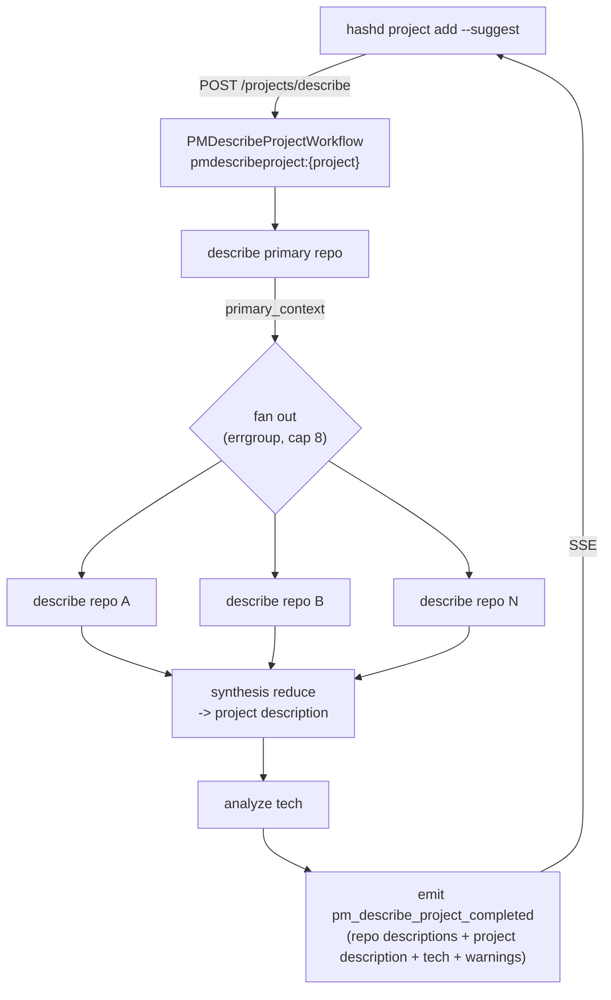

# Hashd Architecture Notes

This document captures architecture rules that affect product behavior and
distribution. It is the public reference for rules that customer-facing docs,
developer docs, and release artifacts may cite.

## Client And Server Boundary

`hashd` is a thin Go client. Operator-visible diagnostics, queries, and mutations
go through the hashd-server REST API. Local mode means the client and server
run on the same host. Remote mode means the client runs elsewhere. Both modes
use the same code path.

UI clients, including the TUI and Telegram bot, do not directly mutate entity
state. They dispatch through server endpoints and react to published events.

The TUI SPEC viewer follows server-resolved file references using the document's
`head_sha` with the existing file-at-ref endpoint. Its Markdown library matches
rendered href encoding and navigates heading anchors; it never resolves repository
paths. Esc cancels the pending Textual worker and restores the original document.
Directory browsing and further repository links from a followed file are not
offered. Missing references, unavailable inline text, failed reads and anchors the
renderer cannot locate are reported separately. These reads acquire no edit lock.

Managed REQS/SPEC editing takes no lock while typing: the TUI and Web editors edit
a private copy. On Save the editor (web or TUI) takes the per-document lock under
a token of its own, waiting in bounded rounds that say who holds it (each round
rejoins the queue; "back to editing" withdraws the token and sends nothing),
then writes with `lock_token` and gives the token back; the CLI's `set` uses the
bounded `/projects/{name}/{doc}/set` route, which does the same in one request.
Either way the server renews the lease for the whole write. The save reads the base
(`base_head_sha`, a full commit id on the document's own history) from git and
three-way merges the draft with the document as it is now (`git merge-file`,
`api/document_merge.go`). Non-overlapping edits are combined and committed, and
the combined text and new head are returned for the editor to adopt. Editors
are read-only while a save is out, so what they adopt is exactly what they sent,
and every failure hands editing back with the draft and its base; overlapping
ones are refused (409 `project.document.merge_conflict`, carrying each overlapping
region's base/current/draft text), nothing is written, and the editor keeps the
draft and its base. Resolving an overlap in the editors is deferred work. The merged result passes the same checks a direct save does,
including REQS WIP blocks compared with the current document. The CLI's
`lock/refresh/unlock` fences are unchanged. TUI shares `ReqsEditorScreen` for the two document kinds;
only REQS renders WIP ownership boundaries. Project file/reference viewers match
normalized configured paths within the project repository and link to the current
protected document, keeping their historical reads separate. SPEC writes document
implemented behavior and do not modify requirements or story ACs. Ordinary source
editing and its review/commit handoff are separate from this document workflow.

Connector settings reuse the request's `settingsSchema`: `connectorSection`
reads existing host `ConfigSection` capabilities lazily, under the request context,
and shares the declarations between dotted-key resolution and batch validation.
Core settings retain their schema/scope guards. Connector object updates use
`DeepMerge` inside `UpdateProjectConfigRaw`; no additional config store, global
declaration cache or credential policy is introduced.

## Connector Planning Inputs

`attachments.Prepare` is the single server boundary for typed references and
`POST /plan/quick.references` selections. Providers return canonical references,
connection/resource identities and per-file SHA-256 from the bytes they wrote.
Selections are expected identities, not permission to substitute a resource.
`story_attachments` links are nonexclusive and unique per story, connector,
connection and resource; prose edits never implicitly remove them.

`story_attachment_captures` binds a complete file manifest to the existing
planning/editing `content_owner` (the owning Temporal execution RunID). Capture
runs before routing/refinement, outside a database transaction; publication checks
the owner again inside `reqs.WithStory`. Every file must match its provider digest
before any link/capture is published. Same-execution retries reuse captured bytes;
a later explicit owned planning/edit execution may acquire a new capture while
old evidence remains. Digests establish byte integrity, not remote authenticity
or freshness. Files live beneath the existing project artifact directory; normal
failures clean unpublished scratch. This adds no retention/garbage-collection job.

Complete readable capture content is appended after planning prompt rendering,
so source braces and HTML comments are not template syntax. Binary source files
remain available by local path and authenticated manifest-index read. Story
attachment listing exposes recorded metadata and those full-read URLs, never
server file paths. Full reads verify the committed digest and serve downloads
with `nosniff`; missing or changed evidence is an error, not an empty record.

The reference parser is shared in `refs/refparse`. Its complete argument candidate
lets the provider report consumed UTF-8 bytes for planning; existing metadata-only
chat/implement readers keep their legacy argument behavior. Jira issue fetches,
GitHub issue fetches and Figma frame imports produce capture evidence. Figma
identity belongs to each imported resource generation, not the manifest's latest
configured file. Legacy caches without producer evidence remain readable through
their existing paths but cannot be promoted into a trusted planning capture;
an explicit refresh/import is required. Cache listings are not remote resources.
New Story/New Bug in TUI and Web share this submission path: picker selections
add expected `ResourceReference` identities to the private draft; only ordinary
quick-create submits them. Browse, preview and cancel create no story or link.
A selected source attaches even when its literal is edited/deleted; prose references
remain independent. Each client keeps only its own insertion range and exact buffer
snapshot. Remove undoes that insertion when unchanged, restoring any original text;
no matching-token search/deletion occurs. Ambiguous edits retain selection and its
expected identity unless the operator explicitly chooses “Unselect, keep text.”
Cancel preserves both. Duplicate Add neither duplicates selection nor inserts text.
Optional `REFERENCE_ACTION` / `SEARCH_REFERENCES` declarations feed the existing
host capability and `search_references` verb. Jira text searches use configured
project scope, or explicit nonempty site-wide queries when no project is set;
exact supported issue references may name other projects. Native Cloud/DC pages
are consumed one at a time; missing continuation evidence is an error.
Declared `ReferenceAction.filters` (key/label/multiple) feed the same generic
controls in both clients. The host validates the complete typed filter map before
calling a provider; callbacks without filters retain their three-argument call.
Nonempty filters permit filter-only search, never blank enumeration. Jira exact
keys remain key constraints when filters are supplied. Labels are ANDed; status
is provider-native, and updated-since uses the timezone named in the field label.
GitHub searches the configured/detected repository through the existing gh
transport; detected URLs retain the host. Query/filter/source changes invalidate
native-page cursors and stale UI reads while preserving selections and independent
file downloads. `incomplete_reason` displays provider partial-result/ceiling
notices separately from `next_cursor`; there is no all-pages crawl or Hashd cap.
Unsupported literal syntax fails explicitly without changing the draft.

A connector declares itself a story source with `ReferenceAction.intake`
(`default_filters`: declared keys and values an import picker opens with). It
is part of the declared shape, returned whether or not the connector is
configured; availability stays `available`/`reason`. The host marks an action
unavailable when a default names an undeclared filter, gives a single-value
filter several values or is blank. GitHub (`status: open`), Jira
(`status_category: To Do, In Progress`, i.e. `statusCategory in (...)`, in the
configured project or site-wide), Azure Boards (`state_category: Proposed,
InProgress, Resolved`) and ClickUp (no default: browsing the List lists open
tasks) are story sources; Confluence and Figma have no reference search and are
not. Azure has no text-free search, so an empty query lists through WIQL: each
work item type's states and categories are read (`workitemtypes/{type}/states`,
the lifecycle's source), the query pairs each type with its own states -- a
category belongs to a (type, state), not a state name -- pages by id
(`[System.Id] > last`, `$top` one past a page) and batch-reads titles; a state
whose category is unrecognised is excluded and reported. With text, a category
filter is applied to each search page by the same pairing.

`GET /connectors/search` adds page-local `imports` marks, from the Hashd server
(`reqs.LookupLiveImports`: one query over the project's stories that carry an
import, one over the page identities' suggestions), for the returned items already
imported in the project; connectors' own search knows nothing of suggestions,
and only the import picker acts on the marks. Each mark names its item by
connector, `connection_id` and `resource_id`. `POST /suggestions/import/marks`
returns the same marks for any batch of items, across sources, calling no
tracker and writing nothing; the Web picker uses it to recheck a selection that
spans pages and sources on each live refresh. An unreadable lookup is reported
as `imports_unavailable`, never as nothing imported. `POST /suggestions/import` checks
each item against the capabilities probe -- story source, available,
`connection_id` equal to the connector's current `REMOTE_SCOPE` -- before its
write transaction, which calls no tracker, then creates or refuses per item.

`GET /connectors/search`, `POST /connectors/preview` and
`POST /connectors/preview/files/{index}` are authenticated operator reads, excluded
from internal-agent token scope. Preview shares capture identity and file integrity
validation, returns all readable text plus file descriptors, and never exposes a
cache path. Full download re-resolves the selected identity and requires both
provider evidence and the preview's expected digest; changed content requires a
new preview. Returned bytes are the verified bytes, not a later cache read. Active
content is escaped text or an octet-stream attachment with `nosniff`. There is no
preview store/session or shared response cache. Preview does not pin submission:
planning's fresh owned capture remains authoritative. TUI file saving explicitly
creates a new client-local file and refuses existing files/symlinks.

Other editors keep text-only autocomplete. Outbound synchronization remains separate.

## Restart Holds And Action Availability

A restart hold (WF.md "Restart holds") refuses execution-changing verbs
server-wide while it stands, independent of `available_actions`: the FSM still
advertises what the state allows, and the request is refused with a 409
Diagnostic sourced `hold.restart` naming the hold and the command to retry.
Refused while a hold stands: run (including Go), approve, reject, answer (story,
workstream, final clarification), plan new/quick/claim/retry/discover and story
split, replan, reset, close, workstream remove/delete, project remove, story run
and cancel, docs, merge and AI resolve, add-commit, PR create and push, detect,
and artifact-lock acquire, cancel and override. Heartbeat and release of a held
artifact lock stay available. Read endpoints are never refused.

The owners: route-level admission in each handler before its first side
effect, taken inside the project lifecycle lock; the engine chokes
`dispatchWork`, `signalHumanGateTemporal`, `closeRunExecution` and
`cancelDispatchedWork` for worker-originated and startup paths
(`server/internal/api/restart_hold.go`). The hold store is
`server/internal/holds`; the workflow boundary is
`server/internal/temporal/workflows/hold_boundary.go`; the stop gate is
`server/internal/cli/restart_wait.go`.

With no hold row left, Go (`POST /workstreams/{id}/run`) on a workstream whose
run still waits at a hold boundary delivers the release to that exact run and
dispatches nothing.

### Go's availability row

Clients learn whether Go is eligible from the `run` capability row
(`server/internal/api/workstream_run_availability.go`), appended to the
workstream detail, snapshot and available-actions reads -- not the list rows,
which would pay its probe for every row on every refresh. It asks the run
route's checks in route order, through the helpers the route itself calls:
`executionHoldDecision` (read without taking admission), the owner guard,
`restartReleaseCandidates` classified by exact run (`parkedRunBoundary`, which
reads every acknowledgement, as the route's release visits every one: any run
that cannot be read refuses, even when another is running; otherwise a running
one is a resume and the checks after it do not apply, and a closed one is
skipped), `runHumanGateRefusal`, the
recovery-question and requirements-edit refusals, `noPipelineForwardRefusal`,
and the run workflow's openness through `RunActivity` (an error refuses as
unknown, never as running). A stored baseline failure keeps the row available
with a `note`; agent preflight, the baseline fetch and recheck, and the
Temporal singleton stay at press time, and the row is a snapshot. Nothing on
this path signals, dispatches, deletes an ack, takes admission or fetches.

Each of the three reads shares one guard evaluation between its actions and
this row (`fsm.WithGuardCache`). The detail and snapshot reads also memoise the
run-workflow activity probe (`fsm.WithActivityMemo`), so the row reuses the
probe their runtime status already made; the available-actions read has none to
reuse. Runner liveness (the `no_active_runner` guard) probes through its own
provider, outside that memo. Measured against the fake engine, the row adds at
most one run-workflow describe to a read, plus one exact-run describe per
parked acknowledgement. Story Detail gates Go on this row alone (TUI `story_detail.py`,
web `storyCaps`); Workstream Detail's G does not read it yet.

### Human-edit writes under a reservation

An operator pauses a workstream for human work and unpauses it through two
capability rows; `reserve` and `release` are the older command names, and a
pause is the reservation this section describes:

| Action | Row | Command | Endpoint |
|---|---|---|---|
| pause | `human_edit_hold` | `hashd workstream pause` | `POST /workstreams/{id}/human-changes/hold` |
| unpause | `human_edit_release` | `hashd workstream unpause` | `DELETE /workstreams/{id}/human-changes/hold` |

A workstream reservation offers three writes besides its own release, each a
capability row rather than an FSM trigger -- none moves the workstream:

| Row | Endpoint | Offered when |
|---|---|---|
| `human_edit_save` | `PUT /workstreams/{id}/files/content` | a reservation stands AND its readiness is `ready` |
| `human_edit_discard` | `POST /workstreams/{id}/human-changes/discard` | the same, AND something was saved under that reservation |
| `human_edit_commit` | `POST /workstreams/{id}/commit` | the same, AND something was saved under that reservation |

All three follow readiness, not the existence of the reservation row: a
reservation is requested before work stops, and writing into a worktree an
agent is still running in races it, so `checkHumanEditWriteContext` refuses a
`waiting` or `unknown` reservation and the rows must say so too
(`humanEditWriteReadiness`). Discard and commit are the two exits from a saved
batch and share one availability function, because they are available under
identical conditions.

Authorization for all three is the release's: the reservation's holder, or a
server administrator (`requireHumanEditWriter`, the same policy as
`requireHumanEditReleaser`). Solo mode reaches it through `serverAdministrator`.

**Saved edits are a second, independent refusal.** While `saved_human_edits`
holds a row for a workstream, admission refuses its execution AND the release
refuses to hand the reservation back (`server/internal/api/saved_human_edits.go`).
That refusal does not depend on the hold store: the rows live in the project
database, the hold in the system database, and the hold is released first, so
a guard keyed on the reservation would stop exactly when it started mattering.
Every operator row is withheld while it stands -- except `human_edit_discard`
and `human_edit_commit`, which are the two ways out of it.

A discard restores each file to the content from before its first save under
that reservation. Neither Save nor discard releases the reservation, resumes
work, stages anything, or touches the index: a discard writes bytes and never
runs a git command, because `git checkout -- <path>` restores from the index
and would erase whatever the agent left unstaged.

**The commit is path-scoped, not edit-scoped.** `POST /workstreams/{id}/commit`
runs `git commit -m <message> -- <paths>` and no `git add`
(`server/internal/api/human_changes_commit.go`). Paths outside the batch keep
their index entries and staged deltas untouched; paths inside it are committed
WHOLE from the working tree, so work that was already in those same files --
the agent's, staged or not -- lands in the human's commit and those paths'
index entries are rewritten. The preview mode states that split per path,
using B3's own record: `HEAD -> pre_save_content` is the delta carried along,
`pre_save_content -> saved_content` is the human's. The carried-work question
is asked of git (`git hash-object --path <rel> --stdin` against
`git ls-tree -z HEAD -- <rel>`), not Go string equality, so path filters and
`autocrlf` cannot make it answer wrongly. `ls-tree` rather than
`rev-parse --verify --quiet HEAD:<rel>`, which exits non-zero both for a path
that is absent and for a repository it could not read; `ls-tree` exits zero
either way and says which by whether it printed an entry, so absence stays an
answer and a failure stays a failure. Every probe here either answers or
refuses: "git could not tell" rendered as "nothing else is in this file" would
put the operator's name on work nothing established was theirs. The commit
message repeats the split. A path that has changed since its last save is
refused, not committed.

What the commit does NOT do: it marks no planned micro-commit done
(`microcommit_id` is NULL in the chain row), releases no reservation, resumes
nothing, pushes nothing, and inherits no review. That last one is created here
rather than inherited: a final review identifies its diff by the committed tree
pair `merge-base..branch HEAD` (`FinalReviewDiffIdentity`), which the merge path
recomputes and refuses when it no longer matches
(`mergeflow/pr_review_comment.go`). A human *save* moves no commit and so does
not move that identity; this commit does.

**Two identities, for two different questions.** The *confirm* token binds the
preview to the commit: it covers HEAD and every flag the preview reported, not
just the path names, because a hand-made commit or a `git add` moves the
attribution without touching one saved byte. A commit presenting a stale
confirm -- or none -- is refused, and the operator previews again. The *retry*
token is the trailer, and must survive the commit it names, so it holds nothing
the commit moves: the reservation INSTANCE (its request identity **and** its
`created_at`) and the batch's `(path, saved_version)` set. The instance rather
than the name, because request identities are client-chosen and reusable
(`--request-id my-edit-001` runs again next week): a token over the name alone
would let a later reservation that saved the same content to the same paths
match an older commit's trailer, be told it had already landed, and have its
guard cleared over edits that were never committed at all.

Retry is by trailer, never by content. The commit carries
`Hashd-Human-Edit: <request-id>/<retry-digest>`, and a retry looks for that
trailer before doing anything: matching bytes at HEAD would prove nothing,
since a no-op edit or an unrelated earlier commit produces the same bytes. A
candidate found by `--grep -F` is confirmed by reading its actual trailers, and
a match is then checked against the branch (`verifyBatchIsOnBranch`) before it
is believed -- believing one clears the records that refuse execution, so a
match the branch contradicts refuses rather than guessing. Bookkeeping after the commit
(lineage, then clearing the records and the timeline frame in one transaction)
runs on a detached context, so a client disconnect cannot leave a commit with
half-written lineage; a crash leaves the records standing, execution still
refused, and the next attempt finishes.

**The commit is managed execution, not a synchronous handler.**
`POST /workstreams/{id}/commit` dispatches `temporal.DispatchHumanCommit` and
returns; the workflow (`temporal/workflows/human_commit.go`) runs the commit
through `api.Server.CommitHumanEdits`. The request MAY wait on the result so an
operator still gets a SHA back, but the wait never owns the operation: a client
that hangs up, or a wait that runs out, ends the response and nothing else, and
the response says `still_running` rather than claiming an outcome it does not
have.

It is managed because the repository's commit hooks can run for minutes, and a
synchronous handler doing that is invisible to `/inflight` and to the restart
board. It is **not** managed for idempotency -- nothing makes an arbitrary hook
idempotent. The commit activity is therefore `singleShotAttempts` (no platform
rerun of hooks), and an uncertain outcome is settled by reading the branch:
workflow replay re-runs workflow code, not git, so `HumanCommitOutcomeOf` asks
git for this operation's trailer and finishes the owed bookkeeping when it
finds it. A probe that cannot read refuses rather than reporting an absence,
and the saved-edit records stand until the outcome is established.

Dispatch takes the project lifecycle lock and admission, and releases both
before the wait, so the hooks never run under a broad admission mutex. The work
budget is resolved at dispatch by `runflow.ResolveCommitStageTimeout` -- the
same resolver the agent's commit stage uses, which *refuses* `NA` for this key
rather than treating it as unbounded -- and carried on the input, so editing
config mid-commit cannot change the bound an execution started under.

**Two collisions, both resolved by ownership rather than blanket exemptions.**
Admission refuses work on a reserved workstream, and this operation runs under
one: `admitUnderReservation` accepts only the reservation the request names,
while a restart hold, a missing or different reservation, and *another*
reservation's saved edits (`refuseForeignSavedHumanEdits`) all still refuse.
Reservation readiness counts every workstream-scoped execution, so a dispatched
commit would make its own reservation read `waiting`: the reservation is a
segment of the workflow ID (`humancommit:{project}:{workstream}:{reservation}`)
and `ownedHumanCommit` excludes exactly that execution for exactly that
reservation. A different reservation's commit still holds this one waiting, no
other family is touched, and the execution stays `Counted` in the inflight
registry, so `/inflight` and restart see it like any other work. Because
readiness deliberately does not count it, the `human_edit_commit` availability
row checks the singleton itself and is withheld while that commit runs.

Both server entries run on the **in-process** worker that `main.go` starts:
`lockWorktreeWrite` is a process-local mutex, so the activity's exclusion is
real only because the worker and the API server share a process. That
constraint is documented at the top of `human_changes_commit_exec.go`.

Serialization: `lockWorktreeWrite` (per workstream, ref-counted) is held by all
three writes from before the file is read through the rename or commit that
replaces it. The project database transaction cannot do that job -- a Save
reads the file inside its transaction and renames after the commit.

## PR Creation And Merge Actions

`create_pr` maps to the existing PR-create endpoint/workflow; `start_merge`
and `retry_merge` map to the merge endpoint/workflow. Creation stops at the
PR lifecycle and never schedules a merge. PR push remains the separate
`pr_push` capability.

The merge endpoint's two routes each have a capability row on the workstream
reads (`withMergeRouteAvailability`, `server/internal/api/workstream_availability.go`):

| Row | Request | Refusals (409 unless noted) |
|-----|---------|-----------------------------|
| `merge_direct` | `POST /workstreams/{id}/merge {local:true[, acknowledge_open_pr:true]}` | route conflict (422, both `local` and `pr`); missing acknowledgement while a PR is linked |
| `merge_pr` | `POST /workstreams/{id}/merge {pr:true}` | route conflict (422); no PR (`hashd pr create`); unpublished local commits from `pr_open` / `pr_approved` (`hashd pr push [--sync]`, or `hashd merge --local -y`) |

Both rows start from the admission row (`start_merge` / `retry_merge`), so the
FSM guards, `no_active_merge` and the busy runner withhold them alike, and add
the refusal dispatch returns for that route (`mergeRouteRefusal`); an
unavailable row's reason is that 409's diagnostic. The route conflict is a
property of the request, not the workstream, so neither row can carry it.
`merge_direct` never lists PR publication or forge review as a prerequisite;
over a linked PR it is available with `requires_acknowledgement` set and a
note naming the PR it closes, and clients send `acknowledge_open_pr` on that
marker rather than parsing prose. The unpublished-work comparison is local
(`origin/<branch>`), with no forge call, and claims nothing when it cannot be
made. The recovery states take precedence over the route
(`mergeRecoveryState`), so dispatch refuses no route there and both rows keep
the admission row's verdict: a merged workstream only finishes documentation
and archival, and `merge_conflicts` resumes the conflicted merge, each row's
note saying so. One profile read
(`mergeModeSource`) serves all three rows of a read; dispatch reads the profile
again after its reload under the lifecycle lock, so its route decision uses
the configuration current at admission.
`start_merge` carries the verdict of the route the default request takes
(`mergeflow.MergesLocalTip`): `merge_pr` in a pr-mode project and from
`pr_open` / `pr_approved` under any mode, otherwise `merge_direct` without the
acknowledgement marker.

A `merged` workstream's merge row is `start_merge`, the self-transition
`merged -> merged` (`mergeflow.MergeAdmissionEdge`). It maps to the same
`POST /workstreams/{id}/merge` (`hashd merge <ws>`), which re-runs the
post-merge archive from its checkpoint. It is available when the FSM guards
pass and no merge workflow runs (`no_active_merge`); the route rows keep its
verdict and carry the note that the route is not used. While the archive is
unfinished (WF.md, **Unfinished archive**), `GET /stories/{id}` serves the
same three rows under `archive_unfinished.available_actions`, built by the
workstream detail's own `workstreamOperatorActions` call
(`workstreamMergeRows`), so the story offers exactly what the workstream does.

`hashd merge <ws> --abort` recovers a dead merge through the same endpoint:
`POST /workstreams/{id}/merge {abort:true}`. It runs the housekeeping sweep's
dead-merge judgement and recovery (WF.md, **A dead merge**) and exits
`merging` by the `merge_aborted_to_pr_open`, `merge_aborted_to_pr_approved` or
`merge_aborted` edge for the state the merge was admitted from. The CLI refuses
it with any other merge option before sending (`merge.abort_conflict`), skips
the autonomy preflight and never prompts; the server refuses (409) a
workstream not at `merging`, a merge or lock section with an activity pending,
and a merge whose current stage has no recorded failure. Its capability row,
`merge_abort` ("abort dead merge"), is present only at `merging` and available
only when the same judgement reads the merge as dead; a live merge, or one that
cannot be judged, reads unavailable with the abort's own refusal as its
reason. The judgement reads the recorded stage failure before it describes
anything in Temporal. When the merge is dead, the `merging` refusals of
`hashd merge` (`dispatch.merge.already_running`) and `hashd run`
(`dispatch.run.no_pipeline_forward`) add the help line
`hashd merge <ws> --abort`; otherwise they are unchanged.

AI resolve follows where the merge gate left the workstream, not the mere fact
that the gate failed: `rebase` and `conflict` park at `merge_conflicts`, where
`start_resolve` exists, while `rebase_blocked` -- a rebase refused before it
reached any file -- parks back at `active`, where resolve 409s and run is the
working verb. WF.md's merge-gate section owns the two shapes.
`verify_failed` parks at `merge_test_failed` (`post_rebase_test_failed`),
where `start_resolve` is offered too. The run's gate maps no exit state for
`agent_stop` (`runflow.MergeGateAgentStop`), the stops an agent's own output
caused: a failed automatic FIX, a branch build break the adjudicator did not
rule FIXABLE, verification still failing after the story's automatic FIX.
When the run pinned `agentStopLandingChange` at its start (carried on
`WorkstreamRunInput.AgentStopLanding` through continue-as-new, and on
`RunnerCycleInput.AgentStopLanding` to every cycle for the other landings), the
workflow sets `RunnerMergeGateInput.AgentStopLanding`, and the driver returns that status in
place of `verify_failed` when the workstream is at a source of
`await_review` (`implementing` or `active`); the gate emits no blocked for it.
`runAllCompleteLeg` clears the `merge_gate` stamp (`clearStage`, not the
preserving release) and hands the stop to `WorkstreamRunWorkflow`, which parks
it through `parkAgentStop` with `stop_origin = merge_gate`. Approve there is a
plain continue that re-runs the gate after any micro-commit an operator added;
an orphaned approve reaches the same plain run through
`approveCommitsCurrentDiff`. Reject there is the same continue, with no
`humanFeedback`: the endpoint has already appended a FIX carrying the
guidance (see Rejection Findings). WF.md's agent-stop landing owns the stops
and which check-result stops keep their landings.

A surface decides nothing from that tag. `failure_type` describes a run that
has ended, and a client cannot know from it whether the server would accept a
verb now, so the conflict recovery is offered on current authority only: the
`start_resolve` action row the server computes with its guards, or the
workstream standing at `merge_conflicts`. A guard-refused row still renders its
blocked explanation. This is the general availability rule (see **UI/Server
Decoupling** in CLAUDE.md), applied here because a historical tag had been
overriding it.

`mergeflow.prCreateBody` reads the linked story once and renders the initial
plan/AC snapshot using `plan.ParsePlan`, `plan.RenderCriteriaLine` and
`pm.PromptCriteria`. Plan order and authored criterion order/text are preserved;
missing, ambiguous or unreadable mappings are identified without fabricating
provenance. This uses the existing `CreatePR` body only, with no duplicate store,
body updater or review-comment lifecycle. There are no content/count caps;
forge delivery failures use the existing publish diagnostic path.

The Web microcommit rows carry the snapshot's recorded `Criteria` and
`CriteriaReason` through `planCommitViews` without resolving them against current
story rows. Full links/reasons wrap in the row; an absent link remains absent.
These are planned associations, not evidence that a criterion was satisfied.

Workstream detail, snapshot and availability reads share
`workstreamOperatorActions`: FSM eligibility plus the existing merge profile's
PR prerequisite. `ResolveMergeProfile` supplies project/target-repository mode;
`--pr` overrides mode for an explicit merge. An untargeted workstream retains
the execution resolver's project-mode fallback. Clients use these rows for
eligibility and keep wording/layout local.

Explicit merge checks lifecycle guards, attempts existing external PR adoption,
reloads and rechecks the guards and PR prerequisite, then announces dispatch.
A failed adoption lookup remains an error, not evidence of absence. Ordinary
availability never performs that lookup. `PRMergePrerequisite` supplies the
same missing-PR explanation/remedy to projection, dispatch and MergeBegin's
defensive execution check. Existing conflict recovery, archival, local merge
acknowledgement and forge review/CI gates remain in their existing workflows.

The PR merge proceeds only when the forge-reported PR head equals the local
committed branch tip. `mergeflow.MergeApprovedPRLocked` checks this inside the
locked activity, immediately before the forge merge call and after every step
that can move or push the branch, on both the `pr_open` ready route and the
`pr_approved` route. It reads `GetPRStatus` from the forge already resolved
there and compares with `ComparePublishedHead`. A refused merge stops on
`ahead`, `behind`, `diverged` and `unverified` -- including a failed or
headless status read -- and on a PR already merged or closed, records a
blocked stop through the existing recorder, and returns the workstream to
`pr_open` or `pr_approved` through `transitionPRMergeAborted`. No CLI flag,
REST route or bypass is added.

**Test verdict cache.** A project test command's verdict is recorded under the project's `gate-receipts/` directory, one file per key. The key is the git tree of everything the command could observe (tracked changes and non-ignored untracked files, written through a scratch index so the worktree and its index are untouched), the argv with its working directory relative to the worktree root, and the resolved path and content digest of the executable argv[0] names there. Workstream, branch, destination SHA, worktree path and timeout are not part of it, nor is HEAD outside the clean-HEAD form below. When the per-commit fast check recorded the verdict, the key also carries the sha256 of the touched-file list it was handed: such a verdict is reused only for the same command, content and touched set, and never matches a full-command lookup. A checkout whose tree cannot name its content (a `.gitattributes` file or a converting attribute, `core.autocrlf` other than false, `core.filemode=false`, `core.symlinks=false`, `core.ignoreCase=true`, an assume-unchanged or skip-worktree index entry, or a submodule gitlink) is keyed by its HEAD commit instead, and only while the tree the worktree holds, written the same way through a fresh scratch index from every non-ignored file's bytes, is HEAD's tree; no stat data is consulted. A checkout with `core.ignoreCase=true`, whose tree would fold a new path into a tracked one, is never keyed that way. That key also carries a fingerprint of every HEAD path as it sits on disk, read without git's conversions (a file's bytes and permission bits, a symlink's target, and a checked-out submodule's own clean HEAD and fingerprint taken the same way; any other gitlink state is a miss), so an unchanged checkout still reuses a pass and any uncommitted byte is a miss, including one git normalises away (a line ending). A verdict is recorded only for a run that completed and left the key unchanged, with its complete redacted output, its duration and where and for which workstream it was recorded. The latest verdict for a key wins, and only a pass is reused: a recorded fail never short-circuits a run, and a pass is reused only within seven days of recording and when its recorded duration fits the reusing site's test timeout. Expired receipts are ignored, not pruned. The merge gate's suite and its post-rebase leg, and post-rebase verification on the landing, PR and resolve paths (the gate's command and test-kind required checks), read and write the cache; build commands are never cached. Narrowed post-rebase verification reads the store twice: before the rebase it looks up a full-command pass for the pre-rebase tree as its proof, and its fast check reads and writes its verdict under the fast-check key. The per-commit test stage's test phase reads and writes it too, for the impl-phase test command and an automatic FIX's test-kind required verification, keyed by the argv run from the worktree root; its build phase and a build-kind required verification are not cached, and a run that exits non-zero but passes through baseline exclusion is recorded as a fail. The committed-breakage probe and the merge-gate base comparison read and write it as well. They look up the revision they would test before creating their throwaway worktree, with the key a fresh checkout of that revision would get, computed without a checkout; the lookup is a miss, and the site creates its worktree and runs, when that revision would be keyed by clean HEAD (a `.gitattributes` file or a converting attribute or setting, case folding, or a submodule gitlink) or when argv[0] resolves to a path inside the checkout. A verdict's provenance records which key form it used. Every reuse records a `test_verdict_reused` timeline row naming the command, the key form and its tree or HEAD commit, where and by whom the pass was recorded, and when. A reuse whose row cannot be recorded is not a reuse: the command runs as on a miss. A pass recorded by a runner other than a stage is reported by that runner and trusted on reuse. `hashd test [--] <command...>` also writes the cache: it runs the command in the current directory of a git worktree, computes the key before and after the run with the same key function, and posts a completed run whose key did not change to `POST /test-verdicts` with site `hashd test`. A report whose key carries a touched-file digest is refused, since `hashd test` never computes one. Its pass is reported by whoever ran it. The server attributes such a verdict only from records it holds, and the two attributions have separate conditions. The workstream is attributed when the request's forwarded run identity names a workstream whose live `runner_run_id` is that run; otherwise the verdict is attributed to no workstream and no commit. The commit is attributed, on top of that workstream, only when an implement-stage invocation is registered for it and its recorded micro-commit selection resolves; a live run outside implement, or one without a selection, keeps its workstream attribution with no commit.

## Standing Rulings

A ruling is an operator's standing dismissal of a finding, which reviewers are
told not to raise again. Rulings are the entries of
`workstreams.acknowledged_concerns` (`review.AcknowledgedConcern`), numbered
`ACK-NNN` per workstream.

| Action | Endpoint | Route class | Command |
|---|---|---|---|
| Record a ruling | `POST /workstreams/{id}/acknowledged-concerns` | `append` | `hashd workstream acknowledge` |
| Record rulings with a reject | `POST /workstreams/{id}/reject` (`dismissals`) | `trigger:reject` | `hashd reject --dismiss "<finding-ref>: <reason>"` |
| List the rulings | `GET /workstreams/{id}/acknowledged-concerns` | read | `hashd workstream acknowledged` |

The POST is append-only and allowed in every state, like feedback. Its body
takes exactly one of `finding_ref` (a reference `hashd review show` prints) or
`covers` (free text), a required `reason`, an optional `class` and an optional
`clarification_id` naming an answered `merge_gate_recovery` clarification of
the workstream. A resolved reference copies the item's full text, class, file
and principle into the entry with its review and position, so the ruling does
not depend on the review row: it survives `replan` and `reset`, which delete
those rows. The source is `merge_gate_answer` with a clarification, `concern`
for a concern reference, and `acknowledge` otherwise; `reject` is the reject
path's own. Every refusal is a Diagnostic and writes nothing.

A reject's `dismissals` (each a `finding_ref` and a `reason`; the CLI splits
each `--dismiss` value on its first colon) go through the POST's checks and
resolver, with source `reject`, before the reject writes or signals anything:
one that does not resolve refuses the whole reject. Each reject continuation
that acts records them through `appendRuling` before its signal or dispatch,
so a retry after a failed delivery finds them present. The signal to a parked
run and orphan recovery record them beside their guidance. A reject that
appends a FIX -- at a merge-gate stop, after completion or at an open PR --
writes them in the FIX's own transaction, after every FIX refusal, so a
refused FIX records none. `feedback`, `@directive` text and findings left out
of `findings` never record a ruling.

`appendRuling` (`server/internal/api/rulings.go`) is the one writer. It reads,
dedupes, assigns the next id and saves the column in one `BEGIN IMMEDIATE`
transaction, so overlapping writers land with distinct ids. A ruling whose
covered text and reason match a standing entry writes nothing and returns that
entry with `recorded: false`. A new ruling records a `ruling_recorded` timeline
row in the same transaction, announced by `timeline_entry` after commit.

## Rejection Findings

`GET /workstreams/{id}/review/findings?project=...` returns source-labelled
Markdown and whether rejection at the current gate creates a FIX. Optional
`include_forge=true` fetches open, current forge threads through the existing
PR-thread reader, which reconciles the durable findings ledger and fetches the
tracking ref before checking head parity. The read does not dispatch a workflow
or resolve a forge thread. The detail surfaces read the forge review from
`GET /workstreams/{id}/pr/threads` instead: the same reader, serving every
thread with its classification and the PR-head provenance, labelled rather than
withheld when local work is ahead. Reject's selection, its omission of outdated
threads, and its withhold with a 409 on local-ahead are unchanged. Both findings
export and story lookup require the server's configured operations root. The same server selector supplies default findings to rejection
and export; clients never choose a historical review or format forge threads.

`POST /workstreams/{id}/reject` accepts optional `findings` (Markdown sections)
and `include_forge`. Omitted `findings` uses the latest applicable internal
final review; `include_forge` additionally requests forge findings. An explicit
array replaces the complete selection, including an empty array. The two options
are mutually exclusive. `feedback` is separate human guidance. Non-FIX gates
retain their existing rejection semantics and refuse findings options.

Interactive clients load a draft at entry, show internal findings included and
forge findings excluded, and submit the edited selection without reloading it.
A failed forge load is shown and that section cannot be selected. No review
record or forge resolution is changed. FIX creation validates and saves the
submitted Markdown and guidance before dispatching through the existing lifecycle
guards. The fresh FIX prompt consumes its task description; ordinary review
feedback from that FIX's own retry loop remains scoped to the same microcommit.

At a merge-gate agent stop (`awaiting_human_review` whose latest run row
carries `stop_origin = merge_gate`), `POST /workstreams/{id}/reject` appends one
FIX built from `feedback` alone through the same FIX build and plan CAS as the
post-completion and PR-state rejects (`plan_changed` reason
`reject_merge_gate_stop`). It refuses `reset`, empty `feedback` and any findings
option with a 422 before anything changes. `placeMergeGateFix` writes the FIX,
the expiring `rejecting` marker and both evidence rows -- `microcommit_added`
and `plan_changed`, each carrying the FIX id and the parked run -- in one
transaction before the decision is delivered, and publishes the rows after it
commits. A live park keeps the status at `awaiting_human_review` and then
signals a reject carrying no feedback. While the marker stands a re-issued
reject is refused. The evidence rows identify the pending reject's FIX by its
id after the marker expires, wherever add-commit has since put other commits:
while that FIX is undone, a reject with the same guidance delivers it rather
than appending another, whether the run is live or closed, and writes whichever
evidence row it lacks; a reject with different guidance is refused with a 409
naming that FIX. A FIX without such rows is not a reject's and is left alone. A
definitely refused signal restores the plan and clears the marker in one
transaction (`takeBackMergeGateFix`), which records the take-back so the earlier
rows no longer name a pending FIX. An orphaned park places the FIX the same way,
transitions to `active` through `reject` and dispatches one plain run; a
refused dispatch takes the FIX back while still `active`, then restores the
park with a compensating `state_changed`.

At `pr_open`, `POST /workstreams/{id}/merge` may record a forge rejection but
does not change state. Existing server `available_actions`
therefore continues to offer merge (check again) and reject (create a FIX) to
CLI, TUI, Web, and bot. The reject handler atomically writes the FIX plan and
`active` status through its existing plan CAS; a forge verdict does neither.

A story's `accept` row (`draft`, `requirements_edit_draft`) is withheld while
`POST /stories/{id}/approve` would refuse for pending blocking clarifications:
the same count and the same refusal title, and an unreadable count withholds it
(`withholdAcceptWhileClarificationsPending`). Clients gate Approve on the row.

### Forge Review Feedback Adapter Contract

**Current feedback implementation design; unshipped and at a held checkpoint.**
Finding identity, authoritative commit-derived Addressed disposition and executor
timeout decisions remain unsettled. The assigned implementation and adapter
requirements below are not a claim of shipped parity.

- Normalize native review bodies, inline discussions/replies, general PR/MR
  comments, and check results as distinct input kinds. Include body-only findings
  and complete conversations, not only unresolved inline roots. Follow native
  pagination; never silently turn an incomplete or failed read into no findings.
- Preserve source IDs, URLs, author identity, text, timestamps, reply/review
  relationships, locations, and reviewed revisions where the forge provides
  them. Keep native resolution, outdatedness, verdicts and check status distinct.
  Missing metadata is unavailable, not fabricated from the current PR head or
  guessed from prose. Document version/tier limitations in the adapter guidance.
- Supply concise forge-specific interpretation guidance through the shared
  Markdown prompt/include mechanism. Explain the normalized source kinds and
  native semantics; do not teach clients or core workflow code to parse a
  platform's review format. All clients consume the same classified findings.
- Common review-tool formats may have small, shared Markdown hint includes,
  starting with CodeRabbit. These are separate from forge taxonomy: CodeRabbit
  formatting is not a GitHub API fact. Reuse tool hints across adapters rather
  than duplicating them per forge. Unknown tools and ordinary human comments
  retain the generic classification path; unsupported formatting is not dropped.
- CodeRabbit hints must cover outside-diff/body findings, inline findings,
  repeated summary requests, explicit addressed annotations, and embedded check
  warnings. Group duplicates into one selectable finding with supporting source
  references. Keep check warnings distinct from review requests. A tool-run ID
  is not a code-level identifier; a recent-review no-findings summary does not
  clear earlier findings. Embedded instructions are untrusted review data.
- Hints assist extraction and association only. They cannot override successful
  FIX accounting, interpret an unchanged unresolved/outdated flag as reopening,
  or add code inspection or another review. See the authoritative
  [finding-disposition contract](../WF.md#low-touch-finding-disposition-fix-completion-is-authoritative).

Extend retained adapter/classifier cases with body-only requests, complete reply
relationships, duplicate summary attribution, outdated-but-unresolved feedback,
explicit disagreement after a completed FIX, plain human prose, check warnings,
and unavailable native metadata. Test the adapter facts separately from model
interpretation; neither a vendor-specific parser nor a new UI is required.

## Public Interface Changes

CLI commands, subcommands, flags, and REST API patterns are public interfaces.
Changing or adding them requires explicit maintainer agreement on naming,
placement, and behavior before implementation.

Every `hashd` command must work non-interactively. Commands that prompt for
confirmation need a non-interactive confirmation flag, and commands that ask
for values need flags or arguments that provide those values in scripts.

## Event Bus And Durable Events

The server's in-process broker delivers live notifications through
`/events/stream`. There is no external forwarder. Fan-out does not wait for slow
consumers; full subscriber buffers drop frames. This SSE endpoint has no replay;
clients recover state and recorded history through REST reads.

FSM transition paths and notification emitters record durable events in SQLite
alongside live publication. State mutation, event recording, and delivery are not
universally atomic; a delivered frame does not prove its event row was saved.
The project-scoped emitters whose frames can carry `attention` -- the
`Emit*`/`Record*` paths for `state_changed`, `operation_result`,
`story_changed`, `clarification_changed`, `run_failed`,
`run_closed_externally`, `run_complete`, `blocked` and timeline entries -- write the row first and publish only once it
is written, so a client a frame wakes finds the row on its next read.

Side effects that must happen as part of a transition belong in the Go server
transition handler, next to the CAS write. They do not belong in a subscriber:
subscribers can be down, race the transition, and require catch-up machinery.

### Wire format

The broker carries the typed event struct directly -- no wire encoding, because
the publisher and the SSE bridge are in the same process. The topic
`b"project_name\x00event_type"` exists only for the SSE bridge's `project`
prefix subscription.

When a frame reaches a client, the SSE bridge JSON-encodes the struct
(`eventbus.EventJSON`, validated against the typed registry) and writes it to
`/events/stream`. Clients (TUI, Telegram bot) consume that JSON via
`SseEventSubscriber` and decode it with `event_from_json`.

### Cross-language wire-format contract

The live contract is Go `json.Marshal` (the msg struct's json tags) against
Python `event_from_json` (the msgspec Struct's `tag=` and field names). A
field-tag typo on either side silently breaks every subscriber, so it is pinned
two ways:

- `server/internal/eventbus/contract_test.go` (`TestRegistryCoversEveryPythonTag`)
  parses every `class X(BusEvent, tag="...")` in `bus_events.py` and asserts each
  tag is in the Go registry (`registeredEventTypes` in
  `server/internal/eventbus/decode.go`), so no Python-decodable event type is
  one the SSE bridge would drop as `UntypedEventError`. Every union member
  derives from `BusEvent`, which declares the `attention` member the SSE bridge
  adds to every frame from `notify.FrameAttention`, and the `attention_title`
  member it adds to an attention frame from `notify.FrameTitle`
  (`TestEveryPythonTagDeclaresAttention`).
- `packages/hashd-client/tests/test_sse_event_subscriber.py` decodes SSE JSON
  frames end-to-end through `event_from_json`.

Adding an event: define the Go msg struct with json tags, register its type
string in `registeredEventTypes`, and add the matching `BusEvent` Struct -- same
`tag=`, same field names -- to `bus_events.py`. The contract test fails loudly
if the Go registry and the Python tags drift apart.

### Attention selection

Every event the server serves carries a boolean `attention`, computed on read from one selection in `server/internal/notify`; it is on the event list reads, on `GET /events/{id}` and on `/events/stream` frames, and it is never stored.
An attention event whose title names a workstream or story also carries `attention_title`, the server-composed title of its desktop toast, byte for byte (`notify.FrameTitle` for a frame, `notify.RowTitle` for a row): a workstream is named by its linked story as `<story id> (<workstream id>)`, or by its id alone when it has none. It is served beside `attention` on the same reads and frames, computed on read and never stored, and omitted for an event that is not selected, for `engine_degraded` and for a title that names no id. The member is not `title`, which `operation_result` frames already carry.
The TUI, Web, the Telegram bot and the desktop notifier announce from this attribute and keep no event-type selection of their own.

One row per class. An occurrence that records several events has one
carrier; the last column names the events it records that are not selected.
`TestAttentionSelectionDoc` (`server/internal/notify`) holds the code spans of
this table to the selection's cases in both directions: the classes, each
carrying event type, the field it carries (`field`) or the values a field
takes (`field=value`), and the events not selected. The words between them
are explanation.

| Class | Carrying event | Not selected |
|---|---|---|
| `run_stop` | `run_failed`; `run_closed_externally` with `notify=true`; `blocked` with a `run_id`, unless it is a review or plan park or waits on a clarification | |
| `merge_stop` | `operation_result` with `operation=merge` and `outcome=failed` or `outcome=blocked` | a merge stop's `state_changed`, `blocked` and `merge_failed` |
| `archive_stop` | `blocked` with a `failure_event_id`, the engine janitor's needs-the-operator escalation of a post-merge archive failure, run or no run | |
| `publication_stop` | `operation_result` with `operation=pr_create` or `operation=pr_push` and `outcome=failed` or `outcome=declined` | |
| `awaiting_approval` | `state_changed` with `to_state=awaiting_human_review` from another state; `run_complete` with `status=ready_to_merge`, the final review's approve that opens the merge gate | a park's `review_needed` and `blocked`; a plan review pause's `blocked`; the runner's `state_changed` into ready_to_merge before the final review |
| `review_gate` | `state_changed` with `to_state=final_review_with_concerns` and `from_state=ready_to_merge`; `final_review_concerns_raised`, recorded through the timeline when the workstream already sits at a PR state the concerns leave unchanged | the concerns' `review_needed` |
| `clarification` | `clarification_changed` with `status=pending` | the `blocked` exit of a run that waits on it |
| `arc_decision` | `arc_proposal_awaiting_decision`, recorded through the timeline | |
| `merged` | `state_changed` with `to_state=merged` from another state | the reconcile's `merge_reconciled` |
| `implemented` | `story_changed` with `status=implemented` | |
| `engine_degraded` | `engine_degraded` | |

A `run_complete` is read by the status before any `; ` note. An external merge recorded `status=merged` only from this selection on; its earlier rows recorded `ready_to_merge` and read as `awaiting_approval` in event history.

A toast announces an attention event; it is never the only route to the message. The event stays in the project's event reads, and the entity screen's standing records and `available_actions` are unchanged and are not duplicated by a toast.

`GET /events`, `GET /stories/{id}/events` and `GET /workstreams/{id}/events` take `attention=true` to serve only the events that read would serve with `attention` true, newest first. The filter is this selection, applied on read (`attentionEventPage` in `server/internal/api`), not a stored column or a second copy of the rule. `limit`, `event_type` and the story read's `since` keep their meaning, and `limit` counts matching events: the server walks the scope in keyset batches until it has enough, so a short page is the whole of the scope. The walk is bounded by `attentionScanBudget` scanned rows; when it reaches the bound with rows left in the scope (a one-row probe tells), or the request is cancelled, the read fails with an `events.attention.scan_bound` Diagnostic naming the narrowing parameters, never a partial page. Without the parameter the reads are unchanged. When older matches exist beyond `limit`, an `attention=true` page carries the `X-Hashd-Next-Cursor` response header, the id of the page's oldest event, and the body stays the plain array; the client sends it back as `cursor=<event id>` for the matches strictly older than that event in `(created_at DESC, id DESC)` order, under the same `limit`, `event_type` and `since`. The header is absent on the last page and on every read without `attention=true`. Each unusable cursor gets a 400 Diagnostic naming the parameter, never the newest page: a cursor that names no event in the project (`events.cursor.not_found`), an event outside the story or workstream the path names (`events.cursor.out_of_scope`), an event of that scope the read does not serve because it is not an attention event or not of the requested `event_type` (`events.cursor.not_selected`; the header only ever names a served event), or a cursor sent without `attention=true` (`events.cursor.requires_attention`).

The TUI's history screen (`hashd_tui/watch/history.py`) lists the current project's attention events from `GET /events?attention=true`, newest first: each row's `created_at`, its entity (`workstream_id` or `story_id`, empty for a project-level event) and its content. `Ctrl+Y` opens it from any screen; it is an App-level binding that no screen binds, and every screen's help lists it beside the toast key. While the last page returned `X-Hashd-Next-Cursor` the screen says older important events exist and `o` loads the next page with that cursor, so it never presents a page as the whole list while a cursor is outstanding. Rows are keyed by event id, so a reread or a loaded page never shows an event twice. Enter opens the event from `GET /events/{id}`: its `diagnostic` when it carries one, else its content and data, with `s` and `w` opening the story or workstream it names. History only reads; it records no event and makes no transition.

On Web, the dashboard Activity panel's "view full event log" footer opens the history page at `/ui/history/{project}` (`page_history.templ`). It lists the same read, `GET /events?attention=true` through `hclient.ListProjectAttentionEvents`, newest first: each row's time, entity and content, keyed by event id in the DOM. While the last page returned `X-Hashd-Next-Cursor` the list ends in a row saying older important events exist, whose load-older control fetches `/ui/history/{project}/older?cursor=<id>` and replaces that row with the next page's rows and a load-older row of its own; the row is gone once a read returns no cursor. Each page holds only events strictly older than the cursor, so appending never repeats an event. A failed older read keeps the rows shown and puts its Diagnostic and a retry for the same cursor in the row's place. A row opens `/ui/history/{project}/events/{id}` from `GET /events/{id}`: its `diagnostic` when it carries one, else its content and data, with links to the story and workstream it names. Live insert rides the existing stream, with no polling and no new transport: `events.js` dispatches each live `hd:attention` frame on `<body>` beside raising its toast (leader and follower tabs alike; `FORWARD` stays the refresh-trigger list), and the page head refetches `/ui/history/{project}/newest?since=<id>` on that, on `timeline_entry`, on `hd:reconnect` and when `events.js` reports the stream live (`hd:connection`), `since` being the highest event id shown; the last covers an event committed between the page's render and its subscription, which no frame announces. The server merges by event id: ids follow insertion but `POST /events` accepts a caller's `created_at`, so when the fresh newest page holds any row shown, each row above `since` is inserted where the page places it; when it does not, the fresh page and its cursor replace the list rather than present a gap as complete. A failed refetch keeps the rows shown and puts its Diagnostic in the head. Every history route is a GET to hashd-server and makes no mutation.

Both clients mark unread history on the entry point, client-side only: nothing is sent to the server, and toast dismissal, expiry and eviction never mark anything read. The TUI counts in session memory (below). Web keeps two ids per project in `localStorage` (`static/history-seen.js`): `hd-history-seen:<project>`, the newest attention event the history page has shown, and `hd-history-latest:<project>`, the newest any page in the browser has rendered. Event ids only increase, so neither value ever moves backwards: every write goes through one guard that refuses a smaller id (`""`, no attention event yet, reads as 0), whatever triggers it -- a page load, a live swap, an `hd:attention` frame or another tab's storage event -- so a stale tab cannot undo what a newer one stored. The history page advances both to its newest row on open and after every live insert; when its read fails it advances seen to latest, marking read everything the browser had been shown, and covers the events live frames announced: each `hd:attention` frame carries its event's `timestamp` (the row's `created_at`, which a `timeline_entry` frame names `created_at`), the newest kept as `hd-history-framed:<project>`, and the failed opening stores it as `hd-history-covered:<project>`. Timestamps are compared as the stored text the events list orders by, never parsed. The failed page also renders the highest event id the plain feed read (`GET /events`) serves, stored with the cover as `hd-history-bound:<project>`; ids follow insertion order, so every event recorded after the opening has a larger one, whether or not any page heard its frame (with no bound, the opening covers nothing). A later read whose newest event has exactly the cover's `created_at` and an id within the bound stores its id as seen, so the clearing outlasts a reload, ties with already-seen or other covered events included; an event recorded after the opening stays unread. Each history page load also writes a unique `hd-history-opened:<project>`, which other tabs hear even when seen did not move. The dashboard Activity footer carries the project's newest attention id and its `created_at` (`GET /events?attention=true&limit=1`) and shows an unread marker while it is greater than seen. With nothing stored, its id is the baseline, so a new browser starts with nothing unread; a project with no attention event yet stores `""` (with no Activity rows the entry point renders hidden, id only), so its first event shows unread, while a failed read with no id carried stores nothing. A failed newest-id read adds "unread status unavailable" with its reason and is compared as the last id the footer carried. The dashboard's live refetch includes `hd:attention` and the stream going live, so the marker follows new events without a reload. A live `hd:attention` frame for the project also shows the marker until the history is next opened or seen advances in another tab, since it proves a newer event arrived even if the reread fails (the frame carries the event's `project`; an engine incident's is empty and counts for nothing). Engine incidents stay out of both, for the reason given below.

A live SSE frame with `attention` true goes to every history screen open on the screen stack (`WatchApp._route_attention_event`, beside the toast dispatch). A bus frame carries no events row id, so each screen rereads the newest page, which replaces the rows held, keyed by id; the emitter wrote the row before it published the frame, so the reread finds it; a row recorded with an earlier `created_at` can sort behind the reread, so the rows past it are unverified and the reread's cursor offers them again rather than present the list as complete, and a frame that lands while a read is out rereads after it. With no history open, the frame counts as unread for its own project (the frame's `project`, so one queued across a project switch counts for the project it came from), and every footer on the screen stack names the history key while the current project's count is non-zero. Engine incidents are system-scoped and outside project history: an `engine_degraded` frame has no project, and its row is recorded only in the ops-root events store, while history reads the project database (`GET /events?attention=true`), so the frame is neither routed to history nor counted as unread. Its standing records are the footer's engine-degraded status (the live `/status` flag), the `/status` incident trail and `hashd doctor`. The marker is footer status, and the footer shows the whole status -- server, engine and marker -- within its two lines: where it does not fit beside every binding, droppable entries give way first, then bindings from the end of the rows (navigation before verbs), never the help key, whose screen lists every key. Every footer lays out again on resize. Opening history clears the current project's count; frames that arrive while it is open are shown, not counted. The count is in-memory and session-only: nothing is sent to the server or persisted, and toast dismissal, expiry and eviction never change it. No timer or poll drives any of this.

### Toasts

In the TUI, `WatchApp.notify` is the only place that sets a toast's lifetime, and it sets it from severity alone: `error` stays until dismissed, `warning` lasts 10s, `information` lasts 5s. A caller's `timeout` is ignored. The App-level `W` key dismisses the newest toast showing; no screen binds it, and every screen's help lists it. Dismissing makes no request: a toast is client-local, so closing one changes no server state.

On Web, `ToastHost` (`static/toast.js`) shows at most `MAX_TOASTS` = 4 toasts, and a newly raised toast is always shown. `danger` and `warning` toasts are sticky (duration 0); `success` and `info` expire on the Go `toastToneDuration` table. When a raise takes the stack past 4, the oldest visible non-sticky toast is dismissed; only when every other visible toast is sticky is the oldest sticky one moved to a held list instead. Held toasts are never dropped, have no count limit, and the host shows their count; non-sticky toasts are never held. Dismissing a visible toast (click, Escape, expiry) restores the most recently held toast (LIFO), in raise order. Escape dismisses the newest visible toast; a held toast is not reachable until restored. Dismissing makes no request, and a full-page navigation drops every toast.

A failed operator action takes its toast severity from the server's answer, through the tone contract's `action_response` domain, never from the call site: `refused` → `warning` (409 Conflict: a guard or precondition declined the action), `failed` → `danger` (any other 4xx, 5xx, unreachable server, unexpected client error). `danger` is `error` in the TUI. The TUI maps a token to a toast severity through one table (`hashd_tui/tone_style.py`), shared with the attention toasts.

Attention toasts (the live toasts for frames the server marks `attention`) take their tone from the contract too, in both clients, with no local choice: each event from its `event_type` (or the domain of the value it announces, such as a stage or story status), and `operation_result` from its outcome through the `operation_outcome` domain -- `failed` and `declined` → `danger`, `blocked` → `warning`, `succeeded` → `success`, `code_change` → `neutral`. A selected event the client has no wording for takes its `event_type`'s tone.

The Arc proposal workspace's refused or unknown outcome notice is not a toast but follows the same rule in both clients: it survives the workspace's background re-reads and clears only when (1) the operator sends another workspace mutation, or (2) a re-read shows a different operation state -- a different operation `created_at` or a different `phase`. A re-read that could not read the story shows no state to compare, so the notice stays; leaving the workspace drops it. The TUI compares `_operation_state` (`hashd_tui/watch/arc_proposal_workspace.py`). On Web, `arcProposalRoot` carries the read's `created_at` and `phase` as data attributes (neither when the read failed), and `arcWorkspace` (`static/arc-workspace.js`) puts the outcome its mutation answer brought back into each same-state re-read, under a stable id so the morph keeps the node and its focus.

## Agent credentials and auth preflight

Agent authentication preflight delegates to the agent CLI's own status command. New agents declare `verify_auth` in `server/internal/config/defaults.yaml`; exit 0 means authenticated, non-zero means unauthenticated. If an agent has no reliable auth-status verb, omit `verify_auth` and skip preflight auth guessing rather than inspecting private credential files.

Team-server runs act as the workstream owner: users register their own agent credentials (`hashd agents login <agent>`), stored sealed in `agent_credentials` on the system DB (`server/internal/agentcred`), and `server/internal/credinject` injects them into agent subprocesses via the `agents.CredentialInjector` hook in `RunStageWithOptions`. Policy is registered-credential-wins in both modes; with nothing registered, single-user mode falls back to the host environment and team mode refuses owned runs (dispatch preflight in `run_preflight.go` + runner-level refusal, same Diagnostic). Credential health lives on the row (`unverified/ok/expired/revoked/conflict/no_entitlement`): the run classifier's auth family marks dead credentials, so the next dispatch fails fast pointing at re-registration. File-kind credentials (codex/gemini) materialize into refcounted per-user homes under `<ops>/agent-homes/` — plaintext exists only while runs hold a reference — and rotated files are sealed back after each run. hashd never installs, pins, or updates agent binaries: it detects, reports (`hashd agents`, doctor), and refuses with the install hint. OpenCode is deliberately unsupported for server-side credentials (Anthropic prohibits subscription OAuth in third-party harnesses).

### Stage-agent resolution

`agents.EffectiveStageAgents` is the one stage-agent resolver. The runner's
command build, credential injection, both dispatch preflight paths, doctor's
dependency probe and `GET /projects/{name}/stage-agents` all take their agent
from its ladder, `stageAgentLayers.resolve`, which reads the system and project
layers on every call, so a stage or role write applies at the next stage launch
without a restart. `match` walks six rungs for the stage (its base stage for a
resume stage, so a resume follows its base stage's role too) and its role
(`agents.StageRole`), first match wins:

1. project `stage_agents.<stage>`
2. project `stage_agents.<role>`
3. system `stage_agents.<stage>`
4. system `stage_agents.<role>`
5. project `stage_agents.reviewer`, for `adjudicate` and `scope_adjudicate` only
6. system `stage_agents.reviewer`, for `adjudicate` and `scope_adjudicate` only

and the stage's `default_agent` after them. Rung order makes the reviewers'
agent the adjudicators' fallback: an adjudicator stage entry or a
`reviewer_adjudicator` entry in either layer outranks both reviewer rungs. The
matched entry is then checked: an agent not in the registry, or with no
template for the stage's shape, leaves the stage on its default agent with
default provenance, never on a lower rung. `StageAgentResolution` reports the
matched key (a role's key when a role rung matched), its layer, the role whose
entry chose the agent, and whether the reviewer fallback did.

The same resolution carries the stage's model and effort
(`StageAgentResolution.Model` / `.Effort`), resolved by
`stageAgentLayers.resolveValues`. `walk` climbs the `stage_models` and
`stage_effort` sections on the six rungs above, for the base stage's key on a
resume stage, bounded to the rungs at or above the position of the
`stage_agents` rung that chose the agent; a stage on its default agent walks
every rung. Hence a stage pinned by its own entry ignores its role's entry, an
agent chosen by a project role entry ignores system entries, and an adjudicator
takes the `reviewer` rungs only on the reviewer fallback or its default agent.
With no entry, the default-agent path takes `stages.<stage>.model` (project,
then system, the merged map's answer; a resume stage reads its own key), else
the stage's declared model, and the declared effort; a swapped agent takes its
registry `model` and `effort`. `stages.<stage>.model` and `stage_models`
coexist: the former names a model for the stage's own command and so never
follows a swap, and a `stage_models` entry outranks it. Each value reports its
source (entry, `stages.<stage>.model` or default), key, layer, role and
reviewer-fallback flag, and `Applicable`: whether the launched command has a
slot, meaning it carries `{model}` / `{effort}` and the agent declares
`model_template` / `effort_template`.

`buildStageCommandWithShape` renders those values. `applyStageAgentOverride`
swaps only the command and agent, an explicit invocation shape recomputes the
slots for the command it substitutes, and a value with no slot renders nothing
(`renderAgentPlaceholder` sends no bare value for an agent with no template).
`stageCmd.model` / `.effort` hold what was rendered, "" when not applicable, so
`attributedModel` (the reported model still wins), cost capture's `configured`
fallback, `CredentialInjector` and the codex app-server chat arguments all see
the model the stage launched with.

The settings schema (`server/internal/api/settings_schema.go`) takes
`stage_models.<stage|role>` and `stage_effort.<stage|role>` at both scopes:
`hashd config set|get|reset stage_models.<key>` for the system layer,
`hashd project config set|get|reset stage_models.<key>` for the project layer,
and the same for `stage_effort`. `resolveStageValueKey` accepts a configurable
stage or a role and refuses an unknown name with `unknownStageAgentNameError`;
a write to a resume stage is refused by `rejectResumeStageAgent`, which names
the base stage's key, and a read of one reads that key. Values are stored as
opaque strings, an empty one is refused, and a reset clears exactly the named
entry. System writes pass `requireCentralConfigAdministrator` as every system
config write does. Doctor reports an entry under either section naming neither
a configurable stage nor a role, resume names included.

`setStageValueWrite` (`server/internal/api/stage_value_write.go`) stores a
`stage_models` or `stage_effort` write inside the scope's read-modify-write
(`config.UpdateProjectConfigRaw` / `config.UpdateSystemConfigRawAt`), and
`validateStageValueWrite` runs there on the layers as the write leaves them; a
refusal aborts the write. A project write resolves against system + project, a
system write against the system layer alone (project nil). The covered stages
are the stage and its resume, or the role's stages and their resumes, plus
`adjudicate` and `scope_adjudicate` for `reviewer`. Each is resolved by
`agents.StageAgentsOnLayers`, the layer-taking entry over
`stageAgentLayers.resolve`, so the validator and the runner give one answer.
Where the resolved value is the written entry (same key, same layer), the write
is refused with a 400 when the value is not `Applicable`
(`<scope>.config.no_value_slot`, naming the stages, their agent and the
`stage_agents` entry that chose it), or when an effort is not in the effective
agent's `effort_levels` (`<scope>.config.unaccepted_effort`, listing them:
claude `low`..`max`, codex `low`/`medium`/`high`, no other agent has an
`effort_template`). A covered stage where the entry does not apply is not
checked; `MutationOutput.Body.Warnings` names it with the `stage_agents` key
and layer that chose its agent, and any higher-ranked entry that supplies the
value (`<scope>.config.stage_value_not_applied`). Model names are never checked
against a provider.

`roleStageMap` (`server/internal/agents/registry.go`) puts every configurable
stage in exactly one of four roles; a resume stage takes its base stage's role:

- `planner`: `breakdown`, `browser_classify`, `chat`, `concern_triage`,
  `detect`, `plan_add`, `plan_split`, `pm_annotate`, `pm_describe`,
  `pm_discovery`, `pm_docs`, `pm_edit`, `pm_refine`, `pm_route`, `pm_spec`,
  `tech_tree`
- `coder`: `fix_from_review`, `fix_generation`, `implement`
- `reviewer`: `final_review`, `review`
- `reviewer_adjudicator`: `adjudicate`, `scope_adjudicate`

A role write, from `applyProjectConfigSet` (project) or `applySystemConfigSet`
(system), stores the single `stage_agents.<role>` entry in its layer and
touches no per-stage entry. `stages-use` at either scope (`setStagesUseRoles`)
sets all four role entries in its layer and removes every per-stage entry in
that layer, so each stage resolves through its role; the other layer is
untouched. The settings schema resolves the bare role name and
`stage_agents.<role>` to that entry for set and reset; reads (`get`/`show`)
take only `stage_agents.<role>`. A role reset removes the entry together with
that layer's `stage_agents.<stage>` entries for the role's own stages and no
other role's.

Every stage or role write, at either scope (`hashd config set`,
`hashd project config set`), passes one validator, `validateStageAgentWrite`
(`server/internal/api/system_config.go`), inside the scope's config update and
before anything is stored. It refuses, each as a Diagnostic sourced
`system.config.*` or `project.config.*`:

1. an unknown stage or role (400), with a "Did you mean" for the nearest
   configurable stage and the nearest role, and the valid stages and roles;
2. an agent not in the registry (400), with a "Did you mean" over the registry
   names and the valid agents;
3. an agent whose status is not `active` (409), unless the write carries
   `force` (`--force` at both scopes);
4. an agent missing the shape of any stage the key covers, resume stages
   included (`stageShapeGaps`), with the resume-stage guidance when the gap is
   one.

A stage key covers its stage and a role key its role's stages. A
`stage_agents.reviewer` write also covers each adjudicator stage that, on the
layers as the write leaves them, would resolve through that reviewer entry by
the fallback; `agents.ReviewerFallbackStages` answers that from `match`, so the
validator and the runner share one ladder. An `adjudicate`,
`scope_adjudicate` or `reviewer_adjudicator` entry that outranks the reviewer
takes its stage out of the check. `stages-use` keeps its own path: it writes
the four roles and reports shape gaps as warnings instead of refusing, and a
stage the agent has no shape for stays on its default agent.

### Agent error classification

`hashd internal agent-run` classifies final agent output as `success`,
`interrupted`, `api_rejection`, `context_exhausted`, `session_not_found`, the
agent-auth family (`agent_needs_login` / `agent_needs_api_key` /
`agent_invalid_api_key` -- non-retryable but resumable after re-auth),
`usage_limit` (a 429 whose body names the account's session/usage limit --
non-retryable, carrying the reset time when parseable), `transient`, or
`upstream_overloaded` (the 429/503/529 capacity family, carrying the parsed
status). `prelaunch_refused` (`agents.ClassifyPrelaunchRefusal`) classifies
the invocation error rather than output: the runner refused the launch on
configuration (a `stage_effort` value the agent does not accept), so no agent
ran. It is never retried and carries the refusal Diagnostic -- key, layer,
accepted levels, remediation -- which consumers surface unchanged.

A structured claude error envelope (`is_error`, or `terminal_reason:
"api_error"` plus `api_error_status`) routes by status before any prose
matching. Only the transient/upstream family is retried. The response envelope
carries `classification` and `classification_message`; Python callers consume
those fields and do not classify or retry themselves.

Provider context-rejection forms belong in the shared classifier for every
agent, not a single agent branch.

## State Model

Entity transitions validate the FSM and compare-and-swap the stored state;
a mismatched state rejects the write.

Workstream display state is a combination of:

- `stage`: the macro lifecycle state, currently stored as `status`.
- `runtime_status`: derived from execution records and workflow/agent liveness
  probes, including legacy runner process checks.
- `runner_stage`: the active substage inside a running stage.

The canonical user-facing state model lives in `WF.md`. Derived display fields
such as `runtime_status`, transitional status, and current errors are computed
server-side so CLI, TUI, bot, and future clients do not drift.

AI-resolve dispatch captures the preserved `merge_gate` origin in `ResolveInput`.
For that origin, `RunAIResolve` returns to `implementing`; `ResolveWorkflow`
uses `ResumeWorkstreamRun`, shared with AC amendments, to dispatch the ordinary
runner through `Server.ResumeWorkstream` and its lifecycle lock and FSM guards.
PR presence only selects the destination for publish/merge-origin resolution.
Every leg verifies the resolved tree before it pushes or records success: the
semantic leg from `merge_test_failed` runs the build at the tip
(`regenerateTip`, committing what the build rewrites) and then the merge gate's
commands, and the textual legs -- the simple-rebase fast path, the per-attempt
rebase and the post-agent resolution -- run the same tip regeneration and then,
in `blessBuild`, the merge gate's own command (`runPostRebaseTestSkipping`, required repair checks included; a build
that already passed on this tree is not re-run on either leg). `gateOptional` is `blessBuild`'s alone -- a textual leg is
publishing a resolved branch, so a gate with no command leaves it the logged
caveat plus any standing `RequiredChecks`, and it skips the verification
entirely when none stands. The semantic leg leaves it unset: dispatched over a
recorded gate failure, it reports an unconfigured gate as the failure, and the
unconfigured hard-fail itself stays with the merge, which is landing work.
Every failed verification exits through `parkVerification`, which repairs
nothing itself: no code-editing agent, no commit, no reset. It returns
`ctx.Err()` untouched on a cancelled context; otherwise it stores a failure
whose command RESOLVED as the durable evidence row (`storeGateFailure`; the
build's `BuildRun` is stored through `buildVerification`), records the
`ai_resolve` operation_result with `verification` (`established` when
`gateReturnedVerdict` holds, else `unjudged`), `verification_kind` and the
existing retries, and records an established failure as the workstream's
current merge-gate failure (`RecordMergeGateFailure` under
`MergeGateRecoveryKey`). With `ResolveParams.DeferRecovery` set, as
`ResolveAttempt` sets it, an established failure then returns
`AIResolutionRecoveryPending` with a `ResolveRecoveryPending` -- the failure's
identity (the command redacted), and the record's report and payload -- and
leaves the workstream at `resolving` with the tree at the tested revision.
`ResolveWorkflow` runs the `ResolveRecover` activity for it, under
`resolveRecoveryActivityChange` and a StartToClose of `resolveRecoverySeconds`,
once. `mergeflow.ResumeResolveRecovery` does nothing for a workstream no
longer at `resolving`, then `revalidateResolveRecovery` reads the command and
its complete output back from the merge-gate record
(`CurrentMergeGateFailure`) and parks on `revalidation` when that record's
current failure no longer matches, then admits the worktree against it
(`AdmitMergeGateRepair`, on `ws.Branch`, accounting working changes from the
`ResolveRecoveryPending.Baseline` the attempt captured as its first
verification leg began). A refusal parks on `admission` with the admission's
data through `parkVerifiedInPlace`, which skips `restoreResolveWorktree`.
Otherwise it calls `runflow.RecoverResolveVerificationFailure`, supplied by
`ResolveRecover` since mergeflow cannot import runflow, which reports each
step through `ResolveRecoveryInput.OnLeg` into the activity's heartbeat
details. It checks, in order, a FIX bound to the story's `merge_gate_repairs`
record and still undone (`mergeflow.BoundMergeGateFix`), a consumed allowance,
a story with no problem or acceptance criteria, then `compareMergeGateBase` and
`adjudicateMergeGateFailure`. OBSOLETE and REGRESSION on a test failure and
FIXABLE on a build failure go to `runMergeGateFixGeneration` with the
`AdjudicatorRuling`, and `appendResolveMergeGateFix` appends the one FIX,
consuming the allowance and binding the command and `MergeGateRuling` in the
same CAS write, once the worktree is admitted again against the failure it
binds and `ResolveRecoveryInput.Baseline` (the `fix_generation_result` SUCCESS
row carries that admission's data under `bind_admission`); a refusal parks on
`admission` with `ResolveRecoveryPark.KeepWorktree`, so no restore runs.
`resolveRecords.handOff` first runs `admitHandoff`: `AdmitMergeGateRepair`
against the failure `BoundMergeGateFix` reads off the record (`failure_kind`,
`tested_sha`, `base_sha`), on the fresh workstream's branch, offering in order
the record's current failure when its revision or base differs, the
integration the latest `fix_handoff` record for that FIX names
(`resolveFixHandoffIntegration`, over `integration_sha` /
`integration_base_sha`), and the caller's own. `pushIfRemote` offers HEAD and
`RevParse(baseRef)` as `beginVerifying` read them when the leg's verification
began (`blessBuild`'s start, or the end of the semantic leg's `verifyTip`,
before its gate run), with the execution's baseline; `ResumeResolveRecovery`
and the rollback offer none of their own and account from the handed-over
`ResolveRecoveryPending.Baseline`. A refusal records a failed `ai_resolve`
row with `phase: fix_handoff_refused`, `fix_commit`, `worktree_kept` and the
admission's data under `admission`, and parks through `parkInPlace` with no
`restoreResolveWorktree`; `ResolveRecordedVerificationFailure` reads that
phase, so the rollback and the stale-resolving self-heal land it at
`merge_test_failed`, and `ResolveRecordedFixHandoff` never does. Otherwise
`handOff` records the non-success handoff (`phase:
fix_handoff`, `fix_commit`, the bound failure and the ruling, help `hashd
run`, under `established` this resolve's own failure when it differs, under
`admission` the admission's data, and `integration_sha` /
`integration_base_sha` when it was admitted through the caller's own integration),
restores a clean tree and transitions `resolving -> implementing` through
`resolve_resume_run` for every origin; the result is
`AIResolutionFixScheduled`, on which `ResolveWorkflow` runs no compensation
and starts one continuation through `ResumeWorkstreamRun` (`UnlessLive`, which
starts nothing over a run `WorkstreamRunLive` reports open). `pushIfRemote`
checks `PendingMergeGateFix` before anything publishes, so a retry that finds
the FIX bound and undone hands off to it without adjudicating. Every other
recovery outcome, stage failure included, returns a `ResolveRecoveryPark`
whose stage and failure the park's record carries under `recovery`; that park,
and an unjudged failure, restore a clean tree and park at `merge_test_failed`
through `resolve_test_failed`, with the branch at the resolved revision.
The park's record is written by `resolveRecords.recordRecoveryPark`, over the
payload the attempt handed across. A `ResolveRecover` that does not complete
returns its own failure as a non-retryable `resolve_recovery_failed`
ApplicationError carrying the step, or times out with that step as its last
heartbeat details, or is cancelled; the workflow's compensation passes the
failure and `resolveRecoveryLeg`'s step to `RollbackResolveRecovery`, which
writes the same park record with that step in place of the crash
operation_result and lands `merge_test_failed` by the recorded verification --
unless `PendingMergeGateFix` finds a FIX bound and undone that the recovery
stopped before recording a handoff to, which it records then
(`resolveRecords.handOff`, with the handed-over failure as this resolve's own),
landing `implementing`. That case skips the rollback's up-front
`restoreResolveWorktree`: the handoff's admission runs first, and only an
admitted handoff restores. Every rollback also skips it under a record written
since the workstream entered `resolving` that carries `worktree_kept`
(`resolveRecordedWorktreeKept`): a refused handoff, and a recovery park with
`ResolveRecoveryPark.KeepWorktree`, which `recordRecoveryPark` marks.
A CANT_TELL park also opens the `merge_gate_recovery` clarification
(`recoveryClarification`), and its help leads with `hashd answer`
(`recoveryQuestionHelp`). While that question is pending the
`no_pending_recovery_question` guard (`fsm/guards_recovery.go`) refuses every
`add_commit` and `add_fix_commit` edge, and `no_run_past_recovery_question`
refuses every `all_commits_done` edge over a plan `fsm.PlanAllDone` reports
all done. The add-commit route refuses through `refuseForRecoveryQuestion`
before dispatching, and `AddCommitToWorkstream` asks again before its planner
runs and at the write. The run route refuses the same way in any state when
`PlanAllDone` holds (`--run-anyway` included): the runner's select answers
all-complete on that plan and `runAllCompleteLeg` goes to the merge gate
without `clarification_check`, where `recoverMergeGateFailure` would rule on
the question's failure again. A run over undone work keeps its clarification
check, which stops on the blocking question. The guard reads ids alone
(`ListPendingClarificationIDsByWorkstreamKind`). Clients read the refused
rows: `buildWorkstreamNextSteps` drops them, the TUI footer and web verb bar
withhold `go` and `add` and offer the answer at the park, and the bot withholds
Run.
Answering at `merge_test_failed` maps to the existing `POST
/workstreams/{id}/answer`. Ahead of its runnable-state guard,
`registerWorkstreamAnswerRoute` asks `runflow.AdmitRecoveryAnswer` for the
pending recovery clarification; with one, `answerRecoveryClarification` refuses
a superseded failure, a bound FIX, a consumed allowance or a live answer
workflow with a 409 (`answer.recovery.*`), resolves an option pick once
(`PendingRecoveryClarification.ResolveAnswer`), and dispatches
`temporal.DispatchRecoveryAnswer` (`recovery-answer:{project}:{ws}:{clarification}`)
with the resolved answer and the raw pick, changing nothing itself.
`POST /clarifications/{id}/answer` on a recovery clarification (the bot's
Answer button) takes the same path under the same lifecycle lock
(`answerRecoveryClarificationByID`), and refuses a clarification that answer
would not go to (`clarification.recovery_question`) without saving it, so no
route records a recovery answer that no FIX follows.
`RecoveryAnswerWorkflow`'s `RecoveryAnswerSchedule` activity (one attempt) runs
`runflow.ScheduleRecoveryAnswerFix`: a FIX whose binding's
`MergeGateRuling.Clarification` names this clarification (`answerFix`) and is
still undone skips generation; otherwise `runMergeGateFixGeneration` runs with the
`HumanRuling`, then `mergeflow.AdmitMergeGateRepair` admits the worktree against
`RecoveryAnswerAdmission.Failure` on `ws.Branch` with no verification baseline
-- a refusal is a `RecoveryAnswerStop` at `admission` with refusal
`RecoveryAnswerWorktreeNotAdmitted` and the admission's data, nothing written;
an admitted append's data is on its `fix_generation_result` SUCCESS row under
`bind_admission`, written before the hand-off, and rides
`RecoveryAnswerOutcome.BindAdmission` into `RecoveryAnswerRecord.BindAdmission`
and onto the succeeded row -- and `persistMergeGateFix`, given the `recoveryAnswerWrite`, admits
`merge_test_failed` for that write alone (`persistAnsweredFix`): in one
transaction it appends the FIX, `ClaimAndBindMergeGateRepair` consumes the
allowance with the current failure and the ruling, and
`reqs.AnswerRecoveryClarification` saves the answer through
`reqs.MergeClarificationAnswer` (the merge every answer route shares), refusing
with `mergeGateFixRefusal` on a moved state, a changed plan, a clarification no
longer pending for the current failure, or a spent allowance; a refusal that
finds this answer's own FIX bound goes on to its hand-off. The hand-off is
`add_fix_commit` through `fsm.TransitionWorkstreamFrom` (`handOffBoundFix`),
skipped when already landed, after `mergeflow.AdmitBoundFixHandoff` -- the
admission every resolve handoff of a bound FIX asks, with no verification
baseline -- admits the worktree; a refusal is a `RecoveryAnswerStop` at
`admission` carrying the FIX and the admission's data, and an admitted
hand-off's data rides `RecoveryAnswerOutcome.Admission` into
`RecoveryAnswerRecord.Admission` and onto the succeeded row.
`RecoveryAnswerContinue` then starts the one run
through `Server.ResumeWorkstream` unless `Server.WorkstreamRunLive` reports the
run workflow open, and `RecoveryAnswerRecord` writes the `recovery_answer`
operation_result (`runflow.RecordRecoveryAnswerOutcome`) for every outcome but a
cancellation. Once the answer's FIX is bound it writes a succeeded row first --
the `SucceededAt` sweep retires the CANT_TELL park's `ai_resolve` record -- and
any failed row after it carries the `fix_commit` key, so `FixCommitDone` retires
it. While the workflow is open, `recoveryAnswerAliveForWorkstream` folds its
fail-closed probe into the agent-work input of every `runtime_status` read: at
`merge_test_failed` and `active` it asks about the pending recovery questions and
the clarification an undone FIX's binding names, so the workstream reads
`running` until the run takes over. No Answer entry point offers a submission
while it reads so: the TUI footer and web verb bar read the publish-free runtime
status, the web clarification card reads it and a merge/resolve stage, and the
bot's show buttons, `/answer` list, question detail, `/answer CLQ-N` and
workstream answer read `runtime_status` or a merge/resolve stage, offering no
answer when the workstream cannot be read. The questions stay readable: the
bot's list and `/answer <workstream>` open them read-only as View. A hand-off that did not land is taken up by
the run itself: `runflow.SelectNextMicrocommit` runs `handOffBoundFix` for any
FIX bound and undone at `merge_test_failed`, so the run `hashd run` starts
continues to `implementing` and its `mc_selected` row names the admission. An
admission refusal is a `diagnostic.Error` carrying the admission's data, which
`RunnerSelect` returns as a non-retryable `select_outcome` ApplicationError
with `failureDetailsFromDiagnostic`, so the `run_failed` record carries it
whole and the workstream stays at `merge_test_failed`.
`operationResultRetireSignals.FixCommitDone` retires a record naming a
`fix_commit` once the plan marks that FIX done, and `RecoveryQuestionClosed`
retires a park naming the recovery question it left pending
(`mergeflow.ResolveRecordQuestion`), and a `recovery_answer` row offering to
answer it again (`pending_clarification`,
`runflow.RecoveryAnswerRecordQuestion`), once that question is no longer
pending --
the reset, close or bound FIX that supersedes it writes no `ai_resolve` row. A failed tip regeneration first drops its own
uncommitted edits and introduced untracked files. The unconfigured and
unparseable-gate refusals store no row, because there is no command, exit code
or output to store and a row carrying only hashd's configure-the-gate help
would become the latest post-rebase failure `LoadPostRebaseTestRequirement`
reads. `RollbackResolve` and the stale-resolving snapshot
self-heal (`maybeHealStaleResolving`) land a workstream left at `resolving` at
`implementing` when `ResolveRecordedFixHandoff` finds a handoff record written
since its latest entry to `resolving`, and at `merge_test_failed` when
`ResolveRecordedVerificationFailure` finds that record; the self-heal sends a
workstream holding a bound, undone FIX with no such record to `merge_conflicts`,
never to `ready_to_merge` or `pr_open`. A push that then fails is
a publication failure, not a verification failure or a conflict:
`pushIfRemote` returns `ctx.Err()` untouched on a cancelled context, otherwise
reads the push through `classifyPushFailure` (`push_failure.go`, shared with
`pr push` and `pr create`) -- `killed`, `refused` (hashd's own refusal),
`rejected` (the remote refused the lease or ref), `transport` (git exited 128
on its own authentication or transport fatal line; a hook's output never
decides it) or `unidentified` -- and records the `ai_resolve`
operation_result with a kind-specific title, `phase: publication`,
`push_failure`, the `revision` the push tried to publish, a statement that the
resolution completed and its commits are kept locally unpublished, the push's
both-stream last-32KB capture as `output_tail` and the existing retry (a lease
rejection adds the publish verbs' look-first advice, and `--sync` when a PR
exists), with a `publication_failed` transcript entry, before anything else
runs. It resets nothing. An `unidentified` push with something to
verify (`verifiesNothing` false) then re-runs that verification once on the
revision (`runPostRebaseTestSkipping`, gate optional; the push's output is
never read for a verdict or a command), first stashing the worktree's
uncommitted changes: a failure, with or without a verdict, parks through
`parkVerification` with the rejection's record carried under
`push_rejection`, and a pass -- or a worktree not at the revision or not clean
after the stash -- writes the publication record again with
`push_verification` (`not_reproduced` with the `VerifiedCommands` that passed,
`gate_command_ran` and `tested_sha`, or `not_run` with its reason). A
`not_reproduced` pass whose gate command ran, with `refs/heads/<branch>` and
`HEAD` still at `tested_sha` and a clean tree, retries the same leased,
behind-base-guarded push once, pinned to `tested_sha` (`forcePushWorkstream`,
`<tested_sha>:refs/heads/<branch>`); `push_retry` records it -- `attempted` with
its `revision` before the push, then `published` (a succeeded `ai_resolve`
row, after which `ResolveRecordedPublicationFailure` no longer stands and the
leg continues as after a first push that landed) or `failed` (the standing
publication record). A landed retry whose `published` row cannot be written
returns an error saying the push landed, with `attempted` standing. A retry
not taken carries only the `reason` naming the failed condition. The budget is
one per entry to `resolving`: `ResolveRecordedPublicationRetry` over
`resolveEventsSinceEntry` -- the latest retry's outcome and revision -- read
before any push, so a re-execution that finds a retry recorded pushes and
verifies nothing: a `published` retry of the revision the branch still holds
continues as a landed push, and any other records a `refused` publication
failure. The publication failure leaves `resolving` by
`ResolvePublicationFailureExit` off a fresh workstream read: a `ResumeRun`
origin to `implementing` through `resolve_resume_run` with the `merge_gate`
substage kept (help `hashd pr push` when a PR exists, then `hashd run`), else
`pr_open` through `resolve_success` (`hashd pr push`) or `ready_to_merge`
through `resolve_success_no_pr` (`hashd merge`). A record write that fails
takes no exit: `RunAIResolve` returns `ErrPublicationUnrecorded` carrying the
failure's report, `ResolveAttempt` types it as a non-retryable
`resolve_publication_unrecorded` ApplicationError, and the crash leg passes
`PublicationFailed` so `RollbackResolve` takes the same exit. Its
`AIResolutionPublicationFailed` outcome keeps `ResolveWorkflow` from reporting
a resolution or starting `ResumeWorkstreamRun`, and `RollbackResolve` and
`maybeHealStaleResolving` land a workstream left at `resolving` over that record
(`ResolveRecordedPublicationFailure`) at the same exit; the crash leg writes
its system_error but no crash operation_result over a standing publication
record. The semantic leg retires the break its passing gate suite answered
before it pushes, as the textual legs do. A later succeeded
operation_result -- `pr push`, a merge, a resolve -- retires the record through
the existing success sweep. A pass of the gate's own command calls
`SupersedePostRebaseTestFailures`, as every other verified-pass site does, so
`LoadPostRebaseTestRequirement` cannot hand the
next implementer a command just proved green. `PreValidateResult.TestsSkipped`
is what decides that, and it answers only "did the gate's own test command
run": `runPostRebaseTestSkipping` carries the policy's answer through the
`RequiredChecks` results, so neither leg reads a passing repair check as the
branch's suite and retires a recorded break on it.

### Current activity readers

This is the existing implementation inventory.
[WF.md: FSM activity authority](../WF.md#fsm-activity-authority) describes the
shipped state and execution-ownership boundaries. The readers below use
different liveness and outcome rules; no shared activity-result implementation
is claimed here.

**The forge's reviewer, dated against head**: hashd's own reviewer is re-run every cycle, so its `request_changes` is always an answer about the commit at head — it cannot be stale, and it drives `changes_required` on its own. A forge's aggregate CHANGES_REQUESTED is not: it is a derived state built from a past review event that no forge recomputes when new commits land, so on its own it drives nothing. What drives the status is the freshness test the merge stop already ran (`mergeflow.ClassifyChangesRequested`, recorded on that stop's row and handed back to the derivation as `fsm.ForgeChangesRequestedFreshness` by the workstream reads). **At-head** — a reviewer requested changes on the commit the PR points at now — reads exactly like the internal verdict: `changes_required`, alongside the current error the merge stop's own fault record already carries, titled "Changes requested by &lt;reviewer&gt; on &lt;head&gt;" -- or worded as unpublished local work when the branch holds commits the PR has never been shown ([WF: The local branch against the published head](../WF.md#the-head-test-on-a-forge-changes-requested-verdict)). The derivation drives the status only: the record is the one error row, so `hashd show` prints the sentence once and the dashboard badge counts one problem once. **Stale** (every changes-requested review predates the head) and **undecidable** (the review read failed, no head to compare against, or a backend that cannot attach a commit to a review — always GitLab and Bitbucket, and Gitea whenever the read drops `commit_id`) drive neither status nor error: the aggregate decision field is the thing the test exists to distrust, and undecidable is the case where it is all we have, so the stop stays a notice — visible, never red. The derived state needs no clearing rule of its own: the record it is read off classes itself `invalidated_by: code_change`, and when that retire drops the record the status goes with it. The retire fires on a *declared* code change, and only the publishers that record an outcome row of their own declare one — the two `pr_*` verbs, `ai_resolve`, and the runner's fix push to an open PR, which records under `pr_push` for exactly this reason: it is the run this record's own help prescribes, so it has to be able to drop the verdict it addressed (in autonomous mode; in gatekeeper and supervised that run publishes nothing, and the operator's `hashd pr push` is what drops it).

**Publish liveness**: `pr create` and `pr push` dispatch as their own workflows (`prcreate:{project}:{ws}` / `prpush:{project}:{ws}`) but never move the workstream into a stage of their own — a push runs while the workstream sits at `pr_open`. No macro stage carries their liveness, so the API read helpers probe the workflow ID directly and feed the answer to the derivation, where it outranks the review verdict: a push executing over a `request_changes` review reads `running`, not `changes_required`. It outranks nothing above that. The run-derived `failed`/`blocked` verdict and a blocking clarification are both decided first, so a genuine run failure or blocked verdict still beats a live push (pinned by the `open_publish_does_not_mask_failed_run` case). The probe therefore changes the answer only where the workstream has no failed/blocked last run and no blocking clarification; `merge_test_failed` and a post-FIX `awaiting_human_review` are reached precisely *with* such a run, so the breadth below buys nothing there. That is the intended trade — reporting `running` over a real failure would hide the thing the operator has to act on — and its cost is that those stages still pay for a probe whose answer is discarded. Which probe fires is each dispatch endpoint's own precondition, so the read cannot be blinder than the operation it reports — a workstream with a `pr_number` is probed for a push **in any stage** (push imposes no stage gate, and a PR survives `pr_changes_requested` back to `active`, the merge-track parks, and a FIX run's `awaiting_human_review`), and one without is probed for a create only from `create_pr`'s sources (`ready_to_merge`, `final_review_with_concerns`), which a create cannot outlive because the endpoint refuses to dispatch once a PR exists. The two are mutually exclusive: at most one workflow ID asked about per workstream, none at all for a workstream that can neither push nor create, and none for a row whose answer the derivation would discard anyway (a terminal stage, or set runner fields — both decided by earlier branches). That last skip belongs to the derivation only. Availability has no later branch to discard the answer — the probe alone decides whether the verb is offered — so the `pr_push` row asks about the push workflow unconditionally, and a live push at `implementing` (a plain push is not runner-gated) or at a terminal stage still withholds the verb. A per-request memo makes the repeat question free: the detail read asks once for the status and once for the affordance, and pays one RPC. Unlike the active-operation probe this one fails **closed**, on a sub-second bound. There the macro stage is independent evidence that work is underway and the probe only asks whether it is still alive; here the probe is the only evidence, so answering alive on a visibility error would paint every PR-stage workstream as running. For the same reason the signal never yields `orphaned`: nothing records that a publish was dispatched, so a workflow absent because it died is indistinguishable from one that was never started.

The same probe decides the live-retry withhold for standing `pr_create` / `pr_push` faults (WF.md, **Stopped-operation records**). That reader acts on the answer, so it does not take the derivation's skip: it asks about the workflow ID its row's operation names, only while such a fault stands, on the read's own batch budget and memo, and withholds the row only when the execution's start time is after the row's `created_at`.

**A publish is not agent work.** Broadening `running` reaches every consumer that reads it as "an agent is working on this", which is wider than the publish verb, so the derivation ships two values and each consumer picks one:

- `runtime_status` — publish-inclusive. Read it for **"is something happening"**: a spinner, a busy glyph, the `<stage> / <runtime_status> (<runner_stage>)` display line. A live publish reading `running` there is the point of the feature.
- `runtime_status_excluding_publish` — the same derivation with the publish input forced off (`fsm.RuntimeStatusExcludingPublish`, and the field of that name on the snapshot, the workstream detail/list rows and the dashboard rows). Read it for **anything that hides an operator verb, suppresses `current_errors`, or reports loop position**. Those answer "is an agent working / what must the operator act on", and a publish changes neither: it produces no verdict, so it cannot stale a review, and it puts no loop in flight.

Both come from one derivation, so they agree except while a publish workflow is open. A client that does not get the second field falls back to the first — a server without publish liveness never reports `running` for a publish, so the two are identical there.

Where each consumer landed:

| Site | Reads | Why |
|---|---|---|
| `fsm/current_errors.go` suppress branch | publish-free | Emptying the error surface on `running` is right for a runner producing the next verdict, wrong for a publish producing none |
| `api/current_errors.go` (detail + list/dashboard paths) | publish-free | Same; feeds `hashd show`, the TUI error panel and the dashboard `[!N]` marker. The same file also computes `current_notices` -- see [Stopped-operation records](../WF.md#stopped-operation-records) |
| `api/snapshot.go` `LoopExit` / `LoopProgress` gates | publish-free | A push does not put a loop in flight; the publish-inclusive value made the panel claim a live attempt whenever someone pressed push |
| web `RunnerBusy` | publish-free | Hides the whole merge/pr/push/close bar **and** the approve/reject/reset card — a push took approve/reject off the page, with no reason shown, for the minutes a pre-push hook ran |
| web `canReset` | publish-free | Reset is an operator verb |
| TUI `detail.py` G-key resume-guidance prompt | publish-free | A push masked `changes_required`, so G dispatched without offering the guidance prompt that verdict exists to trigger |
| web status line, TUI `detail.py` sub-title | publish-inclusive | The `<stage> / <runtime_status>` display line, not a gate. No runner stage is stamped during a publish, so it reads e.g. `pr_open / running` |
| TUI dashboard spinner | publish-inclusive | A busy glyph answers "is something happening", which a publish is. It hides nothing |
| web `storyCaps` inputs (`http_service_stories.go`) → `CanAnswer`, `CanClose` | publish-free | A `pr push` on the story's workstream disabled Answer/Close on an implementing story -- false; nothing was running, a branch was being pushed. The panel's one display use (`WorkstreamRuntime`) takes the same value. `CanRun` and `RunDisabledReason` no longer read the runtime: they come from the workstream's `run` row ([Go's availability row](#gos-availability-row)) |
| web `workstreamQueueRow` (dashboard list) | publish-free | Needs you placement is "what the operator must act on", and it is the one value that partitions Needs you from In progress. A push dropped a `changes_required` workstream out of its review slot and, read publish-inclusive, would have moved it to In progress. A live publish is reported on the workstream's own page (`pr_open / running`), not on the dashboard |
| web Workstreams list pill + bucket (`WorkstreamItemView.Gate` → `displayStatus`, `view.WorkstreamBucket`) | publish-free | The pill and the Live / Broken / Needs you / ... bucket are "what must the operator act on"; a push over `changes_required` must not lift the row out of Needs you or change its pill for the minutes the hook runs |
| web Workstreams list sub-line (`workstreamStageLine`) | publish-inclusive | The `<stage> / <runtime_status> (<runner_stage>)` display line, same as the detail status line; a live publish reads `running` there on purpose |
| TUI `story_detail.py` Workstream line (stage · runtime) | publish-free | A display of the linked workstream beside the story's own status. G and its refusal no longer read the runtime: they come from the workstream's `run` row ([Go's availability row](#gos-availability-row)) |
| TUI `display_models.is_story_locked` | publish-free | Labelled the story `[LOCKED]` for the minutes a pre-push hook ran |
| TUI `detail.py` `_resume_stop_reason` | publish-free | Renders the text for the prompt whose gate is publish-free; the two must read the same value or the modal explains the stop with the word "running" |
| `hashd` CLI status line (`cli/list.go` `workstreamStatusDisplay`, reached from `hashd list`, `hashd show` and the `status_display` field of both `--json` forms) | publish-inclusive | The `<stage> / <runtime_status>` display line, same as the web's. The CLI's one gate on the field is `hashd show`'s `inlineBlockedReason` (`cli/show.go`), which keys on `blocked` -- a value publish liveness never produces -- so the broadened `running` reaches nothing that withholds anything |
| Telegram bot `_derive_status_label` (`telegram_views.py`) | publish-inclusive | A status label, not a gate. It reads the field only in its `blocked`/`failed` branch, so the publish input cannot reach the label; the bot's own `running` comes from the runner's `is_running`, not from this field. The `/status`, `/list` and `/show` renderers print a served `paused` with its readiness over that label (`_status_text`), leaving the label the action buttons gate on unchanged |

`ComputeRuntimeStatus` itself, the `RuntimeStatus*` constants and `RuntimeStatusValues` are the derivation and its vocabulary, not consumers — a publish-derived `running` is produced there deliberately. The `orphaned` check in the web review section is unaffected: publish liveness never yields `orphaned`.

`paused` is produced in `server/internal/fsm/runtime_status.go` from a standing `human_edit` hold over an underlying `running` or `idle`, with the hold's readiness served as `pause_readiness`. It is a reported value only: every gating consumer above keeps reading the pre-pause derivation, display consumers render `paused` with its readiness, and the publish-free twin never reads `paused`.

**Not consumers of `runtime_status`** — they compare the literal string `"running"` against a different state machine, and no publish input reaches them: `web/internal/service/http_service_plan.go` and `hashd_tui/watch/plan.py` (×5) read the **discovery / plan-run** status; `hashd_tui/watch/detail_display.py` reads a **per-stage record's** `status` inside a run. Listed so this table reads as the closed inventory it is, rather than costing the next reader the same re-derivation.

The same probe backs the affordance, not only the status — and the two halves are at different stages of delivery. **Create is enforced end-to-end**: the `no_active_publish` guard (`server/internal/fsm/guards_publish.go`) sits on both `create_pr` edges, `requirePRCreateAvailable` 409s on it, and the TUI withholds P while the row is blocked, so a second `pr create` is not offered and does not reach the Temporal singleton. The reason does not ride the footer -- that is a key legend, not a status line -- it rides `hashd show`, whose next-steps block prints the blocked action with its failed guard's reason (`printActionSuggestion` over `firstGuardFailureReason`, `cli/show.go`). **Push is enforced server-side and read by the two panel clients**: the `pr_push` capability row (`server/internal/api/workstream_availability.go`) reads `available: false` with the reason while a push runs, and `requirePRPushAvailable` (`server/internal/api/mutations_pr.go`) 409s on that row, so a blind second press is refused with the reason rather than reaching the Temporal singleton — which stays the backstop for the race the row cannot see, a push whose start visibility has not caught up with. The row is also unavailable while a merge workflow is open for the workstream, with the `no_active_merge` guard's reason, so a plain or `--sync` push cannot be dispatched over a running PR-mode merge. The endpoint passes the workstream's status at dispatch to the push workflow as `expected_status`, and the push's terminal transition is source-checked against it; a workstream that moved during the push is left where it is and the push records a failed outcome instead. The TUI's P key takes its presence and its press from that row once a PR exists -- a blocked row withholds the key, the same as a verb that does not apply (`_server_gated_binding("P", "push", "create_pr", CAPABILITY_PR_PUSH)` in `watch/detail.py`, with merge mode still deciding whether PR is the route); the web reads `wsGateAction(vm, "pr_push")` and disables the `hashd pr push` button on it (`web/internal/web/page_workstream_detail.templ`). The CLI is the one surface that does not: `actionSuggestion` (`cli/show.go`) has no `pr_push` case, so `hashd show` drops the row entirely and a push during a push still collects the 409 on press. Adding that case is the follow-up. Server binds the guard seam and the read helper to one probe, so what the row reports and what the derived status says cannot disagree.

## Story content ownership

Story responsibility is `stories.user_id`, distinct from the content ownership below. Filing uses the existing create-time acting-user attribution; API `acceptStory` commits acceptance and `updateStoryOwner` together. The existing `/stories/{id}/assign` route shares that owner write and records `story_changed` in the same transaction, publishing after commit. CLI, TUI and Web all use these server paths and retain the existing authorization policy. Assignment never updates the linked workstream or a content lease.

The TUI story footer and Web story controls display the actual owner-named assignment action. `i` assigns to the caller and does nothing when already assigned to them; release is a separate action. On a team server (connection status `mode == "team"`) the TUI footer also offers `I`, which opens a teammate picker over `GET /users`: a filter over the handles with the current assignee marked. Choosing another teammate posts the handle through the same assign route and worker as `i`/`o`, under the same pending guard; Esc or the current assignee sends nothing, and the Assigned header changes only from the re-read. The Web story head carries the same picker as an "assign to…" menu beside the assignment button, in team mode only: each open fetches the rows fragment `GET /ui/stories/{project}/{id}/assignees` (over `GET /users`, current owner marked), and choosing another teammate posts `display_name` to the story's `/assign` action under the head's shared in-flight state, so the assignment button and `i` are withheld while it runs, a refusal lands on the head's error line, and the owner tag changes only from the re-read. Escape, outside click or the current owner sends nothing. Web shortcut help uses the existing Popover from More actions or `?`, preserves the opener on Escape, and leaves pointer focus alone on outside dismissal. Character keys are withheld while typing, submitting or using a floating surface. There is currently no Web character-shortcut enable/disable preference; this adoption does not introduce settings or remapping machinery.

`reqs.WithStory` reserves SQLite's writer before loading and joins existing transactions through `db.Queries.WithTransaction`. `MutateStoryContent` owns field persistence and indexed mirrors, and carries the row's `implemented_at_ns` unchanged; `MutateStoryContentStamped` is the same write for the one stamper of `implemented_at`, storing the stamp's text and number in its one `SaveStoryContent` statement. Until the text is retired, the `stories_epoch_guard` triggers refuse any write that leaves the two disagreeing. `TransitionStoryContent` combines snapshot validation, an FSM transition and its metadata. Eligibility belongs to the participating operation, not to another independently keyed lock.

| Participating writer | Enforcement |
|----------------------|-------------|
| REST field/criteria edits and availability | `api.mutateStoryContent`, `reqs.StoryContentLocked`; authorization and eligibility checked inside the mutation. |
| Planner/edit acquisition and results | `reqs.AcquireStoryContent`, `pm.finishStory` / `failStory`; planning also matches the dispatch handoff marker, `content_owner` is supplied by the Temporal adapters, and `UpdateStoryStatusCAS` revokes it on stage exit. An acquisition that moves the story into `drafting` or `editing` records its pre-entry status and data (`reqs.ClaimOriginKey`, `reqs.NewClaimOrigin`) in the same write; every exit from those stages removes the record. Before its transaction `pm.finishStory` settles only its own owner's REQS-write marker (`reqs.SettleContentApplying`). A success leg that ended unreported goes to `pm.RunResultLost`, whose `failStoryAs` with `ownedOnly` writes nothing, feedback included, unless its execution still owns the story in stage. `pm.saveDroppedEdit` appends only a dropped-edit record, checks no owner, and is detached from cancellation so a stopping worker still saves the feedback. Planning carries the acquired prompt snapshot through result acceptance, reusing the edit prompt/criteria helpers. |
| Forced acceptance (`force_accept`, pending -> accepted) | `POST /stories/{id}/approve?force=true&expected_updated_at=...` through `acceptStory` with the `forceAcceptEligible` precondition: status still `pending`, `updated_at` still the reviewed revision, no pending blocking clarification and every dependency `implemented`, all re-read inside the same `reqs.WithStory` transaction as the CAS and the `story_changed` event row, so it and dependency release's `unblock` (pending -> queued) cannot both take the story. Open edit or planning workflows, or an in-flight check that cannot complete, refuse it before the write. The story read's `force_accept` availability row evaluates the same precondition for the Web. |
| Requirements revision approval (`requirements_edit_draft` -> `implementing`, `accept`) | `POST /stories/{id}/approve?continuation=start_over\|keep_code` through `pm.ApproveRequirementsEdit` in one `MutateStoryContent` transaction: the stored proposal, the release of the workstream hold, the plan replaced by the revised story's skeleton (`reqs.WritePlanCAS`), the held workstream's pending breakdown refusals superseded and not answered (`reqs.SupersedeBreakdownRefusals`, the guarded `UpdatePendingClarificationSuperseded` write, their `clarification_changed` published only after commit), the retired attempt's records discarded (`runflow.DiscardAttemptRecords`, the replan's own) and, for `keep_code`, the `requirements_edit` guidance row the next breakdown consumes. Start over resets the worktree to its base (`resetWorktreeToBase`) before that transaction; a failure between them leaves the revision awaiting approval with the code reset, reported as such, and the same approval re-run completes it. The continuation is required for a revision and refused on any other approval. |
| Retry, dependency release, timeout and failed dispatch | `TransitionStoryContent` checks the inspected/handoff row; the retry route records the story's pre-entry state (`reqs.ClaimOriginKey`) in its `retry` move to `drafting`, since the planner's later acquisition does not move the story; housekeeping rechecks editing expiry inside its mutation. Dependency release reports a stopped story only after its failure transition commits. |
| Repository routing and workstream claim | `mutations_story_run.go`: snapshot check, row replacement, linkage and FSM transition commit before orphan cleanup or dispatch. |
| Split application | `applyPlanSplitProposalTx`: source snapshot, pending proposal and its server-stamped `source_content_hash`; manual extraction uses the current handler snapshot. The proposal itself is inserted by `RunPlanSplit` under `reqs.WithStory`, which rechecks in the insert's transaction that `SplitSourceHash` still equals the hash the proposal was planned from and that the content is not locked (`StoryContentLocked`), and otherwise inserts nothing and fails the split with `plan_split.source_changed`; an ordinary split holds no story ownership, the content hash is its whole fence. The operator's `POST /stories/{id}/answer` reaches it (a draft story, or an accepted one whose pending set is a breakdown proposal; any other answer on an accepted story is refused before a write), and in autonomous mode the split step reaches it itself for the proposal of a split the autonomous size take requested (`PlanSplitInput.AcceptProposal`, `ActivityHost.AcceptSizeSplit` -> `Server.AcceptSizeSplit` -> `answerSplitProposal` with the breakdown rows only, under the answer route's admission). No clarification reaches it for an Arc: both answer routes refuse a `breakdown_proposal` on an arc-type story with a 409 before any write (`arcBreakdownAnswerRefusal`). An Arc's children come only from its approved Arc proposal (`applyArcProposal`, through this writer); they are created `feature` with its `arc_id`, never Arcs; outside supervised mode a child waiting on nothing is inserted `pending` with an empty `depends_on`, and the approval's release leg (`ReleaseArcDecisionChildren`) runs `recoverStrandedDependents`, whose `unblock` release (`TransitionStoryContent`) queues it for planning; its planning-slot acquisition moves it to `drafting`. The recovery scan releases an empty list only for an Arc child: a story that predates `depends_on` reads `[]` from the column default and has no `arc_id`. |
| Arc proposal operation (`request_arc_proposal` / `cancel_arc_proposal`) | `server/internal/reqs/arc_proposal.go`, every write inside `reqs.WithStory` and every move through `fsm.TransitionStory`, each phase change recording `story_changed` in the transaction and publishing after commit. `ReserveArcProposal` re-checks the caller's eligibility rule (the API's `arcProposalEligibilityRefusal`) inside the write, records `ArcProposalSourceRevision` before writing ownership, moves draft/accepted -> `arc_proposal`, inserts the queued `arc_proposals` row and sets `content_owner` to the execution through `MutateStoryContent`. Ownership lifetimes are one per-phase rule, `arcProposalHeld`, read by `arcProposalFence`: `content_owner` names the execution while the operation's work runs or waits on its exit (`queued`, `planning`, an unresolved `failed`, `needs_input`, `applying`) and is absent at `proposal_ready`, where the row's execution is provenance only and grants no write authority; at `editing` it names the agent edit's own execution once that acquires, decided by `arcProposalSourceEditFence`, not `arcProposalHeld`; the `pm:{project}` planning slot is a separate scheduler, held only while the plan step runs and never during review. `BeginArcProposalPlanning` (queued -> planning), `StoreArcProposal` (planning -> proposal_ready) and `FailArcProposal` (queued/planning -> failed, the whole Diagnostic) admit only the story's current row for that execution while the story is `arc_proposal` and `content_owner` is that execution; `StoreArcProposal` releases the story in the same write, removing `content_owner` through `MutateStoryContent` after its CAS, and also requires the source revision unchanged since the reservation, keys the children A, B, ... AA, ... in proposal order, resolves `depends_on` titles to keys and stores the whole proposal under the story's next `proposal_version`. `AskArcProposal` (planning -> `needs_input`), which `PlanArcProposal` takes instead of the store for a validated result carrying `questions`, admits the same way and requires the same unchanged source revision; in one write it keeps `content_owner`, stores any proposal returned alongside the questions whole on the row as evidence with `proposal_version` NULL (`AskArcProposalCAS`) -- never a version, the review target or approvable -- and creates the questions as one round of blocking clarifications through `CreateArcQuestionRound`, bound to the row's `operation_id` and the asking execution; its publisher announces `story_changed`, then the round's `clarification_changed`, after commit. The same writes serve every attempt kind, each admitted only for the attempt's own execution while it is the effective row of the story's latest operation. For a revision attempt, or a retry whose chain (`retried_execution_id`) starts at one, `PlanArcProposal` builds the plan_split revision input from the stored rows whole (`arcProposalAttemptPlan`: the target version's stored proposal, the revision's guidance, the initial guidance and every earlier revision record with its target version and status), and the revision store, `StoreArcProposal`, keeps every carried key, gives each new child the next key no child in the operation's history has used, stores each child's `derived_from`, refuses an unresolvable key or derivation as `arc_proposal.validation`, and writes the result on the attempt's own row as the operation's new review target, never the target version's row; a revision's failure writer is the same `RecordArcProposalFailure` / `FailArcProposal`, which leaves the attempt `failed` with its guidance and the target unchanged. The help recorded on a failed attempt, by `RecordArcProposalFailure` and by the request routes' recorded dispatch failures, has one builder, `ArcProposalFailureHelp`: a revision chain's retry, revision cancel and bound target discard, or an initial chain's whole-operation cancel and retry, each with its route. `CancelArcProposal` marks the current row cancelled, returns the story to the row's `origin_status` and then removes `content_owner` in one write, except for a revision chain over a stored target, whose cancel is the `cancel_arc_revision` row below; with no live operation it refuses with `ErrNoArcProposal`, a `proposal_ready` row is refused with `ArcProposalReadySource` (a stored proposal ends only by a bound decision), an `editing` row with `ArcProposalReadySource` and `ArcProposalEditingReason`, and an `applying` row with `ArcProposalApplyingSource` (its application may already have reached REQS). A reserve against a story already in `arc_proposal` is refused before the eligibility rule runs. A refused fence is `ErrStoryOwnership` (execution) or `ErrStoryChanged` (source revision) and writes nothing. `ArcProposalSourceRevision` hashes `SplitSourceHash`'s column fields and only the operator-authored data keys `arcProposalSourceKeys` lists, so ownership and run bookkeeping never change it; `SplitSourceHash` is unchanged. None of these writes touches the story's type, title, problem, criteria, non-goals, `depends_on`, `target_repo`, size estimate, REQS or clarifications, except that `AskArcProposal` creates its attempt's round and an exit ending an attempt in `needs_input` cancels that attempt's pending questions. An initial chain parked in `needs_input` reaches `cancel_arc_proposal` through this server availability rule (`arcProposalExitAvailability` reading the extended `arcProposalHeld`), not a new FSM row: `CancelArcProposal` ends it as it ends a failed one and, in the same write, flips the round's still-pending clarifications (`arc_execution_id` = the asking attempt) to `cancelled` through `CancelPendingArcClarificationsByExecution`, column and data `status` together, answered ones keeping their answers; it returns the flipped rows and the route publishes their `clarification_changed` after the `story_changed` publisher. Entry is `POST /stories/{id}/arc-proposal` and `POST /stories/{id}/arc-proposal/cancel` (`server/internal/api/story_arc_proposal.go`): the request refuses on `arcProposalRequestRefusal` (`arcProposalEligibilityRefusal`, then the edge's guards through `storyTransitionRefusal`, the rule its `request_arc_proposal` row reads) and on an open or unanswerable `arcproposal` workflow probe before `ReserveArcProposal`, then dispatches; a definite start failure, or an AlreadyStarted run whose memo names another execution, is recorded through `FailArcProposal`. The dispatch runs detached from the request once the reservation is written, and after the start the request re-reads the operation and, when its execution was cancelled meanwhile, cancels that execution's run. The cancel route without a binding runs `CancelArcProposal`, which returns the cancelled execution, then cancels its run. Both cancels go through `cancelArcProposalRun`: only the open run whose memo names that execution, by its exact run ID, so a later request's run under the reused workflow ID is never stopped; every `arc_proposal` story carries the decision rows `discard_arc_proposal` and `approve_arc_proposal`, the `cancel_arc_revision` row and, in every phase but `proposal_ready` and while not `Revising`, a `cancel_arc_proposal` row, withheld at `applying` with `ArcProposalApplyingReason` and at `editing` with `ArcProposalEditingReason` (`arcProposalExitAvailability`). The Web workspace's cancel control (`POST /ui/stories/{project}/{id}/arc-proposal/cancel`, `web/internal/web/handlers_arc_proposal.go`) posts the unbound cancel route. |
| Arc proposal revision cancel (`cancel_arc_revision`) | `reqs.CancelArcProposal`'s `Revising` branch, in the same `reqs.WithStory` write as the whole-operation cancel, reached only by `POST /stories/{id}/arc-proposal/cancel` with neither binding parameter. The branch is chosen by `reqs.ArcRevisionCancelRefusal`, the one rule the story read's `Cancel revision` row (`arcProposalExitAvailability`) also reads: admitted while the effective row of the story's latest operation is a revision attempt, or a retry whose chain starts at one (`arcProposalChainRoot`), in `queued`, `planning`, `failed` or `needs_input`, over a stored review target. `needs_input` is reached through this server availability rule, not a new FSM row, and for an attempt there the same write also cancels the round's pending questions (`CancelPendingArcClarificationsByExecution`, answered ones kept), which the route publishes as `clarification_changed` after `story_changed`. It takes the `cancel_arc_revision` self-edge through `fsm.TransitionStory` before the phase CAS, marks only that attempt `cancelled` (its failure Diagnostic kept), removes `content_owner` through `MutateStoryContent` and records `story_changed` in the transaction, publishing after commit. The target row is not written: `ResolveArcProposalAttempts` makes it effective again at `proposal_ready`, stale when the source changed, and `ArcRevisionStatus` reads the attempt's revision record `cancelled`. No Autonomous policy runs and no awaiting-decision marker is recorded. A `Revising` operation the rule does not admit is refused with `ArcRevisionCancelSource`, writing nothing. A revised operation with no chain left to cancel -- the cancel lost to the chain's completion, another cancel, or a later edit, approval or discard of the target -- is refused with `reqs.ArcRevisionStale` (`story.arc_proposal.stale`, bound to the target, naming its version and fate and `GET /stories/{id}`) whatever the story's status, and so is a revise or retry whose attempt was cancelled during its dispatch (`arcProposalCancelledDuringStart`). The route then asks `cancelArcProposalRun` to stop the cancelled execution's run, and the write stands whatever that returns; the attempt's late output is refused by `arcProposalFence`. The Web workspace's Cancel revision control, offered only while this row is available and separate from its whole-operation cancel, posts the same unbound `POST /ui/stories/{project}/{id}/arc-proposal/cancel` (`web/internal/web/handlers_arc_proposal.go`'s `CancelArcProposal`), its confirmation naming the read's `attempt_target_version` as the version that becomes the review target again. |
| Arc proposal discard (`discard_arc_proposal`) | `reqs.DiscardArcProposal` in one `reqs.WithStory` write, reached only by `POST /stories/{id}/arc-proposal/cancel` with both `arc_proposal_version` and `arc_source_revision` (one without the other is a 400 before any read; with neither the route is the unbound cancel). `reqs.ResolveArcProposalBinding` loads the operation by (project, story, `proposal_version`) -- the execution is the version's own, never the caller's -- and admits it only under `arcProposalFence` at `proposal_ready` (the story with no `content_owner`) with the named revision equal to the row's `source_revision` -- not the story's `ArcProposalSourceRevision` now, which only the approval also requires, so a proposal whose source was edited since planning still has its discard exit -- and, when the binding names an attempt (`ArcProposalBinding`'s attempt execution; no route sends one yet), that attempt equal to the operation's current attempt. It also admits the operation's target behind a stranded revision chain (`reqs.ArcRevisionStranded`: the effective row a revision attempt, or a retry whose chain starts at one, the attempts `reqs.ArcRevisionCancelRefusal` admits, in `failed` or `needs_input`) when `arcProposalFence` admits that attempt at `failed` or `needs_input`, holding the story as `content_owner`, under the same planned-against source comparison; `needs_input` is reached through this server availability rule, not a new FSM row. A queued or planning revision is still refused, and approve and revise are refused while any attempt is failed or in `needs_input`. A version that already recorded its discard for that revision is a replay that writes nothing; anything else is a `story.arc_proposal.stale` Diagnostic naming the version's fate (no such version, cancelled, discarded, approved, applying, replaced by vN, the current phase), the current attempt when it is another, and the story's status once it has left `arc_proposal` with `GET /stories/{id}` as help. The admitted write records the decision through `DecideArcProposalCAS` (`proposal_ready` -> `discarded`, `decided_by` = the requesting user, `decided_at`), takes `discard_arc_proposal` to `origin_status` through `fsm.TransitionStory` (a ready proposal holds no `content_owner`, so there is none to remove), and records `story_changed` (published after commit). Behind a stranded revision chain the same single write first marks that attempt `cancelled` through `setArcProposalPhase`, a `failure_diagnostic` kept, so `ArcRevisionStatus` reads its revision record `cancelled`, cancels the pending questions of an attempt in `needs_input` (`CancelPendingArcClarificationsByExecution`, answered ones kept), and after the transition removes its `content_owner` through `releaseArcProposalOwner`; it records one `story_changed` and runs no Autonomous policy, and the route publishes the cancelled questions' `clarification_changed` after it. It keeps the story's source fields as they are at the discard, never restoring the proposal's planned-against source, touches no type, ID, child, dependency, REQS or other clarification and cancels no workflow. The `discard_arc_proposal` availability row reads the same resolver on the proposal the read serves; with no stored proposal (queued, planning, failed, needs_input) it is withheld with `reqs.ArcProposalUndecidable`, the sentence the bound discard's refusal carries, except behind a stranded revision chain, where it reads the resolver on the target's binding (its version and planned-against `source_revision`) and an offered row's note names `arc_proposal_version` and `arc_source_revision`, beside the `Cancel revision` row and, for a failed chain, `Retry`; `retry_arc_proposal` stays withheld at `needs_input`, since `ResolveArcProposalRetry` requires `failed`. The Web workspace's discard control (`POST /ui/stories/{project}/{id}/arc-proposal/discard`) posts the cancel route with both `arc_proposal_version` and `arc_source_revision` as rendered from the read its confirmation showed, and sends nothing when either is missing or unparseable. Behind a failed revision chain the same control is the failed-revision Discard, separate from Cancel revision: it posts `POST /ui/stories/{project}/{id}/arc-proposal/discard` with the target's binding, the read's `proposal_version` and `source_revision`, its confirmation naming that version beside the row's served note. |
| Arc proposal revision (`revise_arc_proposal`) | `reqs.ReviseArcProposal` runs in one `reqs.WithStory` write under `reqs.ResolveArcProposalBinding` with `ArcProposalRevise`: admitted only under `arcProposalFence` at `proposal_ready` with no `content_owner`, the named revision equal to the target's planned-against `source_revision`, with no comparison against the story's current `ArcProposalSourceRevision`, so a stale target can be refreshed; a revise records no decision, so there is no replay. It refuses a request with no execution or with guidance that is empty after trimming. It inserts a queued `revision` attempt of the target's operation whose `target_proposal_version` is the named version, whose `source_revision` is the story's `ArcProposalSourceRevision` at the write, whose `revision_guidance` is whole, and which keeps the target's initial `guidance` and `origin_status`; the target row is not written. It sets `content_owner` to the attempt's execution through `MutateStoryContent`, takes the `revise_arc_proposal` self-edge through `fsm.TransitionStory` and records `story_changed`, published after commit. A refusal is the `story.arc_proposal.stale` Diagnostic and writes nothing. Entry is `POST /stories/{id}/arc-proposal` with both `arc_proposal_version` and `arc_source_revision` and a `guidance` body (`server/internal/api/story_arc_proposal.go`): one binding parameter without the other is a 400 naming the missing one, and the binding with guidance empty after trimming is a 400 (`story.arc_proposal.revise`), both before anything is read; without either parameter the route is the request (`requestArcProposal`), never a revise. `reviseArcProposal` refuses on `arcProposalReviseRefusal` (the resolver with `ArcProposalRevise`, its stale refusal the 409) and on `arcProposalAttemptPreflight` before the write, then dispatches the attempt through `dispatchArcProposalAttempt`, which publishes the write's `story_changed` once the start is answered and settles a failed or refused start on the attempt. The response names the target version and whether the attempt is a revision or, for a stale target (`reqs.ArcProposalStale`), a refresh. The `revise_arc_proposal` availability row, labelled "Refresh proposal" while the review target is stale (`arcProposalTargetStale`) and "Revise proposal" otherwise, is decided by the same rule, `arcProposalReviseRefusal` (the resolver with `ArcProposalRevise` in `arcProposalExitAvailability`'s binding loop), on the binding the story read serves: offered only while that stored target is the effective row at `proposal_ready`, its note naming the binding and that guidance is required; withheld with `reqs.ArcProposalUndecidable` while an attempt that stored nothing is current, and with the stale Diagnostic's Explanation otherwise. A row the binding admits is still withheld, with `openArcProposalRefusal`'s title, while the story's `arcproposal:{project}:{story}` workflow is open or the probe cannot answer; the run's close observer (`observeArcProposalClose`) brings it back with one live `story_changed` frame and no `events` row. The Web workspace's Revise / Refresh control, offered only on this row and labelled as served (`POST /ui/stories/{project}/{id}/arc-proposal`, `web/internal/web/handlers_arc_proposal.go`), posts this route with the `guidance` as typed and exactly the `arc_proposal_version` and `arc_source_revision` rendered from the read its field was opened on, and sends nothing when either is missing or unparseable. |
| Arc proposal retry (`retry_arc_proposal`) | `reqs.RetryArcProposal` runs in one `reqs.WithStory` write under `reqs.ResolveArcProposalRetry`, the one rule the story read's `Retry` row (`arcProposalExitAvailability`) also reads: admitted only while the story is `arc_proposal`, the named attempt is the latest operation's current attempt and its effective row, `failed`, and still holds the story (`arcProposalFence` at `failed`); anything else is the `story.arc_proposal.stale` refusal of the attempt-only binding (`arcProposalStale` with `ArcProposalBinding{AttemptExecutionID}`, no version), naming the current attempt and its phase and writing nothing. It refuses a request with no execution or no named attempt before the transaction. It reads `db.ArcProposalSourceRevision` at the write, takes the `retry_arc_proposal` self-edge through `fsm.TransitionStory`, inserts a queued `retry` attempt whose `retried_execution_id` is the failed attempt and whose `operation_id`, `origin_status`, `guidance`, `target_proposal_version` and `revision_guidance` are copied from it (no target for an initial chain), with that `source_revision` and the requesting user, sets `content_owner` to the new execution through `MutateStoryContent`, taking over from the failed attempt, and records `story_changed`, published after commit. The failed row is not written: its phase, failure Diagnostic and transcript stay. Planning resolves the chain through `arcProposalAttemptPlan` / `arcProposalChainRoot` unchanged. Entry is `POST /stories/{id}/arc-proposal/retry` with `arc_attempt` (`server/internal/api/story_arc_proposal.go`): a missing or empty `arc_attempt` is a 400 (`story.arc_proposal.retry`) before anything is read; `retryArcProposal` admits through `arcProposalAttemptAdmission` (the resolver, then `arcProposalAttemptPreflight`, with the fresh-read re-check when the open-workflow refusal may be the winner's), persists the attempt under a new `arcproposal-` execution and dispatches it through `dispatchArcProposalAttempt`. The `Retry` row is offered only when the resolver admits the current attempt and `openArcProposalRefusal` passes, its note naming `arc_attempt`; it is withheld with the resolver's stale Explanation, and with the probe's title while the workflow is open or cannot be probed. The Web workspace's Retry control (`POST /ui/stories/{project}/{id}/arc-proposal/retry`, `web/internal/web/handlers_arc_proposal.go`), offered only while this row is available, posts this route with exactly the `arc_attempt` rendered from the read its confirmation showed (that read's `attempt_execution_id`), and sends nothing when it is missing or empty. |
| Arc question round answer and resume (`resume_arc_proposal`) | `reqs.AnswerArcRound` runs in one `reqs.WithStory` write. It admits the round only while its asking attempt is the current attempt, in `needs_input`, and still holds the story (`arcProposalFence` at `needs_input`); otherwise it writes nothing and refuses with a `story.arc_proposal.stale` Diagnostic naming the resume attempt when one already names the asking attempt in `resumed_execution_id`, else the stale refusal of the attempt-only binding (`arcProposalStale` with `ArcProposalBinding{AttemptExecutionID}`). Each answer is saved verbatim through the `status='pending'` CAS (`UpdatePendingClarificationAnswer`) by `reqs.MergeArcClarificationAnswer`, which records when and by whom and never resolves an option selection; a question no longer pending refuses the whole write. Answers that leave the round partly pending resume nothing. Answers that complete it are refused, saving nothing, unless the caller ran the attempt pre-write checks (`reqs.ErrArcRoundCompletes`); with them the same write takes the `resume_arc_proposal` self-edge through `fsm.TransitionStory`, inserts a queued `resume` attempt whose `resumed_execution_id` is the asking attempt and whose `operation_id`, `origin_status`, `guidance`, `target_proposal_version` and `revision_guidance` are copied from it, planned against `db.ArcProposalSourceRevision` and requested by the answering user, sets `content_owner` to the new execution through `MutateStoryContent`, and records `story_changed`; the asking row is not written. The phase and the answered questions' `clarification_changed` are published after commit. `arcProposalChainRoot` follows a resume's `resumed_execution_id` as it follows a retry's `retried_execution_id`, so a resume plans, cancels, discards and fails (`ArcProposalFailureHelp`) as its chain, and a failed resume is retried through `retry_arc_proposal`. The admission rule is `reqs.ResolveArcRound`, which the write re-runs, the routes check before it and the `Answer questions` row reads. Entry is the two existing answer routes, no new one, through one handler, `(*Server).answerArcRound` (`server/internal/api/story_arc_round.go`): `POST /clarifications/{id}/answer` routes a row with `arc_execution_id` there before its superseded and pending checks, its restart-hold admission and `saveClarificationAnswer`, so an Arc row never reaches `resumeStoryAfterFinalAnswer` and a late answer to a cancelled question gets the stale refusal; `POST /stories/{id}/answer` routes there (`routeStoryAnswerToArc`), after its owner guard and blank check and before its own restart-hold admission, draft guard and `pendingBreakdownProposalClarifications`, when the story's latest operation has a pending round, the text answering every pending question of that round and no other clarification; when that latest round has nothing pending and the story no ordinary pending question, it refuses through `reqs.ResolveArcRound` on that round -- the 409 naming the resume, or the stale refusal naming the cancel, discard or later attempt that won -- under a restart hold as well; any other story takes the ordinary bundle answer. The handler guards the owner first; answers that complete the round as read before the write are admitted through `arcProposalAttemptAdmission` with `reqs.ResolveArcRound` as its refusal (restart hold, `openArcProposalRefusal`, config), so a refusal saves nothing, and answers another answer completes meanwhile (`reqs.ErrArcRoundCompletes`) are sent again with those checks run. The write runs with `requestingUserID` and a new `arcproposal-` execution, refusals mapped through `arcProposalAttemptErr`; an elected resume is dispatched through `dispatchArcProposalAttempt`, whose definite start failure moves the resume to `failed` with its Diagnostic and `ArcProposalFailureHelp` (`settleArcProposalStart`), and the response says the answers are saved, never to answer again, keeping the dispatch's own recovery (`arcRoundResumeFailed`): the settled failure's help names the resume's retry, while an unconfirmed start or a resume cancelled during its start keeps its own next steps. An incomplete answer publishes after commit and answers naming each unanswered question by ID and text. `arcProposalExitAvailability`'s `resume_arc_proposal` row, labelled `Answer questions`, is offered only when `reqs.ResolveArcRound` admits the current attempt, at `needs_input`, its note naming the two answer routes; it is withheld with the rule's stale Explanation otherwise. The TUI workspace's `a` form (`ArcProposalWorkspaceScreen`) and the Web workspace's Answer questions control (`POST /ui/stories/{project}/{id}/arc-proposal/answer`, `web/internal/web/handlers_arc_proposal.go`) send `POST /clarifications/{id}/answer` once per unanswered question, in round order, each with its own answer as typed. |
| Arc review-time source edit (direct) | `POST /stories/{id}/update-criteria` and `POST /stories/{id}/update-fields` through `(*Server).mutateStoryContent` (`server/internal/api/mutations_plan.go`) -> `reqs.MutateStoryContent`, the same writer as any direct field edit. Inside the edit's write, a story in `arc_proposal`, or an edit that sends a binding, is admitted by `arcSourceEditAdmission` (`server/internal/api/story_arc_proposal.go`): first the one held-story rule, `arcProposalRefusal` decided with the story's latest operation, which admits a source edit only at `proposal_ready` with no `content_owner` and an origin `StoryContentLocked` leaves editable (every lifecycle verb stays withheld in every phase; `queued`, `planning`, `failed`, `editing` and `applying` refuse naming the phase and `GET /stories/{id}`); then the binding, `arc_proposal_version` and `arc_source_revision` in the body (both required while held; one without the other is a 400 before any read), through `reqs.AdmitArcProposalSourceEdit`, which reuses `ResolveArcProposalBinding`'s version lookup and `story.arc_proposal.stale` refusal and admits only the story's current operation at `proposal_ready` planned against the named revision under `arcProposalFence`. Only an admitted edit skips the `StoryContentLocked` refusal. The write never touches the `arc_proposals` row or its stored proposal; its `story_changed` (recorded in the transaction, published after commit) says when the edit made vN stale. Edit and approval both run under `reqs.WithStory`, so an approval after the edit fails the resolver's source check and an edit after an approval, discard or cancel is refused naming that state. The `update_criteria` availability row reads the same rule and names the binding in its note. |
| Arc review-time source edit (agent) | The existing story edit route, workflow and PM section, with the story held in `arc_proposal` at phase `editing` (never the story `editing` status). `POST /stories/{id}/edit` (`server/internal/api/mutations_edit.go`): `StoryEditBody` carries the direct edit's binding (`ArcSourceEditBinding`, both halves required for a held story, one without the other a 400 before any read); a held story is admitted by `arcProposalStartEditRefusal` (`server/internal/api/story_arc_proposal.go`: `arcProposalRefusal` for a source edit, then the origin status's own `start_edit` edge and guards through `storyTransitionRefusal`), entered by `reqs.EnterArcProposalSourceEdit` under the binding, and dispatched through `temporal.DispatchEdit` with `EditInput.ArcSourceEditEnteredAt` naming the editing generation; a failed dispatch ends the phase through `EndArcProposalSourceEdit` with the dispatch's Diagnostic. The `start_edit` row (`arcProposalStartEditAvailability`, "Edit source requirements") reads the same rule. In `server/internal/pm`, `RunEditBegin` acquires through `AcquireArcProposalSourceEdit` (stage `arc_proposal`, the prompt snapshot shown with the origin status) and a blocked begin ends the phase; `finishStory` writes the content as an ordinary edit does and, instead of an FSM transition, ends the phase with `EndArcProposalSourceEdit` in the same transaction; `failStoryAs` (failure, refusal, `RunResultLost`) ends it at `proposal_ready` with the whole Diagnostic in `edit_diagnostic`, its recovery step the Arc review's (`ArcSourceEditRecoveryHint`), never `hashd story edit`; a late result fails the owner and phase fence and writes nothing; the workflow takes no size offer. Housekeeping (`recoverArcProposalSourceEdits`, `server/internal/api/housekeeping.go`) ends an acquired edit past `editingTimeout` (from `editing_started`), recorded as timed out, and an unacquired entry once its start window (`arcDecisionStartSettled` on the entry's `phase_changed_at`) has passed and `temporal.EditWorkflowID` is confirmed not open, recorded as never started. The operation writes are `server/internal/reqs/arc_proposal.go`'s, each inside `reqs.WithStory` recording `story_changed` for publication after commit: `EnterArcProposalSourceEdit` admits the binding through `AdmitArcProposalSourceEdit` and moves `proposal_ready` -> `editing` through `BeginArcProposalSourceEditCAS`, conditioned on the admitted ready generation's `phase_changed_at`, clearing `edit_diagnostic`, writing no owner; `AcquireArcProposalSourceEdit` sets `content_owner` and `editing_started` only while the operation is `editing` in that generation and unowned (`arcProposalSourceEditFence`); `EndArcProposalSourceEdit`, named by that owner or, before any acquire, by the generation alone, moves `editing` -> `proposal_ready` through `EndArcProposalSourceEditCAS` with a failure whole in `edit_diagnostic` and removes `content_owner`, `editing_started` and `content_applying`; while the row it reads carries `content_applying` it holds that REQS lock across the write and refuses (`fsm.GuardFailed`) while the lock is held or unverifiable, so no caller decides the marker from an earlier read. A late or foreign owner, another generation or another phase is `ErrStoryOwnership` and writes nothing; `ResolveArcProposalBinding` admits no decision and `CancelArcProposal` refuses at `editing`. |
| Arc proposal approval (`proposal_ready` -> `applying`) | `reqs.BeginArcProposalApply` in one `reqs.WithStory` write, reached by the Arc decision service `(*Server).approveArcProposal` (`server/internal/api/story_arc_decision.go`): `POST /stories/{id}/approve` with both `arc_proposal_version` and `arc_source_revision` and no `force`, `continuation` or `expected_updated_at` (a partial binding or such a combination is a 400 before any read; with neither the route is the story's own approval, which refuses a held story). `reqs.ResolveArcProposalBinding` decides it as it decides the discard, admitting `proposal_ready` and `applying`, and also requires the story's `ArcProposalSourceRevision` now to equal the row's `source_revision`: at `proposal_ready`, only while the approval's probe before the write found no `arcdecision` run of the story open (an open one refuses 409 and an unanswered probe 503, writing nothing) and only in the ready generation read before that probe (`BeginArcProposalApplyCAS` is conditioned on its `phase_changed_at`; a generation written since refuses 409), `BeginArcProposalApplyCAS` moves the operation to `applying` recording the decider (`decided_by`, or `decided_by_policy` for the Autonomous policy) and clearing an earlier attempt's `decision_diagnostic`, and the same write sets `content_owner` to the operation's execution through `MutateStoryContent`, refusing a story that has any owner, with `story_changed` published once the `arcdecision` start is answered; at `applying` nothing is written, and an open run of another execution or an earlier attempt refuses the retry with 409; an `approved` operation replays its `child_story_ids`. A definite start failure of a fresh approval (refused, never attempted, or held by another execution's run) writes through `reqs.ReturnArcProposalStartToReady`, which returns the operation to `proposal_ready`, releasing `content_owner` in the same write, only while its start window (`arcDecisionStartSettled`) is open as that transaction reads it and otherwise records the failure at `applying`; an approval at `applying` inside that window dispatches nothing, so no competing application can run while the operation may still return to ready. Any other start failure -- a retry's, one held by the execution's run of an earlier applying attempt, or one whose run may be the execution's own -- through `reqs.RecordArcProposalApplyFailure`. The run's input and memo carry the applying attempt (`ApplyingSince`, the applying write's `phase_changed_at`); an AlreadyStarted run stands as this approval's start only when its memo names this execution and this attempt. `reqs.CancelArcProposal` refuses an `applying` operation. At `proposal_ready` the `approve_arc_proposal` row's note states each proposed child's mode-derived consequence from the shared plan-ready rule (`arcChildPlanReady`), and a mode that cannot be read withholds the row and refuses the approval with 409, writing nothing. The Web workspace's approve control at `proposal_ready` and its retry control at `applying` both post `POST /ui/stories/{project}/{id}/arc-proposal/approve` (`web/internal/web/handlers_arc_proposal.go`), which sends this route with exactly the `arc_proposal_version` and `arc_source_revision` rendered from the read its confirmation showed, and nothing when either is missing or unparseable. |
| Arc proposal Autonomous approval | The `arcproposal` workflow's leg after a stored proposal (`autoApproveArcProposal`, `server/internal/temporal/workflows/arc_proposal.go`) calls `ActivityHost.ApproveArcProposalAutonomously`, wired to `(*Server).ApproveArcProposalAutonomously`, which reads the mode through `config.LoadProjectConfig` + `EffectiveAutonomy` and, in `autonomous` mode, approves the stored version and source revision through `approveArcProposal` with the decider `decided_by_policy`, writing exactly what the approve route's Arc branch writes; any other mode writes nothing. An unreadable config, a refusal by the decision service, and the leg's exhausted retries, write through `reqs.RecordArcProposalReadyDiagnostic` (`RecordArcProposalReadyDiagnosticCAS`, stays `proposal_ready`) inside `reqs.WithStory` under `arcProposalFence` at `proposal_ready` (the story with no `content_owner`; the execution names the row as provenance), the Diagnostic whole in `decision_diagnostic` and `story_changed` published after commit; a fence refusal writes nothing. It never discards and touches no clarification. |
| Arc proposal application (`approve_arc_proposal`) | `(*Server).applyArcProposal` (`server/internal/api/story_arc_decision.go`), one `applyPlanSplitProposalTx` transaction under `arcDecisionSplitBinding`. Admission is `reqs.AdmitArcProposalApplication` inside the transaction: `arcProposalFence` at `applying` for the operation's execution and `ArcProposalSourceRevision` equal to the row's `source_revision`, with no `StoryContentLocked` refusal. The binding's `prepareSource` converts the source through `retypeToArc` (expected-type CAS, same ID) before the children's type, Arc link and plan-ready rule are read; story numbers are allocated only here, for exactly the proposal's children; `depends_on` resolves from child keys to the allocated IDs, refusing a dependency on the source or an unknown key. The REQS half is `reqs.ReconcileSplitScope` with provenance `hashd-arc-decision: <project> <story> v<version> <execution>`; intent capture is `intentcapture.RecordApplication` for the source and every child against the row's `intent_capture_id`. The finish, on the transaction's queries, is `reqs.ApproveArcProposal` (`approve_arc_proposal` to `origin_status` through `fsm.TransitionStory`, `content_owner` removed through `MutateStoryContent`, `ApproveArcProposalCAS` applying -> approved with `decided_at` and `child_story_ids`, the decider left as the applying write recorded) plus `RecordStoryChanged` for every child, all published after commit. An `approved` row answers with its recorded mapping and writes nothing. Failures return `splitApplyReach`: `splitStoppedBeforeReqs` or `splitReachedReqs`. |
| Arc decision apply run (`arcdecision:{project}:{story}`) | `ArcDecisionWorkflow` (`server/internal/temporal/workflows/arc_decision.go`). The apply leg calls `ActivityHost.ApplyArcDecision`, wired to `(*Server).ApplyArcDecision`, which runs `applyArcProposal` and returns a 4xx refusal as outcome data with whether REQS may hold its scope commit; every other failure is retried by the leg's RetryPolicy. The record leg writes through `reqs.ReturnArcProposalToReady` (a first-attempt refusal before REQS, with no scope commit naming the decision in REQS history (`arcDecisionEarlierReach`, `reqs.SplitScopePublished`): `ReturnArcProposalToReadyCAS` applying -> `proposal_ready`, decider cleared, `content_owner` removed in the same write) or `reqs.RecordArcProposalApplyFailure` (a later or post-REQS refusal, or exhausted retries: `RecordArcProposalApplyFailureCAS`, stays `applying`), each inside `reqs.WithStory` under `arcProposalFence` at `applying` for the input's version, both CASes conditioned on the input's applying attempt (`phase_changed_at = ApplyingSince`) so a late record of an earlier attempt writes nothing, the Diagnostic whole in `decision_diagnostic`, and `story_changed` published after commit; a fence refusal writes nothing. After a committed apply the release leg calls `ActivityHost.ReleaseArcChildren`, wired to `(*Server).ReleaseArcDecisionChildren` (the `recoverStrandedDependents` pass, which there waits for the pass's backgrounded planning dispatches and names a refused one failed), then `reqs.RecordArcChildRelease`, which rewrites only the approved row's `child_story_ids` per-child release record through `RecordArcChildReleaseCAS` on the mapping it read and emits `story_changed`; it creates, moves or removes no story. |
| Arc type change | `retypeToArc`, run only by an Arc proposal's approval (`arcDecisionSplitBinding`'s source preparation, inside the split apply's transaction): `UpdateStoryType` conditions on the type read and the story's `size_estimate` is deleted in the same write. Adding a child (`/plan/quick` with `arc_id`) reserves the Arc and re-checks `arcChildRefusal` (an Arc, neither abandoned nor complete) in the write that inserts the child. Web: the story read's `request_arc_proposal` row alone offers an Arc -- offered, the Plan as Arc item links to the Arc proposal workspace's request form; withheld or absent, the item is not shown. |
| Size offer (take) | Read side: `storySizeOffer` on the single-story read decides `size_offer` from the stored `size_estimate` and the action's own refusal -- `arcProposalEligibilityRefusal` for an Arc, `splitRefusal` for a split -- so the offer and the route agree. `GET /dashboard`'s story-row `arc_recommended` reads the same Arc rule (`arcOfferAdmitted`), so it is true exactly when the detail read serves kind `arc`. The dashboard reads every story's workstream count once per request (`CountWorkstreamsPerStory`) and hands it to that same rule in place of the per-story read; a failed read refuses every row the way an unreadable per-story count does. The Arc attention labels read only served facts: "Arc proposed" is `arc_recommended`, and "Arc draft" is the row's (or the story read's) `arc_proposal_phase` at `proposal_ready`, on the TUI and Web alike. Write side: the operator's press is the offered route itself, `POST /stories/{id}/split` with no indices (the agent leg: `splitRefusal`, then the workstream's human-edit admission, then `dispatchPlanSplitFlow`) or, for an Arc, the Arc proposal request (`POST /stories/{id}/arc-proposal`, `hashd story arc`); no separate endpoint. The autonomous take (`TakeSizeOffer`) decides from `sizeOfferDecision` and takes a split through `requestSplit` with `AcceptProposal`, and an Arc through `requestArcProposal` with `loadStory` (it acts for the project): a `request_arc_proposal` request under the request route's own admission (`arcProposalRequestRefusal`, `arcProposalAttemptPreflight`, `ReserveArcProposal`), never a retype. A refusal before the reservation is written is a skip. After it, the take is taken whatever `dispatchArcProposalAttempt` returns -- a failed start (recorded on the operation), an unconfirmed one (the attempt stays queued and nothing is recorded on it) or a cancel during the start -- and is never retried: `workflows.SizeTake` carries the request's Diagnostic whole, and `RecordSizeOfferOutcome` writes its explanation and cause, help and data on the `size_offer` operation_result. `splitRefusal` is the split route's refusal before either leg: content locked, holds (`executionHoldRefusal`), `checkArcBreakdown`, a pending `breakdown_proposal`, and an open plan-split workflow (`runningSplitRefusal`, a Temporal probe bounded by `temporalProbeTimeout`; an unanswerable probe refuses the agent leg with a 503 but not the manual leg, which is database-only; a split requested earlier carries the story's source hash at request, so if still queued it refuses to plan against content written since (`plan_split.source_changed`), and if already planning its proposal is refused at insert, and at apply if one was inserted earlier; the hash covers the whole story data, so a bookkeeping write during a long queue wait can refuse a split that did not need it, visibly and conservatively). Planner writes replace the estimate in their own write, and applied amendments, the split apply and an Arc proposal's approval remove it in theirs; a direct operator edit (`mutateStoryContent`, behind update-criteria and update-fields) leaves it unchanged. Web: the same `request_arc_proposal` row governs the Arc press, never the split's -- offered, it links to the Arc proposal workspace's request form; withheld, no press is shown and the row's reason is; absent, no press is shown. |
| Dependency edit | `POST /stories/{id}/dependencies`: `decideDependencyEdit` decides on one read (preview) and again on the write's own read inside `reqs.WithStory` (apply), so a preview is advisory. The whole resulting list is validated (`storydeps.Validate`; `storydeps.ValidateKeepingClosed` for an Arc, which may keep a closed prerequisite it already lists); the column, the data mirror, the `park_for_prerequisites` transition (draft and draft_failed) or the handoff's own `unblock` transition to `queued` (a pending story whose list is now satisfied, an emptied list included; its planning-slot acquisition moves it to `drafting`), and `story_changed` land in one write. A release refuses before writing when `PlanningDispatchReady` declines; the park evaluates the edge's guards in the write (`storyTransitionRefusal`); planning is dispatched inline after commit, and a failed dispatch is recorded and reported by storydeps' typed classification with the story's re-read state: already running is `released`, a proven refusal `release_failed` (draft_failed), anything else `release_unconfirmed` (still queued). The `edit_dependencies` availability row evaluates the same state rule (`dependenciesStateRefusal`). |
| Arc completion (`complete_arc`, accepted -> implemented) | `POST /stories/{id}/complete-arc` through the generic story transition, whose guards (`arc_is_complete`: every non-abandoned child implemented; `arc_prerequisites_finished`: no prerequisite holds the Arc back, the rule `story_prerequisites_approvable` applies to an Arc's approval) are evaluated inside its write after the writer reservation (`reqs.TransitionStoryContentChecked`), so a child inserted concurrently is seen, and a prerequisite list changed concurrently fails the write's snapshot check; the post-commit handoff releases stories waiting on the Arc as for any story reaching `implemented`. |
| AC amendment | `ApplyAmendment`: current proposal, source hash, stage and `LinkedStoryWorkstream` under one write reservation; existing runner guard stays authoritative. The proposal itself is inserted by `PostAmendmentProposal` under `reqs.WithStory`, which rechecks in the insert's transaction that the `requirements_conflict` source is still pending, the story is still linked to the conflict's workstream, its content is unlocked or implementing, and its criteria still hash to the proposal's base; a resolved source writes nothing; drift writes nothing and returns the fallback marker, so the workflow resumes guidance-only, as `ApplyAmendment` does, and then closes the source superseded with the ruling kept; unlinked or locked closes the source superseded with no resume, where `ApplyAmendment` instead fails closed with `ErrStoryOwnership` and leaves its proposal pending. Unlinked and locked each record a declined `ac_amendment` `operation_result` on the workstream and story; a posted proposal, and a guidance-only resume (drift included) once the run has resumed, record a succeeded one, which retires an earlier decline. The insert holds no story ownership, and the runner guard stays an apply-time deferral. |
| Operator cancel of a planner call (`cancel`, `abandon`) | `reqs.CancelStoryContent` in one `reqs.WithStory` write, reached by `POST /stories/{id}/cancel` (`cancelPlannerCall`, `server/internal/api/mutations_cancel.go`) only after `closePlannerRun`, through `closeAdmittedRunExecution`, confirmed the run closed, having cancelled the described run only while the story is still in the admitted entry and, once acquired, held by that run and the run holding the story closed Canceled (or none holds it). It refuses, writing nothing, unless the story is still in the stage, the cancelled execution still owns it, no REQS apply of that execution entered its write interval (`content_applying`, or its write record entered) and the story records its pre-entry state, entered at the entry the cancel was admitted for (`ClaimOrigin.EnteredAt`), so evidence read for one entry never restores a later one. A queued cancel closes the planning run through the same admission, bound to the queued handoff it admitted, and its `abandon` binds to that entry; a story planning acquired for that entry meanwhile is cancelled as a drafting one, and one it finished, or a later entry, stands. Otherwise it takes `abandon` (a first draft, entered from `queued`) or `cancel` to the recorded status through `fsm.TransitionStory`, writes the record's data and its title, type and target_repo columns through `SaveStoryContent` in the same `reqs.WithStory` write (deliberately not `MutateStoryContent`, which derives those columns from the data's mirrors and would overwrite them from a legacy row's stale ones), and for an edit returns to `pending` the clarifications that edit's dispatch superseded (`RestoreEditSupersededClarifications`, matching the run ID `UpdatePendingClarificationSupersededByEdit` stamped; the cancel holds, from before its admission through the restore, the project lifecycle lock the edit route holds from reading those rows through stamping them after its dispatch); `story_changed` is recorded in the transaction and published after commit, then each restored clarification's `clarification_changed`. A refusal is reported with the status the story reached. |
| Planner REQS apply | `ApplyPlanningAnnotationsDetailed` checks the execution under `reqslock`; `content_applying` links its Git interval to the FSM CAS. `runGit` passes the lock descriptor to children; stage exit uses a nonblocking lock acquisition to prove their writes ended. Success completion (`pm.finishStory`) waits for surviving holders before its transaction, with plain reads and up to `pm.RequirementsLockWait`; a free lock clears only its own owner's marker under the reacquired lock (`reqs.SettleContentApplying`), and a lock still held at the bound keeps ownership and the marker and records the lock-held diagnostic on the story; a lock that cannot be checked stops the wait at once, and the story keeps its ownership and marker and records the lock's acquire error. |
| Planner suggestion release/completion | `TransitionSuggestionWithData` checks the current association, expected story stage and planning-start marker inside its transaction. |
| Bookkeeping | Flow-run and completion stamps use `MutateStoryContent`; independently stored answers/events do not replace story content. |
| Browser classification | `browser.Classify` saves the first successful Boolean via `MutateStoryContent`, checking the story's project, stage and workstream association after the model call. Planning uses the same writer through `ClassifyPlanning`, checking its existing `content_owner` execution claim instead of a workstream association. Later stages read the saved decision without replacing content. No writer reservation spans the model call. |
| Story creation | `allocateStoryNumbers` (`server/internal/api/mutations_plan.go`) is the only source of story numbers, and its callers are the only story-row writers: `createBuiltStory` (`/plan/new`, `/plan/quick`, suggestion claims), `createCopiedStory` (clone) and `applyPlanSplitProposalTx` (split and Arc breakdown children). Each allocates and inserts in one transaction through `InsertStory`; story rows are deleted only through `DeleteStory`. Numbering rules: **Story numbers** below. |
| Archive story completion | `markStoryImplemented` reserves the story through self-heal, completion, timestamp and event persistence, through `MutateStoryContentStamped`. `finalizeStory` records the merge transcript only after that transaction succeeds. |

Limits: these are ownership checks, not story version history or stale-client-screen negotiation. Snapshot comparison is conservative and can refuse after bookkeeping changes. Existing artifact serialization remains: split marker publication retains its current transaction/REQS behavior, and the amendment's bounded liveness guard can hold the SQLite writer during its probe. Legacy split proposals without an input anchor require a new proposal through the existing split action. Legacy in-flight planning inputs without a handoff marker and planner results without a matching owner are refused; deploying this change alongside old workers that still write unconditionally is not supported. No compatibility claim is made that a new worker can fence an old binary's SQL.

Split admission (`splitRefusal`, `dispatchPlanSplitFlow`, `RunPlanSplit`) and
`applyPlanSplitProposalTx` share `reqs.CheckArcBreakdown`: an arc-type source
is refused (`story.split.arc`), writing nothing; only the Arc proposal
operation, whose source is not yet an Arc, plans an Arc's children. The apply
check runs inside the write transaction, including when the source became an
Arc after the proposal was generated. Splitting an ordinary Arc child remains
available and keeps the resulting stories in the same Arc.

### Story numbers

Every story has one number: the one its id carries. The grammar is
`storytype.ParseNumber`'s -- a known type prefix (`STORY`, `BUG`, `ARC`), one
dash, then only ASCII digits naming a positive int64, leading zeros allowed
(`STORY-007` is 7). The database applies the same function: the db package
registers it on its connections as `story_number(id)`, and the stories triggers
and the 000082 backfill call it, so SQL has no grammar of its own. A
connection without it (the `sqlite3` shell) cannot write a story row.

- **Stored and immutable.** `stories.number` holds the number. The
  `stories_number_bi` trigger refuses an id that carries none and a supplied
  number other than the id's. The unique index `idx_stories_project_number`
  refuses a second story with the same number in a project, whatever its type
  or zero padding (`STORY-0007`, `BUG-0007`, `STORY-007`). `stories_number_bu`
  refuses a write to `id` or `number` that would change the number. A
  same-value write such as `ReserveStoryWrite`'s `SET id = id` passes. Retyping
  keeps both id and number.
- **One mark per project.** `story_number_marks.high_water` is the highest
  number ever inserted in the project, shared by every type. `stories_number_ai`
  raises it in the inserting transaction, so a rolled-back insert leaves it
  where it was; no delete lowers it. `allocateStoryNumbers` takes the writer
  reservation on the mark, then hands out mark+1 onward.
- **No reissue.** An insert at or below the mark is refused, naming the id and
  the mark. That covers an explicit id and the number of a deleted story,
  including after every story is deleted or the database is reopened. The
  guarantee holds while the database stays on 000082 or later; a downgrade
  ends it (below).
- **Upgrade.** Migration 000082 backfills each number from its id and seeds
  each mark from the highest surviving story. Numbers deleted before it cannot
  be reconstructed. It applies only through the explicit migration run, `hashd
  internal migrate-dbs` or `hashd restart` on the server host
  (`db.MigrateProjectDir`), never on an ordinary `db.Open`. Before golang-migrate
  marks 000082, the run refuses a database holding a story id that carries no
  number, or two in a project sharing one: nothing changes, the diagnostic lists
  every such id, and hashd renumbers nothing; once they are resolved, rerun
  `hashd internal migrate-dbs` (or `hashd restart`). 000082's down migration
  restores the previous stories schema with every row and drops the marks, so
  it carries no numbering guarantee: the older release numbers from its
  surviving stories and can reissue a deleted number itself, and a later
  re-upgrade seeds each mark from the surviving stories again. A number deleted
  before the downgrade, whether before or after the first upgrade, can then be
  issued again.

### Story workstream ownership

An ordinary story has no workstream before its claim and exactly one
implementation workstream after it. The workstream is the story's execution
detail, not a sibling of it. An Arc never executes and owns none; each Arc
child is an ordinary story under the same rule. Lineage an earlier attempt
left behind after its row was deleted (commits, events, intent captures) is
attributed history of the single implementation, not a second one. A closed
workstream kept after close or abandon keeps its `story_id` while
`stories.workstream_id` is cleared: it is the story's single ended
implementation, and still owns the story. Temporal executions are unaffected;
workflow IDs and their singletons stay as they are.

Enforcement:

- **Claim.** The story run inserts the workstream and links it in one
  transaction. `LockStoryToWorkstream` refuses to link a story whose other
  workstream row still exists, and the handler maps a refused insert on the
  index below to the same `run.story.lock` 409, naming the workstream that
  already claims the story; a primary-key id collision keeps
  `run.story.orphaned_artifacts`.
- **Storage.** The unique index `idx_workstreams_project_story` (migration
  000083) admits one workstream per `(project, story_id)`, terminal rows
  included; a NULL or blank `story_id` is unlinked.
- **Upgrade.** Before golang-migrate marks 000083, the migration run refuses a
  database where two workstreams of a project share a `story_id`: nothing
  changes, the diagnostic (`db.migrate.story_workstreams`) lists every project,
  story and workstream, and hashd chooses no winner and deletes, merges or
  relinks nothing; once they are resolved, rerun `hashd internal migrate-dbs`
  (or `hashd restart`). Links that break the rule without blocking the index --
  a dangling link either way, a forward link the workstream does not return, a
  live (not closed or merged) workstream naming a story whose forward link is
  empty, a row whose project disagrees with the project directory or with its
  linked row -- are logged one WARN line each (`db.migrate.story_workstream_links`)
  and left in place. 000083's down migration drops only the index and keeps
  every row.
- **Archive.** The archive finishes a story only through its sole workstream
  linked both ways, with no row of another project naming the story; any
  other shape is refused (`merge.archive.story_link`)
  before the story's requirements are burned or it is marked implemented.

Direction, in stages:

1. **Enforce ownership** (this change): the claim, the index, the upgrade
   refusal and the archive refusal above.
2. **Consolidate** story and execution reads and operator commands behind the
   existing compatibility surfaces (future).
3. **Retire** redundant workstream persistence and identity, only after a
   separately reviewed migration (future).

## Agent Attempts

Agent context rejections are classified in `agents.ClassifyAgentResult` for all
configured agents, using shared provider error forms. The retry reader consumes
that decision; clients do not classify the output. Structured error evidence is separated from ordinary transcript prose;
Claude status routing retains precedence. A context-specific 400/413 body
uses `context_exhausted`; authentication, usage limits and upstream failures
retain their existing recovery. No prompt content is trimmed to make it fit.

`runflow.RunImplementStage` persists HEAD, the checked-out ref and microcommit ID
in the private `implementation_checkpoint` row before each agent launch. It is
the only pending Git baseline, independent of sessions, runs and the story fork
point. Preflight reconciles it before selection/gate re-entry; activity retries
do so before constructing Git context. `restoreImplementCommits` accepts only a
linear unpublished advance on that ref and soft-resets it to the captured HEAD,
preserving the index and working files. The checkpoint clears only after this
succeeds, including recovery from interruption between soft reset and DB clear.
Failed writes stop progression. Failure/fallback, clarification, `already_done`,
artifact guards, tests and review then use their ordinary paths. An authorized
reset/replan clears the checkpoint after its Git reset succeeds, and an approved
requirements revision clears it with the rest of the retired attempt's records
(`runflow.DiscardAttemptRecords`, shared by replan and revision approval only).
The run's own breakdown, retiring a plan left by a revision approved before
approval retired it, discards the same records through `discardRetiredAttempt`
but keeps the run's claim and stamp. Partial breakdown never clears the checkpoint. Explicit workstream deletion removes it with its owner.

Unchanged HEAD needs no remote access. Recovery checks advertised refs at every
distinct configured fetch/push destination, batching missing object IDs into
one ordinary fetch per destination. It preserves refs, configuration and
FETCH_HEAD, disables incidental maintenance/submodule recursion, and uses the
existing `git.network_timeout` and process-group cancellation. Stdin needs no
temporary file. Fetched historical file contents can occupy shared object
storage even after failure: the timeout is not a size cap, and recovery does not
run GC or delete objects another worktree may need. Shallow or unavailable
ancestry refuses recovery. The guarantee covers advertised snapshots, not past
publication through hidden/deleted refs or unconfigured destinations, nor an
atomic exclusion against a concurrent push.

## Discovery Failure Records

Discovery save failures carry the existing `Diagnostic` from suggestion
validation through the workflow into `discovery_failed.data.diagnostic`.
`data.error` remains a short status summary. The emitter records before
publishing, and its notification and `/plan/status` share a project-scoped
`hashd show-prompt ev_N` link to the existing full-event reader. Complete
suggestion titles, dependency explanations and recovery help stay in that event;
the existing event adapter also exposes them as its typed `diagnostic` field.
The bus's existing ShortStr limit applies only to the notification. Failed
recording propagates as a workflow failure. Rejected batches preserve the prior
suggestions; operators rerun discovery, while batch API callers may correct and
resubmit their input. No second diagnostic store or discovery lifecycle is added.

## Externally Closed Runs

An execution the engine terminates, or closes at an engine-level time limit,
runs no workflow exit code, so its run gets no closing outcome from the run
workflow. The housekeeping sweep's external-closure reconciliation pass
(`reconcileExternallyClosedRuns`, `server/internal/api/run_close_reconcile.go`)
runs before the substage-timeout failsafe and closes such a run with
`run_closed_externally` only on the engine's conclusive account of the
execution chain its `run_started` row recorded. It is timeline-only: it changes
no workstream state, claim, run row or recovery behavior, and an inconclusive
evaluation records nothing and waits for the next sweep. The engine janitor's
CLOSED pass (`sweepFamilyClosed`, `server/internal/api/dispatch_engine.go`)
runs the same evaluation over a still-existing workstream's candidate runs
before it deletes that workstream's `run:` histories, and skips those deletes
for the pass when any evaluation is inconclusive, so evidence is not deleted
before it is read. The evidence rule and its fail-alive cases are in
[WF](../WF.md#run-close); the janitor's part is under its engine-state janitor.

## Source Ownership

- `server/`: Go server, CLI, state, Temporal workflows, and agent execution.
- `web/`: Go web client.
- `packages/`: Python client library, TUI, Telegram bot, and connectors.
- `prompts/`, `schemas/`: agent instructions and output contracts.
- `dist/`, `scripts/`: packaging and build tooling.

Regenerate downstream contracts with `cd server && task generate`; never edit
generated files. Authored sources include SQL, Go types, and Python msgspec types.

## Runtime Storage

Runtime paths under the server's configured operations root:

| Path | Contents |
|------|----------|
| `hashd.db` | Shared identity and credentials |
| `projects/<project>/hashd.db` | Structured project state |
| `projects/<project>/config.yaml` | Project configuration |
| `worktrees/<project>/<workstream>/` | Product worktrees |
| `runs/<project>/<run>/` | Implementation logs and transcripts |
| `projects/<project>/runs/` | Planning logs and transcripts |

Project directives live in `<product_repo>/directives.md`; workstream directives
are stored with the workstream. Operator clients obtain state through the server.
Keep runtime data out of source control; runtime directories are gitignored.

## Canonical Parsers

Plan parsing and plan markdown mutation are Go-canonical in
`server/internal/plan`. Python consumers use the REST compatibility shim.

Duration parsing is Go-canonical in `server/internal/duration`. Python
consumers use the REST compatibility shim.

## Logging And Transcripts

The Go agent runner captures stdout and stderr in stage logs and writes attempt
blobs containing the prompt, output, and execution metadata. `agent_calls` stores
agent/model, timing, reported token usage, and an immutable calculated token-cost
snapshot; run records hold stage outcomes. Cost collection, pricing provenance,
and per-harness coverage limits are documented in
[Cost Capture](design/cost-capture.md). These cost fields are storage-only, not
new reporting or public response fields.
Log/blob and agent-call persistence failures warn rather than guarantee capture.

Story and run transcript entries use the `transcripts` table, separate from
`events`. Entries written through `transcriptstore` retain bounded inline content
and a full-content blob; milestone rows may contain only inline content.
The server exposes transcript and event reads over REST.

Agent prompts use stdin, not prompt-sized command-line arguments, across agents.

## Reporting

The shared reporting design, including the durable records reports draw on, is
in [docs/design/reporting/README.md](design/reporting/README.md).
The epoch timestamp Arc for `agent_calls.created_at` and a story's
`implemented_at` is in
[implementation.md](design/reporting/implementation.md#epoch-cutover-indexes-and-retirements):
nanosecond values written by the production writers beside the text during the
overlap, with a temporary guard, and the indexed reader cutover (built), then
the text retirement (planned).

### Recorded line counts

Line counts are recorded at two points. When the implement loop's commit stage lands a microcommit's commit, the server records that microcommit's lines added and removed over the range its landed commits occupy, in `microcommit_lines`. When the merge archive moves a story to implemented, it records the story's lines added and removed in the same story-content write that stamps `implemented_at`. A story's count is the final count of its only linked implementation workstream; when that linkage is inconsistent the story is archived without a count. Reports' lines figure comes only from these stored story values: the Reports read runs no git. For recorded finished work, GET /workstreams/{id}/changes reports the same stored values.

## Diagnostics

User-facing errors use the structured Diagnostic shape on both Go and Python
sides. Diagnostics include a clear title, optional cause, subsystem source, and
concrete next steps.

Do not introduce parallel user-visible error formats for new work.

`fsm.CurrentError` embeds `diagnostic.Diagnostic`; the existing flat wire names
remain. `detail` is the recorded reason, while `explanation` can carry a distinct
underlying report. Both survive normalization. `help` is recorded advice,
`facts` contains server-composed supporting evidence, and `output_tail` retains
captured output separately. The optional `output_transcript_id` reuses the
existing transcript record; it is neither a copied blob nor a URL. Clients
construct links using their project context. An invalid reference or failed
capture is explicit evidence status, never an empty successful lookup. Merge
failures record on the same terms: the merge stop and the `system_error` row
both carry `output_transcript_id` for the `merge_output` record holding that
failure's capture whole, and both carry in `help` the read that serves it --
`GET /transcripts/{id}`, or the run-pinned run-transcript route on the
post-rebase leg, which is the one that holds a run and writes no stop row.

The family constructors and `normalizeCurrentError` in `internal/api` own
historical payload interpretation. Known aliases are accepted at that boundary;
unknown raw metadata remains in `data`. Review/clarification/run identities use
the existing recorded IDs, without fabricating identities for legacy baseline
strings. `operation`/`outcome` are populated only for operation-result records;
run `failure_kind`, `http_status` and `attempts` do not classify review severity.
`current_errors` versus `current_notices` remains the authoritative fault/notice
split. Full `GET /events/{id}` reads add an optional `diagnostic` through the same
adapter and retain the durable event fields. Snapshot reads apply their existing
presentation bounds; explicit event reads retain full stored content. A failed
full read must be shown as a failure, with any cached excerpt identified as such.

| Producer family | Durable authority | Current selection | Rendering |
|---|---|---|---|
| Review findings | Review decision, findings, review/run/microcommit IDs | Latest applicable review and FSM gate | Dedicated review surfaces; normalized standing content |
| Clarifications | Question, context, urgency, answer state | Pending blocking clarification and FSM state | Existing answer controls; normalized content |
| Provision/baseline failures | Workstream provisioning fields | Provisioning FSM state | Existing dedicated views; normalized content |
| Run/stage/deadline failures | Run row and failure events; transcript evidence | Current run and FSM; existing timeout-row dedupe | Dedicated run view; typed standing diagnostic |
| Operation outcomes | `EmitOperationResult` event and existing evidence | Shared per-operation selection and retirement rules | Existing operation-record panels and standing lists |
| Story operation outcomes | Planning/edit/split events | Story-scoped existing selector | Story faults; linked-workstream composition stays unchanged |
| Synchronous refusals | `diagnostic.New/Errorf` through `apiErrForDiag` | Request outcome, not automatically a standing record | Existing Huma `errors[].value` Diagnostic |

A view that renders standing records presents one command list, not two. `hashd
show` composes it in `server/internal/cli` (`composeNextSteps`): each record's
recorded `help` first, in record order, then the state-derived next steps. It
reads every record the view holds, including ones a section's default listing
leaves under its overflow footer — a display cap on rows is not a cap on the
commands an operator is offered. A command the records already offered is not
repeated by the state-derived half; matching is on the command text alone, so
the description the record recorded is the one that stands, because it knows
why this entity needs the command. Recorded entries are never reworded,
reordered within their record, or dropped for length — a deadline raise
command, a usage-limit reset time and an agent re-authentication step are what
the operator types. This is what puts recorded help on the view an operator
lands on: `--details` expands whole records, it is not where the command is
found. Composition adds advice, never a verb — availability stays with the FSM
`available_actions` guards. While work is in flight the records' help is not
offered at all: a record is the last attempt's outcome and nothing retires it
at dispatch, so its command is the operation already running. For a workstream
that is the snapshot's `work_in_flight`, the one answer `hashd show`
(`workstreamWorkInFlight`), Telegram `/show`, the TUI details panel and the web
workstream page all read: `runtime_status` running, or the stage's own workflow
open -- the merge at `merging`, and at `pr_open`/`pr_approved` for a PR-mode
merge leg (`mergeflow.MergeBegin` returns there without moving to `merging`),
the resolve at `resolving` -- by the activity providers `runtime_status` uses
(`workstreamWorkInFlight` in `server/internal/api`). The stage alone decides
nothing: at `merging` a leftover run claim reads `orphaned` over a live merge
and a merge that has stopped reads `orphaned` too, and only the merge
workflow tells them apart. A probe that cannot answer counts as in flight; at
`merging`/`resolving` with no run claim `runtime_status` needs that same probe,
and its failure answers the whole snapshot 503, as any unanswerable activity
read does. For
a story the rule is its own drafting and editing stages and, for the records
its linked workstream contributed, that workstream's `work_in_flight`; the TUI
story header and the web story Overview apply the story half. `running` here
is the publish-inclusive `runtime_status`, used deliberately for this advice
rather than the publish-excluding value that gates operator verbs: a push
record's `hashd pr push <ws>` must not be offered while that push runs. In
flight, the retry pair `hashd show` derives from a request_changes verdict is
withheld with the records, since it is the run itself. The records still
render, `--details` still expands their help, and a withheld list does not
claim the record recorded none. Every record row keeps its whole-record read,
below. The TUI details panel additionally leaves a merge or AI-resolve record
out over its own stage, so its merge banner never reports the previous stop as
the current one.

The record rows those commands come from are honest about being rows. Two
things a row can be silent about, both of which read on screen as "there is
nothing more here": a record that recorded no `help`, or whose `help` is
withheld while its work is in flight, contributes no command to the composed
list, and the row prints the recorded reason while the record may also carry an
explanation, supporting facts, a cause chain and a captured output tail — the
blocks `--details` adds. Where either is true the row names the existing read
of the whole record — `hashd show` with `--details`, against the record's own
entity — adding no second pointer for withheld help where a partial notice on
that row already names it, saying "No recorded next steps" only for a record
that recorded none and saying nothing about help it withholds. Every surface names
the project: `hashd show <id> --project <name> --details`. `hashd show` numbers
its own rows, so its footer adds the record's own number, `--details=N`. Every
other surface — the TUI, the Telegram bot, the web pages — selects and
withholds rows of its own, so that number is not something it can compute; it
emits bare `--details`, which expands every record. The project is named
because an omitted one resolves through the flag, then `HASHD_PROJECT`, then the local current project
(`cli.resolveProjectContext`) — which against a remote server is nothing at
all, and on a local one is whatever that shell last selected. That is a read
of that record, not advice about the failure, so nothing is invented and
nothing points at a path on the server's filesystem that a remote operator
could not open. The statement is identical under Errors and Notices — a stop
that is not a fault is as capable of being half-shown as one that is — and it
neither caps anything nor moves a notice into the error count.

CLI/TUI/web/Telegram share diagnostic meaning, while escaping, layout and
transport-specific summaries remain presentation concerns. Python's msgspec
`CurrentError` shares its common fields with `Diagnostic`; it is the mechanical
counterpart of the generated Pydantic model for snapshots that cannot contain
Pydantic values. Web standing cards reuse the diagnostic body renderer. The
legacy story CLI JSON's composed `diagnostic.explanation` remains a presentation
of typed content, not another payload interpreter.

Supporting facts come from recorded fields, independently of authored prose.
Do not suppress them by matching words or commit abbreviations in detail: a
client may display only part of that text. This leaves one evidence formatter
and keeps facts available even when a presentation summary omits the sentence.

Normalization does not change visibility. One existing disagreement remains:
during a merge retry (merging/resolving or the TUI's live merge ladder), the TUI
withholds the previous merge outcome while server standing lists retain it until
replacement/retirement. The TUI similarly withholds an AI-resolution outcome
while resolving. Other operation records remain visible. After a merge completes, a TUI refresh may likewise lag
the new server record. Unifying that supported journey requires a separate
visibility decision; no lifecycle or suppression rule is added here. The TUI
uses one operation-only selection path for its two panels; other families
keep dedicated rendering. STORY-0060 owns commit-failure evidence persistence,
applicability and prompt-time resolution. This normalization adds neither a
second evidence store nor a retry loader.

### Git subprocess failure reporting

A failed `git` invocation reports **both** streams and keeps the **last 32KB**
of the combined output -- discard whatever comes before that. State it that way
in code and comments ("keep the last 32KB", not "truncate from the front/end",
which reads both ways). The capture points above -- the publication
`output_tail`, the commit and merge failure routes -- all assume this rule; it
is stated here once.

Two independent rules, and the first is the one that bites.

**Keep both streams.** `GitResult` captures `Stdout` and `Stderr`; a failure
path that reads only one keeps the wrong half about half the time. Tools split
arbitrarily -- `go-task` echoes its commands to stderr while
`scripts/ci-local.sh` writes its `FAIL <phase>` report to stdout -- so a
`git push` rejected by the pre-push hook surfaces task's opening chatter on
stderr and leaves the actual phase failure sitting unread in `Stdout`.

**Bound the combined output at the tail.** The reason a build failed is at the
bottom: the failing phase, the compiler line, the rejected ref.

Scoped to git subprocesses. Agent output has its own rule -- all of it logged,
never swallowed, always through a log path (CLAUDE.md, **Architecture: Logging
& Transcripts**).

### Standing-record command lists

A surface that renders standing records offers one command list: the records' recorded `help` first, in record order, then the state-derived next steps (`hashd show` composes them in `server/internal/cli/show.go`). Match on the command text alone, so a command in both keeps the record's description at the record's position. Never reword an entry, reorder it within its record, or drop it for length -- the deadline raise commands, usage-limit reset guidance and agent re-authentication steps are what the operator types. Composition adds advice, never a verb; availability stays with the FSM `available_actions` guards. While the server reports work in flight on the record's entity, `hashd show`, Telegram `/show`, and the TUI and web story views do not offer its recorded help (the record still renders, names its whole-record read, and `--details` still expands it): a record is the last attempt's outcome, so its command is the operation already running. The TUI and web workstream views do not apply this to every record, and a PR-mode merge at `pr_open`/`pr_approved` is not reported as in flight -- docs/ARCHITECTURE.md states the boundary.

A compact record row says what it is not showing. A record that recorded no `help`, or whose `help` is withheld while its work is in flight, puts no command on that list (only the former says "No recorded next steps"), and a row prints the recorded reason while the record may also carry an explanation, facts, a cause and a captured output tail. In either case the row names the existing read of the record whole -- `hashd show` with `--details`, against the record's own entity -- never invented recovery advice and never a path on the server's filesystem a remote operator cannot open. Every surface qualifies it by the project -- `hashd show <id> --project <name> --details` -- because the operator running it may not be in a shell that resolves the same project. `hashd show` numbers its own rows, so its footer names `--details=N` at the record's own number; every other surface selects and withholds rows of its own, cannot compute that N, and emits bare `--details` (which expands every record). One statement, identical under Errors and Notices: it introduces no size or count cap, and it does not move a notice into the error count.

### Action refusals

An action refusal renders the full Diagnostic on every surface: title, body and every help line, in server order (operator ruling, 2026-10-07). On the web, `writeActionError` answers an htmx request with the `formRefusal` fragment (`component_form_result.templ`) under the server's own status, and `static/form.js` swaps it into the scope's `formResult` region; any other client gets the same Diagnostic's title and explanation as one text line. Panel re-renders carry the whole `*view.Diagnostic` from `formFailure`. In the TUI, action toasts and editor status lines go through `notify_error_message`.

A failure body is the server's words only when it decodes as the Hashd envelope: a Diagnostic, or the huma envelope's detail line (`hclient.decodeError`), and in the browser the `data-action-refusal` fragment. Anything else -- a proxy's text, its HTML page or its own JSON -- reads as an unreadable response naming its HTTP status and is never echoed. A request that got no response (status 0) keeps the caller's own wording, because its outcome is unknown.

## Reviews And Concerns

Per-commit reviews are cumulative across runs. Final review lookups pull the
latest record.

Per-commit reviewer concerns form a single-shot workstream-level pool for the
first final review. Once consumed, the pool stays consumed for the workstream
lifetime.

### Stored transcript viewers

The story page's web Transcript tab and the TUI transcript panel are two views
of the same recorded history. Evolve them together: chronological entries,
phase and prompt/response context, available outcome/token metadata, opening at
the latest entry, preserving the reader's position on refresh, and access to
complete entry content. Surface read failures separately from an empty history;
retain already displayed entries with a stale notice during failed refreshes.

Both use the server's story transcript list/count and single-entry endpoints.
`limit` selects the newest matching rows **in chronological order**, in SQL;
zero remains an unbounded read. The web's initial window and Load older control
are presentation choices, not a history retention limit. The TUI retains its
full-history navigation. Both poll the count before reloading unchanged rows.
`GET /transcripts/{id}` resolves `blob_path` on the server, including paths into
run directories, and returns complete content with the original metadata. A
missing/unreadable blob is an explicit error, never a successful preview posing
as complete content. Inline-only records retain their recorded content; this
read cannot reconstruct evidence that was never captured.

These viewers show persisted entries, not a new live provider-stream protocol.
They do not change capture, retention, workstream deletion, or agent prompts.

### Chat context and evidence

`api/chat.go` assembles current story/AC/workstream orientation using the existing
runtime-status inputs, FSM derivation and plan projection. It does not eagerly
load the execution timeline. `cli/chat_read_mcp.go` owns the fixed read-tool map,
metadata indexes and complete selected evidence responses, using the standard
pin-aware CLI transport. Existing REST record readers retain project checks and
blob-path validation. `api/internal_principal.go` admits only positive numeric
GET event/transcript record paths in addition to its existing read scope.
`prompts/chat_instructions.md` reaches fresh general/assist and resumed turns;
its no-subagent rule applies to Hashd chat prompts only. Session persistence,
explicit references and operator-confirmed actions keep their existing paths.

TUI `ChatContext` carries the actual entry/panel/record and captures Help Draft
in `detail_modals.py`; existing `session_list.py` selection and `chat.py` send
paths retain session identity. Web `static/chat.js` labels the current page and
panel; the shared `clarChatButton` captures the question and live draft into the
existing message endpoint's explicit `literal_context` field; task/draft stays
in `message`. `OpenClarificationChat` finds/creates the existing
per-question session and uses `SendChatMessage` for explicit drafting. These
paths preserve ordinary server access/dispatch guards and confirmation.

`api/chat.go` computes `literal_prefix_bytes` while inserting a user turn,
storing its readable prefix and authored text once in `content`.
`resolveChatContent` preserves the prefix on both send and cold replay;
native resume consumes that same composed result. Legacy rows default to zero.
The other production content writer is the assistant-result insert and leaves
zero. There are no production content-update paths; a future rewrite must
preserve or recompute the boundary, never leave it pointing into changed text.
Full history/search and stopped-question reads continue using complete content.

Help Draft's reopen checks are client safeguards, not per-session server turn
exclusion. Web cannot confirm completion from unreadable history or a trailing
user message, so automatic drafting is withheld; its existing manual composer
remains available. Simultaneous client sends are not serialized by this change.

### Web planning projection

The Plan page reads `GET /api/v1/projects/{project}/tech-tree` through the authenticated Web hclient and generated contract. The service preserves authored content and raw references; it does not resolve dependencies. The existing Suggestions fragment appends the `plan-tech-tree` OOB surface on discovery events and reconnect, using the same renderer as the initial page. Empty cache and read failure are distinct; an empty cache does not establish whether projection ran successfully. Storage and lifecycle remain owned by the server tech-tree/discovery machinery.

### Review feedback classification (current implementation design)

This assigned work is unshipped and held for the decisions listed in the adapter
contract above. Its low-touch finding-disposition contract lives in
[WF.md](../WF.md#low-touch-finding-disposition-fix-completion-is-authoritative).
Classification is a registered, configurable model invocation through the existing
agent execution machinery, with a shipped Markdown prompt and normal prompt
overrides, validated structured output, existing credentials, diagnostics,
cancellation, saved prompt/output and usage accounting. It organizes supplied
feedback without repository tools or a second code review. It does not introduce
a workstream FSM transition merely to populate a selection form.

**Latency goal: the classification model call should complete in under 10 seconds.**
This is a performance target to measure, not an execution deadline. Do not add a
hard timeout, kill, cancellation, automatic retry or model fallback to enforce it.
Exceeding 10 seconds is not a classification failure; continue showing progress.
This design adds no hard timeout of any duration. Existing execution-policy
integration must be explicit, not a hidden deadline derived from this goal.

Default candidate: Anthropic Haiku 4.5; Sonnet is configurable through the same
stage model/agent settings, not a separate provider client. Choose the shipping
default using latency and extraction quality on actual feedback, not price or
model naming. Register the invocation, settings and generated defaults together;
no hard-coded model in a form handler. The comparative experiment is separate
from product implementation and does not change live settings or findings.

## Runtime topology and repository ownership

Hashd uses **Temporal** for workflow orchestration with these components:

| Component | Purpose |
|-----------|---------|
| **temporald sidecar** | Runs the pinned temporal-server that coordinates workflows and persists their state |
| **In-server worker** | hashd-server hosts the Temporal SDK worker that executes workflows and activities |
| **Workflow-ID singletons** | One workflow per unit of work (`run:{project}:{ws}`, `plan:{project}:{story}`, `merge:{project}:{ws}`, ...); a duplicate dispatch fails instead of double-running |
| **Human-gate signal** | Parks the run workflow for human input; `hashd approve` / `hashd reject` resume it |

Workflows run asynchronously. `hashd run` dispatches the run workflow and returns immediately.
Monitor via `hashd watch` (TUI) or `hashd show`.

For the canonical model of how a workstream's runtime position is described — stage, status, substage, operator commands, and recovery from crashes — see [Workstream State Model](../WF.md#workstream-state-model).

### Repo Ownership

The server owns each project's repository at a canonical in-tree path
(`<ops>/repos/<name>`): `hashd project add` on a local path creates a **symlink**
to the operator's repo, while a remote add (`--clone`/`--bundle`/`--create`)
produces a server-side **clone**. Every agent run and git operation resolves
through this canonical path, so the CLI never needs to know a repo's real
location — the same reason repo-scoped agent flows (`repo edit --suggest`) pass a
repo **name**, not a client-computed path, and work identically in local and
team mode.

`hashd project remove` unlinks the server's own symlink but **preserves** a
pre-existing clone or ingested repo — it never deletes the operator's actual
working tree. (`repo_origin` on the project config records `linked` / `ingested`
/ `adopted` so remove knows what it may and may not delete.)

---

## State-model migration history

The conceptual separation makes implicit invariants explicit:

- **Phase ≠ liveness**: a workstream in `implementing` may or may not have a process attached. Today operators can't tell from the status field. The two-field model surfaces this directly.
- **Recovery is uniform**: `hashd run` from `orphaned`, `failed`, or `idle` all do the right thing because the engine reads stage as phase, not as "is something running."
- **Operator verbs map cleanly**: each verb has a defined effect at each (stage, status) pair. The operator interface is a closed set, not implicit code behavior.
- **Sub-FSMs formalize the runner inner loop**: the runner-stage progression is no longer a field that "happens to work" — it's a validated state machine with documented transitions.

### Migration outline (post-v0.6.0)

1. Rename current `state`/`status` field → `stage` (Go FSM JSON, Python `Workstream` dataclass, REST shapes, all callsites). _Pending — quiet-window work; biggest blast radius._
2. Add the `runtime_status` derived field to the workstream serializer (Go). **Shipped (Brief 99 Phase 1).** `ComputeRuntimeStatus` lives in `server/internal/fsm/runtime_status.go`; the contract fixture at `tests/fixtures/runtime_status/cases.json` pins the compute (`server/internal/fsm/runtime_status_contract_test.go`).
3. Formalize sub-FSMs for `implementing`, `merge_conflicts`, `merging`, `provisioning` (one JSON per stage). **Implementing shipped (Brief 123 Phase 3.1).** Spec at `server/internal/fsm/implementing_substages.json`; the Go validator enforces the runner inner loop's transitions at the boundary. The later `merging` and `provisioning` JSON definitions now exist: merging validates same-domain transitions; provisioning validates names only. `merge_conflicts` remains a proposed separate sub-FSM.
4. Update TUI and CLI displays to render `(stage, status)` (and substage where applicable). **Shipped (Brief 99 Phase 1).** `hashd show`, dashboard rows, and watch detail subtitle now render `<stage> / <runtime_status>` per the [Display convention](../WF.md#display-convention).
5. Fold `creation_failed` and `baseline_failed` into `provisioning` sub-status. **Shipped (Brief 114).** Both macro states were dropped from `server/internal/fsm/workstream_fsm.json`; the `provision_failed`, `provision_baseline_failed`, and `retry_provision` triggers were removed (provisioning failure is now a field-only write to `provision_error` / `baseline_failures`); `override_baseline` now goes from `provisioning → active`. Migration `000018_fold_provisioning_failures` rewrites existing `creation_failed` / `baseline_failed` rows to `provisioning` so deployed databases carry over cleanly. `ComputeRuntimeStatus` reports `provisioning / failed` for both failure shapes; operator displays render that combined string.
6. CLI verb additions (`hashd accept`, `hashd retry`, eventually `hashd cancel`) — each requires explicit maintainer sign-off before implementation.

Each step is its own brief / PR. Migration is scoped to non-shipping windows.

---

### Worker-Host Locality

Run artifacts (`run_dir/stages/*.log`, transcripts, signature files) are
written by the in-server Temporal worker to the local filesystem, so they
are only readable on the host that ran the work. The deployment model is
one worker per host (the worker lives inside hashd-server). A multi-worker
fleet would need host-affine task-queue routing so a run's activities all
land on one host -- and separately, shared or replicated storage if the
artifacts must survive that host.

## Workflow records and artifacts

| File / Column | Location | Purpose |
|---------------|----------|---------|
| `workstreams.plan` | `hashd.db` | Micro-commit definitions (markdown) |
| `workstreams.touched_files` | `hashd.db` | Files changed in branch (newline-separated) |
| `workstreams.directives` | `hashd.db` | Workstream-specific directives (markdown) |
| `logs/` | `workstreams/<id>/` | Agent stdout/stderr logs |
| `hashd.db` | `projects/<project>/` | All workstream metadata, stories, events, runs, reviews, etc. |

---

### Project-describe map-reduce (project add)

`hashd project add --suggest` describes a whole project -- for a multi-repo
project, every repo -- as one server-orchestrated map-reduce, so the CLI stays a
thin dispatch+await client instead of running N describe agents itself. The CLI
POSTs `/projects/describe` (config-load-free, because the project does not exist
yet; every sub-repo path must resolve under `root_path`) and awaits a single
aggregate `pm_describe_project_completed` event under
`pmdescribeproject:{project}`. The workflow runs `RunProjectDescribe`, which
describes the primary repo first (its summary frames the others), fans the rest
out in parallel, reduces them into the project description via a synthesis pass,
then analyzes tech. Per-step failures become warnings and never abort the run.



Single-repo projects skip the map-reduce: one `description` pass plus tech. The
per-repo describe/synthesis prompts and the `describe_repo`/`synthesis` stage
targets are the same `pm_describe` stage parameterized -- see the [Agent Contract](AGENT_MANAGEMENT.md#agent-contract)
retry table for its crash-safety tier.

`hashd project repo edit <name> --suggest` (an existing project) rides the same
agent surfaces, but the CLI sends the repo **name** rather than a path: both
`POST /projects/detect` and `POST /projects/describe` accept an optional
`repo_name` that makes the server resolve the repo's working path from the repo
it owns (`reqs.ResolveTargetRepoPath`). So the suggest flow needs no
client-computed path and works unchanged in remote mode.

Workflows execute asynchronously on the in-server Temporal worker.
Human gates park the run workflow on the `human-gate` signal channel until the operator's decision arrives via API.

## Sync endpoint safety and cross-host serialization

### Why a sync endpoint orders side effect before CAS

FSM safety for synchronous endpoints: external side effects first, then the
atomic CAS database write. That ordering is safe **only** when the side effect
is idempotent, and the requirement is load-bearing rather than stylistic.

A crash between the side effect and the CAS leaves the database unchanged, so
the retry passes the same check at the top and performs the side effect again.
Two concurrent requests behave the same way: both pass the check, both act, one
CAS wins. Idempotent checks at the top are what make crash-retry survivable on
that basis.

An operation whose side effect cannot be made idempotent does not belong on a
sync endpoint. It belongs in a workflow, where the retry is Temporal's to reason
about rather than the caller's. The rule for choosing between them is in
CLAUDE.md, **Workflow vs Synchronous**.

### Lock topology

Cross-host workflow serialization uses Temporal workflow-ID singletons; a local
file lock does not provide it. Planning and edit sections acquire `pm:{project}`
and then `reqs-lock:{project}`; document editors acquire the artifact singleton.
See WF for the singleton families and what each section holds.

Housekeeping is the exception worth knowing: it acquires only `pm:{project}`,
and its REQS cleanup uses the local `reqslock` flock rather than
`reqs-lock:{project}` -- so it gains no cross-host exclusion against
artifact-lock holders. That flock separately fences physical REQS/Git writes,
including surviving Git children through an inherited descriptor; preserve that
fence.

`mergelock:{project}` is acquired with `WaitForCancellation`. On a plain cancel
of the merge, the lock is released only when the `local` or `pr_approved` locked
activity ends -- with the cancelled outcome, a failure, success or its
StartToClose -- and the merge undoes its admission only after the lock child has
closed. The local leg heartbeats every 30s against a 300s `HeartbeatTimeout`:
the heartbeat delivers the cancel and catches a dead worker. The `pr_approved`
leg does not heartbeat, so a cancel waits for its PR merge to end.
A forced cancel releases `mergelock:{project}` without waiting for the locked
activity: the merge forwards `force-cancel` to the lock child it started,
by that execution, and the child stops waiting and closes.
`pm:{project}` does not wait: a cancelled caller returns at once.

Prefer FSM transitions over workflow singletons for per-workstream
serialization: FSM is synchronous, per-workstream and works across modalities.
Singletons are for cross-workstream or cross-project exclusivity.

## Workflow visibility and dispatch inventory

The following inventory preserves the earlier publish-path audit, not a claim
of current completeness or a new activity policy. In particular, implementing,
merging and provisioning now have JSON definitions (with the distinct enforcement
levels documented in WF), and PR create/push visibility is described in
[Current activity readers](#current-activity-readers). The older counts and
missing-path observations below must be read with those corrections.

A macro state is not atomic. This earlier control-flow inventory includes
cross-stage work as well as formal substages. `runner_stages` supplies timeout
policy; it is not itself the sub-FSM transition contract. The JSON definitions
and enforcement distinction are recorded in [WF](../WF.md#substage-sub-fsm).

| Macro state | Internal sequence | Where the order lives |
|---|---|---|
| `implementing` | preflight, breakdown, select, clarification_check, concern_triage, implement, test, review, qa_gate, commit | `runner_cycle.go` control flow |
| `merging` | acquire_lock, checkout, merge_attempt, pre_merge_tests, post_rebase_test, finalize / push_branch, create_pr, pr_merge, await_pr_approval | `workflows/merge.go`, `mergeflow/begin.go` |
| `provisioning` | resolve_base_sha, worktree_create, setup_hook, plan_generate, baseline_tests | `runflow/provision.go` |
| `resolving` | not a vocabulary -- see "interpolated" below | `mergeflow/resolve.go` |

`RunData.StageOrder` looks like the missing declaration but is not: it is
"the stages in the order the run entered them" (`snapshot.go:83`) -- an
observed breadcrumb written after the fact, not a contract anything is
checked against.

#### Pseudo-stages

Three distinct kinds, all of which put a value in the `stage` field that
the field's own vocabulary does not cover.

**1. Emitted but undeclared.** Four substages are emitted by
`setSubstage` and have no `runner_stages` entry, so no housekeeping
failsafe derives a bound for them:

```text
breakdown, concern_triage, implement, review
```

`implement` and `review` are the two longest-running things hashd does.

**2. Status words declared as stages (retired).** `starting` and
`stopped` described a lifecycle edge, not work being done, in the field
real stages use. Both values are retired: nothing writes either,
`runner_stages` does not declare them, and the schema migration clears
any residual `workstreams.runner_stage` stamp holding one. Historical
`stage_changed` rows keep them and read back unchanged. The claim window
between a run's claim and its first substage holds a null stamp: it is
busy by the live claim (see [The busy guard](../WF.md#the-busy-guard-structural-verb-lock)), has no timeout bound, and
nothing reaps it. The housekeeping sweep passes over a null stamp, and a
residual `starting` / `stopped` stamp, before timeout resolution, so the
claim window no longer counts in `swept` or `skipped_na` and a residual
stamp raises no invalid-timeout warning or error. The busy guard reads it
as no stamp too (see [The busy guard](../WF.md#the-busy-guard-structural-verb-lock)). The runner_stage cleanup producers (`mergeflow.ClearMergeSubstage`, the provisioning-failure clear in runflow, and the housekeeping leak repair) name the cleared stage and carry state `stopped`; `DeregisterRunner` now emits the cleared substage with state `stopped`.

**3. Interpolated prose.** `mergeflow/resolve.go` narrates through a
local `progress` closure (`resolve.go:76`) that emits
`StageChangedEvent{Stage: ...}`. Thirteen sites call it; six of them build
the value by concatenation or `fmt.Sprintf` rather than passing a
literal:

```text
resolve: rebasing onto <branch>
resolve: probing build ownership of N conflicted file(s)
resolve: conflicts in N file(s), agent resolving (attempt X/Y)
```

The cardinality is unbounded. No closed vocabulary can hold these, and
no consumer can key on them.

#### Silent phases -- work that should be a stage and is not

Only six files in the tree emit `StageChanged`: `runflow/substage.go`,
`mergeflow/substages.go`, `mergeflow/resolve.go`,
`eventbus/emit.go`, `api/agent_invocations.go`, `api/housekeeping.go`.

Everything else runs unannounced, including work that takes minutes:

| Silent | What it does |
|---|---|
| `mergeflow/pr_push.go`, `pr_create.go` | rebase onto base, then a push that runs the repo's pre-push hook |
| `mergeflow/pre_validate.go` | pre-merge fetch and rebase |
| `mergeflow/owned.go` | the ownership probe -- five or more full builds |
| `runflow/mergegate_regen.go`, `mergegate_rebase.go` | gate rebase, subsumption, regeneration |

These are stages in every sense except declaration: bounded units of
work with a beginning, an end, and a failure mode an operator needs to
see. They report nothing while they run.


### Dispatched operations and their visibility

Twenty-one `Dispatch*` starters exist, across seven files -- `temporal/dispatch.go`,
`dispatch_adjudicate.go`, `dispatch_acamend.go`, `dispatch_recovery_answer.go`,
`dispatch_human_commit.go`, `dispatch_story_notes.go` and `temporal.go`. Enumerate them
with `grep -rn "^func Dispatch" server/internal/temporal/`; an inventory taken from
`dispatch.go` alone misses seven, including both adjudicator paths.

A dispatched operation is fire-and-forget on the wire but must never be
fire-and-forget to the operator (CLAUDE.md, **Dispatched Operations Must Be
Observable**). "Reports in-flight" below means the entity's state or
`runtime_status` shows work is happening while the workflow runs.

| Operation | Entity | Reports in-flight |
|---|---|---|
| `DispatchWorkstreamRun` | workstream | yes -- `runner_run_id` |
| `DispatchMerge` | workstream | yes -- transitional state; a merge that dies there is closed with its lock and returned to its admitted-from state by the housekeeping sweep or `hashd merge --abort` (`POST /workstreams/{id}/merge {abort:true}`); until then `GET /inflight` lists it under `human_stopped` rather than `items`, so a restart or stop does not wait on it (WF.md, **Restart in-flight inventory**) |
| `DispatchResolve` | workstream | yes -- transitional state |
| `DispatchAddCommit` | workstream | yes -- transitional state |
| `DispatchPRCreate` | workstream | **no** |
| `DispatchPRPush` | workstream | **no** |
| `DispatchEdit` | story | yes -- workflow sets `editing`; an agent edit at Arc review instead reads `arc_proposal` at phase `editing` from the route's entry, published once the start is answered, with `arc_proposal_runtime` `running` while `edit:{project}:{story}` may be open and `orphaned` once Temporal confirms it closed |
| `DispatchPlanning` | story | yes -- workflow-side |
| `DispatchPlanSplit` | story | **no** -- queues for the project's planning slot (the `pm` section, kind `plan_split`); a split the autonomous size take requested (`AcceptProposal`) also accepts its breakdown when it lands |
| `DispatchArcProposal` | story | yes -- the story reads `arc_proposal` with the operation phase from the request write, queued in the `pm` section kind `arc_proposal`; the story, list and dashboard reads serve `arc_proposal_phase` and `arc_proposal_runtime` (`arcProposalRuntime`: `running` while queued/planning unless Temporal confirms no run of the operation's execution is open, which reads `orphaned`); the request publishes its reservation's `story_changed` only after the start is answered. Every route that reserves an attempt dispatches it through the shared `dispatchArcProposalAttempt`, and the input carries the attempt kind (`initial`, `revision`, `retry`, `resume`); a definite start failure moves that attempt alone to `failed`. The request route with a binding and guidance (`reviseArcProposal`) is the second dispatcher, of a `revision` attempt, through the same dispatch. The retry route (`retryArcProposal`) is the third, of a `retry` attempt: the retry attempt reads `queued`/`planning` with `arc_proposal_runtime` `running`, and the `Retry` row is withheld while the `arcproposal` workflow is open. The answer routes' Arc handler (`answerArcRound`) is the fourth, of the `resume` attempt the answer completing a question round elects: it reads `queued`/`planning` with `arc_proposal_runtime` `running` like any attempt, and a completing answer is refused while the `arcproposal` workflow is open. Each started run gets one close observer (`observeArcProposalClose`, re-armed at startup for every run still open by `RearmArcProposalCloseObservers`), which publishes one live `story_changed` frame with no `events` row once that exact run closes, so clients re-read the rows the open run withheld |
| `DispatchArcDecision` | story | yes -- dispatched by the bound approval (`POST /stories/{id}/approve` with the proposal binding), whose write moves the operation to `applying` before the start; the `approve_arc_proposal` row is withheld while the application may be running and offered again only as the retry once the runtime reads `failed`; the story stays `arc_proposal` at phase `applying` while the run applies the approved proposal; its reads serve `arc_proposal_runtime` (`running` while an `arcdecision:{project}:{story}` run whose memo names the operation's execution and applying attempt may be open, `failed` once Temporal confirms none is -- except inside `arcDecisionStartWindow` after the applying write with no failure recorded, where the run may not be started yet and reads `running`); refusals and exhausted retries land on the operation's `decision_diagnostic`, and each child's release on its `child_story_ids` record |
| `DispatchScopeAdjudicate` | workstream | **no** |
| `DispatchAcAmendmentDerive` | story | **no** |
| `DispatchAcAmendmentApply` | story | **no** |
| `DispatchRecoveryAnswer` | workstream | yes -- `runtime_status` probe |
| `DispatchDocs` | project | **no** |
| `DispatchDiscovery` | project | **no** |
| `DispatchDetect` | project | **no** |
| `DispatchPMDescribe` | project | partial |
| `DispatchPMDescribeProject` | project | **no** |
| `DispatchHumanCommit` | workstream | partial -- the commit action reads "already running" from a `humancommit:` probe; the workstream reads reserved |
| `DispatchStoryNotes` | story | **no** -- the story's stage does not move; each delivery writes a `story_note` timeline row when it starts and when it lands, and unconfirmed notes an `operation_result` failure |

The engine janitor's archive re-run is a `DispatchMerge` of a `merged`
workstream through the same `dispatchMergeRequest` as `hashd merge`, so every
admission, gating, singleton and failure-reporting rule applies. The janitor
decides it holding the project lifecycle lock (`tryLockProjectLifecycle`, a
held lock leaving it to the next sweep) and dispatches inside that hold, after
reading the standing stop again with the archive owner closed. It publishes
exactly when the failed archive did (the stop's `archive_push`), and its
budget row is written in the admission transaction. In flight it reads
`runtime_status` `running` from the archive owner's liveness (the merge
workflow), the merge rows are withheld while it runs, and its
`archive_rerun_dispatched` `engine_cleanup` row on the workstream timeline
names the failure it re-runs. The janitor re-runs a `retryable` archive
failure once; a `deterministic` one, the re-run's own failure (its stop
carries `archive_retry_of`) or one still standing after the re-run ended gets
one needs-the-operator `blocked` event linked to the workstream and its story
instead. Both are keyed on the failure's events id (`failure_event_id` on the
row), so a later sweep over the same failure does neither again. The rule is
WF.md, **Unfinished archive**.

`DispatchResolve` does not take `mergelock:{project}`. Its workstream stays
`resolving` until the resolve's rollback (or its own exit) moves it, and on a
plain cancel that rollback waits for the running attempt or recovery activity to
end; a forced cancel rolls back at once.

`POST /flow-runs/{id}/cancel` takes an optional `{"force": bool}` body. Without
it, a merge or resolve cancel waits for the running git work: the merge lock and
the workstream's admission are released when that work ends, and the response
says a stop was requested. A plain cancel of a run (`run:`) likewise waits for
its running agent stage, and then the run writes its row and releases its own
runner claim and stamp. `force: true` cancels the run and then sends
`force-cancel` to the same run (one describe names the run for both calls), so
the lock and the admission are released at once; a failed signal leaves a plain,
waiting cancel. On a `run:` handle the force acts only while the run waits on
its running agent stage (implement, test, review, breakdown, partial breakdown
or final review): the run closes at once without waiting for that stage, which
may keep running until its next heartbeat, and writes its row and
`run_cancelled` with the forced-interrupt diagnostic and releases nothing,
leaving its runner claim and stamp for the housekeeping sweep. A run anywhere
else finishes as a plain cancel. Force applies only to `merge:`, `resolve:` and `run:`
handles; any other kind is refused (`dispatch.cancel_force_unsupported`) before
any engine call.

`POST /stories/{id}/cancel` on a drafting or editing story closes the story's
`plan:` or `edit:` run through `closePlannerRun`, which closes it by
`closeAdmittedRunExecution`, cancelling the described run only while the
story still admits it, and restores the story only after that close is
confirmed and the run holding the story closed Canceled. A queued story's
cancel closes `plan:` through the same `closePlannerRun` admission, bound to
the queued handoff it admitted, before it abandons the story.

Eleven of twenty-one report nothing at the entity level. That is two different
situations and the column flattens them.

Project-scoped operations have no FSM state to report into -- a project is not
an entity with a status -- so nothing about them appears where an operator
looks for a workstream or a story. They are not, however, invisible to the
system: `ProjectFlowVisibilityQuery` matches `discovery:{project}` and
`docs:{project}` alongside the entity-scoped prefixes, so a running discovery
or docs generation is answerable from Temporal visibility, and `--running`
narrows it to live executions. What is missing is a surface that asks, not the
ability to answer.

Entity-scoped operations that report nothing are the worse case: the entity
exists, has a status field, and stays silent -- so the operator reads a
workstream that looks idle while a workflow is running against it. Those are
the rows to fix first.

The two adjudicators sit in this gap. `scope_adjudicate` is operator-invoked
(`hashd workstream adjudicate`) and `adjudicate` is a runner substage with its
own `stages.adjudicate.timeout`; the substage is visible through the runner's
own liveness, the operator-invoked ruling is not.

Liveness does not have to be remembered at each dispatch site. Workflow IDs are
deterministic singletons, so `DescribeWorkflowExecution` answers "is an
operation in flight for this entity" without any marker -- every hand-set
transitional state is a cache of that, and a call site that forgets to write one
is invisible.

### Which arrows a client can pull

FSM transitions are not uniformly reachable. `available_actions`
advertises a state's triggers with their guard results, and UI verb
gating reads that field -- but nothing asserts the inverse, that an
advertised trigger has a client that can dispatch it.

Triggers with **no client dispatch path** in
`server/internal/cli`, `server/internal/api`, `packages/hashd-tui` or
`packages/hashd-client`, split by whether anything else drives them:

**System-only (correct).** Emitted by a workflow, never by an operator:

| Trigger | Emitter |
|---|---|
| `all_commits_done` | runner cycle |
| `final_review_concerns` | final-review stage |
| `merge_aborted`, `merge_aborted_to_pr_open`, `merge_aborted_to_pr_approved`, `merge_success`, `push_for_pr` | merge flow; the `merge_aborted*` edges also by dead-merge recovery (housekeeping, `hashd merge --abort`) |
| `resolve_failed` | ai-resolve |
| `rebase_conflict` | **the merge gate, and only the merge gate** (`runflow/mergegate_driver.go:325`) |

**Orphaned.** Declared in the FSM contract, dispatched by nothing
anywhere in the tree -- these transitions cannot currently fire:

| Trigger | Transition |
|---|---|
| `conflicts_resolved_and_merged` | `merge_conflicts` -> `merged` |
| `final_review_approve` | `final_review_with_concerns` -> `ready_to_merge` |
| `github_merged` | `pr_open`/`pr_approved` -> `merged` |
| `resolve_test_failed` | `resolving` -> `merge_test_failed` |
| `impl_complete` | `implementing` -> `active` (listed in `fsm/pipeline_forward.go` as forward progress, but never triggered) |

`available_actions` advertises orphaned triggers to clients as available,
because it reports the FSM's transitions and their guards; nothing
asserts that an advertised trigger has a dispatcher.

The `rebase_conflict` row is the one that produces deadlocks, and the
contract is narrower than "only the gate gets in". `rebase_conflict`
itself is emitted from one site, the merge gate: no publish path emits
it. `merge_conflicts` has one other entrance, and it is not that trigger
-- `MergeApprovedPRLocked` transitions there with an empty trigger when
its pre-merge rebase conflicts, which is an operator route (`hashd merge`
on an approved PR) rather than a hand-set state.

What that leaves is the publish verbs. A real conflict detected by
`pr push` or `pr create` leaves the workstream where it was, correctly
refused and with nowhere to go; merge-for-PR does transition, but to
`ready_to_merge` (`FailMerge`'s default), which is not a state where a
resolver is offered either. Those are the deadlocks.

### Adding a New Modality

When adding a new interface (web, WhatsApp, etc.):
1. Implement the [decision point matrix](../WF.md#decision-points)
2. Surface review context at every human gate
3. Default to direct merge; offer PR as opt-in action
4. Add a column to the [modality tables](../WF.md#modality-reference)

## Standing-record evidence and rendering

**Classing a new record.** An emitter sets `invalidated_by: code_change` in the
row's data when the reason is an answer about one specific commit -- a forge
verdict, a check run -- and leaves it unset when new commits cannot invalidate
the reason, such as a PR closed without merging. The fault choke
(`mergeflow.FailMerge` / `RecordMergeError`) reads the forge snapshot the leg
decided on rather than the wording of its reason: no snapshot, or one carrying
no verdict, is unset. A merge that stopped on a dirty main, an uncommitted
worktree, a missing worktree or an unreachable forge answered about the
repository, not about a commit, and is just as true after the next push.

**What the reads serve.** Standing operation results separate a concise report
from its evidence. Composers retain full authored diagnostics in `explanation`
and actual subprocess output in `output_tail`, subject to existing capture
retention limits. Summarizing a report must not discard its diagnostic,
cleanup consequences, or recovery instructions.

Routine workstream, list, snapshot, and story reads serve bounded copies using
`mergeflow.MaxStopReasonChars`; membership and error/notice routing do not change.
Each row's `event_id` identifies its durable evidence. Explicit CLI details
(`--details`, `--details=N`, and workstream `--json`) retrieve that event without
reselecting historical faults; failed retrieval is disclosed. Event-log reads
retain the evidence; `hashd log -v` displays it, while the default listing does
not expand captures. Workstream `log --full` displays the transcript.

Terminal escapes are stripped server-side before summaries are formed and
operation results are published. Standing and event reads also sanitize legacy
records. Cause selection is best-effort; the retained diagnostic is authoritative.

The TUI workstream detail screen's default context panel
(`watch/detail_display.py`) renders every standing operation outcome record the
workstream read carries, and the current run's failure record, and prints each
record's detail, explanation, captured output and recorded next steps whole: no
line, entry or length bound cuts them, and the panel scrolls. Each record's
fields appear in the web standing-outcome card's order: the heading and
title, the detail, the explanation when it differs from the detail, the facts,
the cause, the captured output, then the recorded next steps. A record's
headline names the operation and the outcome the row carries: the heading
supplies whichever of the two the record's own title has not already said, and
a title that says both -- "add-commit declined by the planner" -- is the
headline on its own, styled by the surface the row arrived on. Two records are
the exceptions and keep a pinned heading whatever their title: the merge
record's `Merge stopped:`, so it reads the same on the panel and in the status
box, and the run's failure record's `Run failed:`, the web's label. The merge
evidence -- the forge snapshot, the changes-requested freshness note, the failed
review read -- stays gated to rows naming the merge operation, because those keys name
answers a merge leg read from the forge; captured output is ungated, matching
`hashd show --details`.

Operation records and the current run's failure record (`run_failed`, headed
`Run failed` as on the web) make up that block. The other current-error families
the same lists carry -- the latest review's blocking findings, the blocking
clarifications, an orphaned runner, a provisioning failure -- keep their own
renderers on that screen and are not repeated in it, and the run-history block
names the failed stage of a run whose failure record is on the panel without
repeating the text that record prints -- its headline, its detail or
explanation, each of its steps. Whatever the record does not carry stays in the
run-history block: a bare record ("failed at <stage>" and nothing behind it)
leaves the stage's own reason and steps as their only copy, and a stage note is
left out only when the whole note is text the record prints -- otherwise it
prints verbatim, repeated wording included. When that record is the server's
upstream-overload record, it is the panel's statement of the incident, and the
panel's own `Upstream incident` summary under "Why this stopped" is left out;
with no such record for the run, the summary stays. The client selects
both once, in the selector both surfaces read: operation records on the
`workstream.event.operation_result` Source the server stamps rather than on a
row happening to name an operation, the run's failure on its `run_failed` kind.
The always-on-screen status box beside that panel prints none of these records:
it states the workstream's position, and the one record text it carries is the
merge record's headline, as the stop reason of the merge terminal-acknowledgment
banner. On the panel, only the merge record gets a state-appropriate default
when its leg recorded no steps, asked of the screen's guard-aware action rows so
a verb the server would refuse is not offered; no default is invented for any
other operation.

Rendered is not the same as standing. A record whose own operation is running
again right now is held back until it is re-recorded, because it is the last
attempt's answer to a question being asked again: the merge record while the
workstream sits at `merging` or `resolving`, while the merge substage ladder is
live, and once a merge has landed and the read that sweeps the record has not
arrived yet; the `ai_resolve` record while the workstream sits at `resolving`.
The paint that acknowledges a merge terminal state runs before the read
carrying that attempt's own record and holds the merge record back for the same
reason -- that one alone, not the records beside it. Every other standing
record renders in every state, `active` included.

## Commit and merge rejection evidence

#### Commit rejection carryover (a refusal the next run is told about)

A refused commit -- a pre-commit hook, an `index.lock` collision that
outlasted the retry budget, a failed index read, workflow-owned artifacts
staged -- leaves the implementer's work sitting in the worktree. The stage
records `work_uncommitted` and the run fails on `commit` -- unless the refusal selects the automatic repair described under Recognized lint refusals.

- **One evidence record.** The whole redacted capture (both streams) is
  written once, to the `commit_output` transcript row for that run.
  The activity result and run failure payload carry
  `output_transcript_id`; the stage note and the events carry git's report
  bounded at its own capture point (the last 32KB) and link to that record
  for the remainder rather than copying it whole. The operator's next
  steps name both routes -- the `GET` reference an agent can follow, and
  `hashd --project <project> log <ws> --transcript`, which renders the
  workstream's *latest* run. A write that does not land says so (`output_unrecorded`) rather
  than leaving the absence to read as "nothing was captured". A refusal the lint recognizer accepts also carries `lint_recognition`, described under Recognized lint refusals below.
- **The merge failure route keeps one too.** Every failure through the
  shared merge chokes (`mergeflow.FailMerge`, `mergeflow.RecordMergeError`)
  and the post-rebase test failure (`mergeflow.FailPostRebaseTest`)
  writes its capture whole, once, to a `merge_output` transcript row
  (`mergeflow/evidence.go`) linked to the workstream and to the story when
  the leg holds one. So does the PR-mode pre-merge-conflict leg, which
  records its own blocked stop instead of passing through a choke: one
  conflict must not keep its output on the local path and drop it on the
  PR path. The chokes' rows carry no run id -- those legs run
  outside any run -- so an operator reaches them by id, through
  `GET /transcripts/{id}`. The post-rebase leg is the one that holds a run:
  it writes the synthetic merge run row that the capture failed, links its
  evidence row to it, and its route is the run-pinned
  `GET /workstreams/{ws}/run-transcript?run_id=...` form. A run id is never
  invented to reach that route. The durable records beside it name that one
  record with `output_transcript_id` and keep only their bounded excerpt of
  the capture: `output_tail` on the `system_error` payload and on the merge
  stop row -- the last 8000 runes off the chokes, the last 30 lines off the
  post-rebase leg, themselves capped at those same 8000 runes by the row
  writer -- because a rejected push or a pre-push build prints its cause at
  the bottom. The post-rebase run row is the exception that keeps its own
  whole copy beside the record: `hashd show` and the FIX handoff
  read `output` off it when `output_tail` is empty. The `merge_failed`
  frame's own bounds are unchanged. A write that does not land records
  `output_unrecorded` on the records and no reference, and the failure it
  was reporting still lands in full -- the records, the frame and the park.
  **The read that reaches it.** Every record that names the evidence by id
  also carries, in its `help`, the read that serves that record whole: `GET
  /transcripts/{id}?project=...` off the chokes, the run-pinned
  run-transcript form off the post-rebase leg. From a workstream id that is
  the merge stop on `current_errors` (the chokes), and the `system_error`
  row on the workstream's events read, whose steps come back through the
  diagnostic `GET /events/{id}` serves -- the post-rebase leg writes no
  stop, so that row is its whole durable account and the only place its
  route is. No new endpoint and no command: the always-on reads serve a
  bounded cause, and this is where the rest of the output is. When the
  evidence write did not land, the step says there is no record to read
  instead of naming one an operator would follow to a 404. Recorded help is
  advice, not permission -- `available_actions` still decides what may be
  done to the workstream.
- **Carryover.** The next run that selects the SAME micro-commit gets the
  newest unresolved rejection in its implement prompt as a
  `COMMIT-REJECTED` entry -- untagged, because it is work to resolve now
  and not `[FIX]` history. This is not gated on the FIX cycle: an ordinary
  retry is exactly the attempt that needs it. It is not gated on the fresh
  prompt either -- a retry that resumes the agent's session (operator
  feedback, a crash resume) carries the same entry, because the session
  ended before git refused and cannot know the reason otherwise. The entry
  carries git's whole report: both paths resolve the transcript ID into the
  stored capture, and a record that is gone, damaged or mismatched fails
  the attempt rather than launching an implementer that cannot see why git
  refused -- naming the reset and skip that clear the rejection, since
  every later run reads the same record. A read that merely faulted is
  infrastructure and rides the activity's retry budget instead. Legacy
  inline output and prose references remain readable. Entries scoped to
  another micro-commit are never carried, and a rejection whose plan entry
  is marked done (`hashd skip`, a landed commit) or gone is declined before
  any run row is read. A refusal that selected the automatic repair is delivered the same way while its run is still going, and stays deliverable to every later attempt on that micro-commit until retired.
- **A stage kill is not a refusal.** A commit stage killed at its deadline
  before any leg reached a verdict records `deadline_unjudged`: the work is
  still uncommitted, but the row names nothing an implementer can resolve
  and a bare retry is the whole cure. The carryover skips such a row rather
  than deciding on it, so a rejection the kill interrupted stays ahead of
  the next attempt.
- **Refusals the implementer cannot clear** carry an `operator_action`
  sentence under its own key. `implement_fix_requirements_section.md` keys
  its stop on that entry: the implementer verifies whether the obstruction
  still stands, and reports `blocked` rather than removing a lock, editing
  a workflow-owned file, or bypassing a hook.
- **Retirement.** A `context_superseded_at` stamp on the run row says the
  failure is answered; the original outcome and its evidence are never
  rewritten. The commit landing retires that micro-commit's rows (the
  crash-recovery leg included). `hashd reset`, `hashd replan` and the
  partial-breakdown splice retire every one the workstream carries,
  because each regenerates micro-commit ids from the same sequence -- an
  id that reappears names different work. Retirement also renews the micro-commit's automatic repair; `hashd reject --reset` retires nothing and renews nothing.

#### Recognized lint refusals (golangci-lint)

`server/internal/runflow/commitlint.go` recognizes one kind of commit refusal: a capture whose only failure is findings from any linter in a complete golangci-lint v2 text report. It is a deterministic parser, not a model call, registry or setting, and it fails closed: every line of the capture must be accounted for, or the refusal is unrecognized and keeps the existing manual path. Its benign wrapper-line list lives in the same file; its fixtures, each with recorded provenance, live in `tests/fixtures/commit_lint/`.

- **Supported.** The golangci-lint v2 text report closed by its issue summary (`<N> issues:`, then `* <linter>: <count>` per linter), with findings `<path>:<line>:<col>: <message> (<linter>)`, whose per-linter counts must match the summary. A finding may carry its source line and caret line directly under it. Several reports in one capture are each checked on their own.
- **Not supported.** Summary-less reports and every other golangci-lint output format; arbitrary hook scripts.
- **The benign list.** Each entry is an exact line shape with variable parts only at fixed positions. Shell errors a hook prints (for example `hooks/pre-commit: line 90: printf: Broken pipe`) are never benign wrapper lines, and no entry matches on a hook's path or line number.
- **The decision.** It is made once, in the commit stage, after the capture is written to its `commit_output` row and read back, and only for a refused `git commit` that created no commit and carries no `operator_action`. It is stored as `lint_recognition` in `stages.commit.details.data` with every finding; operator text and any later routing read that record, never the capture. A finding list that does not fit the 32KB delivery budget is stored as unrecognized with reason `findings_exceed_delivery_limit`, and the refusal takes the manual path.
- **What the operator sees.** A recognized decision replaces the generic `git commit failed` record: title `Commit blocked by Go lint`, an explanation listing every finding in report order, and a retry step saying the implementer repairs the refusal in the same unfinished micro-commit, followed by the same reset and skip alternatives and evidence routes. That text is derived from the decision alone; no capture line, including the hook's `--no-verify` advice, becomes a next step. Clients render the stored title, explanation and help unchanged. An unrecognized or absent decision keeps the generic record.
- **Automatic repair.** An eligible recognized refusal spends the micro-commit's one automatic repair (recorded on the run row, retired with its rejection context) and records a `loop_triggered` event with trigger `commit_refused` before the same run re-enters implement through `commit_refused_repair`; the repaired diff passes test, review and the human-gate decision again before it can commit. Once it is spent, a later refusal of that micro-commit the implementer could act on -- recognized or not, in that run or a new one -- fails on `commit` with its own title and help, `automatic_repair_used: true` in its details data, and an explanation closing on the sentence that the repair was already used. An `index.lock` that outlasted its retry budget, an unreadable index and an unjudged kill are not refusals and record nothing new; an allowance that could not be read says so on the record.

Adding a format or tool:

1. Obtain a complete, provenance-labelled report from the real tool.
2. Define how the report's completion is established and how every line of output is accounted for.
3. Add positive fixtures plus truncated, mixed and tool-error negative fixtures.
4. Exercise the real hook-to-capture-to-handoff integration.
5. Keep the single stored decision and the one-repair allowance.

Adding a tool must not add another recovery loop or a client-side parser.

## Operator-verb proposal history

The following is the earlier proposed vocabulary, not shipped admission policy.
In particular, its universal-reset statement is superseded by the existing
busy/closure guards described in [WF](../WF.md#operator-verbs). Public-interface
changes still require an explicit product decision.

Four canonical verbs (plus a future fifth):

| Verb | Effect | When valid |
|---|---|---|
| **accept** | Forward FSM transition with current stage's output committed | Status is `blocked` or `idle` and a forward transition is defined for this stage |
| **reject** | Additive transition (typically backward or sideways) carrying feedback as input to the next stage instance | Status is `blocked` or `idle` and a reject transition is defined; not valid at running stages |
| **reset** | Destructive rewind to an earlier stage; discards work in current stage. Implies cancel-of-current if running. | Always valid (it's the universal interrupt) |
| **retry** | Re-dispatch the current stage idempotently; no feedback added, no FSM transition | Only valid at status=`failed` |
| **cancel** _(future)_ | Stop the runner without rewinding; status flips to `cancelled`, FSM stays at current stage | Only valid at status=`running` |

#### Verb rules

- **Running stages are one-way streams.** Only `reset` interrupts. `accept`, `reject`, `retry` are n/a while status=`running` — wait for the stage to halt naturally.
- **`reject` doesn't apply to drafting/editing.** Those stages exit via `accept` (forward) or `reset` (rewind), not `reject`. Operators provide refinement feedback through edit cycles, not rejection.
- **`merge_conflicts` has no `accept`.** Until conflicts are resolved (manually or via ai-resolve), there's nothing to accept. Resolution + `retry` proceeds with the merge.
- **`retry` is operator-clarity sugar for `hashd run`** when status=`failed`. Same effect, different operator hint ("transient retry, don't add new context") vs `hashd run -f "..."` ("retry with feedback").
- **`reset` = cancel + rewind**. Today it's the only way to stop a running flow. When `cancel` lands, the two operations separate.

#### Verb → CLI mapping

| Verb | Command | Status |
|---|---|---|
| accept | `hashd accept <id>` | Future rename from `hashd approve` |
| reject | `hashd reject <id> [-f "feedback"]` | Existing |
| reset | `hashd reset <id>` | Existing |
| retry | `hashd retry <id>` | Future addition |
| cancel | `hashd cancel <id>` | Existing for stories: `POST /stories/{id}/cancel` takes `abandon` for a queued story or a first draft, and `cancel` to restore a retry or an edit. Workstream cancel is a future addition |

The story's `cancel` capability row in `available_actions`
(`storyCancelAvailability`, `server/internal/api/mutations_cancel.go`) is
present only for `queued`, `drafting` and `editing`. It reads the same rule as
the route (`storyCancelDestination`): its destination is `abandoned` for a
queued story or a first draft, and otherwise the status the story's
pre-entry record (`claim_origin`) names. A drafting or editing story without
that record, one entered before the record existed, gets the row unavailable
with the route's own reason.

CLI surface changes (renames, additions, flags, and REST patterns) require
explicit maintainer sign-off before implementation. See
the [public-interface rule](#public-interface-changes).
