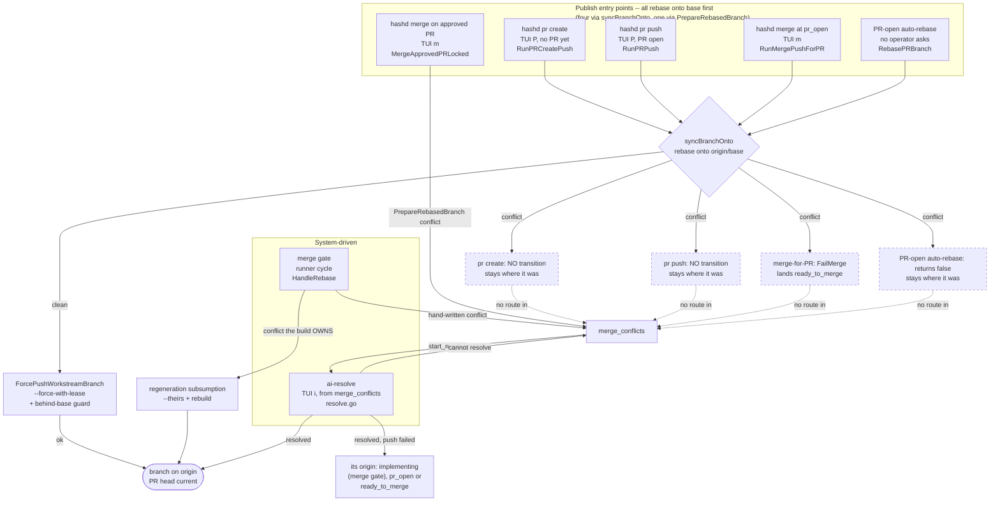

# Diff Viewer with Lineage Integration

## Problem

The current diff panel in the TUI (`d` key) fetches unified diff text from the hashd-server REST API and can render it with `git-delta` when the client has delta installed. Without delta, it falls back to plain unified diff text.

The TUI must not run git or hashd subprocesses to access repository data or mutate workflow state. Local render subprocesses are different: delta is a terminal formatter over REST-fetched text, not a git operation. That client-side formatter carve-out is allowed; data/action subprocesses remain forbidden and must stay behind REST.

The goal is to evolve the diff experience across four incremental steps, from "prettier output" to "select a line and trace it back to the requirement that produced it." The realistic target is Step 2.5. Steps beyond that are documented for future direction.

---

## Optional Client Dependency: delta

Enhanced rendering is built on [delta](https://github.com/dandavison/delta) (git-delta), a Rust-based diff renderer that provides:

- **Syntax-aware highlighting**: Understands the language of the changed file (Python, Go, JS, etc.), not just the diff format.
- **Word-level diff**: Highlights exactly which characters changed within a modified line.
- **Function context in hunk headers**: Shows which function a change is inside.
- **Line numbers**: Configurable side-by-side or inline.
- **Width control**: `--width=N` for precise terminal/panel width formatting.
- **Side-by-side mode**: `--side-by-side` for two-column comparison when terminal width allows.

### Why not a Python library?

- **pygments**: Excellent syntax highlighting but no diff awareness. Cannot highlight a diff with the underlying language's syntax simultaneously.
- **difflib** (stdlib): Generates diffs but renders them as plain text. No syntax highlighting, no word-level change detection.
- **rich.syntax**: Beautiful syntax highlighting for single files via pygments, but has no diff mode.
- None of these can produce word-level change highlighting within a diff. Delta is the only tool that does this well in the terminal.

### Installation

Delta is an optional client-side dependency for the TUI diff panel.

| Platform | Install command |
|----------|----------------|
| Arch Linux | `pacman -S git-delta` |
| macOS | `brew install git-delta` |
| Ubuntu/Debian (24.04+) | `apt install git-delta` |
| Older Ubuntu/Debian | Download `.deb` from GitHub releases |
| Any (Rust) | `cargo install git-delta` |

If delta is not found on the client PATH, the diff panel still renders the REST-fetched unified diff. Delta only adds syntax highlighting, word-level markers, and side-by-side mode.

### Configuration

hashd controls delta's output via explicit flags, not the user's `~/.config/delta/` or `.gitconfig` settings. This ensures consistent rendering across machines. Key flags used:

| Flag | Purpose |
|------|---------|
| `--paging=never` | No pager -- output captured for the TUI panel |
| `--width=N` | Match the TUI panel width or terminal width |
| `--no-gitconfig` | Ignore user's delta theme to ensure consistent display |
| `--side-by-side` | When explicitly requested and width permits |

---

## Step 1: Delta Rendering

### Goal

Replace the manual Rich coloring in the diff panel with delta-rendered output. Same diff, much better presentation.

### What changes

**`detail_git.py`**: The current `get_diff_content()` function fetches raw unified diff text via REST. When delta is installed, it pipes that text through delta. When delta is missing or fails, it renders the unified diff directly. The function accepts a `width` parameter so delta can format to fit the panel.

**ANSI to Rich conversion**: Delta outputs ANSI escape sequences (24-bit color). Textual's `Static` widget renders Rich markup, not raw ANSI. The bridge is `rich.text.Text.from_ansi()`, which converts ANSI escape sequences into a Rich `Text` object that `Static` can render directly.

**`detail.py`**: The `_update_diff_panel()` method currently calls `get_diff_content()` and passes the result as a markup string. It needs to:
1. Determine the actual rendered width of the diff panel (`self.query_one("#panel-diff").size.width`).
2. Subtract a margin for the scrollbar and padding.
3. Pass that width to the delta rendering function.
4. Set the `Static` widget's content to the resulting `Text` object.

On terminal resize, Textual fires a `Resize` event. If the diff panel is active, re-render with the new width.

**`README.md`**: Document delta as an optional TUI diff enhancement.

### Acceptance criteria

- `d` key in TUI shows delta-rendered diff with syntax highlighting, word-level change markers, and line numbers.
- Diff wraps correctly within the panel with no horizontal overflow.
- Terminal resize re-renders at the correct width.
- Missing delta binary falls back to unified diff rendering with an optional install hint, not a crash.

### Risks

- `Text.from_ansi()` handling of delta's 24-bit ANSI output needs testing. Rich supports it, but edge cases are possible with delta's box-drawing characters and line-number decorations.
- Delta's `--width` controls line wrapping. Need to determine the right margin to subtract for Textual's scrollbar and padding (likely 2-4 characters).

---

## Step 2: File Tree Navigation

### Goal

When viewing a diff, show a navigable file list with per-file +/- line counts. Selecting a file scrolls the diff to that file's section. The left column becomes context-aware, showing different content depending on the active panel.

### Left column context switching

The left column currently always shows the status box (top) and microcommit list (bottom). With this change, the bottom half becomes context-aware:

| Active panel | Left column bottom half shows |
|---|---|
| review | Microcommit list (current behavior) |
| log | Microcommit list (current behavior) |
| timeline | Microcommit list (current behavior) |
| diff | File tree with +/- stats |

When the user presses `d` to enter the diff panel, the left column replaces the microcommit list with the file tree. When the user switches to any other panel (`v`, `l`, `L`, `t`), the microcommit list returns.

### File tree widget

A list of files changed in the diff, each showing the filename and insertion/deletion counts. Data comes from the server's diff REST endpoint, backed by numstat data, and returns entries like `42  8  handlers/job.go` (additions, deletions, filename).

Display format per item:

```
handlers/job.go                  +42 -8
internal/db/queries.go           +12 -3
cmd/server/main.go                +5 -0
```

Green for the `+N`, red for the `-N`. Files are listed in the order they appear in the REST diff.

The list is flat, not a directory tree. Workstream diffs typically touch 5-20 files. A directory tree adds complexity without significant benefit at this scale. If diffs routinely grow larger, revisit this.

### Scroll anchoring

When the user selects a file in the file tree and presses Enter (or clicks), the diff panel scrolls to that file's section. This requires knowing where each file's diff starts within the rendered output.

Approach: Parse the raw REST-fetched unified diff text before piping through delta to identify file boundary positions (lines starting with `diff --git`). Map those to line offsets in the rendered output. When a file is selected, scroll the `VerticalScroll` container to the corresponding offset.

### Per-commit diff (smart `d` behavior)

The `d` key gains context awareness based on the currently highlighted microcommit:

| Context | `d` asks the server for |
|---|---|
| No commit highlighted | `scope=story` -- the whole story |
| The micro-commit the server is working | `scope=current` |
| A micro-commit that has landed | `commit=<micro-commit id>` |
| A pending micro-commit that is neither | `scope=story` |
| `d` again, already in the diff panel | `scope=story` |

Which micro-commit is being worked is the server's answer, read off the
`current` range's `scope.microcommit_id` on `/workstreams/{id}/changes` -- the
same field the status box labels its second size line with, so the box and the
panel never name different micro-commits. The microcommit list's own
in-progress marker is not used for this: it marks the first unticked entry
whether or not a runner is live, and a fully ticked plan whose last entry is
still in review has no such entry at all. A highlight the server's selection
does not match, and a plan whose selection it could not name, leave the story
total -- the honest superset rather than a guess at a narrower range.

Both headers name the range on screen: the diff panel's border title reads
`Diff (Story)` or `Diff (COMMIT-JOB_DRAFT_SAVE-003)`, and the file list's reads
`Files (...)` with the same name. Both come from the `scope` echo on the read
that produced what is displayed, never from what was asked for -- a
`scope=current` the server could not bound is answered with the whole story,
and both headers then read `Story (in place of COMMIT-JOB_DRAFT_SAVE-003)`
rather than reporting a branch total as one micro-commit's work. An empty
answer says which range came back empty, with the server's own reasons: "No
changes in COMMIT-JOB_DRAFT_SAVE-003 yet." rather than a bare "No changes vs
base".

The file list is driven from the same selector as the panel, so a file it lists
is a file the panel below it will show.

The full view's starting point is the branch's live fork point with its base branch, not the `base_sha` recorded at provisioning. The two differ once the branch is rebased: `base_sha` is a provisioning record that no rebase advances, so a range spelled from it would report everything the base branch gained in the meantime as this workstream's own work. The server falls back to the recorded `base_sha` whenever there is no fork point to derive, or none it can trust: no base branch ref to resolve, a branch its base already contains, a workstream in a terminal state (merged, closed and closed-without-changes rows are never probed, so they report exactly the range they always did), or a recorded base that `origin/<base>` has not caught up with, where the derived point would sit *behind* the record and widen the range instead of narrowing it. That is the usual state right after provisioning, which pins `base_sha` from its own fetch of origin and moves neither `origin/<base>` nor the local base branch; a `base_sha` recorded from a local base branch with unpushed commits does the same.

To get a per-commit diff, the TUI sends the micro-commit's id and the server
resolves which commits it landed (`commit=<id>`, api/read_diff_microcommit.go):
the range runs from the parent of the earliest of them through the latest, so a
micro-commit that landed several commits reports all of them. No client looks a
SHA up for an id -- a second copy of that rule client-side is one that can
disagree with the server's, and `SHA~1..SHA` is only ever right while a
micro-commit lands exactly one commit.

### TUI diff scopes

| Usage | Behavior |
|-------|----------|
| `d` with no microcommit highlighted | `scope=story`: everything this workstream has produced, landed or not |
| `d` on the micro-commit being worked | `scope=current`, falling back to the story when the server cannot bound it |
| `d` on a landed microcommit | `commit=<micro-commit id>`: the range its commits occupy |
| Highlight a file in the diff file list | That file alone, within the range above |
| `s` | Side-by-side mode (delta `--side-by-side`, when installed) |
| `h` | Hunk selection, over the same range |

Every one of these is one query parameter on `/workstreams/{id}/diff`, resolved
by the range rule both diff endpoints share -- the same rule `hashd diff
--scope story` and `--scope current` go through, so the CLI and the TUI
describe one range rather than two that drifted. Hunk selection, fullscreen and
side-by-side compose over whatever text the range produced.

The lineage view (`I`) reads at branch state whichever range is on screen. Its
endpoint (`/workstreams/{id}/blame`) takes a hex revision alone, and narrowing
it to a micro-commit would mean teaching it the id -- which this arc does not
do.

### Status box change sizes

The left column's status box reports how big the work is, on two lines:

```
Changes: Story +142/-37
  COMMIT-JOB_DRAFT_SAVE-004 (in progress) +58/-12
```

Each range's own name is in the value, under one `Changes:` key -- the label
column `hashd show` puts them in. The box's `Story:` line is the story id, and a
range named in that position would read as a second answer to that question.

`Story` is everything the workstream has produced since its branch began --
landed commits, uncommitted edits to tracked files, and untracked non-ignored
files -- as one range. The second line is the same content narrowed to the
micro-commit the server says is being worked, labelled with that micro-commit's
id and the state of its plan entry (`in progress`, or `done` once its box is
ticked -- ticking it does not move the selection, because review, the qa gate
and the commit leg still run on that micro-commit).

Both numbers come from the `story` and `current` summaries on
`GET /workstreams/{id}/changes`, which the server measures through the same
range resolution `hashd diff --scope story` and `--scope current` use, so the
box and the CLI describe one range rather than two that drifted. Each line is
rendered from the `scope` echo beside the counts and never re-derived
client-side:

- `current` is the in-progress entry of `microcommits` below. When that entry
  could not be measured -- its commits rewritten off the branch, no provable
  start -- or no entry is in progress (no selection, a selection no longer in
  the plan), `current` has zero counts, a one-line `unavailable` and the full
  `unavailable_detail`, and prints `<id> not measured -- <reason>`. It never
  carries the story total, and `scope.fallback` is never set on `/changes`,
  so a branch total is never printed under one micro-commit's name;
- a range measured without the working tree (a reclaimed worktree) says so;
- a range the server could not measure at all -- no usable recorded base, no
  readable source or tip, a git or database fault -- carries `unavailable` and
  prints `not measured -- <reason>` rather than `+0/-0`, which is a measured
  answer about a branch with no work.

The same response carries `microcommits`: every plan entry, in plan order, with
its own size, so per-micro-commit size is readable as the operator moves through
the plan. Each entry has an `id`, a `state` (`in_progress` when it is the
recorded selection, box ticked or not -- review, the qa gate and the commit leg
still run on it until the selection moves on; `done` when its box is ticked;
`not_started` otherwise) and `added` / `deleted`:

- a `done` entry measures the range its landed commits occupy -- the numbers
  `/diff/changes?commit=<id>` reports;
- the recorded selection measures the `current` range, working tree included
  (`uncommitted_included`). With the worktree reclaimed it keeps its committed
  counts and sets `uncommitted_unavailable`;
- an entry that could not be measured -- its commits rewritten off the branch,
  no provable start for the selection, a git fault -- carries a one-line
  `unavailable` and the full `unavailable_detail`, with zero counts. It never
  takes the story total, which is what `/diff`'s `scope=current` serves under
  a fallback;
- a `not_started` entry reads no git and reports `unavailable: not started`.

Neither line is the uncommitted range: `git diff HEAD` empties every time the
runner commits, so a headline measured from it says nothing at the moment a
micro-commit finishes. Both ranges above end at the workstream's content,
committed or not. The details panel's "Pending Changes" block is where the
uncommitted range is read, labelled as uncommitted and not as a headline. A
stopped runner and a fully done plan both keep the last selection on screen
rather than blanking the line.

#### Measured cost of one `/changes` read

Wall time of one `GET /workstreams/web_story_import/changes?project=hashd`
read, before and after the `microcommits` list:

| Revision | Median | Range (10 warm reads) |
|---|---|---|
| Before: `37d5f804b0eb3c7c323701d50ca74f214a410dc2` | ~90 ms (90.4) | 83.1-100.2 ms |
| After: COMMIT-MC_LOC_LIST-FIX-001 tree, committed as `94e86f51764621fe7680d5a4a39e411e3e704db6` | ~118 ms (118.3) | 104.4-130.1 ms |

Method: taken 2026-09-27 during the FIX-001 implement run. The live hashd
project DB was copied with `sqlite3 .backup` into a scratch ops directory. A
temporary Go test in `server/internal/api` built the API server over that
snapshot (`New(db.NewPool(ops), ops, ...)` with the test emitter, CBM and
Temporal fakes), sent the read 11 times through the in-process handler,
dropped the first as warm-up and timed the other 10. The same test file and
snapshot ran at both revisions, the before one in a detached temporary
worktree; the test file, worktree and snapshot were deleted afterwards. The
live server was not restarted or used.

Limitations: one workstream, one host, one run of 10 reads per revision, no
concurrent load. The after figure was taken on the FIX-001 working tree on top
of `ee44e8a49dbd70b7b436760daebfa06717363846` before the commit step wrote it
as `94e86f517`, with no further edits in between. web_story_import is merged
with its worktree reclaimed, and has 8 plan entries: 7 `done` entries all
refused as rewritten off the branch (each after the full `commit=<id>`
resolver runs, so no per-entry `git diff` was timed) and the selection
refused for an unproven start. The ~28 ms added is that per-entry
resolution; a workstream whose done entries resolve also pays one
`git diff --raw --numstat` per entry, which this measurement does not cover.

### TUI keybinding additions (diff panel active)

| Key | Action | Notes |
|---|---|---|
| `s` | Toggle side-by-side / unified | Only shown when diff panel is active and git-delta is installed. |

### Acceptance criteria

- Left column switches to file tree when diff panel is active, switches back when leaving.
- File tree shows all changed files with green +N and red -N counts.
- Selecting a file scrolls the diff to that file's section.
- Highlighting a microcommit then pressing `d` shows that commit's diff.
- Pressing `d` with no commit highlighted shows the full workstream diff.
- A header in the diff panel indicates what is being viewed.
- `s` toggles side-by-side mode when git-delta is installed.

### Design decisions

- **Flat file list vs directory tree**: Flat. Revisit if workstream diffs regularly exceed 30 files.
- **Side-by-side minimum width**: 80 characters. Below that, unified mode is forced with a notification.
- **File tree replaces vs overlays microcommit list**: Replaces. The two lists serve different purposes and showing both would crowd the already-limited left column.

---

## Step 2.5: Line Selection and Lineage Lookup

### Goal

Select a line or range of lines in a file and query hashd's lineage data to answer: who wrote this, which story produced it, what prompt generated it, what review approved it, and what human decisions shaped it.

This is where hashd's unique value becomes visible. Anyone can render a diff. Tracing a line of code back through the full chain -- requirement to story to prompt to agent to review to approval -- is what no other tool does.

### Prerequisite: Lineage query API (DONE)

LINEAGE.md Phase 3 landed in PR #85. The full CLI and data layer already exist:

- **`hashd lineage <file> [--line N] [--lines N-M]`** -- file blame -> commit -> story chain
- **`hashd lineage <sha>`** -- commit -> story/reviews/human decisions
- **`hashd lineage STORY-XXXX`** -- story -> all commits/reviews/decisions
- Output formats: `--format table` (default), `json`, `markdown`

Key functions already implemented:
- `git_blame()` in `orchestrator/git/branch.py` -- porcelain output for machine parsing
- `get_commit_row()` in `orchestrator/lib/db.py` -- single commit lookup by SHA
- `list_commits_by_story()` / `list_commits_by_workstream()` in `db.py` -- batch queries
- `_parse_blame_shas()` in `orchestrator/commands/lineage.py` -- extracts unique SHAs from blame output
- `_lineage_file()` / `_lineage_commit()` / `_lineage_story()` -- the three query pipelines

The query pipeline (already working):

```
Selected lines in a file
  -> git blame -L start,end -- file  (porcelain format)
    -> SHA per line (deduplicated, order preserved)
      -> commits table lookup: SHA -> story_id, microcommit_id, run_id
        -> stories table: story title, source_refs (requirement text), origin
        -> reviews table: decision, confidence
        -> events table: human decisions
```

If a SHA is not found in the commits table (pre-hashd code, manual edits, or external contributions), the lineage display shows "untracked" for those lines. This is expected and not an error.

**What Step 2.5 adds**: The TUI integration. The CLI pipeline exists; this step wraps it in a lineage view widget with navigation, line selection, and a lineage detail modal.

### TUI: Lineage view

When the diff panel is active and a file is selected in the file tree, a new keybinding becomes available:

| Key | Action |
|---|---|
| `I` | Show lineage view for the selected file |

The lineage view replaces the diff content in the right panel with enriched per-line commit attribution:

- Full file content with line numbers and syntax highlighting.
- Each line annotated with its commit SHA and microcommit ID.
- Lines are grouped by commit -- consecutive lines from the same commit share a single annotation block rather than repeating the SHA on every line.
- Color coding: different commits get different muted background colors for visual grouping.

Navigation in the lineage view:

| Key | Action |
|---|---|
| Arrow up/down | Move through lines |
| Enter | Show lineage detail for the current line's commit |
| Escape | Return to diff view |

### Lineage detail display

When the user presses Enter on a line in the lineage view, a modal shows the full lineage chain for that line's commit:

```
Line 42 of handlers/job.go

Commit:       a1b2c3d -- Add job draft save handler
Story:        STORY-0023 -- Job Draft Save
Microcommit:  COMMIT-JOB_DRAFT_SAVE-003 -- Implement save endpoint
Prompt:       implement
Review:       Approved (confidence: 0.92)
Run:          run_20260311_143022
Requirement:  "Users should be able to save job drafts and resume editing later"
```

If the commit has been through multiple review cycles (rejected, then approved), the modal shows the final review decision and notes the retry count.

The modal has a keybinding to open the full story transcript (`o`), which switches to the transcript panel filtered to that run.

### CLI: `hashd lineage` (already implemented)

Landed in PR #85. The TUI lineage view reuses the same query functions from `orchestrator/commands/lineage.py` -- specifically `_parse_blame_shas()`, `get_commit_row()`, and the story/review enrichment logic. No new CLI commands needed for this step.

The TUI lineage view may need a richer return type than the CLI formatters produce. If so, extract the enrichment logic from `_lineage_file()` into a shared function that both the CLI formatter and the TUI widget can call, returning structured data rather than printing directly.

### TUI keybinding summary (when lineage view is active)

| Key | Action |
|---|---|
| `I` | Toggle lineage view on/off for the selected file |
| Up/Down | Navigate lines in lineage view |
| Enter | Show lineage detail modal for current line's commit |
| Escape | Return to diff view |

### Acceptance criteria

- Pressing `I` on a file in the file tree shows an enriched lineage view with commit annotations.
- Navigating to a line and pressing Enter shows the full lineage chain in a modal.
- The modal displays story, microcommit, review decision, prompt template, and requirement text.
- Lines not in the commits table show "untracked" gracefully.
- CLI `hashd lineage` already works (PR #85). TUI lineage view reuses the same query layer.

### Design decisions

- **Lineage view vs line selection in diff**: Lineage view. A dedicated lineage view is simpler than adding line selection to the diff panel. The diff shows what changed; lineage shows why a line exists. These are different questions with different optimal displays.
- **Lineage keybinding**: `I` for lineage. Lowercase `l` and uppercase `L` are already used by Log and Transcript.
- **Modal vs panel for lineage detail**: Modal. The lineage detail for a single line/commit is a focused lookup, not something you browse continuously. A modal overlay keeps the lineage view visible underneath for context.

---

## Step 3: Commit Browser (future)

### Goal

Browse all files in the repository, select a file, see a list of commits that touched it, select a commit, see its diff. Also the reverse: browse commits, select one, see files, select a file, see the diff.

This is the "full code archaeology" experience. Not scoped for current implementation but documented for direction.

### Navigation model

Two entry points, both reaching the same destination:

**File-first**: Browse file tree -> select file -> see commit list for that file -> select commit -> see diff for that file in that commit.

**Commit-first**: Browse commit list (all workstream commits) -> select commit -> see file list -> select file -> see diff.

Both paths end at the same view: a single file's diff in a single commit, with lineage information available via `b`.

### How it differs from Step 2

Step 2 shows files changed in the current workstream diff (base..HEAD) or in a single microcommit. Step 3 shows the full git history for any file or commit, regardless of which workstream produced it. This requires navigating across workstreams and stories, not just within the current one.

### Prerequisites

- Steps 1, 2, and 2.5 complete.
- LINEAGE.md Phase 3 queries working across workstreams.
- Performance consideration: `git log --follow` for file history can be slow on large repos. May need caching or background loading.

---

## Implementation Order

| Step | Depends on | Scope | New CLI commands | New TUI keys |
|------|-----------|-------|-----------------|-------------|
| 1 | delta installed | Small | None | None (existing `d` key, better output) |
| 2 | Step 1 | Medium | None | `s` (side-by-side toggle) |
| 2.5 | Step 2 | Medium | None (CLI `hashd lineage` already exists, PR #85) | `I` (lineage) |
| 3 | Step 2.5 | Large | Extensions to `hashd diff` and `hashd lineage` | TBD |

---

## Files Touched (estimated)

| File | Steps | Nature of change |
|------|-------|-----------------|
| `packages/hashd-tui/src/hashd_tui/watch/detail_git.py` | 1, 2 | Replace diff rendering with delta, add file stat parsing |
| `packages/hashd-tui/src/hashd_tui/watch/detail.py` | 1, 2, 2.5 | Panel width passing, left column context switching, lineage view, keybindings |
| `packages/hashd-tui/src/hashd_tui/watch/detail_display.py` | 2, 2.5 | File tree widget, lineage view widget |
| `packages/hashd-tui/src/hashd_tui/watch/base.py` | 2 | Possible new cached list widget for file tree |
| `orchestrator/commands/lineage.py` | 2.5 | Refactor enrichment logic into shared function for TUI reuse (already exists from PR #85) |
| `packages/hashd-tui/src/hashd_tui/watch/detail_lineage.py` (new) | 2.5 | TUI lineage view widget and lineage detail modal |
| `README.md` | 1 | Document delta as optional |
| `WF.md` | 1, 2, 2.5 | Document new keybindings |

---

## Relationship to LINEAGE.md

This document covers the **user-facing diff and lineage experience**. LINEAGE.md covers the **data model, query API, attestation export, and compliance story**.

LINEAGE.md Phase 3 (query commands) landed in PR #85. The `hashd lineage` CLI command, `git_blame()` function, `get_commit_row()`, `list_commits_by_story()`, and `list_commits_by_workstream()` are all implemented and tested. The diff viewer's lineage view (Step 2.5) is the first TUI consumer of this query layer.

The key integration point is the enrichment logic in `orchestrator/commands/lineage.py`. Currently it formats directly to stdout (table/json/markdown). For the TUI lineage view, we need the same enrichment as structured data. Step 2.5 will refactor the shared parts into reusable functions that both the CLI formatters and the TUI widget can call.

---

## Open Questions

1. **Delta theme**: The TUI currently passes `--dark` for stable output. If delta's default colors clash, upgrade to a custom theme (`--plus-style`, `--minus-style`, `--syntax-theme`) -- but note delta outputs ANSI, not CSS variables, so it's always an approximation.

2. ~~**Large diffs**~~: Resolved -- truncation limit set to 10,000 lines. Paginate if this becomes a real problem.

3. ~~**Side-by-side width threshold**~~: Resolved -- 80 characters effective panel width. Auto-disables on resize below threshold.

4. ~~**Lineage view performance**~~: Not a concern. Benchmarked at ~120ms for a 4k-line file with real history. 10k-line files would be ~300ms, well within the 5s git timeout.

5. ~~**Cross-worktree lineage**~~: Resolved -- lineage lines show workstream ID per SHA group. Lineage modal shows full workstream/story/review chain.

### Rebase Resolution Safeguards

The resolve flow also narrates itself: checkpoint `stage_changed` events (rebase attempt, conflicts found + agent, build verification, push) and a completion `operation_result` whose detail names the outcome (commits rebased, files resolved, attempts, build-gate verdict).

Automated rebases at the merge gate and in AI conflict resolution never
silently overwrite work. Five rules enforce that:

- **rerere is disabled on every machine git invocation.** git's "reuse
  recorded resolution" cache is a human convenience; in an automated
  pipeline it is a contamination channel -- one bad machine resolution is
  memorized and replayed, unverified, into every later rebase with the same
  conflict shape. Every merge-core git call (and the baseline-gate recovery
  rebase) runs with `-c rerere.enabled=false`, a per-invocation flag that
  never touches the operator's repo config.

- **The regeneration-subsumption leg resolves only what the build owns.**
  When a rebase conflict is generated-artifact noise (lockfiles, codegen
  output), the gate accepts `theirs` -- the branch's own copy of the
  artifact -- and lets the build re-derive the canonical content at the
  rebased tip. It qualifies a conflicted path *before* overwriting it, on the
  clean pre-rebase tree, by asking whether the build **owns** it, not merely
  whether the build *changed* it: the build runs on the intact tree (so its
  output for each conflicted path is known), the paths are removed, and the
  build runs again -- a path the build recreates from nothing with exactly
  the bytes it produces is owned (an artifact already in sync is rewritten
  byte-identical, invisible to a status delta). A path the build does not
  recreate is hand-written (a formatter that rewrites a source in place
  cannot recreate it from nothing); a path it recreates with *different*
  bytes is a scaffold (a template copied over a missing file) and the
  branch's content is hand-authored -- neither is owned, the whole batch
  parks for a human, and those paths are never given `--theirs`. The same
  question is then asked on the base tree (`ConfirmOwnedOnBase`, which
  populates the tree through the index so HEAD never moves and a kill
  mid-probe leaves an attached branch): main's build must recreate from
  nothing what it produces on the intact base tree, so a copy the build
  preserves rather than produces -- a scaffold whose template equals the
  branch's copy, a renderer that rewrites only when a derived line goes
  stale -- is never taken and main's hand-customized content survives; a
  hand edit an unconditional generator overwrites was already dead on
  main and is regenerated like any artifact. When the batch build
  fails because a removed path was an input, the paths are probed one at
  a time so the park names the input. Only regular blobs
  tracked at the pre-rebase tip are probed, so a removal never follows a
  symlink out of the worktree; the rollback that restores the tree runs
  detached from cancellation, and a cancelled gate surfaces the bare
  context error instead of a park. The probe is only as strong as the
  build's own staleness logic: an output a task runner still considers up
  to date while it is missing reads as not owned and parks -- conservative,
  never unsafe -- so generators must declare every output they emit by
  name (hashd's `generate:sqlc` lists each `*.sql.go`; a glob does not
  count as missing until it matches nothing). The replay may stop once per
  replayed commit (a stop on a path not yet probed restarts with it,
  bounded by the commit count); a conflict deleted on one side (DU/UD)
  parks rather than being resurrected or dropped. The batch is then
  verified by one build at the rebased tip with every subsumed path
  **removed** first: the build must recreate each of them, so what lands
  is what the build derives from the merged tree -- whether or not that
  happens to equal the branch's copy -- never the taken copy on faith. A
  path the build does not recreate (a scaffold that only copies over a
  missing file, a generator step lost in the merge, a build that deletes
  it) parks, and the tracked paths the build changed are committed as
  `Regenerate after rebase`. Park reasons an operator will meet:
  `conflicted path(s) the build does not regenerate: ...`, `conflicted
  path(s) deleted on one side are not regeneration-subsumable: ... (DU)`,
  `regeneration does not recreate conflicted path(s) at the rebased tip:
  ...`, and the bound guards `stopped more than the N commit(s) it
  replays` / `restarted more than ...`; a failed rollback is appended as
  `; rollback failed: ...`. Every park above, and a tip regeneration build
  that fails, times out or is cancelled, comes before the integration is
  proven and restores the pre-rebase branch. Once the replay has finished
  and the tip regeneration has recreated every taken path with a passing
  build, the integration is proven and the branch stays at it, as a direct
  rebase's does: a post-rebase build or test failure goes to merge-gate
  recovery against that HEAD and a FIX it authorizes runs there, while a
  post-rebase timeout, a missing or unparseable command, a failure to
  stage or commit regenerated files, or a cancellation keeps the
  integration and authorizes no FIX. In the union-merge leg, a conflicted
  path the build rewrote after the union is not a union resolution: it
  bounces to the regeneration-subsumption leg for the two-sided ownership
  proof (a path the build removed parks), while the union-resolved paths
  the build left alone stay union-merged at that stop -- union text never
  reaches history either way. The build's unstaged rewrites of
  non-conflicted paths are discarded before `rebase --continue` (git
  refuses any unstaged tracked change) -- the post-rebase build re-derives
  them at the tip. `server/contracts/openapi.json` is emitted
  line-formatted for the same family of reasons: a one-line artifact
  conflicts on line 1 unconditionally and has no textual merge at all.

- **AI conflict resolution never hands the agent a build-owned conflict it
  reaches, and verifies the build before it blesses a rebase.** The
  resolver applies the same ownership predicate as the merge gate (one
  implementation, `mergeflow.BuildOwnedPaths` + `ConfirmOwnedOnBase`): at
  each stop the core reaches before handing off to the agent, it probes
  the paths it has not yet probed -- on the clean pre-rebase tree for the
  branch's copy and on the base tree for main's copy (a copy main's build
  preserves rather than produces from nothing is never taken; that is
  what refuses a scaffold, including one that rewrites only when a
  derived line goes stale) -- takes the branch's copy
  of every owned path with both sides present (a path deleted on one side
  goes to the agent, logged), and hands the agent only what remains. A
  stop made only of owned paths is resolved with no agent invocation at
  all, and the resolve narrates it (`N build-owned file(s) taken for
  regeneration, not sent to the agent`). Probing is bounded by the commit
  count; past the bound, unprobed paths go to the agent. Once an agent is
  handed a stop, the later stops are the agent's: it completes the rest
  of the rebase itself (its prompt says so), a path first seen at a later
  stop goes to it unprobed, and the rebase is never aborted around its
  work -- the tip regeneration is the backstop for every generated
  artifact it touches. Once the rebase is complete, every taken path is
  removed and the build runs on the tip and must recreate each of them
  from the merged tree (the same proof the gate requires; a path the
  build does not recreate fails the resolve with `regeneration does not
  recreate conflicted path(s) at the rebased tip: ...` and resets the
  branch -- an agent that regenerated a taken artifact itself is simply
  confirmed by it), and every *tracked* path the build changed --
  including a generated file an agent hand-merged --
  is committed as `Regenerate after rebase` before the branch is verified
  or pushed; untracked strays the build introduced are removed, never
  committed. This runs on every leg that completes a rebase (the clean-
  tree fast path, the no-conflict rebase, and the conflict legs) and is
  that leg's build verification. Without a configured build there is no
  ownership predicate: the agent gets the whole set as before, nothing
  downstream regenerates it, and the merge flow's own post-rebase check
  only enforces the test gate -- configure a build. A clean rebase exit is
  not proof the merged code is correct -- a silent revert or a semantic
  conflict rebases without a marker yet fails to compile -- and a passing
  build is not a licence to publish either, because it is a narrower check
  than the gate: before **any** leg pushes or records the branch as
  succeeded -- the simple-rebase fast path, the per-attempt rebase and the
  post-agent resolution alike -- the **merge gate's own command** runs on
  the rebased tree (required repair checks included; the build is not paid
  for twice when the gate resolves to the same command). With no build
  configured the leg proceeds with a logged caveat. A build or gate command
  that fails is not repaired, reset or relabelled a conflict: the resolve
  launches no agent and commits nothing, stores the failing command, its
  exit code, the tested revision and the complete output as the durable
  post-rebase failure record, and keeps the branch at the resolved revision
  with a clean tree (see
  [semantic breaks](../WF.md#post-rebase-semantic-breaks-merge_test_failed)).
  A failed tip regeneration first drops its own uncommitted edits and the
  untracked files it introduced, so the tree is the resolved commit's. A
  command that returned a verdict establishes the failure, recorded as the
  workstream's current merge-gate failure so its command stays required
  verification, and goes to merge-gate recovery: an authorized ruling
  schedules one planned FIX and hands the workstream to `implementing`, and
  anything else parks at `merge_test_failed`; a timeout, a signal or a
  command that never launched parks there unjudged.
  A preservation of the worktree that fails or cannot be confirmed stops the handoff: the workstream parks at `merge_test_failed` (`resolve_test_failed`) with that failure as its reason, no FIX newly bound and no move to `implementing`.
  A pass of the gate's own command retires the workstream's
  standing post-rebase failure context -- that suite is the whole
  branch's, so it answers every failure recorded against it -- and the
  completion summary names the gate's result. A gate with no command --
  unconfigured, or the operator's explicit `tests_skipped` -- proceeds with
  a logged caveat and announces no verification phase it does not run; the
  merge itself hard-blocks the unconfigured case, which is where the
  operator is told to configure one. A required repair check standing
  against the story is not the gate command and runs under either, so
  neither clearing the command nor skipping the tests retires an obligation
  the gate recorded -- but passing one is not the branch's suite either: it
  publishes, it claims no gate in the summary, and it retires nothing,
  because a workstream's recorded break must not be dropped from the next
  implementer's requirements by one narrow repair check. A verification
  failure is only what those commands report: a push that fails after a
  verified resolution -- a deadline kill, hashd's own refusal, a lease or
  ref rejection, an authentication or transport failure, or a pre-push
  decline with nothing configured to verify, whose worktree could not be
  verified at the pushed revision (HEAD moved off it, or uncommitted
  changes could not be stashed), or that the configured verification does
  not reproduce -- is a publication failure recorded by that kind, with
  the resolved commits kept on the local branch and nothing pushed again.
  It lands where the resolve came from, never `merge_conflicts`:
  `implementing` with the `merge_gate` substage kept for an interrupted
  merge gate, else `pr_open` or `ready_to_merge`. No push or hook output
  is scraped for a command to re-run; a push rejected with no identified
  cause re-runs the configured verification once on the revision it tried
  to publish, and a failure there parks like any other verification
  failure. The local `merge
  --no-ff` retry loop
  (`AttemptMergeWithRetry`, used by the merge flow's local merge) still
  hands every conflict to the agent. Before any of its rebases, the
  resolver confirms the worktree is on the workstream's branch -- `git
  rebase` acts on HEAD, and a worktree parked on another branch would
  have *that* branch rewritten and force-pushed under the workstream's
  name -- and refuses a wrong checkout (a detached HEAD, or another
  branch, named as such), leaving the checkout where it was and parking
  where that leg's failures park; the entry's loss-free debris stash and
  the `rebase --abort` restore still run first, unguarded, so a rebase
  git left in progress from a crashed attempt is cleaned up rather than
  stranded.

- **The publish paths heal build-owned conflicts and park everything
  else.** `hashd pr push`, `hashd pr create`, the merge flow's
  publish-for-PR leg and the PR-open auto-rebase all bring the branch up to
  base through one funnel (`syncBranchOnto`). When that rebase conflicts,
  the funnel replays it through the same ownership predicate the merge
  gate and the AI resolver apply (`RebaseSubsumingOwned`, one
  implementation on `BuildOwnedPaths` / `ConfirmOwnedOnBase` /
  `TakeTheirs` / `RegenerateAtTip`): a conflict confined to paths the
  project's build owns on both sides -- a regenerated `openapi.json` on
  either side of a rebase -- takes the branch's copies, regenerates them at
  the tip, commits `Regenerate after rebase`, and the publish proceeds with
  no human and no agent. A conflict containing any path the build does not
  own, or a path deleted on one side, parks the whole rebase exactly as
  before -- the branch is its pre-rebase tip afterwards with nothing taken
  when the rollback succeeds, and a rollback that fails is named in the
  refusal alongside the path -- and a repo with no build command
  configured parks every conflict, since nothing can prove ownership
  there. A clean rebase never runs a build. The heal runs under a budget
  derived from the project's `test_timeout` (the builds one heal runs,
  each bounded by `test_timeout` or, when it is unset, the runner stages'
  fallback -- the merge gate's own probe builds pass `test_timeout` raw;
  the publish activities' deadlines hold the same budget on top of the
  network bound, once per rebase leg), and a heal that runs out of it
  parks with the reason and the tree restored; a rollback that itself
  fails is named in the reason rather than hidden behind "unchanged". A build that restores files from the index (`git checkout
  -- path`, `git restore path`, a stash pop) cannot make a hand-written
  path read as owned: the probes and the tip proof remove a candidate from
  the index as well as the tree before asking the build to recreate it. A
  build that restores from a named commit (`git checkout HEAD -- path`,
  `git show HEAD:path`, `git reset --hard`) is not caught -- HEAD is the
  branch tip on both probe sides by design -- and reads the same as a
  generator whose output equals the committed copy; that is the one
  remaining way a hand-written path can be taken, and a build that does
  it is broken for every other reason first.

- **A merge-gate repair is admitted only on its failure's checkout.** The runner gate's claim and bind, an answered recovery question's bind and hand-off, AI resolve's recovery, append and hand-offs, and a run's pickup of a bound FIX all run one read-only check: the workstream's branch, no operation in progress, no unmerged paths, HEAD at or descended from the failure's tested revision or a later integration a hashd record names, and no working change except at a path that had none when the same execution's verification began. A refusal changes neither the checkout nor the repair record and parks where the route parks (see [semantic breaks](../WF.md#post-rebase-semantic-breaks-merge_test_failed)).

## Publish path implementation

## Publish and Conflict Resolution Paths

The [State Diagram](../WF.md#state-diagram) shows which transitions exist. This section
shows the part that is not derivable from the FSM: which code path runs
for each operator verb, where a branch lands when that path cannot
complete, and which arrows a client can actually pull.

Five entry points put a workstream branch on origin, plus two that
resolve conflicts. Four of the five rebase through `syncBranchOnto`:
`pr create`, `pr push`, merge-for-PR, and `RebasePRBranch`
(`pr_workflow.go:493`) -- the PR-open auto-rebase, the one that runs
without an operator asking, which is why it is the easiest to leave out
of an inventory.

The fifth is `MergeApprovedPRLocked` (`pr_workflow.go:584`), `hashd
merge` on an approved PR. It rebases onto base too, but through
`PrepareRebasedBranch` rather than `syncBranchOnto`, and that is why it
lands differently from every other operator path: a conflict there
transitions to `merge_conflicts` instead of leaving the workstream where
it was.

They do not share failure routing, and that asymmetry is the source of
most "I have approved work and no legal move" states.

### The paths



The dashed edges are the gap: `merge_conflicts` is the state whose
purpose is conflict resolution, and no publish verb routes into it. One
operator edge does reach it solid -- `MergeApprovedPRLocked`, `hashd
merge` on an approved PR, whose pre-merge rebase transitions there. It is
the only operator route that *enters* the state from outside.

ai-resolve also has a solid edge back into `merge_conflicts` and is also
an operator verb (`i`), but it is reachable only from that state to begin
with, so it returns rather than enters. Every operator route that starts
outside `merge_conflicts` and hits a conflict is dashed, except the
approved-PR merge.

## Publish guard implementation

### Invariants the publish paths enforce

- **A workstream whose branch is on an open PR is in a PR state.**
  Publishing is what makes a workstream await PR review, so the state has
  to say so -- and it is status, not `pr_number`, that the PR operations
  are gated on: `available_actions` is derived from the FSM, and the
  TUI's reject fetches the PR's review threads only from a PR state. The
  publish paths that do work maintain this. The ones that return early
  because there is nothing to do -- `pr create` finding linkage already
  present, `pr push` finding the branch at head parity -- are publishes
  too, and reconcile before returning (`fsm.ReconcilePRTracking`). A
  short-circuit that skipped it left the operator holding a PR that no
  verb could reach, with the PR line still rendering because display
  keys on `pr_url`.
- **Never push behind base.** `ForcePushWorkstreamBranch` refuses when
  `origin/<base>` is not an ancestor of the branch. This is hashd's own
  ancestry check, not the repo's pre-push hook: a repo with no hook gets
  the same protection. Paths that publish a possibly-stale branch rebase
  onto base first and pass the guard; the commit-stage auto-push, which
  must not rebase, refuses loudly.
- **Never rebase an unverified checkout.** `git rebase` acts on HEAD, not
  on a named branch, so a worktree parked on another branch has THAT
  branch rewritten. The guard lives inside `syncBranchOnto`, which takes
  the branch being published as a required parameter and refuses before
  any fetch when the checkout is not on it, naming what it is actually
  on. Because the parameter is required, the compiler enforces the guard
  at every call site: a new caller cannot be added unguarded. The four
  paths that publish through the primitive -- `pr create`, `pr push`,
  merge-for-PR and `RebasePRBranch` -- are covered by that alone.

  The fifth, `MergeApprovedPRLocked`, does not route through it: it
  rebases via `PrepareRebasedBranch`, which appears in the table below as
  a site that answers for itself and does so twice. So the compiler
  argument covers four of five paths, and the fifth is covered by a guard
  the table has to keep verifying by hand.

  Four sites rebase outside the primitive with a direct
  `RunGit(..., "rebase", <ref>)`, so the compiler cannot reach them and
  each answers for itself:

  | Site | Reached from | Guarded |
  |---|---|---|
  | `mergeflow/resolve.go` | ai-resolve | yes |
  | `mergeflow/pre_validate.go` | `hashd merge`, via `PrepareRebasedBranch` | yes, twice -- before `syncBranch`'s `pull --ff-only` and again before the rebase |
  | `runflow/mergegate_rebase.go` | the merge gate, via `HandleRebase` | **no** |
  | `runflow/mergegate_regen.go` | the merge gate's regeneration retry | **no** |

  The two guarded ones share a `wrongCheckout` helper rather than
  repeating the `symbolic-ref` call -- searching for the raw git command
  under-reports the coverage.

  The two gate sites are unguarded. The gate runs inside the runner
  cycle on a worktree the runner owns, which makes a foreign checkout
  less likely than on a publish path -- but that is the same reasoning
  that was wrong about the publish paths, where the hazard was proved by
  test (publishing one branch rewrote another). `pr_create.go` no longer
  needs its own guard: it inherits the primitive's.

- **Never force-push the default branch**, and never with a bare
  `--force`. The expected remote SHA is resolved before the push: from
  the existing `origin/<branch>` tracking ref when there is one, so a
  colleague's concurrent push cannot be overwritten. When that ref is
  missing, `ForcePushWorkstreamBranch` fetches the branch once and primes
  the lease from the fetched tip -- it trusts the remote's current state
  exactly once, which is weaker than a lease held from a ref that was
  already local, and is the reason a deadline-killed fetch surfaces as a
  timeout rather than falling through to the empty-expected form. Absent
  from the remote, the lease uses `<branch>:` and requires the ref to not
  exist. Fetching base never updates `origin/<branch>`, so the base
  refresh does not disturb the snapshot.
