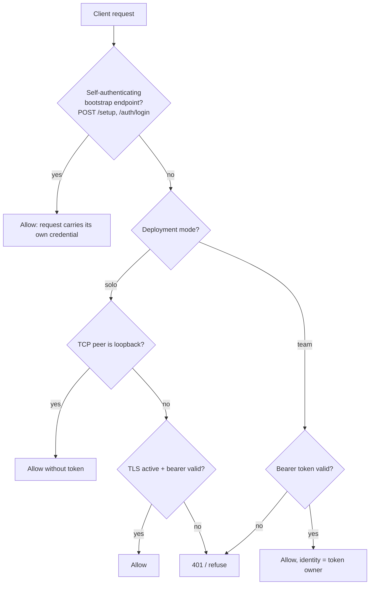

# Remote and Team Servers

Hashd is a client (`hashd`, `hashd watch`) talking to a server (`hashd-server`).
By default both run on your machine as one implicit user with no auth ceremony --
that is [QUICKSTART](../QUICKSTART.md), and if you are a solo developer on your
own box you do not need anything here.

This document is for the other shape: **one `hashd-server` that clients connect
to over the network** -- your laptop driving a box in the closet, or a shared
team server. It covers the trust model, how the operator turns a local install
into a reachable server, how users are provisioned, and how a client pairs.

There is also a third, unmanaged shape -- several solo developers sharing one git
repo with no server -- described at the end under
[Solo shared-repo mode](#solo-shared-repo-mode).

## How trust works

When `hashd-server` listens on anything other than loopback, two things switch on
automatically:

- **TLS.** The server serves HTTPS using a self-signed certificate it generates
  once and persists at `<ops-dir>/tls/server.{crt,key}`. There is no CA to
  configure.
- **Auth.** Every request -- `/health` included -- requires a per-request bearer
  token. Off-loopback fails closed: no token, no answer.

Clients do not trust the self-signed certificate through a CA. Instead, the
certificate's fingerprint is carried **inside the bearer token** the server
mints. When a client pairs with `hashd server set <url> --token <token>`, it
extracts that fingerprint and pins it: the connection is trusted only if the
server presents exactly that certificate. So a single relayed token establishes
both identity (the bearer secret) and transport trust (the pinned fingerprint) --
no separate certificate exchange.

(If you front the server with your own CA-signed certificate by hand-launching
`hashd-server --tls-cert-file ... --tls-key-file ...`, standard TLS verification
applies and no fingerprint pin is used. The managed `hashd restart` path always
uses the automatic self-signed certificate.)

## Scripting hashd over SSH: use a login shell

The installer wires `PATH` from `~/.bashrc` / `~/.zshrc`. Those are **interactive**
shell files: a stock Debian/Ubuntu `~/.bashrc` opens with a guard that returns
immediately when the shell is not interactive, so anything appended below it never
runs — and that guard fires under `bash -lc` too, because a login shell is still
not an *interactive* one.

**Use absolute paths in scripts.** That is the only form that holds regardless of
distro or shell:

```bash
ssh box 'hashd list'                      # hashd: command not found
ssh box '~/.local/bin/hashd list'         # reliable
ssh box '~/.hashd/tools/bin/gh pr list'   # reliable
```

`bash -lc` is not a portable substitute, and the two directories behave
differently under it:

- `~/.local/bin` (where `hashd`, `wf`, `ha` live) is added by *many* distros'
  stock `~/.profile`, which a login shell does read — so `ssh box 'bash -lc "hashd
  list"'` often works, but because of the distro's profile, not because of
  anything hashd installed. On an image whose `~/.profile` lacks that stanza it
  fails.
- `~/.hashd/tools/bin` (the bundled `gh`, `gitleaks`, `delta`, Temporal binaries)
  is wired **only** from the interactive rc files, so it is absent under `bash -lc`
  on every distro.

If you want `bash -lc` to work uniformly, add the PATH entries to a login profile
(`~/.profile`) yourself; the installer deliberately does not edit login profiles.

## Server operator: make the server reachable

Run these on the **server host**. A fresh install already runs on loopback
(`http://127.0.0.1:1337`), so start there.

1. **Mint yourself an owner token** (over the loopback connection, where no token
   is needed yet):

   ```bash
   hashd auth create --description "server host"
   ```

   Copy the `hashd_...` token it prints once.

2. **Point the host at its own LAN address and restart.** On the server host the
   client connection setting doubles as the server's bind address:

   ```bash
   hashd server set https://<lan-ip>:1337 --token <owner-token>
   hashd restart server
   ```

   The server now listens on `<lan-ip>:1337`, serving TLS with its persisted
   self-signed certificate. Confirm:

   ```bash
   hashd status
   ```

   You should see `Server: https://<lan-ip>:1337 (remote)` and `Health: server ok`.

3. **(Optional) Enforce per-user identity everywhere with team mode.** In the
   default solo mode there is one implicit owner, and tokens minted for named
   users are still attributed to those users. Team mode additionally requires a
   token on *every* connection including loopback, so there is no unattributed
   access:

   ```bash
   hashd config set deployment_mode team
   hashd restart server
   ```

## Server operator: add a user

User provisioning is **host-local** -- run it on the server host; it writes the
server database directly, so it needs no network round-trip and works before the
server is even reachable.

```bash
hashd admin user add alice@example.com --name "Alice"
```

This creates the user and prints a **one-time access token** to relay to Alice.
Grant admin rights with `--admin`. Manage users with:

- `hashd admin user list` -- show all users.
- `hashd admin user remove <email>` -- remove a user (and revoke their tokens).
- `hashd admin user reset-key <email>` -- issue a fresh setup key for the password
  login path (see [Password login](#password-login-optional)).

Relay the URL and token to Alice over a trusted channel (the token is a
credential -- do not paste it into shared logs).

## Client: pair and use

Run these on **Alice's machine**. Pairing is identical whether Alice is the owner
or a team member, and identical to how a solo remote client connects:

```bash
hashd server set https://<lan-ip>:1337 --token <token>
hashd status
```

`status` should report the server, `Health: server ok`, and Alice's identity --
e.g. `Identity: Alice <alice@example.com> (user)`. From there everything works
as it does locally:

```bash
hashd list -p <project>
hashd watch -p <project>
```

To stop talking to the remote server and return to local behavior:

```bash
hashd server unset
```

One more step before dispatching runs on a team server: register your agent
credential, so runs on your workstreams bill your own account instead of the
server host's:

```bash
hashd agents login claude      # or codex / gemini / copilot / qwen / kimi
```

Runs on a workstream you own refuse to dispatch until its owner has a live
credential for the run's agents; the refusal names the exact command. See
[AGENT_MANAGEMENT.md](AGENT_MANAGEMENT.md#per-user-credentials-team-servers)
for what each agent needs and how credential health is tracked.

## Password login (optional)

The token from `admin user add` is all a user needs. If you would rather log in
with a password than carry a token, use the setup-key path instead:

1. Operator issues a one-time setup key:

   ```bash
   hashd admin user reset-key alice@example.com
   ```

2. Alice points at the server and redeems the key, then logs in:

   ```bash
   hashd server set https://<lan-ip>:1337
   hashd set-password --key <hsk-setup-key>
   hashd login alice@example.com
   ```

   `login` stores a client token, after which usage is the same as the token
   path. `reset-key` is also the password-reset path: issue a new key, redeem it,
   set a new password.

## Troubleshooting

- **`bearer token is required` (401).** The server is off-loopback and your
  client has no token, or the token is not stored. Re-run
  `hashd server set <url> --token <token>`.
- **`server certificate fingerprint mismatch`.** The token you paired with was
  minted for a different certificate than the server now serves (for example the
  ops dir's `tls/` was regenerated). You need a token minted against the *current*
  certificate.

  If someone else runs the server, ask them for a fresh token and re-pair with
  `hashd server set <url> --token <token>`.

  **If you are the operator on that host, you have to break a chicken-and-egg:**
  every command goes through the pinned client, including `hashd auth create` --
  so you cannot mint the token that would restore trust, and even
  `hashd server unset` is refused. Clear the stale pin *first*, then mint against
  the live certificate:

  ```bash
  hashd server unset          # drop the stale pin; run on the server host
  hashd restart               # ensure the server is up on its current cert
  hashd auth create           # now reachable: mints a token carrying the CURRENT pin
  hashd server set https://<host>:1337 --token <that token>
  hashd restart
  ```

  Neither restart passes `--force`: this recovery does not need to interrupt
  anything, so the restart waits for running work to reach a stopping point
  rather than killing it. `--yes` would not change that -- it answers prompts
  and never interrupts. See the note on stopping the stack below.

  `hashd admin user add <email>` is the other way out, and the better one when
  the client cannot reach the server at all: it is host-local, writes directly to
  the ops DB, and its token carries the current pin -- so it works even when
  every pinned path is refused.
- **`cannot connect to hashd-server`.** The server is not reachable at that
  address -- check the URL, that `hashd restart server` succeeded on the host,
  and that the LAN address and port are open.
- **Which certificate is the server serving?** On the host:
  `openssl x509 -in <ops-dir>/tls/server.crt -noout -fingerprint -sha256`.
- **Stopping the stack on the host.** `hashd restart`, `hashd restart server`
  and `hashd stop` are always local -- there is no remote-shutdown path -- and
  stopping the server stops every activity its Temporal worker is running, for
  every project on that host. All three put a restart hold in force and wait,
  with no limit, until every workflow is at a stopping point; Ctrl-C cancels
  and stops nothing. A restart on a client box paired to a remote server holds
  nothing. Holding requires a solo-mode caller or a team owner/admin.
  - `--force` interrupts instead of waiting (asks first; `--force --yes` does
    not ask, and is required without a terminal). `--yes` alone never forces.
  - The two behaviours `--yes` used to carry have their own flags now, and
    neither is on `hashd stop`. `--reclaim-port` authorizes killing an
    unrecognized process holding the hashd-server port as the server starts, on
    `hashd restart` and `hashd restart server`. `--in-place-upgrade` says a
    source-checkout restart after a version change is a deliberate upgrade, on
    `hashd restart` only. The installers pass those two and not `--yes`.

## Solo shared-repo mode

There is a third, unmanaged shape: several developers each run their own **solo**
hashd against the **same git repository**, with each person's per-project state
living side by side under `.hashd`, and **no server** coordinating them. Git is
the only shared substrate -- people see each other's work through commits, not
through a live server.

This works, but it is **not recommended** for real collaboration: there is no
shared workstream registry, no cross-user gate, and no single source of truth for
in-flight state. Prefer a server (above) when more than one person is driving
work on the same project.

## Server Security Model

hashd-server runs in one of two **deployment modes**. In **solo** mode (the
default) it is single-user: transparent for same-machine workflows, fails closed
when exposed to a network. In **team** mode every REST request must carry a
bearer token -- even on loopback -- because the token is how the client says
which user is calling.

Mode is a durable setting: `hashd config set deployment_mode team` (or `solo`),
then restart the server. It is read once at startup from the `deployment_mode`
system-config key; unset/unknown resolves to solo, so existing installs are never
silently changed. How the mode is *chosen* lives behind one resolver, so a
license key or a separate build could set it later without touching enforcement.



Rules:

- **Solo mode (default):** loopback clients are exempt from auth. Local `hashd`
  (`wf` alias) and SSH/WireGuard tunnel users keep the transparent experience
  because hashd-server stays bound to `127.0.0.1:1337`.
- **Team mode:** there is no loopback exemption -- every request needs a valid
  bearer token. A user-scoped token (minted by `hashd login`) resolves to its
  owning user (`auth_tokens.user_id`) as the request's identity; an unowned
  host-minted `auth create` token still authenticates the request but attaches no
  user identity. Host-local admin provisioning still runs in-process (no REST),
  and the bootstrap endpoints below stay reachable, so the first admin can always
  get a token without already having one.
- **Identity is required to start.** hashd-server fails closed when no user is
  configured -- rather than inventing an identity it exits with a Diagnostic
  pointing at `hashd admin user add`. The installer (`setup.sh` / the curl
  installer) creates the owner from your git identity before starting the server,
  so a normal install or upgrade never hits this. The first user created on a
  fresh server is the **owner** (active, keyless, role `owner`): in solo mode the
  default identity every action is attributed to, in team mode the bootstrap admin
  who sets a password to log in. `hashd status` shows the resolved identity, mode,
  and health.
- **Attribution.** Core work items (`workstreams`, `stories`, `suggestions`) carry
  a `user_id`. The id refers to the ops-dir `users` table -- a cross-database,
  app-enforced reference (no FK; `users` is empty in project DBs). On every start
  the server attributes any unowned work item to the owner (`WHERE user_id IS
  NULL`, idempotent), so existing rows and rows created since the last start both
  land on the owner. Filing a story stamps the acting user. Accepting a story
  also assigns responsibility to the acting user, within existing authorization.
  Explicit story assignment changes responsibility only: execution/content locks
  and linked-workstream ownership remain separate. Assignment emits `story_changed`
  after its database transaction commits so connected views refresh.
- **Owner-guard (team mode only).** In team mode, only a work item's owner may
  mutate it: every state-changing story/workstream endpoint (run, merge, close,
  reset, approve, transitions, AC edits, feedback, answer, ...) checks the acting
  user against the item's `user_id` and returns a 403 naming the owner when they
  differ. An **unassigned** item is open -- anyone may act, which is how an
  unclaimed item gets picked up -- and `assign`/`unassign` are deliberately
  ungated so ownership stays open-grab (any reassignment is allowed and logged).
  Two other classes are exempt by design: internal callers (startup resume,
  plan-split dispatch), which carry no operator identity, and automated
  agent-telemetry writes (code-tool-call recording, PR review-finding
  reconciliation), which are machine writes rather than operator actions.
  **Solo mode never enforces this**, so the single-user experience is unchanged.
  `hashd list` and `hashd show` display the owner handle (`@name`) in team mode;
  in solo mode the owner column stays blank. `hashd list --mine` lists only your
  own stories and workstreams through the `owner=mine` read below.
  `GET /dashboard?owner=mine` narrows the dashboard to the caller's own work: in
  team mode it returns only the stories and workstreams whose owner is the
  signed-in user (unassigned and other users' items are left out), and a request
  that carries no user identity, such as an unowned `auth create` token, is
  refused with a 403 pointing at `hashd login <email>`. `mine` is the only
  accepted value; any other value is rejected, and omitting `owner` returns the
  full view. In solo mode `owner=mine` returns everything.
- **Central-configuration guard (team mode only).** System-scope config is
  cross-project by definition -- `stage_agents` repoints the agent every project
  runs, a connector leaf holds the credential path every project reads, and
  `deployment_mode` is the auth switch itself -- so in team mode only **owner**
  and **admin** users may write it. `PUT /config`, `POST /config/reset` and
  `PUT /config/stages-use` refuse everyone else with a 403 carrying
  `system.config.forbidden`, including a request with no user identity such as
  an unowned `auth create` token. This is the same administrator test the
  restart-hold surface applies. **Solo mode never enforces this**: one implicit
  user, no login ceremony, so `hashd config set` keeps working untouched on a
  single-user box. Project-scope writes (`hashd project config`) are unaffected
  in both modes, and a locked-out team server is always recoverable host-locally
  -- `hashd admin user add <email> --admin` writes the server database directly,
  and `<ops>/config.yaml` is an editable file on the host.
- Off-loopback clients require both TLS and a bearer token. On `0.0.0.0`,
  `:1337`, a public IP, or any other non-loopback bind, hashd-server serves
  TLS automatically. If `--tls-cert-file` and `--tls-key-file` are not set, it
  creates a persistent self-signed cert at `<ops>/tls/server.crt` and key at
  `<ops>/tls/server.key`.
- Bearer tokens are multi-token personal access tokens. Create them from the
  server host with `hashd auth create --description <name>`, list metadata with
  `hashd auth list`, and revoke one with `hashd auth delete <id>`. The plaintext token
  is shown only once; the database stores only its SHA-256 hash.
- A small allowlist of **bootstrap endpoints** is exempt from the bearer-token
  requirement even off-loopback, because they are how a client obtains a
  credential in the first place and each carries its own credential in the
  request: `POST /setup` (redeem a one-time setup key to set a password) and
  `POST /auth/login` (exchange HTTP Basic `email:password` for a token). The
  handlers enforce that credential themselves; the middleware only skips the
  bearer check for them.
- Login tokens are **user-scoped**: `POST /auth/login` stamps `auth_tokens.user_id`
  with the authenticated user, so a login-minted token is attributable to a
  person. `hashd auth create` tokens stay unowned (host-local admin tokens).
  `hashd login <email>` reads the password without echoing it, exchanges it for a
  token, and stores that token in the client config like a paired `auth create`
  token. A failed login costs the same bcrypt work whether or not the email
  exists, so it does not leak which emails are registered.
- When the generated self-signed cert is active, new tokens include the served
  certificate fingerprint: `hashd_<fingerprint>.<secret>`. Clients pin that
  fingerprint instead of needing a CA file. With a BYO/CA certificate, tokens
  stay `hashd_<secret>`.
- Regenerating `<ops>/tls/server.crt` changes the fingerprint. Re-issue tokens
  after replacing or deleting the generated cert so remote clients can re-pair.
- Auth decisions use the raw TCP peer address. `X-Forwarded-For` and other proxy
  headers do not grant loopback exemption.

Direct internet exposure can use hashd-server's generated TLS listener.
hashd-server refuses to start until migration M022 has converted prompt
overrides to Gonja, so run `hashd start` or `hashd restart` once after
upgrading. Its marker is per user (`~/.hashd/migrations`), not per ops
directory, so it does not prove every ops root was inspected.

```bash
hashd-server --ops-dir ~/.hashd --listen 0.0.0.0:1337
hashd auth create --description laptop
```

Or provide your own certificate:

```bash
hashd-server --ops-dir ~/.hashd \
  --listen 0.0.0.0:1337 \
  --tls-cert-file /etc/letsencrypt/live/hashd.example.com/fullchain.pem \
  --tls-key-file /etc/letsencrypt/live/hashd.example.com/privkey.pem
```

In solo mode, tunnel access can keep the server loopback-bound and skip tokens.
Team mode still requires authentication on loopback:

```bash
hashd-server --ops-dir ~/.hashd --listen 127.0.0.1:1337
ssh -L 1337:127.0.0.1:1337 user@server
```

Do not terminate TLS at a reverse proxy that connects to hashd-server over
loopback in solo mode and expect hashd-server auth to protect the backend.
From hashd's point of view that connection is loopback, so solo mode's
loopback exemption applies. Prefer
hashd-terminated TLS for direct binds, or an SSH/WireGuard tunnel.

---
