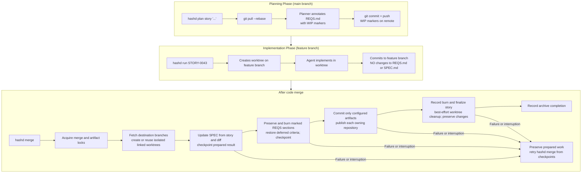
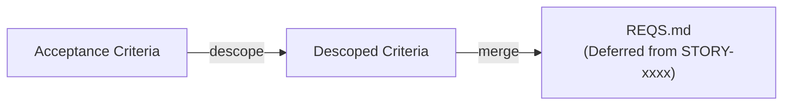
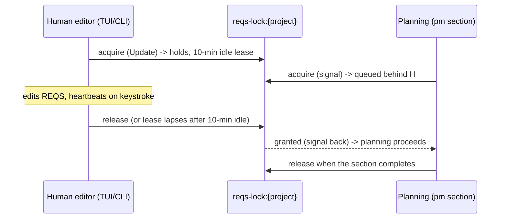

# REQS: how a story owns requirement text

This page is the one place for how hashd keeps REQS and SPEC, how a story
claims requirement text, and what each change to a story's scope does to that
claim. The story and workstream state machines themselves are in
[WF.md](../WF.md); the sections there that touch REQS point back here:

- [Story Scope Management](../WF.md#story-scope-management): splitting, size
  offers and dependency editing.
- [Content ownership and recovery](../WF.md#content-ownership-and-recovery):
  who may write a story's content while planning or an edit runs.
- [Suggestion Lifecycle](../WF.md#suggestion-lifecycle): how unclaimed
  requirement text becomes a suggestion.

## A story's claim, stage by stage

A story owns requirement text by wrapping it in `<!-- BEGIN WIP: STORY-n -->`
and `<!-- END WIP -->` markers in REQS. Regions never nest, and text between
regions belongs to nobody
([WIP Tag Conflicts](#wip-tag-conflicts--scope-overlap)). The table says what
changes that claim at each stage of a story. In `spec_mode` `external` and
`none` no row writes REQS ([Spec Mode](#spec-mode)).

| Story stage | How its scope changes | Approved by | What happens to REQS |
|---|---|---|---|
| `queued`, `drafting` | Planning: `hashd plan story`, `hashd plan bug`, a claimed suggestion | - | When the draft lands, the planner's anchors mark the claim. It is committed at once, and pushed where REQS has a remote. |
| `draft`, `draft_failed` | `hashd story edit` | Approving the draft | The edit's planner restates the anchors and the claim is set again at once. A narrowing inside the claimed passage (`reqs_scope`) is stored on the draft and written when the draft is approved. |
| `draft` | `hashd story descope-ac` | - | The planner prepares the return and the descope workflow writes any returned text directly to REQS in place under the project's REQS lock, then descopes the criterion and records its outcome (`recorded` or `no_text`). Nothing is held for draft approval. |
| `approved`, no workstream yet | `hashd story edit`, which takes the story back to `draft` | Approving it again | As for a draft. |
| `approved` | `hashd story descope-ac` | - | Nothing at the time. The merge archive appends the criterion to REQS under "Deferred from STORY-n". |
| `pending` | `hashd story edit`, which lands back in `pending` | - | Nothing while it waits: a parked story claims no text until its prerequisites are implemented and it is planned again. |
| `implementing` | `hashd replan`, which returns the story to `draft` with its lane held | Approving it again | As for a draft once it is back in planning. `story edit`, `descope-ac` and the other criteria verbs are refused while it implements. |
| Closed with `hashd close` (abandoned) | - | - | The story's markers are stripped. Its text stays in REQS as open work. |
| Closed with `hashd close --no-changes` or `--ref` | - | - | The story's claimed sections are burned: the requirement is met. |
| Merged (`implemented`) | - | - | The merge archive burns the claimed text, updates SPEC, and appends descoped criteria that have no recorded REQS outcome. |

Every write in the table goes through one serialized writer under the
project's REQS lock ([Artifact Edit Locks](#artifact-edit-locks-reqs--spec)).

Where the behaviour is implemented:

| What | Where |
|---|---|
| The markers and who owns which region | `server/internal/reqs/ownership` |
| The writers: the planner's claim, scope narrowing, strip, burn, the commit and push | `server/internal/reqs` (`apply.go`, `wip.go`, `delete.go`, `commit.go`) |
| A story's criteria, their identifiers and rulings, the descoped list and each descoped criterion's REQS outcome | `server/internal/criteria` |
| How a planner's reply is applied to a story's criteria | `server/internal/pm/criteria_write.go` |
| Preparing and publishing a descoped criterion's return | `server/internal/pm/criterion_return.go`, `server/internal/api/story_criterion_return.go`, `server/internal/temporal/workflows/criterion_return.go` |
| The merge archive's burn and deferred-criteria append | `server/internal/mergeflow/archive.go` |

## The rule for changing requirement text

Whenever a change to a story's scope has to split or reword requirement text,
one rule applies:

- The agent makes the smallest edit that keeps each part readable on its own:
  syntax, grammar and continuity only. It never changes what is required, and
  nothing is dropped: every requirement the story does not keep goes back to
  REQS.
- A person approves the exact before and after. That review is the check that
  the right text was kept and the right text was given back.

hashd does not try to prove on its own that the right text moved. No
mechanical check can, because requirements share sentences. REQS says "I want
to have blue buttons with green borders"; the story has one criterion for the
blue button and one for the green border; the green border is descoped. The
text has to become "I want to have blue buttons." kept and "The buttons have
green borders." given back, and neither part is the original bytes.

Do not add byte-for-byte or exact-match checks on requirement text to stand
in for that review. What a check can hold structurally, it should: the WIP
markers and the planner's anchors already refuse a claim on text another
story owns, and a change is refused when REQS no longer matches what was
reviewed.

Where the rule holds today, and where it does not:

- It holds for the planner's narrowing of a claim at planning, in an edit and
  in a split (`reqs_scope`: `prompts/include_planner_reqs_scope.md`,
  `ReqsScope` in `server/internal/stages/plan_split/result.go`). A rewording
  is allowed, nothing checks that the two parts partition the original, and
  the operator approves the exact text.
- It does not hold for descoping a criterion in a draft
  (`prompts/criterion_return.md`, `checkCriterionReturn` in
  `server/internal/pm/criterion_return.go`). There every returned part must be
  the source's own bytes and kept text may change only by whole returned
  sentences, so a criterion whose text shares a sentence with one the story
  keeps is refused as inseparable. That path predates this rule. New work
  follows the rule and does not extend those checks.

## Planner-deferred work

When planning or an edit scopes a story to part of a requirement, the planner lists each part it leaves for later in `deferred`. hashd records each entry as a planner-origin suggestion that waits for the story, linked to it by `deferred_from`. A later planning or edit of the story restates the list and replaces the entries still waiting; claimed, done and dismissed entries stay.

Requirement text for deferred work inside the one REQS passage the story claims returns to REQS, unclaimed, through the story's `reqs_scope` narrowing: the planner returns it as `excluded` and keeps only what the story implements as `retained`, and the narrowing is written to REQS when a person approves the draft, under the rule above. Deferred requirement text outside the claimed passage stays outstanding where it is.

The story's deferred list, each item with its S-id, title, summary and status (waiting, claimed, done or dismissed), appears in `hashd show <story>`, in the TUI story detail and on the Web story page, beside the acceptance criteria and Non-Goals and beside a draft's proposed `reqs_scope` narrowing.

To disagree with what the planner deferred:

- Edit the story (`hashd story edit <story> -f "<feedback>"`) to bring deferred work into the story or to leave more out; the edit restates the deferred list.
- Dismiss an item you do not want: `hashd plan dismiss <S-id>`. The planner does not propose dismissed work for that story again.

## Requirements Lifecycle


### Spec Mode

`spec_mode` is a project setting naming where the project keeps its
requirements (REQS) and spec (SPEC): `repo`, `local`, `external` or `none`.
An absent value means `repo`. It is written with
`hashd project config set spec_mode <mode>`; a config.yaml naming any other
value refuses to load (`config.spec_mode.invalid`), listing the supported
values and the nearest one.

The mode is resolved once, server-side, by
`(*config.ProjectConfig).ResolveSpec` (`server/internal/config/spec_mode.go`).
Every REQS/SPEC consumer that follows the mode reads that resolution, and
clients read it from the project read (`GET /projects/{name}` serves the
resolved mode, never an empty one; `hashd project show` prints it). None
infers the mode from whether a REQS or SPEC file exists.

- **`repo`** is today's behaviour: the flow, invariants and failure modes
  below describe it.
- **`local` and `external`**: the implementer artifact guard does not apply,
  and neither do merge's REQS/SPEC exemptions: its managed-file auto-commit
  leaves REQS.md and SPEC.md out, and a dirty SPEC blocks the merge like any
  other uncommitted file. The worktree editor treats REQS.md and SPEC.md as
  ordinary files, and the merge archive neither regenerates nor publishes
  SPEC, so an implementation's own SPEC (a symlink included) stands. `repo` and `none` keep the guard,
  the exemptions and the editor refusal.
- **`local` document store**: in `local` mode REQS lives in a hashd-owned git
  repository at `{ops_dir}/projects/{name}/documents/`
  (`(*config.ProjectConfig).LocalStoreDir`), on its one fixed branch `main`,
  with no remote. It holds REQS at the configured `reqs_path` and SPEC at
  `spec_path`, each relative to `repo_path` (an absolute one is made
  relative to it). `reqs.ResolveWorkspace` returns it, so every REQS reader
  and writer that resolves through it -- the planner's annotation apply and
  WIP markers, the split-scope write, the close-time strip and burn, the
  sweep and its retries, `requirement_burned`'s locator, the REQS sync,
  refine and edit, discovery's REQS read and the REQS document routes (read,
  save and create) -- reads and commits there, and `reqs.DocumentBranch`
  answers the store's branch. A writer whose config predates a switch
  between `local` and `repo` decides from the mode config.yaml holds when it
  starts, and the writers and the REQS sync resolve REQS again once they hold
  the REQS lock, so each reads, writes and records its `requirement_burned`
  locator where REQS lives under the mode it reads there. The planners'
  REQS and SPEC (refine, edit, discovery, tech tree and plan split, through
  `reqs.PlanningReqsPath` and `reqs.PlanningSpecPaths`, which create the
  store first) and chat's `@reqs` and `@spec` read the store too;
  `(*config.ProjectConfig).SpecAbsPath` names the store's SPEC. SPEC's
  document routes (read, save and create) read and commit in the store as
  REQS's do (`api.documentLocation`), so a project checkout's own REQS or
  SPEC, on whatever branch and committed or not, neither shows in a read nor
  blocks a save. A store document's links name project files, so its read
  checks them against the project repository's default branch and sends
  them with no target: the web renders them as plain text (or marked
  missing), not as links, since its code browser reads only the project
  repository. A store commit is recorded under the repository identity
  `(documents)`, which no configured repository can take, and is never
  pushed. The first resolve seeds the store: REQS from the repository that
  owns `reqs_path`, at that repository's default branch (a multi-repo row's
  own `default_branch` where it sets one), and SPEC from `repo_path` at the
  project's default branch, each read out of git and copied byte for byte,
  WIP claims included, in one seed commit. A document the branch does not carry starts empty; any
  other failed read refuses (`reqs.local_store.seed_failed`, naming the
  repository, branch and path) and creates no store, since seeding empty
  would lose the requirements. The seed writes nothing to any project
  repository, and an existing store is never reseeded or overwritten. The
  merge archive burns REQS and appends descoped criteria in the store, on
  any runner: its REQS target (`ArchiveRequirementsTarget`) names
  `(documents)` on `main`, which the runner acquires from and publishes to
  through the server Git service like any repository with no remote, also
  when the archive does not push (`hashd merge --no-push` governs project
  remotes, not hashd's own copy), and its `requirement_burned` locator
  names `(documents)`. That push checks out and moves the store's branch
  under the project's REQS lock, so it never lands between a REQS writer's
  read and its commit. The archive updates SPEC in the store too, at
  `spec_path`, from the story and the landed branch diff, in the same
  worktree and documentation commit as the REQS burn. `hashd docs` writes
  SPEC only in the store as well: its runner acquires the store through the
  server Git service (`api.DocsStoreTarget`, offered only while the
  project is in `local` mode), and the agent updates SPEC in a worktree of
  it, from the story and the held feature checkout's diff. That SPEC is
  committed, recorded and published there through the archive's own
  documentation commit and publication (`mergeflow.UpdateStoreSpec`), so
  neither the feature checkout nor any project repository changes. A run
  interrupted after the agent wrote SPEC commits and publishes that SPEC on
  the next run, without rerunning the agent over it, before updating SPEC
  again, and its checkpoint stays until its worktree is settled. In this mode the
  archive has no project-repository documentation step: it writes no
  documentation to a project repository, so a protected, missing or
  unreachable documentation branch there cannot stop it or keep the story
  from reaching `implemented`; only the merge itself lands there. A retry
  that finds documentation still unpublished in one store after a switch
  between `repo` and `local` refuses (`archive.documentation.spec_mode_changed`)
  and writes nothing to the other. The archive's targets name the store
  without creating it: the server Git service creates it when the runner
  first fetches it, after that refusal, so a refused retry leaves no store
  behind. An archive finishes in the store its recorded mode admits, also
  after a switch it is allowed to finish across: its runner reads that mode
  first and the server answers that store's REQS target and SPEC path
  (`ArchiveRequirementsTarget`), so documentation published in the store
  finishes there after a switch to `repo`, and documentation published in
  the repository finishes there after a switch to `local`, creating no store.
- **`external` and `none`** (`SpecMode.HasDocuments` is false): the REQS/SPEC
  document routes (`GET`/`PUT`/`POST /projects/{name}/reqs` and `/spec`, the
  `POST` being spec create), `hashd docs`, `@reqs`/`@spec` and, in `none`
  only, discovery dispatch refuse with a `project.spec_mode.unavailable`
  Diagnostic naming the mode, whose help is the command back to `repo`; it
  never offers to create the file. A docs run rechecks the mode when it
  executes and refuses the same way in both modes, and a discovery run
  rechecks it and refuses in `none` before it syncs, reads or prepares
  anything, so a switch after dispatch still reaches them. Doctor skips the
  REQS checks. Every other REQS/SPEC consumer
  stands down, whatever files the repository holds: planning and editing
  read no REQS and advertise no SPEC, the tech-tree stage reads no REQS
  file, every story, discovered and claimed ones included, plans under the
  ad-hoc anchoring rule
  (storytype.OriginIsAdHoc, include_planner_story_origin) and is told the
  project keeps no REQS for hashd to anchor, so none is required to claim a
  region or refused for want of one, plan split anchors nothing, its prompt
  carries no Requirements section and says the project keeps no REQS for
  hashd to anchor, and a split owes no REQS write, and no writer touches
  REQS -- the planner's annotation apply, the close-time WIP strip and burn,
  the housekeeping sweep and its push retries, the split-scope write and the
  merge archive's REQS burn and descoped-criteria append. In none mode no
  planner prompt carries a REQS or SPEC section. Each REQS writer
  rereads the mode from config.yaml once it holds the REQS lock, so one
  started before a switch writes nothing after it; a config.yaml that fails
  validation refuses the write. Through this stand-down every merged story,
  discovered and claimed ones in `external` and ad-hoc ones in `none`
  included, completes when its merge lands: hashd writes no WIP markers for
  it, and the archive admits no document (`mergeflow.ArchiveAdmission`), so
  it burns nothing, regenerates no SPEC and makes no documentation commit or
  push for it. A merge archive finishes under the mode its
  documentation was prepared in: a retry under a mode admitting other
  documents or another store, while that documentation is still
  unpublished, refuses
  (`archive.documentation.spec_mode_changed`) with the command back to that
  mode, and publishes, drops and records nothing.
- **Planners in `external`**: refinement, edits, splits and Arc proposals are handed every `spec_paths` entry, whole, as a path inside the prepared planning view of the repository holding it, resolved as the configured SPEC is (`reqs.PlanningSpecPaths`). The prompt names them the team's own requirements and specification, kept in the repository, which hashd reads and never edits; no repository's `SPEC.md` or `spec_path` is advertised. hashd checks only that each entry exists at the fetched base and never reads its content. An empty `spec_paths`, or an entry missing at the fetched base (one present only in the working tree included), fails the attempt before the agent runs with a `planning.source` Diagnostic naming the entry, or `spec_paths`, whose help is to correct the entry or the list in the project's config.yaml. The tech tree is handed the same paths and refused the same way, and in `none` it is handed no repository's `SPEC.md`. Discovery in `external` is handed the same `spec_paths` through `reqs.PlanningSpecPaths` in single-repo and multi-repo projects alike and is refused the same way, its `planning.source` Diagnostic recorded on the discovery failure record; it reads, syncs and marker-checks no REQS at dispatch or at run, emits no stale-WIP-marker warning, and never stops on a requirements refresh failure, and its prompt says the project keeps no REQS for hashd.
- **Changing the mode**: a change away from `repo` is refused
  (`project.config.spec_mode_wip_claims`) while the default branch's REQS
  holds WIP claims, and a change away from `local` while the document
  store's REQS does, naming the mode left and each claiming story;
  `hashd close <story>` or the story's merge releases its claim. A reset of
  `spec_mode`, or of every override, that leaves the mode is checked the
  same way. The check reads the store without creating it: a store not yet
  created holds no claims, and none is created until the change lands (a
  first read that would create it waits, then creates nothing once the mode
  has left `local`). A change that lands writes nothing back to either REQS; the store
  stays in place, and a return to `local` serves it as it was left, without
  reseeding. Changes back to `repo` or `local` and between the other modes
  are not refused. A change from a mode with documents (`repo`,
  `local`) to one without (`external`, `none`) is written under the REQS
  lock, after any REQS writer holding it finishes.

`spec_paths` is a YAML list of repository-relative paths, validated at config
load (an absolute path, a `..` segment, a project with no `repo_path`, or a
path outside the project's trust roots is refused as
`config.spec_paths.invalid`), and read only in `external` mode: the resolver
carries it in no other mode.

### Document Update Flow

REQS.md and SPEC.md target the configured base branch, separately from feature
implementation work. In `spec_mode repo` when the configured merge mode is PR,
the merge gate's verify phase writes the story's SPEC update and (when the
requirements destination is the lane's repository and base branch) REQS burn as
one ordinary lane commit (`merge_doc_update`) in the lane's checkout, after
final-review approval and any rebase and before the full test, holding no merge
lock. That commit is covered by the full test, the pull request and the merge
gate's review link. Nothing is written in any other spec mode or merge mode, in
the prepare or legacy whole-gate phases, when `HEAD` is already a
`merge_doc_update` commit (including a clean replay), or when nothing is
staged; a REQS destination in another repository or branch is left untouched.
Direct (non-PR) merges and non-repo modes use post-merge finalization in linked
worktrees from the existing local Git repositories, not clones or the
operator's checkout.

After a PR lands in `spec_mode repo` (whether hashd-, forge-, or person-merged,
including external merges), the post-merge archive completes the landing record
first and decides each artifact from what the PR actually merged:

- **SPEC**: if the recorded intent operation of `landing.SourceCommit` is
  `merge_doc_update` (including clean rebase replays), the archive neither
  registers the SPEC destination nor calls `UpdateSpec`.
- **REQS**: only when the requirements destination is the lane's own repository
  and base branch, the archive reads the REQS file at `landing.TargetCommit` and
  at the landed commit (`MergeSHA`, or `SquashCommit` for a squash) from the
  already-fetched objects in the repository. If `reqs.RemoveStorySections`
  extracts the story's text at the target and finds none at the landed commit,
  the archive saves that text in `state.Burned` so the existing burn record
  carries it, and skips REQS registration, `DeleteRequirements`, and
  `AppendDescopedToReqs`.

When nothing remains to write, archival completes without committing or pushing
to the base branch. Any artifact the PR did not deliver, any case where the
archive cannot establish what merged (no landing, empty `SourceCommit` or
`TargetCommit`, or a failed read), REQS targeting another repository or branch,
direct (non-PR) merges, and `spec_mode` `local`, `external`, and `none` keep
the existing post-merge writer unchanged.

In `local` mode the planning phase below writes the document store instead
(**Spec Mode**): the planner's WIP markers, and every other REQS write that
resolves through `reqs.ResolveWorkspace`, commit on the store's `main` with
no pull and no push, since the store has no remote, and the project
repository's REQS and branches are not touched.



### Critical Invariants

1. **WIP tags are added to main** during planning and pushed immediately
2. **Implementation commits never touch REQS.md or SPEC.md** - in `spec_mode repo` with PR merge mode, hashd writes the story's SPEC update and same-repo/same-base REQS burn as one ordinary lane commit (`merge_doc_update`) during the merge gate's verify phase before the full test (covered by the full test, PR and review link; skipped when `HEAD` is already a `merge_doc_update` commit/clean replay or nothing is staged). Direct merges and non-repo modes write documentation post-merge.
3. **Isolated publication** - remote finalization leaves the base checkout's files, index, and branch untouched. Only prepared artifact commits are rebased onto an advancing destination. A prepared commit that conflicts with its destination is not merged or resolved: finalization discards it with its worktree and generates the documentation again on the destination as it stands, once for each destination in an archive run. If the regenerated commit conflicts too, finalization stops with both conflicts named and the regenerated documentation preserved. Local merge publication uses the recorded code merge, never a later base HEAD.
4. **One documentation commit per owning repository** - SPEC and REQS share a commit when colocated. No changes is success, not a commit failure.
5. **Publication precedes completion** - required failures leave finalization incomplete and retryable. Completed preparation and publication steps are checkpointed under the project directory's `archive/`. Local-only / `--no-push` finalization fast-forwards a clean, unchanged local base; otherwise prepared work is retained and finalization stops.
6. **Implemented stories' WIP markers survive until the burn** - the story-transition cleanup and planning's marker reconcile both preserve (or themselves burn) an implemented story's markers; only abandoned/missing stories get markers stripped with prose kept. The merge-archive burn finds the requirement sections by those markers, consumes the prose, and records a `requirement_burned` event; the reconcile sweep performs the same burn as the crash backstop when the archive never ran. Two closes meet a story's requirement without a hashd merge, and both burn it the same way: a story closed with `hashd close <story> --no-changes` (no work was needed: its workstream is `closed_no_changes`, the story `abandoned` with the met requirement recorded in its own data so removing the workstream later changes nothing, and its claimed source suggestion is completed), and a story closed with `hashd close <story> --ref <ref> --reason "..."` (`closed_by_person`: the work landed outside hashd; its source suggestion stays consumed). For either, the story-transition cleanup burns its sections with the sweep's same burn and `requirement_burned` event instead of stripping them, the sweep again the backstop (and the only burn for an ownerless story, which no one's sign-in may publish). A plain `hashd close <story>` abandons the story and returns its requirement to REQS as open prose. A story with no markers burns nothing. The legacy workstream close (`POST /workstreams/{id}/close`) returns the story for re-planning and burns nothing.

### Manual Artifact Inspection and Edits

Manual document writes share the artifact ownership boundary with planners and
editors. They compare the editor's saved revision, hold the document lease during
write/commit/publication, and reject stale revisions, dirty or wrong-branch
checkouts, symlink paths, and edits inside protected REQS WIP sections. Explicit
leases can span multiple steps and require renewal before expiry. See [manual document commands](walkthrough.md#manual-artifact-inspection-and-edits).

### Failure Modes

| Symptom | Cause | Fix |
|---------|-------|-----|
| Documentation incomplete after code merge | Finalization failed or was interrupted | Resolve the reported failure, then retry `hashd merge` |
| Documentation conflicted with its destination twice | The destination changed in the same documentation lines while the documentation was prepared and again while it was generated anew | Retry `hashd merge`: it discards the kept documentation and generates it once more on the destination as it then stands |
| No matching WIP sections | No published markers for this story, including ad-hoc stories | No REQS burn is recorded |

### WIP Tag Conflicts = Scope Overlap

If `git push` fails during planning due to conflicting WIP markers, this is NOT a git problem to auto-resolve.

**What it means:** Two stories are claiming the same requirements.

```
Story A (already pushed):                Story B (trying to push):
<!-- BEGIN WIP: STORY-0042 -->           <!-- BEGIN WIP: STORY-0043 -->
| Skill Level Filtering | ... |    <--   | Skill Level Filtering | ... |
<!-- END WIP -->                         <!-- END WIP -->
```

**Required action:** Rescope one of the stories. The overlap indicates:
- Stories are too broad
- Work is being duplicated
- Requirements need to be split more granularly

The system should abort story creation and report: "STORY-B overlaps with STORY-A. Rescope before proceeding."

## Descoped Criteria Lifecycle



- A criterion remains part of its story while descoped.
- Merge finalization adds a "Deferred from STORY-xxxx" section to REQS.md after
  burning the implemented story's WIP sections. The section lists only descoped
  criteria with no recorded REQS outcome (`criterion_returns` records only each
  final outcome's state — `recorded` or `no_text` — and provenance, never
  returned prose): a criterion whose text was returned to its original REQS
  position, or confirmed to have none, is left out. Draft approval does nothing
  with descopes.
- A descope names its criterion by identifier: `hashd story descope-ac
  STORY-xxxx AC-0002`, or a position the client resolves to the identifier
  when the command runs; the story read serves every criterion's identifier,
  as its next write assigns it. Repeating a request that names the same
  identifier acts on that criterion: one already descoped answers with its
  recorded REQS outcome, and nothing else moves. A chat proposal saves the
  identifier its position resolved to before its first attempt, so its retry
  names the same criterion. Running a positional command again resolves the
  position afresh: once the criterion has left the list, that position names
  the criterion after it.
- On a draft, `hashd story descope-ac` prepares the criterion's REQS return and
  writes any returned prose directly to REQS: the planner associates the
  criterion with its exact prose, checked against what the story claims. The
  descope marks the story with the preparation and starts its workflow
  (`criterionreturn:{project}:{number}`), which waits its turn for the
  project's planning slot; the story reports the preparation in flight
  (`criterion_return_preparing`) and withholds criteria changes and every
  forward move -- approval included -- until it ends. Descoping the same
  criterion again while it runs answers with that workflow, starting no second
  agent. A preparation whose workflow is not open once its start window has
  passed reads `interrupted`: descoping the same criterion or another starts
  afresh with a new execution, reading REQS as it stands so prose an
  interrupted attempt already returned is no longer in the story's owned
  regions and cannot be returned twice. A start that meets an earlier
  preparation's run still closing is refused, not reported as started. A
  criterion with no REQS prose checks its source under the REQS lock, then
  descopes the criterion and records `no_text` in one write, with no REQS
  write. A return of prose rechecks that the mark is still this execution's
  and the story is unchanged, then writes the returned prose directly to REQS
  in place through `reqs.ReconcileSplitScope` (which acquires the project's
  REQS lock itself, refuses a source that changed since preparation, commits
  and pushes), and one story write then checks ownership and that the story is
  unchanged, descopes the criterion (keeping identifier, text, rulings and
  position), records `recorded` under the write's provenance and removes the
  mark. Nothing is held for draft approval. Any descope is refused while the
  draft proposes a REQS narrowing, or while another preparation runs. A
  failure at any step stands among the story's current errors (a
  `criterion_return` operation result, clearing the mark in one write) with
  the criterion left active; when the REQS write landed before the story write
  was refused, the diagnostic says REQS already holds the returned prose and
  that descoping again prepares afresh. A preparation whose result was lost
  after its finishing write committed is recorded as that success. The command
  waits for the outcome and prints the recorded outcome whole, or exits
  non-zero with the failure; if interrupted or timed out, it warns that the
  REQS write may already have happened and that descoping again starts afresh.
- An implementing story refuses `hashd story descope-ac`, and every other
  criteria verb; its refusal names the replan that returns it to planning,
  where it descopes as a draft does. Other stages descope as before, with no
  recorded outcome.
- A chat descope stays pending until its named preparation finishes. Completion
  records the real success or failure and the recorded outcome in the same
  transaction as the story outcome; failed actions remain retryable. A request
  returning late cannot overwrite that result, or a newer attempt's result.
- In `spec_mode: none` or `external`, a draft descope records no REQS prose
  regardless of the story's origin, without resolving a document workspace,
  reading a file or asking an agent.
- The deferred REQS items are picked up by the next `hashd plan` discovery run.
- During implementation, descoped criteria are injected into agent prompts as
  negative requirements ("DO NOT implement").

TUI controls are in [Story scope operations](watch.md#story-scope-operations).

## Artifact Edit Locks (REQS / SPEC)

Manual artifact inspection is read-only. Editing always reloads the current
protected REQS or SPEC document under its lease; historical views cannot be
saved as current edits. REQS writes preserve WIP protection; SPEC writes do not
change requirements or acceptance criteria. [Viewer controls](watch.md#document-inspection-and-editing)
are documented separately.

REQS.md and SPEC.md have independent per-project edit locks coordinating human
editors with planning, story-edit and documentation workflows. Housekeeping REQS
cleanup holds the PM singleton and local flock, but does not acquire the artifact
lock; these locks therefore do not cover every automated writer. Each lock is a
workflow-ID singleton (`reqs-lock:{project}` / `spec-lock:{project}`) --
`ArtifactLockWorkflow` -- the same primitive family as `pm:{project}` and
`mergelock:{project}`. Whoever's holder currently runs under that ID holds the
lock; the lock's state (holder, FIFO queue, lease) is durable across restarts.

New-rule `local` and `pr_approved` attempts enter through `mergequeue:{project}`
in the order that workflow accepts their enqueue signals, per project, with no
elapsed wait limit. The per-attempt
`merge-chute-fifo` version marker leaves attempts started before the upgrade on
the bounded `merge_lock_wait` singleton race and its `merge_busy` stop. A grant
permits one singleton start; a busy start retains the head until the occupying
run closes. Exclusion against legacy merges and archive sections still comes
only from `mergelock:{project}`. Runner admission is awaited at the grant, and
the section body timeout begins only when the child starts.

A new-rule merge attempt's archive enters the same queue, as a pass of its own
under the attempt's next admission, with no elapsed wait limit and no
`merge_busy` stop: the already-merged and resumed-merge recoveries, a PR merged
on the forge, and the archive after a local or PR merge alike. It gives its
runner slot back before it enqueues and asks for it again at its grant, so it
never waits holding a slot a merge granted ahead of it waits for. Every queued local or
PR merge enters the queue the same way, one started before archives queued
included (`merge-chute-slot-release`, chosen at its lock), so a merge queued
behind an archive never holds the slot that archive waits for. The section an
archive waits for is the archive-only body, with its artifact locks, checkpoints,
failure reporting and execution bound, which start only when the lock child
starts. The `merge-archive-chute-fifo` version marker, chosen with
`merge-chute-fifo` at attempt entry and carried through continuations, leaves
attempts started before it on the bounded singleton race and its `merge_busy`
stop.

The run workflow's inline archive of a PR its merge-ready reconcile finds
merged on the forge enters the same queue on the same terms, outside the merge
workflow: the run gives back the runner slot it holds before it enqueues and
asks for it again at its grant, enqueues under an admission count of its own,
and marks itself a FIFO wait (the `merge-chute-fifo` memo) for housekeeping.
Granted, it archives and the run completes on its own, keeping its claim, its
completion notice and its guarded clear of the `finalize` stamp; no `hashd
merge` is needed. The run decides this once, at its start
(`run-archive-chute-fifo`), and carries it through continue-as-new; a run
started before it keeps the bounded race and its warning.

Bounded archives are historical only. The archive-only and forge-merge waits
(`merge_archive_lock_wait`, `merge_external_lock_wait`) are retired settings:
an execution started on a build that shipped them races the singleton under
the value its recorded timer snapshot carries, or the value they shipped with
when it recorded no snapshot, and `merge_lock_wait` never stands in for them.
The archive after a local or PR merge in an execution started before the
upgrade keeps `merge_lock_wait`.

A queued archive stamps its `finalize` substage before it enters the queue,
so its `merged` workstream reads as an unfinished archive -- `running` while
its owner is open -- rather than `done` while it waits.

A cancelled merge waiting in the FIFO queue withdraws, including a cancel that
races its grant, and starts no locked section. The next waiter can proceed.

A PR merge or an archive waiting in the FIFO queue under a restart hold or its
workstream's pause leaves the queue without closing; a local merge waits in line. It looks when the hold asks it to
(`execution-hold-requested`), and again when it is granted. Held, it withdraws,
giving up a grant that raced the hold, returns the workstream from `merging` to
the state it was admitted from and clears its merging substage, and only then
acknowledges, at `queued for the
merge chute`. The next waiter can proceed. A hold asked for before the merge
reached the queue holds it there before it enqueues. Released, the same
execution moves the workstream back to `merging` under the admission it
already holds (`start_merge`, its own open merge not counted against it) and
enqueues again at the tail under its next admission. A grant still
addressed to the admission it withdrew is ignored. A lookup that finds no hold
keeps the merge's place. The per-attempt `merge-chute-hold-v1` marker leaves
merges queued before the upgrade waiting only for their grant or a cancel.
A held archive leaves and re-enters the same way, giving its runner slot back
before it acknowledges and asking for it again at its next grant, but its
branch has landed: it makes no return to the admission origin and no
re-admission, even when the attempt was admitted as a PR merge, so the
workstream keeps its merged state and the archive its progress. The run
workflow's queued inline archive holds the same way, at the run's own
`queued for the merge chute` boundary.

A PR merge already in its locked `pr_approved` section looks for its
workstream's pause between completed steps -- before each preparation, after
it before verification, after verification before the push, after the push
before the forge is read again, after each of the forge's status and thread
reads, failed or not, before any stop judges them, at each boundary of the mergeability wait (before
its timeout stop), and last immediately before the forge is asked to
merge. A step already running finishes first. A pause it finds returns the
workstream from `merging` to the state the merge was admitted from
(`merge_aborted_to_pr_approved` for an approved PR) and clears the merging
substage; the branch, the PR, its approval and every record stand, nothing is
recorded as a stop, and its attempt reads `blocked`. The section returns, its
lock run closes, and only once that close and its release are recorded does
the merge acknowledge, at `queued for the merge chute`, holding neither the
chute nor its runner slot: the next waiter can proceed. Released, the same
execution moves the workstream back to `merging` as a queued merge does, enters
the chute again at the tail under its next admission, and its section runs its
gates again. A failure to
read the pause or to make that return is the section's error, not a yield.
Once the forge request has begun the merge looks no more: its retries,
verification and landing run to their own end. The local merge does not look.
A cancelled merge already holding `mergelock:{project}` keeps it until its locked section ends, and
undoes its admission only after the lock child has closed. The local section
stops at its next step boundary: it starts no new step after the cancel, and
once `merge_attempt` begins it runs through to its record. A step that fails
after the cancel arrived stops as the cancel, returning the workstream to the
state it was admitted from, and the cancel record carries the step's failure
and output as evidence.

A forced cancel (the merge execution cancelled, then sent `force-cancel` on the
same run; a failed signal leaves a plain, waiting cancel) withdraws while queued.
After the lock child starts it does not wait: the
`local` or `pr_approved` locked section is no longer waited for, the lock
frees, and the merge undoes its admission at once. It records a work-in-progress
stop saying the git work in the repository may have been cut off partway, with
`git -C <repo> status` and the retry as next steps.

Both are `POST /flow-runs/{id}/cancel` on the `merge:{project}:{ws}` (or
`resolve:{project}:{ws}`) handle. With no body the cancel waits: the lock and
the admission are released when the running git work ends, and the response says
a stop was requested, not that the run is cancelled. With `{"force": true}` they
are released at once. Force is refused on any other kind of run.

Waiting is **event-driven, never polled**. Two acquire paths feed one FIFO queue:

- **Clients** (TUI editor, CLI) acquire via a blocking Update -- it parks in the
  workflow until granted, then returns a lease token. The TUI drives a **10-min
  idle lease** reset on keystrokes (2-min warning, then drop-to-read-only); the
  CLI is identity-keyed (the holder is the calling user, no token threaded).
- **Automated writers** (planning, story-edit, docs) acquire via a signal and
  are **signaled back** on grant, so a waiting plan costs O(1) history, not one
  event per poll. Planning/edit take `reqs-lock` **inside** their pm section (pm
  stays the automated-vs-automated mutex; the artifact lock is purely the human
  boundary); docs takes `spec-lock` for its run. A 2-min heartbeat holds the
  lease; release is explicit, and the writer's body deadline + lease are the
  crash backstop.



**Save guard:** a write is rejected if its token / caller-identity no longer
holds the lock (a lapsed lease). A write while an **automated** writer holds the
lock is always rejected (its edit must not interleave); another **human** holder
also blocks tokenless writes and document creation. **Break-glass steal**
exists server-side but is unpublished (no CLI verb, no TUI key) and refuses to
steal from a system process -- yanking a live planning run would corrupt its
in-flight REQS write. When Temporal is absent the whole mechanism degrades to
CAS-only writes. A connectivity failure never authorizes this fallback. Save
responses pair document content with its revision; clients must not advance a
draft's base revision without the corresponding content.
