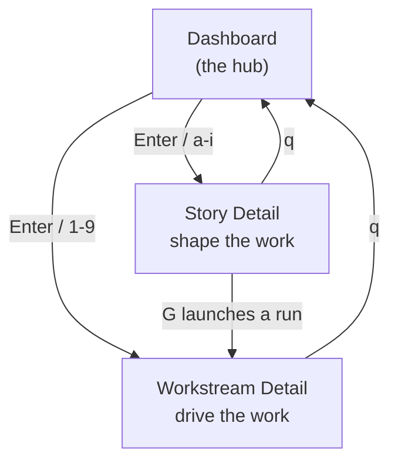

# The watch TUI

`hashd watch` opens hashd's terminal UI — a live cockpit for planning, running, and
merging work. It is a *viewer*: it connects to the running hashd services and
reflects their state; it never starts or restarts them (if the services are down,
`hashd restart` brings them back). Every view updates in real time over the event
stream, so you watch progress rather than re-querying.

This page is the working map — the three views, when to use each, and the keys you
reach for most. For the exhaustive, state-by-state keybinding tables see
[Watch UI Keybindings](#watch-ui-keybindings); for the terms used here, see
[glossary.md](glossary.md).

## Three views

The TUI is a hub and spoke: one Dashboard, two detail views.

`q` moves you back one level — from a detail view to the Dashboard, and from the
Dashboard it quits. (`Esc` steps back too, but the footer always shows `q`.)

## Dashboard — the hub

The home screen. It lists the project's active Stories and Workstreams, each tagged
with its `<stage> / <runtime_status>`, so at a glance you see what is running,
blocked, or waiting on you. Use it to triage: scan for anything `blocked` or
`changes_required`, then drill in. Every Story and Workstream gets a row: when they
don't all fit, each list scrolls on its own, and rows past the ninth have no
shortcut key.

| Key | Action |
|-----|--------|
| `j` / `k` (or arrows) | move the selection in the focused list |
| `Enter` | open the selected Story or Workstream |
| `Tab` / `Shift+Tab` | switch between the Stories and Workstreams lists |
| `1`–`9` | open one of the first nine Workstreams in **Workstream Detail** |
| `a`–`i` | open one of the first nine Stories in **Story Detail** |
| `p` | open the **Plan** screen |
| `m` | change **autonomy mode** |
| `o` | team mode only: list only your own Stories and Workstreams, or all again |
| `Ctrl+g` | hide or show the graph strip (`[ctrl-g]raphs`), when the terminal has room for it |
| `Ctrl+r` | step the graph strip's window: 1h, 8h, 24h, 7d, 30d, then 1h again |
| `Ctrl+p` | switch project |
| `A` · `C` · `/` · `?` | artifacts (view SPEC, view/edit REQS) · chat · command palette · help |
| `q` | quit |

### Graph strip

When the terminal has room, a shallow strip of three compact panels sits above the lists — **Tokens**, **Stories**, then **Activity**. Each panel is a title line over its figures, drawn at the width and height the strip gives it; the lists stay the Dashboard's main content. The strip is shown and hidden whole, and the owner filter (`o`) changes no panel.

The panels share one window, 24 hours to start. `Ctrl+r` steps all three through 1h, 8h, 24h, 7d and 30d for the rest of the session, and each names the window on its own title line (`Tokens · last 7d`). The key is listed under `?`, not in the footer, which has no room for it.

The two history panels draw a filled Braille plot: each value lights every dot row from the baseline up to its own level, so the series reads as a mass rather than a line of scattered dots. Traces that share a scale stack, bottom trace first, so the top edge is the running total; Tokens instead mirrors its two traces about a centre line, each on its own scale, as described below. The legend beside a plot names each trace's colour.

**Tokens** — the project's input and output tokens over the strip's window, from `GET /reports/series` at that range. Each read sends the plot's width in dot columns as `buckets`, and the server picks the finest bucket width that gives every bucket a dot column of its own, so a wider terminal shows a finer day; a resize that changes the fit reads again. The plot is mirrored about a centre line: output stands up from it and input hangs down from it, each on its own scale, beside a legend of `out` and `in` window totals. The number in each half's outer corner is that half's largest bucket, the value its outermost dot row stands for. The figures count every agent call of the project in the window, calls with no workstream included, and a token counter a call did not report counts as 0. They are the raw input and output counters with no cache counters, so these totals differ from the Activity panel's normalized tokens. On a real day fresh input is a fraction of a percent of output, which is why input has a half and a scale of its own: on output's scale it would be a hairline.

**Stories** — the historical peak number of distinct stories whose implementation work overlapped at one instant, per block over the strip's window, from `GET /reports/active-stories` at that range with the plot's dot columns as `buckets`, as the Tokens panel reads. The server owns the window, the bucket width it fits to the plot, the dense zero-filled buckets and the coverage counters; the panel draws each returned bucket exactly as returned, oldest at the left, beside a legend laid out like the Tokens panel's: `max`, the window's most stories at once and the value the plot's top dot row stands for; `total`, the distinct stories the window touched; and `now`, the stories with an agent working at the read. `now` comes from the live invocation rows the workstreams' `running` status reads, since the history cannot tell a stage running now from a run that died without recording its end, and the row is left out when those rows could not be read.

This is history, not a status board. It is not a current count of stories, a count by status, starts or completions per day, or merges. A block whose peak is 0 is a stretch in which no implementation work was counted; a 0 beside a nonzero coverage count is incomplete history rather than a quiet stretch. A workstream the rows link to no story is excluded from the count and reported as excluded coverage, a stretch of work nothing closed — a stage running now, or a run that died without recording its end — is in no bucket and counted as an interval with no end, and the history of a deleted workstream is not recoverable.

**Activity** — each recorded activity's share of the project's agent time and tokens over the strip's window, from `GET /cost?scope=project&by_stage=true`: the same figures as the Web Reports page gives that window, folded into the activity groups its By stage table shows. There is no time axis — each row covers the whole window:

| Column | Meaning |
|--------|---------|
| Stage | the recorded activity, or `unassigned` for the calls whose stage the server did not record |
| Time | a meter of its share of the window's recorded agent time |
| Tokens | a meter of its share of the window's normalized tokens, cache included |

Each share is a meter rather than a number: a filled portion in the column's own colour, which the column label carries too, over a dim track the width of the whole meter, so the rows are read against each other at a glance. A share that cannot be stated is drawn as a dotted groove instead of a bar — either no call of that row reported the figure, or the window's own total is unknown or 0. `?` gives every row whole, with both shares to a tenth of a percent (`unknown`, `unavailable` and `<0.1%` spelled out there) and the coverage counts behind them.

The stage column is as wide as the longest name it shows and no narrower than its own floor. A name that does not fit keeps its start and its end with the middle elided, because the recorded names that collide do so at their starts — `implement` and `implement_resume`, `review` and `review_resume` — and `?` gives them whole. Rows run by recorded time descending, then the activities whose time no call reported. `unassigned` takes its place by its own recorded time like any other row, and sorts after a named activity only where the two tie. The figures count every agent call of the project in the window, planning calls and calls with no workstream included. Time is recorded agent execution time, not test subprocess wall time, so calls that ran side by side add up.

Hovering a plot puts the stretch of time under the pointer and its figures on the panel's title line. The rightmost bucket is drawn faint while the window's end falls inside it, since it has had only part of its time, and each plot's top-right corner says `now` where nothing is drawn there.

Each workstream row carries an activity line: eight Braille cells of its raw tokens over the strip's window, from `GET /reports/workstream-series`, read with the panels and on the same terms. Each line is on its own scale, so it shows when a workstream worked, not how much beside another; a workstream with no call in the window shows its baseline, and the lines are blank while the strip is not shown.

Every panel shows a loading state until its first read, an empty state when its window counted nothing — `no agent calls in the last 24 hours`, `no story implementation counted in the last 24 hours`, `no agent calls in the last 24 hours`, each naming the window shown — and an unavailable state with the reason when a read fails; for Activity, a server too old to group the window by activity is one of those reasons. They read when the strip is shown (on opening the Dashboard, with `Ctrl+g` or `Ctrl+r`, when room returns, and on returning to the Dashboard), after the event stream reconnects, and every 30 seconds while shown. None reads while graphs are hidden, the terminal has no room for them, another screen or dialog is on top, or the event stream is disconnected.

When the read shown carries notes, that panel's title line shows a marker and `?` lists them in full under the panel's name. Tokens notes a token-semantics warning, and the workstreams whose calls could not be read — the one case where its totals leave whole workstreams' calls out; its third note, calls whose timestamp could not be read, belongs to an unbounded window and so never reaches a bounded read. Stories carries no warning field, so its marker means a coverage count: intervals with no recorded end, or workstreams with counted work and no linked story. Activity notes a token-semantics warning, calls whose timestamp could not be read or was zone-less and read as UTC, and the calls whose agent time or token terms the window's own totals are missing, since those totals are what every share divides by. `?` also lists Activity's rows whole, since a shallow strip can cut them, and the full reason while a panel is unavailable. A panel too narrow for its figures says in one line how many cells they need.

The strip carries its own control: `[ctrl-g]raphs`, at the right of the status line under the header. Clicking it does what `Ctrl+g` does — hide or show the strip for the rest of the session — and the footer offers the same `[ctrl-g]raphs` entry. Both appear only while there is room for the strip: on a terminal too short for it, or too narrow for the three panels side by side, it hides itself, and it comes back when room returns unless you hid it with `Ctrl+g`.

## Story Detail — shape the work

Open a Story (`a`–`i`) when you are working on *what* a change should do, before it
becomes code — grooming a Story, or intervening while it is being planned.

| Key | Action |
|-----|--------|
| `A` | **approve** the story (`draft → accepted`) so it can run |
| `E` | AI-edit the story |
| `e` · `d` · `D` · `r` | edit · delete · descope · rescope an acceptance criterion |
| `a` | answer the planner's pending questions |
| `G` | **Go** — create a Workstream and start the run |
| `R` · `X` | retry · close the story |
| `v` | view the full story |

Once you press `G`, the work moves to Workstream Detail.

## Workstream Detail — drive the work

Open a Workstream (`1`–`9`) to monitor and steer one in-flight branch through
implementation, review, and merge. The footer is **state-aware** — it offers exactly
the verbs that are legal at the current stage, so you are never shown an impossible
action.

| Key | Action |
|-----|--------|
| `G` · `!` | run the workstream (or retry) · run anyway |
| `A` · `r` | **approve** · **reject** at the human review gate |
| `R` · `N` | reset (redo from baseline) · replan |
| `a` | answer a clarification the agent raised |
| `d` `l` `L` `v` `t` | diff · log · transcript · review · timeline |
| `m` · `P` | **merge** · create a PR at `ready_to_merge` |
| `i` | AI-resolve merge conflicts |
| `+` `e` `X` | add commit · edit · close |
| `z` · `u` | **pause** for a human · **unpause** (see [Pause and unpause](#pause-and-unpause)) |

> **Approve is `A` (capital).** Lowercase `a` answers a clarification — they are
> different keys, in both Story and Workstream Detail.

Across the top sits the graph area: the run rail over the activity strip. The
rail places the runner on the phases of a run -- the micro-commit cycle (plan,
implement, test, review), the legs after it (merge gate, final review) and the
merge -- with done segments solid, the current one in its runtime's tone
(running, stalled or failed), the rest faint. A workstream whose PR is open
stands at the merge, waiting; only a merged one is done throughout.

A phase is one or more stages. No stage is dropped: a short stage is
folded into the phase whose work it begins or finishes, and the caption still
names the stage itself, so a commit that fails reads `commit · failed` on a red
review segment. The server owns the grouping (`runflow.RunnerStagePhases`, sent
as `phases` on `GET /reports/workstream-stages`); the rail and the Gantt draw
it.

| Phase | Stages | Folded in because |
|---|---|---|
| plan | `breakdown`, `preflight`, `select`, `clarification_check`, `concern_triage` | breakdown makes or re-makes the plan; the others pick the next micro-commit and check it can start, and take no time of their own |
| implement | `implement` | |
| test | `test`, `adjudicate` | adjudication rules on the test result |
| review | `review`, `qa_gate`, `commit` | the QA gate signs off the review (tests green, change approved), and the commit records what it signed off; both take seconds |
| merge gate | `merge_gate` | |
| final review | `final_review` | |
| merge | `acquire_lock`, `checkout`, `pre_merge_tests`, `merge_attempt`, `post_rebase_test`, `push_branch`, `create_pr`, `await_pr_approval`, `pr_merge`, `finalize` | the merge workflow's steps. The rail places a workstream here by its status alone -- `ready_to_merge`, `pr_open` or `pr_approved` waiting, `merging` running -- since a merge step a finished merge left behind must not place a workstream that has moved on. The Gantt draws no merge row: its intervals count the runner's work, which ends at final review |

The caption under the rail names the recorded substage, how long it has stood
and the commit in hand, with the story's criteria in one line at its right end
(`ACs 12 ✓ · 1 ⊘ · 10 ng`). The strip is the dashboard's Tokens figure for this
workstream over its life, from `GET /reports/workstream-series?workstream=`,
beside its start, age and agent calls. `Ctrl+g` hides the area for the session,
as it hides the dashboard's strip, and the area gives way on a screen under 32
rows. `c` opens the story's criteria card read-only.

The Timeline panel has two views: the event list, and a stage Gantt (`g`) with a
row per phase that ran, in the run's order, and a bar per visit -- the stages of
a phase that run back to back are one visit, and the row's `×N` counts visits --
from `GET /reports/workstream-stages`. The stage the history leaves open is shaded to
the read and footnoted, since the history cannot tell a stage running now from a
run that died without recording its end; an attempt a later run broke off is
shaded up to that run's start, which proves it over but not when it stopped. The
strip is re-read every 30 seconds while the screen is on top; the stages follow
the screen's event-driven refreshes and the criteria line follows story events,
as all entity state does. The open bar and the rail's clock are drawn against
the time of drawing, so they move between reads. A workstream older than
366 days shows its last 366 days, and its call count says `/366d`.

Micro-commits show their status as a glyph: `✓` done, `⟳` in hand, `▪` to come.

### Pause and unpause

`z` pauses the workstream for a human. It asks for a one-line reason (Enter
sends it, Esc cancels and sends nothing), and the reason is recorded on the
pause and shown in the status box. The footer offers `z` only while the
server offers the pause.

- Pausing stops runs at the next safe boundary, not immediately: a run in the
  middle of a stage finishes that step first, and the status box reads
  `pausing…` until it has stopped.
- While the pause stands the server refuses the requests that would start,
  resume, cancel or close the workstream's execution, or rewrite its plan. The
  footer offers `u` alone, and commands that standing records or run hints
  printed before the pause stay plain text, not keys.

`u` unpauses. Unpausing continues the runs the pause parked and dispatches
nothing new; it answers no gate or clarification. When someone else paused the
workstream (or the server cannot tell whether you did), `u` first asks
`Paused by <holder> for '<reason>' since <HH:MM>. Unpause it?`, and declining
sends nothing. Your own pause is unpaused without asking.

### Rejection draft

`r` opens human guidance first, then forge findings, then internal findings. Guidance
stays visible and supports `@` context. Forge findings are included and expanded
by default when fetched; internal findings are included and collapsed. Each source
header shows its loaded count/types and inclusion; edits are marked separately
from the loaded summary. Fetching, a successful empty result, no PR, and fetch
failure/unavailability have distinct statuses. A failed forge fetch must be retried
or explicitly excluded before submission.

`Ctrl+S` (or `Ctrl+Enter`) submits, `Ctrl+L` clears guidance, and `Esc` cancels.
Use `Tab` / `Shift+Tab` to move between guidance, inclusion checkboxes, source headers
and the expanded editor. The chevrons expand/collapse on click too; `Space` toggles a
focused checkbox. On a source header: `Enter` expands/collapses, `Space` includes/excludes,
`r` restores its loaded text, and `f` retries a failed fetch. The shortcut hint
shows the actions available at the current focus. Only one findings editor opens
at a time; switching, resizing, and submission failures preserve edits and choices.
Bordered editors highlight Markdown source. The shared shortcut footer stays at the
screen bottom with a blank row above it. Larger terminals provide more editing space;
small ones scroll the findings while keeping guidance and shortcuts visible.
Non-FIX gates keep guidance-only rejection.

### Diff and Plan sub-surfaces

- **Diff** (`d` from a Workstream): `s` side-by-side, `f` fullscreen, `I` the
  **Lineage** view — trace a selected line back through the provenance chain (see
  [provenance.md](provenance.md)) — and `h` / `space` to select hunks.
- **Plan** (`p` from the Dashboard): `d` discover suggestions from `REQS.md`,
  `1`–`9` to pick a suggestion and turn it into a Story, `s` new story, `b` new bug,
  `i` import tracker items as suggestions (shown when a connector is a story
  source), `t` tech tree.

## A typical journey

1. `hashd watch` → land on the **Dashboard**.
2. `p` → run discovery, pick a suggestion (`1`–`9`) to start a Story.
3. `a`–`i` → open **Story Detail**, review the acceptance criteria, `A` to accept,
   `G` to launch.
4. The view becomes **Workstream Detail**; watch implement → test → review run.
5. At the human gate, `A` to approve (or `r` / `R` / `N`).
6. At `ready_to_merge`, `m` to merge — or `P` for a PR.
7. `q` back to the **Dashboard** for the next piece of work.

The footer always shows the keys that are live right now, and this page covers the
common path. For the complete, state-by-state tables, see
[Watch UI Keybindings](#watch-ui-keybindings).

## Watch UI Keybindings

The `hashd watch` TUI provides context-sensitive keybindings based on workstream status:

### Dashboard

| Key | Action |
|-----|--------|
| `j` / `k` (or arrows) | Move the selection in the focused list |
| `Enter` | Open the selected Story or Workstream |
| `Tab` / `Shift+Tab` | Switch between the Stories and Workstreams lists |
| `1-9` | Open one of the first nine workstreams |
| `a-i` | Open one of the first nine stories |
| `p` | Open plan screen |
| `m` | Change autonomy mode (supervised/gatekeeper/autonomous) |
| `o` | Team mode only: list only your own stories and workstreams, or all again |
| `Ctrl+g` | Hide or show the graph strip (`[ctrl-g]raphs`), when the terminal has room for it |
| `Ctrl+r` | Step the graph strip's window: 1h, 8h, 24h, 7d, 30d, then 1h again |
| `/` | Command palette |
| `?` | Help |
| `q` | Quit |

### Workstream Detail View

Available on any workstream detail screen:

| Key | Action |
|-----|--------|
| `G` | Go - run workstream |
| `a` | Answer pending clarifications (bundle modal -- one answer applies to all) |
| `c` | Open the story's criteria card (read-only) |
| `g` | Switch the Timeline between the event list and the stage Gantt |
| `Ctrl+g` | Hide or show the run rail and activity strip |
| `d` | View diff |
| `l` | View log |
| `1` | Toggle status section |
| `2` | Toggle commits section |
| `3` | Toggle timeline section |

### Diff Mode

When the diff panel is active (`d`):

| Key | Action |
|-----|--------|
| `s` | Toggle side-by-side / unified view |
| `I` | Toggle lineage view |
| `f` | Toggle fullscreen (hides left column) |
| `Enter` | Show lineage detail for selected line (lineage view) |

### Stage: awaiting_human_review

| Key | Action |
|-----|--------|
| `a` | Approve changes, continue to next micro-commit |
| `r` | Reject with feedback, iterate on current commit |
| `R` | Reset -- keep the plan, redo the implementation from the baseline |
| `N` | Re-plan -- regenerate the plan from a clean base (prompts for guidance) |

### Stage: ready_to_merge / final_review_with_concerns

| Key | Action |
|-----|--------|
| `m` | Merge directly to main (default) |
| `P` | Create PR/MR (for external review) |
| `r` | Reject with feedback |
| `e` | Edit pending microcommit |
| `+` | Add new micro-commit to plan |

When `merge_mode: pr` is set in config.yaml, `P` (create PR) and `m` (merge PR) swap roles -- `P` appears when no PR exists, `m` appears once a PR is created.

**Note:** `final_review_with_concerns` has the same bindings as `ready_to_merge`. The difference is informational - the AI final review flagged concerns. The Details panel shows these concerns; review them before proceeding.

**Note:** `+` (add micro-commit) is also available in active and implementing states when the workstream is idle.

### Stage: merge_conflicts

| Key | Action |
|-----|--------|
| `i` | AI-resolve conflicts |
| `R` | Reset workstream |

### Stage: pr_open / pr_approved

| Key | Action |
|-----|--------|
| `r` | Reject - opens loaded findings editors with separate human guidance |
| `o` | Open PR in browser |
| `a` | Merge PR |

The `[r] reject` action loads the server's latest applicable internal findings
(included) and available open forge findings (included and expanded in the TUI). The operator can edit,
exclude, or restore either source and add separate, authoritative guidance.
Submission sends that exact draft as a complete findings override. The server
preserves the PR, appends one FIX, and resumes the existing run loop. Refusal
keeps the draft open. Web uses the same selection semantics on a dedicated
rejection page; Telegram provides view, exclude/restore, guidance, submit, and
cancel controls. Viewing is never inclusion.

### Plan Screen

| Key | Action |
|-----|--------|
| `s` | Create new story |
| `b` | Create new bug |
| `d` | Run discovery from REQS.md |
| `i` | Import tracker items as suggestions (only when a story source is configured) |
| `1-9` | Create story from suggestion |
| `Esc` | Back to dashboard |

The import picker opens on the chosen story source's default listing -- its
declared default filters are shown, filled in and editable -- and lists at
once; search text and filters narrow it. `Enter` previews, `Space` selects the
highlighted item (selection survives paging and searches), `Ctrl+Enter`
imports the selection and lists each item's outcome, `Esc` goes back. Items
already imported in the project are shown with the record that imports them
and cannot be selected. Reaching the last row loads the next page.

### Story Detail Screen

| Key | Action |
|-----|--------|
| `A` | Approve story (Shift+A, draft -> accepted) |
| `a` | Answer open questions |
| `E` | Edit story with AI (Shift+E) |
| `e` | Edit selected acceptance criterion |
| `d` | Delete selected criterion |
| `D` | Descope selected criterion (Shift+D, moves to descoped list) |
| `r` | Rescope selected descoped criterion (moves back to AC) |
| `G` | Create workstream and run (Shift+G) |
| `C` | Open pair programmer chat (Shift+C) |
| `X` | Close/abandon story (Shift+X) |
| `v` | View full story markdown |
| `Esc` | Back to dashboard |

### Global Keybindings (all screens)

| Key | Action |
|-----|--------|
| `?` | Show help (context-aware shortcuts) |
| `/` | Open command palette |
| `Ctrl+t` | Toggle dark/light theme |
| `Ctrl+s` | Save screenshot |
| `Ctrl+p` | Switch project |
| `1-9` | Open one of the first nine workstreams (dashboard) |
| `a-i` | Open one of the first nine stories (dashboard) |
| `p` | Open plan screen (dashboard) |
| `q` | Back / Quit |
| `Esc` | Back to previous screen |

---

## Story scope operations

In Story Detail the criteria list is the story's whole scope, drawn as the
Web story page's criteria card: active criteria (`✓`, success-toned, over
muted text), then `descoped · N` with each descoped criterion as a faint `⊘`
over faint, struck-through text, then `non-goals · N` with each non-goal as a
faint `⊘` over muted text, not struck, since a non-goal is a constraint in
force. The group headings are skipped by the cursor. Criteria keys act on
criteria only; a non-goal is read-only. Enter expands or collapses a long
row.

| Selection | Key | Action |
|-----------|-----|--------|
| Active criterion | `D` | Descope (with confirmation) |
| Active criterion | `e` | Edit |
| Active criterion | `d` | Delete |
| Descoped criterion | `r` | Rescope (immediate) |

See the [scope lifecycle](../WF.md#story-scope-management).

## Document inspection and editing

The TUI's read-only SPEC viewer can open server-resolved file references at the
SPEC revision and follow heading anchors. Esc cancels a pending read and returns
to the original SPEC; Esc there closes the viewer. Directories, further repository
links and unavailable inline content are reported without acquiring an edit lock.

TUI REQS and SPEC editing reuses the managed-document editor, which takes no
lock: Save waits for the document lock (naming who holds it; esc goes back to
editing and sends nothing), then merges the draft with changes made since it
was opened, holds the editor read-only until the save answers, adopts the saved
document, and on overlapping edits keeps the draft and its base and says the overlap
needs resolving (not offered in the editors yet). File views
in TUI/Web recognize configured REQS/SPEC paths and offer an explicit route to
the current protected document; historical content stays read-only. The editor
reloads the configured document rather than saving a viewed historical revision.
REQS defines requirements and retains WIP protection; SPEC saves document the
implemented system without changing requirements or story acceptance criteria.
